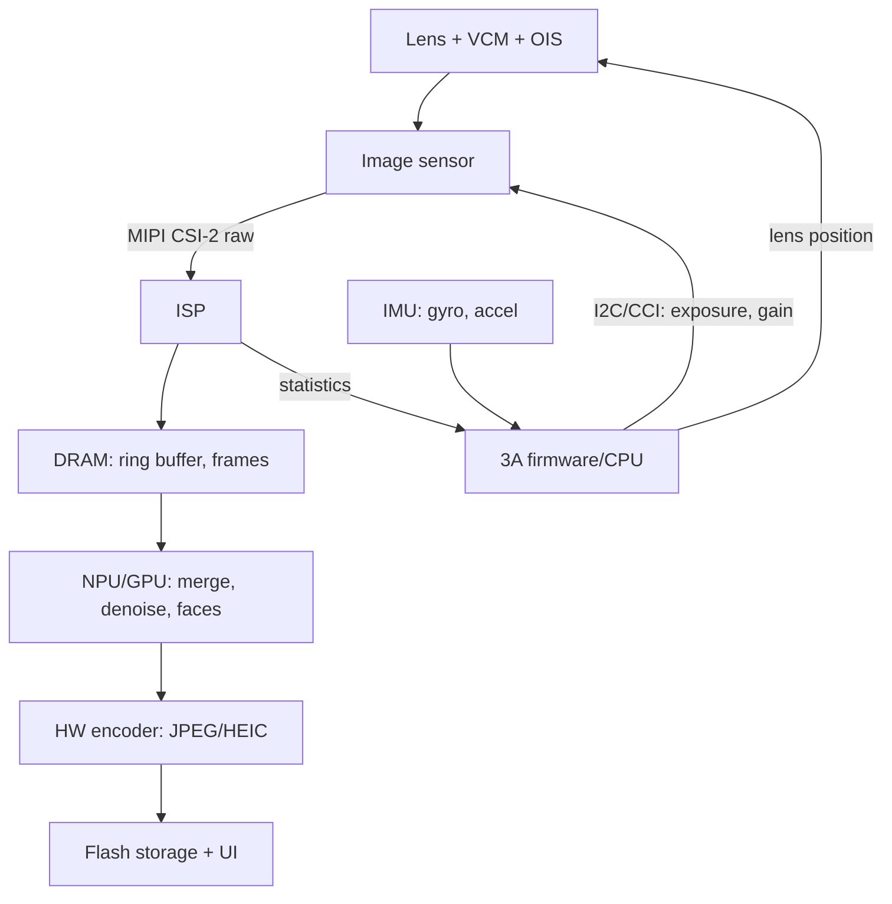
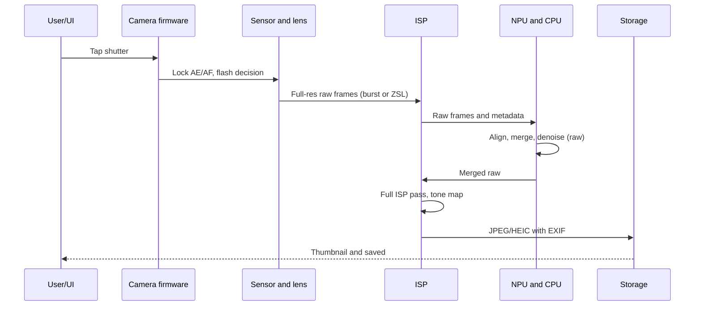

::: testing
Whether you can describe a **system-level timeline**, not just the sensor. The interviewer wants the "before" part (the always-running preview stream with auto exposure, autofocus and auto white balance, face detection, and a ring buffer of recent frames) as well as the "after" part (capture request, focus and flash decisions, multi-frame selection or merging, ISP reprocessing, encoding, storage). Strong candidates mention latency sources, zero shutter lag, data rates over MIPI, DRAM and SoC blocks, and the feedback between software and sensor registers.
:::

::: why
A phone camera is a small real-time system: sensor, lens actuator, flash, IMU, ISP, DSP/NPU, DRAM, storage and a UI, all coordinated at 30 frames per second. Hardware engineers have to size the link bandwidth, memory and power, and debug problems such as shutter lag, missed focus and thermal throttling. This question tests whether you can reason about the whole chain and where time and bandwidth go. See [[q0862]] for the ISP stages and [[q0858]] for the multi-frame capture used in low light.
:::

::: concepts
- **Preview stream**: the sensor runs continuously at a reduced resolution and frame rate so the screen shows a live image ([[q0856]]).
- **3A loop**: auto exposure, auto focus and auto white balance, computed from per-frame statistics and fed back into sensor and lens registers ([[q0862]]).
- **Zero shutter lag (ZSL)**: the camera keeps recent full-resolution frames in a ring buffer, so the picture comes from the moment you pressed the button, not after it.
- **Multi-frame computational photography**: burst capture and merging for HDR and night ([[q0858]]).
- **Sensor interface**: MIPI CSI-2 lanes carry raw frames to the SoC; DRAM stores them.
- **Gyro and IMU**: stabilization and motion-aware exposure planning ([[q0857]]).
:::

::: answer
"Before you press anything, the camera is already working hard. When you open the app, the sensor starts streaming at maybe 30 frames per second at reduced resolution, over MIPI to the SoC. Every frame goes through the ISP, which shows you the live preview and also produces statistics: a brightness histogram for auto exposure, focus measures or phase-detect data for autofocus, and color statistics for white balance. Firmware uses those to update the sensor's exposure and gain, move the lens, and set white balance for the next frame. Face detection runs on the NPU, and the phone keeps a ring buffer of recent full-resolution frames, which is how zero shutter lag works.

When you press the button, the phone locks focus and exposure if it hasn't already, decides on flash, and picks frames: either the best recent ones from the buffer or a fresh burst, depending on the mode and light level. In low light or HDR it merges several frames, in the raw domain, aligned with gyro help. The ISP then runs the full pipeline at full resolution: demosaic, white balance, color, tone mapping, denoise, sharpen. The result is encoded to JPEG or HEIC with metadata like EXIF and location, written to storage, and the thumbnail appears. The total time from tap to saved picture is typically a few hundred milliseconds to a couple of seconds, while the screen has to stay responsive."
:::

::: technical
**Before the press (preview loop, every frame).**
- The sensor streams a binned or cropped stream, e.g. 12 MP at 30 fps = 3.6 Gbit/s raw at 10 bit, or smaller for preview, over MIPI CSI-2 (a 4-lane D-PHY at 2.5 Gbit/s per lane carries 10 Gbit/s, so about 36 percent utilization). 50 MP at 30 fps would be 15 Gbit/s, which is why high-resolution sensors bin to 12.5 MP (3.75 Gbit/s) for preview.
- The ISP generates the preview and 3A statistics. Auto exposure adjusts exposure and gain with damping. Each update typically takes effect 2 frames later (pipeline latency), so with a damping factor of 0.5 per step an initial 2-stop error shrinks 2, 1, 0.5, 0.25 over successive updates: roughly 3 updates times 2 frames, about 200 ms at 30 fps.
- Autofocus: phase-detect pixels give signed defocus in one to a few frames; contrast AF sweeps the voice-coil motor, taking 20 frames (about 0.67 s) for a 20-step sweep. Hybrid AF uses PDAF to jump close then contrast to refine; a ToF/laser sensor assists in the dark.
- Auto white balance estimates the illuminant ([[q0860]]); face and scene detection (NPU) steer metering and focus.
- A **ZSL ring buffer** in DRAM holds the last N full-resolution raw frames; 8 frames of 15 MB each is 120 MB and covers 266 ms at 30 fps.

**At the press.**
1. UI event; camera service issues a capture request with the chosen mode.
2. Lock AF/AE (if not already), pre-flash metering if flash is needed.
3. Select frames: the sharpest ZSL frames, or a fresh burst with per-frame exposures from the gyro and scene-motion estimate ([[q0858]]).
4. Align and merge in raw; run the ISP at full resolution; run the neural networks (denoise, HDR, portrait segmentation).
5. Encode (JPEG/HEIC, hardware encoder), attach EXIF (exposure, ISO, GPS, orientation from the IMU), write to flash storage, update the gallery thumbnail.

**Latency budget** (illustrative): shutter-to-exposure start under 50 ms with ZSL, up to a second or more for a multi-frame night shot; processing continues in the background while the UI is responsive. Treat all of these as typical orders of magnitude; real numbers vary widely.
:::

::: short
"Before the press, the sensor streams continuously over MIPI, the ISP makes the preview and statistics, and firmware closes three loops: auto exposure, autofocus and white balance, while face detection runs and a ring buffer holds recent full-resolution frames for zero shutter lag. On the press, the phone locks focus and exposure, chooses or captures frames, merges them in raw if it's HDR or night, runs the full ISP, encodes to JPEG or HEIC with metadata, and saves it, while the UI stays responsive."
:::

::: long
"Let me start before the press, because that's where most of the work is. When the app opens, the sensor runs continuously, say 30 frames per second, over MIPI CSI-2 to the SoC. Each frame goes through the ISP, which produces the live preview and a set of statistics: a brightness histogram, white balance data, and focus information from phase-detect pixels or contrast. Firmware uses those statistics to update the sensor's exposure and gain, move the lens with the voice-coil motor, and set white balance gains. These are closed loops with a latency of about two frames each, so they converge over a few hundred milliseconds. In parallel, the NPU runs face and scene detection to steer metering and focus. And the phone keeps a ring buffer of the last few full-resolution raw frames in DRAM, maybe 8 frames of 15 megabytes, so when you press the button it can use a frame from just before the press. That's zero shutter lag.

When you press, the camera service issues a capture request. Focus and exposure are locked, and if a flash is needed there's a pre-flash to meter it. Depending on the light level, the phone either takes the best ZSL frame or captures a burst. In HDR or night mode it aligns and merges several raw frames, using gyro data, as I'd explain for night mode.

Then the full-resolution ISP runs: demosaic, white balance, color matrix, tone mapping, denoise, sharpen, with neural networks for some steps. The result is encoded to JPEG or HEIC by a hardware encoder, metadata like exposure, orientation and location is attached, and it's written to flash storage. The thumbnail appears while heavier processing may still finish in the background.

So, to summarize: always-on preview with three feedback loops, a ring buffer for zero lag, a capture that can involve multiple frames, a full ISP pass, and encode and storage."
:::

::: terms
- **Preview / viewfinder stream**: low-resolution, continuous frames used for display and 3A.
- **3A**: auto exposure (AE), auto focus (AF), auto white balance (AWB).
- **ZSL (zero shutter lag)**: capturing from a buffer of frames recorded before the button press.
- **PDAF**: phase-detect autofocus, which yields the direction and amount of defocus.
- **VCM**: voice-coil motor that moves the lens for autofocus.
- **MIPI CSI-2**: the serial interface from sensor to SoC (D-PHY or C-PHY lanes).
- **Ring buffer**: circular buffer storing the most recent frames.
- **Request/result pipeline**: the camera HAL model in which each capture request carries settings and returns metadata.
- **Pre-flash**: low-power flash pulse used to meter the scene for the main flash.
- **EXIF**: metadata embedded in the image file (exposure, ISO, time, orientation, GPS).
:::

::: exceptional
An average answer says "the sensor captures light and the phone processes it and saves a JPEG." An exceptional answer:

- Describes the **always-on preview and the 3A feedback loops**, with the latency of about two frames per update and the damping that stops oscillation.
- Explains **zero shutter lag** with the ring buffer, with the memory arithmetic (8 frames × 15 MB).
- Gives **data-rate numbers** for MIPI and DRAM (3.6 Gbit/s for 12 MP at 30 fps).
- Distinguishes **ZSL single frame**, **HDR bracketing** and **night burst** paths, and when each is chosen.
- Includes the IMU for stabilization and exposure planning, NPU for scene/face detection, hardware encoder and storage.
- Notes the user-facing constraints: responsiveness, power and thermal throttling.
:::

::: mistakes
- **"The sensor starts exposing when you press the button."** It has been running for seconds, and with ZSL the picture can come from before the press.
- **"Autofocus happens at the press."** Focus is tracked continuously; the press only locks it, perhaps with a quick refinement.
- **Treating preview and capture as the same frame size.** Preview is lower resolution (binned or cropped), capture is full resolution. The sensor may switch modes, which costs time unless it can stream both.
- **Ignoring feedback latency.** Exposure changes take effect a couple of frames after the register write; a controller with no damping oscillates.
- **Forgetting bandwidth and thermals.** Raw frames at full resolution plus neural-network processing stress MIPI, DRAM and the SoC; sustained burst work heats the device and triggers throttling.
- **Thinking JPEG is the capture format.** The pipeline works on raw, and the JPEG is the final product of the ISP after merging.
:::

::: deep
## The system, as blocks


Figure: Sensor to ISP to DRAM is the data path; the statistics, firmware and registers form the control path. The IMU provides motion data for exposure planning and stabilization ([[q0857]]).

## Before the button: the preview loop

Opening the camera app powers the sensor rail sequence (analog, digital, IO), starts the clock, programs thousands of register settings over I²C/CCI (a "mode table" for the chosen resolution and frame rate), and starts streaming. A typical streaming mode: the sensor bins a 50 MP array to 12.5 MP (the Bayer pattern is reconstructed from groups of pixels) at 30 fps: $12.5\times10^6\times10\times30 = 3.75$ Gbit/s over MIPI, which a 4-lane D-PHY at 2.5 Gbit/s per lane (10 Gbit/s total) handles at about 38 percent utilization. Full 50 MP at 30 fps would be 15 Gbit/s and need a faster PHY or more lanes, which is why high-res sensors capture full-res only for the still.

**Auto exposure as a control loop.** Let the metered brightness error in stops be $e_k$. The controller updates exposure by $-\alpha e_k$ (in log domain), but because the register write takes effect $d$ frames later, using a large $\alpha$ makes the loop oscillate: with $d = 2$ delay frames the loop is stable only for sufficiently small $\alpha$. With $\alpha = 0.5$, an initial 2-stop error follows 2.0, 1.0, 0.5, 0.25, 0.13, 0.06 stops. At 2 frames per update, 3 updates take 6 frames = 200 ms. That's the visible "brightness settling" when you point the phone from a dark room into a window.

```plot
{"title":"AE convergence after a 2-stop step (damping α = 0.5)","x":{"label":"Update number","unit":"","min":0,"max":6},"y":{"label":"Exposure error","unit":"stops","min":0,"max":2.1},
 "series":[{"label":"α = 0.5","fn":"2*pow(0.5,floor(x))","step":true}],
 "points":[{"x":3,"y":0.25,"label":"0.25 stop after 3 updates"}]}
```
Figure: Each update halves the remaining error. A tight loop converges in fewer frames but, with the 2-frame sensor delay, risks oscillation; real AE adds a convergence "dead band" so it doesn't hunt for small errors, and a faster path when the error is large (more than a stop).

**Autofocus.** PDAF uses pairs of masked or dual-photodiode pixels that see the scene through left and right halves of the lens. Their image shift gives a signed defocus, so the lens moves directly to focus in one to a few frames (33 to 100 ms). Contrast AF steps the lens and hill-climbs on a gradient-energy measure, 20 steps at 30 fps costing about 0.67 s, so hybrids use PDAF coarse then contrast fine. In low light PDAF's SNR fails ([[q0860]]), so a laser or time-of-flight ranger measuring distance in the dark takes over. Continuous AF tracks moving subjects through the preview.

**Auto white balance and scene detection.** The AWB statistics (average R, G, B per zone) estimate the illuminant ([[q0862]]). The NPU detects faces, eyes and scene type (portrait, night, food) at reduced frame rate and tells AE to meter on faces and AF to focus on them.

**The ring buffer.** Not every frame is kept at full resolution. A ZSL design keeps $N$ recent raw frames in DRAM. With 15 MB per frame (12 MP at 10 bit) and $N=8$, that's 120 MB, covering $8/30 = 267$ ms. When you tap, the camera can pick a frame from about 100 to 200 ms back (human reaction plus UI delay), choosing the sharpest one by a focus and motion metric. The cost is DRAM, power for continuous full-res capture, and the thermal budget, which is why some phones disable ZSL under heat.

## At the button: capture timeline


Figure: The user-visible shutter moment can be very short, but the real processing continues after the tap while the UI returns control.

**Flash.** For an LED flash, the phone runs a short pre-flash (or a sequence at two intensities) to measure how much of the scene's light the flash adds, sets the main flash current and exposure, and may use dual-tone LEDs to match the ambient color temperature. The LED driver is a current source with a boost converter, pulsed at 1 A or more for tens of milliseconds, which is why flash needs a supercap or a limit on battery voltage droop.

**Frame choice by mode.**

| Situation | What is captured | Reason |
|---|---|---|
| Bright, static | one ZSL frame, or 2 to 3 for HDR | enough signal; speed matters |
| High contrast | exposure bracket (short plus normal) | recover highlights, dynamic range |
| Low light | 6 to 15 raw frames | SNR via stacking ([[q0858]]) |
| Portrait | main frame plus depth/segmentation data | background blur needs a mask |
| Moving subject | short exposures, burst, pick best | freeze motion |

**Processing.** Merge and denoise in raw, then the ISP at full resolution ([[q0862]]). Neural processing happens on the NPU or GPU; the typical data flow is DRAM to engine to DRAM, so memory bandwidth, not compute, is often the limit. Finally the encoder (hardware JPEG/HEIC) writes the file, and the app attaches EXIF: exposure time, ISO, f-number, focal length, orientation from the accelerometer, time and optional GPS. Many phones also store depth maps or a Live Photo/motion clip from the ring buffer.

## Latency, power and thermal

- **Shutter lag** = the delay from press to the exposure that's recorded. With ZSL it's near zero or negative (uses the past); without it, it's the sum of the AF lock time, the sensor mode switch (if the sensor must leave the preview mode, tens to hundreds of ms), and exposure.
- **Shot-to-shot time** depends on the processing pipeline's throughput: if processing a night shot takes 1.5 s and you can queue another, the SoC has to pipeline captures.
- **Power:** keeping the sensor, ISP and NPU running in preview consumes on the order of a watt or more (vendor and mode dependent), which is why the camera app is one of the first things to heat a phone, and why sensors have low-power always-on modes for camera-based wake features.
- **Thermal throttling:** sustained processing raises temperature. The SoC lowers clocks, and the system may disable ZSL, reduce the frame count or lower the preview resolution. Dark current also rises with temperature ([[q0859]]).

> [!UNCERTAIN]
> Latencies, frame counts, buffer depths and power numbers differ widely across phones, sensors and software stacks, and the specific designs are proprietary. The numbers here are meant to show orders of magnitude and the structure of the system, not any specific product.

## Experiment with it

```sim
{"id":"sampling-aliasing","f":900,"fs":1000}
```
Figure: The preview stream samples the scene at a fixed frame rate. Try a signal frequency above half the sample rate and notice aliasing: the same thing makes flickering lights beat against the frame rate, which is why AE has anti-flicker modes ([[q0860]]).
:::

::: applications
- **Smartphone cameras**: ZSL, HDR, night mode and portrait mode all rely on this preview-plus-buffer architecture.
- **Mirrorless cameras and DSLRs**: electronic viewfinder preview with continuous AF and a pre-capture buffer in pro-burst modes.
- **Automotive and surveillance cameras**: always-on 3A loops and event-triggered clip recording with a pre-event ring buffer.
- **Drones and action cameras**: continuous preview over wireless, with stabilization driven by the IMU.
- **Video calls**: the same 3A loops (face-priority AE and AF) with a low-latency path rather than a still capture.
:::

::: assumptions
- I describe a **modern smartphone** with an ISP, NPU, DRAM and a software camera stack (for example the Android camera HAL request/result model, or the iOS equivalent). A simple point-and-shoot or a microcontroller camera module does fewer of these steps.
- Numbers (30 fps preview, 8-frame ring buffer, 4-lane D-PHY at 2.5 Gbit/s per lane, 2-frame sensor latency) are illustrative typical values; real products differ.
- Some phones do not capture raw frames in the ring buffer but keep processed YUV frames to save memory; the principle (pre-captured frames) is the same.
- Video recording runs a different pipeline (encoder in the loop, constant frame rate, no still capture) but shares the 3A and ISP front end.
- A valid alternative emphasis: a software engineer would describe the camera HAL and APIs; a hardware engineer emphasizes interfaces, DRAM bandwidth, power and thermal.
:::

::: followups
### What is zero shutter lag and what does it cost in hardware?
The phone continuously stores recent full-resolution frames in DRAM, so when you tap it chooses a frame from the moment of the press (or just before) rather than starting an exposure afterwards. It costs memory (8 frames of 15 MB is 120 MB), DRAM bandwidth (writing 3.6 Gbit/s continuously, about 450 MB/s), sensor and ISP power in full-res mode, and thermal headroom.

### Why does the exposure take a couple of frames to change after the AE decision?
The sensor's exposure register is double-buffered and latched at a frame boundary, and exposure is applied to the next frame to be exposed, while the statistics for the frame just read out are already a frame old. So the loop has a 2-frame delay, which forces damped control. Sensors with fast register updates and "skip" or "frame-sync" modes shorten it.

### How would you reduce shutter lag in a product that has no spare memory for a ring buffer?
Keep the sensor in a mode that can stream both the preview and a full-resolution still (a "dual-stream" or "staggered" mode), pre-lock AE and AF while the finger is on the button (half-press, or on touch-down), use PDAF rather than contrast AF, and avoid a mode switch by capturing the still from the preview mode if resolution allows. Also pre-warm the encoder and storage path.

### How much data does a night capture move, and where's the bottleneck?
Fifteen 12 MP frames at 10 bit is 225 MB written to DRAM, then read by the merge, again by the ISP, with intermediate buffers, so total traffic can be several times that, a few GB. At around 30 to 60 GB/s LPDDR bandwidth shared with other users, that is tens of milliseconds of raw bandwidth, so the real time is dominated by compute and neural networks and thermal limits, not MIPI.

### Scenario: users report that photos sometimes come out blurry on the first shot after opening the camera, but the second is fine. What do you suspect?
The 3A loops haven't converged: AE may still be adjusting (long exposure, blur), and AF has not locked, especially if the capture is triggered right after the sensor mode switch. Check the time from stream start to AE/AF convergence, whether the UI allows capture before convergence flags are set, and the OIS/gyro initialization. A fix is to gate the first capture on a converged flag, or bias the startup AE toward shorter exposures.
:::

::: interpretations
"Describe what happens when you press the button (and also before you press the button!)" means a timeline of the camera subsystem, which I interpret as covering the preview loop, 3A, ring buffer and capture. For the ISP stages themselves see [[q0862]], and for the burst merge behind night shots see [[q0858]].
:::

::: references
- Android Open Source Project documentation, "Camera" (camera HAL3 and request/result model): describes capture requests, 3A control and zero-shutter-lag concepts.
- MIPI Alliance specifications for CSI-2 and D-PHY (a member document; see the public specification overviews).
- Hasinoff et al., "Burst photography for high dynamic range and low-light imaging on mobile cameras," ACM SIGGRAPH Asia 2016: describes the viewfinder and burst capture pipeline.
- Nakamura (ed.), *Image Sensors and Signal Processing for Digital Still Cameras*: autofocus, AE and AWB algorithms.
:::

::: rubric
- Describes the always-on preview stream and that the sensor runs before the press :: The "before" part was explicitly asked in the question.
- Explains the 3A loops (AE, AF, AWB) with statistics from the ISP feeding back to sensor and lens :: These closed loops are the core of camera behavior.
- Mentions the ring buffer / zero shutter lag :: Explains why pictures come from the moment of the press.
- Describes what the press triggers: lock, flash decision, frame selection, multi-frame merge :: Shows the capture path and mode selection.
- Describes the ISP pass, encode and storage with metadata :: Completes the timeline to the saved file.
- Gives data-rate or latency numbers (MIPI Gbit/s, frame period, buffer MB) :: Quantifying shows hardware thinking.
- Mentions power, thermal and bandwidth constraints :: Real products are limited by these, not just algorithms.
:::

::: quiz
```json
[
 {"type":"mcq","level":"fundamental","q":"What is the purpose of the ring buffer in a zero-shutter-lag camera?","options":["To store the final JPEG","To hold recent full-resolution frames so a picture can come from the moment of the press","To cool the sensor","To increase the f-number"],"answer":1,"explain":"The sensor streams continuously; the ring buffer keeps the last few frames so that on a tap the phone can pick a frame from just before or at the press, avoiding the delay of starting a new exposure."},
 {"type":"truefalse","level":"fundamental","q":"The sensor only starts capturing when you press the shutter button.","answer":false,"explain":"The sensor streams continuously in preview, feeding the live view and the 3A statistics. The button only selects or triggers full-resolution capture."},
 {"type":"numeric","level":"intermediate","q":"A 12 MP sensor at 10 bits per pixel runs at 30 fps. What is the raw data rate in Gbit/s?","answer":3.6,"tolerance":0.02,"unit":"Gbit/s","explain":"$12\\times10^6\\times10\\times30 = 3.6\\times10^9$ bit/s."},
 {"type":"numeric","level":"intermediate","q":"A ZSL buffer holds 8 raw frames of 15 MB each at 30 fps. How many ms of history does it cover?","answer":267,"tolerance":0.02,"unit":"ms","explain":"8 frames × 33.3 ms = 267 ms. The memory used is 8 × 15 = 120 MB."},
 {"type":"numeric","level":"intermediate","q":"An AE controller halves the remaining error at every update and each update takes 2 frames at 30 fps. Starting with a 2-stop error, how long (ms) until the error is 0.25 stop?","answer":200,"tolerance":0.03,"unit":"ms","explain":"2 → 1 → 0.5 → 0.25 takes 3 updates; 3 × 2 frames = 6 frames = 6 × 33.3 ms = 200 ms."},
 {"type":"multi","level":"advanced","q":"Which of these increase when a phone keeps a zero-shutter-lag buffer of full-res frames running?","options":["DRAM usage","Sensor and ISP power","Thermal load","Lens focal length"],"answer":[0,1,2],"explain":"A ZSL buffer needs memory, keeps the sensor and ISP at full-res activity, and so adds heat. It doesn't change the lens."}
]
```
:::
