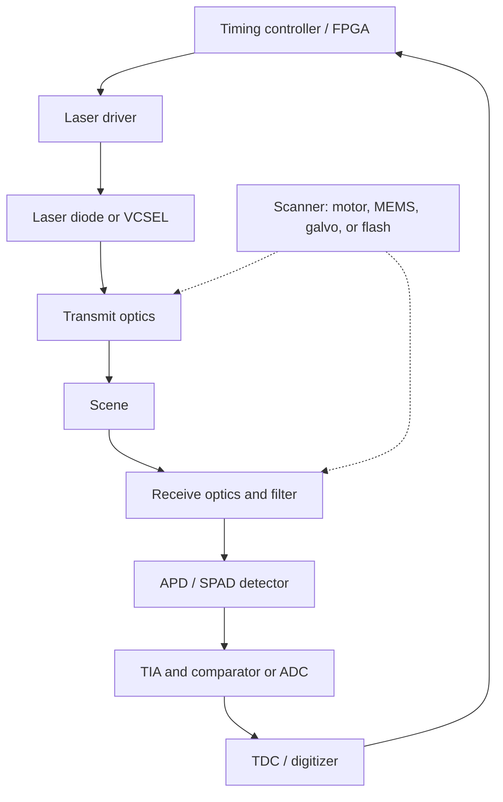

::: basics
### In plain words
LiDAR stands for Light Detection And Ranging. It is a sensor that fires short pulses of invisible infrared laser light and times how long each pulse takes to bounce off an object and return. Since the speed of light is known, that time gives the distance. Aim the laser in many directions and you get a 3D map of the surroundings.

### Picture it
Shout in a canyon and time the echo. Half the echo time multiplied by the speed of sound is the distance to the far wall. LiDAR does the same with light. Light is about a million times faster than sound, so the timing has to be far finer: a nanosecond, one billionth of a second, is already 0.3 m of light travel. The canyon picture also lacks something: LiDAR sends its own light, so it works in the dark.

### Words you need
- **Time of flight**: the time a pulse takes to go out and come back. Distance is the speed of light times that time, divided by two. See [[q0865]].
- **Pulse**: a very short burst of light, a few nanoseconds long.
- **Active sensor**: a sensor that sends out its own signal instead of using ambient light.
- **Scanning**: pointing the laser in many directions, by spinning, steering mirrors or flashing the whole scene.
- **Point cloud**: the output, a set of 3D points with a position for each. See [[q0869]].

### The simplest example
A pulse leaves the sensor and returns 200 ns later. Light covers about 0.3 m per nanosecond, so in 200 ns it travels 60 m. That is out and back, so the target is half of that: 30 m away. Repeat in many directions, and each return gives one point in space. Together they form a point cloud. That is the whole idea. The rest of this page covers the parts inside the box, how range is measured in different ways, how return power drops with distance, and how the beam is scanned.
:::

::: testing
Whether you can define LiDAR **precisely and briefly** (an active optical sensor that measures distance by timing light) and then show the structure behind the acronym: emitter, optics, detector, timing electronics, scanning. The interviewer is listening for the correct name (Light Detection And Ranging), the physical principle ($d = ct/2$), the distinction between pulsed time-of-flight and continuous-wave or FMCW ranging, typical wavelengths (905 nm and 1550 nm), and what comes out (a 3D point cloud). Bonus points for contrasting it with radar and cameras and for giving real numbers.
:::

::: why
LiDAR is a core sensor for autonomous vehicles, robots, drones, surveying and now phones and AR devices, and it is a good hardware-interview topic because it mixes optics, high-speed analog electronics (TIA, comparators, TDCs), lasers and eye safety, precision timing and system-level trade-offs. This is the opening question of the LiDAR block ([[q0865]] to [[q0870]]); a crisp definition here lets you go straight into how it works ([[q0865]]), where it is used ([[q0866]]) and how it compares with a camera ([[q0867]]).
:::

::: concepts
- **Speed of light and time of flight**: light travels $c = 299{,}792{,}458$ m/s, about 0.3 m per nanosecond; distance is half the round-trip time times $c$ ([[q0865]]).
- **Active sensing**: LiDAR supplies its own illumination, so it doesn't depend on ambient light the way a camera does ([[q0867]]).
- **Laser and photodetector**: a pulsed laser diode or VCSEL emits; an APD, SPAD or SiPM receives the weak return.
- **Scanning / field of view**: mirrors, rotation, MEMS or flash illumination steer beams over the scene ([[q0868]]).
- **Point cloud**: the output, a set of 3D points with intensity ([[q0869]]).
- **Eye safety and wavelength**: limits on pulse energy, and the choice of 905 nm versus 1550 nm.
:::

::: answer
"LiDAR stands for Light Detection And Ranging. It's an active sensor: it sends out laser light, usually near-infrared pulses, and measures how long it takes for the light to bounce off something and come back. Since light travels at about 30 centimeters per nanosecond, the distance is the speed of light times the round-trip time divided by two. A target 30 meters away gives a round trip of about 200 nanoseconds.

To get a picture of the world rather than a single distance, the system points the laser in many directions, with a spinning head, mirrors, MEMS, or by flashing the whole scene at once, and records a distance for each direction. The result is a point cloud: thousands to millions of points per second, each with an x, y, z position and usually an intensity.

The hardware is a laser diode and driver, transmit and receive optics, a sensitive detector like an avalanche photodiode or a single-photon array, a transimpedance amplifier, and fast timing electronics. Some LiDARs measure the phase of a modulated beam or a frequency-chirped beam rather than pulses. Compared to a camera, it gives direct, accurate 3D geometry day or night, but it has lower resolution, no color, and costs more. It's the sensor behind autonomous vehicles, robot mapping and surveying."
:::

::: technical
**Principle.** A source emits at $t = 0$, the detector sees the return at $t_r$, and range is $d = c\,t_r/2$ (in air, $c \approx 299{,}792{,}458/n$ with $n\approx1.0003$, which is negligible for most uses). A target at 30 m: $t_r = 200.1$ ns. Range resolution from timing resolution $\Delta t$: $\Delta d = c\Delta t/2$, so 1 ns gives 15 cm, 100 ps gives 1.5 cm, 10 ps gives 1.5 mm.

**Ranging methods.**
- **Pulsed direct time-of-flight (dToF):** nanosecond-scale pulses (peak power tens of watts for automotive 905 nm), a TDC or a fast ADC measures the delay. Dominant in automotive and mapping.
- **Amplitude-modulated continuous wave (AMCW / indirect ToF):** modulate the intensity at $f_m$ and measure phase $\varphi$: $d = \dfrac{c\varphi}{4\pi f_m}$, unambiguous up to $c/(2f_m)$ (7.5 m at 20 MHz). Used in short-range depth cameras.
- **FMCW:** chirp the optical frequency; mixing the return with a local copy gives a beat frequency $f_b = 2dB/(cT)$ for chirp bandwidth $B$ and period $T$; the Doppler shift gives velocity directly ($f_D = 2v/\lambda$, 38.7 MHz at 30 m/s and 1550 nm).

**Link budget (Lambertian target filling the beam).** $P_r = P_t\,\rho\,A_r\,\eta/(\pi R^2)$, so the return falls as $1/R^2$. With $P_t = 75$ W peak, $\rho = 0.1$, 25 mm receiver diameter and 50 percent optical efficiency (illustrative values), $P_r$ is 5.9 µW at 10 m and 58.6 nW at 100 m.

**Wavelengths.** 905 nm: cheap silicon detectors and laser diodes, but strict eye-safety limits and sunlight background. 1550 nm: absorbed in the eye's front, so more pulse energy is allowed, but needs InGaAs detectors (costly) and fiber-laser or similar sources. Some sensors use 850 or 940 nm VCSELs for short-range flash LiDAR.

**Output.** A 3D point cloud with per-point range, azimuth, elevation, intensity and timestamp; rates from about $10^5$ to $10^7$ points/s.
:::

::: short
"LiDAR is Light Detection And Ranging: an active sensor that fires laser pulses and times how long they take to come back. Distance is c times the round-trip time over two, so 200 nanoseconds is 30 meters. By steering the beam, with a spinning head, MEMS mirror or flash illumination, it builds a 3D point cloud of the scene. It gives accurate geometry in any lighting, but has lower resolution than a camera and no color."
:::

::: long
"LiDAR means Light Detection And Ranging. It's an active optical sensor: it emits laser light and measures distance from the time the reflection takes to return. Light moves about 30 centimeters per nanosecond, so distance equals the speed of light times the round-trip time, divided by two. A target at 30 meters returns after about 200 nanoseconds, and to resolve 15 centimeters you need roughly one nanosecond of timing precision.

The most common type, especially in automotive, is pulsed time-of-flight. A laser diode emits a few-nanosecond pulse of near-infrared light, usually 905 nanometers, sometimes 1550. A receiver lens focuses the faint return onto an avalanche photodiode or a single-photon detector array. A transimpedance amplifier boosts the current, and a comparator and time-to-digital converter, or a fast ADC, timestamp the arrival. There are also continuous-wave versions that measure the phase of a modulated beam, good for short range, and FMCW LiDARs that chirp the laser's frequency and get both range and velocity from the beat frequency.

A single beam gives one distance, so to see the scene the beam is scanned: a rotating head with a stack of lasers, a MEMS or galvo mirror, an optical phased array, or a flash that illuminates everything and uses a detector array. The output is a point cloud, a few hundred thousand to millions of points per second, each with x, y, z and intensity.

Compared with a camera, LiDAR measures geometry directly and works in the dark, but it has lower angular resolution, no color or texture, it's affected by fog and rain, and it costs more. That's why most robots and cars use both."
:::

::: terms
- **LiDAR**: Light Detection And Ranging, laser-based distance sensing.
- **Time of flight (ToF)**: distance from the round-trip time of light, $d = ct/2$.
- **dToF / iToF**: direct (pulse timing) versus indirect (phase of modulated light) time of flight.
- **FMCW**: frequency-modulated continuous wave; range and velocity from a beat frequency.
- **APD / SPAD / SiPM**: avalanche photodiode and single-photon avalanche diode (or array) detectors.
- **TDC**: time-to-digital converter with picosecond-scale resolution.
- **Point cloud**: the set of 3D points produced by the sensor.
- **Field of view (FoV)**: angular extent covered horizontally and vertically.
- **Pulse repetition frequency (PRF)**: pulses per second, which limits points per second and unambiguous range.
- **Eye safety (Class 1)**: emission levels that are harmless to the eye under IEC 60825-1.
:::

::: exceptional
An average answer says "a laser radar that measures distance." An exceptional answer:

- Defines it and gives $d = ct/2$ with a number (200 ns at 30 m, 15 cm per ns).
- Names the **family of ranging methods** (pulsed dToF, AMCW, FMCW) and when each is used.
- Lists the **signal chain** (laser driver, optics, APD/SPAD, TIA, TDC/ADC, processing) rather than just "laser and sensor".
- Mentions **1/R² link budget**, wavelength choice (905 vs 1550 nm) and eye safety.
- Explains scanning approaches and that the output is a **point cloud**.
- Compares briefly with camera and radar (strength: direct geometry; weakness: weather, cost, resolution, no color).
:::

::: mistakes
- **"LiDAR is just radar with light."** The principle (time of flight) is similar, but wavelength changes everything: much narrower beams and better angular resolution, but poorer weather penetration and no direct velocity for pulsed systems.
- **"The laser sweeps the scene with a continuous beam."** Most automotive units fire short pulses; the "line" you see in a visualization is many individual pulses.
- **Forgetting the factor of two.** Light goes out and back; $d = ct/2$. A common slip is to report 30 m for a 100 ns delay: 100 ns × 0.3 m/ns = 30 m is the round trip, so the range is 15 m.
- **Treating a point cloud as a photograph.** It's sparse, unordered, density falls with range, and it has no color ([[q0869]]).
- **Assuming the range accuracy equals the display resolution.** Accuracy comes from timing, calibration and target properties ([[q0870]]).
:::

::: deep
## A one-line definition, then the physics

LiDAR (Light Detection And Ranging) is **range measurement by timing light**. The simplest model has three ingredients: a source that marks a moment in time, a path of length $2d$, and a detector that marks the moment of return. Because $c$ is known exactly (299,792,458 m/s in vacuum), the only measurement is time:

$$d = \frac{c\,t}{2}$$

| Round trip time | Range |
|---|---|
| 6.67 ns | 1 m |
| 66.7 ns | 10 m |
| 200 ns | 30 m |
| 667 ns | 100 m |
| 1.33 µs | 200 m |

The numbers explain why LiDAR electronics are hard: a 5 cm range error is 333 ps of timing error. The timing chain (laser pulse edge, detector, amplifier, comparator, TDC) therefore has to be controlled to a few hundred picoseconds, including temperature drift, and the received pulse varies in amplitude by more than three decades between a bright nearby retroreflector and a dark distant object ([[q0870]]).

## What is in the box


Figure: The controller fires the laser and starts a clock. The return passes through a narrow band-pass filter (to reject sunlight), the detector and TIA, and stops the clock at the TDC. The scanner decides in which direction each pulse points.

**Laser and driver.** A pulsed edge-emitting laser diode driven by a GaN FET or similar can deliver tens of amperes in a few nanoseconds, giving peak optical power of tens of watts at a low duty cycle (average power is only milliwatts). The pulse width sets the spatial extent of a pulse: 5 ns is 0.75 m of range. VCSEL arrays are used for flash and some scanning LiDARs, with lower peak power per emitter but easier packaging.

**Receiver.** The return power at 100 m is tens of nanowatts (see below), so the detector needs gain. An APD offers gain of about 10 to 200, a SPAD array detects single photons and operates in Geiger mode, producing a digital event for each photon. A band-pass filter of 10 to 40 nm centered on the laser wavelength blocks most sunlight.

**Timing.** The simplest detector is a comparator that fires when the signal crosses a threshold, with a TDC (time-to-digital converter) of 10 to 100 ps resolution. Higher-end designs sample the full waveform with a high-speed ADC (1 GS/s or more) and process peaks digitally, which gives multiple returns and better accuracy through centroid or matched filtering ([[q0865]]).

## Why $1/R^2$ matters: the link budget

For a pulsed laser of peak power $P_t$ hitting a diffuse (Lambertian) target of reflectivity $\rho$ that fills the beam, the received peak power with receiver area $A_r$ and optical efficiency $\eta$ is

$$P_r = \frac{P_t\,\rho\,A_r\,\eta}{\pi R^2}$$

```plot
{"title":"Received peak power vs range (75 W pulse, 25 mm receiver, 50% optics)","x":{"label":"Range R","unit":"m","min":5,"max":300,"log":true},"y":{"label":"Received power","unit":"W","min":1e-9,"max":1e-4,"log":true},
 "vars":{"pt":75,"ar":"pi*0.0125^2","eta":0.5},
 "series":[{"label":"10% reflectivity","fn":"pt*0.1*ar*eta/(pi*x*x)"},{"label":"90% reflectivity","fn":"pt*0.9*ar*eta/(pi*x*x)","color":"green"}],
 "hlines":[{"at":1e-8,"label":"example detection floor, 10 nW","color":"red"}]}
```
Figure: The return falls by 100x for every 10x in range (a slope of −2 on the log-log plot), and a 90 percent target returns 9x more than a 10 percent target. For the same detection floor, a 90 percent target is seen $\sqrt{9} = 3$ times farther. This is why LiDAR spec sheets always quote range *at a stated reflectivity* (such as "200 m at 10 percent").

The numbers (peak power, receiver size, 10 nW floor) are illustrative. To double the range at a fixed floor you need 4x the laser power or detector area; since eye safety bounds the first, designers add receiver area, detector gain, or integrate over several pulses.

> [!UNCERTAIN]
> Real LiDAR specifications (peak power, pulse width, detector sensitivity) are product-specific and often not public. The values used here are order-of-magnitude illustrations for a 905 nm automotive-class design, not data for any product.

## Three ways to turn light into a distance

| Method | What is measured | Strength | Weakness |
|---|---|---|---|
| Pulsed dToF | pulse delay $t$ | long range, simple, robust to ambient | high peak power, fast electronics |
| AMCW / iToF | phase $\varphi$ of modulated light, $d=c\varphi/(4\pi f_m)$ | cheap CMOS pixels, dense depth images | range ambiguity $c/2f_m$, multipath, low range in sun |
| FMCW | beat frequency of a chirp, $f_b = 2dB/(cT)$ | velocity per point (Doppler), immunity to other lidars and sun | complex photonics, coherent detection |

**Worked FMCW example.** Chirp bandwidth $B = 1$ GHz over $T = 10$ µs and a target at 100 m: $f_b = 2\times100\times10^9/(2.998\times10^8\times10^{-5}) = 66.7$ MHz. The range resolution is $c/2B = 15$ cm, similar to a 1 ns pulsed system. A target moving at 30 m/s adds a Doppler shift of $2v/\lambda = 38.7$ MHz at 1550 nm, which is how FMCW reports velocity.

**iToF unambiguous range.** At $f_m = 20$ MHz, $c/(2f_m) = 7.5$ m. A target at 9 m wraps to 1.5 m, so these systems use two frequencies to extend range.

## Scanning and field of view

A single laser beam measures one direction, so building a scene requires steering ([[q0868]] has the details):

- **Mechanical spinning:** a stack of 16 to 128 lasers and detectors on a rotating head gives 360° horizontal coverage.
- **MEMS/galvo/polygon mirrors:** a 1D or 2D mirror steers a beam over a limited FoV (like 120° × 25°).
- **Optical phased array or other solid-state steering:** no moving parts, still emerging.
- **Flash:** a laser floods the scene and a detector array (SPADs or pixels) records the return from each direction at once, used for short-range and in phones.

## Output: the point cloud

Each pulse that returns yields a point: range $r$, azimuth, elevation, intensity and timestamp, converted to $(x,y,z)$. A 64-channel sensor spinning at 10 Hz with 0.2° azimuth steps produces $64\times10\times1800 = 1.15$ million points per second. [[q0869]] details what this product looks like and how to describe it.

## Experiment with it

```sim
{"id":"lidar-tof","d":30,"tres":1e-9,"prf":100e3}
```
Figure: Move the target distance and watch the round-trip time and the return pulse. Change the timing resolution from 1 ns to 100 ps and see the range resolution shrink from 15 cm to 1.5 cm. Increasing the pulse repetition frequency raises the point rate but reduces the maximum unambiguous range $c/(2\,\text{PRF})$.
:::

::: applications
- **Autonomous vehicles and ADAS**: roof-mounted or grille-integrated LiDAR for object detection and localization ([[q0866]]).
- **Mobile robots and warehouse AMRs**: 2D safety scanners and 3D LiDAR for navigation and obstacle avoidance.
- **Surveying and mapping**: airborne and terrestrial laser scanning for terrain, forests and buildings.
- **Smartphones and AR**: small dToF/flash depth sensors for autofocus, portrait mode and room scanning.
- **Wind and atmospheric sensing**: Doppler LiDAR for wind profiles, aerosol and cloud detection.
- **Space**: laser altimeters and rendezvous sensors.
:::

::: assumptions
- "LiDAR" is used in its broad sense: any laser-based ranging device. Narrower meanings (only spinning automotive units) are common in casual speech.
- The principle $d = ct/2$ assumes light travels in a straight line in air at $c$ (refractive index about 1.0003 ignored), and that the pulse's reflection is from a single surface.
- Link-budget numbers assume a Lambertian target filling the laser spot; small or specular targets, or partial beam fill, change the answer ([[q0870]]).
- Capitalization varies: LiDAR, lidar, LIDAR. All are accepted.
- Alternatives: some sources describe LiDAR as "Light Imaging, Detection And Ranging". Either way, the measurement is the same.
:::

::: followups
### Why do LiDARs use near-infrared light rather than visible?
Mostly eye safety, cost and background. Near-IR isn't visible so it doesn't annoy people, silicon and InGaAs detectors and compact laser diodes are available for 850 to 940 nm and 1550 nm, and the solar background is lower at some narrow absorption bands than the visible peak. The trade between 905 nm (cheap silicon, strict eye limits) and 1550 nm (higher allowed energy, costlier InGaAs) is a key design choice.

### What limits the maximum range of a pulsed LiDAR?
Two things. The link budget: received power falls as $1/R^2$ and must exceed a detection threshold above noise and sunlight, set by peak power (eye-safety limited), receiver area, detector sensitivity and target reflectivity. And the PRF: a pulse must return before the next one is sent to avoid ambiguity, so $R_{max} = c/(2\,\text{PRF})$, which is 1.5 km at 100 kHz, rarely binding in cars; but multi-beam systems can confuse echoes from different channels.

### What is the difference between LiDAR and radar?
Both measure time of flight, but radar uses microwaves (77 GHz for automotive, wavelength about 4 mm) while LiDAR uses light (905 nm). Shorter wavelength gives much narrower beams and finer angular resolution, so LiDAR can see object shape; radar is better in fog and rain, measures velocity directly by Doppler, and costs less. Many systems fuse both.

### How would you get 1 cm range precision from a pulsed LiDAR?
1 cm corresponds to $2\times0.01/c = 67$ ps of timing precision. Use a TDC with picosecond-level resolution, fast pulse edges, a low-jitter clock, compensate walk error (amplitude-dependent timing shift), and average multiple pulses or fit the waveform. Also calibrate temperature drift. Averaging $N$ independent measurements reduces random error by $\sqrt{N}$, but not systematic walk error.

### Scenario: your prototype LiDAR reads 3 m on a wall that is actually 2.5 m away, the same at all distances. What do you suspect?
A constant offset suggests a fixed timing or optical-path delay not calibrated out: cable or trace delay in the laser trigger and receiver paths, TDC start offset, or a firmware offset. A 0.5 m offset is a 3.3 ns round-trip delay. Calibrate by measuring a target at two known distances, so you can fit offset and scale (like the two-point calibration in [[q0871]]), and check whether the error scales with distance (clock error) or not (fixed delay).
:::

::: interpretations
"What is LiDAR?" is the opening definition question for the section. I give the concise definition and then the principle, hardware and output. The follow-on questions ask how it works ([[q0865]]), applications ([[q0866]]), comparison with a camera ([[q0867]]), 360° mapping ([[q0868]]), the sensor's output ([[q0869]]) and accuracy factors ([[q0870]]).
:::

::: references
- Shan and Toth (eds.), *Topographic Laser Ranging and Scanning: Principles and Processing*: LiDAR ranging principles and the laser range equation.
- Richmond and Cain, *Direct-Detection LADAR Systems* (SPIE Press): link budgets, detectors and timing for pulsed ranging.
- IEC 60825-1, "Safety of laser products": the standard behind eye-safety classes.
- Horowitz and Hill, *The Art of Electronics*, 3rd ed.: photodiode and transimpedance amplifier design (the receive chain).
:::

::: rubric
- Defines LiDAR (Light Detection And Ranging) as an active laser ranging sensor :: A clear definition is the question.
- Gives $d = ct/2$ with a numeric example (e.g. 200 ns for 30 m) :: Shows you understand the factor of two and the timescale.
- Names methods: pulsed dToF, AMCW, FMCW :: Shows breadth beyond the automotive spinning LiDAR.
- Lists hardware blocks: laser and driver, optics, detector (APD/SPAD), TIA, TDC, scanner :: Hardware roles expect the signal chain.
- Mentions wavelength choice (905 vs 1550 nm) and eye safety :: These are the main design constraints.
- Describes the output as a 3D point cloud with intensity :: Connects the sensor to downstream use.
- Contrasts briefly with camera or radar :: Shows system-level understanding.
:::

::: quiz
```json
[
 {"type":"numeric","level":"fundamental","q":"A pulse returns after 400 ns. How far away is the target?","answer":60,"tolerance":0.01,"unit":"m","explain":"$d = ct/2 = 3\\times10^8 \\times 400\\times10^{-9}/2 = 60$ m. The factor of two accounts for the out-and-back path."},
 {"type":"mcq","level":"fundamental","q":"LiDAR is classified as which kind of sensor?","options":["Passive, uses ambient light","Active, emits its own light and measures the return","Magnetic","Inertial"],"answer":1,"explain":"LiDAR emits laser light and times or phase-measures the reflection, so it is active and independent of ambient illumination (although sunlight is a noise source)."},
 {"type":"numeric","level":"intermediate","q":"What timing resolution is needed to resolve 1.5 cm in range?","answer":100,"tolerance":0.02,"unit":"ps","explain":"$\\Delta t = 2\\Delta d/c = 2\\times0.015/3\\times10^8 = 100$ ps."},
 {"type":"numeric","level":"intermediate","q":"An iToF camera modulates at 20 MHz. What is its unambiguous range?","answer":7.5,"tolerance":0.01,"unit":"m","explain":"$R_{unamb} = c/(2f_m) = 3\\times10^8/(2\\times20\\times10^6) = 7.5$ m."},
 {"type":"mcq","level":"intermediate","q":"A 10 percent reflectivity target at 100 m returns a certain power. About how far away could a 90 percent target be placed to return the same power?","options":["150 m","200 m","300 m","900 m"],"answer":2,"explain":"Received power $\\propto\\rho/R^2$. A 9x higher reflectivity allows $R$ to increase by $\\sqrt9 = 3$, so 300 m."},
 {"type":"truefalse","level":"advanced","q":"Doubling the maximum range of a pulsed LiDAR (same target, same detector) requires about four times the transmitted peak power or receiver area.","answer":true,"explain":"Since $P_r\\propto P_tA_r/R^2$, doubling $R$ reduces the return by 4x, which must be compensated by 4x $P_t$ or $A_r$ (or better detector sensitivity). Eye safety limits $P_t$, which pushes designers to larger apertures and better detectors."}
]
```
:::
