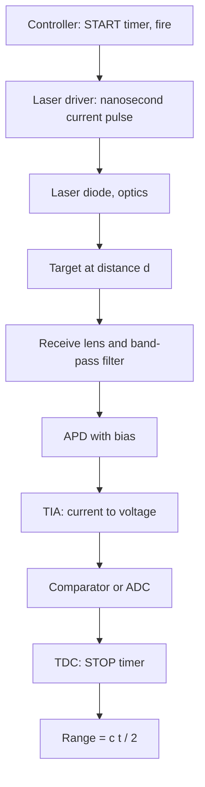

::: testing
Whether you can walk through the **measurement chain end to end**: trigger, laser pulse, flight, reflection, collection, detection, timestamp, conversion to range and direction. "How does it work?" is open, so the interviewer wants a structured explanation with the key equation and the hardware that makes it real: transimpedance amplifier, comparator or ADC, TDC, timing jitter and walk. Strong candidates quantify (200 ns for 30 m, 100 ps for 1.5 cm), explain what limits range and precision, and show awareness of noise and thresholds, not just the ideal picture.
:::

::: why
LiDAR looks like a simple stopwatch, but the stopwatch has to resolve picoseconds on signals that are nanowatts in power and vary in amplitude by a factor of a thousand. For a hardware engineer the interesting work is in the receive chain (APD, TIA, comparator, TDC), the laser driver, timing calibration and the trade-offs between range, precision, power and eye safety. This answer builds directly on the definition in [[q0864]], and it sets up the accuracy factors in [[q0870]] and the scanning in [[q0868]].
:::

::: concepts
- **Time of flight**: $d = ct/2$; 0.15 m per nanosecond of measured time ([[q0864]]).
- **Link budget**: the return is only nanowatts at 100 m, falling as $1/R^2$.
- **Photodetection**: an APD or SPAD converts photons into current or digital events ([[q0851]]).
- **Transimpedance amplifier (TIA)**: converts photocurrent to voltage with bandwidth set by the feedback network ([[q0001]]).
- **Timing discrimination**: a threshold comparator and TDC, or a fast ADC with digital peak finding.
- **Noise and jitter**: timing precision is rise time divided by SNR.
- **Scanning and angle encoding**: each range is paired with a direction ([[q0868]]).
:::

::: answer
"Think of it as a very fast stopwatch with a laser. A controller fires a laser diode with a short pulse, a few nanoseconds long, and at the same moment starts a timer. The light travels to the target, scatters off it, and a small fraction comes back through the receive lens onto a detector, usually an avalanche photodiode. That detector produces a tiny current, maybe a microamp at 100 meters, which a transimpedance amplifier turns into a voltage. A comparator, or a fast ADC, detects when the pulse arrives and a time-to-digital converter stops the timer.

The range is the speed of light times the time difference, divided by two, because the light went out and back. 200 nanoseconds is 30 meters, and every nanosecond is 15 centimeters. The controller also knows which direction the laser was pointing, from the scanner's angle, so each measurement becomes an x, y, z point.

The hard part is precision: to get a centimeter you need around 70 picoseconds of timing accuracy, and the return amplitude varies by a thousand, so a fixed threshold makes bright targets look closer than dim ones, called walk error. Designers fix that with constant-fraction discrimination or by digitizing the waveform. Range is limited by the laser power, which is capped by eye safety, the receiver's sensitivity, and sunlight noise."
:::

::: technical
**Sequence per pulse.**
1. **Trigger:** controller asserts START and the laser driver discharges a capacitor through a GaN FET into the laser diode. Pulse width $\tau_p$ of 2 to 10 ns; peak current tens of amps.
2. **Flight:** light travels $2d$; round trip $t = 2d/c$.
3. **Collection:** receive optics (aperture area $A_r$) collect a fraction $P_r = P_t\rho A_r\eta/(\pi R^2)$ of the beam on a Lambertian target. With illustrative numbers (75 W, $\rho$ = 0.1, 25 mm aperture, 50 percent optics) $P_r$ = 58.6 nW at 100 m.
4. **Detection:** APD responsivity about 0.5 A/W at 905 nm with gain $M\approx50$ gives $I = 0.5\times50\times58.6$ nW = 1.47 µA.
5. **TIA:** $V = I R_f$; with $R_f = 10$ kΩ, 14.7 mV. Bandwidth needed for a 2 ns rise: $0.35/t_r = 175$ MHz. Noise: Johnson noise current of $R_f$ is $\sqrt{4kT/R_f} = 1.29$ pA/√Hz, giving 17 nA rms over 175 MHz, so SNR = 1.47 µA/17 nA = 86.
6. **Timing:** a comparator fires at a threshold crossing, TDC records $t_{stop} - t_{start}$ with 10 to 100 ps LSB. Alternatively an ADC at ≥1 GS/s digitizes the waveform and firmware finds the peak or center of mass.
7. **Conversion:** $d = c\,t/2$, plus calibration for fixed delays. Combine with the beam angles $(\theta,\phi)$ from the scanner to give $(x,y,z)$.

**Precision.** Noise-limited timing jitter on a linear edge is $\sigma_t \approx t_r/\text{SNR}$: with $t_r$ = 2 ns, SNR 20 gives 100 ps (1.5 cm), SNR 100 gives 20 ps (3 mm). **Walk:** with a fixed 5 mV threshold, a 14.6 mV return crosses 0.86 ns after the start of the edge, but a 1.46 V return crosses at 0.009 ns, so strong returns look 0.85 ns, or 12.7 cm, closer. Fix with constant-fraction discrimination, amplitude-based calibration, or waveform processing.

**Max range** is the smaller of the link-budget limit (SNR drops below the detection threshold) and the PRF limit $c/(2\,\text{PRF})$ (1.5 km at 100 kHz).
:::

::: short
"A controller fires a few-nanosecond laser pulse and starts a timer. The light scatters off the target and a faint return hits an avalanche photodiode. A transimpedance amplifier boosts it, a comparator or ADC detects the pulse, and a time-to-digital converter stops the timer. Range is c times the time over two: 15 centimeters per nanosecond. Pair that with the scanner's angle and you get an x, y, z point. Precision comes from low-jitter timing, and amplitude-dependent walk error has to be calibrated or removed."
:::

::: long
"I'll follow one pulse. First, the controller sends a trigger. That starts a high-resolution timer and fires the laser driver, which dumps a pulse of current, tens of amps for a few nanoseconds, through a laser diode. We get a short pulse of near-infrared light, maybe 75 watts peak but only milliwatts average.

The pulse travels to the target, scatters off it, and a tiny fraction comes back. The receive lens collects it onto an avalanche photodiode, with a narrow optical filter to reject sunlight. The received power falls as one over range squared, and for a dark target at 100 meters that's tens of nanowatts. With responsivity half an amp per watt and APD gain of 50, you get roughly a microamp.

The transimpedance amplifier converts that to a voltage. With a 10 kilohm feedback resistor that's about 15 millivolts. The bandwidth needs to be about 175 megahertz so the nanosecond edge isn't smeared, and the noise is mostly the feedback resistor and the APD. A comparator fires when the signal crosses a threshold, and a time-to-digital converter with tens of picoseconds resolution stops the clock. In more advanced designs a high-speed ADC captures the whole waveform instead, which also lets you detect multiple returns, like leaves in front of a wall.

Then it's arithmetic: range is c times the time over two, 15 centimeters per nanosecond. The scanner supplies the beam angles, so we convert to x, y, z.

The engineering challenge is accuracy. A 1 centimeter error is only 67 picoseconds. Jitter scales as rise time over SNR, and a fixed threshold makes strong returns look closer than weak ones, walk error, so you correct with constant-fraction timing or waveform fitting. And range is limited by laser power, set by eye safety, and by sunlight background."
:::

::: terms
- **Start/stop timing**: the timer starts at laser trigger and stops at detection of the return.
- **TIA**: transimpedance amplifier converting photocurrent to voltage, $V = -IR_f$.
- **APD gain (M)**: internal multiplication of photocurrent in avalanche photodiodes, typically 10 to 200.
- **TDC**: time-to-digital converter that measures an interval with ps-scale resolution.
- **Walk error**: amplitude-dependent shift of the threshold crossing time.
- **Constant-fraction discrimination (CFD)**: trigger at a fixed fraction of the pulse peak to remove walk.
- **Jitter**: random variation in measured time, $\sigma_t \approx t_r/\text{SNR}$.
- **Waveform digitization**: sampling the entire return pulse for peak/centroid/multi-return processing.
- **Unambiguous range**: $c/(2\cdot\text{PRF})$.
- **Multiple returns**: several echoes from one pulse (foliage, glass, rain).
:::

::: exceptional
An average answer says "send a laser, time the return." An exceptional answer:

- Walks the **chain** with numbers (power at 100 m, photocurrent, TIA voltage, bandwidth, SNR).
- Derives the precision as **rise time over SNR** and gives picosecond-to-centimeter conversions.
- Explains **walk error** and how to fix it (CFD, calibration, waveform).
- Mentions **sunlight rejection** (band-pass filter, narrow field of view per pixel, coincidence for SPADs), eye safety and PRF limits.
- Distinguishes **threshold + TDC** from **full waveform digitization**, and when multiple returns matter.
- Adds the **angle** information from the scanner so each range becomes a 3D point.
:::

::: mistakes
- **Forgetting that the receive amplifier needs bandwidth.** A TIA with 20 MHz bandwidth stretches a 2 ns edge to about 17 ns rise time, wrecking precision (jitter scales with rise time).
- **Ignoring amplitude dependence.** A fixed-threshold comparator has walk error; the same object at two reflectivities appears at different distances.
- **Using the mean power as the pulse power.** A 75 W peak, 5 ns pulse at 100 kHz is 37.5 mW average; link budget uses the peak, eye safety uses both energy per pulse and average.
- **Believing more APD gain is always better.** Gain also multiplies shot noise (excess noise factor), and the avalanche gain is temperature-dependent, so bias must be compensated.
- **Treating time and distance units casually.** 1 ns of timing is 15 cm of range (not 30 cm). Use $d = ct/2$ each time.
- **Forgetting multi-return and blooming.** One pulse can produce several echoes, and a retroreflector can saturate the receiver and hide nearby objects ([[q0870]]).
:::

::: deep
## The measurement chain, block by block


Figure: The electrical path is controller to driver on the transmit side, and APD to TIA to comparator or ADC to TDC on the receive side. Everything from START to STOP has to be stable to tens of picoseconds, including temperature drift of delays in drivers, cables and comparators.

## The transmit side

The laser driver stores energy in a small capacitor and discharges it through the laser diode via a fast switch (GaN FET). The peak current is set by the capacitor voltage and the loop inductance: $di/dt \approx V/L$. A 40 A pulse reaching peak in 2 ns needs $V/L = 2\times10^{10}$ A/s, so with 20 V on the cap you can afford only 1 nH of loop inductance; this is why drivers are placed millimeters from the laser, with a careful layout ([[q0870]] mentions the timing consequences of that layout). The laser's optical peak power is roughly the slope efficiency (about 1 W/A for 905 nm diodes, vendor-dependent) times the drive current above threshold, so tens of amps give tens of watts.

**Eye safety and duty cycle.** The emission is characterized per IEC 60825-1 by pulse energy and average power at the aperture. A 75 W, 5 ns pulse is 375 nJ; at 100 kHz that's 37.5 mW average. The numbers must satisfy the Class 1 limits for the actual beam size at the exit window, which are not simply peak-power limits, so detailed compliance is a laser-safety exercise.

> [!UNCERTAIN]
> The peak power, pulse width and PRF here are illustrative and not tied to a specific product. Whether a given combination is Class 1 depends on wavelength, aperture, beam divergence and pulse train; always check the standard.

## The receive side

The detector sees a pulse of optical power $P_r(t)$. For an APD with responsivity $\mathcal{R}$ and gain $M$ the current is $i(t) = \mathcal{R}MP_r(t)$.

```circuit
{"elements":[
 {"t":"rail","at":[4,1],"label":"V_{bias} (APD)","dir":"up"},
 {"t":"wire","pts":[[4,1],[4,3]]},
 {"t":"photodiode","a":[4,7],"b":[4,3],"label":"APD"},
 {"t":"wire","pts":[[4,7],[10,7]]},
 {"t":"dot","at":[7,7]},
 {"t":"wire","pts":[[7,7],[7,4]]},
 {"t":"dot","at":[7,4]},
 {"t":"R","a":[7,4],"b":[13,4],"label":"R_f","value":"10 kΩ","labelSide":"other"},
 {"t":"wire","pts":[[7,4],[7,1]]},
 {"t":"C","a":[7,1],"b":[13,1],"label":"C_f","value":"0.2 pF"},
 {"t":"wire","pts":[[13,4],[13,1]]},
 {"t":"opamp","at":[10,8]},
 {"t":"wire","pts":[[13,4],[16,4],[16,8]]},
 {"t":"dot","at":[16,8]},
 {"t":"wire","pts":[[14,8],[20,8]]},
 {"t":"wire","pts":[[10,9],[8,9],[8,10]]},{"t":"gnd","at":[8,10]},
 {"t":"box","at":[20,6],"w":6,"h":4,"label":"Comparator\nTDC","pins":[{"side":"left","pos":2,"name":"IN"}]},
 {"t":"arrow","a":[1,4.2],"b":[3.3,5.6]},{"t":"text","at":[0,3.6],"text":"photons","anchor":"start"},
 {"t":"text","at":[17,5.2],"text":"V_{out} = −I_{pd}R_f","anchor":"start"}
]}
```
Figure: A TIA receiver. Photocurrent flows from the reverse-biased APD into the virtual ground at the inverting input, so $V_{out} = -I_{pd}R_f$. $R_f$ sets the gain, and $C_f$ (with the input capacitance) sets stability and bandwidth. The comparator and TDC block takes the output.

**Bandwidth versus noise.** The TIA needs enough bandwidth that a 2 ns edge is not slowed: $BW \approx 0.35/t_r = 175$ MHz. For feedback resistor $R_f$ and total input capacitance $C_{in}$ (APD plus op-amp, say 2 pF), a single-pole op-amp with gain-bandwidth $GBW$ gives a closed-loop bandwidth of about $\sqrt{GBW/(2\pi R_f C_{in})}$. To get 175 MHz with $R_f = 10$ kΩ and $C_{in} = 2$ pF requires $GBW = BW^2\cdot2\pi R_fC_{in} = 3.85$ GHz. This is why LiDAR TIAs are custom ICs or discrete high-speed amplifiers (SiGe or CMOS), not general-purpose op-amps.

**Signal and noise numbers (100 m, 10 percent target, illustrative).**

| Quantity | Value |
|---|---|
| Received peak power | 58.6 nW |
| APD current ($\mathcal{R}$ = 0.5 A/W, $M$ = 50) | 1.47 µA |
| TIA output ($R_f$ = 10 kΩ) | 14.7 mV |
| $R_f$ Johnson noise density | 1.29 pA/√Hz |
| Integrated noise (175 MHz) | 17 nA rms |
| SNR | 86 (38.7 dB) |

At 200 m the same target gives 14.6 nW, 0.37 µA, 3.7 mV and SNR 21, close to the usable limit once APD excess noise and sun background are added. The detection floor of 10 nW used in [[q0864]] corresponds to an SNR near 15.

**Sunlight.** The solar background through a 25 nm filter produces a continuous photocurrent and shot noise. For a narrow 0.1° pixel field of view it is of the order of a nanowatt at the detector (order-of-magnitude estimate, strongly dependent on conditions), i.e. a count rate of hundreds of Mcps for an SPAD, which is why SPAD LiDARs use coincidence detection in a time window.

## Timing: threshold, jitter and walk

For a linear edge, noise $\sigma_v$ on the voltage turns into timing error $\sigma_t = \sigma_v/(dV/dt) = t_r/\text{SNR}$ (with $t_r$ the 10–90 percent rise time and SNR as peak signal over noise, approximately). The table converts to range error $\sigma_d = c\sigma_t/2$:

| $t_r$ | SNR | $\sigma_t$ | $\sigma_d$ |
|---|---|---|---|
| 2 ns | 10 | 200 ps | 3.0 cm |
| 2 ns | 20 | 100 ps | 1.5 cm |
| 2 ns | 100 | 20 ps | 3 mm |

Averaging $N$ independent pulses improves jitter by $\sqrt{N}$ (16 pulses: SNR-20 jitter from 100 ps to 25 ps), at the cost of point rate.

**Walk.** With a fixed threshold $V_{th}$ and a linear edge, crossing time is $t_c = V_{th}/\text{slope} = V_{th}t_r/(0.8A)$. For $V_{th} = 5$ mV and $t_r = 2$ ns, a 14.6 mV pulse crosses at 0.86 ns and a 1.46 V pulse at 0.009 ns, a difference of 0.85 ns, 12.7 cm. Remedies: **constant-fraction discrimination** (compare with a delayed and attenuated copy so the trigger point is at a fixed fraction of the peak), **amplitude-based walk calibration** (store a correction table versus pulse amplitude or width), or **waveform digitization** with centroid or matched-filter peak location.

## Waveform processing and multiple returns

An ADC at 1 to 2 GS/s gives 15 to 7.5 cm per sample; a peak finder with interpolation refines to a few centimeters. The advantage is multiple returns: a pulse through foliage, a window or rain gives several peaks, each of which can be reported as a separate point. Airborne LiDAR for forestry uses the last return for the ground and the first for the canopy ([[q0866]]).

## Putting angle on the range

The scanner reports the beam direction at the instant of firing: azimuth $\phi$ (encoder or MEMS mirror feedback) and elevation $\theta$ (fixed per laser in a spinning head). Then $x = r\cos\theta\cos\phi$, $y = r\cos\theta\sin\phi$, $z = r\sin\theta$ ([[q0868]]). Angle error also becomes position error: 0.1° at 100 m is 17.5 cm.

## Experiment with it

```sim
{"id":"lidar-tof","d":60,"tres":1e-9,"prf":100e3}
```
Figure: Increase the distance and watch the return pulse arrive later and weaken. Set the timing resolution to 100 ps and then to 5 ns to see the range resolution change from 1.5 cm to 75 cm. Raise the PRF until the unambiguous range falls below the target distance to see aliasing of the range.
:::

::: applications
- **Automotive pulsed dToF LiDAR**: APD or SPAD receivers with TDC or ADC timing, 100 to 250 m range.
- **Smartphone and AR depth sensors**: VCSEL emitters with SPAD arrays and on-chip TDCs for dToF depth.
- **Airborne laser scanning**: 100 to 1000 kHz PRF with full-waveform digitization for forests and terrain.
- **Robot vacuum and AMR 2D scanners**: low-cost triangulation or short-range ToF with simple comparator timing.
- **Laser rangefinders and surveying tools**: handheld pulsed or phase-based distance meters.
:::

::: assumptions
- I describe a **pulsed direct-ToF LiDAR with an APD receiver**; SPAD, AMCW and FMCW systems share the geometry but have different receivers (and the equations for noise and timing change).
- Link-budget and noise numbers are illustrative for a 905 nm automotive-class design; actual APD responsivity, gain, excess noise and TIA noise vary by part.
- The jitter formula $t_r/\text{SNR}$ assumes a linear leading edge and white noise; real systems add TDC quantization, clock jitter and laser pulse-shape jitter.
- Target is Lambertian and fills the beam; specular surfaces, edges and sub-beam targets change the return ([[q0870]]).
- Angles and range are assumed independent; for a moving platform, motion during the scan must be compensated ([[q0868]]).
:::

::: followups
### Why do you need so much bandwidth in the TIA?
The timing information is in the pulse edge. If the TIA's bandwidth is lower than $0.35/t_r$, it slows the edge, so for a given noise the slope is smaller and jitter ($\sigma_v/\text{slope}$) is larger. A 20 MHz amplifier turns a 2 ns edge into about 17 ns and multiplies the jitter by about 8. The trade-off is that wider bandwidth means more integrated noise ($\propto\sqrt{BW}$).

### Why not just use a very sensitive detector like a SPAD everywhere?
SPADs detect single photons so are great for long range and low power, but they saturate in sunlight (each photon triggers a dead time of tens of nanoseconds), so they need narrow filters, small pixels and coincidence logic, and they have limited dynamic range for bright retroreflectors. APDs with TIAs handle high-amplitude returns and linear waveforms better. The choice depends on range, ambient light and cost.

### How do you calibrate fixed delays in the timing chain?
Place targets at two or more known distances (or use an internal optical reference path of known length), measure range, and fit $d_{meas} = d_{true}(1+\epsilon) + d_0$. The offset $d_0$ is the fixed delay of driver, laser, cables and receiver; $\epsilon$ is clock or scale error. Do it over temperature and for different amplitudes to calibrate walk. Many LiDARs include an internal reference return every frame to track drift.

### How do you get more than one return from a single pulse?
Capture the waveform with a fast ADC (or time-gated SPAD histograms) and find multiple peaks, each above threshold and separated by at least a pulse width (5 ns pulse is 0.75 m). Transparent or thin objects (glass, foliage, rain) return partial energy, and the rest continues to the next surface. Reporting first and last returns is common in mapping.

### Scenario: a bright retroreflective sign at 50 m makes points near it appear at the wrong distance, and nearby objects disappear. What is happening?
The huge return saturates the TIA and APD, stretching the pulse (long recovery time), so the comparator crosses early and stays high (walk and blooming), and the receiver is blind for the recovery time, hiding weak returns at nearby ranges. Remedies: limit the TIA with a clamp or logarithmic stage, use dynamic range extension (reduce APD gain by bias control or use two-gain channels), apply walk correction using pulse width, and post-process saturated returns. See [[q0870]].
:::

::: interpretations
"How does it work?" refers back to LiDAR in the previous question ([[q0864]]). I answer for the dominant implementation (pulsed time-of-flight with an APD receiver) and note the continuous-wave and FMCW variants for completeness.
:::

::: references
- Richmond and Cain, *Direct-Detection LADAR Systems* (SPIE Press): link budget, detection statistics and timing.
- Horowitz and Hill, *The Art of Electronics*, 3rd ed.: photodiode amplifiers, transimpedance design and noise.
- Graeme, *Photodiode Amplifiers: Op Amp Solutions*: TIA stability, bandwidth and noise.
- Shan and Toth (eds.), *Topographic Laser Ranging and Scanning*: range equation, waveform processing.
:::

::: rubric
- States the timing principle with $d = ct/2$ and a numeric example :: This is the core idea; the factor of two is the usual trap.
- Walks the signal chain: laser driver, optics, APD, TIA, comparator/ADC, TDC :: A hardware question expects the physical blocks.
- Pairs range with scanner angles to produce 3D points :: Range alone isn't a map.
- Explains what sets precision (timing jitter, rise time over SNR) with a conversion to cm :: Shows you can connect electronics to the measurement.
- Explains walk error and a fix (CFD, calibration, waveform) :: A well-known practical pitfall with amplitude variation.
- Mentions link-budget limits: $1/R^2$, laser power capped by eye safety, sunlight noise :: These define the range limits.
- Mentions multiple returns or waveform digitization :: Shows awareness of real scenes beyond single surfaces.
:::

::: quiz
```json
[
 {"type":"numeric","level":"fundamental","q":"A LiDAR's timer reads 133 ns between START and STOP. What is the range?","answer":19.9,"tolerance":0.02,"unit":"m","explain":"$d = ct/2 = 2.998\\times10^8\\times133\\times10^{-9}/2 = 19.94$ m."},
 {"type":"mcq","level":"fundamental","q":"Why is the timer's START tied to the laser trigger?","options":["To measure the laser's wavelength","So the elapsed time to the return equals the round-trip flight time","To increase the pulse power","To cool the laser"],"answer":1,"explain":"The delay between emission and detection is the round-trip time; the START marks emission so STOP − START = $2d/c$ (plus calibrated fixed delays)."},
 {"type":"numeric","level":"intermediate","q":"A TIA has a 2 ns edge and a noise that gives an SNR of 40. What range jitter does that imply?","answer":0.75,"tolerance":0.03,"unit":"cm","explain":"$\\sigma_t = t_r/\\text{SNR} = 2\\text{ ns}/40 = 50$ ps, so $\\sigma_d = c\\sigma_t/2 = 3\\times10^8\\times50\\times10^{-12}/2 = 0.75$ cm."},
 {"type":"numeric","level":"intermediate","q":"APD photocurrent is 1.0 µA and $R_f$ is 20 kΩ. What is the TIA output magnitude in mV?","answer":20,"tolerance":0.01,"unit":"mV","explain":"$|V| = I R_f = 1\\,\\mu\\text{A}\\times20\\,\\text{k}\\Omega = 20$ mV (inverting, so the output is −20 mV)."},
 {"type":"mcq","level":"intermediate","q":"Which method best removes amplitude-dependent walk error in a threshold-based timer?","options":["Lower the laser power","Constant-fraction discrimination or walk calibration","Increase the PRF","Use a longer pulse"],"answer":1,"explain":"Walk comes from a fixed threshold crossing a weak and a strong pulse at different points on the edge. CFD triggers at a fixed fraction of the peak, or a calibration table corrects the delay versus amplitude."},
 {"type":"numeric","level":"advanced","q":"A fixed-threshold comparator sees pulses with 0.9 ns difference in crossing time between a weak and a strong return. What apparent range difference (cm) does that cause?","answer":13.5,"tolerance":0.03,"unit":"cm","explain":"$\\Delta d = c\\Delta t/2 = 2.998\\times10^8\\times0.9\\times10^{-9}/2 = 0.135$ m = 13.5 cm."}
]
```
:::
