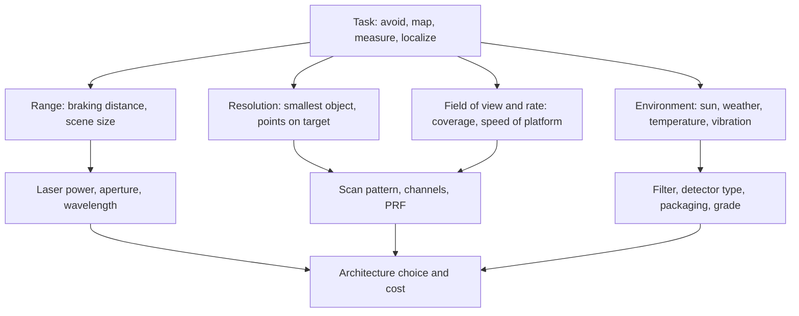

::: basics
### In plain words
LiDAR gives direct, accurate 3D shape without needing daylight. So it is used wherever machines must know the shape of the world: cars that detect obstacles, robots that map a warehouse, aircraft that survey terrain, and phones that measure depth for focus. Each use needs different numbers for range, detail, coverage and speed, so each leads to a different LiDAR design.

### Picture it
Think of reading glasses, binoculars and a wide-angle lens. Reading glasses help up close, binoculars reach far in a narrow view, and a wide lens takes in the whole scene. LiDARs differ the same way. A phone needs a few meters and tiny size. A highway car needs a long, narrow view. A mapping aircraft needs wide coverage and dense points. The lens picture does not show that cost and eye safety also limit every design.

### Words you need
- **Range**: how far away an object can be and still be detected.
- **Reflectivity**: the fraction of light an object bounces back. Black tires return far less than white paint, so range is always quoted for a stated reflectivity.
- **Field of view**: how wide and tall an angle the sensor covers.
- **Point density**: how many measured points land on each square meter.
- **Stopping distance**: the distance covered during your reaction time plus the distance needed to brake.

### The simplest example
How far must a car's LiDAR see? At 100 km/h the car moves 27.8 m each second. With a 0.5 s reaction time it covers about 13.9 m before braking starts. Braking hard on dry road, at 7.85 m/s², takes another 49 m. The total is about 63 m. At 130 km/h on a wet road it is about 185 m. That is why highway LiDARs are specified at 150 m or more on a dark, low-reflectivity target. That is the whole idea. The rest of this page runs the same use-to-spec steps for robots, mapping and phones.
:::

::: testing
Whether you can go beyond a list ("self-driving cars, mapping") to **link each application to the specs that matter** for it: range, angular resolution, field of view, frame rate, eye safety, cost, robustness. The interviewer wants breadth (automotive, robotics, surveying, consumer devices, atmospheric and industrial uses), one or two worked requirement calculations (for example the detection range for highway braking), and the understanding that different applications drive different LiDAR architectures (spinning, MEMS, flash, FMCW). A candidate who can say "for this use I would choose that type and here's why" stands out.
:::

::: why
A LiDAR is never designed in a vacuum: the application sets the requirements and the requirements set the architecture. If you join a sensing team you will be asked to translate a use case ("detect a tire on the road at 120 km/h") into range, resolution and update-rate numbers, then into laser power, aperture and scan pattern. This question checks that you can do that translation and that you know the ecosystem. It follows the definition and working principle in [[q0864]] and [[q0865]], and the camera comparison in [[q0867]] explains why LiDAR is chosen rather than a camera for many of these jobs.
:::

::: concepts
- **Range requirement from physics**: stopping distance and reaction time set how far a vehicle must see ([[q0864]]).
- **Angular resolution and point density**: determines whether a small object gets enough points to be classified ([[q0869]]).
- **Field of view and scan rate**: 360° vs forward-facing, 10 to 30 Hz frames ([[q0868]]).
- **Reflectivity and weather**: specs hold at a stated reflectivity and visibility ([[q0870]]).
- **Sensor fusion**: LiDAR together with camera, radar, IMU ([[q0845]], [[q0867]]).
- **Eye safety, cost and robustness**: automotive-grade temperature, vibration and lifetime requirements.
:::

::: answer
"LiDAR's value is direct, accurate 3D geometry that doesn't depend on ambient light, so it shows up wherever machines need to know the shape of the world.

The famous one is autonomous driving and driver assistance: detecting vehicles, pedestrians and road edges at 100 to 250 meters, in the dark, with centimeter-level range. Then robotics: warehouse robots, delivery robots and robot vacuums use 2D or 3D LiDAR for mapping and localization, and for safety scanners that stop a machine when someone enters a zone. In surveying and mapping, airborne LiDAR flies over terrain and forests and gives you ground elevation under the trees from the last returns, and terrestrial scanners capture buildings, construction progress and archaeological sites. Drones use small LiDARs for obstacle avoidance and inspection of power lines.

On the consumer side, phones and tablets have small time-of-flight depth sensors for autofocus, portrait effects and AR room scanning. Other uses include wind and atmospheric sensing with Doppler LiDAR, bathymetric LiDAR with green lasers for shallow seabeds, and even speed or traffic monitoring.

Each use drives different specs. A highway car needs long range and a narrow forward field of view; a robot vacuum wants cheap, short range 360°; a mapping drone cares about point density and accuracy; a phone wants tiny, low power and eye safe."
:::

::: technical
**Automotive requirement (worked).** Detection range must cover reaction plus braking: $d = v\,t_r + v^2/(2a)$. At 130 km/h ($v$ = 36.1 m/s), $t_r$ = 0.5 s and dry-road deceleration $a$ = 0.8 g = 7.85 m/s²: 18.1 + 83.1 = 101 m. On a wet road with $a$ = 0.4 g (3.92 m/s²): 18.1 + 166.3 = 184 m. LiDARs for highway automation are therefore specified at 150 to 250 m on a 10 percent reflectivity target. The received power from a 10 percent target at 185 m is only about 17 nW with the illustrative link budget of [[q0864]].

**Angular resolution needed.** A pedestrian 0.5 m wide and 1.7 m tall at 50 m, with 0.2° horizontal and 0.625° vertical spacing: horizontal point spacing 17 cm, vertical 55 cm. That's about 3 points across and 3 rows on the body, barely enough to classify, which is why automotive spec sheets push for 0.1° or finer in the forward region.

**Airborne mapping (worked).** Flying height 1000 m, ±20° scan half-angle, ground speed 60 m/s, PRF 200 kHz: swath $=2H\tan20° = 728$ m; point density $=\text{PRF}/(\text{swath}\times v) = 200{,}000/(728\times60) = 4.6$ points/m² (about 0.47 m spacing). Doubling the PRF to 400 kHz gives 9.2 points/m². Multiple returns per pulse let some points fall on the ground below the canopy.

**Terrestrial scanning.** A 360° × 270° scan at 0.02° spacing is about 243 million points and takes minutes; spacing at 20 m is 7 mm.

**Doppler wind LiDAR.** A 1550 nm coherent LiDAR sees a Doppler shift $2v/\lambda$: 12.9 MHz for a 10 m/s radial wind.
:::

::: short
"LiDAR gives direct 3D geometry in any lighting, so it's used wherever machines need to know the shape of the world: autonomous driving and driver assistance, mobile robots and safety scanners, airborne and terrestrial surveying and forestry, drones, and small depth sensors in phones for autofocus and AR. The use sets the specs: a highway car needs 150 to 250 meters of range, a vacuum robot needs cheap short range 360 degrees, a mapping drone needs point density and accuracy."
:::

::: long
"LiDAR's strength is direct, accurate 3D geometry that doesn't depend on lighting, so the applications are all about machines understanding space.

The headline is automotive. For driver assistance and automated driving you need to detect vehicles, pedestrians and road debris at 100 to 250 meters. The requirement comes from physics: at 130 kilometers per hour, with half a second of reaction time and 0.8 g braking you need about 100 meters on a dry road, and about 185 on a wet one, and the sensor has to see a dark 10 percent reflective object at that range. Fine angular resolution matters too, since a pedestrian at 50 meters might only get three or four points.

In robotics, warehouse and delivery robots and robot vacuums use 2D or 3D LiDAR for SLAM, which is simultaneous localization and mapping, and for obstacle avoidance. Industrial safety scanners use a 2D LiDAR to stop machines when a person enters a protected field. They want robustness and low cost more than long range.

In surveying and mapping, airborne LiDAR flies a plane or drone and makes a terrain model. With a 200 kilohertz laser at 1 kilometer height and 60 meters per second you get around 4.6 points per square meter, and because pulses give multiple returns, some reach the ground through forest canopy. Terrestrial scanners capture buildings and construction sites, and bathymetric LiDAR uses green light to map shallow seabeds.

Consumer devices use small time-of-flight sensors for autofocus, portrait mode and AR. And atmospheric Doppler LiDAR measures wind for weather and wind farms.

So the pattern is: each application sets range, resolution, field of view and cost, and that decides the architecture."
:::

::: terms
- **ADAS**: advanced driver-assistance systems (emergency braking, adaptive cruise).
- **SLAM**: simultaneous localization and mapping.
- **Airborne laser scanning (ALS)**: LiDAR on aircraft or drones for terrain and forest mapping.
- **Terrestrial laser scanning (TLS)**: tripod-based high-density scanners.
- **Bathymetric LiDAR**: green (about 532 nm) lidar that penetrates water to map the bottom.
- **Digital elevation model (DEM)**: map of ground elevation derived from the last returns.
- **Safety laser scanner**: a 2D LiDAR certified to detect people in a protective field.
- **Doppler LiDAR**: coherent LiDAR measuring radial velocity from the frequency shift.
- **Detection range at reflectivity**: the range at which an object of stated reflectivity is detected with specified probability.
:::

::: exceptional
An average answer lists three applications. An exceptional answer:

- Groups applications into families (mobility, robotics, mapping, consumer, atmospheric) and shows how **specs change** between them.
- Derives at least one requirement with numbers (braking distance gives 100 to 185 m at 130 km/h; point density for airborne mapping).
- Mentions **multiple returns** for forestry, **green lasers** for water, **Doppler** for wind.
- Explains why LiDAR rather than a camera or radar for each (direct geometry, light-independence, resolution) and where it is **not** the best choice (rain, fog, cost).
- Mentions fusion with cameras, radar and IMU, and safety certification for industrial scanners.
:::

::: mistakes
- **"LiDAR is only for self-driving cars."** Surveying and mapping were the first large markets and are still large; robots, drones and phones are growing.
- **Quoting a single range number.** "200 m" means nothing without reflectivity, field of view, and detection probability.
- **Assuming one design fits all.** A spinning 128-channel head, a small MEMS unit, and a flash ToF in a phone have totally different trade-offs.
- **Ignoring weather and sensor fusion.** Fog, rain, snow and dust scatter the beam; safety-critical systems fuse with radar and cameras ([[q0867]]).
- **Believing LiDAR gives color or semantics.** It gives geometry and intensity; classification needs algorithms or fusion with cameras ([[q0869]]).
- **Forgetting eye safety and cost** as primary constraints when scaling to consumer products.
:::

::: deep
## From use case to spec: the method

Every LiDAR application can be reduced to five questions: how far, how fine, how wide, how fast, and in what environment. Start from the task, find the physical constraint, and then the spec.


Figure: The use case drives the specs; the specs drive the architecture (spinning, MEMS, flash, FMCW) and cost. Reading the diagram left to right is a good template for answering any "design a LiDAR for X" question.

## Automotive: range from stopping distance

The detection range has to cover the reaction time plus braking: $d = v\,t_r + v^2/(2a)$.

```plot
{"title":"Required detection range vs vehicle speed (reaction 0.5 s)","x":{"label":"Speed","unit":"km/h","min":10,"max":140},"y":{"label":"Distance","unit":"m","min":0,"max":200},
 "vars":{"tr":0.5,"ad":7.85,"aw":3.92},
 "series":[{"label":"Dry road, a = 0.8 g","fn":"(x/3.6)*tr+(x/3.6)^2/(2*ad)"},{"label":"Wet road, a = 0.4 g","fn":"(x/3.6)*tr+(x/3.6)^2/(2*aw)","color":"orange"}],
 "points":[{"x":130,"y":101.1,"label":"101 m"},{"x":130,"y":184.4,"label":"184 m"},{"x":50,"y":19.2,"label":"19 m"}]}
```
Figure: Distance grows with the square of speed once braking dominates. At 50 km/h urban driving needs about 20 m (dry), but highway speeds need 100 to 185 m, which is why highway-capable LiDARs are rated at 150 m or more on a 10 percent target. Points: 101 m (dry) and 184 m (wet) at 130 km/h, 19 m (dry) at 50 km/h.

Tying this to the link budget in [[q0864]]: the return from a 10 percent target falls as $1/R^2$, so going from 100 m to 185 m needs $(1.85)^2 = 3.4\times$ more received power (more laser peak power within eye-safe limits, a larger aperture, or a more sensitive detector). That's why 1550 nm designs (which allow higher pulse energy) and SPAD receivers are attractive for long range.

Other automotive needs: **cut-ins** require wide horizontal FoV at medium range (±60° at 50 m); **small debris** (a 20 cm tire fragment at 100 m is 0.11° tall, so you need about 0.05° vertical resolution to get several points on it); **road markings and curbs** use the intensity channel; **localization against an HD map** uses point-cloud matching ([[q0868]]). Compare with a camera, which sees color and signs but not range directly ([[q0867]]). Requirements include automotive temperature range (−40 to 105 °C or higher), vibration, a 10-year lifetime and unit cost in the hundreds of dollars or less for mass production.

## Robotics and industry

| Use | Typical sensor | Key needs |
|---|---|---|
| Warehouse AMR navigation | 2D scanning LiDAR, 10 to 25 m, 270° | cheap, robust, 20 to 50 Hz |
| Robot vacuum | triangulation or small dToF, 360° | very low cost, 5 to 8 m |
| Safety laser scanner | 2D, safety-rated | certified detection of a person, reliable protective field |
| Outdoor robots, delivery | 3D 16 to 32 channel | 50 to 100 m, rain tolerance |
| Mining, agriculture | rugged 3D LiDAR | dust/mud, wide temperature |

**Stopping distance for a robot (worked).** A robot at 1.5 m/s, with 0.2 s total latency and 1.0 m/s² deceleration, needs $1.5\times0.2 + 1.5^2/(2\times1) = 1.43$ m, so the protective field must extend at least that far, plus margins for measurement error and the person's own motion. The sensor frame rate and processing latency directly enter the safety distance, which is why safety scanners publish response time.

**SLAM.** Consecutive scans are registered (ICP or NDT matching) to estimate motion and build a map, using the LiDAR as an odometer: details of the mapping process in [[q0868]].

## Mapping and surveying

**Airborne LiDAR.** Point density $\rho = \text{PRF}/(w\,v)$ with swath $w = 2H\tan(\theta_{half})$. At $H$ = 1000 m, $\theta_{half}$ = 20°, $v$ = 60 m/s, PRF = 200 kHz: $w = 728$ m, $\rho = 4.6$ pts/m². Footprint at 1000 m with 0.3 mrad divergence is 30 cm. A pulse hitting forest produces a first return from the canopy top and later returns from lower branches and the ground, so the digital terrain model comes from the last returns, and canopy height from first minus last.

**Terrestrial scanning.** Tripod scanners capture 360° × 270° at 0.02° steps: 243 million points, with 7 mm spacing at 20 m. Used for building as-built documentation, tunnels, plants and heritage sites. Precision is millimeters, so these use phase-based or waveform systems with careful calibration ([[q0870]]).

**Bathymetric.** A green laser (about 532 nm) penetrates clear water; the system distinguishes surface and bottom returns. Maximum depth depends on water clarity and is typically a small multiple of the Secchi depth, a standard measure of water clarity (system-dependent), so it's limited to shallow, clear coastal waters.

> [!UNCERTAIN]
> Bathymetric depth capability depends strongly on water turbidity and the system; I give only the qualitative relation to water clarity rather than a specific depth.

## Consumer and mobile

Phones and tablets include small dToF (SPAD array with a VCSEL) or iToF depth sensors with ranges of a few meters. Uses: **autofocus assist** in low light (a distance measurement instead of contrast), **portrait and bokeh** depth maps, **AR placement** and room scanning, face unlock (structured light is a related technology). These sensors need milliwatt-level optical power and Class 1 eye safety at close range, with a small footprint, so they use many low-power VCSEL emitters and highly integrated SPAD receivers with on-chip TDCs. Their resolution is far lower than automotive scanners (tens of zones to tens of thousands of pixels) but good enough for AR.

## Environmental and scientific

- **Wind LiDAR:** coherent Doppler at 1550 nm measures radial velocity from the frequency shift $f_D = 2v/\lambda$; 10 m/s gives 12.9 MHz. Used for wind turbine control and airport wind shear.
- **Atmospheric:** elastic backscatter LiDAR measures clouds and aerosols; differential absorption (DIAL) measures gases.
- **Space:** laser altimeters on planetary missions and docking sensors.
- **Traffic and security:** roadside LiDAR counts and tracks vehicles and pedestrians without capturing faces.

## Choosing an architecture

| Need | Architecture | Why |
|---|---|---|
| 360° at 100 m, mapping or robotaxi roof | spinning multi-channel | proven, full coverage |
| Forward 120° at 150 m+, mass production | MEMS or rotating mirror, 1550 nm | compact, integration in grille |
| Short range 0 to 20 m, wide FoV | flash (VCSEL plus SPAD or ToF array) | no moving parts, solid-state |
| Velocity per point, interference immunity | FMCW | Doppler, coherent detection |
| Cheapest 2D | triangulation or single-point ToF with spinning mirror | cost |

## Experiment with it

```sim
{"id":"lidar-tof","d":185,"tres":1e-9,"prf":150e3}
```
Figure: Set the target at 185 m, the wet-road highway requirement computed above, and note the round-trip time (about 1.2 µs). The pulse repetition frequency must be low enough that the unambiguous range, $c/(2\,\text{PRF})$, stays beyond the target, but high enough for the point rate the application needs: that is the main trade-off in the airborne and automotive examples.
:::

::: applications
- **Highway pilot and robotaxi sensor suites**: long-range forward LiDAR plus 360° roof or corner LiDARs, fused with cameras and radar.
- **Warehouse AMRs and AGVs**: 2D LiDAR for localization and safety zones.
- **Airborne topographic mapping and forestry**: drone and aircraft LiDAR producing DEMs and canopy models.
- **Construction and infrastructure scanning**: terrestrial laser scanners for as-built models and progress tracking.
- **Phone and tablet depth sensing**: dToF for low-light autofocus and AR.
- **Wind energy**: nacelle- or ground-mounted Doppler LiDAR for turbine control and site assessment.
:::

::: assumptions
- Range and resolution numbers are computed from simple physics (stopping distance, point density) with typical values (0.5 s reaction, 0.8 g and 0.4 g deceleration); real automotive requirements add margins, ego-motion and target closing speed. Closing speed with oncoming vehicles is higher than ego speed.
- Reflectivity of 10 percent is a common specification target; real objects range from below 5 percent (black clothing, tires) to above 90 percent (white paint) and retroreflective signs.
- The airborne example assumes flat terrain, constant speed and a uniform scan; real density varies across the swath.
- Application areas and capabilities (such as bathymetric depth, phone LiDAR range) are described qualitatively because they are product-dependent.
- Valid alternative framing: group by **platform** (ground vehicle, aerial, fixed, handheld) instead of by industry.
:::

::: followups
### Why do some self-driving companies avoid LiDAR and use cameras only?
Cameras are cheap, high-resolution and rich in semantics, and neural networks can infer depth from images (monocular or stereo), so camera-only is possible. The argument against is that inferred depth has errors that grow quickly with range (see [[q0867]]), and cameras fail in glare and darkness, while LiDAR measures distance directly. Cost and complexity of LiDAR have been the argument for; safety redundancy the argument against.

### How does rain or fog affect the sensor choice?
Droplets scatter and absorb the beam, reducing range and creating false returns. Two-way attenuation of 10 dB/km over 100 m is 2 dB (63 percent of the signal), while heavy fog at 30 dB/km is 6 dB (25 percent). Mitigations: more power margin, multiple-return filtering, 1550 nm (water absorption is higher, but more pulse energy is allowed), FMCW, and fusion with radar, which is little affected by fog.

### What is the difference between a LiDAR for a robot vacuum and for a car?
Range (5 m vs 200 m), speed (slow vs 100+ km/h), and cost (a few dollars vs hundreds). Vacuum LiDARs often use triangulation (a laser spot imaged onto a line sensor, so range comes from geometry, not timing) or low-power ToF; car LiDARs use high-peak-power pulses, sensitive APD/SPAD receivers, and automotive-grade packaging.

### How would you choose point density for a forest-mapping drone?
Start from the product: ground model needs enough last returns reaching the ground, perhaps 10 to 50 pts/m² under canopy. Density is $\text{PRF}/(w\,v)$, so for a 100 m height with ±30° scan ($w$ = 115 m), 60 kHz PRF and 10 m/s: $60{,}000/(115\times10) = 52$ pts/m², of which a fraction (a canopy-dependent 10 to 30 percent) reach the ground. Lower speed, lower altitude, higher PRF or overlapping flight lines raise it.

### Scenario: your warehouse robot's LiDAR gives false obstacle detections near shiny floors and shrink-wrapped pallets. What do you check?
Specular surfaces cause multipath (the beam bounces off the floor then the object) and mirror-like ghost points, and plastic wrap creates saturating or weak returns. Check intensity and echo width of the false points, filter by multiple-return logic and intensity, mount the sensor to reduce grazing incidence on the floor, tune the near-field blanking, and use temporal consistency (a real obstacle persists across scans) before declaring a protective-field violation. See [[q0870]].
:::

::: interpretations
"What are some applications?" refers to LiDAR (the previous questions in the block). I group applications and, crucially, link each to specs. If the interviewer wants automotive depth only, expand the stopping-distance and resolution calculations; if they want hardware depth, expand the architecture table and the receiver trade-offs ([[q0865]]).
:::

::: references
- Shan and Toth (eds.), *Topographic Laser Ranging and Scanning*: airborne and terrestrial laser scanning, point density and multiple returns.
- Vosselman and Maas (eds.), *Airborne and Terrestrial Laser Scanning*: applications in mapping, forestry and engineering.
- Thrun, Burgard and Fox, *Probabilistic Robotics*: range sensors and SLAM for mobile robots.
- IEC 60825-1 (laser product safety) and, for machine safety scanners, the IEC 61496 family of electro-sensitive protective equipment standards (consult the standard directly for requirements).
:::

::: rubric
- Names several application families (automotive, robotics, mapping, consumer, atmospheric) :: Breadth shows you know the landscape.
- Links each application to the key specs (range, resolution, FoV, rate, cost, environment) :: This is the real engineering content.
- Derives a requirement with numbers (stopping distance, point density) :: Calculations demonstrate you can translate use cases to specs.
- Mentions multiple returns, green lasers or Doppler for specific uses :: Shows depth beyond the automotive default.
- Explains why LiDAR is chosen over camera or radar for those uses :: Shows system-level reasoning.
- Mentions environmental limits (rain, fog, sun) and fusion :: Real deployments must handle them.
- Mentions architecture choices (spinning, MEMS, flash, FMCW) tied to application :: Connects use case to hardware.
:::

::: quiz
```json
[
 {"type":"mcq","level":"fundamental","q":"Which use takes most advantage of LiDAR's multiple returns per pulse?","options":["Robot vacuum navigation","Airborne forest mapping","Phone autofocus","Parking sensors"],"answer":1,"explain":"In forests a single pulse returns from canopy, mid-level branches and the ground, so first and last returns provide canopy height and terrain elevation."},
 {"type":"numeric","level":"intermediate","q":"Detection range needed for a vehicle at 100 km/h with 0.5 s reaction time and 0.8 g (7.85 m/s²) deceleration (m)?","answer":63,"tolerance":0.02,"unit":"m","explain":"$v$ = 27.78 m/s. Reaction distance $vt_r$ = 13.9 m; braking distance $v^2/(2a)$ = 771.6/15.7 = 49.1 m. Total 63.0 m."},
 {"type":"numeric","level":"intermediate","q":"An airborne LiDAR flies at H = 800 m, scan half-angle 25°, speed 50 m/s, PRF 150 kHz. What is the average point density in points/m²?","answer":4.02,"tolerance":0.03,"unit":"pts/m²","explain":"Swath $=2\\times800\\tan25° = 746$ m; density $=150{,}000/(746\\times50) = 4.02$ pts/m²."},
 {"type":"truefalse","level":"intermediate","q":"A LiDAR specified at 200 m range is guaranteed to see any object at 200 m.","answer":false,"explain":"Range specs apply to a stated target reflectivity (often 10 percent), weather and detection probability. A darker, smaller or oblique target, or fog, reduces the range."},
 {"type":"numeric","level":"advanced","q":"A robot moves at 2 m/s with 0.25 s latency and 1.5 m/s² deceleration. What minimum stopping distance (m) must the protective field cover?","answer":1.83,"tolerance":0.03,"unit":"m","explain":"$d = vt + v^2/(2a) = 2\\times0.25 + 4/3 = 0.5 + 1.33 = 1.83$ m (margins are added on top)."}
]
```
:::
