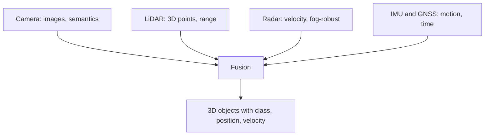

::: testing
Whether you can compare two sensors on **what they physically measure** (a 2D map of reflected ambient light with color versus a direct 3D range map from active light), then on the engineering consequences: depth accuracy, resolution, lighting and weather dependence, data rate, cost, and what each is good at. The interviewer likes numbers and an honest conclusion: neither wins everywhere; fusion is the answer. Bonus points for stereo depth error scaling with range squared and for how fusing needs calibration and time sync.
:::

::: why
Perception systems (cars, robots, drones, AR) usually combine cameras and LiDAR, and as a hardware engineer you'll be asked to justify each sensor, size its data link and processing, and design the calibration and synchronization that makes fusion work. The question also checks whether you can reason from the underlying physics (passive vs active, triangulation vs time of flight) rather than from marketing. See [[q0864]] and [[q0865]] for the LiDAR basics and [[q0856]] for the camera.
:::

::: concepts
- **Passive vs active sensing**: a camera collects ambient light; LiDAR emits and times its own ([[q0856]], [[q0864]]).
- **Triangulation vs time of flight**: stereo cameras infer depth from disparity; LiDAR measures round-trip time directly ([[q0865]]).
- **Angular resolution**: pixels per degree versus beam spacing.
- **Dynamic range and illumination**: cameras need light; LiDAR has its own, but sunlight is noise ([[q0860]]).
- **Semantics and texture**: color, text and appearance are in the image, not in range data ([[q0869]]).
- **Sensor fusion and calibration**: extrinsic transforms, timestamps, and the projection of 3D points into images ([[q0845]]).
:::

::: answer
"The core difference is what they measure. A camera is passive: it records how much ambient light each pixel received, which gives a dense, high-resolution 2D image with color and texture, but no direct depth. LiDAR is active: it sends laser pulses and times the return, so every point gives a direct, accurate distance, and together they form a 3D point cloud.

That leads to practical differences. LiDAR range accuracy is a couple of centimeters and roughly independent of distance, and it doesn't care whether it's day or night. A camera can only estimate depth with stereo or neural networks, and stereo depth error grows with the square of distance: with a 30 cm baseline, a 1000-pixel focal length and quarter-pixel matching, I'd get about 8 centimeters at 10 meters but over 8 meters of error at 100. On the other hand a camera has far more resolution, thousands of pixels across the field of view versus a few hundred beams, and it can read signs, traffic light colors and lane markings, which LiDAR can't. Cameras are also cheaper.

LiDAR has its weaknesses: fog, rain and dust scatter the beam, it has lower resolution and no color, it's more expensive and has moving parts or complex optics, and dark or shiny surfaces return little light. Cameras struggle in the dark, in glare and with low-contrast scenes. So robots and cars use both, fused: the camera provides semantics, LiDAR provides geometry, and that needs careful calibration and time sync."
:::

::: technical
**What is measured.** Camera: irradiance per pixel, $I(u,v)$, via projection $u = f_x X/Z + c_x$, $v = f_y Y/Z + c_y$; depth $Z$ is lost. LiDAR: range $r$ along a known direction, $r = ct/2$ ([[q0865]]).

**Stereo depth error.** For baseline $B$, focal length $f$ in pixels and disparity $d = fB/Z$, the depth error from disparity error $\sigma_d$ is
$$\sigma_Z = \frac{Z^2}{fB}\sigma_d.$$
With $f$ = 1000 px, $B$ = 0.3 m, $\sigma_d$ = 0.25 px: 2 cm at 5 m, 8.3 cm at 10 m, 33 cm at 20 m, 2.1 m at 50 m, 8.3 m at 100 m, 33 m at 200 m. At 100 m the disparity is only 3 px. LiDAR range error is typically 1 to 3 cm over the whole range (depends on SNR, [[q0870]]), growing slowly with range as SNR falls.

**Angular resolution.** A 1920 px, 60° camera: 0.031°/pixel, a 2.7 cm footprint at 50 m. A 64-channel spinning LiDAR: 0.2° azimuth and about 0.625° vertical: 17 cm and 55 cm at 50 m. The camera samples about 6x more finely horizontally and 20x more finely vertically, roughly 130 times more samples per unit solid angle.

**Data.** 1080p30 RGB uncompressed: 187 MB/s. LiDAR 1.15 Mpoints/s at 16 bytes: 18 MB/s.

**Light.** Camera SNR drops with lux ([[q0860]]); LiDAR's return is independent of ambient but sunlight adds noise, and bright retroreflectors cause blooming.

**Fusion.** A LiDAR point $\mathbf{p}_L$ is projected to the image with $\mathbf{p}_C = R\mathbf{p}_L + \mathbf{t}$ then pinhole projection. A 0.1° rotation error in extrinsics moves points 8.7 cm at 50 m; 10 ms of time misalignment at 20 m/s is 0.2 m.
:::

::: short
"A camera is passive and gives a dense 2D image with color and texture but no direct depth; LiDAR is active and gives direct, accurate 3D range, day or night. Stereo camera depth error grows as range squared, so it's meters at 100 meters, while LiDAR stays at centimeters. But cameras have far higher resolution and read signs and colors, are cheaper, and LiDAR struggles in fog and has no color. So real systems fuse them."
:::

::: long
"The fundamental difference is passive versus active. A camera collects ambient light and gives a dense 2D grid of brightness and color; depth isn't measured. LiDAR emits laser pulses and times the return, so each point has a direct distance, and you get a sparse 3D point cloud.

Let me compare on a few axes. Depth: LiDAR gives centimeter accuracy at any range up to its limit. A camera infers depth, either from stereo or from a neural network. For stereo the error is Z squared times the disparity error over focal length times baseline. With a 30 centimeter baseline, 1000 pixel focal length and quarter-pixel matching that's 8 centimeters at 10 meters but 8 meters at 100 meters, so it blows up with range.

Resolution: a camera has about 0.03 degrees per pixel, while a 64-beam spinning LiDAR has 0.2 degrees horizontally and more than half a degree vertically. So a camera sees small things like a traffic light's color, lane markings and text, and LiDAR sees the geometry but not that.

Lighting: the camera needs light and suffers in the dark or against glare; LiDAR works at night and is independent of ambient light, although bright sun adds noise. Weather: fog, rain and snow scatter the laser, shortening its range, and affect cameras too.

Cost and complexity: cameras cost tens of dollars, LiDARs hundreds or more, and they have more complex optics and electronics.

So I'd fuse them: camera for semantics, LiDAR for geometry, with careful extrinsic calibration and timestamp sync, since a tenth of a degree of error is 9 centimeters at 50 meters."
:::

::: terms
- **Passive / active sensor**: collects existing energy versus emits and measures its own.
- **Stereo disparity**: pixel shift of a point between two cameras, $d = fB/Z$.
- **Baseline ($B$)**: distance between the stereo cameras.
- **Focal length in pixels ($f$)**: focal length divided by pixel pitch.
- **Extrinsic calibration**: the rigid transform (rotation, translation) between sensors.
- **Intrinsic calibration**: camera internal parameters ($f_x, f_y, c_x, c_y$, distortion).
- **Time synchronization**: aligning timestamps between sensors.
- **Semantic segmentation**: labeling pixels or points by class (road, car, person).
- **Blooming**: saturated returns spreading to neighboring points or pixels.
- **Sensor fusion**: combining sensors for a better estimate than either alone.
:::

::: exceptional
An average answer says "LiDAR gives depth, a camera gives color." An exceptional answer:

- States the physics: passive 2D projection (depth lost) versus active time-of-flight range.
- Quantifies **stereo error $\sigma_Z = Z^2\sigma_d/(fB)$** with numbers against LiDAR's roughly constant centimeter error.
- Compares **angular resolution** and **data rate** with numbers.
- Covers both sensors' **failure modes** (dark and glare for cameras; fog, dark or specular surfaces, cost for LiDAR) rather than declaring a winner.
- Gives the fusion story: complementary strengths, and calibration/time sync numbers.
- Mentions that depth from a **single** camera (monocular networks) is learned and scale-ambiguous, not measured.
:::

::: mistakes
- **"LiDAR replaces cameras."** LiDAR can't read signs, traffic light colors or lane paint (except by reflectivity), and its resolution is far lower.
- **"Cameras can't measure depth."** Stereo, structure from motion, ToF cameras and learned monocular depth all provide depth; the point is accuracy and failure modes.
- **Ignoring how stereo error scales.** $Z^2$ growth is why cameras do well up close and poorly at highway ranges.
- **"LiDAR works perfectly in all light."** Sunlight adds noise, and rain, fog, dust and dark glossy surfaces degrade it.
- **Assuming fusion is free.** Mis-calibrated extrinsics or time offsets create ghosting between the two sensors.
- **Comparing price only.** Include processing: dense camera streams need heavy compute; LiDAR is lighter per point but needs ground segmentation and clustering.
:::

::: deep
## What each sensor measures

A camera projects 3D points to a 2D image: a point at $(X,Y,Z)$ in the camera frame lands at $u = f_xX/Z + c_x$, $v = f_yY/Z + c_y$ ([[q0856]]). Everything along the ray through the pixel gives the same image, so depth is lost. A LiDAR measures along a known ray: the direction comes from the scanner geometry, and the range from the time of flight, so the 3D point is fully determined: $(x,y,z) = r\,\hat{\mathbf{u}}(\theta,\phi)$ ([[q0868]]).

| Property | Camera | LiDAR |
|---|---|---|
| Measures | reflected ambient light (intensity, color) | round-trip time of own laser (range), plus intensity |
| Output | dense 2D image | sparse 3D point cloud |
| Depth | inferred (stereo, SfM, learned) | direct |
| Angular resolution | about 0.03°/pixel (1080p, 60° HFOV) | about 0.1° to 0.4° horizontal, 0.1° to 0.7° vertical |
| Range accuracy | $\propto Z^2$ for stereo | about 1 to 3 cm, weakly range dependent |
| Lighting | needs light, glare-limited | independent (own light), sun is noise |
| Weather | fog/rain reduce contrast | fog/rain scatter the beam |
| Color/semantics | yes | intensity only |
| Typical cost | tens of dollars | hundreds to thousands of dollars |
| Moving parts | none | some designs |
| Data | about 190 MB/s (1080p30 raw RGB) | about 18 MB/s (1.15 Mpts/s) |

## Depth: why stereo error explodes with range

For two parallel cameras with baseline $B$ and focal length $f$ (pixels), a point at depth $Z$ shifts by disparity $d = fB/Z$. Differentiating, $\partial d/\partial Z = -fB/Z^2$, so a disparity error $\sigma_d$ becomes

$$\sigma_Z = \frac{Z^2}{fB}\,\sigma_d$$

```plot
{"title":"Depth error vs range: stereo camera vs LiDAR","x":{"label":"Range Z","unit":"m","min":2,"max":200,"log":true},"y":{"label":"1-sigma depth error","unit":"m","min":0.005,"max":50,"log":true},
 "vars":{"f":1000,"b":0.3,"sd":0.25},
 "series":[{"label":"Stereo, B = 0.3 m, 0.25 px matching","fn":"x*x*sd/(f*b)"},{"label":"Stereo, B = 1.0 m","fn":"x*x*sd/(f*1.0)","color":"orange"},{"label":"LiDAR (about 2 cm, rising slowly)","fn":"0.02*(1+x/200)","color":"green"}],
 "points":[{"x":10,"y":0.083,"label":"8 cm at 10 m"},{"x":100,"y":8.33,"label":"8.3 m at 100 m"}]}
```
Figure: Stereo error rises with the square of range (slope 2 on the log-log plot) and crosses LiDAR's roughly constant centimeter-level error at about 5 m. Widening the baseline to 1 m helps by 3.3x but is mechanically hard on a phone or car mirror. The values assume a 1000 px focal length (roughly a 90° field of view on a 2000 px-wide sensor), calibrated cameras and quarter-pixel matching, which is optimistic outdoors.

Monocular depth networks avoid the baseline by learning priors about object sizes and scene layout, but they give relative or scale-ambiguous depth, with no guarantee in new situations. Time-of-flight cameras (iToF) provide direct depth from a camera-like sensor but at short range ([[q0864]]).

## Resolution: the camera wins

A 1080p camera with a 60° horizontal field of view has 1920 pixels across it, 0.031° per pixel, and each pixel covers 2.7 cm at 50 m. A 64-channel LiDAR at 0.2° azimuth and 0.625° elevation spacing has 17 cm horizontal and 55 cm vertical point spacing at 50 m. A 0.5 m wide pedestrian at 50 m therefore covers 18 pixels across in the image but only about 3 LiDAR points across. This is why LiDAR object detection relies on shape from few points, and why higher channel counts and finer scans are in demand ([[q0869]]).

## Lighting and weather

Camera SNR falls with illuminance ([[q0860]]): at 5 lux a 1 µm pixel has SNR near 3 dB, and a headlight in the field of view blooms the image. LiDAR returns its own light, so at night it is unchanged; in bright sun the detector sees solar background and range drops (narrow filters and coincidence logic mitigate it). Rain, snow and fog: for LiDAR, droplets scatter and cause false returns and attenuate the two-way signal (6 dB at 100 m in heavy fog of 30 dB/km), and for cameras they reduce contrast and add glare. Radar is far less affected by fog than either, which is why systems often include it.

**Surface effects.** A black, dark-gray or wet surface returns very little light to LiDAR (reflectivity below 5 percent); glass and mirrors are transparent or specular, giving missing or ghost points. Cameras see through glass naturally, and reflections are a problem for stereo matching and texture-less surfaces (white walls give no disparity).

## Semantics and texture

Text, colors, lane markings, brake lights and facial expressions are in the image. LiDAR's intensity channel can detect retroreflective paint and signs but not read them. Deep learning for detection works best on images (huge datasets); LiDAR-based detectors use point-cloud networks and perform well for 3D boxes and distances. So camera and LiDAR are complementary: LiDAR says *where* and *how big*, the camera says *what*.

## Fusion needs calibration and time sync

Project a LiDAR point $\mathbf{p}_L$ into the image: $\mathbf{p}_C = R\mathbf{p}_L + \mathbf{t}$, then $u = f_x X_C/Z_C + c_x$, $v = f_y Y_C/Z_C + c_y$. Example: a point 20 m ahead, 2 m left, 0.5 m up, with $f_x = f_y = 1663$ px and the principal point at (960, 540), lands at $u = 1663\times(-2/20)+960 = 794$, $v = 540 - 1663\times0.5/20 = 498$ (sign convention: image $x$ right, $y$ down).

Error sensitivity:
- **Rotation error:** 0.1° corresponds to 8.7 cm at 50 m, or 2.9 pixels in the example camera ($1663\times\tan0.1° = 2.9$), enough to paint a distant car's points onto the wrong object.
- **Time offset:** at 20 m/s ego speed (or relative speed of a car), 10 ms is 0.2 m. Hardware triggering or PTP (IEEE 1588) timestamps are used to keep offsets below a millisecond; a spinning LiDAR's scan time (100 ms per revolution) also needs per-point timestamps ([[q0868]]).
- **Rolling shutter** in the camera adds another row-dependent time offset ([[q0856]]).


Figure: Typical perception stack. Each sensor covers another's weakness; the IMU and common clock keep them aligned in time and space.

## Experiment with it

```sim
{"id":"lidar-tof","d":50,"tres":1e-9,"prf":100e3}
```
Figure: LiDAR measures the delay directly. Set the timing resolution to 1 ns and read the range quantization (15 cm), and compare it with the stereo error at 50 m (2.1 m for the baseline in the plot). Then set 100 ps (1.5 cm). The depth precision of time of flight doesn't depend on the baseline or the pixel size.
:::

::: applications
- **Autonomous driving**: camera plus LiDAR plus radar, with cameras for traffic lights and signs and LiDAR for geometry and free space.
- **Mobile robots**: LiDAR for mapping and obstacle avoidance, cameras for object recognition and visual place recognition.
- **Phones**: a camera for imaging and a small dToF or structured-light sensor for depth.
- **Drone mapping**: photogrammetry (many camera images) versus LiDAR scanning: photogrammetry gives color texture cheaply; LiDAR penetrates vegetation and works with low texture.
- **Augmented reality headsets**: cameras with SLAM for tracking, depth sensors for surface meshing.
- **Industrial inspection**: 3D cameras (structured light, stereo or ToF) when LiDAR range is overkill.
:::

::: assumptions
- Stereo numbers assume rectified, calibrated cameras, a 1000 px focal length (a wider sensor would give a smaller error for the same field of view), 0.25 px matching accuracy, and well-textured scenes. Real outdoor accuracy can be worse on textureless surfaces and better with learned matching and subpixel refinement.
- LiDAR accuracy of 1 to 3 cm is typical for automotive-class sensors; precision surveying scanners reach millimeters ([[q0870]]).
- Costs are rough ranges that change quickly with volume; automotive solid-state LiDAR aims at lower prices than shown.
- "Camera" here means a visible-light RGB camera. Infrared, event, polarization or time-of-flight cameras change some comparisons.
- Valid alternative framings: compare **LiDAR vs radar**, or **LiDAR vs stereo vs ToF camera** as three depth technologies.
:::

::: followups
### Can a camera alone do what a LiDAR does?
Partly. Stereo and learned monocular depth give dense depth, and with enough data networks can perform 3D detection from cameras alone. The limits are accuracy at long range ($\sigma_Z\propto Z^2$), failure in darkness, glare and textureless regions, and the lack of a direct physical measurement, which matters for safety validation. Many companies pair cameras with radar or LiDAR to get redundancy.

### Why not use LiDAR intensity as a camera image?
LiDAR intensity at one near-IR wavelength is a monochrome reflectance image at much lower resolution, with values depending on range, incidence angle and receiver gain. It is useful for lane marking and sign detection, but lacks color and fine texture, and it has no information about brake lights or traffic light colors.

### How do you calibrate a camera to a LiDAR?
Find 3D-2D correspondences: use a target with known geometry (a checkerboard or a board with holes) visible in both sensors; fit the plane or edges in the point cloud and the corners in the image, then solve for $R,\mathbf{t}$ by minimizing reprojection error (PnP plus refinement). Targetless methods align edges or mutual information. Verify by projecting the points onto the image at several ranges and checking edges align, and recalibrate after mechanical shocks.

### What happens to each sensor at night versus in direct sunlight?
Night: the camera's SNR falls dramatically ([[q0860]]), while LiDAR is unchanged. Direct sun: the camera might saturate (bright sky) with low contrast or glare, and LiDAR sees solar background noise and may lose some range, but narrow filters and coincidence processing keep it working; low sun angle into the optics can cause flare for both.

### Scenario: your fused detection places a pedestrian's camera box 1 m to the side of the LiDAR points at 50 m. Where do you look?
At 50 m, 1 m is 1.1°, much larger than typical calibration error, so suspect a time offset (a pedestrian walking at 1.5 m/s moves 1 m in 0.67 s, so likely not time), or a systematic extrinsic error (yaw), or LiDAR point motion distortion, or a camera principal point/focal length error. Check by projecting static features (poles, building edges): if the offset is the same for everything, it's yaw calibration; if it grows with distance, it's focal length/scale; if it only affects moving objects, it's time sync.
:::

::: interpretations
"Just a regular camera" invites a comparison with a standard RGB camera; I treat other depth cameras as variants within the discussion. The answer should highlight what's physically different (passive 2D projection versus active range measurement) and not just list pros and cons.
:::

::: references
- Hartley and Zisserman, *Multiple View Geometry in Computer Vision*: camera projection, stereo geometry and triangulation error.
- Szeliski, *Computer Vision: Algorithms and Applications*: stereo correspondence and depth estimation.
- Thrun, Burgard and Fox, *Probabilistic Robotics*: range sensors versus vision.
- IEEE 1588 (Precision Time Protocol): for time synchronization between sensors.
:::

::: rubric
- States passive 2D intensity vs active 3D range measurement :: This is the fundamental difference that drives everything else.
- Compares depth accuracy, with stereo error growing as $Z^2$ and LiDAR roughly constant :: A quantitative anchor.
- Compares resolution and data, with numbers :: Cameras win resolution and semantics; LiDAR is sparse.
- Covers lighting and weather behavior of each :: Failure modes decide system design.
- Mentions color/semantics only in the camera :: LiDAR cannot read signs or colors.
- Mentions cost/complexity and moving parts :: Practical trade-offs matter in hardware roles.
- Concludes with fusion, calibration and time sync :: Shows system-level thinking.
:::

::: quiz
```json
[
 {"type":"mcq","level":"fundamental","q":"Which statement is true?","options":["A camera measures distance directly","LiDAR measures distance directly by timing light","LiDAR provides color images","Stereo depth error is independent of range"],"answer":1,"explain":"LiDAR times the laser pulse return, giving range directly. A camera needs stereo or learning to infer depth, LiDAR has no color, and stereo error grows as $Z^2$."},
 {"type":"numeric","level":"intermediate","q":"Stereo cameras: f = 1000 px, B = 0.5 m, disparity error 0.25 px. What is the depth error at Z = 40 m (m)?","answer":0.8,"tolerance":0.02,"unit":"m","explain":"$\\sigma_Z = Z^2\\sigma_d/(fB) = 1600\\times0.25/(1000\\times0.5) = 0.8$ m."},
 {"type":"numeric","level":"intermediate","q":"A 1920-pixel-wide camera has a 60° horizontal field of view. What is the footprint of one pixel at 50 m in cm (small-angle)?","answer":2.73,"tolerance":0.03,"unit":"cm","explain":"Angle per pixel $=60°/1920 = 0.03125° = 5.45\\times10^{-4}$ rad. Times 50 m = 2.73 cm."},
 {"type":"mcq","level":"intermediate","q":"Which sensor failure is most associated with LiDAR rather than cameras?","options":["Poor image quality in darkness","Low returns from very dark or glossy surfaces and scattering in fog","Lack of resolution for reading signs","Saturation in headlights"],"answer":1,"explain":"LiDAR depends on enough reflected light from the target: black or specular surfaces return little, and fog scatters the beam. Darkness and headlight blooming mainly hurt cameras."},
 {"type":"numeric","level":"advanced","q":"An extrinsic yaw error of 0.2° between camera and LiDAR displaces projected points by how many cm at 40 m?","answer":14,"tolerance":0.03,"unit":"cm","explain":"$40\\tan0.2° = 40\\times0.003491 = 0.1396$ m = 14.0 cm."},
 {"type":"truefalse","level":"advanced","q":"Doubling a stereo rig's baseline halves its depth error at a given range.","answer":true,"explain":"$\\sigma_Z = Z^2\\sigma_d/(fB)$ is inversely proportional to $B$. The drawbacks are mechanical size, calibration stability and occlusion at close range."}
]
```
:::
