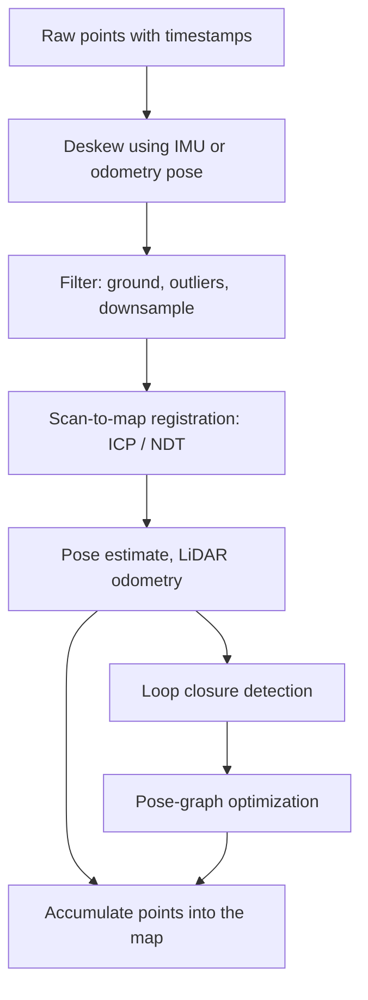

::: testing
Whether you can explain **two linked problems**: (1) how a sensor covers the full 360° around it (spinning heads, mirrors, multiple units, scan patterns, angular encoding) and (2) how those scans become a map (coordinate transforms, motion compensation, scan registration, SLAM). The interviewer wants the geometry (range plus azimuth and elevation to $x,y,z$), the engineering of the rotating head, numbers for point density and blind spots, and awareness that a moving sensor distorts its own scan. Strong candidates mention IMU deskewing, ICP/NDT matching, loop closure and drift.
:::

::: why
360° coverage is what turns LiDAR from a rangefinder into a situational-awareness and mapping sensor, for robotaxis, mobile robots and survey vehicles. As a hardware engineer you would deal with the rotating head (bearing, slip ring or wireless coupling, encoder), laser channel layout, timestamping per point, and the IMU/clock integration that makes mapping possible. Interviewers use this question to see whether you can reason about coordinate frames and time, not only about optics. It builds on [[q0864]] and [[q0865]] and leads to the data description in [[q0869]].
:::

::: concepts
- **Spherical to Cartesian conversion**: $(r,\phi,\theta)\to(x,y,z)$ for each return ([[q0865]]).
- **Scan mechanisms**: rotating head, polygon or MEMS mirror, multiple solid-state units, flash.
- **Angular resolution and ring geometry**: vertical beams give rings on the ground whose spacing grows with range ([[q0869]]).
- **Rigid-body transforms**: sensor frame to vehicle frame to world frame (rotation and translation).
- **Motion distortion and IMU**: the sensor moves while it scans; correct with pose interpolation ([[q0845]], [[q0850]]).
- **Registration and SLAM**: ICP or NDT scan matching, odometry drift, loop closure.
:::

::: answer
"There are two parts: seeing in all directions, and stitching what you see into a map.

For the 360° coverage, the classic way is a spinning head. A column of lasers and detectors, say 32 or 128 channels stacked vertically with different elevation angles, rotates around a vertical axis at 10 to 20 revolutions per second. An encoder reports the azimuth at each firing, so each return has a range, an azimuth and a fixed elevation, and I convert that to x, y, z with sines and cosines. Alternatives are a single laser with a rotating mirror for a 2D slice, MEMS or polygon mirrors for a limited field of view, or several solid-state units around the vehicle whose fields of view are stitched using a calibrated transform.

For the map: the sensor is moving, so one revolution of 100 milliseconds at 20 meters per second smears by 2 meters unless I correct it. I use the IMU and wheel odometry to estimate the pose at each point's timestamp and transform every point into a common frame, called deskewing. Then I register consecutive scans with ICP or NDT to estimate how the sensor moved and accumulate the points into a map. Odometry drifts, so I use loop closure, recognizing a place I have seen before, and optimize the pose graph. That's LiDAR SLAM."
:::

::: technical
**Geometry.** Each return: range $r$, azimuth $\phi$ (from the encoder), elevation $\theta_k$ (fixed per channel $k$). Sensor-frame coordinates:
$$x = r\cos\theta\cos\phi,\quad y = r\cos\theta\sin\phi,\quad z = r\sin\theta.$$
For $r$ = 25 m, $\phi$ = 30°, $\theta$ = −5°: $(21.57, 12.45, -2.18)$ m.

**Scan numbers.** A 64-channel head at 10 Hz with 0.2° azimuth steps has 1800 columns per revolution, a firing every 55.6 µs per channel (18 kHz per channel) and $64\times1800\times10 = 1.15$ M points/s. Labeling 1800 columns needs at least 1800 counts per revolution (11 bits); even a 13-bit encoder (0.044° per count) contributes up to 7.7 cm of lateral error at 100 m if uncorrected ([[q0870]]).

**Ground rings and blind zone.** Mounted at $h$ = 1.8 m, a beam depressed by $\alpha$ hits the ground at $h/\tan\alpha$: 3.9 m for 25°, 10.2 m for 10°, 20.6 m for 5°, 51.6 m for 2°, 103 m for 1°. So the lowest beam defines a blind circle of radius 3.9 m around the vehicle, and at small angles 0.5° steps leave huge gaps: the 1° ring lands at 103 m and a 0.5° ring would land at 206 m.

**Motion distortion.** A scan takes 100 ms; at 20 m/s the vehicle moves 2 m, so the start and end of the sweep disagree by 2 m (3 m at 30 m/s). Deskew by interpolating the pose $T(t_i)$ for each point's timestamp and transforming the point into the frame at a reference time.

**Registration (ICP).** Find $R,\mathbf{t}$ minimizing $\sum_i\|R\mathbf{p}_i+\mathbf{t}-\mathbf{q}_i\|^2$ over matched pairs; given correspondences the optimum is closed-form (centroids, SVD of the cross-covariance, Kabsch). Iterate matching and solving; NDT matches to a grid of Gaussians instead of points.

**Drift.** Odometry error of 0.5 percent of distance traveled gives 5 m after 1 km. Loop closure adds a constraint between distant poses, and pose-graph optimization redistributes the error.
:::

::: short
"For 360°, a spinning head carries a vertical stack of lasers around an axis at 10 to 20 revolutions per second, and an encoder gives each return its azimuth; range, azimuth and the channel's elevation convert to x, y, z. Alternatives are mirrors or several solid-state units stitched together. To make a map, I timestamp every point, use the IMU to deskew the motion during a scan, register consecutive scans with ICP or NDT, accumulate them in a world frame, and use loop closure to correct drift."
:::

::: long
"I split it into coverage and mapping.

Coverage first. The most common approach is a spinning head. A column of lasers and detectors, anywhere from 16 to 128 channels, each pointed at a slightly different elevation, rotates around a vertical axis at 10 to 20 hertz. A rotary encoder tells me the azimuth at the instant each laser fires. Each return then has a range, an azimuth, and a known elevation, and I convert to Cartesian: x equals r cos elevation cos azimuth, y equals r cos elevation sin azimuth, z equals r sin elevation. For a 64-channel head at 10 hertz with 0.2 degree steps that's about 1.15 million points a second. The beams hit the ground in rings, and the lowest beam sets a blind zone: with the sensor at 1.8 meters and a lowest beam 25 degrees down, nothing within 3.9 meters is seen. Other options are a single laser with a rotating mirror for a 2D plane, a MEMS or polygon mirror for a limited field of view, or several solid-state units around a car with calibrated overlap.

Now mapping. The sensor moves, so one 100 millisecond revolution at 20 meters per second smears 2 meters. To fix that, every point carries a timestamp, and I use IMU and odometry to interpolate the sensor pose at that time, then transform all points into a common frame. Then I estimate motion between scans by registration: ICP finds the rotation and translation that best aligns the new scan to the previous one or to the map, NDT does a similar thing against a grid of Gaussians. Chaining these gives odometry, but it drifts, say half a percent of distance, which is 5 meters over a kilometer. So I detect loop closures, optimize the pose graph, and accumulate the corrected scans into a map.

Hardware-wise the keys are a precise encoder, per-point timestamps, a calibrated sensor-to-IMU transform, and a common clock."
:::

::: terms
- **Azimuth / elevation**: horizontal angle around the vertical axis and vertical angle relative to the horizon.
- **Channel / ring**: one laser-detector pair with fixed elevation; its returns trace a ring while rotating.
- **Rotary encoder**: sensor reporting the head's angle.
- **Deskewing / motion compensation**: correcting the distortion caused by the sensor's motion during a scan.
- **ICP (iterative closest point)**: scan registration by alternating point matching and rigid-transform estimation.
- **NDT**: normal distributions transform, registration to a grid of local Gaussians.
- **SLAM**: simultaneous localization and mapping.
- **Loop closure**: recognizing a revisited place to correct drift.
- **Pose graph**: nodes are poses, edges are relative-motion constraints, optimized jointly.
- **Extrinsic calibration**: the fixed transform between LiDAR and IMU, vehicle or other sensors.
:::

::: exceptional
An average answer says "spin the LiDAR around." An exceptional answer:

- Gives the **conversion equations** and an example, and numbers (points/s, ring and blind-zone geometry).
- Describes **alternatives** (mirrors, multiple units, flash) with trade-offs (moving parts, FoV, cost).
- Raises **motion distortion** unprompted and quantifies it (2 m at 20 m/s over 100 ms), then explains deskewing with IMU-interpolated poses and per-point timestamps.
- Explains **registration (ICP/NDT)**, **drift** and **loop closure** rather than saying "SLAM" as a magic word.
- Mentions calibration (encoder, channel elevations, LiDAR-IMU extrinsics) and time sync.
:::

::: mistakes
- **Treating a scan as instantaneous.** At vehicle speed a scan has meters of motion distortion; ignoring it blurs walls and double-images objects.
- **Forgetting the blind zone.** A roof-mounted spinning LiDAR cannot see the ground near the car; the lowest beam angle sets it.
- **Assuming uniform density.** Rings spread with range; consecutive low-angle rings land tens of meters apart on the ground at 50 m and beyond.
- **Thinking ICP always converges.** ICP needs a good initial guess, overlapping structure, and enough geometric constraint; long straight corridors and flat fields make some directions unobservable.
- **Mixing coordinate frames and timestamps.** Sensor, vehicle, IMU and world frames each have their own transform and clock.
- **Believing a map has no drift.** Odometry errors accumulate; loop closure and GNSS corrections bound them.
:::

::: deep
## Part 1: Covering 360°

### The spinning multi-channel head

A column of $N$ emitter-detector pairs (channels), each with a fixed elevation $\theta_k$, rotates about a vertical axis. At each azimuth step the lasers fire (sequentially or in a staggered pattern to limit optical crosstalk), producing $N$ points. Over one revolution: $N\times(360°/\Delta\phi)$ points.

| Parameter | Example | Result |
|---|---|---|
| Channels | 64 | |
| Rotation | 10 Hz (600 rpm) | 100 ms per revolution |
| Azimuth step | 0.2° | 1800 columns |
| Points per revolution | $64\times1800$ | 115,200 |
| Points per second | $\times10$ | 1.152 M |
| Firing rate per channel | $1800\times10$ | 18 kHz (55.6 µs between firings) |
| Max unambiguous range at 18 kHz | $c/(2\times18\text{ kHz})$ | 8.3 km (not limiting) |

The head needs power and data to cross the rotating interface: a slip ring (wear), or inductive/capacitive coupling and optical or wireless data links in modern designs. Bearings must last for years of continuous 600 rpm; motor speed is controlled by a loop that locks to the encoder, and a stable speed matters because azimuth is derived from it.

```plot
{"title":"Where each beam hits flat ground (default sensor height 1.8 m)","x":{"label":"Beam depression angle","unit":"°","min":1,"max":25},"y":{"label":"Ground hit distance","unit":"m","min":0,"max":150},"vars":{"h":1.8},"series":[{"label":"h / tan(angle)","fn":"h/tan(x*pi/180)"}],"points":[{"x":25,"y":"h/tan(25*pi/180)","label":"25°"},{"x":10,"y":"h/tan(10*pi/180)","label":"10°"},{"x":5,"y":"h/tan(5*pi/180)","label":"5°"},{"x":2,"y":"h/tan(2*pi/180)","label":"2°"},{"x":1,"y":"h/tan(1*pi/180)","label":"1°"}],"params":[{"name":"h","label":"Sensor height","min":0.5,"max":2.5,"value":1.8,"unit":"m","step":0.1}],"readouts":[{"label":"Blind circle (25° beam)","expr":"h/tan(25*pi/180)","unit":"m"},{"label":"Ground hit of the 2° beam","expr":"h/tan(2*pi/180)","unit":"m"},{"label":"Ground hit of the 1° beam","expr":"h/tan(1*pi/180)","unit":"m"}]}
```
Figure: At the default 1.8 m height, the lowest beam (25°) sets a blind circle of 3.9 m. The ground distance grows as $1/\tan\alpha$, so a 0.5° change in elevation moves the ground hit by 17 m near 2° but by about 100 m near 1°. That's why dense vertical resolution matters at small depression angles, and why many designs concentrate channels near the horizon. Drag the mounting height to 1.0 m: the blind circle shrinks to about 2.1 m and the 1° beam lands at about 57 m.

### Elevation layout and field of view

Channels aren't uniformly spaced: dense near the horizon, sparse at large angles. Example: 128 channels over −25° to +15°, average 0.31° spacing. At 100 m, a 0.31° step is 54 cm vertically, so a 1.7 m pedestrian gets about 3 or 4 channels.

### Alternatives to spinning

| Approach | Coverage | Pros | Cons |
|---|---|---|---|
| Single laser + rotating mirror | 2D plane, 270° to 360° | simple, cheap (robots) | 2D only unless tilted |
| Nodding/tilting 2D scanner | 3D, slow | cheap mapping | low rate, motion issues |
| Polygon/galvo/MEMS mirror | 60° to 120° sector | no whole-head rotation, can steer | limited FoV; mirror size limits aperture |
| Several solid-state sensors | stitched 360° | automotive integration, no spin | calibration, overlaps, cost |
| Flash | fixed FoV | no moving parts | short range |
| Optical phased array | steered | no moving parts | immature, loss, side lobes |

For several fixed sensors, the extrinsic transform of each into the vehicle frame must be calibrated to a fraction of a degree. A 0.1° yaw error is 8.7 cm at 50 m ([[q0867]]).

### Angle knowledge

Azimuth comes from an encoder: 1800 counts per revolution gives 0.2°; a 13-bit absolute encoder (8192 counts) gives 0.044°, but the effective error includes eccentricity and speed ripple, 0.05° at 100 m is 8.7 cm ([[q0870]]). Elevation per channel is calibrated at the factory and stored.

## Part 2: From scans to a map


Figure: The LiDAR SLAM loop. Deskewing needs per-point timestamps; registration gives relative motion; loop closure and graph optimization remove accumulated drift before points are added to the final map.

### Coordinate frames

Each point is in the sensor frame $S$. The vehicle frame $V$ is related by a fixed extrinsic $T_{VS}$ (from calibration). The pose of the vehicle in the world is $T_{WV}(t)$ (estimated). A point maps to the world as
$$\mathbf{p}_W = T_{WV}(t_i)\,T_{VS}\,\mathbf{p}_S$$
with $t_i$ the timestamp of that individual point, not the scan, which is what deskewing means.

### Motion distortion (deskewing)

If the scan takes 100 ms and the vehicle moves at 20 m/s, a wall straight ahead measured at the start and end of the sweep differs by 2 m of pose change (3 m at 30 m/s), so a flat wall appears curved or doubled. Rotation matters even more: a yaw rate of 30°/s produces 3° over the scan, which is 5.2 m at 100 m. Correction: interpolate the pose between the start and end (linear for position, spherical interpolation for orientation), or use the IMU's high-rate data (hundreds of Hz) integrated between LiDAR frames ([[q0850]]). The IMU also gives an initial guess to registration, which makes ICP converge.

### Registration with ICP: a worked example

Given point pairs $\mathbf{p}_i\leftrightarrow\mathbf{q}_i$, the optimal rigid transform is closed-form: subtract the centroids $\bar{\mathbf p},\bar{\mathbf q}$, build $H=\sum(\mathbf p_i-\bar{\mathbf p})(\mathbf q_i-\bar{\mathbf q})^T$, take the SVD $H = U\Sigma V^T$, then $R = VU^T$ (with a determinant sign fix), $\mathbf t = \bar{\mathbf q} - R\bar{\mathbf p}$. In 2D the rotation angle is simply $\psi=\text{atan2}\left(\sum p_x q_y - p_y q_x,\ \sum p_x q_x + p_y q_y\right)$ with centered coordinates.

Example: points $P = \{(0,0),(4,0),(4,2),(0,3)\}$ were rotated by 30° and translated by $(1,2)$ giving $Q = \{(1,2),(4.464,4),(3.464,5.732),(-0.5,4.598)\}$. Centroids: $\bar p=(2,1.25)$, $\bar q=(2.107,4.083)$. The formula yields $\psi=30.0°$ and then $\mathbf t=(1,2)$, recovering the motion exactly. With noisy points and unknown correspondences, ICP repeats this: nearest-neighbor match, solve, apply, until the change is small. Point-to-plane variants converge faster on structured scenes.

**Failure modes.** Poor initial guess (local minima), too little geometry (a long featureless corridor leaves translation along the corridor unobservable), dynamic objects (cars and people create wrong matches, so downweight or remove them), and degraded returns.

### Drift, loop closure and the map

Scan-to-scan odometry accumulates error. If the error is 0.5 percent of path length, then after 1 km the position is off by 5 m. When the vehicle returns to a known place, a place-recognition step detects it (global descriptors of the scan), a loop-closure constraint is added between the two poses, and the pose graph (poses as nodes, relative motions as edges) is re-optimized to spread the correction. GNSS or a prior HD map can also constrain the pose. The final map can be stored as points, voxels (a 10 cm voxel map of 1 km × 50 m × 10 m is up to 0.5 G voxels if fully dense; real maps are sparse and much smaller), an occupancy grid, or meshes. Raw logging at 1.15 Mpts/s × 16 bytes is 18 MB/s, or 11 GB per 10 minutes, so maps are downsampled.

### Timing and calibration hardware

- **Per-point timestamps** from the LiDAR's clock, synchronized to the IMU/GNSS clock (PTP or PPS plus NMEA); a 1 ms offset at 20 m/s is 2 cm of position, but a 10 ms offset is 20 cm.
- **LiDAR-IMU extrinsic calibration** (a few mm and a fraction of a degree) by motion-based optimization.
- **Intrinsic calibration:** channel elevations, azimuth offsets per laser, range offsets ([[q0871]] discusses calibration experiments in general).

## Experiment with it

```sim
{"id":"imu-lab","view":"drift","bias":0.02}
```
Figure: Double-integrating an accelerometer with a small bias makes position error grow as $\tfrac12 bt^2$. This is why an IMU alone can't be used for mapping over more than a second or two, and why LiDAR registration and loop closure are used to bound drift while the IMU provides the short-term motion for deskewing.
:::

::: applications
- **Autonomous vehicles**: roof-mounted 360° LiDAR for detection, localization against HD maps and free-space estimation.
- **Mobile mapping systems**: vehicle- or backpack-mounted spinning LiDAR with GNSS/IMU producing street and indoor maps.
- **Warehouse and service robots**: 2D 360° scanners for SLAM and localization, 3D heads for ramps and clutter.
- **Underground and mining mapping**: handheld or drone LiDAR SLAM where GNSS is unavailable.
- **Drones for inspection and survey**: gimbal-mounted or fixed LiDAR with RTK GNSS and IMU for direct georeferencing.
- **Construction progress capture**: SLAM-based handheld scanners producing as-built point clouds.
:::

::: assumptions
- I assume a **mechanically rotating multi-channel LiDAR** as the main 360° solution, a flat-ground geometry for ring distances, and a rigid sensor with calibrated intrinsics.
- Numbers (64 channels, 10 Hz, 0.2° step, 1.8 m height, 0.5 percent drift) are illustrative.
- Deskewing using constant-velocity interpolation assumes smooth motion during 100 ms; aggressive maneuvers need IMU integration.
- ICP details given are for rigid motion in static scenes; dynamic scenes, rolling-sensor effects and non-rigid platforms add complexity.
- A valid alternative reading is "map the world 360° around **a stationary** sensor", for which a tripod scanner with a nodding mirror, a slow rotation and no motion distortion is the right answer.
:::

::: followups
### Why does a spinning LiDAR have a blind zone around the vehicle?
The lowest beam points down at some angle (say 25°) from a mounting height $h$, so the first ground return is at $h/\tan25°$ (3.9 m for 1.8 m). Closer than that, the ground and any small object are below the beam fan. Designs address it with extra short-range LiDARs or cameras at the corners, or a lower mounting plus wider vertical field of view.

### How would you correct motion distortion if you have an IMU running at 400 Hz?
Integrate the IMU between the start and end of the scan (with the current bias and gravity estimates) to get the pose at each timestamp; transform each point from the sensor frame at its own time into the frame at a reference time (often the scan end). Use the LiDAR registration result to correct IMU bias, since IMU alone drifts ([[q0850]]). With 400 Hz IMU you have 40 poses per 100 ms scan, so interpolation between them is accurate.

### What makes ICP fail in a long hallway?
The scene geometry constrains lateral position and heading but not motion along the corridor (every slice looks the same), so the along-corridor translation is unobservable and ICP slides. Fixes: use the IMU/wheel odometry as a prior for that degree of freedom, add features (doorways), use intensity as well as geometry, or use a motion model with covariance that reflects the degeneracy.

### How do multiple solid-state LiDARs get combined into a 360° view?
Each sensor reports points in its own frame, and each has a calibrated extrinsic transform to a common vehicle frame, so I transform all points and merge them. Calibration uses overlapping fields of view: align the clouds in the overlap (ICP) or use targets. Timestamps must be synchronized (they scan at different instants and may be staggered) and you must handle crosstalk and interference between the sensors' lasers ([[q0870]]).

### Scenario: your map of a loop shows two copies of the same wall offset by 40 cm when you return to the start. Diagnose.
That is accumulated drift at the loop closure point, 40 cm over a path of maybe tens of meters, or a systematic error. Check whether the offset scales with distance (scale/odometry error), with turns (a yaw bias or calibration error in the LiDAR-IMU rotation), or is constant (time offset). Run loop closure and pose-graph optimization, verify the LiDAR-IMU extrinsic and time offset, check the deskew, and look for dynamic objects corrupting matches.
:::

::: interpretations
"Map the world 360 degrees all around you" could be read as (a) the sensor's scan geometry, or (b) building a world map as the platform moves. I cover both: Part 1 is the 360° scan geometry and Part 2 is the SLAM/mapping pipeline.
:::

::: references
- Thrun, Burgard and Fox, *Probabilistic Robotics*: scan matching, occupancy grids, SLAM.
- Besl and McKay, "A method for registration of 3-D shapes," IEEE Trans. PAMI, 1992 (ICP).
- Biber and Strasser, "The normal distributions transform: a new approach to laser scan matching," IROS 2003.
- Barfoot, *State Estimation for Robotics*: rigid-body transforms, pose interpolation and graph optimization.
:::

::: rubric
- Explains the scan mechanism (rotating multi-channel head with encoder, or mirrors/multiple units) :: Directly answers how 360° is covered.
- Gives the spherical-to-Cartesian conversion :: It is the core geometry of the point generation.
- Quantifies points per second or ring/blind-zone geometry :: Shows grasp of the design numbers.
- Identifies motion distortion and the deskewing fix using IMU/odometry and per-point timestamps :: This is the key mapping subtlety.
- Explains registration (ICP/NDT) and accumulation into a world frame :: How scans become a map.
- Mentions drift and loop closure / pose graph :: Shows you understand SLAM beyond a buzzword.
- Mentions calibration and time sync :: Required for accurate fusion and mapping.
:::

::: quiz
```json
[
 {"type":"numeric","level":"fundamental","q":"A 32-channel LiDAR spins at 20 Hz with 0.4° azimuth steps. How many points per second does it produce (in thousands)?","answer":576,"tolerance":0.02,"unit":"k points/s","explain":"Columns per revolution = 360/0.4 = 900. Points per revolution = 32 × 900 = 28,800. At 20 Hz: 576,000 points/s."},
 {"type":"numeric","level":"intermediate","q":"A LiDAR is mounted 2.0 m above flat ground; its lowest beam is 20° below horizontal. What is the radius of the blind zone (m)?","answer":5.5,"tolerance":0.02,"unit":"m","explain":"$h/\\tan20° = 2.0/0.3640 = 5.49$ m."},
 {"type":"numeric","level":"intermediate","q":"A return has $r$ = 40 m, azimuth 60°, elevation 10°. What is its x coordinate (m)?","answer":19.7,"tolerance":0.02,"unit":"m","explain":"$x = r\\cos\\theta\\cos\\phi = 40\\times0.9848\\times0.5 = 19.70$ m."},
 {"type":"mcq","level":"intermediate","q":"What causes the distortion of a scan taken from a moving vehicle?","options":["The laser wavelength changes with speed","The sensor moves between the first and last points of one revolution","The encoder has too many counts","The ground reflects less light"],"answer":1,"explain":"A revolution takes ~100 ms, during which the sensor moves (2 m at 20 m/s) and rotates, so points measured at different times are in different frames. Deskewing with per-point poses fixes it."},
 {"type":"truefalse","level":"advanced","q":"In a long, featureless straight corridor, ICP can reliably estimate motion along the corridor axis.","answer":false,"explain":"Every slice of the corridor looks the same, so translation along its axis is unobservable (degenerate); ICP slides. Use odometry/IMU priors or additional features."},
 {"type":"numeric","level":"advanced","q":"Odometry drift is 0.8 percent of distance traveled. How large is the position error after a 2.5 km drive (m), before loop closure?","answer":20,"tolerance":0.02,"unit":"m","explain":"$0.008\\times2500 = 20$ m."}
]
```
:::
