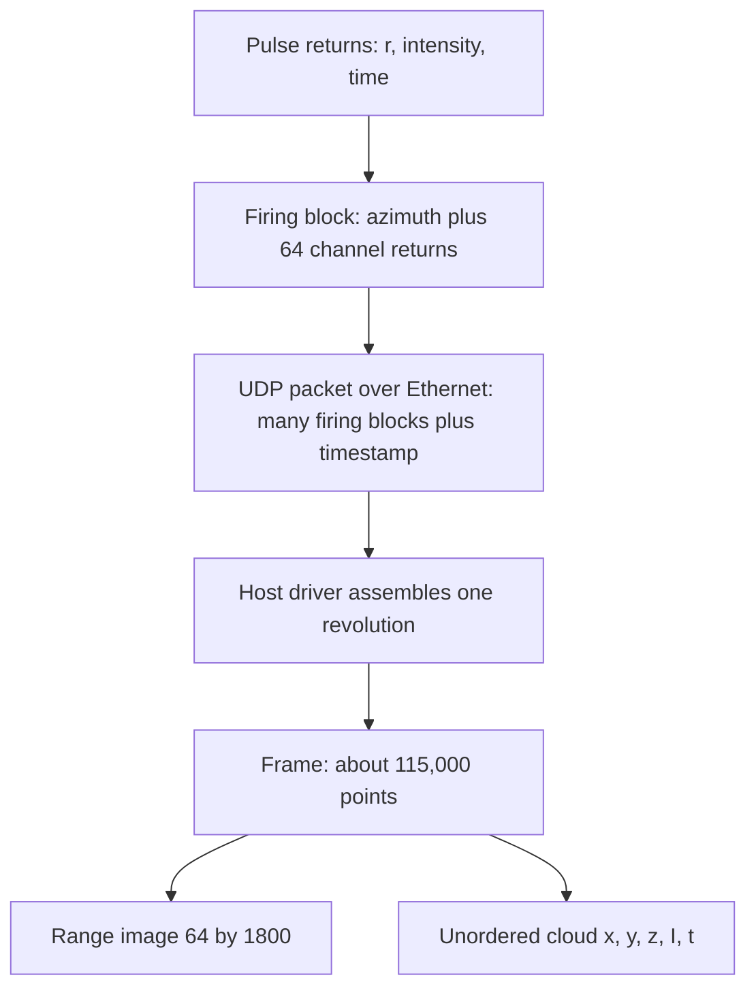

::: basics
### In plain words
A LiDAR's output is a point cloud: a large set of 3D points, each one a spot on a surface where a laser pulse bounced back. A point holds at least a position, a strength of return called intensity, and a time stamp. The sensor delivers one full set, called a frame, about 10 to 20 times a second.

### Picture it
Imagine a ceiling-star projector. It shoots a fixed pattern of dots into a room. On a nearby wall the dots sit close together. On a far wall the same pattern spreads out, so the dots are farther apart. A LiDAR scans in a fixed pattern of angles the same way. The dot count per square meter falls with the square of the distance. The picture differs in one way: each LiDAR dot carries a measured distance, but no color.

### Words you need
- **Point cloud**: the set of 3D points from one or more scans. See [[q0868]] for how the sensor covers all directions.
- **Frame**: all points collected in one scan period, typically 50 to 100 ms.
- **Intensity**: how strong the returned pulse was. It depends on the surface, the distance and the angle.
- **Angular spacing**: the angle between neighboring beams, such as 0.2 degrees. It fixes how the dots spread out.
- **Mixed pixel**: a false point that lands in empty space between a near and a far surface, because the beam straddled an edge.

### The simplest example
Take a LiDAR with beams spaced 0.2 degrees apart sideways and 0.625 degrees apart up and down. A pedestrian 0.5 m wide and 1.7 m tall at 20 m gets about 56 points: about 7 across and 8 up. At 50 m they get about 9 points. At 100 m, only about 2. Doubling the range cuts the points to about a quarter. That is the whole idea. The rest of this page covers what each point contains, how the data streams into frames, the data rate, and the artifacts that need filtering.
:::

::: testing
Whether you can describe LiDAR's **data product precisely**: what a single measurement contains, how points are organized into frames, what the cloud looks like (sparse, unordered or range-image-organized, density falling with range), what is missing (color, semantics), and which artifacts are in the data (noise, mixed pixels, multi-returns). The interviewer is also testing whether you understand data rate, formats and the downstream uses (detection, mapping, localization) well enough to size links and processing. Quantifying points on a target at range is a strong signal.
:::

::: why
The output format is what the rest of the system sees: link bandwidth (Ethernet, MIPI-like), compute for filtering and clustering, logging storage, and algorithm design all follow from it. A hardware engineer needs to know what is in each packet, what timestamps and calibration are applied where, and why the cloud looks the way it does. In an interview, "describe the product of a lidar sensor" is checking that you can state it concisely and then show you understand its limits ([[q0870]]) and how it differs from an image ([[q0867]]).
:::

::: concepts
- **Point**: a 3D sample of a surface, with coordinates (or range and angles), intensity and timestamp ([[q0865]]).
- **Frame / sweep**: all points collected in one scan period, typically 50 to 100 ms ([[q0868]]).
- **Organized vs unorganized clouds**: a range image grid (channel × azimuth) versus an unordered list.
- **Intensity / reflectivity**: return amplitude, depends on target, range and incidence angle.
- **Sampling density**: angular spacing makes density fall as $1/R^2$ per unit area ([[q0866]]).
- **Multiple returns and noise**: echoes per pulse, outliers and edge artifacts.
:::

::: answer
"The product of a LiDAR is a point cloud: a set of 3D points sampled on the surfaces the sensor can see, collected over one scan, typically 10 to 20 times per second. Each point has at least an x, y, z position relative to the sensor, or equivalently a range, azimuth and elevation, plus an intensity from the return signal strength, and a timestamp. Many sensors add which laser channel it came from, which return it was if there were several, and sometimes ambient light level, or for FMCW, a radial velocity.

What does it look like? It's sparse and irregular. A 64-channel spinning unit gives around a million points a second, but the density falls with the square of distance: a pedestrian at 20 meters might have 50 points on them, at 50 meters about nine, at 100 meters about two. The beams form rings on the ground. There's no color or texture, just geometry and intensity. It also has noise: range jitter of a couple of centimeters, stray points at edges where the beam straddles two surfaces, ghost points from reflections, and gaps where surfaces are dark, glossy or absorbing.

Data-wise, a raw stream is a few megabytes a second over Ethernet in sensor packets, and a processed cloud is more like 20 megabytes a second. Downstream, people turn it into range images, bird's-eye-view grids or voxels for detection, and accumulate it into maps."
:::

::: technical
**Per-point record.** Typical fields: $(x,y,z)$ [float32 or fixed-point mm] or $(r,\phi,\theta)$; intensity (8 or 16 bit); timestamp (ns resolution, per point or per firing); channel (ring) index; return index (first, strongest, last); optionally reflectivity (calibrated for range), ambient/NIR level, pulse width or peak, and radial velocity (FMCW).

**Frame structure.** A spinning LiDAR sends UDP packets over Ethernet, each carrying firing blocks (azimuth plus per-channel distance and reflectivity), which the host assembles into a frame/sweep. 64 channels × 1800 columns × 10 Hz = 1.152 M points/s.

**Data rates.** Raw packets at about 3 bytes per channel return (2 B distance + 1 B reflectivity): 3.46 MB/s = 27.6 Mbit/s. Converted point cloud at 16 B per point (float32 x, y, z, intensity): 18.4 MB/s = 147 Mbit/s, which is 1.84 MB per 115,200-point frame. A range image of $64\times1800$ at 16-bit is 0.23 MB per frame.

**Density on a target.** Points on a target of width $w$ and height $h$ at range $R$ for angular steps $\Delta\phi,\Delta\theta$: $N\approx\dfrac{w\,h}{R^2\tan\Delta\phi\tan\Delta\theta}$. For a pedestrian 0.5 × 1.7 m with 0.2° × 0.625°: 893 points at 5 m, 223 at 10 m, 56 at 20 m, 8.9 at 50 m, 2.2 at 100 m, 0.6 at 200 m. Finer steps (0.1° × 0.2°) give 14 points at 100 m.

**Intensity.** Received power $\propto\rho\cos\alpha/R^2$, so raw amplitude falls 100x from 10 m to 100 m; sensors report either raw intensity or a range-compensated reflectivity.

**Artifacts.** Mixed pixels (edge points between a near and far surface), multipath ghosts, blooming around retroreflectors, rain or dust returns, and missing returns on dark or specular surfaces ([[q0870]]).
:::

::: short
"The product is a point cloud: a time-stamped set of 3D points on the visible surfaces, produced 10 to 20 times a second, each with x, y, z, an intensity from the return strength, and usually the laser channel and return number. It's sparse and irregular, density falls with the square of range, there's no color, and it carries noise like edge artifacts and ghost points. A 64-channel unit gives around a million points a second, tens of megabits to a couple hundred megabits per second."
:::

::: long
"A LiDAR's product is a point cloud. Each pulse that returns gives one point: a position in 3D, computed from the measured range and the beam's azimuth and elevation, plus an intensity from the strength of the return, and a timestamp. Usually there's also which laser channel it came from, and a return number, since one pulse can give several echoes. The sensor groups the points into frames, one rotation of 50 to 100 milliseconds, and streams them as UDP packets over Ethernet.

Some numbers for a 64-channel spinning unit: 1800 columns per revolution, 10 revolutions per second, so about 1.15 million points per second. Raw packets are about 3 bytes per return, so around 28 megabits per second; once you convert to float x, y, z and intensity at 16 bytes per point, it's about 150 megabits per second.

What the cloud looks like is more interesting. It's sparse: the density per area falls with the square of range. A pedestrian half a meter wide and 1.7 tall gets about 56 points at 20 meters, 9 at 50 meters and about 2 at 100. The points lie on rings on the ground. It's unordered unless you keep the range image structure, which is useful: it's a 64 by 1800 grid where each pixel is a range. It has no color or texture, just geometry and intensity, and the intensity depends on reflectivity, range and angle.

And it has artifacts: range noise of a couple of centimeters, mixed points at the edge of objects where the beam straddles two surfaces, ghosts from reflections, blooming near retroreflectors, and no returns from very dark or mirror-like surfaces.

Downstream we turn it into range images, bird's eye view or voxels for detection networks, ground segmentation and clustering, or accumulate scans into a map."
:::

::: terms
- **Point cloud**: unordered or grid-organized set of 3D points representing sampled surfaces.
- **Frame / sweep**: one full scan period of points.
- **Range image**: 2D array indexed by channel and azimuth, each pixel storing range.
- **Intensity / reflectivity**: return amplitude, or range- and angle-compensated surface reflectance.
- **Ring / channel**: laser index, also the elevation line.
- **Return index**: first, last or strongest echo for a pulse.
- **Mixed pixel (edge) point**: a spurious point between two surfaces caused by a beam straddling an edge.
- **Voxel grid / BEV**: regular 3D or top-down discretizations used by algorithms.
- **PCAP / PCD / LAS**: capture of raw packets, Point Cloud Library file, and an airborne-survey point format.
- **PTP timestamp**: time from IEEE 1588 synchronization stamping each packet or point.
:::

::: exceptional
An average answer says "a point cloud with x, y, z." An exceptional answer:

- Lists the **fields per point** (position, intensity, time, ring, return) and says what each is for.
- Describes the **structure**: frames, organized range image versus unordered cloud, rings, and the sparse $1/R^2$ density, with a number (points on a pedestrian at 20, 50, 100 m).
- Gives **data rates** (raw versus processed) and what they mean for the link.
- Lists **artifacts**: mixed pixels, ghosts, blooming, dropouts, rain, motion distortion.
- Notes what is **absent** (color, semantics) and how the cloud is consumed (range image, BEV, voxels, maps) and fused with cameras ([[q0867]]).
:::

::: mistakes
- **Calling it "a 3D image".** It is a sparse, irregularly sampled set of surface points, not a dense grid of pixels; an organized range image is closer to an image but with gaps.
- **Assuming uniform density.** Area density falls as $1/R^2$ and near the ground the rings spread rapidly ([[q0868]]).
- **Treating intensity as reflectance.** Raw intensity depends on range, incidence angle and receiver gain; only calibrated reflectivity is comparable between points.
- **Ignoring timestamps.** Points within a frame are measured at different times (up to 100 ms), so a moving sensor distorts the cloud without per-point timestamps.
- **Trusting every point.** Edge points, ghost points and noise returns need filtering; "real" points need consistent returns.
- **Forgetting the data rate.** Raw stream budgets (100 Mbit/s class) matter for connectors, switches and logging storage.
:::

::: deep
## A point, concretely

A single point is the result of one pulse that got a detected return. The sensor has the following facts at that instant:

| Field | Source | Typical format |
|---|---|---|
| Range $r$ | time of flight, $r = ct/2$ | 16-bit, 4 mm to 1 cm units (65,536 × 4 mm = 262 m; × 1 cm = 655 m) |
| Azimuth $\phi$ | rotation encoder or mirror feedback | 0.01° units, 16-bit |
| Elevation $\theta$ | fixed per channel (calibration table) | table lookup |
| Intensity | peak/area of the return pulse | 8 or 16 bit |
| Timestamp | sensor clock (PTP/GPS-synced) | ns or µs |
| Channel/ring | which laser | 8 bit |
| Return index | first, strongest, last | 2 to 3 bits |
| Optional | pulse width, ambient level, confidence, velocity (FMCW) | |

Converted to Cartesian: $x = r\cos\theta\cos\phi$, $y = r\cos\theta\sin\phi$, $z = r\sin\theta$ ([[q0868]]). The host (or sensor firmware) applies the calibration tables (range offsets, per-laser azimuth offsets) before or after conversion.

## From points to frames and packets


Figure: One firing block carries all channels at one azimuth; packets bundle blocks; the host assembles a revolution (frame). The same data can be kept as an organized range image or converted to an unordered cloud.

**Rates.**
- Points: $64\times1800\times10 = 1.152$ M/s. Frame: 115,200 points.
- Raw at 3 B per return (distance 2 B, reflectivity 1 B): 3.46 MB/s, 27.6 Mbit/s.
- Converted, 16 B per point (4 floats): 18.4 MB/s, 147 Mbit/s; each frame is 1.84 MB.
- Range image: 64 × 1800 × 2 B = 0.23 MB per frame.
- Logging 10 minutes of converted data is 11 GB, so loggers keep the raw packet stream (about 2 GB per 10 minutes) and reprocess offline.

A gigabit link easily carries one such sensor; several 128- or 256-channel sensors at 20 Hz produce several hundred Mbit/s each, which is why high-end sensors use multi-gigabit Ethernet, and why on-sensor compression or ROI selection are active topics.

## What the cloud looks like: density and structure

The angular sampling grid ($\Delta\phi\times\Delta\theta$) is fixed, so the **area** density on a surface perpendicular to the beam falls as $1/R^2$. Points on a pedestrian of width $w$ = 0.5 m and height $h$ = 1.7 m:

$$N(R)\approx\frac{w}{R\tan\Delta\phi}\cdot\frac{h}{R\tan\Delta\theta}$$

```plot
{"title":"Points on a 0.5 m × 1.7 m pedestrian vs range","x":{"label":"Range R","unit":"m","min":5,"max":200,"log":true},"y":{"label":"Number of points","unit":"","min":0.3,"max":1000,"log":true},
 "vars":{"w":0.5,"h":1.7},
 "series":[{"label":"0.2° × 0.625° (64 ch, 0.2° azimuth)","fn":"(w/(x*tan(0.2*pi/180)))*(h/(x*tan(0.625*pi/180)))"},{"label":"0.1° × 0.2° (high-res)","fn":"(w/(x*tan(0.1*pi/180)))*(h/(x*tan(0.2*pi/180)))","color":"green"}],
 "hlines":[{"at":10,"label":"10 points","color":"muted"}],
 "points":[{"x":20,"y":55.8,"label":"56 at 20 m"},{"x":50,"y":8.9,"label":"9 at 50 m"},{"x":100,"y":2.2,"label":"2 at 100 m"}]}
```
Figure: Points on target fall with $R^{-2}$ (slope −2). The standard 64-channel pattern leaves only 9 points on a pedestrian at 50 m and about 2 at 100 m, whereas a 0.1° × 0.2° pattern still gives 14 points at 100 m. The "10 points" line is just a reference level; how many points a detector needs depends on the algorithm and the use.

**Structure.** The grid is regular in angle but not in space: on the ground, spinning heads give concentric rings with spacing that grows with range ([[q0868]]); on a wall, points form rows and columns. When the platform moves, rings smear into helices unless deskewed.

**Intensity.** Return power is $\propto\rho\cos\alpha/R^2$ ([[q0864]]), where $\alpha$ is the incidence angle. Raw intensity therefore falls by 100x between 10 m and 100 m for the same surface. Sensors apply range compensation and calibration to produce a reflectivity value that can identify lane paint (bright), asphalt (dark) and retroreflective signs (very bright), though saturation, gain changes and angle effects remain.

## What's wrong with a raw cloud

1. **Range noise:** 1 to 3 cm rms from timing jitter ([[q0865]]).
2. **Mixed pixels (edge or "flying" points):** if the beam footprint (e.g. 30 cm at 100 m for 3 mrad divergence) straddles a near object and a far wall, the receiver sees two echoes or a blended one, and the point lands between them, in empty air.
3. **Multipath and ghost points:** the beam bounces off a glossy surface (wet road, glass) and then a target, appearing behind the mirror.
4. **Blooming** around retroreflectors: saturated receiver creates a halo of false points or hides neighbors.
5. **Weather returns:** rain, fog, snow, dust produce clustered low-intensity points near the sensor.
6. **Dropouts:** very dark (below 5 percent), glossy or transparent surfaces and surfaces at grazing incidence return nothing.
7. **Motion distortion:** a frame spans 100 ms and the platform moves ([[q0868]]).
8. **Crosstalk and interference** from other LiDARs produce random points or ghosts.

Typical cleanup: remove statistical outliers and isolated points, filter low-intensity near-field clusters (rain), remove ground via plane fitting, then cluster the rest.

## What the algorithms do with it

- **Range image** (64×1800 matrix): convolutional networks and fast ground/segment algorithms operate on this (neighbors are known).
- **Bird's-eye view (BEV) grid** or **voxels**: points binned into 2D/3D cells, with features like count, max height, mean intensity, fed to detection networks (output 3D boxes with class).
- **Point-based networks** (PointNet-style) operate directly on unordered points.
- **Occupancy grid**: free/occupied/unknown space for planning, built by ray casting from the sensor through each point.
- **Map/localization**: accumulate points, match a new scan to a map ([[q0868]]).

Because the cloud is unordered in memory, algorithms must be permutation-invariant or use spatial indices (k-d trees, voxel hashes) for neighbor searches.

## File and message formats

PCAP (raw network capture with sensor packets, replayable), ROS `PointCloud2` messages, PCD (Point Cloud Library), PLY, KITTI-style `.bin` (float32 x, y, z, intensity), and LAS/LAZ for airborne and survey data (per-point records of position, intensity, return number, classification, GPS time; LAZ compresses by roughly 5 to 10x). Sensor-level compression (delta encoding, dropping of unused channels) is common, and when you log, keep the raw timestamps and calibration so you can reprocess.

## Experiment with it

```sim
{"id":"lidar-tof","d":30,"tres":2e-9,"prf":100e3}
```
Figure: The simulation shows what one point contains: a range from the delay, and an intensity from the return pulse height. Increase the timing resolution step from 1 ns to 5 ns to see a point's range quantize to 75 cm steps, then imagine a cloud of such points: the geometry becomes terraced. Raise the PRF to see how pulse rate relates to point rate.
:::

::: applications
- **Object detection for autonomy**: BEV or voxel networks on single frames, producing 3D boxes with class and velocity estimate.
- **HD mapping and localization**: accumulated, georeferenced clouds used as reference maps and matched in real time.
- **Free-space and obstacle detection for robots**: occupancy grids from ray casting.
- **Terrain and forestry products**: classified LAS clouds producing DEMs, canopy height models and volume estimates.
- **As-built construction capture**: dense registered scans compared with CAD/BIM models.
- **AR/phone scanning**: depth maps from small ToF sensors converted to meshes of rooms.
:::

::: assumptions
- Numbers are for a representative **64-channel, 10 Hz spinning LiDAR with 0.2° azimuth and 0.625° vertical spacing**; real sensors vary widely (from 16 to 256 channels, 5 to 30 Hz, nonuniform elevation spacing).
- Field names and byte layouts differ between manufacturers (and I do not quote any specific protocol); the 3-byte raw return and 16-byte point sizes are typical but not universal.
- The pedestrian point-count estimate assumes a flat target perpendicular to the beam and a perfectly regular grid; real counts vary with alignment and occlusion.
- "Product" is read as the sensor's data output, not a commercial product; FMCW outputs add velocity.
- Solid-state and flash LiDARs produce organized depth images with different structure, but the point cloud description still applies.
:::

::: followups
### What is the difference between organized and unorganized point clouds, and why does it matter?
An organized cloud keeps the sensor's grid structure (rows = channels, columns = azimuth), so neighbors are known by index; you can run image-style filters, fast ground segmentation and normal estimation in $O(N)$. An unorganized cloud is just a list, so neighbor queries need a k-d tree or voxel hash ($O(\log N)$ each), but it's the general form after merging scans or removing points. Merged maps are always unorganized.

### Why does the intensity of a point vary with range, and how do sensors correct it?
Received power $\propto\rho\cos\alpha/R^2$, so a given surface returns 100x less at 10x the distance. Sensors apply a range-compensation curve (from calibration) and report reflectivity on a standard scale, plus handle receiver gain changes and saturation. Even then, incidence angle and wet surfaces change values, so it's a feature rather than a precise measurement.

### How many points do you need on a car to detect it?
It depends on the algorithm, but a car is about 1.8 m wide and 1.5 m tall, so at 100 m with 0.2° × 0.625° spacing you get about $(1.8/0.349)\times(1.5/1.09) = 5.2\times1.4\approx7$ points, enough for a rough box with a good network but not much else; at 50 m it's about 28 points. Detection range specs often specify a minimum number of points on target.

### What are mixed pixels and how do you remove them?
At an object edge, the beam footprint is partly on a near surface and partly on a far one, so the receiver sees a blended return and the point falls in empty space between them. Filter by looking at neighbors in the range image: a point whose range differs strongly from both neighbors but with an intermediate angle to the beam, or whose returns are weak/wide, is likely an edge point. Also use pulse width/multi-echo information from the sensor.

### Scenario: your downstream detector produces a "wall" of false obstacles in rain, close to the sensor. What do you check in the data?
Look at the points' intensity and return structure: rain returns are clustered near the sensor (first few meters), low intensity, short pulse and appear only as the first return while the true surface often appears as the last. Filter by intensity, by using last or strongest return, by temporal persistence across frames and by density (rain is sparse and random). Also check whether the receiver is saturating from near-field returns, and whether the sensor offers a rain filter mode.
:::

::: interpretations
"How would you describe the product of a lidar sensor?" means its output data. I answer with the point cloud definition, per-point fields, how it's organized and delivered, its density and artifacts, and how it's used, which is the answer an interviewer expects. In some contexts, "product" can be the derived mapping product (DEM, 3D model), which is covered in the applications.
:::

::: references
- Rusu and Cousins, "3D is here: Point Cloud Library (PCL)," ICRA 2011: the point cloud data model and tools.
- ASPRS LAS Specification: the standard format for airborne LiDAR point data (consult the current version).
- Qi et al., "PointNet: Deep learning on point sets for 3D classification and segmentation," CVPR 2017.
- Geiger et al., "Vision meets robotics: the KITTI dataset," IJRR 2013: an example of LiDAR point cloud data in autonomous driving.
:::

::: rubric
- Defines the output as a time-stamped 3D point cloud :: That is the direct answer to the question.
- Lists per-point fields: x, y, z (or range, angles), intensity, timestamp, channel, return :: Shows what information is actually available.
- Describes structure: frames, rings, organized range image versus unordered :: Understanding the data layout matters for processing.
- Quantifies density and its $1/R^2$ falloff (points on a pedestrian at range) :: Numbers show practical understanding of resolution.
- Gives data rate or packet-level information :: Hardware roles need link budgets.
- Lists artifacts: noise, mixed pixels, ghosts, dropouts, motion distortion :: Real data is imperfect and algorithms depend on handling it.
- Mentions what is absent (color) and how it's consumed (BEV, voxels, maps, fusion) :: Connects the product to its use.
:::

::: quiz
```json
[
 {"type":"mcq","level":"fundamental","q":"Which set of fields is most typical for one LiDAR point?","options":["R, G, B color only","x, y, z, intensity, timestamp","Frequency and amplitude spectrum","Pixel row and column only"],"answer":1,"explain":"A point has a 3D position, an intensity from return strength, and a timestamp (plus channel and return index). Color is not measured."},
 {"type":"numeric","level":"intermediate","q":"A sensor makes 115,200 points per frame at 10 Hz and stores 16 bytes per point. What is the data rate in Mbit/s?","answer":147.5,"tolerance":0.02,"unit":"Mbit/s","explain":"$115{,}200\\times10 = 1.152$ M points/s × 16 B = 18.43 MB/s × 8 = 147.5 Mbit/s."},
 {"type":"numeric","level":"intermediate","q":"With 0.2° horizontal and 0.5° vertical point spacing, about how many points land on a 1 m × 1 m flat target facing the sensor at 40 m?","answer":20.5,"tolerance":0.05,"unit":"points","explain":"Horizontal spacing = 40 tan0.2° = 0.1396 m; vertical = 40 tan0.5° = 0.349 m. Points = (1/0.1396)×(1/0.349) = 7.16 × 2.86 = 20.5 points."},
 {"type":"mcq","level":"intermediate","q":"What causes 'mixed pixel' points at object edges?","options":["Encoder error","The laser footprint straddles a near and a far surface","The ADC is too slow","Ambient light saturation"],"answer":1,"explain":"The beam has a finite footprint (about 30 cm at 100 m for 3 mrad). When part falls on a near object and part on a far one, the returned timing is blended and the point lands in empty space between them."},
 {"type":"truefalse","level":"advanced","q":"For the same surface, raw LiDAR return intensity at 100 m is about 100 times lower than at 10 m.","answer":true,"explain":"Received power $\\propto1/R^2$ for an extended Lambertian target filling the beam, so a 10x range increase gives a 100x decrease. Sensors apply range compensation to report reflectivity."},
 {"type":"numeric","level":"advanced","q":"A 16-bit range field with 4 mm LSB can represent at most what range (m)?","answer":262,"tolerance":0.01,"unit":"m","explain":"$65{,}536\\times4$ mm = 262,144 mm = 262.1 m."}
]
```
:::
