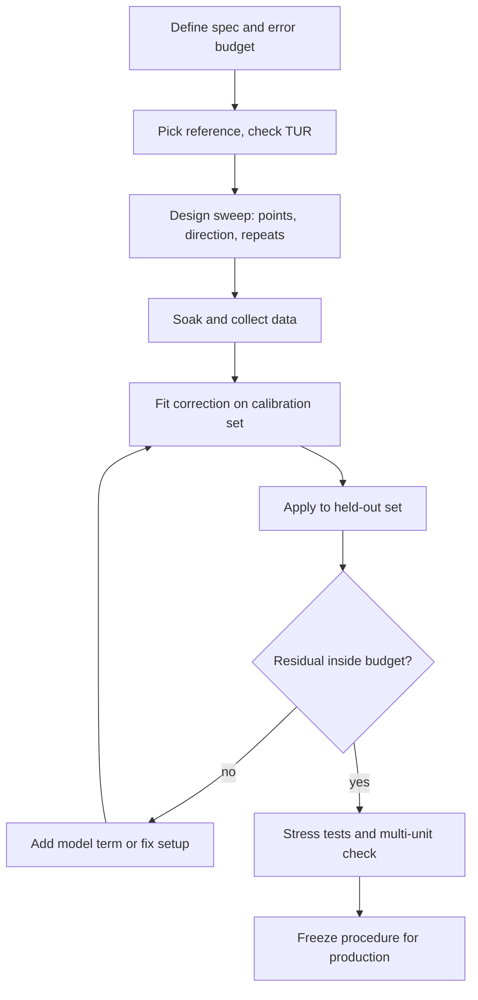

::: basics
### In plain words
Three different jobs are bundled here. Calibrating a sensor means comparing it with a trusted reference and finding a correction for its steady errors. Validating means proving the correction works on data you did not use to build it. Testing means stressing the sensor in the conditions it will really face, such as heat, supply changes and vibration.

### Picture it
Think of a bathroom scale. To calibrate it, you place known weights on it and adjust until it agrees. To validate it, you try a weight you did not use for adjusting and see whether it still reads right. To test it, you check it on a cold floor, after a bump, or with a wobbly battery. If you only checked it with the same weights you adjusted it with, it would look perfect without proving much. A sensor also has drift and noise.

### Words you need
- **Reference**: an instrument much more accurate than the sensor under test, ideally at least four times better.
- **Offset and gain**: offset is the error when the true input is zero. Gain error is a wrong scale factor.
- **Residual**: what remains after correction, the corrected reading minus the reference.
- **Held-out data**: measurements not used in the fit, saved for the check.
- **Hysteresis**: reading depends on whether you approached from above or below.

### The simplest example
A sensor reads 0.20 when the true input is 0, and 11.10 when it is 10. The gain is (11.10 minus 0.20) divided by 10, which is 1.09. The offset is 0.20. The correction is true value equals reading minus 0.20, all divided by 1.09. Now check at a true input of 5, a point not used in the fit. The sensor reads 5.55, and the corrected value is 4.908. That is off by 0.092, so two points fixed offset and gain but not the bow in the middle. That is the whole idea. The rest of this page designs the sweep and sets pass criteria.
:::

::: testing
Whether you treat a sensor as a **measurement system with an error budget**, not a part that "just reads the right number". The interviewer wants to hear the three different jobs (calibrate = fix the systematic error, validate = prove it meets the spec on data you did not fit to, test = stress it in the conditions it will actually live in) and then watch you design an experiment: a trusted reference, a sweep of the full range in both directions, repeated runs, controlled temperature and supply, a fit, and a held-out check. Hidden sub-skills: reference-instrument thinking (test uncertainty ratio), statistics (repeatability vs accuracy), and knowing what you would *not* trust.
:::

::: why
Every real sensor ships with offset, gain error, nonlinearity, temperature drift and noise. Control loops, state estimators, battery gauges and perception stacks all assume the numbers mean something. If you cannot design a calibration and validation procedure you cannot tell whether a bad system result is a sensor problem, a firmware problem or a physics problem. In production the same procedure becomes the factory test: it has to be fast, repeatable and cheap, so you learn early which terms you must trim per unit and which you can characterize once. Interviewers for sensing, robotics and camera or LiDAR teams ask this because it exposes whether you have actually brought a sensor up on a bench.
:::

::: concepts
- **Reference standard**: an instrument or artifact that is much more accurate than the device under test, ideally with a test uncertainty ratio (TUR) of 4:1 or better.
- **Offset, gain, nonlinearity**: the three systematic error terms a calibration fixes. See [[q0873]] for how errors are characterized.
- **Random error vs systematic error**: noise averages away, bias does not. Calibration only removes the bias.
- **Hysteresis, drift, temperature coefficient**: the error terms that depend on history, time and environment, and that a single room-temperature calibration cannot remove.
- **Training vs validation data**: points used to fit the correction cannot also be used to prove it works. See [[q0872]] for what to validate.
- **Design of experiments**: choose points, repetitions, order and conditions so that each error source can be separated from the others.
:::

::: answer
"I'd split it into three jobs. Calibration is fixing the systematic error: I compare the sensor to a reference that's at least four times better than the accuracy I'm claiming, and I fit a correction, offset and gain for a start, more points if it's nonlinear. Validation is checking that correction on points I did not use in the fit, across the whole range and across temperature, and comparing the residual error to the spec. Testing is everything else, the stuff that tries to break it: supply variation, warm-up, vibration, EMI, aging.

For the experiment, say a temperature sensor: I'd put it and a calibrated reference thermometer in a stirred bath or thermal chamber, step through maybe eight temperatures up and then back down so I can see hysteresis, wait for thermal soak at each step, and take a few hundred samples per point. That gives me the mean error and the noise at each point. I'd fit offset and gain on the odd points, then check the residual on the even points. Then I repeat at a couple of supply voltages and on several units, because one unit tells me nothing about production spread. If the residual is inside the budget, I write the coefficients to non-volatile memory and the factory test becomes a two-point check."
:::

::: technical
**Definitions.** *Calibration*: establishing the relationship between the sensor output and the true value traceable to a reference, then applying a correction. *Verification/validation*: showing, with independent data, that the corrected output meets a stated accuracy over the stated conditions. *Testing*: exercising performance, robustness and safety beyond nominal.

**Error model.** For a scalar sensor, reading $y = (1+\varepsilon_g)\,x + b + f_{NL}(x) + h(x,\text{history}) + \alpha(T-T_0)x + n$. The terms are gain error, offset, nonlinearity, hysteresis, temperature effects and noise $n$ (zero mean, standard deviation $\sigma$).

**Calibration methods.**
- *One-point*: removes offset only. Good if gain is trusted.
- *Two-point*: use the ends (or a bracketing pair): $g = \frac{y_2-y_1}{x_2-x_1}$, $b = y_1 - g x_1$, then $\hat x = (y-b)/g$. Leaves nonlinearity.
- *Multi-point or polynomial/LUT*: least squares over $N$ points. The polynomial order should be the lowest that makes residuals look like noise, not a pattern.

**Experiment design.** Test uncertainty ratio $\text{TUR} = \text{spec tolerance}/\text{reference uncertainty} \ge 4$. Sweep the range up and down (hysteresis shows as a loop). Randomize or interleave the order if drift is suspected. Take $N$ samples per point so the standard error of the mean $\sigma/\sqrt N$ is well below the target (for example $\sigma = 20$ mV and $N = 100$ gives 2 mV). Log temperature and supply as covariates. Fit on one subset, hold out the rest.

**Pass criteria.** Max residual error over the held-out set, repeatability (spread of repeated runs), hysteresis, drift over soak time, and the same numbers across temperature and across units (mean and 3σ unit-to-unit spread).

**Production.** Pick the fewest points that keep the residual inside budget; store coefficients with a CRC and a version; add a final check against a golden unit.
:::

::: short
"Calibration fixes the systematic error against a reference that's at least four times better than the sensor: offset and gain at minimum, more points if it's nonlinear. Validation checks that correction on points I did not fit, across range and temperature, against the spec. Testing stresses it with supply changes, warm-up, vibration and noise. My experiment is a sweep up and down over the full range with many samples per point, a fit on half the points and a check on the other half, repeated on several units. That separates bias, noise, hysteresis and unit-to-unit spread."
:::

::: long
"I'd start by asking what the sensor measures and what accuracy the system actually needs, because that sets how much calibration effort is justified. Then I'd separate three jobs.

Calibration is correcting the systematic error. I need a reference that's much better than the sensor, a test uncertainty ratio of four to one or better, otherwise I'm just calibrating the sensor to the reference's errors. I put both in the same environment, sweep through the range, and fit a correction. Two points gives offset and gain; if the residual has a bow shape, I add a mid point and fit a quadratic or use a lookup table.

Validation is proving it. I fit on some points and check on others I held out, because a fit will always look good on its own data. I compare the worst residual to the spec, and I look at the residual pattern. If it isn't random, the model is missing a term.

Testing is trying to break it: temperature, supply voltage, warm-up, vibration, EMI, long-term drift.

For the concrete experiment, say a pressure sensor with a 12-bit ADC. I'd use a deadweight tester or a calibrated reference gauge, eight pressures from zero to full scale and back down, a settle time at each step, and a few hundred samples per point. That gives me mean error per point, noise from the standard deviation, and hysteresis from the up-down difference. Then I'd repeat at two temperatures and two supply voltages, on at least five units, so I can say something about production spread. And I'd log everything so I can redo the analysis later.

If it passes, the factory procedure shrinks to a two-point trim plus a golden-unit check."
:::

::: terms
- **Calibration**: determining and applying a correction so that output matches a reference.
- **Traceability**: an unbroken chain of calibrations back to a national or international standard.
- **Test uncertainty ratio (TUR)**: tolerance of the unit under test divided by uncertainty of the reference. 4:1 is a common target.
- **Repeatability**: scatter of repeated measurements under identical conditions.
- **Hysteresis**: output difference at the same input depending on whether you approached from above or below.
- **Held-out (validation) set**: data not used in the fit, used to estimate real-world error.
- **Residual**: reading after correction minus reference.
- **Soak**: waiting for thermal or mechanical equilibrium before sampling.
- **Golden unit**: a well-characterized reference unit used to check the production test.
:::

::: exceptional
**An average answer** says "compare to a known-good value and adjust until it matches".

**An exceptional answer**:
- Names the three jobs and says why they use different data.
- Requires a reference with a stated TUR and asks about traceability.
- Sweeps both directions to expose hysteresis, and takes enough samples that the standard error is below the target.
- Separates fit points from validation points and looks at the residual *pattern*.
- Covers temperature, supply and multiple units, and says what changes in production (fewer points, trim stored with a CRC, golden unit).
- Quantifies one thing: for example, "100 samples at 20 mV σ gives 2 mV standard error".
:::

::: mistakes
- **Calibrating and validating on the same points.** The fit will look perfect. Hold data out.
- **Using a reference that is not better than the sensor.** A 1 percent reference cannot certify a 1 percent sensor. Aim for TUR 4:1.
- **Sampling before the system settles.** Thermal and mechanical lag looks like drift or hysteresis. Soak first.
- **Only sweeping upward.** You miss hysteresis and backlash entirely.
- **Calibrating one unit and generalizing.** Production spread means the coefficients are per unit; the *model* is per design.
- **Trimming at one temperature and ignoring the tempco.** Room-temperature accuracy says little about a device that lives at 85 °C.
- **Fitting too high an order.** A 7th-order polynomial through 8 points fits the noise and swings between the points.
:::

::: deep
## Three different questions

People say "calibrate" for everything, but the three words answer different questions.

| Activity | Question it answers | Data it uses | Output |
|---|---|---|---|
| Calibration | What correction removes the systematic error? | Reference vs sensor, fit points | Coefficients, LUT |
| Validation | Does the corrected sensor meet the spec? | Independent points, other units, other conditions | Pass/fail with residual numbers |
| Testing | Does it keep working when conditions are bad? | Stress profiles | Failure modes, margins |

Keeping them separate also keeps you honest. If the same points are used for fit and check, the check measures nothing.


Figure: The loop to remember is fit, check on held-out data, and if the residual shows a pattern, add a model term (or fix the setup) before touching the sensor. Stress tests come after the model is trustworthy.

## The error model and what each term needs

A simple but useful model for a linear-ish sensor is

$$y = g\,x + b + c\,x^2 + h + n,$$

with gain $g$, offset $b$, a curvature term $c$, a hysteresis term $h$ that depends on direction, and noise $n$. Each unknown demands a different measurement:

- Offset $b$ needs a known zero (or any single known point if the gain is known).
- Gain $g$ needs a second point far from the first. Using points close together magnifies reference error into gain error.
- Curvature $c$ needs a third point in the middle.
- Hysteresis needs an up-then-down sweep.
- Noise needs many samples at one fixed input.

Worked example. A sensor reads $y = 0.2 + 1.05x + 0.004x^2$ over $x\in[0,10]$ (units arbitrary). Raw error at full scale is $11.1 - 10 = 1.1$. Choose the two end points: $y(0)=0.2$ and $y(10)=11.1$, so $g = (11.1-0.2)/10 = 1.09$ and $b = 0.2$. Correct with $\hat x = (y-0.2)/1.09$. At $x=5$ the sensor reads $0.2 + 5.25 + 0.1 = 5.55$, so $\hat x = 5.35/1.09 = 4.908$, an error of $-0.092$, about $-0.9\%$ of full scale. The two-point fit fixed offset and gain but left the bow. A third point at mid-range removes it.

```plot
{"title":"Residual error after different calibrations (noise-free sensor)","x":{"label":"True input x","min":0,"max":10},"y":{"label":"Error (corrected - true)","min":-0.2,"max":1.3},
 "series":[
  {"label":"Raw","fn":"0.2+0.05*x+0.004*x^2","color":"red"},
  {"label":"1-point (offset)","fn":"0.05*x+0.004*x^2","color":"orange"},
  {"label":"2-point (ends)","fn":"0.004*x*(x-10)/1.09","color":"blue"},
  {"label":"3-point (quadratic)","fn":"0","color":"green","dashed":true}],
 "points":[{"x":5,"y":"0.004*5*(5-10)/1.09","label":"mid-range bow, -0.092"}]}
```
Figure: Each extra calibration point removes one more error term. The 2-point residual is a bow, largest in the middle, which tells you that a third point (or a curvature term) is justified. A residual that looks like a pattern, not like scatter, always means a missing model term.

## Designing the experiment

Take a temperature sensor with a 10 mV/°C analog output read by a 12-bit, 3.3 V ADC. One LSB is $3.3/4096 = 0.806$ mV, which is 0.08 °C, so the ADC is not the limit if the target is ±0.5 °C. A concrete plan:

1. **Reference**: a calibrated PT100 and readout with ±0.05 °C uncertainty. For a ±0.5 °C goal that is TUR 10:1.
2. **Environment**: stirred bath or thermal chamber with the reference thermometer physically adjacent to the sensor. The two must see the same temperature, which is often the hardest part: thermal gradients and the sensor's self-heating become part of the error.
3. **Points**: 0, 10, 25, 40, 55, 70, 85 °C, then back down. Spread them to cover the range and the expected operating point.
4. **Soak**: wait until both are stable to better than the target (for example, rate of change under 0.01 °C/min).
5. **Samples**: 200 per point. If $\sigma = 20$ mV on the raw output, standard error is $20/\sqrt{200} = 1.4$ mV, equivalent to 0.14 °C. If you need better, average more or filter in hardware.
6. **Covariates**: log supply voltage and board temperature.
7. **Units**: at least 5, preferably across lots.
8. **Analysis**: fit offset and gain using the odd-numbered points, test on the even ones; plot the residual vs temperature, split by direction.

> [!TIP]
> Interleave, don't batch. If you run all of unit A and then all of unit B, a slow drift in the chamber looks like unit-to-unit variation. Rotate the order or repeat a point at the end to expose drift.

## Experiment with it

```sim
{"id":"sensor-calibration","offset":0.2,"gain":1.05,"nonlin":0.02,"noise":0.05}
```
Figure: Take calibration points, then compare the 1-point, 2-point and multi-point corrections. Notice that raising the noise does not change the bias, but makes the fit of a single point unreliable; averaging helps scatter but not nonlinearity.

## Validation: what a pass means

A good validation statement looks like: "Over 0 to 85 °C, on 5 units, corrected error stays within ±0.4 °C (max) with 0.1 °C repeatability and 0.15 °C hysteresis, at 3.0 to 3.6 V supply." Every number has a condition. Report the worst case and the distribution, not just the average. Also state what was *not* tested.

If the residual of unit-to-unit variation is dominated by one term (for instance offset), a one-point trim per unit plus a design-level gain and curvature table may be enough. If gain varies per unit, you need two points in production. The production test is the cheapest set that still keeps the held-out error under the limit.

## Testing: trying to break it

After calibration is trustworthy, test the stress cases: supply ripple and brownout (does the output glitch, and for how long?), warm-up transient, self-heating at the fastest sample rate, EMI near a motor or radio, vibration and shock, humidity, long-term drift via a burn-in soak, and the fault behavior (open or shorted sensor lines should read as a fault, not as a plausible number).

> [!UNCERTAIN]
> The 4:1 TUR rule is a widely used convention in calibration practice, but some standards and labs prefer 10:1 or require an explicit uncertainty calculation instead. Use the one your customer or quality system specifies.
:::

::: applications
- **Factory test of an IMU or magnetometer**: per-unit offset and scale trims written to flash, with a rate table or Helmholtz coil as the reference.
- **Thermistor or RTD front ends**: per-board two-point trim at the end of line, with the Steinhart-Hart or Callendar-Van Dusen curve handling the nonlinearity.
- **Camera and LiDAR**: intrinsic calibration with targets (checkerboards, flat walls at known range) and range-offset calibration per channel.
- **Battery fuel gauges**: current-sense offset trimmed at zero current, gain checked with a precision source.
- **Load cells and pressure sensors**: deadweight or reference-gauge sweeps with hysteresis and creep checks.
- **Bring-up of a new prototype**: a quick bench sweep against a bench meter that tells you whether the problem is the sensor or the firmware.
:::

::: assumptions
I assumed a mostly monotonic, scalar sensor whose errors are smooth and can be corrected with a low-order model, and that a better reference exists. If the sensor is a multi-axis device (IMU, magnetometer), calibration is a matrix plus offsets and the experiment needs orientations rather than a sweep. If the dominant error is temperature dependent, the calibration must be done across temperature, not just at room temperature. If the sensor is safety-critical, validation becomes a formal process with defined sample sizes and statistical confidence, not five units on a bench. Other valid answers: self-calibration against a built-in reference (for example a bandgap or a known-dark pixel), and in-field recalibration using a known event such as zero-motion for a gyro or ambient pressure for an altimeter. I used a temperature sensor as the running example; the structure carries over to any sensor.
:::

::: followups
### Why do you need a reference that is at least four times better?
Whatever error the reference has gets baked into your correction. If the reference is ±1% and you claim ±1%, the true unit might be ±2% off. At 4:1 the reference contributes about a quarter of the budget, and in an RSS sum its contribution is only about 3% of the total, which is negligible.

### You fit a 2-point calibration and the residual is a bow shape. What do you do?
A bow means curvature, which a line cannot fix. Add a mid-range point and fit a quadratic, or use a small LUT with interpolation. Check on held-out points that the residual now looks like noise. Do not go higher order than the data justify.

### How many samples per point?
Enough that $\sigma/\sqrt N$ is well below the target error. With $\sigma = 20$ mV and a target of 2 mV, $N = 100$. If noise is not white (1/f or drift), averaging stops helping after a while, and you should check with an Allan deviation plot instead.

### The sensor calibrates fine on the bench but fails in the product. What do you check?
Differences between the bench and the system: supply noise and ripple, thermal gradients (a hot regulator next to the sensor), self-heating, mechanical stress from mounting, EMI from nearby switching, ADC reference differences, and filtering or timing in firmware. Re-run the validation with the real board and real supply.

### You only have a budget for two calibration points in production. How do you pick the points?
Put them as far apart as the usable range allows but where you can do it reliably and fast, usually near the ends of the operating range, and use the design-level characterization (from the multi-unit study) for curvature. Check one extra mid-point in the golden-unit check.

### How would you recalibrate a sensor in the field?
Use a known event: a gyro at rest for zero-rate offset, a pressure sensor at known ambient or altitude, a temperature sensor at a known stable temperature. Limit the correction rate and range so a bad event cannot corrupt the calibration.
:::

::: interpretations
"Calibrate/validate/test" is deliberately broad: it can mean a particular sensor type (the question gives none) or the general process. I answered it as a process with a worked example on a temperature sensor, and gave the multi-axis and camera variants in the assumptions. For which properties to check, see [[q0872]]; for how to quantify the error data once you have it, see [[q0873]].
:::

::: references
- Taylor and Kuyatt, *Guidelines for Evaluating and Expressing the Uncertainty of NIST Measurement Results* (NIST Technical Note 1297): the standard treatment of uncertainty in calibration.
- JCGM 100 (the *Guide to the Expression of Uncertainty in Measurement*, GUM): how to combine uncertainty contributions.
- Horowitz and Hill, *The Art of Electronics*: chapters on precision circuits and on noise and measurement.
- Fraden, *Handbook of Modern Sensors*: chapters on sensor characteristics and calibration.
:::

::: rubric
- Distinguishes calibration, validation and testing :: They answer different questions and need different data; mixing them up hides errors.
- Requires a trusted, traceable reference with an adequate TUR :: Calibration is only as good as the reference.
- Sweeps the full range in both directions with settle time :: Reveals nonlinearity and hysteresis and avoids lag artifacts.
- Takes enough repeated samples to separate noise from bias :: The standard error needs to be below the target to trust a mean.
- Fits on one data set and validates on held-out points :: Otherwise the fit proves nothing.
- Covers temperature, supply and multiple units :: Real-world accuracy depends on conditions and production spread.
- Defines pass criteria in numbers, with conditions :: A spec without numbers cannot be tested.
- Describes the production version (few points, stored coefficients, golden unit) :: Shows engineering judgment about cost and time.
:::

::: quiz
```json
[
 {"type":"mcq","level":"fundamental","q":"Which activity checks that a correction works on data that was NOT used to compute the correction?","options":["Calibration","Validation","Warm-up","Normalization"],"answer":1,"explain":"Validation uses independent (held-out) data. Calibration is the fitting step, and checking a fit on its own data tells you very little."},
 {"type":"truefalse","level":"fundamental","q":"A two-point calibration removes offset, gain error and nonlinearity.","answer":false,"explain":"Two points define a line, so it fixes offset and gain only. Any curvature remains as a bow-shaped residual."},
 {"type":"numeric","level":"intermediate","q":"A sensor reads 0.20 at x = 0 and 11.10 at x = 10. You do a 2-point calibration $\\hat x = (y - b)/g$. What gain g do you compute?","answer":1.09,"tolerance":0.01,"unit":"","explain":"$g = (11.10 - 0.20)/(10 - 0) = 1.09$ and $b = 0.20$."},
 {"type":"numeric","level":"intermediate","q":"Raw noise is $\\sigma = 20$ mV. How many samples per point do you need for a standard error of the mean of 2 mV?","answer":100,"tolerance":0.02,"unit":"samples","explain":"$\\sigma/\\sqrt N = 2$ mV gives $\\sqrt N = 10$, so $N = 100$. This assumes white noise; drift or 1/f noise does not average down this way."},
 {"type":"mcq","level":"intermediate","q":"You must calibrate a sensor to ±0.5 °C. Which reference is the best choice?","options":["Another sensor of the same type, ±0.5 °C","A calibrated reference with ±0.1 °C uncertainty","A reference with ±0.4 °C uncertainty","The sensor's own datasheet typical value"],"answer":1,"explain":"The reference should be about four times better than the target: ±0.1 °C gives 5:1. A same-grade sensor or ±0.4 °C reference uses up nearly the whole budget."},
 {"type":"multi","level":"advanced","q":"Select all that belong in a good validation experiment for a temperature sensor.","options":["Held-out temperatures not used in the fit","Both rising and falling temperature sweeps","Multiple units from different lots","Fitting a polynomial with as many coefficients as points"],"answer":[0,1,2],"explain":"Held-out points test the fit, rising and falling sweeps reveal hysteresis, and multiple units show production spread. A polynomial with as many terms as points fits any noise perfectly and validates nothing."}
]
```
:::
