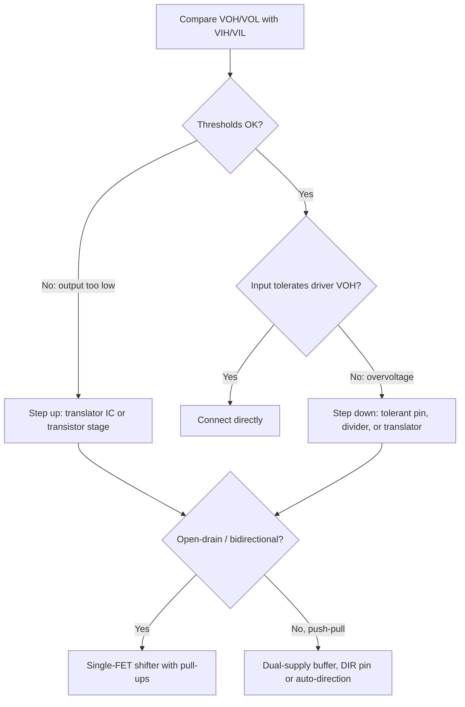

::: basics
### In plain words
Chips on different supply voltages, such as 1.8 V, 3.3 V and 5 V, do not always understand each other's logic levels. To connect them, check each direction separately. The sender's guaranteed high must exceed the receiver's high threshold, and its guaranteed low must fall below the receiver's low threshold. The receiver must also survive the sender's highest voltage. If any test fails, add a level shifter.

### Picture it
Think of one person speaking to another who only counts it as "loud" above a certain volume. A whisperer cannot be heard as loud, so the message is lost. That is a low-voltage chip driving a higher-voltage chip. A shouter can be heard, but may hurt the listener's ears. That is a 5 V output on a 3.3 V pin.

### Words you need
- **VIH and VIL**: the input thresholds. Above VIH a receiver reads high, and below VIL it reads low.
- **VOH and VOL**: the guaranteed output levels of a driver, high and low.
- **Level shifter**: a circuit or chip that converts logic levels between supply voltages.
- **5 V-tolerant input**: an input that can safely see 5 V even though its own supply is lower.
- **Open-drain**: an output that only pulls the line low. A pull-up resistor makes the high, at whatever supply voltage it connects to.

### The simplest example
A 3.3 V output guarantees at least 2.4 V for high. A common (TTL-type) 5 V input needs only 2.0 V. Since 2.4 V is above 2.0 V, the link works directly, with 0.4 V of margin. Now a 1.8 V output, guaranteed only 1.35 V for high, drives a 3.3 V input that needs 2.0 V. Since 1.35 V is below 2.0 V, it fails by 0.65 V and needs a level shifter. For 5 V into a non-tolerant 3.3 V pin, a 1 kΩ and 2 kΩ divider gives 3.33 V, fine for slow signals. That is the whole idea. The rest of this page covers the shifter options and open-drain buses.
:::

::: testing
Whether you can *check compatibility with numbers* before reaching for a part. The interviewer wants to see you compare $V_{OH}$ against $V_{IH}$ and $V_{OL}$ against $V_{IL}$ for each direction, know the options (direct connection, 5 V-tolerant pins, resistor divider, FET shifter, dedicated translator IC, open-drain with pull-ups) and pick one based on direction, speed, open-drain versus push-pull, and the voltages involved. Bonus points for mentioning back-powering, protection diodes and sequencing.
:::

::: why
Modern boards mix 1.8 V processors, 3.3 V peripherals, 5 V legacy parts and sensors on different rails. A wrong guess here is a classic bring-up failure: a signal that "mostly works", a chip that is damaged because a 5 V output drove a 3.3 V input, or an I²C bus that hangs because one side's pull-up is on an unpowered rail. The follow-up questions [[q0878]] and [[q0879]] ask you to design the shifter, so this page gives the decision framework.
:::

::: concepts
- **Logic thresholds**: $V_{OH}$, $V_{OL}$ from the driver, $V_{IH}$, $V_{IL}$ for the receiver ([[q0874]]).
- **Absolute maximum input**: voltage above $V_{DD}+0.3$ V typically forward-biases an ESD diode and can damage the part unless the pin is "5 V tolerant".
- **Push-pull versus open-drain**: determines whether a shared pull-up can be used ([[q0785]], [[q0786]]).
- **Voltage divider**: resistive attenuation for slow, one-way high-to-low translation ([[q0008]]).
- **Pull-up/pull-down resistors**: set idle levels and the rise time on open-drain lines ([[q0020]], [[q0755]]).
:::

::: answer
"First I'd check each direction separately. For a signal going from device A to device B, A's guaranteed output high has to be above B's input-high threshold, and A's output low has to be below B's input-low threshold, with some margin. If that works, I connect them directly and I'm done. A 3.3 V part driving a 5 V TTL-compatible input is fine, for example.

If it doesn't work, it depends on direction. Going up, like 1.8 V to 3.3 V, the 1.8 V high may not reach the 3.3 V part's threshold, so I need a real level shifter: a translator IC with two supply pins, or a discrete transistor stage. Going down, like 5 V to 3.3 V, the danger is overvoltage on the 3.3 V pin: I can use a 5 V-tolerant input, a resistor divider for slow signals, or a translator.

For bidirectional open-drain buses like I²C I'd use the single-FET shifter, a MOSFET with pull-ups on each side. For fast or push-pull signals like SPI or a parallel bus, I'd use a dedicated buffer such as a dual-supply translator with a direction pin, and for auto-direction parts I'd check they handle the load. And I'd check power sequencing, so no input is driven when its chip is unpowered."
:::

::: technical
**Compatibility test.** For a driver-to-receiver pair at rails $V_{DD,A}$ and $V_{DD,B}$:
$$V_{OH(min),A}\ge V_{IH(min),B}+NM_H,\qquad V_{OL(max),A}\le V_{IL(max),B}-NM_L$$
and the absolute maximum input of B must exceed the highest $V_{OH,A}$ (including overshoot).

**Typical thresholds** (vary by family; check datasheets):
| Family (at its supply) | $V_{IH}$ min | $V_{IL}$ max | $V_{OH}$ min | $V_{OL}$ max |
|---|---|---|---|---|
| 5 V TTL / HCT input | 2.0 V | 0.8 V | 2.4 V | 0.4 V |
| 5 V CMOS (HC), about $0.7/0.3\,V_{DD}$ | 3.5 V | 1.5 V | $V_{DD}-0.1$ | 0.1 V |
| 3.3 V LVCMOS/LVTTL | 2.0 V | 0.8 V | 2.4 V | 0.4 V |
| 1.8 V LVCMOS (about $0.65/0.35\,V_{DD}$) | 1.17 V | 0.63 V | $V_{DD}-0.45$ | 0.45 V |

> [!UNCERTAIN]
> Thresholds differ by vendor, family and sometimes by pin. The table is for orientation. Always read the specific part's electrical characteristics.

**Worked checks.**
- 3.3 V LVCMOS out into 5 V CMOS (HC) in: $V_{OH}=2.4$ to 2.9 V against $V_{IH}=3.5$ V fails. Into HCT (2.0 V) passes.
- 1.8 V out into 3.3 V in: $V_{OH}\ge1.35$ V against $V_{IH}=2.0$ V fails: a translator is required.
- 5 V out into 3.3 V in: logic is compatible, but 5 V exceeds the 3.3 V pin's limit ($V_{DD}+0.3$ typical) unless the pin is 5 V tolerant.

**Options, ranked by when to use them:**
1. **Direct connect** when the check passes and the input is tolerant.
2. **5 V-tolerant input** pins on many MCUs, FPGAs, LVC/AHC-family buffers (with $V_{CC}$ at 3.3 V).
3. **Resistor divider** (down only, slow): 1 kΩ/2 kΩ turns 5 V into 3.33 V.
4. **Series resistor into clamp diodes** (down only, slow, low current): relies on the ESD diode, so only if the datasheet allows the injection current.
5. **Single-FET shifter** (open-drain, bidirectional): I²C, 1-Wire.
6. **Dedicated translator IC**: unidirectional with a direction pin (dual-supply bus transceivers), or auto-direction (no DIR pin, only an output enable) for push-pull; choose speed rating and drive strength.
7. **Comparator/Schmitt-trigger stage** for analog-ish or noisy inputs.
:::

::: short
"I check each direction: the driver's guaranteed high must exceed the receiver's input-high threshold, the low must be under the input-low threshold, and nothing may exceed the receiver's absolute maximum. If that works, connect directly. If not, step down with a 5 V-tolerant input, a divider for slow signals or a translator; step up with a translator or transistor stage. Open-drain buses like I²C get a single-FET shifter with pull-ups; fast push-pull buses get a dual-supply translator IC."
:::

::: long
"I start with the datasheet numbers for both ends, because 'logic level' is a range. For a signal from A to B, I need A's minimum output high to be above B's minimum input high, with some margin, and A's maximum output low below B's maximum input low. I also need A's high to stay below B's absolute maximum input, which is usually its supply plus a few tenths of a volt unless the pin is five-volt tolerant.

So a 3.3 volt LVCMOS output into a five-volt TTL-compatible input just works, since 2.4 is above 2.0. But 3.3 into a five-volt HC part with a 3.5 volt threshold doesn't. And 1.8 volts into 3.3 volts fails because 1.35 volts guaranteed high is below the 2.0 volt threshold.

For translating down, say 5 to 3.3, I can use a tolerant pin, a resistor divider for slow signals like an enable line, or a translator. For translating up I generally need something active: a translator IC or a transistor stage, because a resistor can't raise a level.

Then I look at the signal type. Open-drain and bidirectional, like I²C, calls for the single-FET shifter: a small MOSFET gated at the low rail with pull-ups on both sides. Fast push-pull signals like SPI at tens of megahertz call for a dual-supply buffer, either with a direction pin or one that senses direction automatically, and I'd check its rated data rate and whether it tolerates the capacitive load.

Finally I'd check the system-level stuff: power sequencing so I don't drive an unpowered chip and back-power it through the protection diodes, whether lines are shared by several devices, and whether the translator has a defined state when one supply is off."
:::

::: terms
- **$V_{IH}$ / $V_{IL}$**: minimum voltage read as high and maximum voltage read as low at an input.
- **$V_{OH}$ / $V_{OL}$**: guaranteed output high and low at a stated load current.
- **Noise margin**: $V_{OH}-V_{IH}$ and $V_{IL}-V_{OL}$.
- **5 V-tolerant**: an input that can safely see 5 V while its own supply is lower.
- **Level translator / shifter**: circuit that maps logic levels of one rail onto another.
- **Open-drain**: output that only pulls low; the high level is set by a pull-up to the rail of choice.
- **Back-powering**: current through protection diodes of an unpowered chip into its supply rail.
- **Auto-direction translator**: bidirectional shifter that senses which side is driving, no direction pin.
:::

::: exceptional
**An average answer** says "use a level shifter or a voltage divider".

**An exceptional answer**:
- Starts by comparing $V_{OH}/V_{OL}$ with $V_{IH}/V_{IL}$ *per direction*, with numbers, and notes many pairs need nothing.
- Treats up- and down-translation as different problems and states the absolute-max hazard.
- Chooses by signal type: open-drain/bidirectional (FET shifter), unidirectional push-pull (buffer), auto-direction (with caveats on loading and speed).
- Mentions the divider's RC edge penalty and the clamp-diode caveat.
- Brings up sequencing and back-powering, and I²C pull-up location.
:::

::: mistakes
- **Assuming all "digital" is compatible.** 3.3 V to a 5 V HC input fails the $V_{IH}$ check; 1.8 V to 3.3 V fails too.
- **Connecting 5 V outputs to non-tolerant 3.3 V inputs.** The ESD diode clamps and injects current into the supply, or exceeds the absolute maximum rating.
- **Using a resistor divider for fast or bidirectional signals.** With 10 pF at the node, a 1 kΩ/2 kΩ divider has $R_{th}=667\,\Omega$ and a 10 to 90% rise of about 15 ns; at higher speeds or higher capacitance it distorts the edge. It cannot work in the up direction.
- **Using auto-direction translators on lines with strong pull-ups, or on open-drain buses at wrong speeds.** Some auto-direction parts misbehave with low-impedance pull-ups or heavy capacitive load. Read the datasheet.
- **Forgetting to power the translator rails in the right order** or leaving inputs floating when one side is off.
- **Putting pull-ups only on one rail** of a FET shifter.
:::

::: deep
## Step 1: do the numbers for each direction

Logic levels are not single voltages; they are guarantees with margin. Draw two bars per device: the output side shows $V_{OL(max)}$ and $V_{OH(min)}$, the input side shows $V_{IL(max)}$ and $V_{IH(min)}$. The link works when the output's guaranteed-high bar sits above the input-high threshold and the guaranteed-low sits below the input-low threshold.

```plot
{"title":"Guaranteed logic bands: 1.8 V output into a 3.3 V input","x":{"label":"","min":0,"max":4},"y":{"label":"V","unit":"V","min":0,"max":3.6},
 "series":[{"label":"1.8 V V_OH(min)","fn":"1.35","color":"accent"},{"label":"1.8 V V_OL(max)","fn":"0.45","color":"accent","dashed":true},{"label":"3.3 V V_IH(min)","fn":"2.0","color":"red"},{"label":"3.3 V V_IL(max)","fn":"0.8","color":"red","dashed":true}]}
```
Figure: The 1.8 V driver's guaranteed high (1.35 V, solid blue) is far below the 3.3 V receiver's required 2.0 V (solid red), so the high lands in the 3.3 V input's forbidden zone (0.8 to 2.0 V, between the two red lines) and can be read either way. The low side works (0.45 V is below 0.8 V). The failure is only in the upward direction, which is why it often "works" at room temperature on one board and fails on another.

The decision flow is:


Figure: Pick the topology after the numbers. Open-drain buses (I²C) allow the cheap FET shifter; fast push-pull buses need an active translator.

## Stepping down with a resistor divider

A divider is the cheapest way to take a 5 V push-pull output down to a 3.3 V input, for a *slow, one-direction* signal such as an enable, an LED status or a UART at modest baud rate ([[q0008]]).

```circuit
{"caption":"5 V to 3.3 V divider","elements":[
 {"t":"term","at":[0,2],"label":"5 V logic out","side":"left"},
 {"t":"R","a":[0,2],"b":[5,2],"label":"R_1","value":"1 kΩ"},
 {"t":"wire","pts":[[5,2],[11,2]]},{"t":"dot","at":[5,2]},{"t":"dot","at":[8,2]},
 {"t":"term","at":[11,2],"label":"3.3 V in","side":"right"},
 {"t":"R","a":[5,2],"b":[5,6],"label":"R_2","value":"2 kΩ","labelSide":"other"},
 {"t":"C","a":[8,2],"b":[8,6],"label":"C_{in}","value":"10 pF","color":"orange"},
 {"t":"wire","pts":[[5,6],[5,7],[8,7],[8,6]]},{"t":"gnd","at":[6.5,7]}
]}
```
Figure: The divider output is $5\cdot2/3=3.33$ V. The orange input capacitance (pin plus trace) forms an RC with $R_{th}=R_1\parallel R_2$, which slows edges.

The output is $V_{out}=V_{in}\frac{R_2}{R_1+R_2}=3.33$ V, and the Thevenin resistance is $1\text{k}\parallel2\text{k}=667\,\Omega$. With 10 pF of input and trace capacitance the 10 to 90% rise time is $2.2R_{th}C=2.2\cdot667\cdot10\text{ pF}=14.7$ ns. That is fine for a 1 MHz signal, and marginal for 20 MHz. Higher resistances (10 kΩ/20 kΩ) cut the current to 0.17 mA but multiply the edge time by ten.

Check the resulting high level: with a 3.3 V part at $V_{IH}=2.0$ V, the 3.33 V high has 1.3 V of margin, and the 5 V low (0.1 to 0.4 V) becomes about 0.07 to 0.27 V. If the divider's high is above $V_{DD}+0.3$ V (when the 3.3 V rail is lower than nominal), clamp diodes start to conduct. Use a divider ratio that gives a little less than $V_{DD}$, and remember the divider doesn't work upward at all.

## Stepping up, and the real devices

Going up is fundamentally an *active* problem: a passive network cannot raise a voltage. Options:

- **NMOS or NPN inverter stage** with a pull-up to the high rail: inverting, simple, slow because the edge up is set by $R_{pull}C$.
- **Single-FET shifter** for open-drain lines: bidirectional ([[q0879]]).
- **Dual-supply translator IC** such as the common single-bit and octal bus-transceiver families (74LVC1T45/74LVC8T245 style parts, with a DIR pin) and auto-direction ones (the TXB-style and TXS-style parts). Each rail powers its own side. They are specified with a maximum data rate, tens to hundreds of MHz for the DIR-pin parts, lower for auto-direction.

> [!UNCERTAIN]
> Maximum data rates, drive strength and open-drain compatibility of auto-direction translators differ by family and supply pair. Treat all speed numbers as "check the datasheet table for your exact $V_{CCA}/V_{CCB}$".

An often-overlooked option is to **pick the right logic family**: an HCT or AHCT input accepts 3.3 V logic at 5 V supply because its input threshold is TTL-like (about 2.0 V), and LVC-family parts powered at 3.3 V have 5 V-tolerant inputs, so they can take 5 V signals down to 3.3 V. A single 74AHCT125 buffer at 5 V accepts 3.3 V signals and outputs 5 V levels, avoiding a dedicated translator, but its output is then 5 V and can't directly feed a 3.3 V-only input.

## Open-drain buses: why the FET shifter works

A bus like I²C never drives high; devices only pull low, and pull-up resistors make the high. That means each side can have its own pull-up to its own rail, and a single N-channel FET between them lets either side pull the other low ([[q0879]]). The pull-up value sets the rise time: for I²C fast mode with 300 ns maximum rise time and a 100 pF bus, $0.8473\,RC\le300$ ns gives $R\le3.5$ kΩ. The minimum pull-up is bounded by the 3 mA low-level sink spec: $R\ge(V_{DD}-0.4)/3\text{ mA}=0.97$ kΩ at 3.3 V and 1.53 kΩ at 5 V ([[q0755]]).

```sim
{"id":"level-shifter","vlow":3.3,"vhigh":5}
```
Figure: Toggle which side pulls low and which side releases. Watch the FET's gate-source voltage turn it on and off, and the voltage on the other side follow.

## System-level issues

- **Power sequencing.** If a 3.3 V chip is unpowered while a 5 V chip drives its input, current flows through its ESD diode into its supply rail and can partially power it ("back-powering"), causing odd resets. Translator ICs often have a "high-Z when either supply is off" feature; some do not.
- **Idle states.** Auto-direction translators with both sides floating can oscillate or pass noise. Give lines a defined pull state ([[q0786]]).
- **Signal integrity.** Fast edges from a translator need the usual treatment: series termination near the driver, controlled-impedance traces for long runs.
- **Contention.** A bidirectional shifter on a push-pull line can cause two drivers to fight. Make sure only one device drives at a time, or use a direction pin controlled by firmware.
- **Analog or very noisy levels.** If the input is slow or noisy, add a Schmitt-trigger stage (many LVC and AHC parts have Schmitt inputs) after translating.

## A compact decision table

| Situation | Typical solution |
|---|---|
| 3.3 V out, 5 V TTL/HCT in | Direct (check $V_{OH}\ge V_{IH}$) |
| 3.3 V out, 5 V CMOS (0.7 $V_{DD}$) in | Translator or HCT buffer at 5 V |
| 5 V out, 3.3 V non-tolerant in, slow | Divider (1k/2k) or translator |
| 1.8 V out, 3.3 V in | Dual-supply translator |
| I²C between 3.3 V and 5 V (or 1.8 V and 3.3 V) | Single-FET shifter or I²C-specific translator |
| SPI 20 MHz between 1.8 V and 3.3 V | Dual-supply translator with enough bandwidth |
:::

::: applications
- **I²C sensor on a different rail**: a 1.8 V MCU talking to a 3.3 V IMU, using a FET shifter or an I²C-rated translator.
- **SD card or flash on a 1.8 V host**: high-speed signals through a dual-supply translator rated for the data rate.
- **5 V legacy peripherals (LCD, relay board)** driven from a 3.3 V MCU via HCT buffers or a translator.
- **Programming/debug headers** exposing a target's rail: translators let a programmer track the target voltage (the target's reference pin supplies one side).
- **FPGA to external parts**: banks at different $V_{CCO}$ avoid translators when thresholds allow, otherwise bank-level translation.
:::

::: assumptions
- Threshold numbers are generic and rounded; real parts differ, and temperature and supply tolerance move them.
- Static analysis: dynamic effects (ringing, overshoot beyond $V_{DD}+0.3$ V) can still exceed ratings.
- "Translator" parts are described by function; the specific families named are common but a given part's datasheet governs.
- If the signal is analog, or the "logic" level is a sensor output with an unusual swing, a comparator or ADC is a better interface than a logic shifter.
:::

::: followups
### A 1.8 V MCU drives a 3.3 V part with $V_{IH}=2.0$ V. Why might it "mostly work"?
Typical (not guaranteed) $V_{OH}$ is nearly the full 1.8 V, and some receivers' real thresholds are lower than the datasheet maximum. But across temperature, supply and part variation the guarantee fails, and noise margin is negative. It may pass on the bench and fail in production, so use a translator.

### How would you convert 5 V UART TX to a 3.3 V MCU RX?
Direct connection risks overvoltage unless RX is 5 V tolerant. A divider works: 1 kΩ/2 kΩ gives 3.33 V with a 15 ns edge, fine for 115,200 baud (bit time 8.7 µs). For the reverse (3.3 V TX to 5 V RX), a 5 V TTL-compatible input with $V_{IH}=2.0$ V works directly; a 5 V CMOS input at 3.5 V needs a translator.

### Why doesn't a resistor divider work for stepping up?
A passive divider only attenuates ($R_2/(R_1+R_2)\le1$). To raise a level you need an active element: a transistor stage with a pull-up to the higher rail, or a translator IC.

### What is the failure mode of an auto-direction translator on an I²C bus with strong pull-ups?
Auto-direction parts use weak one-shot or sensing drivers. Low-impedance pull-ups (say 1 kΩ) can overpower the translator's weak hold drivers so it fails to latch the low or the direction detection misfires. Also each rail's pull-up must be sized so the bus sits within the translator's drive spec. Use an I²C-specific part or the FET shifter.

### What happens if the 3.3 V side is powered off while the 5 V side keeps driving?
Current flows through the 3.3 V chip's ESD diodes into its supply, partially powering it, with possible latch-up or unpredictable behavior. Use translators with a power-off high-Z feature, or sequence supplies so the lower-voltage rail is up first, or open-drain lines with the pull-up on a switched rail.
:::

::: interpretations
"Different logic levels" could mean different supply voltages (1.8/3.3/5 V) or different logic *families* at the same supply (TTL versus CMOS thresholds). Both are covered by the same threshold comparison. Note this question precedes [[q0878]] (design a level shifter) and [[q0879]] (single-FET shifter), which are the design follow-ups.
:::

::: references
- Horowitz & Hill, *The Art of Electronics*, 3rd ed.: logic families, TTL/CMOS compatibility and interfacing levels.
- NXP UM10204, *I²C-bus specification and user manual*: rise time, pull-up sizing and the bidirectional level-shifting section.
- Texas Instruments and Nexperia logic-selection guides and translator family datasheets (74LVC1T45/74LVC8T245 style dual-supply bus transceivers; TXB/TXS-style auto-direction parts): consult the exact datasheet for data rate and drive limits.
- JEDEC JESD8 series: interface standards for LVCMOS/LVTTL logic levels.
:::

::: rubric
- Compares $V_{OH}/V_{OL}$ against $V_{IH}/V_{IL}$ per direction :: Compatibility is a numerical check, not a feeling.
- Treats step-up and step-down differently :: Down is an overvoltage problem; up is a threshold problem needing an active stage.
- Lists options: direct, tolerant pin, divider, FET, translator IC :: Shows breadth of practical solutions.
- Chooses by signal type (open-drain/bidirectional vs push-pull, speed) :: The right shifter depends on the protocol.
- Mentions divider RC/speed and clamp-diode limits :: The common cheap fix has real limitations.
- Mentions power sequencing/back-powering and defined idle states :: System-level hazards that cause field failures.
:::

::: quiz
```json
[
 {"type":"mcq","level":"fundamental","q":"A 3.3 V LVCMOS output ($V_{OH}\\ge2.4$ V) drives a 5 V TTL-compatible input with $V_{IH}=2.0$ V. What is the correct conclusion?","options":["It needs a translator","It works directly","It will damage the input","It works only with a pull-down"],"answer":1,"explain":"2.4 V is above the 2.0 V threshold, with 0.4 V of margin, and 3.3 V doesn't exceed the 5 V part's rating. No translation needed."},
 {"type":"numeric","level":"fundamental","q":"A 1 kΩ / 2 kΩ divider (2 kΩ to ground) takes a 5 V logic high. What output voltage results, in volts?","answer":3.33,"tolerance":0.01,"unit":"V","explain":"$5\\cdot2/(1+2)=3.33$ V."},
 {"type":"numeric","level":"intermediate","q":"The divider above drives 10 pF of input and trace capacitance. Estimate the 10-90% rise time with $2.2R_{th}C$, in ns.","answer":14.7,"tolerance":0.03,"unit":"ns","explain":"$R_{th}=1\\text{k}\\parallel2\\text{k}=667\\,\\Omega$; $2.2\\cdot667\\cdot10^{-11}=14.7$ ns."},
 {"type":"truefalse","level":"intermediate","q":"A resistor divider can be used to translate a 1.8 V logic signal up to 3.3 V.","answer":false,"explain":"A passive divider only attenuates. Raising a level requires an active element: a transistor stage or a translator IC."},
 {"type":"mcq","level":"advanced","q":"For a 1.8 V LVCMOS driver with $V_{OH,min}=1.35$ V into a 3.3 V receiver with $V_{IH,min}=2.0$ V, the margin is:","options":["+0.65 V","-0.65 V","+1.5 V","0 V"],"answer":1,"explain":"1.35 - 2.0 = -0.65 V. The guaranteed high does not reach the receiver's guaranteed threshold, so it fails the check."},
 {"type":"multi","level":"advanced","q":"Select all hazards when a 5 V device drives a 3.3 V-powered chip through its input pin.","options":["Overvoltage beyond the absolute maximum rating","Current through ESD diodes into the 3.3 V rail","Failure to meet $V_{IH}$ because 5 V is too high","Back-powering if the 3.3 V rail is off"],"answer":[0,1,3],"explain":"A 5 V high exceeds V_DD + 0.3 V, turning on the ESD diode (injecting current into the rail, and back-powering an unpowered chip). A higher voltage still satisfies V_IH, so option 3 is false."}
]
```
:::
