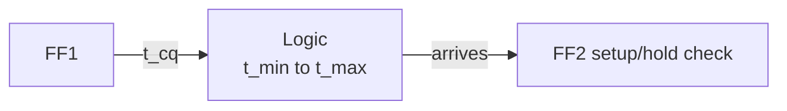

::: basics
### In plain words
A flip-flop samples its data input at one instant, the active clock edge, and stores that value. Setup time is how long the data must already be steady before the edge. Hold time is how long it must stay steady after the edge. If the data changes inside that window, the flip-flop may store the wrong value, or become undecided.

### Picture it
Think of taking a photo of a child. For a sharp picture, the child must be still for a moment before the shutter clicks, which is setup, and just after it, which is hold. A child who moves right at the click gives a blurry shot. The data must be steady for the same window around the clock's click. Unlike photos, hold problems cannot be fixed by waiting longer between shots.

### Words you need
- **Flip-flop**: a memory cell that copies its input D to its output Q at a clock edge and holds it. See [[q0881]].
- **Active clock edge**: the clock transition, usually rising, at which the flip-flop samples D.
- **Setup time**: the minimum time D must be steady before the active edge.
- **Hold time**: the minimum time D must stay steady after the active edge.
- **Metastability**: an undecided in-between output after a violation. See [[q0887]].

### The simplest example
Data leaves one flip-flop, passes through logic, and must reach the next one. The first flip-flop takes 0.4 ns from clock to its output. The logic takes up to 2.0 ns. The next flip-flop needs 0.1 ns of setup, and clock skew costs 0.1 ns. The clock period must be at least 0.4 plus 2.0 plus 0.1 plus 0.1, which is 2.6 ns, so about 385 MHz at most. A longer period fixes any setup problem. Hold has no period in its formula, so slowing the clock cannot fix it. You must add delay to the data path. That is the whole idea. The rest gives both inequalities and the board-level use.
:::

::: testing
Whether you can define setup and hold relative to the **active clock edge**, draw them, and explain *why* they exist inside the flip-flop. Then whether you can use them: write the timing inequalities, say which violation can be fixed by slowing the clock (setup) and which cannot (hold), and describe what a violation does (wrong value or metastability, [[q0887]]). Strong candidates mention clock skew, PVT corners and how static timing analysis checks all of this.
:::

::: why
Every synchronous design lives or dies by setup and hold. They determine the maximum clock frequency, the correctness of every register-to-register path, and how an off-chip bus is timed (SPI, DDR, parallel ADC). Failing timing causes intermittent faults that appear only hot, cold, or at low voltage. This question also appears in the embedded section as [[q0693]]; here it sits in the digital-electronics context, so the emphasis is on the flip-flop mechanism and the timing budget.
:::

::: concepts
- **Edge-triggered flip-flop**: captures D at the clock edge and holds it ([[q0881]], [[q0882]]).
- **Setup time $t_{su}$**: how long D must be stable *before* the active edge.
- **Hold time $t_h$**: how long D must stay stable *after* the active edge.
- **Clock-to-Q delay $t_{cq}$**: delay from the clock edge to a new Q.
- **Propagation delay of logic** between registers, with min and max values.
- **Metastability**: the undefined outcome when a data change falls inside the setup/hold window ([[q0887]]).
:::

::: answer
"Setup time is how long the data input has to be stable before the active clock edge so the flip-flop can capture it reliably. Hold time is how long it has to stay stable after the edge. Together they define a small window around the edge where the data must not change.

The reason is that inside the flip-flop the input has to propagate through internal gates and settle onto a latch before the clock closes it. If data arrives too late, that is a setup violation; if it changes too soon after the edge, the master latch hasn't finished closing and that's a hold violation.

If you violate either, the flip-flop can capture the wrong value, or worse, go metastable, where Q hovers at an in-between voltage for a while and may resolve randomly, and downstream logic can see inconsistent values.

For a path between two flip-flops, setup says the clock period has to be at least clock-to-Q plus the logic delay plus setup time plus skew. You fix a setup violation by slowing the clock or shortening the logic. Hold says clock-to-Q plus the shortest logic delay has to exceed the hold time plus skew, and that doesn't depend on frequency, so you can't fix it by slowing the clock; you add delay on the data path."
:::

::: technical
**Definitions** (relative to the active edge at $t=0$): D must be stable on $[-t_{su},+t_h]$. Datasheets/libraries give $t_{su}$, $t_h$, $t_{cq}$ at specific slews, loads and PVT corners; $t_{su}$ and $t_h$ can even be negative.

**Setup constraint** for a path launched by FF1 and captured by FF2 one cycle later, with skew $t_{skew}=t_{clk2}-t_{clk1}$ (positive when the capture clock is later):
$$T_{clk}\ge t_{cq,max}+t_{logic,max}+t_{su}-t_{skew}$$
Hold constraint (same-edge race):
$$t_{cq,min}+t_{logic,min}\ge t_h+t_{skew}$$

**Worked example.** $t_{cq}=0.4$ ns (max), logic 2.0 ns (max), $t_{su}=0.1$ ns, worst skew costing 0.1 ns: $T_{clk}\ge2.6$ ns so $f_{max}=385$ MHz. Hold: $t_{cq,min}=0.25$ ns, $t_{logic,min}=0.05$ ns, $t_h=0.05$ ns, skew $=0.4$ ns: $0.30\ge0.45$ fails by 0.15 ns. Insert at least 0.15 ns of delay (one or two delay buffers, plus margin) on that short path.

**Violation effects.** Setup: Q captures the *old* value or goes metastable. Hold: Q captures the *new* value one cycle early (or goes metastable). Metastability resolution time follows $e^{-t/\tau}$ ([[q0887]]).

**Asymmetry.** Setup depends on $T_{clk}$; hold does not. A chip that fails hold is dead at every frequency (including slow debug clocks); a chip that fails setup fails only above some frequency.

**Where fixed.** Static timing analysis (STA) checks every path at multiple PVT corners; designers fix setup by pipelining or sizing gates, and hold by buffer insertion.
:::

::: short
"Setup time is how long data must be stable before the active clock edge, and hold time is how long it must stay stable after it. They exist because the flip-flop's internal latches need time to capture the data. Violating either can capture the wrong value or put the flip-flop into metastability. Setup limits clock frequency, since the period must cover clock-to-Q plus logic plus setup, so you fix it by slowing the clock or pipelining. Hold doesn't depend on frequency; you fix it with delay on the data path."
:::

::: long
"Setup and hold describe a window around the active clock edge in which the data input of a flip-flop must not change. Setup time is how long before the edge the data must already be stable. Hold time is how long after the edge it must remain stable.

Why do they exist? A flip-flop is two latches, a master and a slave. At the edge, the master closes and captures what it sees. Data has to travel through the input gates and settle to a solid logic level before the master closes, which is the setup time. And the master's feedback needs a little time to lock in, so if D changes right after the edge, it can corrupt the stored value, which is the hold time.

If I violate them, the flip-flop may latch the wrong value, or it may go metastable, with Q sitting at an intermediate voltage for an unpredictable time and then resolving randomly. That can cause downstream logic to see two different values from the same signal.

For design, between two flip-flops with a clock period T, setup requires T to be at least clock-to-Q plus the longest logic delay plus the setup time, adjusted for clock skew. If clock-to-Q is 0.4 ns, logic is 2 ns, and setup is 0.1 ns, then T is at least 2.5 ns, so roughly 400 MHz. Hold requires clock-to-Q plus the shortest logic delay to be longer than the hold time plus skew. That doesn't involve T, so slowing the clock doesn't fix it. You add delay buffers.

These get checked by static timing analysis across process, voltage and temperature corners. On a board it's the same idea: an ADC or SPI slave specifies setup and hold for data relative to the clock, and you check them with the scope."
:::

::: terms
- **Setup time ($t_{su}$)**: minimum time data is stable before the active clock edge.
- **Hold time ($t_h$)**: minimum time data stays stable after the clock edge.
- **Clock-to-Q ($t_{cq}$)**: delay from the active edge to a valid Q output.
- **Clock skew**: difference in clock arrival times at two flip-flops.
- **Slack**: margin by which a timing constraint is met (negative means violation).
- **Critical path**: the longest register-to-register path; it sets $f_{max}$.
- **Static timing analysis (STA)**: tool-based check of all paths against setup/hold.
- **Metastability**: undefined output when a setup/hold window is violated ([[q0887]]).
:::

::: exceptional
**An average answer** defines setup and hold and says "the output is undefined if violated".

**An exceptional answer**:
- Defines them around the **active edge** and explains the internal reason (master latch closing).
- Writes both inequalities with $t_{cq}$, logic delay and skew and works a numeric example.
- States the key asymmetry: setup is frequency dependent, hold is not; fixes differ (slow the clock or pipeline versus insert delay).
- Mentions PVT corners: setup is checked at slow corner, hold at fast corner.
- Connects to off-chip timing (SPI/DDR/ADC) and synchronizers for asynchronous inputs ([[q0887]]).
:::

::: mistakes
- **Saying hold can be fixed by lowering the clock frequency.** Hold is a race between the same clock edge and the data; frequency does not appear in the inequality.
- **Defining them relative to the clock *period*** instead of the active edge.
- **Forgetting clock-to-Q** in the setup budget, so the calculated $f_{max}$ is too high.
- **Using the max delay for hold or the min for setup.** Setup uses worst-case *slow* delays; hold uses worst-case *fast* delays.
- **Believing a violation always gives the wrong value.** It may give either value, or a metastable one that takes extra time to resolve.
- **Ignoring clock skew** and clock network delay when comparing two flip-flops.
:::

::: deep
## The window around the edge

An edge-triggered flip-flop samples D at the clock edge. In real hardware "at the edge" isn't a mathematical instant: it is a window. Inside the flip-flop (see [[q0882]]) the master latch is transparent while the clock is low, and it closes as the clock rises. For the master to store D correctly, D has to have reached a full logic level inside the master loop before the transmission gate or feedback path shuts. That sets $t_{su}$. After the edge, the master's input path still takes a moment to disconnect; if D changes during that interval it can leak through, which sets $t_h$.

```timing
{"signals":[
 {"name":"CLK","wave":"0011111100"},
 {"name":"D (good)","wave":"x=.....=x.","data":["stable","next"]},
 {"name":"D (violates window)","wave":"x10.1...x.","color":"red"},
 {"name":"Q (good D)","wave":"x..=......","data":["captured"],"color":"accent"}],
 "marks":[{"t":2,"label":"active edge"}],
 "spans":[{"from":1,"to":2,"row":1,"label":"t_su"},{"from":2,"to":3,"row":1,"label":"t_h"}],
 "hscale":1.2}
```
Figure: The data in the second row is stable for t_su before and t_h after the rising edge (marked), so the flip-flop captures it cleanly. The red row changes right at the edge, inside that window, so the captured value is unreliable. (Q is drawn changing one slot after the edge, a cartoon of clock-to-Q delay.)

The numbers for modern CMOS are small: $t_{su}$ and $t_h$ are tens of picoseconds up to a few hundred picoseconds in on-chip libraries, and on the order of ns for off-chip parts such as an SPI slave or ADC.

## Timing budget between two registers

Consider FF1 launching data to FF2 through combinational logic:


Figure: The data launched at one edge must arrive at FF2 after its hold window for the same edge, and before the setup window of the next edge.

**Setup (late arrival).** Data launched at edge 0 must arrive at FF2 before edge $T$ minus $t_{su}$:
$$t_{cq,max}+t_{logic,max}\le T_{clk}+t_{skew}-t_{su}.$$
**Hold (early arrival).** Data launched at edge 0 must not arrive before FF2's hold window for the *same* edge has ended:
$$t_{cq,min}+t_{logic,min}\ge t_h+t_{skew}.$$
Here $t_{skew}=t_{clk2}-t_{clk1}$. Positive skew (FF2's clock arrives late) helps setup but hurts hold, which is the origin of "useful skew" tricks and also of many bugs.

Worked numbers: $t_{cq}=0.4$ ns, logic 2.0 ns, $t_{su}=0.1$ ns, $t_{skew}=-0.1$ ns (capture clock early, worst case):

$$T_{clk}\ge0.4+2.0+0.1-(-0.1)=2.6\text{ ns}\Rightarrow f_{max}=385\text{ MHz}.$$

```plot
{"title":"Maximum clock frequency vs logic delay (t_cq = 0.4 ns, t_su = 0.1 ns, 0.1 ns skew penalty)","x":{"label":"Logic delay","unit":"s","min":1e-10,"max":5e-9},"y":{"label":"f_max","unit":"Hz","min":0,"max":1.2e9},
 "vars":{"tcq":4e-10,"tsu":1e-10,"tsk":1e-10},
 "series":[{"label":"f_max = 1/(t_cq + t_logic + t_su + t_skew)","fn":"1/(tcq+x+tsu+tsk)"}],
 "points":[{"x":2e-9,"y":"1/(tcq+2e-9+tsu+tsk)","label":"2 ns logic: 385 MHz"}]}
```
Figure: Fmax is set by the sum of clock-to-Q, logic, setup and skew. Cutting logic from 2 ns to 1 ns (by pipelining) lifts Fmax from 385 MHz to 625 MHz; the fixed overheads (0.6 ns) then dominate.

Hold example: $t_{cq,min}=0.25$ ns, $t_{logic,min}=0.05$ ns (a direct shift-register connection), $t_h=0.05$ ns, skew $+0.4$ ns (capture clock late because of a long clock tree branch). Left side $0.30$, right side $0.45$. Slack $=-0.15$ ns: a hold violation. Fix by inserting a delay cell (about 0.2 ns), or by rebalancing the clock tree.

**Why hold is frequency independent:** $T_{clk}$ doesn't appear. Launch and capture refer to the *same* clock edge, so you only race the data against the hold window of that edge. This is why a design that is broken even at 1 MHz is a hold problem, and a design that works slowly but fails fast is a setup problem.

## Why different corners

Delays vary with process, voltage and temperature. For setup you want the *slowest* data and the earliest capture clock: slow process, low voltage, high temperature (older nodes; at advanced nodes low temperature can be worst because of temperature inversion). For hold you want the *fastest* data: fast process, high voltage, and also (for older nodes) cold. STA runs all the corners and reports the worst slack of each type.

```sim
{"id":"flipflop-lab","mode":"setup-hold","tsu":0.1,"th":0.05}
```
Figure: Move the D transition toward the clock edge. Inside the setup or hold window the sim marks the capture as invalid. Make the window larger (a slower flip-flop) and watch how much less margin you have.

## Real hardware beyond the chip

The same ideas apply to board-level interfaces. An SPI ADC specifies setup of SDO before the next SCK edge and hold after. Parallel buses and source-synchronous interfaces such as DDR memory time the data against a clock sent alongside it, and they route clock and data with matched lengths (serpentine length matching, [[q0517]]). A common trap: the data valid window on a bus shrinks with clock rate, trace skew, jitter and the receiver's own $t_{su}+t_h$, and the data eye must stay wide enough:

$$\text{valid window}=T_{bit}-t_{su}-t_h-t_{skew}-t_{jitter}.$$

For example, a 100 MHz DDR-like interface with 5 ns half-period, 1 ns setup, 0.5 ns hold, 0.5 ns trace skew and 0.3 ns jitter leaves $5-1-0.5-0.5-0.3=2.7$ ns of margin.

## What happens physically at violation

A violating transition leaves the master latch's cross-coupled inverters near their unstable equilibrium. The loop gain then amplifies the tiny difference exponentially, with time constant $\tau$ (tens of ps for modern gates): resolution time grows like $\tau\ln(V_{full}/\Delta V)$. If Q is sampled by the next stage before resolution, you can get a runt pulse, a late transition or two different readings of the same signal. That is the story of metastability, covered fully in [[q0887]]. Synchronizer flip-flops give the loop extra time to resolve before the data is used.

> [!TIP]
> In an interview, say the asymmetry out loud: "Setup is a race against the *next* edge so slowing the clock fixes it. Hold is a race against the *same* edge, so only added delay fixes it."
:::

::: applications
- **Maximum clock frequency** of CPUs, FPGAs and ASICs is set by the critical-path setup slack.
- **FPGA timing closure**: tools report setup/hold slack; hold fixing is automatic, setup needs RTL changes or pipelining.
- **SPI/I²S/ADC interfaces**: choosing the sampling edge and checking datasheet setup/hold against clock-to-data delay.
- **DDR memory interfaces**: write/read training and length-matching to center the clock in the data eye.
- **Asynchronous input synchronizers**: two-flop chain gives the first flop time to resolve ([[q0887]]).
:::

::: assumptions
- Single-clock, edge-triggered flip-flops. Latch-based designs have time borrowing and different constraints ([[q0881]]).
- Delay values are illustrative; real libraries specify them as functions of slew and load per corner.
- Positive skew means the capture clock arrives later than the launch clock.
- Setup and hold times are assumed positive; library values can be negative for some cells.
- For off-chip timing the same inequalities hold with the device's datasheet values, plus jitter and trace delay.
:::

::: followups
### A path fails hold at every frequency. What do you do?
Add delay on the short data path (delay buffers or resized gates), or fix the clock skew so the capture flop's clock is not later than the launch's. Lowering the frequency won't help because the hold check uses the same clock edge and doesn't depend on the period.

### A path fails setup at 500 MHz but passes at 300 MHz. Options?
Pipeline the logic (insert a register in the middle), restructure it, up-size gates on the critical path, or reduce clock-to-Q and setup with faster flops. From 300 to 500 MHz the period falls from 3.33 to 2 ns, so you must remove at least 1.33 ns of delay. Or accept a lower clock.

### Can setup or hold time be negative?
Yes. A flip-flop with an internal input delay can have a negative hold time, meaning data may change slightly *before* the edge and still be captured correctly. Libraries report such values, and STA uses them as signed numbers.

### How do you deal with a signal that is asynchronous to the clock?
You cannot guarantee setup/hold, so a violation will occasionally happen. Use a synchronizer (two or more flops in series) to give the first flop time to resolve, and design so the occasional extra cycle of latency is harmless ([[q0887]]).

### What happens to timing when the clock tree is unbalanced by 0.5 ns?
Skew of +0.5 ns (capture later) gives setup an extra 0.5 ns but takes 0.5 ns from hold margin; $-0.5$ ns does the opposite. If both directions occur on different paths in the same design, you may be unable to meet both without balancing the tree or inserting delays.
:::

::: interpretations
This question is a duplicate of [[q0693]] in the embedded section. Here it follows the flip-flop/latch/metastability sequence ([[q0881]], [[q0887]]), so I emphasize the flip-flop internals and register-to-register budget; for the embedded version, the SPI/ADC board-level view gets more weight.
:::

::: references
- Harris & Harris, *Digital Design and Computer Architecture*: chapter on sequential timing (setup, hold, clock-to-Q, skew).
- Weste & Harris, *CMOS VLSI Design*: chapter on timing and clocking, including skew and time borrowing.
- Rabaey, Chandrakasan & Nikolic, *Digital Integrated Circuits*: chapter on sequential logic timing.
- Standard-cell library datasheets and STA tool documentation for the actual setup/hold tables of a process.
:::

::: rubric
- Defines setup and hold relative to the active clock edge :: The definitions must be anchored on the edge, not the period.
- Explains why they exist (master latch settling and closing) :: Understanding beats memorization.
- Gives both inequalities with $t_{cq}$, logic delay and skew :: Shows you can use the concepts quantitatively.
- Knows the asymmetry: setup depends on frequency, hold does not :: The classic probe question.
- Describes consequences: wrong value or metastability :: Shows you know what the violation does.
- Mentions corners/STA and real fixes (pipelining, delay buffers) :: Connects to practice.
:::

::: quiz
```json
[
 {"type":"mcq","level":"fundamental","q":"Which statement defines setup time?","options":["Time data must be stable after the clock edge","Time data must be stable before the active clock edge","Delay from clock edge to Q","The clock period"],"answer":1,"explain":"Setup time is the minimum time before the active edge that D must be stable. Stable-after is hold time; clock-to-Q is the output delay."},
 {"type":"numeric","level":"intermediate","q":"$t_{cq}=0.4$ ns, logic = 2.0 ns, $t_{su}=0.1$ ns, with 0.1 ns of unfavorable skew. What is $f_{max}$ in MHz?","answer":385,"tolerance":0.02,"unit":"MHz","explain":"$T\\ge0.4+2.0+0.1+0.1=2.6$ ns so $f_{max}=1/2.6\\text{ ns}=385$ MHz."},
 {"type":"truefalse","level":"intermediate","q":"A hold violation can be fixed by reducing the clock frequency.","answer":false,"explain":"The hold check compares data and the *same* clock edge, so the period does not appear. Add delay on the data path or fix skew."},
 {"type":"numeric","level":"intermediate","q":"$t_{cq,min}=0.25$ ns, $t_{logic,min}=0.05$ ns, $t_h=0.05$ ns, skew = +0.4 ns. What is the hold slack in ns?","answer":-0.15,"tolerance":0.02,"unit":"ns","explain":"Slack = (0.25 + 0.05) - (0.05 + 0.4) = -0.15 ns, a violation that needs about 0.15 ns of added delay."},
 {"type":"mcq","level":"advanced","q":"A design works at 10 MHz but fails above 150 MHz. Which violation is the most likely cause?","options":["Hold","Setup","Hold and metastability only","A reset glitch only"],"answer":1,"explain":"Failure that appears only above a frequency means the period no longer covers clock-to-Q + logic + setup: a setup violation. Hold failures would exist at all frequencies."},
 {"type":"multi","level":"advanced","q":"Select all fixes for a setup violation on a register-to-register path.","options":["Pipeline the logic with an extra register","Lower the clock frequency","Insert delay buffers on the data path","Use a faster flip-flop or up-size critical gates"],"answer":[0,1,3],"explain":"Pipelining, a slower clock and faster cells all create more slack for setup. Adding delay makes setup worse (it's a hold fix)."}
]
```
:::
