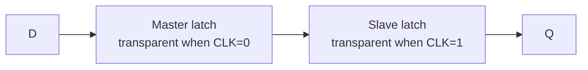

::: testing
Whether you can state the core distinction crisply, **level-sensitive versus edge-triggered**, and back it up with a waveform. Then whether you know the consequences: a latch is transparent so glitches pass through and timing analysis is trickier, a flip-flop samples once per cycle and is simple to reason about, and a flip-flop is literally two latches back to back. Mentioning area, time borrowing and clock gating shows depth.
:::

::: why
Synchronous design is built on flip-flops, but latches show up in clock-gating cells, high-speed pipelines and accidentally in RTL when an `if` statement lacks an `else`. Interviewers ask this because confusing the two causes real bugs: unintended latches, hold races and glitches. It also bridges the "how does a flip-flop work" question ([[q0882]]) and the timing question ([[q0880]]).
:::

::: concepts
- **Bistable storage**: two cross-coupled inverting stages hold one bit ([[q0883]]).
- **Level-sensitive**: output follows the input while the enable/clock is at its active level.
- **Edge-triggered**: output changes only at a clock transition.
- **Master-slave structure**: a flip-flop is two opposite-phase latches in series ([[q0882]]).
- **Setup/hold**: constraints around the capturing edge or closing edge ([[q0880]]).
- **Registers**: arrays of flip-flops sharing a clock ([[q0886]]).
:::

::: answer
"A latch is level-sensitive: while its enable, or clock, is at the active level, the output follows the input, so it's transparent. When the enable goes inactive, it holds the last value. A flip-flop is edge-triggered: it only looks at its input at the instant of the clock edge, say the rising edge, copies it to the output, and ignores changes everywhere else.

The relationship is that a D flip-flop is built from two D latches in series with opposite clock phases, called master and slave. While the clock is low, the master is transparent and the slave holds. At the rising edge the master closes and the slave opens, so the output updates once, with whatever the master held.

Why does it matter? Flip-flops make timing simple: data moves exactly one stage per clock, so you just check setup and hold at each edge. Latches pass glitches through when they're transparent and the timing depends on when data arrives within the open window. The upside is that latches are smaller and faster, and allow time borrowing between stages, so they show up in clock-gating cells and custom high-speed designs. A classic gotcha is that incomplete `if` statements in RTL infer latches by accident."
:::

::: technical
**Behavior.**
- D latch (active-high enable $E$): $Q=D$ while $E=1$; $Q$ holds while $E=0$.
- Positive-edge D flip-flop: $Q^+=D$ sampled at the rising edge of CLK; otherwise $Q$ holds.

**Structure.** Master-slave flip-flop: master latch transparent when CLK=0, slave transparent when CLK=1. Between them, data moves one latch per half cycle, so only one latch is open at a time: at no moment is there a transparent path from D to Q.

**Timing.** Flip-flop: setup before and hold after the active edge; the output changes $t_{cq}$ after the edge. Latch: setup and hold relative to the *closing* edge; while transparent, $Q$ tracks D with a D-to-Q delay. Data that arrives while the latch is open passes through (**time borrowing**: a slow stage can use part of the next stage's slack).

**Cost.** In static CMOS, a latch is about 8 to 12 transistors, a flip-flop about 20 to 28, so a latch has roughly half the area and clock load of a flip-flop. Exact counts depend on the design style (transmission gate, NAND-based, true single-phase clocked).

**Hazards.** Transparent latches pass glitches from upstream logic during the open phase; a loop through two latches with the same phase is a combinational feedback loop (race-through); inferred latches in RTL can cause synthesis and verification surprises.

**Uses.** Flip-flops: registers, counters, state machines, pipelines. Latches: integrated clock gating (a latch holds the enable stable while CLK is high), time-borrowing pipelines, SRAM cell storage, input holding in some mixed-signal blocks.
:::

::: short
"A latch is level-sensitive: it's transparent while its enable is active and holds when it isn't. A flip-flop is edge-triggered: it samples D at one clock edge and ignores the input otherwise. A flip-flop is two latches in series, master and slave, with opposite clock phases, so there's never a transparent path from D to Q. Flip-flops give simple, predictable timing; latches are smaller and allow time borrowing but pass glitches and are trickier to analyze."
:::

::: long
"The core difference is level-sensitive versus edge-triggered. A D latch has a data input and an enable. While the enable is high, the output simply follows the input, which we call transparent. When enable goes low, it holds whatever the input was at that moment. A D flip-flop has a data input and a clock, and it only samples D at one edge, say the rising one. It copies D to Q at that instant and ignores D the rest of the time.

The nice connection is that a flip-flop is built from two latches. The master is transparent while the clock is low, the slave is transparent while the clock is high. When the clock rises, the master closes holding D, and the slave opens and passes that held value to the output. When the clock falls, the slave closes and holds. Only one of the two is ever open, so there's no path through the pair, and the output changes only at the rising edge.

The practical consequences: with flip-flops, each stage launches at an edge and the next captures at the next edge, so timing analysis is just setup and hold, per edge. With latches, anything that arrives while the latch is open passes straight through, so glitches propagate and the timing analysis has to consider when data arrives inside the open window. The benefit is time borrowing: a slow stage can steal time from the next one. Latches also use roughly half the transistors.

You find latches in clock-gating cells, in high-speed custom datapaths, and in SRAM cells. And a common bug is an RTL `always` block with an incomplete `if` or `case`, which synthesizes a latch you didn't want."
:::

::: terms
- **Latch**: level-sensitive storage element, transparent while enabled.
- **Flip-flop**: edge-triggered storage element that samples at a clock edge.
- **Transparent**: output follows input; D-to-Q path is open.
- **Master-slave**: two latches of opposite phase forming a flip-flop.
- **Time borrowing**: using unused time of a following stage when a latch is open.
- **Inferred latch**: a latch created unintentionally by incomplete assignments in RTL.
- **Clock gating**: disabling the clock to a block to save power, using a latch to hold the enable.
- **Race-through**: data passing through two transparent latches in one phase.
:::

::: exceptional
**An average answer** says "latch is level-triggered, flip-flop is edge-triggered".

**An exceptional answer**:
- Draws the waveform comparison with D changing while the clock is high, showing the latch following and the flip-flop ignoring it.
- States the master-slave construction and explains why there is never a transparent D-to-Q path.
- Gives a consequence for each: timing simplicity versus area/time borrowing; glitches passing through a latch.
- Mentions the unintentional latch from incomplete RTL conditions and the clock-gating latch.
- Notes that the timing checks are at the *closing* edge for a latch.
:::

::: mistakes
- **Saying a latch is asynchronous and a flip-flop synchronous.** Both can be clocked; a latch with a clock enable is a clocked element too. The difference is level versus edge.
- **Believing a flip-flop output changes when the input changes.** It only changes at the active edge.
- **Forgetting that the master-slave pair means a flip-flop is two latches.** And that a single latch is transparent for half a cycle.
- **Ignoring the transparency window when analyzing timing.** Data arriving late in the open phase still passes through.
- **Writing combinational RTL with missing `else`/default branches.** The synthesizer infers a latch to hold the old value.
- **Assuming latches are obsolete.** They are in clock-gating cells, memories and many high-speed designs.
:::

::: deep
## Level versus edge, shown on a waveform

The cleanest way to see the difference is to feed the same D and CLK to both and watch Q.

```timing
{"signals":[
 {"name":"CLK","wave":"0011001100110011"},
 {"name":"D","wave":"0110000111100001"},
 {"name":"Q latch","wave":"0010000111100001","color":"orange"},
 {"name":"Q flip-flop","wave":"0011110000111100","color":"accent"}],
 "hscale":1.0}
```
Figure: Each clock period is four slots. The latch (orange) is transparent while CLK is high: in the first high phase, D is 1 then 0, and Q follows both. The flip-flop (blue) only samples D at each rising edge: at the first edge D just before the edge is 1, so Q goes to 1 and stays until the next edge, ignoring D's change in between.

Notice two other things. The latch's output can change *twice* in one clock period (glitch passes through), whereas the flip-flop's changes at most once. And the flip-flop's Q lags the data by a full cycle in this view: the value sampled at one edge appears at the output after it, which is what makes registers work as pipeline stages.

```sim
{"id":"flipflop-lab","mode":"latch-vs-ff"}
```
Figure: Click to edit D and CLK. Put a D change in the middle of the high phase: the latch follows it, the flip-flop ignores it.

## A flip-flop as two latches


Figure: The master and slave are enabled on opposite clock phases. Data waits in the master while the slave holds Q, then the master closes and the slave opens, so Q changes only at the rising edge.

Walk the clock through one cycle. With CLK=0, the master is open (tracking D) and the slave is closed (holding the old Q). When CLK rises, the master closes capturing D at that instant, and the slave opens and passes the master's stored value to Q. During CLK=1, the master is closed so changes at D are ignored, and the slave just displays what the master captured. When CLK falls, the slave closes holding Q and the master opens again. Q changes once per cycle, shortly after the rising edge ($t_{cq}$).

Here is where setup and hold come from ([[q0880]]): the setup time is how long D must be stable before the master closes; the hold time is how long the master's input path takes to isolate. See [[q0882]] for the gate-level circuit.

## Why latches are smaller and faster, and what you pay

A latch stores one bit in one cross-coupled loop. A flip-flop has two loops. So the flip-flop uses about twice the transistors, twice the internal capacitance on the clock, and burns more clock power. In a processor, where the clock network is a major power consumer, using a single latch per pipeline stage where possible (two-phase latch design) saves significant area and power.

Speed also improves: a flip-flop's $t_{cq}+t_{su}$ (the overhead per stage) typically exceeds a latch's D-to-Q delay. And because a latch is transparent, if one stage is slow the next stage's time can be borrowed.

**Time borrowing example.** Two stages, each assumed 1 ns of logic, clock period 2 ns with two-phase latches. If stage A needs 1.3 ns and stage B only 0.7 ns, a flip-flop design is limited by the worst stage (1.3 ns each, so $T=2.6$ ns for a two-stage pair), whereas a latch design averages them: 2.0 ns total fits in a 2.0 ns period, as long as data arrives during the transparent window and before the closing edge. Latch designs reclaim this imbalance automatically.

The price:
- **Glitches propagate.** While transparent, any glitch on D shows up on Q and goes on to the next stage.
- **Hold/race analysis gets harder.** A path through two latches in the same phase is a combinational loop, so non-overlapping clock phases or careful ordering are needed.
- **Tools.** STA handles latches (with time borrowing), but equivalence checking, scan test and DFT are more complex.

## Latches you actually meet

1. **Clock gating (ICG) cell.** To turn off a clock to save power, you AND the clock with an enable. If the enable changes while the clock is high, the output clock glitches. Fix: a latch that is transparent when CLK is low and holds the enable steady while CLK is high. The AND then can't glitch.

2. **SRAM bit cell.** The six-transistor cell is a latch: two cross-coupled inverters plus access transistors ([[q0883]]).

3. **Accidental RTL latches.** In Verilog:

```verilog
always @* begin
  if (en) q = d;   // no else: q must hold its value => latch inferred
end
```
The synthesizer must remember `q` when `en=0`, so it builds a latch with enable `en`. Intended registers use `always @(posedge clk)`. Add a default assignment (`q = 1'b0;`) or an `else` to keep logic combinational. Tools warn about inferred latches; treat them as errors.

4. **Input capture in mixed-signal blocks**, such as sample-and-hold circuits or comparator output latches, which are electrically latches with analog front ends.

## What to say about timing

For a flip-flop: check setup before the capture edge and hold after it. For a positive-level latch (transparent while CLK is high): setup to the **falling** (closing) edge, hold after it, and the data *may* arrive while the latch is open, which means the path continues through to the next stage. In STA tools this shows up as time borrowed from the next path, with a limit set by the closing edge. Because behavior depends on when within the window data arrives, designers prefer flip-flops for synthesized logic and use latches deliberately in custom macro design.

> [!TIP]
> If asked "which would you use?", answer: "Flip-flops by default, since they're easy to verify and time. Latches where I have a specific reason: area/power in a custom datapath, time borrowing, or the clock-gate enable."
:::

::: applications
- **CPU/FPGA registers, counters and state machines** use edge-triggered flip-flops ([[q0886]]).
- **Clock-gating cells** in SoCs use a latch to hold the enable stable during the high phase.
- **SRAM and register-file bit cells** are latches built from cross-coupled inverters.
- **Two-phase latch pipelines** in high-performance custom CPU datapaths exploit time borrowing.
- **Comparator and sense-amplifier output latches** capture a result at a strobe in ADCs and memories.
:::

::: assumptions
- The flip-flop is a positive-edge D type; negative-edge and other types (JK, T) are variations ([[q0882]]).
- Transistor counts are typical for static CMOS and vary with design style and with extra functions (reset, scan, enable).
- "Latch" means a level-sensitive D latch; SR latches are covered in [[q0882]] and [[q0883]].
- Timing discussion assumes ideal clocks with non-overlapping phases for latch designs.
:::

::: followups
### Draw Q for a D latch and a D flip-flop given CLK and D.
Mark the rising edges. For the latch, wherever CLK is high, Q equals D (with only gate delay), and wherever CLK is low, Q equals the last D value from the end of the high phase. For the flip-flop, Q is constant between rising edges, equal to the D value just before the most recent rising edge.

### Why is a flip-flop built from two latches?
A single latch is transparent for half a cycle, so a signal could race through multiple stages in one phase. Two latches of opposite phase make sure exactly one is open at any time: data advances one stage per edge, with no transparent end-to-end path.

### How does a latch get inferred in RTL and how do you avoid it?
When a combinational `always` block or a `case` does not assign a signal in every branch, hardware must remember the old value, so synthesis creates a latch. Avoid it with a default assignment at the top of the block, full `else`/`default` branches, and by treating synthesis latch warnings as errors.

### Your clock-gating enable glitches the gated clock. What went wrong?
The enable changed while the clock was high, so the AND gate output made a short pulse. Use a latch transparent while CLK is low (an integrated clock-gating cell) so the enable is frozen during the high phase.

### What if the latch's data arrives late in the transparent window?
It still passes through and consumes time from the next stage (time borrowing). As long as it arrives before the closing edge minus setup and the next stage still meets its own deadline, it works. If it arrives after the closing edge, the latch captures the previous value: a setup violation.
:::

::: interpretations
"Latch" can also mean an SR latch (two cross-coupled NOR or NAND gates) without a clock. I treat it as the gated D latch, the form used with flip-flops, and cover the SR latch in [[q0882]]. In software contexts "latch" sometimes means "capture a value at an event" (for example a timer capture register), which is the edge-triggered idea.
:::

::: references
- Harris & Harris, *Digital Design and Computer Architecture*: chapter on sequential logic (latches, flip-flops, and their construction).
- Rabaey, Chandrakasan & Nikolic, *Digital Integrated Circuits*: sequential circuits, static latches and registers, and time borrowing.
- Weste & Harris, *CMOS VLSI Design*: sequential circuit design, latches versus flip-flops and clock gating.
- IEEE 1364 Verilog standard and synthesis tool guides on inferred latches.
:::

::: rubric
- States level-sensitive (latch) versus edge-triggered (flip-flop) :: This is the core definition.
- Shows or describes the waveform difference (latch follows D while enabled) :: Visual understanding separates recitation from comprehension.
- Explains the master-slave construction from two latches :: Connects the two elements and answers "how".
- Notes consequences: glitch pass-through, timing complexity, time borrowing :: Shows engineering judgment.
- Mentions area/power advantage of latches and where they are used (clock gating, SRAM) :: Real-world context.
- Mentions the accidental latch in RTL :: A practical bug interviewers love.
:::

::: quiz
```json
[
 {"type":"mcq","level":"fundamental","q":"A D latch with active-high enable is transparent when:","options":["The clock rises","The enable is high","The clock falls","D is high"],"answer":1,"explain":"While the enable is high, Q follows D. When the enable goes low, Q holds the last value."},
 {"type":"truefalse","level":"fundamental","q":"A positive-edge D flip-flop changes its output whenever D changes while CLK is high.","answer":false,"explain":"It samples D only at the rising edge. Changes in D at other times are ignored until the next edge."},
 {"type":"mcq","level":"intermediate","q":"A master-slave D flip-flop is made from:","options":["Two latches with the same clock phase","Two latches with opposite clock phases","A latch and an inverter","Two NAND gates"],"answer":1,"explain":"The master is transparent when CLK=0 and the slave when CLK=1, so exactly one is open and there's never a D-to-Q transparent path."},
 {"type":"numeric","level":"intermediate","q":"Two flip-flop stages need 1.3 ns and 0.7 ns of logic. A flip-flop design must use the worst stage for both. What minimum period (ns) ignores overheads?","answer":1.3,"tolerance":0.01,"unit":"ns","explain":"The clock period must cover the slowest stage: 1.3 ns. A latch-based design could borrow time and approach the average of 1.0 ns per stage."},
 {"type":"mcq","level":"advanced","q":"What does a Verilog combinational block `always @* if (en) q = d;` (no else) synthesize to?","options":["A flip-flop","A level-sensitive latch","A multiplexer","A tri-state buffer"],"answer":1,"explain":"Because q is not assigned when en=0, hardware must hold its old value: a transparent latch enabled by en."},
 {"type":"multi","level":"advanced","q":"Select all true statements about latches versus flip-flops.","options":["A latch typically uses fewer transistors than a flip-flop","A latch can pass a glitch from D to Q while transparent","A latch allows time borrowing between pipeline stages","A flip-flop has a transparent D-to-Q path during the whole clock-high phase"],"answer":[0,1,2],"explain":"Latches are smaller, pass glitches during transparency and allow time borrowing. A flip-flop has no end-to-end transparent path because master and slave are never open together."}
]
```
:::
