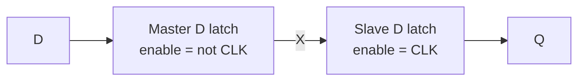

::: basics
### In plain words
A flip-flop or latch remembers one bit by feeding a circuit's output back into its own input. Two cross-coupled gates settle into one of two stable states, 0 or 1, and stay there. Add an enable and you get a D latch. Put two latches in series with opposite enables and you get a flip-flop that changes only at a clock edge.

### Picture it
Think of a rocker light switch. Push it up and it stays up; push it down and it stays down. It remembers which way it was last pushed. Balanced exactly in the middle, it is unstable, and the slightest nudge tips it one way or the other. A gate loop does the same: feedback reinforces whichever state it is in.

### Words you need
- **Positive feedback**: feeding an output back so that it reinforces its own state, giving two stable states (bistable).
- **NOR gate**: a logic gate whose output is 1 only when both inputs are 0. See [[q0889]]. Cross-coupled means each gate's output feeds the other's input.
- **SR latch**: two cross-coupled NOR gates with set (S) and reset (R) inputs.
- **D latch**: a gated latch whose output follows input D while its enable is active.
- **Master-slave**: two latches with opposite enables, forming a flip-flop. See [[q0881]].

### The simplest example
Take an SR latch made of two cross-coupled NOR gates. Say it stores Q = 1. With S and R both 0, it just holds. Pulse R to 1. The top NOR now outputs 0, so Q = 0. That makes the other output 1, and the loop locks in the new state. Return R to 0 and Q stays 0. Pulsing S to 1 does the reverse. Setting S and R both to 1 is forbidden, because both outputs go to 0 and releasing them together is unpredictable. The rest of this page builds the D latch and the master-slave flip-flop, and shows where setup time and metastability come from.
:::

::: testing
Whether you can build storage from gates: positive feedback gives a bistable element, an enable (or clock) controls when it listens, and two of those in series make an edge-triggered flip-flop. The interviewer wants a gate-level story (cross-coupled NOR or NAND SR latch, gated D latch, master-slave) plus the physical idea: a loop with gain greater than one has two stable states and one unstable one, which also explains metastability.
:::

::: why
Every register, counter and state machine reduces to this. Being able to derive a latch from gates shows you understand where state comes from, why a flip-flop needs setup and hold ([[q0880]]), and why asynchronous inputs can cause metastability ([[q0887]]). Interviewers often follow with "now draw the transistors" or "what does an SR latch do when S and R are both 1?".
:::

::: concepts
- **Positive feedback**: output fed back to the input in phase, reinforcing the current state.
- **Bistability**: two stable states (0 and 1) of a loop, with an unstable midpoint ([[q0883]]).
- **Universal gates**: NAND/NOR are enough to build everything ([[q0892]]).
- **Gate symbols and transistor-level gates** ([[q0889]], [[q0890]]).
- **Latch versus flip-flop**: level versus edge triggering ([[q0881]]).
:::

::: answer
"The basic idea is feedback. If I take two inverting gates and cross-couple them, like two NOR gates where each output feeds the other's input, I get a circuit with two stable states, so it remembers one bit. That's the SR latch: pulse S to set the output high, pulse R to reset it low, and with both low it holds. The one forbidden case is both inputs high, which forces both outputs to the same value and gives unpredictable behavior when you release them.

To make it more useful, I add gating. A gated D latch has a data input D and an enable. When enable is high, D controls the latch, so Q follows D, so it's transparent. When enable is low, the inputs are blocked and the loop just holds. D can only produce set or reset, so the forbidden state is gone.

A flip-flop is two D latches in series with opposite enables. When the clock is low, the first one, the master, is transparent and the second is holding. At the rising edge the master closes and keeps the value D had at that moment, and the second one, the slave, opens and passes it to the output. So the output changes only at the clock edge.

Physically, the master's setup and hold times come from how long it takes the master loop to settle before it closes, and metastability is what happens if D changes at that moment and the loop is left balanced at the unstable midpoint."
:::

::: technical
**SR latch (NOR).** $Q=\overline{R+\overline Q}$, $\overline Q=\overline{S+Q}$. Truth table:

| S | R | Q next | Note |
|---|---|---|---|
| 0 | 0 | Q | hold |
| 1 | 0 | 1 | set |
| 0 | 1 | 0 | reset |
| 1 | 1 | 0, 0 | forbidden: both outputs low; releasing both inputs simultaneously races |

NAND version is active-low: $\overline S$, $\overline R$ inputs; both low is forbidden.

**Gated D latch.** $S=D\cdot E$, $R=\overline D\cdot E$ into an SR latch. $S=R=1$ is impossible since $D$ and $\overline D$ differ. For $E=1$: $Q=D$; for $E=0$: holds. Equivalent: a 2:1 mux with feedback, $Q=E\cdot D+\overline E\cdot Q$ (beware of static-hazard glitches, [[q0888]]).

**Master-slave D flip-flop.** Master latch enabled by $\overline{CLK}$, slave by $CLK$. Positive-edge triggered: $Q^+=D$ at the rising edge. Transistor count in static CMOS using transmission-gate latches is roughly 18 to 24 (plus extra for set/reset or scan).

**Loop analysis.** Two inverters in a loop with small-signal gain magnitude $A>1$ per stage have three equilibria: two stable (full-rail) and one unstable (the switching threshold $V_M$, where both nodes sit at $V_M$). A perturbation $\delta$ around $V_M$ grows as $\delta e^{t/\tau}$, with $\tau\approx C/(g_{m,n}+g_{m,p})$ per node, which gives the resolution time scale in [[q0887]].

**Timing.** $t_{su}$: time for D to propagate to the master's storage node before the master closes; $t_h$: time for the input path to isolate; $t_{cq}$: slave propagation plus output buffer.
:::

::: short
"Feedback is the key. Two cross-coupled NOR gates form an SR latch with two stable states, so it stores a bit: set, reset, or hold, with both inputs high forbidden. Gate the inputs with an enable and tie them to D and its complement and you get a D latch, which is transparent while enabled. Put two D latches in series with opposite enables and you get a flip-flop: the master captures D while the clock is low, and at the rising edge the slave takes it to Q, so the output only changes on the edge."
:::

::: long
"Memory in digital logic comes from feedback. If I cross-couple two NOR gates, so each output feeds an input of the other, the loop has two stable states. If Q is high, the other NOR sees a 1 and holds its output low, which keeps Q high. And if Q is low, the opposite holds. That's the SR latch. Setting S high forces Q to 1, setting R high forces Q to 0, and with both low it just remembers. If both are high, both outputs are forced to 0, and when I release them together the result depends on which gate is faster, so we call it forbidden.

To tame it, I build a D latch. I feed S as D AND enable and R as NOT D AND enable. Since D and its complement are never both one, I never hit the forbidden case. When enable is high the latch follows D; when enable is low both S and R are 0, so the loop holds. That's a transparent latch.

To get an edge-triggered flip-flop I chain two D latches with opposite enables. When the clock is low, the master is transparent and the slave holds the old output. When the clock rises, the master closes, locking in D, and the slave opens and shows that locked value at Q. When the clock falls, the slave closes again and holds. So Q changes only at the rising edge, about a clock-to-Q delay after it.

In silicon this is usually done with transmission gates and inverters, around 20 transistors per flip-flop. Setup time is the time D needs to reach the master's storage node before the master closes, and hold is the time the input path takes to disconnect. If D changes inside that window, the loop can be left near its unstable midpoint, and it resolves exponentially fast but unpredictably: that's metastability."
:::

::: terms
- **Bistable**: circuit with two stable states, which stores one bit.
- **SR latch**: cross-coupled gates with set and reset inputs.
- **D latch**: gated latch whose output follows D while enabled.
- **Enable / clock**: signal that controls when a latch is transparent.
- **Master-slave**: two latches of opposite phase making an edge-triggered flip-flop.
- **Transmission gate**: parallel NMOS/PMOS pass switch used in CMOS latches.
- **Forbidden state**: S=R=1 in an SR latch.
- **Clock-to-Q ($t_{cq}$)**: delay from the active edge to a valid output.
- **Metastability**: balance at the unstable equilibrium after a marginal capture ([[q0887]]).
:::

::: exceptional
**An average answer** draws a block diagram of D, CLK, Q and says "it stores a bit on the edge".

**An exceptional answer**:
- Starts from the cross-coupled gates and explains *why* it stores: positive feedback, two stable states.
- Gets the SR truth table right including the forbidden case and its release race.
- Builds the D latch (S = D·E, R = D̄·E) and then the master-slave flip-flop, walking a clock cycle with the open/closed latches.
- Connects to the physics: the unstable midpoint, setup/hold and metastability.
- Mentions the transistor-level implementation (transmission gates) and rough transistor counts.
:::

::: mistakes
- **Using NOR truth-table rules for a NAND latch.** NAND SR latches are active-low: S̄=R̄=0 is forbidden, S̄=R̄=1 holds.
- **Forgetting the forbidden SR state**, or saying it "just toggles". With a NOR latch it makes both outputs 0, and releasing both at once is unpredictable.
- **Describing a flip-flop as one latch with a clock.** A single clocked latch is transparent; the flip-flop needs master and slave.
- **Claiming Q changes exactly at the clock edge.** It changes $t_{cq}$ later.
- **Saying metastability is just "an in-between voltage".** It's the loop balanced at the unstable equilibrium, which then resolves randomly and exponentially.
:::

::: deep
## Step 1: feedback gives memory

A combinational circuit's output depends only on its present inputs. To remember anything, the output must depend on its own past, which means a feedback path. The simplest feedback loop is two inverters head to tail:

$$V_2=f(V_1),\quad V_1=f(V_2)$$

Both node voltages must satisfy both equations at once. Plotting the two inverter transfer curves on the same axes (one mirrored) gives three intersection points:

```plot
{"title":"Two inverters in a loop: three equilibria","x":{"label":"V_1","unit":"V","min":0,"max":4.6},"y":{"label":"V_2","unit":"V","min":0,"max":3.7},
 "vars":{"vdd":3.3,"vm":1.65,"g":6},
 "series":[{"label":"V_2 = f(V_1)","fn":"vdd/(1+exp(g*(x-vm)))"},{"label":"V_1 = f(V_2) (axes swapped)","points":[[3.2998,0.0],[3.2998,0.0412],[3.2997,0.0825],[3.2997,0.1237],[3.2996,0.165],[3.2994,0.2062],[3.2993,0.2475],[3.2991,0.2887],[3.2988,0.33],[3.2985,0.3712],[3.298,0.4125],[3.2975,0.4537],[3.2968,0.495],[3.2959,0.5363],[3.2947,0.5775],[3.2932,0.6188],[3.2913,0.66],[3.2889,0.7012],[3.2858,0.7425],[3.2819,0.7837],[3.2768,0.825],[3.2703,0.8662],[3.2621,0.9075],[3.2516,0.9487],[3.2383,0.99],[3.2213,1.0312],[3.1999,1.0725],[3.1729,1.1138],[3.139,1.155],[3.0965,1.1962],[3.0438,1.2375],[2.9789,1.2788],[2.8996,1.32],[2.8041,1.3612],[2.6906,1.4025],[2.5579,1.4438],[2.406,1.485],[2.2359,1.5262],[2.0502,1.5675],[1.8532,1.6087],[1.65,1.65],[1.4468,1.6912],[1.2498,1.7325],[1.0641,1.7738],[0.894,1.815],[0.7421,1.8562],[0.6094,1.8975],[0.4959,1.9387],[0.4004,1.98],[0.3211,2.0212],[0.2562,2.0625],[0.2035,2.1037],[0.161,2.145],[0.1271,2.1862],[0.1001,2.2275],[0.0787,2.2687],[0.0617,2.31],[0.0484,2.3512],[0.0379,2.3925],[0.0297,2.4337],[0.0232,2.475],[0.0181,2.5162],[0.0142,2.5575],[0.0111,2.5987],[0.0087,2.64],[0.0068,2.6812],[0.0053,2.7225],[0.0041,2.7637],[0.0032,2.805],[0.0025,2.8462],[0.002,2.8875],[0.0015,2.9287],[0.0012,2.97],[0.0009,3.0112],[0.0007,3.0525],[0.0006,3.0938],[0.0004,3.135],[0.0003,3.1763],[0.0003,3.2175],[0.0002,3.2588],[0.0002,3.3]],"color":"red","dashed":true}],
 "points":[{"x":0.0,"y":3.3,"label":"stable: V_2 high"},{"x":1.65,"y":1.65,"label":"unstable midpoint"},{"x":3.3,"y":0.0,"label":"stable: V_2 low"}]}
```
Figure: The solid curve is one inverter's transfer function; the dashed curve is the other inverter's, drawn with axes swapped. They intersect at three points: two full-rail states that are stable (the slope product is less than one there, so errors shrink) and one at the switching threshold, which is unstable (slope product greater than one, so errors grow).

Around the midpoint, a small disturbance $\delta$ is amplified by the loop gain each time around, so the voltages run away to the nearest rail. That makes the state a true memory: once at a rail, noise is rejected, not amplified. It also reveals the weakness: if you place the loop *exactly* at the midpoint (by changing data at the wrong time), it takes a long, random time to fall to one side ([[q0887]]).

## Step 2: cross-coupled gates become an SR latch

Replace the inverters by NOR gates; each has a second input to override the loop.

```circuit
{"caption":"SR latch from two cross-coupled NOR gates","elements":[
 {"t":"nor","at":[6,2],"inputs":2},
 {"t":"nor","at":[6,10],"inputs":2},
 {"t":"term","at":[0,1],"label":"R","side":"left"},{"t":"wire","pts":[[0,1],[6,1]]},
 {"t":"term","at":[0,11],"label":"S","side":"left"},{"t":"wire","pts":[[0,11],[6,11]]},
 {"t":"wire","pts":[[10,2],[14,2]]},{"t":"dot","at":[11,2]},{"t":"term","at":[14,2],"label":"Q","side":"right"},
 {"t":"wire","pts":[[10,10],[14,10]]},{"t":"dot","at":[11,10]},{"t":"term","at":[14,10],"label":"Q̄","side":"right"},
 {"t":"wire","pts":[[11,2],[11,5],[3,5],[3,9],[6,9]]},
 {"t":"wire","pts":[[11,10],[11,7],[2,7],[2,3],[6,3]]}
]}
```
Figure: The top NOR takes R and Q̄ and produces Q; the bottom NOR takes S and Q and produces Q̄. Each output feeds the other gate's input, forming the loop. A dot marks where an output splits; the two feedback wires cross without connecting.

Walk through it. Suppose Q=1, Q̄=0, S=R=0. The top NOR sees R=0 and Q̄=0, so its output is 1 (consistent). The bottom NOR sees S=0 and Q=1, output 0 (consistent). Now pulse R=1: the top NOR output goes to 0, so Q=0; the bottom NOR now sees S=0, Q=0 and outputs 1: Q̄=1. Return R to 0: the top NOR now sees R=0 and Q̄=1, so it stays 0. The state is stored.

The forbidden input $S=R=1$ forces both outputs to 0 (so Q and Q̄ are no longer complements). If S and R drop together, both NORs see all-zero inputs and both try to go to 1; whichever is slightly faster wins, or both swing and fight, which can oscillate or go metastable.

```sim
{"id":"flipflop-lab","mode":"sr"}
```
Figure: Apply S and R pulses and watch the stored state. Try S=R=1 and then release both together to see the ambiguous result.

A NAND version works the same way with active-low inputs, and often costs fewer transistors in CMOS (NAND gates are smaller than NOR gates, since series NMOS are faster than series PMOS).

## Step 3: the gated D latch

Feed the SR latch through two AND (or NAND) gates with an enable: $S=D\cdot E$, $R=\overline D\cdot E$.

- $E=0$: $S=R=0$, the latch holds.
- $E=1$, $D=1$: $S=1$, $R=0$, so $Q=1$.
- $E=1$, $D=0$: $S=0$, $R=1$, so $Q=0$.

Because $D$ and $\overline D$ are complementary, the forbidden case never occurs. This *is* the latch from [[q0881]]: transparent while $E=1$.

```circuit
{"caption":"A D latch as a mux with feedback","elements":[
 {"t":"box","at":[6,2],"w":5,"h":5,"label":"2:1 MUX","pins":[{"side":"left","pos":1,"name":"1"},{"side":"left","pos":4,"name":"0"},{"side":"bottom","pos":2.5,"name":"S"},{"side":"right","pos":2.5,"name":"Q"}]},
 {"t":"term","at":[0,3],"label":"D","side":"left"},{"t":"wire","pts":[[0,3],[6,3]]},
 {"t":"wire","pts":[[11,4.5],[15,4.5]]},{"t":"dot","at":[13,4.5]},{"t":"term","at":[15,4.5],"label":"Q","side":"right"},
 {"t":"wire","pts":[[13,4.5],[13,9],[3,9],[3,6],[6,6]]},
 {"t":"term","at":[8.5,10],"label":"E","side":"bottom"},{"t":"wire","pts":[[8.5,10],[8.5,7]]}
]}
```
Figure: Select input 1 (D) when E=1, and input 0 (the fed-back Q) when E=0. When E=0 the output reinforces itself, holding the value. This is a compact view of a latch; real implementations use the gated SR structure because a mux with feedback can glitch while switching (a static hazard on the feedback loop).

## Step 4: two latches make a flip-flop


Figure: The master is transparent while CLK is low, the slave while CLK is high; the node between them (X) holds the sampled value.

A cycle with numbers: Q=0 and D=1 (set up well before the edge). While CLK=0 the master follows D, so X=1, and the slave is closed, so Q=0. At the rising edge the master closes holding X=1, and the slave opens, so Q rises to 1 after $t_{cq}\approx0.3$ ns. If D now falls to 0 during CLK=1, X is unaffected; Q stays 1. When CLK falls, the slave closes at 1 and the master reopens, ready to track D=0; Q changes only at the next rising edge.

## Step 5: inside the silicon

In CMOS, the latch is a pair of inverters plus pass gates (transmission gates). While the latch is transparent, the input pass gate is on and the feedback pass gate is off, so the input *overrides* the loop; when closed, the input gate is off and the feedback gate is on, closing the loop to hold the value. Each latch needs about 8 transistors (two pass gates and two inverters), the master-slave flip-flop about 16 plus clock inverters, around 18 to 24 total. The six-transistor SRAM cell is the same loop with the input provided by access transistors ([[q0883]]).

- **Setup time** is the time for the input to propagate through the input pass gate and first inverter and flip the loop state before the pass gate shuts.
- **Hold time** is the time the clock needs to turn the input gate fully off (clock skew inside the cell also matters).
- **Clock-to-Q** is the slave's delay: pass gate plus output inverter.

If D changes inside that setup/hold window, the master loop is left near its midpoint. Resolution follows $\delta(t)=\delta_0e^{t/\tau}$ with $\tau$ of order tens of picoseconds in modern CMOS, so for $\delta_0=1$ mV the loop needs $\tau\ln(1.65\text{ V}/1\text{ mV})=7.4\tau$ to reach a rail: about 220 ps if $\tau=30$ ps. Longer if the initial imbalance is smaller, which is the exponential tail that [[q0887]] studies.
:::

::: applications
- **Registers and counters**: arrays of D flip-flops store words and count events ([[q0886]]).
- **State machines**: the state register is a bank of flip-flops clocked each cycle ([[q0896]]).
- **Debounce and synchronizer chains**: two flip-flops in series reduce metastability risk for async inputs ([[q0887]]).
- **Memory cells**: SRAM bit cells are the same cross-coupled loop ([[q0883]]).
- **Clock gating and sample-and-hold style capture**: latches hold enables and comparator outputs.
:::

::: assumptions
- Standard gate-level and static-CMOS implementations; dynamic and pulsed-latch designs differ internally.
- Gate delays are assumed small compared with the clock period; the cycle walkthrough uses ideal timing.
- Positive-edge-triggered D flip-flop; negative-edge, JK and T flip-flops follow from the same ideas.
- Transistor counts are approximate and vary with cell style and added features.
:::

::: followups
### What does an SR latch do when S=R=1 and then both go to 0 together?
With a NOR latch, S=R=1 forces Q=Q̄=0. When both inputs drop at once, both gates see two zero inputs and both try to go high. The faster gate wins and forces the other low, or both swing and fight for a while, possibly oscillating in a symmetric circuit. The result is unpredictable, which is why the state is forbidden.

### How would you build a T (toggle) flip-flop from a D flip-flop?
Feed D with $\overline Q$ (D = Q̄ for toggle every clock) or $D=T\oplus Q$ for a controlled toggle. With T=1 it flips on each edge, giving a divide-by-two ([[q0885]] covers clock-speed limits of such counters).

### Why can't the D flip-flop just be one latch with the clock as enable?
A latch is transparent for the whole high phase: if D changes during that time, Q follows, and feedback through combinational logic back to D can race round multiple times in one clock. The master-slave structure breaks that loop.

### How do you add an asynchronous reset to a flip-flop?
Add a reset input that forces the slave (and master) to a defined state independent of the clock, for example NAND/NOR gates with a reset input in the latch loops, or an extra transistor pulling a storage node. Release it synchronously (recovery/removal timing, analogous to setup/hold) to avoid metastability.

### What if D is exactly at the threshold when the clock edge arrives?
The master loop is left near its unstable midpoint, and Q takes an unbounded, random time to resolve. The probability that it's still unresolved after $t$ falls as $e^{-t/\tau}$, which is why synchronizers add flops to wait extra time ([[q0887]]).
:::

::: interpretations
"How does a flip flop/latch work?" invites both the logic-level construction (SR, D, master-slave) and the physical mechanism (positive feedback, bistability). I cover both. The comparison between the two devices and their uses is in [[q0881]], and the timing constraints are in [[q0880]].
:::

::: references
- Harris & Harris, *Digital Design and Computer Architecture*: chapter on sequential logic (SR latch, D latch, D flip-flop).
- Horowitz & Hill, *The Art of Electronics*, 3rd ed.: chapter on sequential logic, latches and flip-flops.
- Rabaey, Chandrakasan & Nikolic, *Digital Integrated Circuits*: static sequential circuits (bistability, transmission-gate latches, master-slave).
- Weste & Harris, *CMOS VLSI Design*: sequential element design and metastability.
:::

::: rubric
- Explains memory from feedback: cross-coupled gates with two stable states :: This is the root idea behind any storage element.
- SR latch behavior including the forbidden state :: Shows precise knowledge of the primitive.
- D latch from gating S and R with D, D̄ and enable :: Shows how control is added and the forbidden case removed.
- Master-slave flip-flop with a walk through a clock cycle :: Shows you understand edge triggering.
- Mentions setup/hold or metastability from the physical loop :: Connects logic-level to physical behavior.
- CMOS implementation (transmission gates, about 20 transistors) :: Depth beyond the logic diagram.
:::

::: quiz
```json
[
 {"type":"mcq","level":"fundamental","q":"What makes cross-coupled gates able to store a bit?","options":["Large capacitance on the outputs","Positive feedback giving two stable states","A clock signal","A pull-up resistor"],"answer":1,"explain":"The loop reinforces whichever state it is in, so both the 0 and 1 states are stable."},
 {"type":"mcq","level":"fundamental","q":"For a NOR-based SR latch, which input combination is forbidden?","options":["S=0, R=0","S=1, R=0","S=0, R=1","S=1, R=1"],"answer":3,"explain":"With S=R=1 both outputs are forced to 0 so Q and Q̄ are not complementary, and releasing both inputs together gives an unpredictable result."},
 {"type":"truefalse","level":"intermediate","q":"A master-slave D flip-flop is built from two D latches with the same enable phase.","answer":false,"explain":"Opposite phases: the master is transparent while CLK is low and the slave while CLK is high, so there is never a D-to-Q transparent path."},
 {"type":"numeric","level":"intermediate","q":"A latch loop has $\\tau=30$ ps and starts 1 mV from the midpoint. Time to grow to 1.65 V using $\\delta=\\delta_0e^{t/\\tau}$, in ps?","answer":222,"tolerance":0.03,"unit":"ps","explain":"$t=\\tau\\ln(1.65/0.001)=30\\cdot7.41=222$ ps."},
 {"type":"mcq","level":"advanced","q":"In the gated D latch built as $S=D\\cdot E$, $R=\\overline D\\cdot E$, what is Q when E=1, D=0 and Q was 1?","options":["1","0","Undefined","Toggles"],"answer":1,"explain":"E=1, D=0 gives S=0 and R=1, so the latch resets and Q=0."},
 {"type":"multi","level":"advanced","q":"Select all true statements.","options":["The unstable midpoint of the cross-coupled inverters is where metastability occurs","A flip-flop's output changes exactly at the clock edge with zero delay","NAND SR latches use active-low inputs","A transparent latch can pass glitches on D to Q"],"answer":[0,2,3],"explain":"Metastability sits at the unstable equilibrium; NAND latches are active-low; transparent latches pass glitches. Q changes $t_{cq}$ after the edge, not instantly."}
]
```
:::
