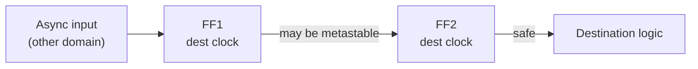

::: basics
### In plain words
Metastability happens when a flip-flop's input changes at the very instant it is supposed to capture it. The flip-flop cannot decide between 0 and 1, so its output hovers somewhere in between for a short, random time before falling to one side. That is dangerous if the next gate reads the muddy in-between voltage and different parts of the chip disagree about what it means.

### Picture it
Picture a ball balanced on the top of a hill with a valley on each side. A clear push sends it rolling into one valley right away. A tiny, barely-there nudge leaves it wobbling on the peak, and nobody can say how long before it tips. The closer to perfect balance, the longer it takes. The ball always tips eventually, but there is no upper limit on the wait.

### Words you need
- **Setup/hold window**: the tiny interval around a clock tick when the input must hold still ([[q0880]]).
- **Asynchronous input**: a signal with no timing relationship to your clock, such as a button press.
- **Resolution time**: how long the output takes to settle to a clean 0 or 1.
- **Synchronizer**: two flip-flops in a row on the same clock. The first may go muddy, and the second gets a full clock period to see a settled value.

### The simplest example
A button press feeds a flip-flop clocked at 1 GHz. Occasionally the press lands inside the window, and the flip-flop goes metastable. The page's illustrative numbers say that if the next stage reads it only 0.7 ns later, the average time between failures is about 7,000 seconds, under two hours. Add a second flip-flop, which gives about 1 ns more time to settle, and the average gap grows to about 65 billion years. Extra waiting time makes failures astronomically rarer, but never zero.

That is the whole idea. The rest of this page shows why waiting helps exponentially, how the MTBF formula works, and how to send multi-bit values across safely.
:::

::: testing
Whether you understand metastability as a **physical property of bistable circuits**, not a vague "glitch": a flip-flop whose data changes inside its setup/hold window can end up balanced at the unstable equilibrium and take a random, unbounded time to resolve. Strong candidates give the mechanism (positive feedback, exponential growth), the MTBF formula with its dependence on resolution time, and the fix (two-flop synchronizer, more time, correct clock-domain-crossing practice), plus its limits: you cannot eliminate it, only make it astronomically rare.
:::

::: why
Any signal that is asynchronous to a clock (a button, an interrupt from another clock domain, an external sensor strobe) can violate setup/hold. Metastability is why clock-domain crossing needs special structures, why asynchronous resets need synchronized release, and why a design can pass all tests then fail once a month in the field. It is the standard "advanced" digital interview question, linked directly to setup and hold ([[q0880]]) and to the physical latch behavior ([[q0882]]).
:::

::: concepts
- **Setup/hold window**: the interval around the clock edge in which data must not change ([[q0880]]).
- **Bistable latch with positive feedback**: two stable states and one unstable equilibrium ([[q0882]]).
- **Exponential regeneration**: deviation from the midpoint grows as $e^{t/\tau}$.
- **Asynchronous inputs**: signals unrelated to the sampling clock ([[q0946]]).
- **Synchronizer**: chain of flip-flops that gives metastability time to resolve.
- **MTBF**: mean time between failures of the synchronizer.
:::

::: answer
"Metastability is what happens when a flip-flop's data input changes right at the clock edge, inside its setup and hold window. A flip-flop is a bistable circuit, basically two cross-coupled inverters, with two stable states, 0 and 1, and an unstable balance point in between, like a ball on the top of a hill. Normally the input pushes it clearly to one side. If the data changes right at the sampling moment, the internal node can be left near that balance point. Positive feedback then amplifies whatever tiny difference exists, exponentially, until it falls to 0 or 1, but how long that takes is random and, in principle, unbounded.

During that time the output can sit at an in-between voltage, or oscillate, or switch late. The danger is that downstream logic sees a value near its threshold, so different gates interpret it differently, giving inconsistent state, and the system can crash.

You can't eliminate it for truly asynchronous signals, so you make failures extremely rare. The standard fix is a synchronizer: two or more flip-flops in series clocked by the destination clock. The first one may go metastable, but it has a full clock period to resolve before the second samples it. The probability of still being unresolved falls exponentially with the time you give it, so the mean time between failures becomes thousands or millions of years. For multi-bit data you don't synchronize each bit separately; you use a handshake, a Gray-coded counter or an asynchronous FIFO."
:::

::: technical
**Mechanism.** The master latch is a pair of cross-coupled inverters with equilibria at $V_{low}$, $V_{high}$ (stable) and $V_M$ (unstable). If at the closing instant the node voltage is $V_M+\delta_0$, then linearizing: $\delta(t)=\delta_0e^{t/\tau}$ with $\tau\approx C/(g_{m,total}-g_{leak})$ the regeneration time constant (about $C/g_m$ of the loop; tens of picoseconds in modern CMOS). The output is valid when $|\delta|\approx V_{DD}/2$, so the resolution time is $t_{res}=\tau\ln\!\left(\frac{V_{DD}/2}{|\delta_0|}\right)$, unbounded as $\delta_0\to0$.

**Probability.** The initial offset $\delta_0$ is roughly uniformly distributed over a small range set by the setup/hold aperture $T_0$ (the effective window). The probability that a sampled event is still unresolved after time $t_r$ is $\propto T_0e^{-t_r/\tau}/T$.

**MTBF** of a synchronizer, clock frequency $f_c$, average data transition rate $f_d$:
$$\text{MTBF}=\frac{e^{t_r/\tau}}{T_0\,f_c\,f_d}$$
where $t_r$ is the resolution time available before the next stage samples ($t_r\approx T_{clk}-t_{cq}-t_{su}-t_{logic}$ for one flop; one full extra period per extra flop).

**Worked example** (illustrative parameters $\tau=30$ ps, $T_0=20$ ps, $f_c=1$ GHz, $f_d=100$ MHz): with $t_r=0.7$ ns: $e^{23.3}=1.4\times10^{10}$ and the denominator is $2\times10^{-11}\cdot10^{9}\cdot10^{8}=2\times10^{6}$: MTBF $\approx7{,}000$ s (about 1.9 hours). Adding a second flip-flop gives $t_r\approx1.7$ ns: $e^{56.7}\approx4.1\times10^{24}$ so MTBF $\approx2\times10^{18}$ s, or about $6.5\times10^{10}$ years.

**Fix hierarchy.** Two-flop synchronizer (three for very high frequency or safety-critical); gray-coded pointers and asynchronous FIFOs for multi-bit data; handshake (req/ack) synchronizers; synchronized reset release.

> [!UNCERTAIN]
> $\tau$ and $T_0$ depend on the process, supply, temperature and flip-flop design. The values above are illustrative; real libraries and foundries characterize them per cell.
:::

::: short
"Metastability is when a flip-flop samples a data change inside its setup/hold window and its internal bistable loop is left near the unstable midpoint. Positive feedback then amplifies the tiny difference exponentially, so the output eventually settles to 0 or 1, but after a random and unbounded time, during which it may sit at an in-between level. You can't prevent it for asynchronous inputs, so you use synchronizers: two flip-flops in series give the first one a full cycle to resolve, making the MTBF astronomically long. Multi-bit buses need FIFOs or handshakes."
:::

::: long
"A flip-flop stores a bit in a bistable circuit, a pair of cross-coupled inverters. It has two stable states, and in between there's an unstable equilibrium, like a ball balanced on a hilltop. When data is stable around the clock edge, the circuit gets pushed clearly to one side. If data changes inside the setup and hold window, the circuit can be left almost exactly at that midpoint. Then positive feedback takes over: any tiny difference gets amplified exponentially, with a time constant tau that's tens of picoseconds in modern CMOS. The output eventually falls to a 0 or a 1, but how long it takes depends on how close to the midpoint it started, and in principle there's no upper bound.

The problem is that during this time the output can be at an intermediate voltage, or can switch late. If that goes to two gates with slightly different thresholds, one sees a 1 and the other a 0, and the system state becomes inconsistent. You get rare, unreproducible crashes.

You can't remove it if the signal is truly asynchronous to the clock, since sometimes the edge will land in the window. What you do is reduce the probability that it's still unresolved when someone uses it. The probability of still being metastable falls like e to the minus t over tau. So the MTBF is e to the t-resolve over tau, divided by the window T-zero times the clock frequency times the data rate. Each extra period of resolution time multiplies the MTBF by e to the T over tau, which is enormous; with tau of 30 ps and a 1 ns period, that's a factor of about 10 to the 14 per stage.

So the standard fix is a two-flop synchronizer clocked by the destination clock: the first flop may go metastable, the second one samples after a full period. For multiple bits, never synchronize each bit independently, since different bits may resolve on different cycles; use a Gray-coded pointer, a handshake, or an asynchronous FIFO. And release asynchronous resets through a synchronizer too."
:::

::: terms
- **Metastability**: a latch/flip-flop output hovering near the unstable equilibrium after a marginal capture.
- **Resolution time ($t_{res}$)**: time for the metastable state to settle to a valid logic level.
- **Regeneration time constant ($\tau$)**: exponential growth constant of the bistable loop.
- **Aperture / window ($T_0$)**: effective time window around the clock edge in which a transition can cause metastability.
- **MTBF**: mean time between synchronization failures.
- **Synchronizer**: serial flip-flop chain that gives metastability time to resolve.
- **Clock domain crossing (CDC)**: signal passing between asynchronous clock domains.
- **Gray code**: counting code where only one bit changes per step, safe to synchronize bit-by-bit.
- **Recovery/removal**: setup/hold-style checks for asynchronous reset release.
:::

::: exceptional
**An average answer** says "the output becomes unpredictable when setup or hold is violated, so we use two flip-flops".

**An exceptional answer**:
- Explains the cause physically: cross-coupled loop balanced at the unstable equilibrium, exponential escape with time constant $\tau$.
- Gives the MTBF formula, explains each term and why extra resolution time helps exponentially.
- States the key truth: metastability can't be eliminated, only made very unlikely, and shows a number.
- Warns about multi-bit CDC (use Gray code, FIFOs, handshakes) and about async reset release.
- Mentions that the second flop does not "remove" the problem, and that the synchronizer's first flop output must not fan out to other logic.
:::

::: mistakes
- **"Metastability only happens with a bad design."** It happens in any flip-flop when an asynchronous input lands in the window; good design makes it rare.
- **"A second flip-flop fixes it for good."** It reduces the failure probability exponentially; it doesn't make it zero.
- **Synchronizing each bit of a bus separately.** Bits may resolve on different cycles, so the destination sees a value that never existed; use Gray code, handshakes or FIFOs.
- **Using the first synchronizer flop's output elsewhere.** It may be metastable; only the second flop's output is used.
- **Thinking the output is a "random 0 or 1" instantly.** It may be an intermediate voltage, oscillate or arrive late for an unbounded time.
- **Forgetting async reset deassertion.** Releasing reset near the clock edge violates recovery/removal and can cause metastability.
:::

::: deep
## The ball on the hill

Recall the bistable loop from [[q0882]]: two inverters feeding each other have three equilibria: two stable (rails) and one unstable (both nodes at the switching threshold $V_M$). In the energy picture, the stable states are valleys and the unstable state is the hilltop between them. A clean data input pushes the ball firmly into one valley. A data input that changes at the instant the latch closes leaves the ball near the top with almost no push.

Around the midpoint the circuit is a linear amplifier with positive feedback. Let $\delta$ be the differential voltage between the two storage nodes. The two inverters have small-signal gain $-g_mR$ each, and the node capacitance $C$ sets the speed, so

$$C\frac{d\delta}{dt}=(g_m-g_{load})\delta\;\Rightarrow\;\delta(t)=\delta_0e^{t/\tau},\quad\tau=\frac{C}{g_m-g_{load}}\approx\frac{C}{g_m}.$$

The latch is "resolved" once $\delta$ reaches about $V_{DD}/2$:
$$t_{res}=\tau\ln\frac{V_{DD}/2}{|\delta_0|}.$$

```plot
{"title":"Resolution time vs initial offset (tau = 30 ps, V_DD = 1.2 V)","x":{"label":"initial offset |delta_0|","unit":"V","min":1e-12,"max":0.6,"log":true},"y":{"label":"resolution time","unit":"s","min":0,"max":1.2e-9},
 "vars":{"tau":3e-11,"vh":0.6},
 "series":[{"label":"t_res = tau ln((V_DD/2)/delta_0)","fn":"tau*ln(vh/x)"}],
 "points":[{"x":1e-3,"y":"tau*ln(vh/1e-3)","label":"1 mV: 192 ps"},{"x":1e-9,"y":"tau*ln(vh/1e-9)","label":"1 nV: 0.6 ns"}]}
```
Figure: The closer the initial state is to the exact midpoint, the longer resolution takes, growing logarithmically without bound. Starting 1 mV off takes about 6.4 time constants (192 ps); starting 1 nV off takes about 20 time constants (0.6 ns). Because the offset is a continuous random variable, there is always some chance of a very long resolution.

What does the output look like while waiting? It stays near $V_M$ (neither valid 0 nor valid 1), then departs to a rail. If the departure is slow, the downstream flop or gate samples a non-logic voltage.

```timing
{"signals":[
 {"name":"CLK","wave":"0101010101"},
 {"name":"D (async)","wave":"0001111111"},
 {"name":"Q1 (FF1)","wave":"000xxx1111","color":"red"},
 {"name":"Q2 (FF2)","wave":"0000000111","color":"accent"}],
 "marks":[{"t":3,"label":"D changes at the edge"}],
 "hscale":1.2}
```
Figure: D rises just as the clock edge samples it. FF1's output Q1 hovers in an indeterminate state (x) for a while before resolving to the new value. FF2 samples Q1 one clock later, when Q1 has (with overwhelming probability) resolved, so Q2 is clean, simply a cycle later than the "ideal" capture. The synchronizer converts a potentially undefined value into an at-worst late but valid one.

## Why the failure rate is exponentially small in the waiting time

Assume the data transition lands uniformly within one clock period. The probability that it lands inside the aperture $T_0$ (so that the latch starts with a small enough $\delta_0$ for resolution to be long) is $T_0/T_{clk}$ per data event. The condition "unresolved after $t_r$" means $|\delta_0|<\frac{V_{DD}}{2}e^{-t_r/\tau}$, which is a fraction $\propto e^{-t_r/\tau}$ of all the starting offsets. The failure rate is then

$$\text{rate}=f_d\cdot\frac{T_0}{T_{clk}}\cdot e^{-t_r/\tau} \;\Rightarrow\;\text{MTBF}=\frac{1}{\text{rate}}=\frac{e^{t_r/\tau}}{T_0f_cf_d}.$$

(Using $f_c=1/T_{clk}$, so $T_0/T_{clk}=T_0f_c$.)

**Numbers.** Take $\tau=30$ ps, $T_0=20$ ps, $f_c=1$ GHz, $f_d=100$ MHz:

| Configuration | $t_r$ available | $e^{t_r/\tau}$ | MTBF |
|---|---|---|---|
| Single flop, second stage samples after 0.7 ns | 0.7 ns | $1.4\times10^{10}$ | about 7,000 s (1.9 h) |
| Add a second flop (+1 ns) | 1.7 ns | $4.1\times10^{24}$ | $2\times10^{18}$ s, about $6.5\times10^{10}$ years |
| Slower clock, 100 MHz, $f_d=10$ MHz, $t_r=9$ ns | 9 ns | $e^{300}\approx2\times10^{130}$ | effectively infinite |

```plot
{"title":"Synchronizer MTBF vs resolution time (tau = 30 ps, T_0 = 20 ps, f_c = 1 GHz, f_d = 100 MHz)","x":{"label":"resolution time t_r","unit":"s","min":2e-10,"max":2.5e-9},"y":{"label":"MTBF","unit":"s","log":true,"min":1e-3,"max":1e30},
 "vars":{"tau":3e-11,"t0":2e-11,"fc":1e9,"fd":1e8},
 "series":[{"label":"MTBF = exp(t_r/tau)/(T_0 f_c f_d)","fn":"exp(x/tau)/(t0*fc*fd)"}],
 "hlines":[{"at":3.15e7,"label":"1 year","color":"orange"},{"at":3.15e17,"label":"10 billion years","color":"muted"}]}
```
Figure: MTBF rises exponentially with resolution time: every extra 30 ps multiplies it by e (about 2.7). Going from 0.7 ns to 1.7 ns, which is the extra clock period a second flop provides, adds 14 orders of magnitude. This is why two flops are enough in most designs, and why very high clock rates (small $t_r/\tau$) or very low $\tau$ margins (low voltage, cold) need a third.

```sim
{"id":"flipflop-lab","mode":"setup-hold","tsu":0.1,"th":0.05}
```
Figure: Slide the D edge into the setup/hold window and observe the capture become unreliable: the same event, in a real flip-flop, produces a metastable output instead of a clean wrong or right value.

## The standard synchronizer


Figure: The first flip-flop takes the risk; the second isolates the rest of the design from it. The wire between them should be short, with no logic, to give the maximum time for resolution.

Rules for using it:
1. **No logic between FF1 and FF2**, and no use of FF1's output anywhere else.
2. **Place the flops close** and mark them in constraints so tools treat the path as an asynchronous crossing and don't "optimize" them apart.
3. **Source signals should be held for at least two destination clocks** (or be a clean pulse-stretched/toggled signal), else a fast pulse may be missed entirely.
4. **Single bits only.** For multi-bit values, use one of:
   - **Gray-coded counters** (only one bit changes per step, so a mis-sampled bit gives either the old or new value, never an invalid one), used in asynchronous FIFO pointers.
   - **Handshake**: sender holds data stable, toggles a request; the receiver synchronizes the request, then reads the data; an acknowledge goes back.
   - **Asynchronous FIFO** with Gray-coded read/write pointers.
5. **Asynchronous reset**: assert asynchronously, release synchronously via a two-flop reset synchronizer (recovery/removal check).

## Why multi-bit buses break

Suppose a 3-bit counter value changes from 011 (3) to 100 (4) while the destination samples. All three bits flip, but each bit's two-flop synchronizer sees the edge at a slightly different moment relative to the destination clock. The destination might capture 111, 000, 101 or any other combination for a cycle, none of which was ever the true value. With Gray code, 010 to 110 changes only one bit, so any capture is either the old or the new value.

## Where it shows up in real hardware

- **Buttons and external interrupts**: asynchronous to the MCU clock, so MCU input pins have synchronizers on the GPIO inputs and on the external interrupt path.
- **SPI/I²C slave inputs** with the clock from another domain, UART RX (sampled with oversampling).
- **Clock domain crossings** between CPU, DDR and peripheral buses in an SoC.
- **Reset trees**, where release must align to each domain's clock.
- **Synchronizer MTBF** is reported by synchronizer-characterization tools and cell libraries; safety standards require documented values.

> [!TIP]
> If an interviewer asks "can you eliminate metastability?" say no: "For an input that is truly asynchronous, the setup/hold window will eventually be hit. We trade time for reliability: each extra stage multiplies the MTBF by $e^{T/\tau}$, so we can make it longer than the age of the universe, but never infinite."
:::

::: applications
- **MCU GPIO inputs and external interrupts** pass through input synchronizers before reaching the core.
- **Clock-domain crossings in SoCs**: control signals via two-flop synchronizers, data through asynchronous FIFOs.
- **Reset distribution**: reset synchronizers ensure clean release per clock domain.
- **High-speed serial receivers** (SerDes) resolve metastability in sampling latches and use extra pipeline stages.
- **Arbiters and mutual-exclusion elements**: circuits that must choose between near-simultaneous requests are inherently metastable and need resolution time.
:::

::: assumptions
- Standard CMOS flip-flops, with $\tau$ and $T_0$ assumed constant (really functions of voltage and temperature; $\tau$ grows at low voltage and cold at some nodes).
- Uniformly distributed asynchronous events; correlated or periodic inputs can hit the window repeatedly.
- MTBF numbers are for illustrative parameters, not any specific library.
- Synchronizers with more stages or shorter clock periods change $t_r$; at low voltage or high clock rates more flops may be required.
:::

::: followups
### Why does a two-flop synchronizer work, and when are two flops not enough?
The first flop may go metastable, but it has one full clock period (minus $t_{cq}$ and setup) to resolve before the second samples it. The MTBF grows as $e^{t_r/\tau}$ with that resolution time. Two flops usually give astronomically long MTBF; for very fast clocks (small $t_r/\tau$), low voltages/cold (large $\tau$), very high event rates or high-reliability systems, calculate MTBF and add a third stage.

### How would you cross a 16-bit counter value from one clock domain to another?
Don't synchronize 16 bits independently. Convert to Gray code in the source domain, synchronize the Gray bits (each through a two-flop synchronizer) and convert back; a mis-sampled transition is either old or new. Or use a handshake (data stable, toggle request, synchronize request, read data, return ack) or an asynchronous FIFO with Gray pointers.

### What happens if a short pulse in the source domain is shorter than the destination clock period?
It can fall between destination clock edges and be missed entirely. Pulse-stretch it in the source domain, use a toggle synchronizer (toggle a flop on each event, synchronize and detect edges), or use a handshake.

### Can you detect metastability?
You can't reliably detect it with a flip-flop, because any detector is also a sampling circuit that can go metastable. Designers instead characterize $\tau$ and $T_0$ and reduce probability by waiting. Analog detectors exist but also have limits; "metastability-hardened" flops reduce $\tau$.

### A product has a random crash about once a month that nobody can reproduce. How might metastability be involved?
An asynchronous signal (external event, domain crossing) is sampled by a single flop whose output fans out to different logic. Rare window hits produce inconsistent values. Check clock-domain crossings, add proper synchronizers, count the MTBF for your clocks/rates, and run CDC analysis tools.
:::

::: interpretations
The term "metastability" in electronics also appears in analog contexts (a comparator at zero differential input, an arbiter), but in this digital-electronics context it means the flip-flop/latch behavior after setup/hold violation. It's the physical consequence of the timing rules in [[q0880]] and a motivation for the multi-clock-domain discussion in [[q0946]].
:::

::: references
- Harris & Harris, *Digital Design and Computer Architecture*: chapter on sequential timing, metastability and synchronizers.
- Weste & Harris, *CMOS VLSI Design*: synchronizer design and the MTBF derivation.
- Dally & Poulton, *Digital Systems Engineering*: synchronization and metastability chapter.
- Ginosar, "Metastability and Synchronizers: A Tutorial," IEEE Design & Test of Computers, 2011.
:::

::: rubric
- Defines metastability as indeterminate output after violating setup/hold :: The core definition tied to timing.
- Explains the mechanism (bistable loop at the unstable equilibrium, exponential escape) :: Shows physical understanding.
- Gives the MTBF formula with exponential dependence on resolution time :: Quantitative handle on the risk.
- States it can't be eliminated, only reduced :: A key conceptual point.
- Describes the two-flop synchronizer and its usage rules :: The practical fix.
- Handles multi-bit crossing (Gray code, FIFO, handshake) and async reset :: Shows real CDC knowledge.
:::

::: quiz
```json
[
 {"type":"mcq","level":"fundamental","q":"What causes a flip-flop to go metastable?","options":["Too high a supply voltage","A data change inside the setup/hold window around the clock edge","A slow clock","Too many outputs connected"],"answer":1,"explain":"If D changes inside the window, the bistable loop can be left near its unstable equilibrium."},
 {"type":"truefalse","level":"fundamental","q":"A two-flop synchronizer eliminates metastability completely.","answer":false,"explain":"It reduces the probability exponentially by allowing more resolution time, but the probability is never zero."},
 {"type":"numeric","level":"intermediate","q":"A latch has $\\tau=30$ ps, $V_{DD}=1.2$ V and starts 1 mV from the midpoint. Resolution time to reach $V_{DD}/2$ in ps ($t=\\tau\\ln\\frac{V_{DD}/2}{\\delta_0}$)?","answer":192,"tolerance":0.03,"unit":"ps","explain":"$30\\cdot\\ln(0.6/0.001)=30\\cdot6.397=191.9$ ps."},
 {"type":"numeric","level":"intermediate","q":"By what factor does the MTBF increase when the resolution time grows by 1 ns with $\\tau=30$ ps? Give the exponent $\\log_{10}$ of the factor.","answer":14.5,"tolerance":0.03,"unit":"orders of magnitude","explain":"$e^{1000/30}=e^{33.3}$, and $\\log_{10}(e^{33.3})=33.3\\cdot0.4343=14.5$."},
 {"type":"mcq","level":"advanced","q":"Which approach is correct for passing a 4-bit counter between asynchronous clock domains?","options":["Four independent two-flop synchronizers","Convert to Gray code, then synchronize each bit","Use a single flop","Slow the destination clock"],"answer":1,"explain":"Gray code changes only one bit per step, so any mis-sampled transition yields the old or new value. Independent synchronizers on a binary counter can capture values that never existed."},
 {"type":"multi","level":"advanced","q":"Select all rules for a two-flop synchronizer.","options":["No combinational logic between the two flops","Use the first flop's output elsewhere to save area","Both flops are clocked by the destination clock","The asynchronous signal should be held long enough to be seen by the destination clock"],"answer":[0,2,3],"explain":"The first flop's output may be metastable, so it must not drive other logic. Both flops use the destination clock, and short pulses can be missed unless stretched."}
]
```
:::
