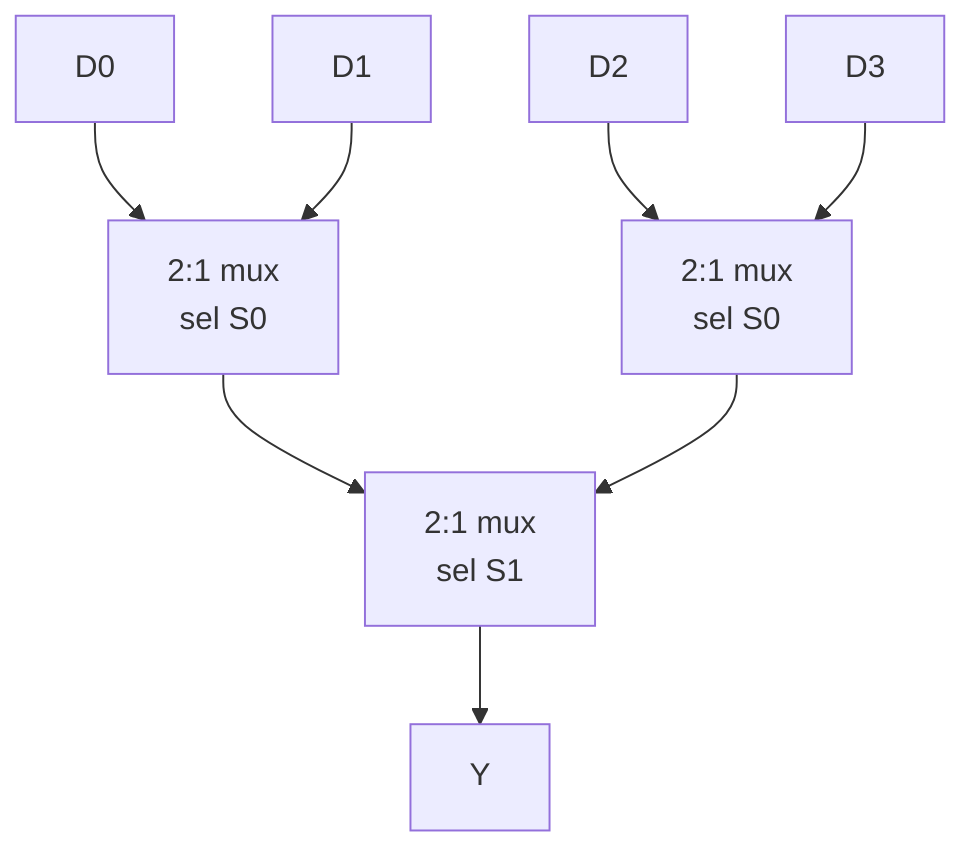

::: testing
Whether you can describe a multiplexer as **a digitally controlled switch that routes one of N inputs to one output**, and then go one level deeper. The interviewer wants to see the select-line arithmetic ($N$ inputs need $\lceil\log_2 N\rceil$ select bits), the Boolean expression $Y = \bar S A + S B$, a gate-level or transistor-level implementation, and ideally the two ideas that mark real experience: a mux is **universal** (it can implement any logic function, which is exactly what an FPGA look-up table is), and a gate-level mux can **glitch** when the select changes even though both data inputs are equal.
:::

::: why
Muxes are all over digital hardware. Every time a register can load from more than one source, say a CPU register file reading one of 32 registers, an ALU result chosen among add/and/or, or a pipeline forwarding path choosing between the register value and a bypassed result, there is a mux. In RTL, every `if/else`, ternary and `case` becomes a mux in synthesis. In analog and mixed-signal boards, an analog mux lets one ADC read many sensor channels. So the question is a quick filter: candidates who only say "it selects an input" are a notch below those who can write the equation, size the select bus, and talk about delay, glitches and the LUT connection.
:::

::: concepts
- **Truth table and Boolean expression**: a 2:1 mux is $Y = \bar S\,A + S\,B$. If you can write truth tables ([[q0891]]) you can derive any mux.
- **Gate symbols and AND/OR/NOT** ([[q0889]]): the gate-level mux is two ANDs, one OR and one inverter.
- **Binary select encoding**: $n$ select bits choose among $2^n$ inputs. This is the same positional binary as in [[q0893]].
- **CMOS pass/transmission gates** ([[q0105]]): the compact transistor-level mux is built from switches, not from AND/OR gates.
- **Propagation delay and hazards**: select-to-output delay, and the static-1 hazard when the select flips with both data inputs high.
- **Universality** ([[q0892]]): any $n$-variable function can be built from a $2^{n-1}$:1 mux plus at most an inverter. This is how a LUT works.
:::

::: answer
"A mux, short for multiplexer, is a digitally controlled switch. It has N data inputs, some select lines, and one output, and the select lines decide which input gets passed through to the output. The simplest one is a 2-to-1 mux: if the select is 0 the output follows input A, if it's 1 the output follows input B. As an equation that's Y equals not-S times A, plus S times B.

The number of select lines is log base 2 of the number of inputs, so a 4-to-1 mux has two select bits, an 8-to-1 has three, and so on. You can build bigger muxes out of small ones in a tree, so a 16-to-1 is five 4-to-1 muxes.

At gate level a 2-to-1 is an inverter, two ANDs and an OR. In CMOS you'd normally use two transmission gates, so it's only a handful of transistors. Where you see them: choosing between register sources, picking which ALU result to use, steering ADC channels with an analog mux, and every if-else in RTL synthesizes to one.

The thing I'd add is that a mux is also a universal logic element. Feed the inputs of the data pins with constants and the select lines with your variables, and you've built a look-up table, which is literally what an FPGA is made from. And a mux can glitch if the select changes while both data inputs are high, because the inverted select arrives late."
:::

::: technical
**Definition.** An $N$:1 multiplexer has data inputs $D_0\ldots D_{N-1}$, $n=\lceil\log_2 N\rceil$ select bits $S_{n-1}\ldots S_0$ and one output $Y = D_k$, where $k$ is the unsigned binary value of $S$. Its inverse is the demultiplexer (1 input steered to one of $N$ outputs), which is a decoder with an enable.

**Equations.**
$$Y_{2:1} = \bar S\,A + S\,B$$
$$Y_{4:1} = \bar S_1\bar S_0\,D_0 + \bar S_1 S_0\,D_1 + S_1\bar S_0\,D_2 + S_1 S_0\,D_3$$
Each data input is ANDed with the minterm of the select lines that picks it, and the products are ORed. Only one product term is non-zero at a time.

**Cascading.** An $N$:1 mux needs $N-1$ 2:1 muxes in a binary tree, with depth $\log_2 N$ stages. A 16:1 mux is 15 2:1 muxes or five 4:1 muxes (four in the first rank, one to combine).

**Implementations.**
- *AND-OR*: simple, fully static, but needs an inverter and four gate-input loads per select.
- *Transmission-gate (pass-gate)*: each leg is an NMOS and PMOS in parallel, enabled by $S$ and $\bar S$. A 2:1 TG mux uses 2 TGs (4 transistors) plus 1 inverter (2 transistors) = 6 transistors, usually followed by a buffer because the output is not restored.
- *Tri-state buses*: several drivers with enable lines sharing one wire. Functionally a mux, but only one driver may be enabled at a time, or you get contention.
- *Analog mux/switch*: same idea with analog-capable switches (for example the 8-channel 74HC4051-style parts). The switch has an on-resistance and leakage, so the source impedance and the load matter.

**Universality (Shannon expansion).** For any function $F(x_1,\dots)$: $F = \bar x_1 F|_{x_1=0} + x_1 F|_{x_1=1}$, which is exactly a 2:1 mux with select $x_1$. Repeating the expansion shows an $n$-variable function fits in a $2^n$:1 mux whose data inputs are hard-wired to 0 and 1 (the truth-table column), or in a $2^{n-1}$:1 mux whose data inputs are $0$, $1$, $x_n$ or $\bar x_n$.

**Timing and hazards.** Delay from select to output includes the select inverter and the AND-OR path, so it is typically longer than the data-to-output delay. When $A=B=1$ and $S$ switches, $Y$ should stay at 1, but the AND term that was holding $Y$ high turns off before the other turns on (the inverted select is one inverter delay late). The result is a brief low pulse, a **static-1 hazard**. Adding the redundant consensus term $AB$ removes it: $Y = \bar S A + S B + AB$. Synthesis and timing tools generally ignore this for flop-to-flop paths, but it matters when the mux output drives a clock or an asynchronous reset.
:::

::: short
"A mux is a digitally controlled switch: N data inputs, log-two-of-N select lines, one output that follows whichever input the select picks. A 2-to-1 is Y equals not-S times A plus S times B, so an inverter, two ANDs and an OR, or just two transmission gates in CMOS. You can tree them to make bigger ones. They're used for register source selection, ALU result select, and every if-else in RTL. They're also universal: tie the data inputs to constants and you've got a look-up table, which is what an FPGA is built from."
:::

::: long
"A multiplexer is basically a digital switch with an address. You have N data inputs, a set of select lines, and one output, and the binary value on the select lines tells the mux which input to connect to the output. N inputs need log base 2 of N select bits, so 8 inputs, 3 select bits.

The smallest one is a 2-to-1. Write the truth table with S, A, B and you get Y equals S-bar A plus S B. At the gate level that's one inverter, two ANDs and one OR. The AND with S-bar lets A through when S is 0, the other lets B through when S is 1, and the OR combines them since only one is ever non-zero. In CMOS you'd more likely use two transmission gates, an NMOS and PMOS in parallel on each leg, driven by S and its complement, which is about six transistors with the inverter. Bigger muxes are trees: 4-to-1 is three 2-to-1s, 16-to-1 is fifteen, and the delay grows with the log of the number of inputs.

You find muxes everywhere. A register file read port is a big mux. The ALU picks its operation with a mux. A pipeline forwarding path is a mux that chooses between the register value and the result just computed. In RTL, any ternary operator or case statement turns into one. On the analog side, an analog mux like a 4051 lets one ADC scan eight sensors, and then you care about on-resistance and settling.

Two things that I think show real understanding. First, a mux is universal: by Shannon expansion, a 2^n-to-1 mux with constants on its data pins is any n-input function, which is why an FPGA LUT is just a small SRAM feeding a mux tree. Second, the AND-OR version can glitch. If both data inputs are 1 and the select flips, the inverted select lags by one gate delay and the output dips low for a moment. A consensus term, A AND B, fixes it, and I'd care if the output fed a clock or an async reset."
:::

::: terms
- **Multiplexer (mux)**: a combinational circuit that routes one of $N$ inputs to a single output, chosen by select lines.
- **Select (address) lines**: the control bits; $\lceil\log_2 N\rceil$ of them for $N$ inputs.
- **Demultiplexer (demux)**: the inverse, steering one input to one of $N$ outputs. A decoder with an enable input.
- **Transmission gate**: an NMOS and PMOS in parallel that passes both logic levels with low resistance; the usual CMOS mux building block.
- **Shannon expansion**: $F = \bar x F_0 + x F_1$. It shows any function is a tree of 2:1 muxes.
- **LUT (look-up table)**: an FPGA primitive: a small memory (the truth table) read through a mux tree selected by the inputs.
- **Static hazard**: a momentary wrong output pulse when a signal should stay constant, caused by unequal path delays.
- **Tri-state buffer**: output that is 0, 1 or high-impedance; used to build bus-style muxing with enables.
:::

::: exceptional
**An average answer**: "It selects one of several inputs based on a select signal." That's correct and thin.

**An exceptional answer**:
- Writes $Y=\bar S A+SB$ and the select-line count $\lceil\log_2 N\rceil$ without prompting, and notes a 16:1 is 15 two-input muxes.
- Draws the gate-level version, then says "in CMOS I'd use transmission gates, 6 transistors", showing they know the symbol is not the implementation.
- Connects muxes to **universality and LUTs**, and to RTL (`?:` and `case` become muxes), showing it is a building block rather than a trivia item.
- Raises the **static-1 hazard** and the consensus term, or the analog-mux on-resistance issue, unprompted.
- Gives one concrete system use: register file read, forwarding path, ADC channel scan.
:::

::: mistakes
- **Counting select lines as $N$ instead of $\log_2 N$.** An 8:1 mux needs 3 select bits, not 8 (a one-hot "select" needs $N$ lines, but that is an AND-OR structure, not a binary mux).
- **Confusing mux with demux/decoder.** A mux is many-to-one; a demux is one-to-many; a decoder turns an $n$-bit code into one-hot $2^n$ lines and has no data input.
- **Writing $Y = SA + \bar S B$ and not noticing the polarity.** Whichever input is selected when $S=1$ goes with the un-inverted $S$. Verify with the truth table, not memory.
- **Assuming a "bus mux" is free.** Shared tri-state wires can have contention if two enables overlap, and muxes add delay (about $\log_2 N$ stages).
- **Using an analog mux as if it were ideal.** It has on-resistance (often tens to hundreds of ohms, part dependent), leakage and charge injection, which matter at a high-impedance sensor or a precision ADC.
- **Ignoring glitches on a mux whose output is a clock or reset.** Clock muxes need glitch-free switching (synchronized select), not just a plain mux.
:::

::: deep
## What a mux actually is

Think of a rotary switch on an old stereo selecting "CD", "tape" or "radio". A mux is that switch, except the knob is a binary number. There are three kinds of pins: **data inputs** (the things you choose between), **select inputs** (the knob), and one **output**. Only the data input whose index equals the select value is visible at the output.

The simplest case, a 2:1 mux, has one select bit. Build the truth table from the definition "output $A$ when $S=0$, output $B$ when $S=1$":

| S | A | B | Y |
|---|---|---|---|
| 0 | 0 | 0 | 0 |
| 0 | 0 | 1 | 0 |
| 0 | 1 | 0 | 1 |
| 0 | 1 | 1 | 1 |
| 1 | 0 | 0 | 0 |
| 1 | 0 | 1 | 1 |
| 1 | 1 | 0 | 0 |
| 1 | 1 | 1 | 1 |

The rows with $Y=1$ are $\bar S A\bar B$, $\bar S AB$, $S\bar A B$ and $SAB$. Group the first two ($\bar S A$ covers both values of $B$) and the last two ($SB$ covers both values of $A$):

$$Y = \bar S\,A + S\,B$$

This is why the mux costs so little logic: the selected input appears **once** in a product with the select literal, and the unselected input does not matter at all.

## Gate-level mux

```circuit
{"elements":[
 {"t":"term","at":[0,2],"label":"A","side":"left"},
 {"t":"term","at":[0,10],"label":"B","side":"left"},
 {"t":"term","at":[0,6],"label":"S","side":"left"},
 {"t":"wire","pts":[[0,2],[8,2]]},
 {"t":"wire","pts":[[0,10],[8,10]]},
 {"t":"wire","pts":[[0,6],[1,6]]},
 {"t":"dot","at":[1,6]},
 {"t":"wire","pts":[[1,6],[1,4],[2,4]]},
 {"t":"wire","pts":[[1,6],[1,8],[8,8]]},
 {"t":"not","at":[2,4]},
 {"t":"wire","pts":[[6,4],[8,4]]},
 {"t":"and","at":[8,3],"inputs":2},
 {"t":"and","at":[8,9],"inputs":2},
 {"t":"wire","pts":[[12,3],[14,3],[14,5],[16,5]]},
 {"t":"wire","pts":[[12,9],[14,9],[14,7],[16,7]]},
 {"t":"or","at":[16,6],"inputs":2},
 {"t":"term","at":[20,6],"label":"Y","side":"right"},
 {"t":"text","at":[6.6,4.9],"text":"S'","muted":true},
 {"t":"text","at":[10,0.5],"text":"A·S'","muted":true},
 {"t":"text","at":[10,12.2],"text":"B·S","muted":true}
]}
```
Figure: A 2:1 mux from gates. The inverter makes the S' signal that enables A, and S itself enables B; the OR merges the two (only one AND output can be 1 at a time). Notice that S' is made by an extra gate, so S' arrives one inverter delay later than S. That delay is the origin of the glitch discussed below.

## Bigger muxes: trees and wider select

A 4:1 mux has two select bits, and the select pair $(S_1S_0)$ is just a binary number. The equation earlier is the "sum of products of select minterms." You can also build it as a tree: two 2:1 muxes in the first rank both controlled by $S_0$, and a third 2:1 controlled by $S_1$ in the second rank.


Figure: A 4:1 mux as a tree of three 2:1 muxes. Rank 1 uses S0 (the LSB) to pick within each pair; rank 2 uses S1 (the MSB) to pick between pairs. Delay scales with the number of ranks, which is $\log_2 N$.

Counting cost for a binary tree: an $N$:1 mux needs $N-1$ 2:1 muxes. So 4:1 uses 3, 8:1 uses 7, 16:1 uses 15. If you use 4:1 muxes as the building block, a 16:1 needs $4+1=5$. For 64:1 you get $16+4+1=21$ 4:1 muxes.

## CMOS implementations

In silicon, an AND-OR mux is wasteful: an AND2 is 6 transistors, an OR2 is 6, so the four-gate structure above is about $2+6+6+6=20$ transistors. The compact version uses **transmission gates** (see the CMOS basics in [[q0105]]). A TG is an NMOS and a PMOS in parallel with opposite gate polarity. When on, it passes both a strong 0 (through the NMOS) and a strong 1 (through the PMOS), unlike a lone NMOS that only passes a degraded 1 (it stops one threshold below the gate drive).

```circuit
{"elements":[
 {"t":"term","at":[0,3],"label":"A","side":"left"},
 {"t":"term","at":[0,11],"label":"B","side":"left"},
 {"t":"wire","pts":[[0,3],[4,3]]},
 {"t":"wire","pts":[[0,11],[4,11]]},
 {"t":"box","at":[4,1],"w":4,"h":4,"label":"TG","pins":[{"side":"left","pos":2,"name":"in"},{"side":"right","pos":2,"name":"out"},{"side":"top","pos":2,"name":"S'"},{"side":"bottom","pos":2,"name":"S"}]},
 {"t":"box","at":[4,9],"w":4,"h":4,"label":"TG","pins":[{"side":"left","pos":2,"name":"in"},{"side":"right","pos":2,"name":"out"},{"side":"top","pos":2,"name":"S"},{"side":"bottom","pos":2,"name":"S'"}]},
 {"t":"wire","pts":[[8,3],[10,3],[10,7],[12,7]]},
 {"t":"wire","pts":[[8,11],[10,11],[10,7]]},
 {"t":"dot","at":[10,7]},
 {"t":"term","at":[12,7],"label":"Y","side":"right"},
 {"t":"text","at":[6,15],"text":"top TG on when S = 0, bottom TG on when S = 1","muted":true,"anchor":"middle"}
]}
```
Figure: Block view of the TG mux. The upper TG conducts when S = 0 (passing A), the lower one when S = 1 (passing B). Only one is on at a time, so the shared output node is driven by exactly one input. The select and its complement drive the NMOS and PMOS gates inside each TG.

Cost: 2 TGs (4 transistors) plus one inverter (2) = 6 transistors, versus about 20 for AND-OR, and the select-to-output path is just a switch plus the inverter. The downside is that a TG mux does not regenerate the signal: the output is driven through the on-resistance of the switch, so you usually follow it with a buffer, and a long chain of TGs becomes an RC ladder (delay grows roughly as $N^2$) which is why designers break chains with buffers every few stages.

## Mux as a universal logic element

Shannon expansion says that for any function, $F(x,\ldots) = \bar x\,F_0 + x\,F_1$ where $F_0$ and $F_1$ are $F$ with $x$ set to 0 and 1. That has exactly the form of a 2:1 mux with $x$ on the select. Apply it again to $F_0$ and $F_1$ and you get a tree.

Worked example: build the 3-input **majority** function $F=AB+AC+BC$ (output 1 when at least two inputs are 1) with a 4:1 mux. Use $A$ and $B$ as selects, and find what $C$-dependence is needed for each $(A,B)$ pair:

| A B | F | data input |
|---|---|---|
| 0 0 | 0 | $D_0 = 0$ |
| 0 1 | C | $D_1 = C$ |
| 1 0 | C | $D_2 = C$ |
| 1 1 | 1 | $D_3 = 1$ |

Check against the truth table: at $A=0,B=1,C=1$ the majority is 1, and the mux picks $D_1=C=1$. At $A=1,B=0,C=0$ it gives 0, correct. The same trick for a 3-input XOR gives $D_0=C$, $D_1=\bar C$, $D_2=\bar C$, $D_3=C$.

This is the principle behind an FPGA **LUT**: an $n$-input LUT is $2^n$ SRAM bits (the truth-table column) feeding a $2^n$:1 mux tree whose select lines are the logic inputs. Programming the FPGA means loading those bits. Compare the same view with other universal sets in [[q0892]].

```sim
{"id":"logic-lab","preset":"mux2"}
```
Figure: Toggle the S, A and B inputs and watch the output follow A when S is 0 and B when S is 1. Open the generated truth table and check it against the one above. Then change the preset to 'decoder2' and compare: a decoder produces the select minterms that the mux ANDs with data.

## The glitch: when the select changes

Real gates have delay. Look at what happens if $A=B=1$ and $S$ goes from 1 to 0. Ideal behaviour: $Y$ stays at 1, because both inputs are 1. In the gate-level mux, though, the $B\cdot S$ term turns off as soon as $S$ falls, while the $A\cdot\bar S$ term does not turn on until $\bar S$ rises, one inverter delay later. For that interval both AND outputs are low and the OR output dips low.

```timing
{"signals":[
 {"name":"S","wave":"11100000"},
 {"name":"S' (late)","wave":"00001111"},
 {"name":"B·S","wave":"11100000"},
 {"name":"A·S'","wave":"00001111"},
 {"name":"Y","wave":"11101111","color":"red"}
],
 "spans":[{"from":3,"to":4,"row":4,"label":"glitch"}],"hscale":1.4}
```
Figure: A = B = 1, S falls at t = 3. The B·S term drops immediately, but S' only rises one inverter delay later, so for one time unit both AND outputs are 0 and Y glitches low. The fix is the consensus term A·B, which holds Y high during the hand-off.

In a synchronous design this glitch is harmless as long as it settles before the next clock edge, because the downstream flip-flop only samples at the edge. It is dangerous when the mux output drives a clock, an asynchronous set/reset or a latch enable, because a runt pulse is treated as a real event. That is why clock-selection muxes use special glitch-free structures with synchronized select signals.

## Muxes in real designs

- **Datapaths**: ALU result selection, operand select (register vs immediate), and the forwarding muxes in a pipeline.
- **Register files**: each read port is a $N$:1 mux per bit, with the register number as select.
- **RTL**: `assign y = s ? b : a;` and every `case` statement is a mux. A long `if/else if` chain makes a priority mux (a chain of 2:1 muxes), which is slower than a flat parallel `case`.
- **I/O**: a pin-mux selecting which peripheral drives a GPIO pad; analog muxes for sensor scanning.
- **Delay estimate**: with ~2 gate delays per 2:1 stage, a 32:1 mux (5 ranks) is on the order of 10 gate delays; designers use balanced trees or one-hot AND-OR structures for speed.

> [!INTERVIEW]
> If asked to "design a mux" ([[q0959]]) follow this order: state $N$ and the select count, write the equation, draw the gate version, mention TGs, then analyze delay and glitches. Interviewers usually wait for you to mention the select decoding, so say "the select lines decode to one-hot enables for each input".
:::

::: applications
- **Register file read port in a CPU**: a 32-entry file has a 32:1 mux per bit (5 select bits from the instruction's register field).
- **FPGA look-up tables**: a 4- or 6-input LUT is a 16:1 or 64:1 mux tree over configuration SRAM bits.
- **Analog multiplexing for ADCs**: an 8-channel analog switch IC (for example a 74HC4051 type) scans eight sensor channels into one ADC input.
- **Pipeline forwarding / bypass**: muxes in front of the ALU choose between the register-file value and a result forwarded from a later stage.
- **Clock selection**: a glitch-free clock mux switches an SoC peripheral between a crystal and a PLL output.
- **Pin multiplexing in MCUs**: each pad selects among GPIO, UART TX, SPI MOSI and so on via a mux controlled by configuration registers.
:::

::: assumptions
- I assumed a **binary-encoded select**. Some designs use one-hot selects (one enable line per input), which is an AND-OR structure with no select decoding but $N$ control wires.
- The gate-level mux assumes **static CMOS logic** with ordinary gate delays; the TG version assumes a buffered output.
- The glitch analysis assumes the select inverter is slower than the direct select path. In an actual synthesized netlist the tool may restructure the logic, so the hazard may or may not appear. Always check the post-layout simulation if the output feeds a clock or async input.
- For analog muxes, the answer changes: you must consider **on-resistance, leakage and charge injection**, and treat the part as a switch network, not an ideal selector.
- Alternate valid answers: a mux built from tri-state buffers (bus style), or from AOI cells in a standard-cell library.
:::

::: followups
### How many select lines does a 32:1 mux need, and how would you build it from 4:1 muxes?
$\log_2 32 = 5$ select bits. With 4:1 cells you can't tile 32 perfectly because 32 is not a power of 4: 8 muxes in rank 1 (32 inputs to 8), 2 in rank 2 (8 to 2), and one 2:1 in rank 3 (2 to 1), so 11 cells in total. With only 2:1 muxes it is 31.

### Implement the function F(A,B,C) = A XOR B XOR C using a single 4:1 mux.
Use A and B as selects. When $AB=00$, $F=C$; $01$: $\bar C$; $10$: $\bar C$; $11$: $C$. So $D_0=D_3=C$ and $D_1=D_2=\bar C$. One inverter on C is the only extra gate. This is just Shannon expansion on A and B.

### What is the difference between a mux and a decoder?
A decoder has no data inputs: it turns an $n$-bit code into one of $2^n$ one-hot outputs. A mux ANDs the data inputs with those decoded select lines and ORs the results. A mux is "decoder + AND-OR", and a demux is "decoder with an enable as the data input".

### Your 2:1 mux output drives an asynchronous reset and occasionally resets the chip. Why?
Likely a select-change glitch. If both data inputs are 1 (reset inactive, say active-low reset) and the select changes, the late inverted select can make the output dip low for one gate delay, which the async reset treats as a real reset. Fix: add the consensus term, use a glitch-free cell, or register the mux output with a flip-flop so only clean values reach the reset pin.

### What if the mux is made from NMOS pass transistors only? What changes?
An NMOS passes a strong 0 but only a degraded 1 ($V_{DD}-V_{th}$, with body effect). The next gate may then see a marginal high, leakage rises as the downstream PMOS turns on partially, and noise margin shrinks. That is why you pair it with a PMOS (full TG) or restore the level with an inverter.

### What about a 64:1 mux built from transmission gates in one big tree. What do you worry about?
Cumulative RC: each on-state TG has resistance $R_{on}$ and diffusion capacitance, so a chain of $k$ TGs has delay roughly $\propto k^2R_{on}C$ (Elmore). Insert a buffer every 2-4 stages, or use a hierarchical tree with restoring cells.
:::

::: interpretations
"What is a mux?" is open, so there are two sensible depths: the one-line definition, and the "digital designer" depth that includes the equation, implementation and hazards. I covered both. The sibling [[q0959]] ("Design a mux") asks for a build; this page explains the concept and the implementation options. If the interviewer is on the analog side, treat "mux" as an analog multiplexer IC and bring up on-resistance and channel crosstalk.
:::

::: references
- Harris & Harris, *Digital Design and Computer Architecture*: combinational building blocks, multiplexers and their use in building logic.
- Weste & Harris, *CMOS VLSI Design*: transmission gates and pass-transistor logic, and the multiplexer circuit examples.
- Mano & Ciletti, *Digital Design*: multiplexers, demultiplexers and implementing functions with multiplexers.
- Sedra & Smith, *Microelectronic Circuits*: CMOS logic and transmission-gate circuits.
:::

::: rubric
- Defines a mux as routing one of N inputs to one output under control of select lines :: This is the core concept; without it the rest is noise.
- Gives the select-line count $\lceil\log_2 N\rceil$ and the 2:1 equation $Y=\bar S A+SB$ :: Shows you can translate the verbal definition into hardware math.
- Shows or describes the gate-level (inverter, two ANDs, OR) and mentions a transmission-gate CMOS version :: Separates "I know the symbol" from "I know how it is built".
- Notes that larger muxes are built as trees ($N-1$ 2:1 muxes, $\log_2 N$ depth) :: Demonstrates cost and delay awareness.
- States a mux is universal / is what an FPGA LUT is built from :: Links a simple block to a major real-world architecture.
- Mentions at least one hazard or limitation (static-1 glitch, TG output not restored, analog on-resistance) :: Indicates practical experience and not only textbook recall.
- Gives a concrete use: register-file read, ALU select, forwarding, ADC channel scan :: Ties the concept to real systems.
:::

::: quiz
```json
[
 {"type":"mcq","level":"fundamental","q":"How many select lines does a 16:1 multiplexer need?","options":["16","8","4","2"],"answer":2,"explain":"$\\log_2 16 = 4$. Four binary select bits address 16 inputs. A one-hot scheme would need 16 control lines, but that is not a binary mux."},
 {"type":"numeric","level":"fundamental","q":"How many 2:1 multiplexers are needed to build a 16:1 multiplexer as a binary tree?","answer":15,"tolerance":0.001,"unit":"","explain":"An $N$:1 binary-tree mux needs $N-1$ 2:1 muxes: 8 + 4 + 2 + 1 = 15."},
 {"type":"truefalse","level":"fundamental","q":"For a 2:1 mux with $Y=\\bar S A + S B$, input B appears at the output when S = 0.","answer":false,"explain":"With S = 0, $\\bar S = 1$, so the A term is active and Y = A. B is selected when S = 1."},
 {"type":"mcq","level":"intermediate","q":"You implement F(A,B,C) = majority(A,B,C) with a 4:1 mux using A and B as selects. What are the data inputs $D_0, D_1, D_2, D_3$?","options":["0, C, C, 1","C, 0, 1, C","0, 1, 1, C","C, C, C, C"],"answer":0,"explain":"Majority is 0 when A=B=0, 1 when A=B=1, and equals C when exactly one of A, B is 1. So $D_0=0$, $D_1=D_2=C$, $D_3=1$."},
 {"type":"numeric","level":"intermediate","q":"A 2:1 transmission-gate mux uses two TGs (each one NMOS plus one PMOS) and one inverter to generate the complement select. How many transistors in total?","answer":6,"tolerance":0.001,"unit":"","explain":"2 TGs x 2 transistors = 4, plus the inverter's 2 transistors = 6. A static AND-OR mux needs about 20 for comparison."},
 {"type":"mcq","level":"advanced","q":"A gate-level 2:1 mux has A = B = 1. When S switches from 1 to 0 the output briefly dips to 0. What is the cause and the standard fix?","options":["Charge injection; add a larger capacitor","The inverted select arrives later than S, so both AND terms are briefly 0; add the consensus term A·B","The OR gate is too slow; replace it with an AND","Metastability in the select line; add a second flip-flop"],"answer":1,"explain":"This is a static-1 hazard. The B·S term turns off at once while A·S' waits for the inverter. The consensus term A·B stays 1 during the transition, so Y does not dip."}
]
```
:::
