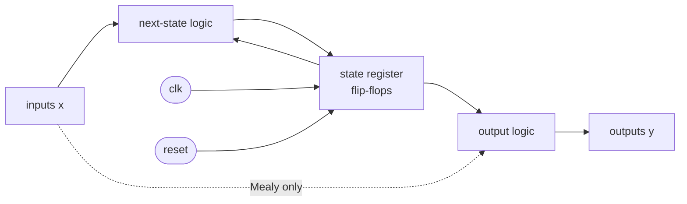
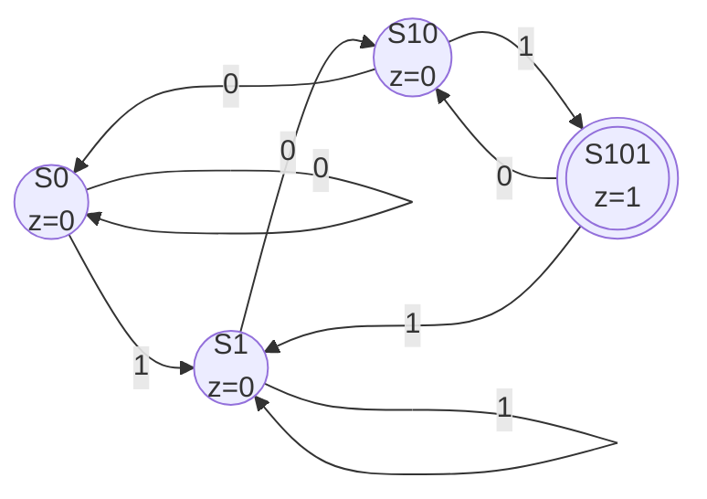

::: basics
### In plain words
A finite state machine (FSM) is a circuit that is always in exactly one of a small, fixed set of situations, called states. On every clock tick it moves to a next state that depends on its current state and its inputs. This is how hardware remembers what has happened so far. FSMs run things like traffic lights, protocol controllers and pattern detectors.

### Picture it
Think of a subway turnstile. It has two states: locked and unlocked. Put in a coin, and it goes from locked to unlocked. Push through, and it goes back to locked. Pushing while locked changes nothing, and neither does another coin while unlocked. You can predict what happens next from just two things: which state it is in now, and what you do to it.

### Words you need
- **State**: one of the machine's situations, a summary of what it needs to remember.
- **Transition**: a move from one state to another on a clock tick.
- **State register**: the flip-flops (one-bit memories) that hold the current state ([[q0886]]).
- **Moore / Mealy**: two styles. In Moore, outputs depend only on the state. In Mealy, they also depend on the current inputs ([[q0897]]).
- **Reset state**: the known starting state the machine enters on reset.

### The simplest example
The turnstile has 2 states, so the state register needs just one flip-flop: 0 for locked, 1 for unlocked. The rules are: coin when locked goes to unlocked. Push when unlocked goes to locked. The other two combinations keep the state. Reset puts it in locked.

That is the whole idea: a stored state plus rules for the next state. The rest of this page builds a 101 pattern detector, covers how to choose bit patterns for states, and explains what happens with a missing reset or an input that arrives at a bad moment.
:::

::: testing
Whether you can explain a finite state machine as **registered state plus combinational logic**, and not just as a bubble diagram. The interviewer wants to hear:

1. The definition: finite set of states, inputs, outputs, a next-state function and an output function, one active state at a time.
2. The hardware structure: state register (flip-flops) clocked by one clock, next-state logic, output logic.
3. Moore vs Mealy, at least in one sentence ([[q0897]]).
4. How you would actually design one: spec, state diagram, encoding, logic, reset, verification.
5. Practical hazards: reset, unreachable states, asynchronous inputs.
:::

::: why
Almost every control task in digital hardware is an FSM: bus protocol handlers (I2C, SPI, UART), memory controllers, arbiters, the control unit of a CPU, button debouncers, power-up sequencers. In an RTL interview "design an FSM that detects X" or "design a traffic-light controller" is routine, and the quality of the answer shows whether you think in clocked hardware or in software loops. FSMs are also the bridge between truth tables ([[q0894]]), flip-flops ([[q0886]]) and real RTL ([[q0956]]).
:::

::: concepts
- **State**: a snapshot of everything the machine must remember about the past, stored in flip-flops.
- **Flip-flops and clocking**: state updates only on the clock edge. See [[q0886]].
- **Next-state function**: combinational logic of (current state, inputs) giving the state after the next edge. A truth table with state columns ([[q0894]]).
- **Output function**: depends on state only (Moore) or state and inputs (Mealy). See [[q0897]].
- **State encoding**: binary, Gray, one-hot; trades flip-flops against logic depth.
- **Reset**: forces a known initial state. Without it the power-up state is random.
:::

::: answer
"An FSM, a finite state machine, is a circuit that can be in exactly one of a finite number of states at a time, and on every clock edge it moves to a next state that depends on its current state and its inputs. Its outputs are determined either by the state alone, which is a Moore machine, or by the state and the inputs, which is a Mealy machine.

In hardware it's really just three pieces: a register of flip-flops that holds the current state, combinational logic that computes the next state from state and inputs, and combinational logic that computes the outputs. The clock is what makes it a machine rather than just logic: all the state changes happen together on the edge.

The design flow I'd follow is: write down the behavior, draw a state diagram, assign encodings (binary or one-hot), build the next-state and output tables, minimize them, and make sure there's a reset to a known state. A classic example is a sequence detector, say one that raises its output when it sees 1-0-1 on a serial input, or a traffic light controller. I'd use FSMs for protocol handlers, arbiters, and the control unit of a CPU, basically anywhere behavior depends on history."
:::

::: technical
**Formal definition.** A synchronous FSM is a tuple $(S, I, O, \delta, \lambda, s_0)$: finite state set $S$, input alphabet $I$, output alphabet $O$, next-state function $\delta: S\times I\to S$, output function $\lambda$, and reset state $s_0$.
- Moore: $\lambda: S\to O$, so $o[n]=\lambda(s[n])$.
- Mealy: $\lambda: S\times I\to O$, so $o[n]=\lambda(s[n],i[n])$.
The state register updates as $s[n+1]=\delta(s[n],i[n])$ on each rising clock edge.

**Flip-flop count.** $N$ states need at least $\lceil\log_2 N\rceil$ flip-flops in binary encoding; one-hot uses $N$ flip-flops but needs very little decoding. Example: 12 states need 4 flops in binary and 12 in one-hot.

**Timing constraint.** The clock period must satisfy $T \ge t_{clk\to Q} + t_{logic,max} + t_{su}$ (plus skew). Next-state logic depth is what limits FSM frequency; one-hot shortens it because each next-state bit depends on only a few predecessor states.

**Implementation pattern (RTL).** Three blocks: a sequential `always_ff` for the state register with reset, a combinational `always_comb` for next state, and (optionally) another for outputs. Registering the outputs removes glitches from combinational output logic.

**Pitfalls.** (1) Missing default branch causes inferred latches. (2) Unused encodings (for 5 states in 3 bits, 3 are unused) can lock the machine up after a bit-flip, so define recovery. (3) Asynchronous inputs must pass through a two-flip-flop synchronizer before entering the FSM, or the state register can go metastable. (4) Mealy outputs change within the cycle when inputs change, which can glitch downstream logic.
:::

::: short
"An FSM is a clocked circuit that is in one of a finite number of states and moves between them based on its inputs. Hardware-wise it's a state register of flip-flops, next-state logic that depends on state and inputs, and output logic. If outputs depend only on state it's Moore; if they also depend on inputs it's Mealy. I'd use one for anything with history: protocol handlers, sequence detectors, arbiters, controllers. Key design points are state encoding, a reset to a known state, and synchronizing asynchronous inputs."
:::

::: long
"A finite state machine is a way of describing behavior that depends on history, using a finite set of states. At any moment the machine is in exactly one state. On each clock edge it looks at its current state and its inputs and moves to the next state, and it produces outputs.

In hardware there are three parts. First, a state register: a few flip-flops, all on the same clock, holding an encoding of the current state. Second, next-state logic: combinational logic whose inputs are the current state bits and the external inputs, and whose outputs feed the flip-flop D inputs. Third, output logic. If the outputs depend only on the state, that's a Moore machine; if they also depend on the inputs, it's Mealy. Mealy often needs fewer states and reacts a cycle earlier, but its outputs can glitch and aren't registered.

For design, I start from the spec and draw the state diagram: circles for states, arrows labelled with the input condition. For a sequence detector for 1-0-1, for example, the states record how much of the pattern I've matched so far. Then I choose an encoding. Binary uses the fewest flip-flops; one-hot uses one flop per state but gives shallow logic and is very common on FPGAs. I derive the next-state and output equations, minimize them, and check unused states.

The practical things I'd always add: a reset into a defined start state, a default branch so no latches are inferred, and a synchronizer if an input comes from another clock domain or a button. I'd also cover it with a testbench that walks every transition. FSMs show up everywhere: I2C or UART controllers, memory controllers, arbiters, and the control unit inside a CPU."
:::

::: terms
- **State**: the stored summary of past inputs that determines future behavior.
- **State register**: the flip-flops that hold the current state.
- **Next-state logic**: combinational logic mapping (state, input) to next state.
- **Moore machine**: outputs depend only on current state.
- **Mealy machine**: outputs depend on current state and current inputs.
- **State encoding**: assignment of bit patterns to states (binary, Gray, one-hot).
- **One-hot**: one flip-flop per state, exactly one is 1.
- **State diagram / table**: graphical and tabular specifications of $\delta$ and $\lambda$.
- **Reset state**: the defined initial state entered on reset.
:::

::: exceptional
**An average answer** says "a machine with states and transitions" and draws a bubble diagram.

**An exceptional answer**:
- Gives the hardware decomposition (state register, next-state logic, output logic) and says the clock is what makes it work.
- Distinguishes Moore and Mealy with a concrete consequence (one-cycle timing and number of states).
- Discusses encoding trade-offs with numbers (binary vs one-hot flop counts and logic depth).
- Brings up reset, unreachable states, glitch-free registered outputs and synchronizing inputs without being asked.
- Uses a real example (I2C master, arbiter, CPU control unit) and a small design example (sequence detector or traffic light).
:::

::: mistakes
- **Treating an FSM as a software loop.** Hardware has no program counter; all state changes occur together on the clock edge and the next-state logic is combinational.
- **No reset.** Flip-flops power up randomly. An FSM without reset may begin in an invalid state and never recover.
- **Putting everything in one giant `always` block with blocking assignments**, causing simulation vs synthesis mismatches; keep sequential and combinational parts separate.
- **Forgetting the default case**, which infers latches and leaves unused states stuck.
- **Feeding asynchronous inputs directly to next-state logic.** A button press arriving near the clock edge can corrupt multiple state bits. Use a synchronizer.
- **Confusing the number of states with the number of flip-flops.** Binary needs $\lceil\log_2 N\rceil$, one-hot needs $N$.
:::

::: deep
## What "state" means

A combinational circuit has no memory: output is a function of the current inputs only. But many tasks require remembering something. "Detect the sequence 1-0-1" needs to know whether the last bit was a 1, or the last two bits were 1-0. A **state** is the minimal information about the past that you need to decide all future outputs. The number of distinct histories is infinite, but they collapse into a finite number of equivalence classes, and those are the states. That is the "finite" in finite state machine.

## The hardware structure


Figure: Every synchronous FSM has the same skeleton. The loop through the state register is what stores history. The dashed arrow (input to output logic) exists only in a Mealy machine. Clock and reset go only to the flip-flops.

The state register is the only place memory lives. Between clock edges the next-state logic just settles to a value, and the next edge captures it. This is why FSMs are easy to reason about: at each edge, $s[n+1]=\delta(s[n],i[n])$ is a pure function, and the only timing requirement is that the combinational logic settles before the next edge.

## Worked example: overlapping "101" detector

Spec: serial input $x$, output $z$ goes high when the last three bits seen were 1, 0, 1 (overlaps allowed, so 10101 contains two matches).

States record how much of the pattern we have matched: $S_0$ (nothing useful), $S_1$ (seen "1"), $S_{10}$ (seen "10"), $S_{101}$ (just matched). A Moore version:


Figure: Moore state diagram for an overlapping 101 detector; z = 1 only in S101. From S101 a 0 goes to S10 (the last two bits are now 1,0) and a 1 goes to S1 (the trailing 1 may start a new match). That is how overlap is handled.

Check each transition by asking which suffix of the input is still useful. After "101" a 0 leaves suffix "10" ($S_{10}$) and a 1 leaves suffix "1" ($S_1$). After "10" a 0 gives "100", which has no useful suffix ($S_0$). I ran the input 0110101101 through this machine in code: the pattern ends at indices 4, 6 and 9 (0-indexed), and the Moore output is high in the cycle after each, at indices 5 and 7 (and 10, past the end of that stream).

**Encoding and logic.** Four states in binary need 2 flip-flops $(Q_1Q_0)$: $S_0=00,S_1=01,S_{10}=10,S_{101}=11$. The next-state table from the diagram:

| $Q_1Q_0$ | $x=0$ | $x=1$ |
|---|---|---|
| 00 ($S_0$) | 00 | 01 |
| 01 ($S_1$) | 10 | 01 |
| 10 ($S_{10}$) | 00 | 11 |
| 11 ($S_{101}$) | 10 | 01 |

That is a 3-input truth table for each next-state bit ([[q0894]]) which can be minimized with a K-map ([[q0895]]). The next-state bits are 1 in $D_1$ for the rows $(01,0)$, $(10,1)$, $(11,0)$, so $D_1 = Q_1'Q_0x' + Q_1Q_0x' + Q_1Q_0'x = Q_0x' + Q_1Q_0'x$, and $D_0 = x$ because every row with $x=1$ goes to an odd state. The output is $z = Q_1Q_0$.

```sim
{"id":"fsm-lab","preset":"detect-101"}
```
Figure: Step the bit stream through the detector. Watch the highlighted state; compare the Moore output with the Mealy version, which fires in the same cycle as the last 1 rather than one cycle later.

## Choosing an encoding

| Encoding | Flops for N states | Next-state logic | Good for |
|---|---|---|---|
| Binary | $\lceil\log_2 N\rceil$ | Deep, many bits per equation | ASIC with area limits, small machines |
| Gray | $\lceil\log_2 N\rceil$ | Moderate; only one bit changes per transition (low glitch/power) | Counters, state sequences that step linearly |
| One-hot | $N$ | Very shallow (each state bit depends on a few predecessors); output decode is trivial | FPGAs (flops are plentiful), high-speed controllers |

For 12 states: binary 4 flops, one-hot 12. In an FPGA where each logic cell already includes a flip-flop, one-hot costs nothing extra and runs faster, which is why synthesis tools often re-encode your FSM to one-hot automatically. In an ASIC, where each flop is bigger than a gate, binary or a hand-tuned encoding is more common. One-hot has a safety downside: an upset that sets two bits creates an illegal state, so critical designs add detection.

## Reset, unreachable states and recovery

Three states encoded in two bits leaves a fourth, unused pattern. If a glitch, a missed reset, or a radiation event puts the machine there, what happens? If the logic doesn't define it, it may lock up forever. Good practice: make unused states transition to the reset state (a `default` branch), or use a "safe" one-hot detector. Also make reset *synchronous* or at least *synchronously de-asserted*, since an asynchronous reset released near a clock edge risks metastability.

## Asynchronous inputs

A button, or a signal from another clock domain, can change at any time relative to the FSM clock. If it changes inside the setup/hold window of a state flip-flop, that flop can go metastable and, worse, different flops can resolve differently, causing an illegal state. The fix is a **two-flip-flop synchronizer** on each asynchronous input before it enters the next-state logic ([[q0887]] covers metastability). Add a debouncer for mechanical switches.

## Mealy outputs and glitches

Mealy outputs depend combinationally on inputs, so a glitch on an input shows up on the output within the same cycle. If the output drives something sensitive (a clock gate, an asynchronous reset, an edge-sensitive input), register it. The cost is one cycle of latency, which turns a Mealy output into a Moore-like registered output. See [[q0897]] for the full comparison.

## Real hardware where FSMs live

- **I2C master controller**: states IDLE, START, ADDR bits, ACK, DATA, STOP, repeated-start; the timing of SDA relative to SCL is exactly what an FSM encodes.
- **CPU control unit**: a multi-cycle CPU's control FSM steps through fetch, decode, execute, memory and writeback each instruction ([[q0905]]).
- **Memory/DRAM controller**: sequences activate, read/write and precharge commands with timing constraints between states.
- **Arbiter**: states represent which requester holds the bus.
- **Power sequencer**: stepping rails on in order, with fault states.

The design principle across all of them: put the behavior in states, keep the logic shallow so it meets timing, and make illegal states recoverable.
:::

::: applications
- **Serial protocol controllers**: UART, SPI, I2C masters and slaves are FSMs stepping through start, data, parity/ack and stop.
- **CPU control units**: hardwired control decodes the current phase (fetch/decode/execute) with an FSM.
- **Traffic-light controllers**: the standard textbook FSM with timer inputs and safe-state outputs.
- **Sequence and pattern detectors**: framing detection in communication links (e.g. finding a sync word).
- **Bus arbiters and DMA controllers**: grant sequencing among requesters.
- **Button debounce and vending-machine logic**: coin-counting states and dispense output.
:::

::: assumptions
- **Synchronous design**: one clock, flip-flops edge-triggered, inputs synchronized. Asynchronous FSMs exist (state held by feedback loops) but are rare and error-prone.
- **Finite state**: if the behavior needs unbounded memory (counting an arbitrary number of items), it is not an FSM; you'd add a counter and treat the counter value as part of the datapath, giving an FSM with datapath (FSMD).
- **Deterministic**: one next state per (state, input). Nondeterministic machines are a theory tool, not hardware.
- **Reset exists** and brings the machine to $s_0$.

The answer changes if the interviewer asks about software FSMs (switch-case on a state variable in firmware), which have the same logic but no clock edge: the "next-state function" runs in a loop or ISR.
:::

::: followups
### How many flip-flops do you need for a 10-state FSM?
Binary encoding needs $\lceil\log_2 10\rceil = 4$ flip-flops (16 codes, 6 unused). One-hot needs 10. I'd pick binary if I'm area-constrained in an ASIC and one-hot on an FPGA for speed.

### What is the difference between Moore and Mealy, briefly?
In Moore the output depends only on the current state, so it is stable through the cycle. In Mealy it depends on state and current input, so it can react in the same cycle and often needs fewer states, but it can glitch. See [[q0897]].

### Design a detector for the sequence 1011. How many states?
For an overlapping Moore detector you need 5 states: nothing, "1", "10", "101", "1011". On the final state a 1 goes to "1" (the trailing 1 starts a new match), and a 0 goes to "10" (the suffix "10"). A Mealy version needs 4 states because the output fires on the transition from "101" with input 1.

### What happens if the FSM powers up in an unused state?
With no reset and incomplete default handling it may lock in a loop of illegal states. I add a synchronous reset into the idle state and, for robustness, route every unused encoding to idle (a `default` branch, or detection logic on one-hot).

### Your FSM works in simulation but fails at speed on the board. Where do you look?
First, whether inputs are asynchronous or from a different clock: add synchronizers. Second, timing: the next-state logic depth might exceed the period ($T\ge t_{clk-Q}+t_{logic}+t_{su}$). One-hot encoding or splitting the logic can help. Third, reset release timing, and glitchy combinational (Mealy) outputs feeding clocks or resets.
:::

::: interpretations
"What is an FSM?" is asking for the concept, but interviewers often follow with a design task (sequence detector, vending machine, traffic light) and with Moore vs Mealy ([[q0897]]). Be ready to draw a state diagram on a whiteboard. Some interviewers mean software FSMs in firmware; the same reasoning applies but without the clocked-hardware structure.
:::

::: references
- Harris & Harris, *Digital Design and Computer Architecture*: Chapter 3, Sequential Logic Design (finite state machines, Moore/Mealy, state encoding).
- Mano & Ciletti, *Digital Design*: chapter on synchronous sequential logic (state tables, state diagrams, state reduction and assignment).
- Wakerly, *Digital Design: Principles and Practices*: sequential-circuit design and state-machine design procedures.
:::

::: rubric
- Defines an FSM as a finite set of states with transitions driven by inputs and a clock :: Establishes the basic concept.
- Describes the hardware as state register plus next-state logic plus output logic :: Shows you can map the abstraction to circuits.
- Distinguishes Moore from Mealy :: It's the usual immediate follow-up and tests precision.
- Gives or sketches an example (sequence detector, traffic light) :: Demonstrates you can apply it.
- Mentions state encoding trade-offs (binary vs one-hot) :: Shows design maturity.
- Mentions reset and handling of unused states :: Robustness is what separates RTL practice from textbook.
- Mentions synchronizing asynchronous inputs :: A real-hardware failure mode interviewers like to probe.
:::

::: quiz
```json
[
 {"type":"mcq","level":"fundamental","q":"Which set of blocks makes up a synchronous FSM?","options":["Only combinational logic","A state register, next-state logic, and output logic","A counter and a ROM","An ALU and a register file"],"answer":1,"explain":"The state register holds history, the next-state logic computes the next state from state and inputs, and the output logic generates outputs. Purely combinational logic has no memory."},
 {"type":"numeric","level":"fundamental","q":"How many flip-flops are needed for a 12-state FSM using one-hot encoding?","answer":12,"tolerance":0.001,"unit":"flip-flops","explain":"One-hot uses one flip-flop per state, so 12. Binary encoding would need $\\lceil\\log_2 12\\rceil = 4$."},
 {"type":"numeric","level":"intermediate","q":"Minimum flip-flops to binary-encode a 10-state FSM?","answer":4,"tolerance":0.001,"unit":"flip-flops","explain":"$\\lceil\\log_2 10\\rceil=\\lceil 3.32\\rceil=4$; 3 flip-flops give only 8 codes."},
 {"type":"mcq","level":"intermediate","q":"Why should an asynchronous button input go through a two-flip-flop synchronizer before the FSM?","options":["To make the button faster","To reduce the number of states","To prevent metastability in the state register when the input changes near the clock edge","To convert a Mealy machine to Moore"],"answer":2,"explain":"An input that changes inside a flip-flop's setup/hold window can make it metastable, and different state bits may settle differently, giving an illegal state. The synchronizer gives the first flop a full cycle to resolve."},
 {"type":"truefalse","level":"intermediate","q":"If an FSM has 5 states encoded in 3 bits, the 3 unused codes are harmless and need no handling.","answer":false,"explain":"A bit upset, a bad power-up or missing reset can land the machine in an unused code. Without defined transitions it may lock up; route unused codes to the reset/idle state."},
 {"type":"mcq","level":"advanced","q":"A Moore overlapping detector for the sequence 1011 needs how many states (including the idle state)?","options":["3","4","5","6"],"answer":2,"explain":"States: nothing, '1', '10', '101', '1011' (output state). Five states. A Mealy detector can drop the output state, needing 4."}
]
```
:::
