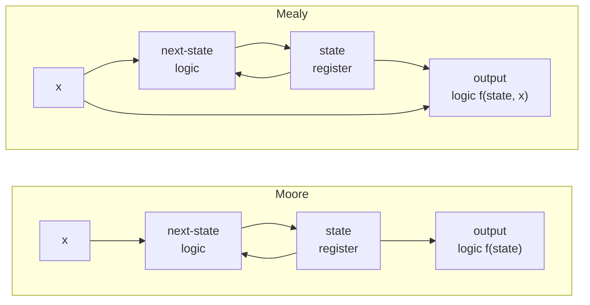

::: testing
Whether you can state the **one structural difference** (what the output depends on) and then reason out its consequences: output timing, number of states, glitching, and how it affects connecting machines together. The interviewer is also checking that you can draw each type, ideally on a small example like a sequence detector, and that you have a view on which one you would pick and why.

Weak candidates recite "Moore = state only, Mealy = state and inputs" and stop. Strong ones say how that changes the waveform, the state count, and what you would do to make a Mealy output safe to use.
:::

::: why
In real RTL the choice decides whether a handshake takes one cycle or two, whether an output can glitch into a clock-gate or reset, and how many states the FSM has. Bus protocols often demand a response in the same cycle as a request (Mealy-style behavior), while safety-critical outputs are normally registered (Moore-style). A candidate who can reason about this has probably written and debugged real control logic. It is also a very standard interview question, because it is quick to ask and quick to separate people who understand FSMs from those who memorized the definition.
:::

::: concepts
- **FSM structure**: state register, next-state logic, output logic. See [[q0896]].
- **Combinational vs registered outputs**: whether an output changes right after an input changes or only after a clock edge.
- **Clock-to-output timing**: a registered output changes $t_{clk\to Q}$ after the edge; a combinational output also depends on input arrival.
- **State minimization**: fewer states can mean fewer flip-flops and logic; Mealy usually needs fewer states.
- **Glitches and hazards**: combinational output logic can produce transient pulses ([[q0895]]).
- **Flip-flops**: edge-triggered storage underlying both types ([[q0886]]).
:::

::: answer
"The difference is what the outputs depend on. In a Moore machine, the output is a function of the current state only. In a Mealy machine, the output is a function of the current state and the current inputs.

That has a few knock-on effects. First, timing. In a Moore machine the output only changes after a clock edge, when the state changes, so it's stable for the whole cycle. A Mealy output can change in the middle of a cycle as soon as the input changes, so it reacts one cycle faster. Second, state count: Mealy machines usually need fewer states, because the output can be encoded on the transitions instead of needing a dedicated state for each output value. If I do an overlapping 101 detector, Moore needs four states and Mealy needs three. Third, robustness: Moore outputs come straight from flip-flops, so they're clean; Mealy outputs go through combinational logic from the inputs, so an input glitch can show up at the output, and that matters if it drives a clock or reset.

In practice I'd use Moore when I want clean, registered outputs and simple timing, and Mealy when I need a one-cycle-faster response or want to save a state. A common compromise is to compute Mealy-style and register the output, which is effectively Moore with the right alignment."
:::

::: technical
**Definitions.** With state $s[n]$, input $x[n]$, next-state function $\delta$:
- Moore: $s[n+1]=\delta(s[n],x[n])$, $z[n]=\lambda(s[n])$.
- Mealy: $s[n+1]=\delta(s[n],x[n])$, $z[n]=\lambda(s[n],x[n])$.

**Timing.** Moore output delay after the clock edge: $t_{clk\to Q}+t_{decode}$, independent of the inputs. Mealy output delay after an input change: $t_{input\to output}$ through combinational logic, so it changes mid-cycle and must settle before downstream setup: $T \ge t_{in,delay} + t_{logic} + t_{su,downstream}$. Two Mealy machines chained directly create an input-to-output path through both, and a feedback loop between them is a combinational loop.

**Latency.** For the same behavior, the Moore output appears one clock cycle after the Mealy output (in the overlapping 101 detector the Mealy output is high in the cycle in which the final 1 is present; the Moore output is high in the next cycle).

**State count.** Any Moore machine can be converted to a Mealy machine with the same or fewer states, and any Mealy machine can be converted to a Moore machine, at the cost of possibly splitting a state by output value (up to a factor of the number of distinct outputs). Example: overlapping "101" detector needs 3 states as Mealy ($S_0,S_1,S_{10}$) and 4 as Moore (adds $S_{101}$); overlapping "1011" needs 4 vs 5, so 2 vs 3 flip-flops in binary encoding.

**Metastability, glitches.** Moore outputs from registers are glitch-free (if driven directly from flops, or one-hot decoded). Mealy outputs inherit input glitches and may have hazards from the output logic ([[q0895]]); asynchronous inputs must be synchronized before they reach a Mealy output.

**Registered Mealy.** Register the Mealy output (a flip-flop on $z$). It is now a clean signal that appears one cycle after the Mealy value, i.e. at the same time as the Moore version, but with the Mealy state count. This is the usual way to get the best of both.
:::

::: short
"In a Moore machine the outputs depend only on the current state; in a Mealy machine they depend on the current state and the current inputs. So a Moore output changes only on clock edges and is clean, while a Mealy output can respond within the same cycle, which is one cycle faster and usually needs fewer states, but it can glitch if the inputs do. For an overlapping 101 detector, Moore needs four states and Mealy three. I'd use Moore for clean registered outputs and Mealy when I need the fast response, and register the output if it feeds anything sensitive."
:::

::: long
"Both are the same kind of machine: a state register, next-state logic, and output logic. The only difference is what feeds the output logic. In a Moore machine the output depends only on the current state. In a Mealy machine it depends on the current state and the current input.

The first consequence is timing. Moore outputs change only right after a clock edge, because that's the only time the state changes, so they're stable for the whole cycle. A Mealy output is combinational from the inputs, so it can change in the middle of a cycle as soon as the input does. That means Mealy reacts a full cycle earlier. For a 101 sequence detector, the Mealy output goes high in the same cycle that the last 1 arrives. The Moore one goes high in the cycle after.

The second consequence is state count. Since a Mealy machine can put the output on the transition, it doesn't need a state whose only job is to raise the output. The overlapping 101 detector needs three states as Mealy and four as Moore. That's a small saving, but on bigger machines it can be a flop or two.

Third, there's the signal-integrity side. Moore outputs come from flip-flops through a decoder, so they're clean. Mealy outputs have an input-to-output combinational path, so glitches or late-arriving inputs show up at the output, and chaining Mealy machines creates long combinational paths and, with feedback, loops. For anything that drives a clock gate, reset, or another module's edge-sensitive input, I'd want a registered output.

So my rule of thumb: default to Moore for clarity and clean timing. Use Mealy if I need the one-cycle-faster response or I'm short on states, and if I do, I either make sure inputs are synchronized and glitch-free or register the output, which gives you Mealy state count with Moore-like timing."
:::

::: terms
- **Moore machine**: output is a function of the present state only.
- **Mealy machine**: output is a function of present state and present inputs.
- **Registered output**: an output taken directly from a flip-flop, changes only on clock edges.
- **Combinational (input-to-output) path**: a path from an input pin through logic to an output pin without crossing a flip-flop.
- **Glitch / hazard**: a brief unintended pulse on a combinational output.
- **State splitting**: converting Mealy to Moore by duplicating states so each has a single output.
- **Latency**: number of clock cycles between an input event and its visible effect.
- **Synchronizer**: two-flop chain that brings an asynchronous input into a clock domain.
:::

::: exceptional
**An average answer** states the one-line definitions.

**An exceptional answer**:
- Gives the definitions and draws the two block diagrams (extra input arrow into the output logic for Mealy).
- Shows the waveform difference: Mealy output in the same cycle as the input, Moore output one cycle later.
- Quantifies with an example: overlapping 101 detector with 3 vs 4 states; 1011 with 4 vs 5.
- Discusses glitches, input-to-output timing paths, and combinational loops across chained Mealy machines.
- Knows the practical remedy: register Mealy outputs, or use Mealy only inside a block, and says that the two are interconvertible.
- States which they would choose in a given scenario and why.
:::

::: mistakes
- **"Mealy is faster in clock frequency."** It reacts one cycle sooner, but its input-to-output path can *limit* clock frequency. Latency and fmax are different things.
- **"Moore needs more flip-flops always."** It often needs one more state, which rounds up to an extra flop only sometimes (3 vs 4 states: both 2 flops; 4 vs 5 states: 2 vs 3 flops).
- **Drawing the Moore output on the arrows.** Moore outputs belong in the state circles; Mealy outputs belong on the transitions (written $x/z$).
- **Thinking a Mealy output is asynchronous.** It is combinational in the inputs, but if the inputs are synchronous to the clock, the output is stable by the next edge. The risk is *input* glitches and timing, not asynchrony per se.
- **Saying you can't convert between them.** You can; Mealy to Moore may add states, Moore to Mealy never needs more.
- **Forgetting a Moore output is not necessarily glitch-free** if the output logic decodes multiple state bits that change at once (binary encoding). One-hot or a registered output avoids that.
:::

::: deep
## The structural difference

Look at the two FSM block diagrams. The next-state path is identical; the only difference is whether the input bus also reaches the output logic.


Figure: In both machines the state register feeds back through the next-state logic. Mealy adds one extra arrow, from the inputs straight to the output logic. That arrow is the origin of everything different: earlier response, fewer states, and an input-to-output combinational path.

## Same job, two machines: overlapping "101" detector

Specification: input bit stream $x$, output $z$ asserted when the last three bits were 1, 0, 1. The Moore machine needs four states ($S_0,S_1,S_{10},S_{101}$, with $z=1$ only in $S_{101}$). The Mealy machine drops $S_{101}$: the transition from $S_{10}$ on $x=1$ produces $z=1$ and goes to $S_1$ (the trailing 1 may start a new pattern). On a diagram the Mealy transitions are labelled $x/z$:

| Present state | $x=0$: next / $z$ | $x=1$: next / $z$ |
|---|---|---|
| $S_0$ | $S_0$ / 0 | $S_1$ / 0 |
| $S_1$ | $S_{10}$ / 0 | $S_1$ / 0 |
| $S_{10}$ | $S_0$ / 0 | $S_1$ / **1** |

Run both with the input 0 1 1 0 1 0 1 1 0 1 (I simulated this in code to get the traces below):

```timing
{"signals":[
 {"name":"CLK","wave":"p........."},
 {"name":"x","wave":"0110101101","color":"accent"},
 {"name":"Mealy state","wave":"=.=.====.=","data":["S0","S1","S10","S1","S10","S1","S10"]},
 {"name":"Mealy z","wave":"0000101001","color":"red"},
 {"name":"Moore state","wave":"=.=.======","data":["S0","S1","S10","S101","S10","S101","S1","S10"]},
 {"name":"Moore z","wave":"0000010100","color":"green"}
],"hscale":1.4}
```
Figure: The Mealy output (red) rises in the same cycle as the third bit of each 1-0-1 match (cycles 4, 6, 9). The Moore output (green) rises one cycle later (5 and 7; the third would be in cycle 10, off the end), because it must wait for the state register to reach S101. Mealy state sequence is also shorter (no S101).

Read it carefully: during cycle 4, $x=1$ and the Mealy machine is in $S_{10}$, so its output logic $z=(S_{10}\cdot x)$ is already 1. The Moore machine takes that same input into the state register at the end of cycle 4, enters $S_{101}$ in cycle 5, and only then raises $z$.

```sim
{"id":"fsm-lab","preset":"detect-101"}
```
Figure: Step the same bit stream and watch the Moore and Mealy outputs side by side; count the cycles between the last input bit of a match and each output.

## Why Mealy needs fewer states

A Moore output is a label on a state. If two different outputs are needed in what would otherwise be the same state, you must split it. If an output event is needed only on one transition, a Moore machine needs a dedicated state to hold it. A Mealy machine hangs the output on the arrow. In the worst case Mealy-to-Moore conversion multiplies states by the number of distinct output values that arrive at a state. Going the other way, Moore-to-Mealy never increases the state count: just copy each state's output onto all its incoming transitions.

Numerically, for the overlapping "1011" detector: Moore has 5 states, Mealy has 4. In binary encoding that is 3 vs 2 flip-flops. Both then need output logic: Moore's is a one-term decode of the state; Mealy's is an AND of a state decode with the input. For the "101" example both need 2 flops (3 and 4 states both round to 2).

## Timing analysis: where Mealy bites

For a Moore machine, every path ends at a flip-flop D input or at an output pin that is itself driven from a register. All paths start at a clock edge. Static timing analysis handles this simply: $T\ge t_{clk\to Q}+t_{logic}+t_{su}$.

For a Mealy machine there is an additional class of path: **input pin to output pin** (or to the next block's flop through the output logic). The constraint now involves the *external* delay at the input, plus the combinational logic, plus whatever the downstream block needs: $t_{in}+t_{logic}+t_{su,next}\le T$. If the upstream device is also Mealy, the paths concatenate across the whole chain, and if two Mealy machines feed each other you can create a combinational loop with no flip-flop, which is a functional bug and a timing-analysis failure. This is a big reason bus-protocol designs (ready/valid, AXI handshakes) forbid combinational paths from valid to ready, or at least carefully document where they are allowed.

## Glitches and what to do about them

Suppose a Mealy output is $z = S_{10}\cdot x$. If $x$ comes from another clocked block, it settles shortly after the clock edge, but may bounce briefly before settling; the output then has a transient pulse. Downstream flip-flops sampling on the next edge see only the settled value, so the glitch is harmless **if** the output only goes to D inputs. It becomes dangerous when the output goes to:
- a clock gate or generated clock,
- an asynchronous reset or set,
- an edge-detector or interrupt line,
- an off-chip pin that something else samples asynchronously.

For Moore machines with binary encoding, a transition where several state bits change at once (like 01→10) can also create a decoding glitch in output logic. Remedies: Gray or one-hot encoding, or registering the outputs.

**Registered Mealy / "Mealy with output flop".** Compute $z_{next}=\lambda(s,x)$ combinationally, then register: $z[n+1]=\lambda(s[n],x[n])$. The output is now clean, one cycle later, and the state graph retains the Mealy state count. This is very common in high-speed RTL because it also cuts the input-to-output path.

## Which to choose

| Criterion | Moore | Mealy |
|---|---|---|
| Output depends on | state | state + inputs |
| Response latency | +1 cycle | same cycle |
| Typical number of states | more | fewer |
| Output glitch risk | low (clean if registered/one-hot) | higher (follows input glitches) |
| Input→output timing path | none | yes |
| Easiest to reason about | yes | slightly harder |
| Good fit | traffic lights, sequencers, anything driving slow or sensitive hardware | protocol handlers needing same-cycle response, small controllers |

> [!INTERVIEW]
> If asked "which would you use?", answer with the requirement: "If I need the output in the same cycle as the input, say a combinational handshake response, Mealy. If the output drives something sensitive or I want the cleanest timing closure, Moore or a registered Mealy output. By default Moore, because the timing is simpler to verify."

## Example: traffic light and a vending machine

A traffic-light controller is naturally Moore: the output (which lamps are lit) is a property of the state (NS-green, NS-yellow, EW-green...). Transitions are driven by timers and sensors. There's no benefit in changing a lamp mid-cycle in reaction to an input.

A vending machine: the "dispense" output happens at the moment the last coin arrives and the sum reaches the price. As Mealy, the dispense pulse is on the transition triggered by the coin. As Moore you need an extra "paid" state whose only job is to assert dispense for one cycle. Both work; the Mealy one reacts in the same cycle, the Moore one adds a cycle but its output is registered.

## Real hardware note

In synthesis, tools treat both types the same way (combinational logic plus flip-flops), so the choice only matters through the coding style and the resulting timing paths. In SystemVerilog the Moore output block is `assign z = (state == S101);` while the Mealy output is `assign z = (state == S10) && x;`. The second contains `x`, and the synthesis timing report will therefore show an input-to-output path that you need to constrain with `set_input_delay` and `set_output_delay` in the SDC file. If those constraints are missing, the tool silently treats the path as unconstrained, a classic source of silicon surprises.
:::

::: applications
- **Traffic-light and sequencer control**: Moore, outputs are lamp patterns tied to states.
- **Bus protocol handlers (ready/valid style)**: mostly registered outputs, with limited Mealy paths where same-cycle response is specified.
- **UART transmitters/receivers**: state-based Moore outputs (TX line level by state), with sample strobes.
- **Pattern/sync-word detectors in communication links**: Mealy detectors fire immediately on the last bit; Moore detectors fire one cycle later.
- **Vending machine / coin acceptors**: classic textbook example for both styles.
- **CPU control units**: multi-cycle CPUs often use Moore-style control (control signals depend on state) with some Mealy-style dependence on opcode ([[q0905]]).
:::

::: assumptions
- **Synchronous design** with inputs synchronized to the same clock. With asynchronous inputs a Mealy output can glitch arbitrarily.
- **Output timing definition**: "same cycle" assumes the input changes right after the clock edge and the output is sampled before the next edge.
- **Equivalent behavior up to one cycle of latency**: the two models implement the same function if you account for the shift; "one cycle later" is the standard Moore/Mealy relationship, though a designer can also pipeline further.
- **State counts are for the minimal machines**: other encodings or specs (non-overlapping vs overlapping) change the numbers.

Different textbooks draw Moore outputs inside the circles and Mealy outputs on arrows ($x/z$). If the interviewer uses a different notation, state yours before drawing.
:::

::: followups
### How do you convert a Mealy machine to Moore?
For each state, look at the outputs on its incoming transitions. If they all agree, put that output in the state. If they differ, split the state into one copy per distinct output and redirect the incoming transitions accordingly. The number of states can grow but never beyond (states × distinct outputs). The new Moore output appears one cycle after the Mealy one.

### Which is faster, Mealy or Moore?
Mealy responds one cycle sooner, so lower latency. But its clock frequency may be limited by the input-to-output combinational path, so Moore (especially registered) often closes timing at higher frequency. Latency and fmax are different things.

### Design a Mealy detector for "11". Compare with Moore.
Mealy: states $S_0$ (last bit not 1), $S_1$ (last bit 1). From $S_1$ with $x=1$ output 1 (stay in $S_1$ for overlapping). Two states, one flop. Moore needs a third state $S_{11}$ whose output is 1. Same function, 2 vs 3 states (1 vs 2 flops).

### Your Mealy output drives a clock-gating enable and the chip glitches. Why, and how do you fix it?
The Mealy output follows input glitches, and a glitch on a clock-gate enable can chop or generate a clock pulse. Fix: register the output (make it Moore-like), and use a proper latch-based integrated clock gate cell so the enable is only sampled while the clock is low. Synchronize the inputs too.

### Can the output of a Moore machine still glitch?
Yes, if it is decoded from several state bits that change simultaneously (e.g. binary 01 to 10) because the bits arrive at slightly different times and the decode momentarily sees 00 or 11. Remedies are Gray or one-hot encoding or putting a flip-flop on the output.
:::

::: interpretations
The wording "difference between a Mealy and Moore FSM" is a definition-plus-consequences question. Some interviewers only want the one-liner; the best answers add the waveform difference and one concrete trade-off. The general FSM concepts and design flow are in [[q0896]]. Notation differs between textbooks (Moore outputs in states vs Mealy outputs on arrows), so say which convention you use.
:::

::: references
- Harris & Harris, *Digital Design and Computer Architecture*: Chapter 3, Moore and Mealy machines, with timing diagrams comparing them.
- Mano & Ciletti, *Digital Design*: synchronous sequential logic, state diagrams for Mealy and Moore models.
- Wakerly, *Digital Design: Principles and Practices*: clocked synchronous state-machine analysis and design, Mealy and Moore models.
:::

::: rubric
- States the defining difference: Moore output = f(state); Mealy output = f(state, inputs) :: This is the core definition the question asks for.
- Explains the timing consequence: Mealy reacts in the same cycle, Moore one cycle later :: Shows you understand behavior, not just definitions.
- Mentions Mealy typically needs fewer states :: A key design trade-off.
- Mentions glitching/clean outputs and registering outputs :: Practical hardware awareness.
- Notes the input-to-output combinational path and its timing/loop implications :: Distinguishes real RTL experience.
- Gives an example (sequence detector, traffic light) :: Concrete application of the concepts.
- Knows the conversion between them or the registered-Mealy compromise :: Shows mastery, beyond textbook definitions.
:::

::: quiz
```json
[
 {"type":"mcq","level":"fundamental","q":"In a Moore machine, the outputs depend on:","options":["Inputs only","Current state and current inputs","Current state only","Next state only"],"answer":2,"explain":"Moore outputs are a function of the present state only, so they change only when the state register changes (on clock edges). Mealy outputs also depend on inputs."},
 {"type":"mcq","level":"fundamental","q":"Which machine typically produces its output one clock cycle earlier for the same behavior?","options":["Moore","Mealy","Both are always identical","Neither; it depends on the clock only"],"answer":1,"explain":"The Mealy output depends on the current input, so it can change in the same cycle in which the input arrives. The Moore output has to wait for the state register to update."},
 {"type":"numeric","level":"intermediate","q":"An overlapping 1011 sequence detector needs 5 states as a Moore machine and 4 as a Mealy machine. How many flip-flops does the Moore version need with binary encoding?","answer":3,"tolerance":0.001,"unit":"flip-flops","explain":"$\\lceil\\log_2 5\\rceil = 3$ flip-flops (the Mealy version needs $\\lceil\\log_2 4\\rceil = 2$)."},
 {"type":"truefalse","level":"intermediate","q":"Because Mealy machines react one cycle sooner, they always allow a higher maximum clock frequency than Moore machines.","answer":false,"explain":"Reaction latency and maximum clock frequency are different. The Mealy input-to-output combinational path can limit fmax, and chained Mealy machines make this worse. Registered Moore outputs usually close timing more easily."},
 {"type":"multi","level":"intermediate","q":"Select all situations where a combinational Mealy output is risky.","options":["Output drives a clock-gate enable","Output feeds the D input of a synchronous flop","Output drives an asynchronous reset","Output feeds a downstream Mealy machine's output logic in a feedback loop"],"answer":[0,2,3],"explain":"Glitches are harmless at synchronous D inputs because they settle before the sampling edge, but they are dangerous on clock gates and asynchronous resets, and feedback between combinational Mealy outputs can create combinational loops."},
 {"type":"mcq","level":"advanced","q":"You want Mealy state economy but a clean glitch-free output aligned like a Moore machine. What is the standard fix?","options":["Use a faster clock","Add a flip-flop on the Mealy output (registered Mealy output)","Remove the reset","Use binary encoding"],"answer":1,"explain":"Registering the combinational Mealy output gives a glitch-free signal that appears one cycle later (like a Moore output) while keeping the smaller Mealy state graph."}
]
```
:::
