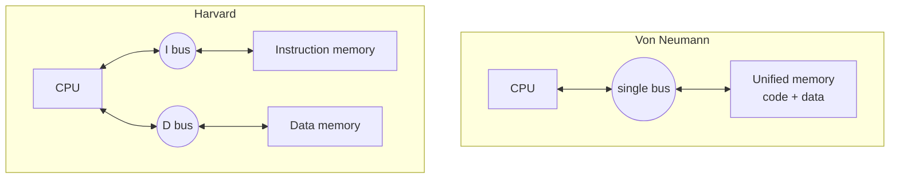
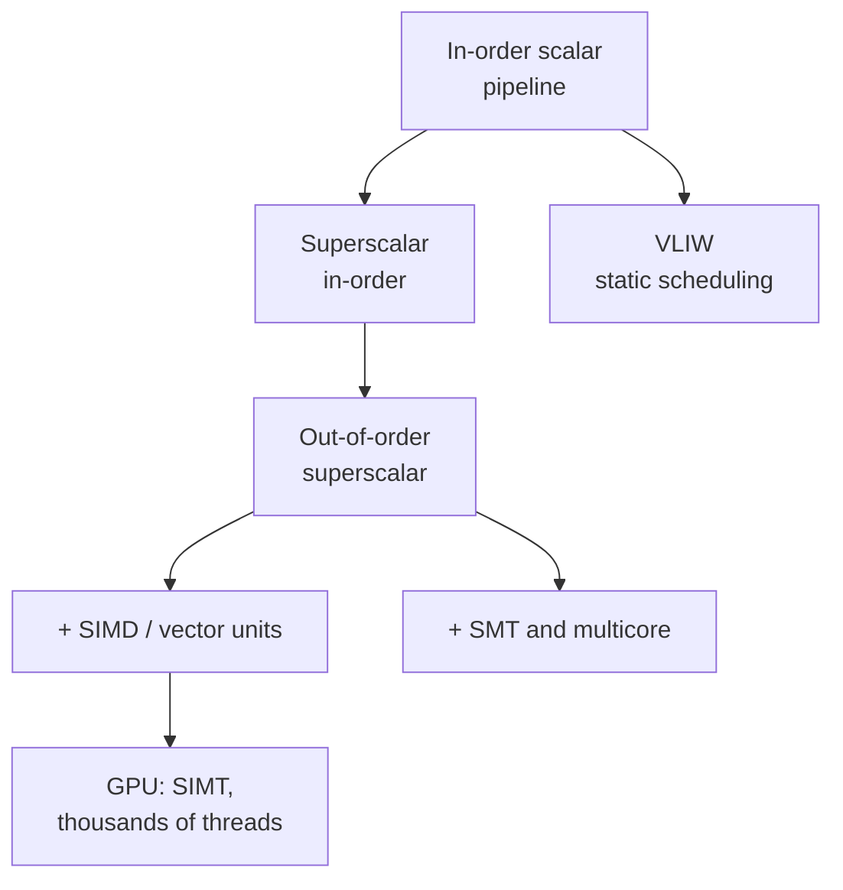

::: testing
Whether you have a **map** of the computer-architecture landscape rather than a single memorized name. "Architecture" is used loosely, and a strong answer sorts examples along clear axes instead of listing buzzwords:

1. How memory is organized (von Neumann vs Harvard).
2. What the instruction set looks like (RISC vs CISC, and real families such as ARM, x86, RISC-V).
3. How instructions are executed (scalar, pipelined, superscalar, out-of-order, VLIW, SIMD, SIMT, multicore).
4. What it is built for (microcontrollers, application processors, GPUs, accelerators).

The interviewer also wants to see whether you know why each one exists, i.e. what bottleneck it attacks.
:::

::: why
Every hardware role, from SoC design to firmware to board design, touches processors, and choosing or reasoning about one starts with knowing the families and their trade-offs. When you pick an MCU for a battery sensor (small Harvard-style core, no cache), a phone SoC (big.LITTLE Arm cores plus GPU and NPU), or an AI accelerator (systolic arrays), you are choosing an architecture. Being able to name them and explain what problem each one solves is the quickest way to show an interviewer you understand the system beyond the schematic.
:::

::: concepts
- **ISA vs microarchitecture**: the programmer-visible contract versus the hardware that implements it. See [[q0913]], [[q0912]].
- **CPU basics**: fetch, decode, execute, memory, writeback. See [[q0900]].
- **Von Neumann vs Harvard**: one shared memory for code and data versus separate memories.
- **RISC vs CISC**: simple fixed-length instructions versus complex variable-length ones. See [[q0917]].
- **Parallelism types**: instruction-level (pipelining, superscalar), data-level (SIMD), thread-level (multicore, SMT).
- **Heterogeneous computing**: mixing CPU, GPU, DSP and accelerators on one chip. See [[q0899]].
:::

::: answer
"I'd group them along a few axes rather than just throw out names.

By memory organization there's the von Neumann architecture, where instructions and data share one memory and bus, which is simple but creates the von Neumann bottleneck, and the Harvard architecture, with separate instruction and data memories so you can fetch an instruction while accessing data. Most real CPUs are a modified Harvard: unified main memory, but separate L1 instruction and data caches. Small microcontrollers like AVR are true Harvard.

By instruction set, there's CISC, with x86 as the big example, and RISC, which includes ARM, RISC-V and MIPS: simple, fixed-length instructions, a load/store model, and lots of registers.

By how they execute: a simple scalar in-order pipeline, a superscalar out-of-order core that issues several instructions per cycle like modern phone and desktop cores, VLIW where the compiler packs parallel operations, as in some DSPs, SIMD and vector units that apply one instruction to many data elements, and GPUs, which run thousands of threads in a SIMT style. Then you scale out with multicore and multithreading.

And finally there's specialized: DSPs, neural-network accelerators with systolic arrays, and SoCs that combine all of these. Which one you pick depends on the power budget, performance, and what the workload looks like."
:::

::: technical
**Axis 1, memory organization.**
- *Von Neumann*: single address space and bus for instructions and data. Cheap and flexible (self-modifying code, loaders) but one access per cycle, so an instruction fetch and a data access conflict (structural hazard). With a fraction $f$ of load/store instructions the minimum is $1+f$ memory accesses per instruction, e.g. 1.3 for $f=0.3$.
- *Harvard*: separate instruction and data memories/buses, so both can be accessed in one cycle; typical of DSPs and MCUs (AVR, PIC, many Cortex-M internal buses).
- *Modified Harvard*: unified main memory, split L1 I/D caches. This is what ARM Cortex-A, x86 and most application CPUs are.

**Axis 2, ISA style.** CISC (x86) has variable-length, memory-operand instructions, translated internally to micro-ops. RISC (Arm, RISC-V, MIPS) has load/store, fixed-length (or two-length) simple instructions, easier to pipeline and decode.

**Axis 3, microarchitecture / execution.** Single-cycle; multi-cycle; 5-stage in-order pipeline ([[q0906]]); superscalar (issue width $W>1$); out-of-order with register renaming and reorder buffer; VLIW/EPIC (static scheduling by the compiler; TI C6000 DSPs are VLIW); SIMD/vector (Arm NEON/SVE, x86 SSE/AVX, RISC-V V); SIMT (GPU warps); SMT/multicore.

**Axis 4, special purpose.** DSPs (MAC units, circular buffers), GPUs, NPUs/TPUs (systolic arrays of multiply-accumulate units), FPGAs (reconfigurable fabric), and dataflow machines (rare commercially).

**Performance model.** All of these attack $T=\text{IC}\times\text{CPI}\times t_{clk}$: instruction count (better ISA, SIMD), CPI (pipelining, superscalar, caches, prediction) or clock period (shorter pipeline stages). See [[q0908]].
:::

::: short
"I'd split them up. By memory: von Neumann, with one shared memory for code and data, and Harvard, with separate ones; real CPUs are modified Harvard with split L1 caches. By instruction set: CISC like x86 and RISC like ARM, RISC-V and MIPS. By execution style: in-order pipelined, superscalar out-of-order, VLIW, SIMD/vector, GPU-style SIMT, and multicore. Then special-purpose ones like DSPs and neural accelerators. Each one targets a bottleneck: memory bandwidth, instruction throughput, or energy per operation."
:::

::: long
"'Computer architecture' gets used for a few different things, so I'll organize the answer rather than recite a list.

First, memory organization. In a von Neumann machine, instructions and data live in the same memory and share a bus. It's simple and flexible, but you can only do one access per cycle, so fetching an instruction and loading data compete. That's the von Neumann bottleneck. A Harvard machine has separate instruction and data memories, so both can happen in the same cycle. Small microcontrollers like AVR are Harvard, and most big CPUs are 'modified Harvard': one unified main memory, but split L1 instruction and data caches.

Second, instruction set philosophy. CISC, mainly x86, has complex variable-length instructions that can touch memory directly, which it breaks down into micro-ops internally. RISC, so ARM, RISC-V, MIPS, uses simple fixed-length load/store instructions that are easy to pipeline. Today the ISA matters less than the microarchitecture underneath it.

Third, how the machine executes. The simplest is a scalar in-order pipeline. Superscalar cores issue several instructions per cycle, and out-of-order cores reorder them dynamically around dependencies. VLIW pushes the scheduling to the compiler, and you see it in DSPs. SIMD or vector units run one instruction on many data items, and GPUs take that to thousands of threads. Multicore and multithreading add thread-level parallelism.

Fourth, specialized designs: DSPs with multiply-accumulate units, neural-network accelerators built around systolic arrays, and SoCs that combine CPUs, GPU, DSP and accelerators.

For the right choice you start from the workload and the power budget: a battery sensor wants a tiny in-order Harvard core, a phone wants big.LITTLE Arm cores plus accelerators, and a data-center AI workload wants massive parallelism."
:::

::: terms
- **Von Neumann architecture**: single memory and bus shared by instructions and data.
- **Harvard architecture**: separate instruction and data memories and buses.
- **Modified Harvard**: unified memory with separate L1 instruction and data caches.
- **RISC / CISC**: reduced vs complex instruction set computer design philosophies.
- **Superscalar**: issues more than one instruction per cycle.
- **VLIW**: very long instruction word; the compiler schedules parallel operations.
- **SIMD / SIMT**: single instruction multiple data; single instruction multiple threads (GPU).
- **Heterogeneous / SoC**: multiple processor types integrated on one chip.
- **Systolic array**: grid of processing elements passing data rhythmically, used in neural-network accelerators.
:::

::: exceptional
**An average answer** lists "von Neumann, Harvard, RISC, CISC, ARM, x86".

**An exceptional answer**:
- Organizes by axis (memory, ISA, execution, purpose) and says why each exists.
- Quantifies the von Neumann bottleneck (e.g. $1+f$ accesses per instruction) and notes modern CPUs are modified Harvard.
- Separates ISA (ARM, x86, RISC-V) from microarchitecture (in-order, out-of-order, superscalar).
- Mentions parallelism types: ILP, DLP, TLP, and maps each to hardware.
- Ties the choice to a use case: MCU, phone SoC, GPU, accelerator.
- Is honest about gray areas: e.g. x86 internally is RISC-like micro-ops; the RISC/CISC line is blurry.
:::

::: mistakes
- **Treating "architecture" as one thing.** ISA, microarchitecture, system architecture and memory organization are different layers ([[q0912]], [[q0913]]).
- **Saying modern CPUs are von Neumann or Harvard, full stop.** Programmers see a unified address space; the L1 caches are split. "Modified Harvard" is the accurate label.
- **"ARM is RISC so it's faster than x86."** Performance depends on the microarchitecture, process, and power budget; modern x86 cores translate to micro-ops and compete head-to-head.
- **Listing GPUs as "just more cores".** GPUs trade single-thread speed for throughput using SIMT execution and massive multithreading to hide memory latency.
- **Confusing SIMD with multicore.** SIMD is data-parallel inside a core; multicore is thread-parallel across cores.
- **Calling an SoC an architecture on par with RISC.** An SoC is an integration approach that contains CPUs of some architecture.
:::

::: deep
## Why there are many architectures

A processor is a compromise between four things: performance, power, area (cost), and flexibility. Different workloads sit at different corners of that space. A temperature sensor MCU that runs at 8 MHz for years on a coin cell has nothing in common with a 5 GHz server core, even though both execute instructions. Architecture families are the different answers to "what do we spend transistors and energy on?".

The unifying equation is the "iron law" of processor performance:
$$T_{exec}=\text{IC}\times\text{CPI}\times t_{clk}$$
with instruction count (IC), cycles per instruction (CPI) and clock period. Each architecture idea attacks one factor.

## Memory organization: von Neumann vs Harvard


Figure: In a von Neumann machine, instructions and data share one memory port, so an instruction fetch and a data access cannot happen in the same cycle. Harvard separates them. Real CPUs mimic Harvard at the L1-cache level (split I-cache and D-cache) while presenting one unified memory above that.

The cost of sharing a port is concrete. If a fraction $f$ of instructions access data (loads/stores), each instruction needs one fetch plus $f$ data accesses, so the best possible CPI with a single memory port is $1+f$:

```plot
{"title":"Best-case CPI limited by a single memory port","x":{"label":"Fraction of instructions that load/store, f","min":0,"max":0.6},"y":{"label":"Minimum CPI","min":0.8,"max":1.7},
 "series":[{"label":"von Neumann (1 port): 1 + f","fn":"1+x"},{"label":"Harvard (2 ports)","fn":"1","color":"orange"}],
 "points":[{"x":0.3,"y":1.3,"label":"f = 0.3: CPI >= 1.3"}]}
```
Figure: With a typical 30% load/store mix, a pipelined machine sharing one memory port can never beat CPI = 1.3, a 30% throughput loss that Harvard-style split caches avoid. That is why even "von Neumann" programmers' machines have split L1 caches.

Harvard has disadvantages: code cannot easily be read as data (needs special instructions on AVR to read constants from flash), and program memory and data memory sizes are fixed separately. Modified Harvard fixes this with a unified address space.

## ISA families: CISC and RISC

- **x86 / x86-64 (CISC)**: variable-length instructions (1 to 15 bytes), memory operands, large legacy. Modern cores decode to simpler internal micro-ops and run them on an out-of-order backend. Dominant in desktops, laptops and servers.
- **Arm (RISC)**: load/store, fixed 32-bit instructions in A64, with different profiles: Cortex-A (application processors, phones), Cortex-R (real time), Cortex-M (microcontrollers). Licensed by Arm Ltd, which provides the ISA and in many cases core designs.
- **RISC-V (RISC)**: open ISA with a small base (RV32I, RV64I) and standard extensions (M multiply, A atomics, F/D floating point, C compressed, V vector). Used from tiny MCUs to research servers. See [[q0915]].
- **MIPS**: a classic RISC that textbooks use for the 5-stage pipeline.
- **8-bit MCUs (AVR, PIC, 8051)**: accumulator-based or small register files, Harvard (AVR, PIC) and still common in cost-sensitive products.

The RISC/CISC distinction matters less than it did in the 1980s because the decoder is a small part of a modern core. See [[q0917]].

## Execution styles


Figure: A rough family tree of execution styles. Moving down adds hardware to extract more parallelism: from one instruction per cycle, to several per cycle, to reordering around stalls, to exploiting data and thread parallelism.

- **In-order scalar pipeline** ([[q0906]]): at most one instruction per cycle, simple and small, ideal for low-power MCUs (Cortex-M0/M3/M4 class) and for explaining pipelines.
- **Superscalar**: issue width $W$; maximum IPC is $W$. Needs dependence checking and multiple execution units.
- **Out-of-order**: a reorder buffer and reservation stations let later independent instructions run during a cache miss; renaming removes false dependencies. Large, power-hungry, used in high-performance cores.
- **VLIW / EPIC**: the compiler packs independent operations in one wide word. Hardware is simple, but the code is tied to a specific pipeline, and performance depends on a compiler that cannot know about cache misses at compile time. TI's C6000 DSPs are VLIW; Intel's Itanium was an EPIC design that failed to displace x86.
- **SIMD / vector**: one instruction applies to a vector of elements: 128-bit NEON holds four 32-bit floats. Great for signal, image and ML kernels.
- **SIMT (GPUs)**: groups of threads (warps/wavefronts) execute in lockstep; when one stalls on memory another runs. Throughput-optimized.
- **Multicore / SMT**: thread-level parallelism. Limited by Amdahl's law: with parallel fraction $p=0.9$, 4 cores give $1/(0.1+0.9/4)=3.08\times$, and even infinite cores give only $10\times$.

## Specialized and heterogeneous

- **DSPs**: single-cycle multiply-accumulate, zero-overhead loops, circular addressing, often Harvard or VLIW. Used in audio, radio, motor control.
- **NPUs/TPUs**: systolic arrays of MAC units that reuse each operand many times as it flows across the array, minimizing memory traffic, which dominates energy.
- **FPGA/CGRA**: reconfigurable logic; no instruction fetch at all, you build the datapath.
- **SoC**: all of the above on one die, with a shared memory system. See [[q0899]].

## What to pick: three worked scenarios

1. *Coin-cell temperature logger*: Cortex-M0+ class in-order core, tens of microamps per MHz, flash and SRAM on chip, no cache. Throughput is irrelevant, energy per task is the metric.
2. *Smartphone application processor*: big.LITTLE Arm cores (out-of-order big cores for bursts, in-order small cores for background tasks), plus GPU, ISP, DSP, NPU, modem. Energy-per-operation matters across a very wide dynamic range.
3. *Training a neural network in a data center*: thousands of SIMT or systolic-array lanes with high-bandwidth memory. Single-thread latency is irrelevant; bytes per second per watt rules.

> [!INTERVIEW]
> When you name architectures, always attach the trade-off in one phrase: "Harvard: fetch and data in parallel but needs two memories", "VLIW: simple hardware but the compiler must find parallelism", "GPU: huge throughput but poor single-thread latency". That turns a list into understanding.

## Real hardware behaviors to mention

- Real cores are hybrids: an Arm Cortex-A core is a RISC ISA implemented as a superscalar out-of-order, modified-Harvard machine with SIMD extensions.
- "x86 is CISC" is true at the ISA level, but inside it behaves like a RISC out-of-order machine fed by micro-ops.
- Energy is dominated by data movement: moving a word from DRAM costs far more energy than an arithmetic operation on it. This is why caches, scratchpads, and systolic dataflow exist. Exact ratios vary by process; the commonly quoted ordering is DRAM access ≫ on-chip SRAM access > ALU operation.
:::

::: applications
- **Microcontrollers**: Cortex-M, AVR and RISC-V MCUs (Harvard-style, small in-order cores) in sensors and appliances.
- **Phones and tablets**: Arm-based application SoCs with big.LITTLE CPU clusters, GPU, NPU and ISP ([[q0899]]).
- **Laptops, desktops, servers**: x86-64 out-of-order cores; increasingly Arm in laptops and servers.
- **Signal processing**: VLIW or Harvard DSPs in audio codecs, radio basebands, motor-control loops.
- **Graphics and AI**: GPUs (SIMT) and systolic-array accelerators.
- **Prototyping and glue**: FPGAs implementing custom datapaths or soft RISC-V cores.
:::

::: assumptions
- **"Architecture" interpreted broadly**: I mixed ISA names (x86, Arm), organizations (Harvard) and microarchitectural styles (superscalar). Different interviewers want different layers, so I'd state the axes first.
- **Typical, not universal, properties**: for example "Harvard MCU" describes AVR and PIC, but Arm Cortex-M cores expose a single address space while using multiple internal buses.
- **Mainstream market**: I left out exotic or historical architectures (dataflow, Lisp machines, stack machines) which an interviewer might still ask about.
- **No quantitative performance claims** apart from the textbook CPI and Amdahl calculations; real numbers depend on process and design.

If the interviewer says "architectures" in the sense of ISAs, answer with x86, Arm, RISC-V, MIPS, and explain RISC vs CISC.
:::

::: followups
### What is the von Neumann bottleneck?
The CPU and memory share a bus, so every instruction fetch and data access uses it. With a load/store fraction $f$ the minimum is $1+f$ accesses per instruction, and in general the memory bandwidth becomes the limit as the CPU gets faster than memory. Caches, split I/D caches and wider buses mitigate it.

### Is a modern PC CPU von Neumann or Harvard?
Both, at different levels. The programmer sees one unified address space (von Neumann), but the L1 cache is split into instruction and data caches (Harvard-like), so fetch and load/store can proceed in parallel. That's called modified Harvard.

### When would you pick VLIW over out-of-order?
When the workload is regular and predictable (DSP loops), you want low power and small area, and you control the compiler. VLIW removes the dynamic scheduling hardware, which is a big fraction of an out-of-order core's power. It works poorly for irregular code with unpredictable cache misses, because the compiler can't schedule around latencies it can't see.

### Why do GPUs run so many threads?
Memory latency is hundreds of cycles. Instead of building large caches and OoO logic to hide it for one thread, a GPU keeps thousands of threads in flight and switches to another warp whenever one stalls. With enough threads the ALUs stay busy. It trades single-thread latency for throughput.

### If you were designing a processor for a battery-powered sensor node vs a phone, how would your choices differ?
Sensor: tiny in-order core, no caches, SRAM on-chip, aggressive clock gating and sleep states; energy per task and leakage dominate. Phone: heterogeneous multicore with out-of-order big cores plus small efficient cores, GPU, NPU and DSP, DVFS, and an OS scheduler to place work. The sensor optimizes for microwatts of sleep current; the phone for performance per watt over a very wide load range.
:::

::: interpretations
The question is open-ended: "computer architectures" can mean memory organizations (von Neumann/Harvard), instruction set families (x86, Arm, RISC-V, MIPS), or execution styles (superscalar, VLIW, SIMD, GPU). A good answer names several and organizes them. The follow-up question Q899 ([[q0899]]) narrows to consumer electronics.
:::

::: references
- Patterson & Hennessy, *Computer Organization and Design* (RISC-V or Arm edition): the Performance, Instruction Set, and The Processor chapters.
- Hennessy & Patterson, *Computer Architecture: A Quantitative Approach*: introduction (performance equation, Amdahl's law) and chapters on ILP, data-level parallelism and domain-specific architectures.
- Harris & Harris, *Digital Design and Computer Architecture*: the Microarchitecture and Memory Systems chapters.
- The RISC-V specification (unprivileged ISA) by RISC-V International, for the open ISA.
:::

::: rubric
- Names von Neumann and Harvard and explains the difference :: These are the textbook architectures; the explanation shows understanding, not recall.
- Explains modified Harvard in real CPUs (split L1 caches) :: Shows you know how the models map to modern hardware.
- Names ISA families (x86/CISC, ARM/RISC-V/MIPS RISC) :: The most common meaning of "architecture" in practice.
- Mentions execution styles (pipelined, superscalar, out-of-order, VLIW, SIMD, GPU/SIMT, multicore) :: Shows you understand how performance is achieved.
- Attaches a trade-off or purpose to each :: Turns a list into engineering reasoning.
- Gives a use-case mapping (MCU vs phone vs data center) :: Architectures exist to fit workloads.
- Distinguishes ISA from microarchitecture :: Prevents the common confusion and sets up the follow-up questions.
:::

::: quiz
```json
[
 {"type":"mcq","level":"fundamental","q":"Which statement best describes a Harvard architecture?","options":["Instructions and data share one memory and bus","Separate memories (and buses) for instructions and data","Only one instruction can be in flight at a time","Instructions are fixed length"],"answer":1,"explain":"Harvard separates instruction and data storage and buses so an instruction fetch and a data access can occur in the same cycle. The shared-memory definition describes von Neumann."},
 {"type":"mcq","level":"fundamental","q":"A modern application CPU is best described as:","options":["Pure von Neumann","Pure Harvard","Modified Harvard: unified main memory with split L1 instruction and data caches","A VLIW machine"],"answer":2,"explain":"Software sees one address space, but split L1 I-cache and D-cache give Harvard-like parallel access at the top of the hierarchy."},
 {"type":"numeric","level":"intermediate","q":"A pipelined CPU shares a single memory port for instructions and data. 30% of instructions are loads or stores. What is the minimum possible CPI?","answer":1.3,"tolerance":0.01,"unit":"","explain":"Each instruction needs one instruction fetch plus 0.3 data accesses on average, so at least $1+0.3=1.3$ port cycles per instruction."},
 {"type":"numeric","level":"intermediate","q":"By Amdahl's law, what is the speed-up with 4 cores if 90% of the program is perfectly parallelizable?","answer":3.08,"tolerance":0.02,"unit":"x","explain":"$S = 1/((1-p)+p/N) = 1/(0.1+0.9/4) = 1/0.325 = 3.08$."},
 {"type":"multi","level":"intermediate","q":"Select all that are data-parallel (rather than thread- or instruction-parallel) execution techniques.","options":["SIMD vector units","GPU SIMT warps","Superscalar issue of independent scalar instructions","Systolic array MAC grid"],"answer":[0,1,3],"explain":"SIMD, SIMT and systolic arrays apply the same operation to many data items. Superscalar issue exploits instruction-level parallelism among different instructions."},
 {"type":"truefalse","level":"advanced","q":"Because ARM is RISC and x86 is CISC, an ARM core must be more power-efficient than an x86 core at the same performance.","answer":false,"explain":"Efficiency depends on the microarchitecture, process node and design goals. Modern x86 cores decode to RISC-like micro-ops, and the decoder is a small fraction of a big core, so ISA style alone does not determine efficiency."}
]
```
:::
