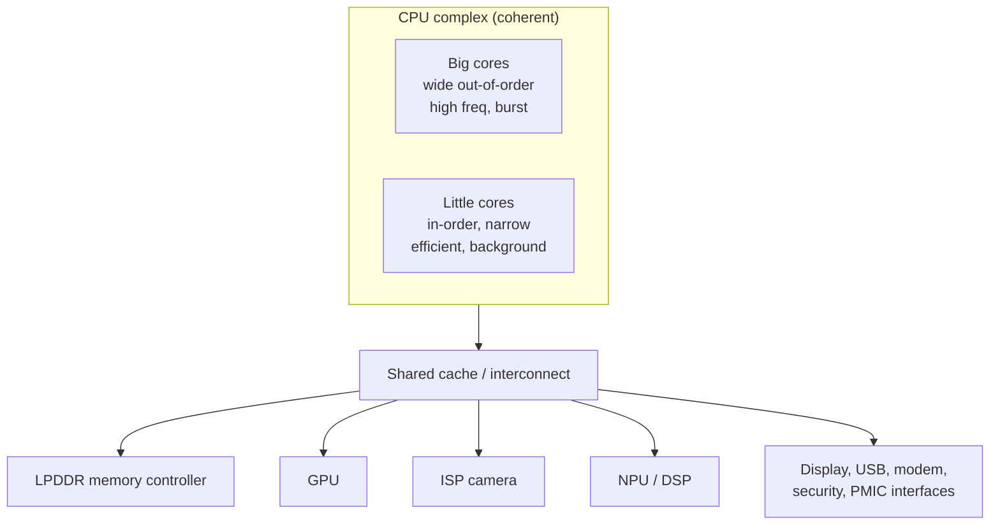

::: basics
### In plain words
Phone processors are almost all built around Arm cores. The bigger idea is that a phone chip is a system on a chip (SoC): CPU cores plus dedicated blocks for graphics, the camera, AI and the radio, all on one piece of silicon. Everything is designed around one limit, which is battery life and heat.

### Picture it
Picture a restaurant kitchen. A star chef (a fast, power-hungry core) handles the rush. Line cooks (small, efficient cores) handle routine orders all day. Specialist machines, like a bread slicer, each do one job using far less effort than a chef would. Phones assign work the same way, choosing the cheapest worker that can do the job in time.

### Words you need
- **SoC (system on a chip)**: the CPU, graphics, camera, AI and other blocks integrated in one chip.
- **Arm**: the instruction set used by nearly all phone CPUs, licensed to many chip makers.
- **big.LITTLE**: pairing fast cores for bursts with small efficient cores for background work.
- **Accelerator**: a block built for one job, such as video or AI, that uses less energy than a CPU would.
- **DVFS**: lowering the clock speed and voltage together when full speed is not needed.

### The simplest example
Dynamic power, the power spent switching transistors, depends on frequency and on voltage squared. With the page's illustrative numbers, 2.5 GHz needs 1.0 V, but 1.0 GHz needs only 0.7 V. At 1.0 GHz the speed is 40% of before. Power drops to about 20%, and energy per operation to about 49%. So a modest task run slowly at low voltage costs about half the energy.

That is the whole idea: a phone saves energy by matching each task to the cheapest hardware. The rest of this page covers the CPU cluster design, why accelerators save so much, memory energy, and the small chips in earbuds and wearables.
:::

::: testing
Whether you can connect **architecture choices to constraints**: battery life, heat, cost and software ecosystem. The expected answer is more than "ARM". The interviewer wants to hear:

1. Arm-family RISC cores dominate phones and most consumer devices, and why (energy efficiency, licensing, ecosystem).
2. That a phone is a **heterogeneous SoC**: big and little CPU cores plus GPU, ISP, DSP, NPU, modem.
3. The role of **big.LITTLE-style** asymmetric multiprocessing and DVFS.
4. That tiny consumer gadgets use microcontroller-class cores (Cortex-M, RISC-V) and that x86 also appears in some devices.
:::

::: why
Consumer electronics are power- and thermally limited, not performance-limited. A phone has no fan, a battery of roughly 15 Wh, and a skin temperature limit; the architecture is designed around joules per task. Hardware engineers working on any consumer product will deal with SoC datasheets, power domains, and thermal budgets, so being able to say why the architecture looks the way it does (and what is on the chip) is basic fluency. It also leads straight into SoC, power and DVFS questions ([[q0926]], [[q0945]]).
:::

::: concepts
- **RISC vs CISC and the Arm ISA**: simple load/store instructions, good performance per watt. See [[q0917]], [[q0898]].
- **SoC integration**: CPU, GPU, memory controller and peripherals on one die. See [[q0926]].
- **Dynamic power**: $P\approx \alpha C V^2 f$; voltage and frequency scaling are the main levers. See [[q0945]].
- **Heterogeneous multiprocessing**: different cores and accelerators for different workloads. See [[q0907]].
- **Offload to accelerators**: moving work from the CPU to fixed-function blocks that are often an order of magnitude or more energy-efficient for their task.
:::

::: answer
"The dominant one is Arm. Almost every smartphone application processor uses Arm-ISA cores, either Arm's own Cortex designs or custom cores that implement the Arm instruction set, like Apple's. It's a RISC ISA with simple load-store instructions, which makes it very efficient per watt, and a licensing model lets each phone maker build a custom SoC around it.

But the real answer is that a phone isn't one CPU, it's a heterogeneous system on a chip. You get a cluster of high-performance out-of-order cores for bursty work and a cluster of small, efficient in-order cores for background tasks, the big.LITTLE idea, and the OS scheduler moves threads between them. Around that are specialized blocks: a GPU, an image signal processor for the camera, a DSP, a neural engine for ML, a video codec, and the modem. Doing a task on a fixed-function block can use a fraction of the energy that the CPU would.

Smaller consumer devices like earbuds, fitness bands and smart-home sensors use microcontroller cores such as Cortex-M, and RISC-V is showing up in controllers. Laptops and some tablets use x86 or Arm. So: Arm RISC cores, heterogeneous, with lots of accelerators, because battery and heat are the constraint."
:::

::: technical
**Dominant ISA.** Arm (A-profile Armv8/v9 with the 64-bit A64 instruction set for phones; M-profile for MCUs). Reasons: energy efficiency heritage, a licensing model (core IP or ISA license) that enabled many vendors to build SoCs, and the ecosystem (Android and iOS toolchains and apps).

**Heterogeneous CPU clusters.** Arm's big.LITTLE and DynamIQ place high-performance cores (wide out-of-order) and efficiency cores (narrow, often in-order) under one coherent cache system. The scheduler migrates threads based on load. The point: energy per instruction on small cores can be several times lower than on big cores for tasks that don't need the speed. Exact ratios depend on the core, process, and workload.

**DVFS.** Dynamic power is $P_{dyn}=\alpha C V_{DD}^2 f$. Because the minimum voltage rises with frequency, power grows roughly as $f^3$ near the top of the curve. Example with $V = 0.5+0.2f$ ($f$ in GHz, illustrative): at 2.5 GHz ($V=1.0$ V) relative power is $2.5\times1.0^2=2.5$; at 1.0 GHz ($V=0.7$ V) it is $1.0\times0.49=0.49$. Speed falls to 40% but power to 19.6% and energy per operation to 49%.

**SoC blocks.** CPU clusters, GPU, ISP, video codec, DSP, NPU, memory controller (LPDDR), display controller, modem, security enclave, PMIC interface. Power domains and clock gating shut unused blocks down.

**Memory.** LPDDR with a shared system cache; bandwidth and energy per byte are the key constraints because DRAM access energy is far larger than an ALU op (exact ratio is process- and vendor-dependent).

**Thermal.** Sustained power for a fanless phone is only on the order of a few watts (vendor- and enclosure-dependent), so peak performance is used in bursts before thermal throttling.
:::

::: short
"Phones and most consumer electronics use Arm-based RISC cores, because they're very efficient per watt and the licensing model lets each vendor build its own SoC. A phone chip is heterogeneous: big out-of-order cores for bursts, small efficient cores for background work, plus a GPU, image processor, DSP, neural engine and modem on the same die. Small devices like earbuds use Cortex-M style microcontrollers, and RISC-V is growing. It's all driven by battery life and heat."
:::

::: long
"The architecture that dominates smartphones and most consumer devices is Arm. It's a RISC instruction set, so simple load-store instructions with a regular encoding, and that makes it easy to build cores that deliver a lot of performance per watt. Arm's licensing also matters: companies can license ready-made Cortex cores or license the instruction set and design their own, and that's how you get many different SoCs with a common software ecosystem, which is really what ties Android and iOS to it.

But the more interesting thing is that a phone processor is a heterogeneous SoC. The CPU side is usually a mix of core types, the big.LITTLE idea. A few big cores are wide out-of-order designs that run at high frequency for bursty tasks like opening an app. Several little cores are small in-order cores that are several times more energy-efficient and handle background work. The OS scheduler moves threads between them and uses DVFS, dynamic voltage and frequency scaling, because dynamic power goes as $CV^2f$, so slowing down a bit saves a lot of energy.

Around the CPUs you have specialized hardware: a GPU for graphics, an image signal processor for the camera pipeline, a video encoder and decoder, a DSP for audio and sensor fusion, an NPU for machine learning, and the cellular modem. The principle is offload: a fixed-function block can do the same task for a tenth or less of the energy of a general CPU.

Lower down the scale, earbuds, fitness bands, and smart-home devices use microcontroller-class cores like Cortex-M, increasingly RISC-V, with no cache and tiny SRAM. Tablets and laptops can use Arm or x86. The common thread is that these devices are limited by battery and thermal budget, so the architecture is chosen to minimize energy per task."
:::

::: terms
- **Arm / Cortex-A / Cortex-M**: Arm ISA family; A-profile for application processors, M-profile for microcontrollers.
- **SoC (system on chip)**: all major system blocks integrated in one die or package. See [[q0926]].
- **big.LITTLE / DynamIQ**: Arm heterogeneous CPU clustering with performance and efficiency cores.
- **DVFS**: dynamic voltage and frequency scaling to trade performance for energy.
- **ISP**: image signal processor, the camera pipeline hardware.
- **NPU**: neural processing unit, a machine-learning accelerator.
- **LPDDR**: low-power DRAM used in mobile devices.
- **Thermal throttling**: reducing frequency to stay within temperature limits.
- **Power domain / clock gating**: switching off supply or clock to idle blocks to save power.
:::

::: exceptional
**An average answer** says "ARM" and "RISC".

**An exceptional answer**:
- Names the architecture and gives the reasons: efficiency, licensing, ecosystem.
- Describes the SoC as heterogeneous: big and little CPU cores plus GPU, ISP, DSP, NPU, modem, and why offload saves energy.
- Gives the DVFS argument with $P=\alpha CV^2f$ and a worked number.
- Mentions memory (LPDDR) and thermal limits as the real bottlenecks.
- Covers the lower end (Cortex-M, RISC-V) and the exceptions (x86 devices, custom Arm cores).
- Ties it to the constraint: energy per task, not peak speed.
:::

::: mistakes
- **"Phones use ARM because RISC is inherently faster."** The ISA is not what makes it efficient; the microarchitecture, process and design goals matter. Arm's advantage was history, licensing and efficiency focus.
- **Describing the phone CPU as "an ARM chip" with no mention of accelerators.** Much of the compute and most of the efficiency comes from fixed-function blocks.
- **Saying ARM is a manufacturer.** Arm licenses designs and ISAs; companies like Apple, Qualcomm, Samsung and MediaTek build the SoCs, and foundries fabricate them.
- **Assuming more cores always means more performance.** Phone apps are mostly lightly threaded; cores are about efficiency and scheduling, not peak throughput.
- **Treating the clock rate as the headline.** Voltage scaling means high frequency costs power roughly cubically; sustained performance is thermally limited.
- **Forgetting the microcontroller tier.** Consumer electronics are mostly small MCU-based products, not phones.
:::

::: deep
## The constraint that shapes everything: joules per task

A phone has a battery of roughly 10 to 20 Wh (typical range, varies by model) and no fan. To get a day of use, average power must sit near a watt, but the user also expects bursts of performance (app launches, camera processing, games) that would need several watts. The chip is therefore designed for a very wide dynamic range of power, and the architecture exists to deliver the required work using as few joules as possible.

Two physical facts underpin it:

1. **Dynamic CMOS power** is $P_{dyn}=\alpha C V_{DD}^2 f$ ([[q0945]]). Each switching event charges and discharges capacitance, costing $\tfrac12CV^2$ per transition.
2. **Higher frequency needs higher voltage** because transistors must switch faster. So power rises faster than linearly with $f$.

```plot
{"title":"Illustrative DVFS curve: V = 0.5 + 0.2 f (f in GHz)","x":{"label":"Frequency","unit":"GHz","min":0.5,"max":2.5},"y":{"label":"Relative to 2.5 GHz","min":0,"max":1.05},
 "series":[{"label":"Performance (f/2.5)","fn":"x/2.5"},{"label":"Power: f V^2 / 2.5","fn":"x*pow(0.5+0.2*x,2)/2.5","color":"red"},{"label":"Energy per op: V^2","fn":"pow(0.5+0.2*x,2)","color":"orange","dashed":true}],
 "points":[{"x":1.0,"y":0.196,"label":"1 GHz: 40% speed, 19.6% power"}]}
```
Figure: Slowing from 2.5 GHz to 1 GHz cuts performance to 40% but power to about 20% and energy per operation to 49%, because both frequency and V^2 fall. The V(f) model is made up for illustration; real silicon curves come from the vendor's characterization.

So the cheapest way to do a modest task is slowly, on a small efficient core at low voltage. The most responsive way is fast on a big core at high voltage, but the energy per task is about double. The scheduler's job is to pick the right point.

## Heterogeneous CPU clusters (big.LITTLE and its successors)


Figure: A typical smartphone SoC. CPU clusters of two kinds share coherent caches, and accelerators plus I/O hang off a shared interconnect and memory controller. Everything is power-gated and clock-gated separately.

A big core is a wide superscalar out-of-order design with large caches: lots of transistors, high peak performance, poor energy per instruction. A little core is narrow, usually in-order: small area, low leakage, much better energy per instruction on easy code. Because phone usage is mostly idle, scrolling and background sync (which a little core handles fine) with brief intense bursts, the combination beats a uniform design. Cache coherence between clusters lets a thread migrate in microseconds.

## Why offload to accelerators

A general CPU spends energy on instruction fetch, decode, register renaming, and branch prediction for every arithmetic operation. A fixed-function block for video decoding, image processing or matrix multiplication strips all of that. The result can be an order of magnitude or more less energy per operation, which is why a 4K video decode on the hardware codec barely warms the phone while a software decode would drain the battery. The trade-off is flexibility: a codec block supports the codecs it was built for. Programmable accelerators such as DSPs, GPUs and NPUs sit in between. This is the same argument as [[q0907]] (offloading), applied at SoC scale.

## Memory is the other cost center

Moving data costs more energy than computing on it. A DRAM access consumes much more energy per byte than an on-chip SRAM access, which consumes more than an arithmetic operation; the exact ratios depend on process node and DRAM type, but the ordering is robust. Phones therefore use LPDDR (low-voltage, with deep power-down states), large shared system-level caches and compression of frame buffers, so the same pixels don't cross the DRAM interface twice. A system-level cache that catches a few more percent of the traffic saves real battery life.

## The lower tiers: microcontrollers and wearables

Not all consumer electronics are phones. An earbud, a smart bulb, a TV remote, a fitness band or a thermostat typically uses a microcontroller or SoC with a Cortex-M class core (in-order, short pipeline: 2 stages on Cortex-M0+, 6 on Cortex-M7, no MMU, tens to hundreds of kB of SRAM, Harvard-like internal buses) and aggressive sleep modes. RISC-V cores are also appearing in controllers and in the management subsystems inside larger SoCs. Here the metric is microamps in sleep and cost per unit, not gigahertz.

## x86 and other architectures in consumer devices

x86 powers PCs, some Windows tablets, game consoles (as semi-custom x86 SoCs) and set-top boxes. Arm has grown in laptops. GPUs and custom accelerators (video, AI) appear in every tier. The question's "often used in smartphones" answer is Arm, but a good answer notes that the general shape, *a heterogeneous SoC*, is the point, and applies equally to an x86 console APU.

## Worked example: a 1-second photo burst

Capturing a photo involves sensor readout, the ISP pipeline (demosaic, noise reduction, tone mapping), possibly an ML model for scene detection, JPEG/HEIF encoding, and writing to flash. If the CPU did all of it, it would need many cores at high frequency for the duration, drawing multiple watts and heating the phone. Instead the ISP streams pixels directly from the sensor in fixed-function hardware, an NPU runs the ML model at a fraction of the CPU's energy, a hardware encoder compresses the image, and the CPU just orchestrates. That is why the same workload can run at, say, hundreds of milliwatts of CPU power rather than several watts. (These are qualitative magnitudes; actual numbers vary by chip.)

> [!UNCERTAIN]
> Specific sustained-power figures, battery capacities and energy ratios (DRAM vs SRAM vs ALU) vary by device generation and process node. The qualitative ordering and the $CV^2f$ scaling are reliable; treat any single number as an order of magnitude.

> [!INTERVIEW]
> After "Arm", always add "heterogeneous SoC" and "energy per task". It shows you know the architecture is a response to the power constraint, not a brand choice.
:::

::: applications
- **Smartphone application processors**: Arm big.LITTLE-style CPU clusters plus GPU, ISP, NPU, DSP and modem.
- **Wearables and hearables**: Cortex-M microcontrollers or tiny Cortex-A cores with microamp sleep modes.
- **Smart TVs, set-top boxes and cameras**: Arm SoCs with hardware video codecs and display pipelines.
- **Game consoles and handheld PCs**: semi-custom x86 or Arm SoCs with large integrated GPUs.
- **Smart-home and IoT**: Cortex-M and RISC-V MCUs with integrated radios (BLE, Wi-Fi, Thread).
:::

::: assumptions
- **"Smartphones/consumer electronics" read as mass-market mobile devices.** Industrial or automotive consumer-adjacent products may use different cores (Cortex-R, safety MCUs).
- **Arm dominance reflects the current market**, which can shift (RISC-V adoption, x86 in some tablets and laptops, Arm in servers).
- **Energy figures are illustrative.** The DVFS curve uses a made-up linear $V(f)$; real devices have voltage floors (below which voltage can't be lowered) and leakage, so energy per operation can rise again at very low frequency.
- **Single-core simplification.** Real scheduling also considers thermal headroom, memory bandwidth and latency requirements.

If asked about a specific vendor's SoC, I would say I know the general structure but not exact core counts or numbers, rather than guess.
:::

::: followups
### Why are there big and little cores instead of just one good core?
Workloads vary widely. A big core is very fast but burns far more energy per instruction; a little core is slow but efficient. Most of the time the phone needs the little core; sometimes it needs the big one. Having both lets the OS use the efficient one for light work and burst to the big one when needed, which gives both battery life and responsiveness.

### What is DVFS and why does it save so much power?
Dynamic voltage and frequency scaling. Because $P\approx\alpha CV^2f$ and lower frequency permits lower voltage, power falls faster than speed. In the example curve, 40% of the frequency gives about 20% of the power and 49% of the energy per operation.

### Why does the phone throttle during a long game?
Sustained power is limited by how fast heat can leave the device (no fan, small surface). The SoC can run flat out for seconds, but the die temperature rises, and thermal management reduces frequency and moves work to efficient cores to stay under the limit.

### Would an x86 processor work in a phone? Why isn't it common?
Technically yes, and it has been tried. The barriers are the software ecosystem (Android and iOS apps were built for Arm), licensing and the integration model, and the long history of Arm cores tuned for low power. The ISA itself is not a fundamental blocker, since modern x86 cores translate to micro-ops.

### You're designing a smart ring with a coin cell. What compute architecture and what power strategy?
A Cortex-M0+ or similar tiny in-order MCU, or a BLE SoC, with the CPU asleep most of the time and waking on a timer or sensor interrupt. Hardware accelerators in the sensor (step detection, FIFO) let the MCU sleep longer. The goal is microamps average: for a 3 V, 25 mAh-class cell, 10 uA average gives about $25\text{ mAh}/0.01\text{ mA}=2500$ h, roughly 104 days.
:::

::: interpretations
"Computer architectures" here means mainly ISA and system-level organization. The sensible answer is "Arm-based RISC heterogeneous SoCs", with extras for different product tiers. This question builds on the general list in [[q0898]] and continues with the SoC questions starting at [[q0926]].
:::

::: references
- Hennessy & Patterson, *Computer Architecture: A Quantitative Approach*: the chapters on energy and power, and on domain-specific architectures.
- Arm documentation on big.LITTLE and DynamIQ technology (Arm Ltd. technical overviews), for the heterogeneous clustering concepts.
- Weste & Harris, *CMOS VLSI Design*: the power section (dynamic power, voltage scaling).
- Patterson & Hennessy, *Computer Organization and Design: Arm Edition*, for the Arm ISA background.
:::

::: rubric
- Names Arm (RISC) as the dominant ISA in phones and consumer devices :: Directly answers the question.
- Explains why: efficiency, licensing, software ecosystem :: Shows the choice is engineering and business, not accident.
- Describes the heterogeneous SoC: big/little CPU clusters plus GPU, ISP, DSP, NPU, modem :: A phone is an SoC, not a CPU.
- Mentions DVFS and $P=\alpha CV^2f$ :: Core energy-efficiency principle.
- Explains offloading to accelerators for energy efficiency :: The main reason for the diversity of blocks.
- Mentions microcontroller-class cores (Cortex-M, RISC-V) and x86 as exceptions :: Shows breadth across consumer electronics.
- References thermal and battery constraints :: The constraints that shape the architecture.
:::

::: quiz
```json
[
 {"type":"mcq","level":"fundamental","q":"Which instruction set family dominates smartphone application processors?","options":["x86-64","Arm (A-profile)","MIPS","AVR"],"answer":1,"explain":"Phones overwhelmingly use Arm-ISA cores, either Cortex designs or custom cores implementing Arm. x86 and MIPS are rare in phones, and AVR is an 8-bit MCU architecture."},
 {"type":"mcq","level":"fundamental","q":"What is the main idea behind big.LITTLE-style CPUs?","options":["Using one very large cache","Combining high-performance and energy-efficient cores so the scheduler can match cores to workloads","Doubling the clock frequency of each core","Replacing the GPU"],"answer":1,"explain":"Heterogeneous clusters let light workloads run on efficient cores and bursts on fast cores, improving battery life without sacrificing responsiveness."},
 {"type":"numeric","level":"intermediate","q":"With $P\\propto f V^2$ and $V = 0.5 + 0.2f$ (f in GHz), by what factor does power drop when the frequency is reduced from 2.5 GHz to 1.0 GHz? Give the ratio P(1 GHz)/P(2.5 GHz).","answer":0.196,"tolerance":0.02,"unit":"","explain":"At 2.5 GHz, V = 1.0 V and $fV^2 = 2.5$. At 1.0 GHz, V = 0.7 V and $fV^2 = 0.49$. Ratio = 0.49/2.5 = 0.196."},
 {"type":"numeric","level":"intermediate","q":"Using the same V(f) model, what is the energy per operation at 1.0 GHz relative to 2.5 GHz (energy per op $\\propto V^2$)?","answer":0.49,"tolerance":0.02,"unit":"","explain":"Energy per operation scales with $V^2$: $(0.7/1.0)^2 = 0.49$."},
 {"type":"multi","level":"intermediate","q":"Select all blocks commonly found on a smartphone SoC.","options":["Image signal processor (ISP)","Neural processing unit (NPU)","LPDDR memory controller","A discrete CRT controller"],"answer":[0,1,2],"explain":"ISP, NPU and the LPDDR controller are standard SoC blocks; a CRT controller is obsolete and not part of a phone SoC."},
 {"type":"truefalse","level":"advanced","q":"Offloading video decoding to a fixed-function hardware block typically reduces energy per frame compared with decoding on the CPU.","answer":true,"explain":"A fixed-function block avoids instruction fetch, decode and general-purpose overhead for each operation, so its energy per operation is far lower, at the cost of flexibility."}
]
```
:::
