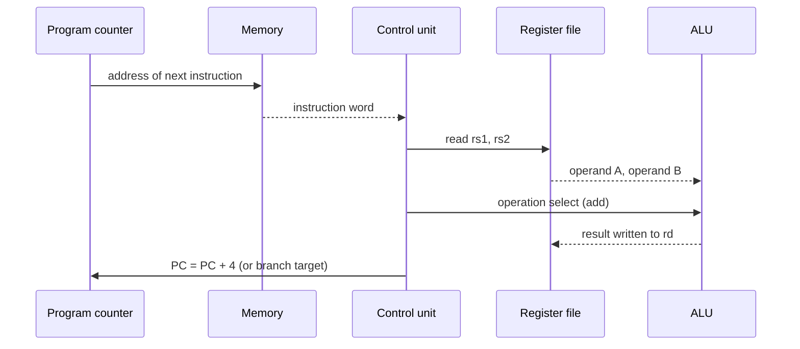

::: testing
Whether you can define a CPU as more than "the brain of the computer". A good answer explains what it physically is and what it does:

1. A CPU is a **sequential digital machine** that repeatedly fetches an instruction, decodes it, and executes it, driven by a clock.
2. It has two halves: a **datapath** (registers, ALU) and a **control unit** (an FSM that sequences the datapath).
3. It talks to memory and I/O over buses and executes instructions from an **ISA**.
4. Performance is characterized by clock rate, CPI and instruction count, and the CPU differs from an MCU, GPU or accelerator.
:::

::: why
Every embedded system, laptop and server has a CPU at its center, and hardware engineers deal with them constantly: choosing between MCU and application processor, reading datasheets (clock, memory map, interrupts), debugging boot failures, and sizing power. Interviewers ask this simple question because the quality of the answer reveals whether you see a CPU as a magic box or as a clocked FSM plus datapath. It's also the entry point to the rest of the architecture questions on the page: blocks, ALU, program counter, fetch/execute, pipelining.
:::

::: concepts
- **Instruction**: a binary word encoding an operation (add, load, branch). The CPU's job is to run a stream of them. See [[q0913]].
- **Datapath vs control**: registers and an ALU do the work; a control FSM selects what happens each cycle. See [[q0896]], [[q0902]].
- **Program counter**: register holding the address of the next instruction. See [[q0903]].
- **Memory and buses**: instructions and data live in memory the CPU addresses. See [[q0898]].
- **Clock**: synchronizes state updates in the CPU's flip-flops.
- **Stored-program concept**: programs are data in memory, so behavior changes by loading different instructions.
:::

::: answer
"A CPU, the central processing unit, is the part of a computer that executes instructions. A program is a list of simple instructions stored in memory, like load a value, add two registers, store a result, or branch. The CPU repeatedly fetches the next instruction using the program counter, decodes it to figure out what it means, and executes it, using an ALU for the arithmetic and logic and a register file for fast storage. Then it moves on.

Physically, it's a clocked digital circuit with two parts. The datapath is the registers, the ALU, and the buses that move data around. The control unit is basically a big finite state machine that, based on the instruction, sets the control signals that steer the datapath each clock cycle. The CPU talks to memory and peripherals over address, data and control buses.

How fast a CPU runs a program comes from three things: how many instructions the program needs, how many clock cycles each takes on average, and how long a clock cycle is. Modern CPUs use pipelining, caches, branch prediction, and multiple cores to do much better than one instruction at a time. And a microcontroller is basically a small CPU plus memory and peripherals on one chip."
:::

::: technical
**Function.** A CPU implements the instruction cycle: fetch ($IR\leftarrow M[PC]$, $PC\leftarrow PC+4$ for a fixed 4-byte ISA), decode (read register file, generate control signals), execute (ALU operation or address calculation), memory access (load/store), writeback (register file). See [[q0905]].

**Structure.**
- *Datapath*: program counter, instruction register, register file (e.g. 32 registers in RISC-V/Arm A64), ALU, multiplexers, memory interface.
- *Control unit*: hardwired logic (FSM or decoder) or microcoded sequencer that maps opcode to control signals (ALU operation, register write enable, memory read/write, PC source).
- *Memory system*: caches, MMU/TLB, bus interface.
- *Support*: interrupt controller, privilege modes, debug interface.

**Performance.** Iron law: $T=\text{IC}\times\text{CPI}\times t_{clk}$. Example: 3 billion instructions, CPI 1.5, 2 GHz: $T=3\times10^9\times1.5/(2\times10^9)=2.25$ s. Performance in MIPS or IPC is only meaningful with the instruction mix and ISA fixed.

**CPU vs MCU.** An MCU integrates a CPU with flash, SRAM, timers, ADC, UART, SPI and GPIO on one die; an application processor has external DRAM and an MMU to run an OS like Linux.

**Power.** Dynamic power $P=\alpha CV^2f$ plus leakage; CPU frequency and voltage are scaled together (DVFS).
:::

::: short
"A CPU is the circuit that executes a program. It repeatedly fetches an instruction from memory using the program counter, decodes it, and executes it using an ALU and a register file. Internally it's a datapath controlled by a finite state machine, all synchronized by a clock. Its speed is instruction count times CPI times clock period, and modern ones use pipelining, caches and branch prediction to execute many instructions in parallel."
:::

::: long
"A CPU is the part of a computer that actually runs programs. A program is a sequence of simple instructions stored in memory: things like add two registers, load a word from an address, store, or branch if two values are equal. The CPU's whole job is to step through those instructions, doing what each one says.

It does that with the fetch, decode, execute loop. A register called the program counter holds the address of the next instruction. The CPU fetches it from memory, decodes it, which means reading the opcode and register fields to work out the operation, then executes it. For an add, the ALU, the arithmetic logic unit, computes the sum of two values read from the register file, and the result is written back to a register. For a load or store it computes an address and accesses memory. Then the program counter advances to the next instruction, or jumps if it was a branch.

Hardware-wise, a CPU is a clocked digital circuit made of a datapath and a control unit. The datapath has the registers, ALU, multiplexers and buses. The control unit is effectively a finite state machine, or a decoder in a pipelined design, that generates the control signals that tell the datapath what to do that cycle.

For performance, execution time equals instruction count times cycles per instruction times clock period. A modern CPU improves CPI by pipelining so several instructions overlap, using caches to hide slow memory, and predicting branches. It also adds multiple cores for parallel work.

Finally, a microcontroller is a CPU with memory and peripherals on the same chip, while a bigger application processor adds an MMU and caches and runs an operating system."
:::

::: terms
- **CPU**: central processing unit; the circuit that fetches, decodes and executes instructions.
- **Instruction set architecture (ISA)**: the instructions and registers visible to software. See [[q0913]].
- **Datapath**: registers, ALU and buses that carry out operations.
- **Control unit**: logic that generates control signals for the datapath based on the instruction.
- **Register file**: small fast storage array of general-purpose registers.
- **Program counter (PC)**: register holding the address of the next instruction. See [[q0903]].
- **CPI / IPC**: cycles per instruction and its reciprocal, instructions per cycle.
- **Stored-program computer**: programs and data share memory and are fetched like data.
- **Microcontroller (MCU)**: CPU plus on-chip memory and peripherals.
:::

::: exceptional
**An average answer** says "the brain of the computer that executes instructions".

**An exceptional answer**:
- Describes the fetch-decode-execute loop and the role of the program counter.
- Splits the machine into datapath and control, and says control is an FSM.
- Gives the iron law ($T=\text{IC}\times\text{CPI}\times t_{clk}$) with a numeric example.
- Mentions the memory system as part of what makes a CPU fast or slow.
- Distinguishes CPU from MCU, SoC and GPU, and from ISA vs microarchitecture.
- Notes power ($CV^2f$) as a first-order constraint on how CPUs are built.
:::

::: mistakes
- **"The CPU is the computer."** It is one component; memory, I/O and the interconnect determine real system performance.
- **"Higher GHz means faster."** Performance is IC × CPI × clock period. A 3 GHz core with CPI 2 loses to a 2 GHz core with CPI 1 for the same program.
- **Confusing CPU with ISA.** The ISA is the interface; the CPU is one implementation of it ([[q0912]], [[q0913]]).
- **Thinking the CPU executes high-level code directly.** It executes machine instructions; compilers translate C into them.
- **Equating CPU with microprocessor chip only.** In an MCU the CPU is one block among many; in a multicore SoC there are several.
- **Ignoring that a CPU is clocked state machinery**, not magic: every instruction is a defined sequence of register transfers.
:::

::: deep
## A program is data

The central idea behind every CPU is the **stored-program concept**: instructions are binary numbers stored in memory alongside data. Changing what the machine does means loading different numbers, not rewiring. A 32-bit RISC-V instruction like `add x3, x1, x2` is encoded as a fixed bit pattern: opcode (7 bits), destination register `rd` (5), `funct3` (3), source registers `rs1`, `rs2` (5 each), `funct7` (7). The CPU's decoder reads the fields; they select registers and control the ALU. (Encoding fields shown for RISC-V's R-type format; other ISAs differ.)

## The loop every CPU runs


Figure: One instruction's trip through a simple CPU. The program counter addresses memory, the control unit decodes, the register file supplies operands, the ALU computes, and the result returns to the register file. The control unit updates the PC at the end. Real CPUs overlap many of these steps using a pipeline.

## Datapath and control

The datapath is a set of storage elements and combinational blocks connected by multiplexers. The *control unit* decides every select line and write enable each cycle. A simple multi-cycle CPU's control is a literal FSM ([[q0896]]): state FETCH asserts "memory read, IR write, PC increment", state DECODE reads registers, state EXECUTE selects the ALU op, and so on. In a pipelined CPU the control logic is a combinational decoder whose outputs ride along the pipeline with the instruction.

Because the datapath is just flip-flops and logic, everything in [[q0894]], [[q0896]], [[q0902]] applies: the clock period must exceed the slowest register-to-register path, $T\ge t_{clk\to Q}+t_{logic}+t_{su}$. The ALU and memory access are usually the critical paths, which is why they get so much design attention.

## Performance: what makes one CPU faster

Execution time of a program:
$$T=\frac{\text{instructions}\times \text{CPI}}{f_{clk}}$$

| Core | Instructions | CPI | Clock | Time |
|---|---|---|---|---|
| A | 3.0e9 | 1.5 | 2.0 GHz | 2.25 s |
| B | 3.0e9 | 1.0 | 1.5 GHz | 2.00 s |
| C | 2.4e9 (better ISA/compiler) | 1.5 | 2.0 GHz | 1.80 s |

B beats A despite a lower clock because its CPI is lower. C wins by executing fewer instructions. Each term is attacked by a different technique:

- **Instruction count**: the ISA, compiler, SIMD instructions.
- **CPI**: pipelining, superscalar issue, caches, branch prediction ([[q0906]], [[q0908]], [[q0910]]).
- **Clock period**: process technology, shorter pipeline stages, circuit design.

## From the idealized CPU to real ones

A single-cycle CPU executes every instruction in one long clock (CPI = 1) and the clock period is set by the slowest instruction (a load goes through instruction memory, register file, ALU, data memory, register file). A multi-cycle CPU splits instructions into steps using a shorter clock but more cycles each. A pipelined CPU overlaps instructions so that, ideally, each cycle finishes one instruction with a short clock: it improves throughput without shortening single-instruction latency ([[q0909]]). A superscalar out-of-order CPU extends that to several instructions per cycle. All of these implement the same ISA, which is why software runs unchanged ([[q0912]]).

## Worked example: why the clock period is what it is

Take a single-cycle CPU with these made-up but plausible stage delays: PC clock-to-Q 30 ps, instruction memory read 250 ps, register-file read 150 ps, ALU 200 ps, data memory 250 ps, register-file setup 20 ps.

- An `add` (no data memory) needs $30+250+150+200+20=650$ ps.
- A `lw` goes through everything: $30+250+150+200+250+20=900$ ps.

A single-cycle design must use one clock for all instructions, so $T\ge 900$ ps, about 1.11 GHz, even though most instructions finish sooner. Now cut the datapath into five stages (fetch 250, decode/register read 150, execute 200, memory 250, writeback about 100 including the register write). A pipeline clock must cover the slowest stage plus register overhead (say 50 ps of clock-to-Q plus setup plus skew): $T\approx 250+50=300$ ps, i.e. 3.33 GHz. The speed-up on throughput is $900/300=3\times$, not the ideal $5\times$, because the stages are unbalanced (memory 250 vs writeback 100) and each stage pays the register overhead. This is the practical reason pipeline designers try to balance stage delays, and why the memory access stages are split further in faster CPUs.

## CPU vs MCU vs SoC vs GPU

- **CPU core**: just the instruction-executing engine.
- **Microcontroller**: core + flash + SRAM + peripherals (timers, ADC, UART, SPI, I2C, GPIO) in one package, designed for low power and deterministic real-time behavior. Typically no MMU and tens of MHz to a few hundred MHz.
- **Application processor / SoC**: multiple cores, caches, MMU, external DRAM controller, GPU and other accelerators, running an OS ([[q0926]]).
- **GPU**: many simple cores optimized for throughput on data-parallel work rather than low-latency single-thread execution.

## What real hardware adds

- **Registers are tiny, fast memory**: reading them takes under a cycle, while main memory takes hundreds of cycles. That mismatch is why caches exist.
- **Privilege and protection**: user vs kernel modes, an MMU to isolate processes.
- **Interrupts and exceptions** divert the PC to handlers ([[q0911]]).
- **Power management**: clock gating, DVFS and sleep states; leakage matters more as transistors shrink.
- **Verification and debug**: scan chains, JTAG/SWD debug ports and trace blocks to see inside a running CPU.

> [!INTERVIEW]
> A good one-sentence frame: "A CPU is a clocked state machine with a register-and-ALU datapath that implements an ISA by repeating fetch, decode, execute." Then add the iron-law equation. Interviewers pick up from whichever piece you mention.
:::

::: applications
- **Microcontroller cores (Cortex-M, RISC-V)**: running firmware in motor controllers, sensors and appliances.
- **Application processors**: running Linux or Android on phones, routers and set-top boxes.
- **Laptop, desktop and server CPUs**: high-IPC out-of-order cores with multi-level caches.
- **Soft cores in FPGAs**: a CPU implemented in programmable logic for control tasks.
- **Embedded controllers inside other chips**: small CPUs managing power sequencing, boot or radio firmware inside SoCs.
:::

::: assumptions
- **Von Neumann-style stored-program CPU.** Other models (dataflow, quantum) are outside the scope here.
- **A conventional ISA** such as RISC-V or Arm, with a register file and load/store architecture.
- **Single core unless stated.** Multicore adds coherence and parallelism but the core is the same.
- **Performance figures** (CPI, clock) are examples; real programs have varying CPI due to cache misses and branches.

In an exam setting "CPU" often means just the processor core; in industry it can mean the whole chip package. I would clarify which if the question depends on it.
:::

::: followups
### What's the difference between a CPU and a microcontroller?
A microcontroller is a CPU core plus on-chip flash, RAM and peripherals (timers, ADC, serial interfaces, GPIO), designed so one chip can run a whole embedded application at low power and deterministic timing. A general-purpose CPU is usually just the processor, with external DRAM and I/O, designed for performance and running an OS.

### Why is a 4 GHz CPU not necessarily faster than a 3 GHz CPU?
Time is instructions × CPI / frequency. If the 4 GHz CPU needs CPI 2 and the 3 GHz one CPI 1 on the same program, the 3 GHz is faster (for $10^9$ instructions: 0.5 s vs 0.33 s). IPC, microarchitecture, caches and the memory system matter as much as clock rate.

### What limits how fast you can clock a CPU?
The longest register-to-register combinational path ($t_{clk\to Q}+t_{logic}+t_{su}+$ skew), power density (dynamic power $\propto V^2f$ and rising voltage with frequency) and thermal limits. Pipelining shortens the logic per stage to raise the clock, until overhead and power dominate.

### What is the difference between a CPU and a GPU?
A CPU is optimized for low-latency execution of a few threads with complex control (out-of-order, large caches, branch prediction). A GPU has many simpler cores running thousands of threads in lockstep groups and hides memory latency by switching threads, so it's optimized for throughput on data-parallel work.

### Suppose your CPU hangs at boot. How would you debug it from the hardware side?
Check power rails and sequencing, reset release timing and clock presence first. Then verify the reset vector fetch: probe for the first memory read with a logic analyzer or scope, see that the address is the expected reset vector and that flash/boot ROM responds. Use JTAG/SWD to halt the core and read the PC. If the PC is stuck at an exception or at an address with no memory, the problem is in the memory map or boot media.
:::

::: interpretations
"What is a CPU?" is a definition question that expects the fetch-decode-execute story and a description of its blocks. Sometimes interviewers want a hardware answer (datapath and control), sometimes a system answer (CPU vs MCU vs SoC). Cover both briefly and let the interviewer steer. Details of blocks are in [[q0901]].
:::

::: references
- Patterson & Hennessy, *Computer Organization and Design* (RISC-V edition): chapters on the Processor and on performance (the iron law).
- Harris & Harris, *Digital Design and Computer Architecture*: Chapter 7 (Microarchitecture) for single-cycle, multi-cycle and pipelined processors.
- Hennessy & Patterson, *Computer Architecture: A Quantitative Approach*: Chapter 1 on quantitative principles.
:::

::: rubric
- Defines the CPU as the circuit that executes a stored program's instructions :: The core definition.
- Describes the fetch-decode-execute cycle with the program counter :: Shows the operating principle.
- Splits into datapath (registers, ALU) and control unit (FSM/decoder) :: Shows hardware-level understanding.
- Mentions memory/buses and the ISA as the software interface :: Places the CPU in the system.
- Gives the performance equation with a numeric example :: Demonstrates quantitative thinking.
- Distinguishes CPU from MCU/SoC/GPU :: Shows breadth.
- Mentions power or clocking constraints :: Real chips are power-limited.
:::

::: quiz
```json
[
 {"type":"mcq","level":"fundamental","q":"Which pair of components makes up the two main parts of a simple CPU?","options":["Datapath and control unit","Cache and DRAM","Compiler and linker","Clock and battery"],"answer":0,"explain":"The datapath (registers, ALU, buses) performs operations and the control unit generates the signals that sequence it each cycle."},
 {"type":"mcq","level":"fundamental","q":"What does the program counter hold?","options":["The result of the last ALU operation","The address of the next instruction to fetch","The number of instructions executed","The stack depth"],"answer":1,"explain":"The PC holds the address of the next instruction. It normally increments each instruction and is overwritten on branches, jumps, calls and interrupts."},
 {"type":"numeric","level":"intermediate","q":"A program has 3.0e9 instructions, the CPU has CPI 1.5 and runs at 2 GHz. How long does it take?","answer":2.25,"tolerance":0.01,"unit":"s","explain":"$T=\\text{IC}\\times\\text{CPI}/f = 3\\times10^9\\times1.5/(2\\times10^9)=2.25$ s."},
 {"type":"numeric","level":"intermediate","q":"CPU X: 4 GHz, CPI 2.0. CPU Y: 3 GHz, CPI 1.0. Same program. How many times faster is Y than X?","answer":1.5,"tolerance":0.02,"unit":"x","explain":"Time per instruction: X = 2.0/4 GHz = 0.5 ns, Y = 1.0/3 GHz = 0.333 ns. Ratio = 0.5/0.333 = 1.5."},
 {"type":"multi","level":"intermediate","q":"Which of these are typical differences between a microcontroller and an application processor?","options":["MCU integrates flash and SRAM on the same chip","Application processor typically has an MMU and runs an OS like Linux","MCUs usually clock at multiple GHz","MCUs integrate peripherals such as ADC, UART and timers"],"answer":[0,1,3],"explain":"MCUs integrate memory and peripherals, typically run at tens to a few hundred MHz, and usually lack an MMU. Application processors run multi-GHz with an MMU and external DRAM."},
 {"type":"truefalse","level":"advanced","q":"Pipelining a CPU reduces the latency of each individual instruction.","answer":false,"explain":"Pipelining improves throughput by overlapping instructions. Each instruction still passes through every stage, and with register overhead its latency is slightly longer than in an unpipelined design."}
]
```
:::
