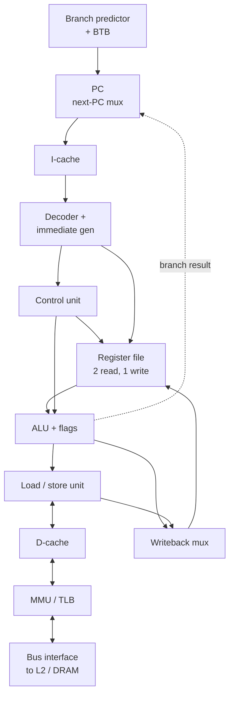

::: basics
### In plain words
A CPU is a set of small blocks that each do one job, wired together. One block remembers which instruction comes next. Others fetch it, work out what it means, supply the numbers, do the math, and talk to memory. Following a single instruction through these blocks shows how they fit.

### Picture it
Picture a small office. A bookmark marks the next order on the list (the program counter). A manager reads the order and tells everyone what to do (the decoder and control unit). The desk holds the numbers in use right now (the registers). A calculator does the arithmetic (the ALU). A runner fetches things from the filing cabinet down the hall (the load/store unit and memory).

### Words you need
- **Program counter**: holds the address of the next instruction ([[q0903]]).
- **Control unit**: turns the instruction into signals that steer the other blocks.
- **Register file**: a small, very fast set of storage spots for the numbers in use.
- **ALU**: the block that does arithmetic and logic ([[q0902]]).
- **Cache**: a small fast memory next to the CPU that holds recently used instructions and data.
- **Load/store unit**: the block that reads data from memory and writes it back.

### The simplest example
Take the instruction "add x1 and x2, put the result in x3", with x1 = 4 and x2 = 6. The program counter gives the instruction's address, and the instruction comes from the instruction cache. The control unit sees "add" and tells the register file to read x1 and x2. The ALU adds them to get 10, and 10 is written into x3.

That is the whole idea: each block has one job, and the instruction flows through them in order. The rest of this page shows the full block diagram, the register file's design, and the extra blocks real CPUs add to stay fast, such as branch predictors and out-of-order hardware.
:::

::: testing
Whether you can open the box and name the main blocks of a CPU **and say what each one does and how they connect**. The strongest answers go in a sensible order, for example following one instruction: program counter, instruction fetch (cache), decoder and control unit, register file, ALU, data memory access (load/store unit, data cache), writeback. Then they add the blocks that make real CPUs fast or usable: branch predictor, MMU/TLB, interrupt controller, floating-point unit, reorder buffer. The interviewer is checking that you see it as a coordinated datapath plus control rather than a list of words.
:::

::: why
Block-level thinking is how hardware teams divide the work: one engineer owns the fetch unit, another the load/store pipeline, another the cache. In interviews and on the job you need the vocabulary to read a datasheet block diagram, discuss where a bug or critical path lives ("the bypass network into the ALU limits our clock"), or estimate where power goes. This question is also the easiest way for an interviewer to sample your depth, because you can stop at a simple 5-block answer or keep going to out-of-order structures.
:::

::: concepts
- **Datapath and control split**: blocks that hold and transform data vs the logic that sequences them. See [[q0900]].
- **Program counter and instruction register**: where the next instruction is, and the current one. See [[q0903]].
- **Register file**: small, multi-ported fast storage addressed by register number.
- **ALU**: arithmetic and logic operations and condition flags. See [[q0902]].
- **Caches and memory interface**: hide DRAM latency. See [[q0936]].
- **Pipeline registers**: store each stage's result between clock edges. See [[q0906]].
:::

::: answer
"I'd walk through it following an instruction. First the program counter holds the address of the next instruction, and the fetch unit reads it from the instruction cache. The instruction goes to the decoder, and the control unit turns the opcode into control signals: which registers to read, which ALU operation, whether to access memory. The register file supplies the operands; it's a small multi-ported memory, typically two reads and one write per cycle. The ALU, the arithmetic logic unit, does the add, subtract, AND, shifts, compares, and sets flags. For loads and stores, the load/store unit computes the address and talks to the data cache and memory interface. Finally the result is written back to the register file.

Around that core you get the blocks that make it practical: caches, the MMU with its TLB for virtual memory, a branch predictor so the pipeline doesn't stall, a floating-point unit and multiplier or divider, an interrupt controller and exception logic, and in bigger CPUs register renaming, a reorder buffer, and multiple execution units for out-of-order superscalar execution. Pipelined designs also have pipeline registers between stages and hazard-detection and forwarding logic."
:::

::: technical
**Core blocks (single in-order pipeline).**
1. *Program counter (PC)*: register, next-PC multiplexer selecting PC+4, branch target, jump or exception vector.
2. *Instruction memory / I-cache*: returns the instruction at PC; typically 16 to 64 KB L1 in application cores (size varies by design).
3. *Decoder + control unit*: extracts opcode/register fields, immediate generator, produces control signals (RegWrite, ALUSrc, ALUOp, MemRead/Write, MemToReg, Branch).
4. *Register file*: e.g. 32 registers × 32 or 64 bits with 2 read ports and 1 write port; 1,024 bits for 32×32. Reads are combinational, writes on the clock edge.
5. *ALU*: add/sub, AND/OR/XOR, shifts, set-less-than, flags (N, Z, C, V) ([[q0902]]).
6. *Load/store unit + D-cache*: address generation, alignment, cache access, store buffer.
7. *Writeback mux* to the register file.

**Support blocks.** Branch predictor and branch target buffer ([[q0910]]); hazard detection and forwarding paths; MMU and TLB for virtual-to-physical translation; interrupt/exception controller and control/status registers ([[q0911]]); multiplier/divider and floating-point unit; clock/reset and power management hooks; debug/trace interface.

**Out-of-order additions.** Register rename table, issue queues (reservation stations), multiple execution ports, reorder buffer for in-order retirement, load/store queue.

**Example cache numbers.** A 32 KB, 8-way, 64-byte-line cache has $32768/(64\cdot 8)=64$ sets: 6 offset bits, 6 index bits and, for 32-bit addresses, $32-12=20$ tag bits.
:::

::: short
"Following an instruction: the program counter addresses the instruction cache, the decoder and control unit turn the opcode into control signals, the register file supplies operands, the ALU computes, the load/store unit talks to the data cache and memory, and the result is written back to the register file. Real CPUs add a branch predictor, MMU and TLB, a floating-point unit, an interrupt controller, and in high-end cores register renaming and a reorder buffer."
:::

::: long
"I'll follow one instruction through the CPU, because that shows how the blocks connect.

It starts with the program counter, a register holding the address of the next instruction. The fetch logic sends that address to the instruction cache, which usually returns the instruction in a cycle or two. A next-PC multiplexer picks either PC plus four or a branch target. A branch predictor tries to guess that early so fetch can keep running.

The instruction goes to the decoder. It splits out the opcode, the register numbers and any immediate, and the control unit generates all the control signals: which ALU function, whether to write a register, whether to access memory. The register file is next: a small fast array, maybe 32 registers, with two read ports and one write port, so it can supply both operands and accept a result in the same cycle.

The ALU takes the operands and does the operation: add, subtract, AND, OR, shift, compare, and it also sets flags like zero and carry. For a load or store, the ALU computes the address, and the load/store unit accesses the data cache, which goes out to memory through the bus interface on a miss. The MMU and TLB translate virtual addresses to physical ones along the way. At the end, a writeback mux picks the ALU result or the loaded value and writes it to the register file.

On top of that are blocks for exceptions and interrupts, which can redirect the PC, and special units like a multiplier, divider and floating-point unit. In a pipelined CPU there are pipeline registers between stages, plus hazard detection and forwarding. A high-performance out-of-order core adds register renaming, issue queues, several execution units and a reorder buffer to retire instructions in order."
:::

::: terms
- **Program counter (PC)**: address of the next instruction. See [[q0903]].
- **Instruction register / decoder**: holds and interprets the current instruction.
- **Control unit**: generates datapath control signals from the decoded instruction.
- **Register file**: multi-ported array of general-purpose registers.
- **ALU**: arithmetic logic unit, executes arithmetic and logic operations. See [[q0902]].
- **Load/store unit**: handles memory accesses, address generation and alignment.
- **L1 I-cache / D-cache**: small fast caches for instructions and data.
- **MMU / TLB**: memory management unit translating virtual to physical addresses; TLB caches translations.
- **Branch predictor**: guesses branch outcomes and targets to keep the pipeline full. See [[q0910]].
- **Reorder buffer (ROB)**: structure that lets out-of-order cores retire instructions in program order.
:::

::: exceptional
**An average answer** lists "ALU, registers, control unit, cache".

**An exceptional answer**:
- Orders the blocks by following an instruction and explains the connections (buses, muxes, pipeline registers).
- Gives numbers: register file size and port count, cache geometry, stage delays.
- Separates the datapath, control and memory system, and notes which parts are critical paths (ALU, forwarding, cache access).
- Mentions the blocks real CPUs need beyond the textbook five: predictor, MMU/TLB, interrupts, FPU, ROB.
- Knows what changes between an MCU core and an out-of-order core and why.
:::

::: mistakes
- **Listing blocks with no relationships.** Say what each block feeds and receives.
- **Forgetting the program counter or the control unit.** They are what make a CPU a sequencer rather than a calculator.
- **Calling the register file "memory".** It is fast, tiny, multi-ported, and addressed by register number inside the instruction; it is not part of the memory map.
- **Saying the ALU does memory access.** The ALU computes addresses; the load/store unit and cache do the access.
- **Confusing cache with register file.** Registers are named in the instruction; caches are transparent and tag-matched.
- **Treating the MMU as optional on every CPU.** MCU-class cores often have only an MPU or none; application CPUs require an MMU for Linux.
:::

::: deep
## A block diagram you can draw in 60 seconds


Figure: The main blocks of a simple in-order CPU. Solid arrows are data; the control unit (decoded from the instruction) steers the register file, ALU and memory. The dotted line is the branch outcome that redirects the PC. Real chips add pipeline registers between stages and forwarding paths from ALU output back to its inputs.

## The register file in detail

The register file is a tiny memory with unusual requirements: it must supply two operands and accept one result every cycle, so it needs two read ports and one write port. Reads are combinational (address in, data out within the cycle), writes happen on the clock edge. A RISC-V style file with 32 registers of 32 bits holds $32\times32=1024$ bits; with 64-bit registers, 2,048 bits. Register 0 is hard-wired to zero in RISC-V, so a write to it is just ignored and it needs no storage.

Each read port is a 32:1 multiplexer per bit; each write port needs a decoder that asserts one of 32 write enables. In a superscalar core that issues four instructions per cycle, you need 8 read and 4 write ports. The cell grows with the number of ports because each port adds word lines and bit lines inside every bit cell, so area and delay grow superlinearly with port count (roughly quadratically in the cell dimensions is the common rule of thumb). That's one of the real reasons wide cores are expensive: the register file and bypass network become the critical path and power hog.

## The ALU and the datapath around it

The ALU ([[q0902]]) does the real arithmetic. In a pipelined CPU its inputs come through multiplexers that select either a register-file read, a forwarded result from the previous instruction, or the immediate field; this *forwarding network* (bypass) lets back-to-back dependent instructions run without stalling ([[q0906]]). The ALU output goes to three places: the register write-back path, the data-memory address, and the branch-resolution logic.

## Control: decoding the instruction

For a fixed-length RISC instruction the decoder is a small combinational block. A subset of a RISC-V style main decoder:

| Instruction | RegWrite | ALUSrc | MemRead | MemWrite | MemToReg | Branch |
|---|---|---|---|---|---|---|
| add (R-type) | 1 | 0 (reg) | 0 | 0 | 0 | 0 |
| lw | 1 | 1 (imm) | 1 | 0 | 1 | 0 |
| sw | 0 | 1 (imm) | 0 | 1 | X | 0 |
| beq | 0 | 0 (reg) | 0 | 0 | X | 1 |

That's a truth table ([[q0894]]) with don't-cares ([[q0895]]). In a multi-cycle design the control unit is an FSM; in a microcoded CISC it is a ROM of micro-instructions; in an x86 core the decoder translates complex instructions into micro-ops.

## Memory system blocks

The instruction cache and data cache are the first level of the hierarchy; each is typically tens of KB. Address breakdown: for a 32 KB, 8-way, 64-byte-line cache the number of sets is $32768/(64\times8)=64$, so 6 bits are offset, 6 are index and, for 32-bit addresses, 20 are tag. The cache is looked up in parallel with the TLB in many designs (a virtually-indexed, physically-tagged L1) so that translation does not add latency.

```sim
{"id":"cache-lab","lines":8,"ways":2,"block":16,"trace":"sequential"}
```
Figure: Step through the sequential trace and watch each address split into tag, index and offset: one compulsory miss per 16-byte block, then three hits on the same block (87.5% hits). Then pick the "conflict" trace and set associativity to 1-way: two arrays one cache-size apart evict each other on every access. Switch back to 2-way at the same capacity and they coexist.

The **MMU** translates virtual addresses (what programs use) to physical addresses via page tables; the **TLB** is a small cache of recent translations. An MCU often has instead a **memory protection unit (MPU)** that checks permissions but does not translate.

## The blocks that keep the pipeline full

- **Branch predictor and BTB**: predicts direction and target at fetch time so the front end doesn't wait for the branch to resolve ([[q0910]]).
- **Hazard detection / stall logic**: inserts bubbles when a load's data is not yet available.
- **Return address stack, prefetchers, store buffers**: small structures that remove common stalls.

## Out-of-order additions

An out-of-order core adds, between decode and execute: a *rename* stage that maps architectural registers to a larger physical register file (removing false dependencies), *issue queues* that hold instructions until their operands are ready, several *execution ports* (integer ALUs, branch unit, load/store, FP/vector), and a *reorder buffer* that holds results until older instructions finish so that state is updated in program order and exceptions are precise. These blocks are why a high-end core is far larger than a Cortex-M-class core: the scheduling logic costs more silicon and power than the ALUs themselves.

## Non-datapath blocks

- **Interrupt controller and exception logic**: on an interrupt, finish or squash in-flight instructions, save the PC, switch mode and load the PC from a vector table ([[q0911]]).
- **Control/status registers (CSRs)**: mode, interrupt enables, cycle counters.
- **Clock and power control**: clock gating, DVFS hooks, reset sequencing.
- **Debug and trace**: JTAG/SWD ports, hardware breakpoints, performance counters.

> [!INTERVIEW]
> Draw the diagram while you talk, in instruction order, and label the control signals on the mux selects. If you only have a minute: PC, I-cache, decoder/control, register file, ALU, load/store with D-cache, writeback. Then offer "want me to add what a modern core adds on top?"
:::

::: applications
- **Cortex-M / RISC-V MCU cores**: PC, small register file, ALU, simple decoder, no cache or MMU, with a nested interrupt controller.
- **Smartphone big cores**: wide decode, rename, reorder buffer, multiple ALUs and load/store ports, large L1/L2 caches.
- **DSP cores**: multiple MAC units, address generators and zero-overhead loop hardware in place of a big branch predictor.
- **Soft CPUs on FPGAs**: the register file maps to block RAM, the ALU to carry chains.
- **Teaching processors (MIPS / RISC-V five-stage)**: the blocks above with pipeline registers, used to learn hazards.
:::

::: assumptions
- **A RISC-style load/store CPU** (RISC-V/MIPS-like) is the template; x86 adds microcode and a complex front end to turn instructions into micro-ops.
- **In-order pipeline unless stated.** Out-of-order cores add the extra structures listed.
- **Cache and register sizes are typical examples**, not fixed: designs differ widely.
- **The decoder table is simplified** from a typical textbook RISC-V datapath; exact control signal names vary by implementation.

If the interviewer wants a particular level, such as logic gates inside the ALU, or the memory hierarchy, say so and go there ([[q0902]], [[q0936]]).
:::

::: followups
### What's inside the ALU?
An adder/subtractor (with carry-in tricks for subtraction), bitwise logic, a shifter, comparison logic, and often a multiplier path. Outputs flags like zero, negative, carry and overflow. See [[q0902]].

### Why does the register file have multiple ports?
An instruction like `add rd, rs1, rs2` needs two operands and produces one result, and a pipelined CPU does this every cycle for different instructions. So it needs 2 read ports and 1 write port. A 4-wide superscalar needs 8 read and 4 write ports, which makes the register file large and a critical path.

### What is the difference between a register file and a cache?
Registers are explicitly named in the instruction, tiny (32 to a few hundred entries), and read within a cycle. A cache is transparent to software, much larger (KBs to MBs), and accessed by address with tag comparison, taking multiple cycles for larger levels.

### Which blocks are on the critical path that limits clock frequency?
Typically the ALU plus forwarding mux (execute stage), the register file read, and cache access. In wide cores, the scheduler wakeup/select loop and the bypass network are major limiters. Designers split slow blocks across stages (e.g. two-cycle cache access).

### What would you remove to make a CPU ultra-low-power for a sensor node?
No caches or MMU, no branch predictor, a short in-order 2-3 stage pipeline, a small register file (some cores have 16 registers), a single-cycle multiplier or none, and aggressive clock gating. Memory is on-chip SRAM so there's no miss penalty to hide. That is essentially a Cortex-M0+ style design.
:::

::: interpretations
"Blocks in a CPU" may mean the textbook five (fetch, decode, execute, memory, writeback), the architectural blocks (control unit, ALU, registers, cache), or the real micro-architecture (predictor, TLB, ROB). I cover all three in order of increasing depth, so you can stop where the interviewer wants. The ALU and program counter get their own pages: [[q0902]], [[q0903]].
:::

::: references
- Patterson & Hennessy, *Computer Organization and Design* (RISC-V edition): The Processor chapter, datapath and control.
- Harris & Harris, *Digital Design and Computer Architecture*: Microarchitecture chapter (single-cycle and pipelined processors, with control tables).
- Hennessy & Patterson, *Computer Architecture: A Quantitative Approach*: chapters on instruction-level parallelism and memory hierarchy.
:::

::: rubric
- Names PC, instruction fetch/cache, decoder/control, register file, ALU, load/store and data cache, writeback :: These are the core datapath blocks any CPU answer needs.
- Explains how they connect for one instruction :: Shows a system-level understanding rather than a word list.
- Distinguishes datapath from control unit :: A fundamental structural division.
- Mentions register file ports (2 read, 1 write) :: Demonstrates hardware-level detail.
- Adds MMU/TLB, branch predictor, interrupt logic, FPU :: Real CPUs need more than the textbook five blocks.
- Mentions pipeline registers and forwarding :: Links the blocks to performance.
- Knows out-of-order extras (rename, ROB) :: Shows depth beyond basics.
:::

::: quiz
```json
[
 {"type":"mcq","level":"fundamental","q":"Which block holds the address of the next instruction to fetch?","options":["ALU","Program counter","Register file","TLB"],"answer":1,"explain":"The program counter holds the address of the next instruction. The next-PC mux updates it each cycle."},
 {"type":"mcq","level":"fundamental","q":"How many read and write ports does a typical single-issue RISC register file have?","options":["1 read, 1 write","2 read, 1 write","1 read, 2 write","4 read, 4 write"],"answer":1,"explain":"Most instructions read two source registers and write one destination, so 2 read ports and 1 write port are needed to run one instruction per cycle."},
 {"type":"numeric","level":"intermediate","q":"How many sets are in a 32 KB, 8-way set-associative cache with 64-byte lines?","answer":64,"tolerance":0.001,"unit":"sets","explain":"$32768/(64\\times8)=64$ sets, so 6 index bits."},
 {"type":"numeric","level":"intermediate","q":"For that cache with 32-bit addresses, how many tag bits are there?","answer":20,"tolerance":0.001,"unit":"bits","explain":"Offset = log2(64) = 6 bits, index = log2(64) = 6 bits, so tag = 32 - 6 - 6 = 20 bits."},
 {"type":"multi","level":"intermediate","q":"Select all blocks that exist mainly to keep the pipeline full or hide latency.","options":["Branch predictor","L1 caches","Interrupt controller","Forwarding (bypass) network"],"answer":[0,1,3],"explain":"Predictors avoid control stalls, caches hide memory latency and forwarding removes data-hazard stalls. The interrupt controller handles asynchronous events rather than performance."},
 {"type":"truefalse","level":"advanced","q":"The register file is just a small part of main memory and is addressed by the memory address bus.","answer":false,"explain":"Registers are addressed by register numbers encoded in the instruction, accessed within a cycle through dedicated ports, and are separate from the memory address space."}
]
```
:::
