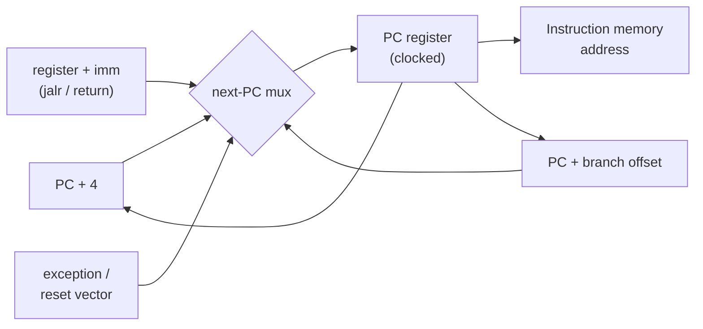

::: basics
### In plain words
The program counter (PC) is a register inside the CPU that holds the address of the next instruction to run. Each step, the CPU fetches the instruction at that address and updates the PC. Normally the PC just moves to the following instruction. Branches, function calls, interrupts and reset can load a different address instead.

### Picture it
Picture a bookmark in a long book of instructions. Normally you finish a page and move the bookmark to the next one. Sometimes the text says "go to page 64", so you move the bookmark there. Page numbers are the memory addresses. The PC is the CPU's "you are here" marker. If a stuck device stops, you can read the marker to see where it was.

### Words you need
- **Address**: the numbered location of something in memory.
- **Register**: a tiny, fast storage spot inside the CPU ([[q0886]]).
- **Branch / jump**: an instruction that sends the PC somewhere other than the next instruction.
- **Return address**: where a function call should come back to, saved before the jump.
- **Interrupt**: an outside event that makes the CPU jump to a handler routine ([[q0911]]).

### The simplest example
Suppose each instruction takes 4 bytes. The PC starts at 0. The CPU fetches the instruction at 0, and the PC becomes 4. It fetches at 4, and the PC becomes 8. Now the instruction at 8 says "jump to 64". The PC becomes 64, not 12, so the next fetch comes from address 64.

That is the whole idea: add the instruction size, unless something says go elsewhere. The rest of this page shows the hardware (a register, an adder and a selector), how calls and returns work, why pipelines complicate it, and how to debug a stuck system by reading the PC.
:::

::: testing
Whether you understand the PC as a **real register in the datapath** with a next-value multiplexer, not a vague idea of "where the program is". The interviewer is looking for:

1. Definition: the register holding the address of the next instruction to fetch (or of the current one, depending on convention).
2. How it updates: normally $PC\leftarrow PC+\text{instruction size}$; branches, jumps, calls, returns and exceptions load a new value.
3. How it is built: a clocked register, an incrementer, and a mux.
4. Practical facts: its reset value (reset vector), width, who can write it, PC-relative addressing, and why corrupting it crashes a system.
:::

::: why
The program counter is the single piece of state that defines "what the CPU is doing". Boot problems on a new board are often diagnosed by reading the PC through a debugger: is it at the reset vector, in a fault handler, or stuck in a loop? Understanding what changes it explains branches, function calls, interrupts, and pipeline hazards (a taken branch redirects the PC and flushes fetched instructions). It is also a favorite RTL interview question because the PC is a tiny, concrete block (register, adder, mux) you can design on a whiteboard in two minutes.
:::

::: concepts
- **Register / flip-flop**: stores the PC value, updated on each clock edge. See [[q0886]].
- **Instruction fetch**: the PC is the address sent to instruction memory. See [[q0905]].
- **Sequential vs non-sequential flow**: increment normally, load on control transfers. See [[q0904]].
- **Address space width**: the PC is as wide as the instruction address (e.g. 32 or 64 bits).
- **Interrupts and exceptions**: they save the PC and load a handler address. See [[q0911]].
- **ISA conventions**: byte-addressed, 4-byte instructions advance the PC by 4. See [[q0913]].
:::

::: answer
"The program counter is a register inside the CPU that holds the address of the next instruction to fetch. Each cycle the CPU sends the PC to instruction memory, fetches the instruction there, and meanwhile updates the PC so it points at the next one. Normally that's just PC plus the instruction size, so plus 4 for a 32-bit RISC instruction. If the instruction is a branch, jump, function call or return, the PC is loaded with a different address instead. Interrupts and exceptions also overwrite it with a handler address, after saving the old value so the program can resume.

Hardware-wise, it's a clocked register of address width, an adder that increments it, and a multiplexer that chooses between PC plus four, a branch target computed from the current PC plus an offset, a jump target from a register, or an exception vector. On reset it's forced to a fixed reset vector, which is where boot code lives.

So the program counter is basically the CPU's 'you are here' marker. If you want to know what a stuck embedded system is doing, you halt it and read the PC."
:::

::: technical
**Definition.** $PC$ is an $n$-bit register ($n$ = instruction address width, 32 or 64 typically) feeding the instruction-memory address. Convention differences: in RISC-V and MIPS-style pipelines, `pc` is the address of the instruction being fetched or executed; in classic 32-bit Arm state, reading PC in an instruction returns the address of the current instruction plus 8 (an artifact of the original 3-stage pipeline); in x86 the register is RIP.

**Next-PC logic.**
$$PC_{next}=\begin{cases}PC+4 & \text{sequential}\\ PC+\text{offset} & \text{taken PC-relative branch/jump}\\ R[rs1]+\text{imm} & \text{indirect jump/return}\\ \text{vector} & \text{reset, interrupt, exception}\end{cases}$$

**Reach of PC-relative branches (RISC-V examples).** Conditional branch: 12-bit immediate in units of 2 bytes gives $\pm4$ KiB. `jal`: 20-bit immediate (units of 2 bytes) gives $\pm1$ MiB. Longer jumps use `auipc`+`jalr` or an absolute address from a register. In A64 Arm, `B` has a 26-bit word offset: $\pm128$ MiB.

**Reset.** On reset the PC loads a fixed address: on Arm Cortex-M the core reads the initial stack pointer from address 0x0 and the reset-handler address from 0x4 of the vector table. Other cores jump to a hard-wired reset address (such as the boot ROM).

**Width and range.** A 32-bit PC addresses 4 GiB of byte-addressed space; current 64-bit implementations typically implement 48 or fewer bits of virtual address.

**Timing.** The PC register's next-value path (increment, branch-target adder, mux) must meet $T\ge t_{clk\to Q}+t_{mux}+t_{adder}+t_{su}$. In pipelines the redirect from a resolved branch back to the PC mux is a critical loop, so predictors speculate ahead ([[q0910]]).
:::

::: short
"The program counter is a register that holds the address of the next instruction to fetch. Normally it increments by the instruction size each cycle; branches, jumps, calls, returns, interrupts and exceptions load a new value into it instead. In hardware it's a clocked register, an incrementer and a mux selecting between PC+4, a branch target, a register jump target and an exception vector. On reset it's loaded with the reset vector, where boot code starts."
:::

::: long
"The program counter, or PC, is a register in the CPU whose value is the address of the next instruction to execute. It's what turns a pile of instructions in memory into a running program.

Every cycle of the fetch stage, the CPU puts the PC on the address bus of the instruction memory or cache, gets the instruction back, and updates the PC. In straight-line code the update is just PC plus the instruction length, so plus 4 on a 32-bit RISC machine. A branch instruction instead computes a target, usually the current PC plus a signed offset encoded in the instruction, and if the branch is taken that target is loaded into the PC. A jump or function call loads a new address too, and a call also saves the return address in a link register or on the stack. A return loads the saved address back. Interrupts and exceptions force the PC to a handler address from a vector table, after saving the old PC so execution can resume.

In hardware, it's a flip-flop register as wide as the address, an adder for the increment, and a multiplexer in front of the register that selects among PC plus four, the branch target, a register-based jump target, or the exception vector. The select lines come from the control unit and the branch comparison result. On reset the PC is forced to a fixed reset vector. For a Cortex-M that's read from address 4 of the vector table, and that's how boot code gets started.

Practically, the PC is the first thing I look at when debugging: halt the core over JTAG or SWD, read the PC, and you know whether you're in the main loop, a fault handler, or running off into nowhere. In a pipelined processor it also matters for performance, because a taken branch changes the PC and any instructions already fetched down the wrong path have to be thrown away."
:::

::: terms
- **Program counter (PC)**: register holding the address of the next (or current) instruction.
- **Instruction pointer (IP/RIP)**: x86 name for the same thing.
- **Next-PC mux**: selects among sequential, branch, jump and exception addresses.
- **PC-relative addressing**: target = PC + signed offset; makes code position-independent.
- **Link register**: stores the return address on a call (Arm LR, RISC-V ra).
- **Reset vector**: the fixed address the PC takes on reset.
- **Exception / interrupt vector**: address of the handler loaded into the PC. See [[q0911]].
- **Branch target buffer (BTB)**: cache predicting the next PC for branches at fetch time. See [[q0910]].
:::

::: exceptional
**An average answer** says "it holds the address of the next instruction and increments".

**An exceptional answer**:
- Draws the PC as register + adder + mux and says what controls the mux.
- Lists every way the PC changes (increment, branch, jump, call/return, interrupt, reset) and what is saved.
- Gives concrete numbers: +4 per instruction, branch reach, reset vector location, PC width.
- Notes ISA quirks (Arm PC+8 read value, RISC-V PC not directly writable as a register).
- Connects to pipelining (branch redirect, flushes) and debugging (read PC over JTAG).
- Mentions security/robustness: corrupted PC (stack overflow, return-address overwrite) is how many crashes and exploits happen.
:::

::: mistakes
- **"The PC points to the current instruction being executed."** Often it holds the address of the next instruction. In a pipeline several instructions are in flight, each with its own PC copy carried along.
- **Always adding 1.** For byte-addressed memory with 4-byte instructions the increment is 4 (2 or 4 with compressed instructions, variable on x86).
- **Forgetting how calls return.** A call saves the return address (link register or stack), and a return loads it back into the PC; the PC itself does not remember it.
- **Thinking the PC is only changed by branches.** Interrupts, exceptions and reset also change it.
- **Treating the PC as ordinary memory.** It's a dedicated register in the datapath, with a mux in front and the instruction-fetch address on its output.
- **Assuming PC width equals data width.** They are separate; an 8-bit MCU can have a 16-bit PC.
:::

::: deep
## What the PC is for

A stored program is a sequence of instruction words in memory. The CPU needs one piece of state that says "which instruction is next", and that piece of state is the PC. Everything else about control flow (loops, if statements, functions, interrupts) is, at the hardware level, ways of putting different values into the PC.


Figure: The PC datapath. The register feeds the instruction memory and two adders (the +4 incrementer and the branch-target adder). A mux, controlled by the decoder and the branch-condition result, selects what gets loaded on the next clock edge. Reset and exceptions come in through the same mux.

## The hardware in detail

The register is $n$ D flip-flops with a common clock. The incrementer is just an adder with a constant input; for +4 on a byte-addressed machine the two low bits are unchanged and an $(n-2)$-bit incrementer works. The branch target adder takes the (sign-extended, shifted) immediate from the instruction and the PC of the branch.

A reset input forces the register to the reset vector. For example, a synchronous reset value of 0x0000_0000 (some cores) or 0xFFFF_0000 or a boot ROM address (others). In Cortex-M cores the first two words of the vector table are the initial stack pointer and the reset handler address, so the core loads SP from 0x0 and PC from 0x4; the vector table can be relocated afterwards.

## Timing waveforms

```timing
{"signals":[
 {"name":"CLK","wave":"p......."},
 {"name":"PC","wave":"=.=.=.=.","data":["0x00","0x04","0x08","0x0C"]},
 {"name":"PC (branch at 0x08 taken to 0x40)","wave":"=.=.=.=.","data":["0x00","0x04","0x08","0x40"],"color":"accent"},
 {"name":"PCSrc (branch taken)","wave":"0...1.0."}
],"hscale":1.3}
```
Figure: Sequential flow (second row) steps +4 every cycle. In the third row the instruction at 0x08 is a taken branch; while PCSrc is high during the 0x08 cycle the next-PC mux picks the branch target and the PC jumps to 0x40 instead of 0x0C. (Idealized: a single-cycle machine where the decision is made in the same cycle; pipelined CPUs resolve it later.)

## Branch and jump encodings: how far can the PC reach?

A branch instruction has to fit its target into a few immediate bits, so reach is limited. For RISC-V the offset is in multiples of 2 bytes (to allow 16-bit compressed instructions):

| Instruction | Immediate bits | Reach |
|---|---|---|
| `beq`/`bne` (B-type) | 12 bits × 2 bytes | ±4 KiB ($2^{12}=4096$ bytes) |
| `jal` (J-type) | 20 bits × 2 bytes | ±1 MiB |
| `jalr` | register + 12-bit imm | any address in a register |
| `auipc` + `jalr` | 20 + 12 bits | ±2 GiB PC-relative |

In 64-bit Arm, `B` and `BL` have a 26-bit word offset, giving $\pm2^{25}\times4$ bytes $=\pm128$ MiB. PC-relative branches make code **position independent**: moving the whole program to a different base address doesn't change any offset. This is why shared libraries and bootloaders favor them.

## What happens at a call and a return

A call instruction (`jal ra, func` in RISC-V, `bl` in Arm) does two things at once: it writes PC+4 into the link register ($ra$ or $LR$) and loads the PC with the function address. At the end of the function, a return (`jalr x0, 0(ra)` or `bx lr`) loads the PC from the link register. For nested calls the callee saves the link register on the stack. The PC itself holds no memory of where it came from; the link register or stack does. If a buffer overflow overwrites the saved return address on the stack, the PC loads an attacker-chosen value, which is the basic mechanism of stack-smashing exploits and why return-address protection features exist.

## The PC in a pipeline

In a pipelined CPU several instructions are in flight, and each carries its own PC down the pipeline (needed to compute branch targets, return addresses on exceptions, and debug traces). The *fetch PC* is speculative: the front end keeps incrementing it (or following predictions) while earlier branches are still unresolved. When a branch resolves as mispredicted, the correct target is loaded into the PC and the wrongly fetched instructions are flushed ([[q0910]]).

```sim
{"id":"pipeline-lab","program":"branch","forwarding":true}
```
Figure: Step through the branch program. Watch which instructions enter the pipeline after a taken branch, and how many cycles are lost when they are flushed: that is the branch penalty, the cost of redirecting the PC late.

## The PC and exceptions

When an interrupt or exception occurs, hardware must save the PC of the interrupted instruction (the "return address"), then load the handler address into the PC. On Arm Cortex-M, the hardware automatically pushes eight registers (including the PC and xPSR) onto the stack and loads the handler address from the vector table, which takes 12 cycles on Cortex-M3 and M4 with zero-wait-state memory. On RISC-V the PC at the time is saved in the `mepc` CSR, and the handler address comes from `mtvec`. At the end, a return-from-interrupt instruction restores the PC. See [[q0911]].

## Variable-length instructions

On x86, instruction lengths range from 1 to 15 bytes, so the PC increment depends on decoding; the front end predecodes instruction boundaries. RISC-V's compressed extension mixes 16- and 32-bit instructions, so the PC increments by 2 or 4. In both cases a jump into the middle of an instruction decodes a different (usually garbage) instruction stream. RISC-V prevents that by requiring branch targets to be 2-byte aligned (4-byte without the C extension); x86 has no alignment rule, so it is the compiler's job never to jump mid-instruction.

## Debugging with the PC

When a board does nothing: halt the core with a debug probe, read the PC, and look it up in the map file. Typical findings: the PC is at the reset vector and never advances (clock or flash not responding), the PC sits in a `HardFault_Handler` loop (an exception, so read fault status registers), or the PC is at an address with no memory (bad vector table or stack corruption). Hardware trace units (ETM on Arm) record the PC flow without halting.

> [!INTERVIEW]
> If asked to "design a program counter", say: "n-bit register with synchronous reset to the reset vector, an adder for PC+4, a 4:1 mux for PC+4, branch target, jump target and exception vector, selected by control signals, and an enable so it can stall". Mention the stall enable: when the pipeline stalls, the PC must hold.
:::

::: applications
- **Boot and bring-up**: reading the PC over JTAG/SWD to see whether a board reached the reset handler.
- **Debuggers and tracing**: breakpoints compare the PC to set addresses; trace units log PC changes.
- **Function calls and interrupt handlers**: control transfers save and restore the PC.
- **Profiling**: sampling the PC periodically shows where time is spent.
- **Security hardening**: control-flow integrity checks that the PC loads only legitimate targets.
:::

::: assumptions
- **Fixed 4-byte instructions on a byte-addressed machine** unless stated. Compressed or CISC ISAs vary the increment.
- **Convention of "next vs current instruction"** differs by ISA and by pipeline stage; I state the convention when it matters.
- **Branch reach numbers are RISC-V and A64 specific**; other ISAs differ.
- **Cortex-M reset and exception timing** (reset vector at 0x4, 12-cycle interrupt entry) are for Cortex-M3/M4 with zero-wait-state memory and should be checked against the specific core's documentation.
- **Simplified single-cycle view** for the timing diagram; pipelines have the PC changing speculatively.
:::

::: followups
### Why does the PC increment by 4 and not 1?
Memory is byte-addressed and each instruction is 4 bytes in a fixed-width 32-bit ISA, so the next instruction is 4 addresses further on. With 16-bit compressed instructions it is 2 or 4; on x86 it depends on the decoded length.

### What happens to the PC on a function call and return?
The call writes the return address (PC+4) into the link register or the stack and loads the PC with the function address. The return loads the PC from the link register or from the stack. Nested calls save the link register on the stack first.

### What is the reset vector and why does it matter?
It's the fixed address the PC takes at reset (or the address of the handler stored in the first vector table entries on Cortex-M). It must point to valid, executable memory (boot ROM or flash), so a board with flash that isn't ready, or a wrong boot-pin configuration, dies immediately: the first fetch returns garbage.

### How would you detect a corrupted PC in hardware?
Watchdog timers catch a PC that wanders into a loop; MPU/MMU execute-never regions trap fetches from data memory; control-flow integrity or shadow stacks check return addresses; ECC on instruction memory catches bit flips. A debugger reading the PC shows addresses outside any code section.

### In a 5-stage pipeline, how many PC values exist at once?
One per instruction in flight: the fetch PC plus the PC values carried in the IF/ID, ID/EX and EX/MEM registers (needed for branch targets and exceptions). Five stages means up to five instructions, each with its own PC copy.
:::

::: interpretations
"What is the program counter?" is a definition question; interviewers sometimes want the hardware (register, adder, mux), sometimes the software view (the thing you see in the debugger and in the stack frame). The question after this one, [[q0904]], asks how its contents evolve, so keep the sequential/branch/interrupt distinction ready.
:::

::: references
- Patterson & Hennessy, *Computer Organization and Design* (RISC-V edition): the Processor chapter, the datapath with PC, adder and branch mux.
- Harris & Harris, *Digital Design and Computer Architecture*: Microarchitecture chapter, single-cycle datapath.
- RISC-V International, *The RISC-V Instruction Set Manual, Volume I: Unprivileged ISA*: control-transfer instructions and immediate encodings.
- Arm, *Cortex-M3/M4 Devices Generic User Guide* (Arm Ltd.): exception model and vector table.
:::

::: rubric
- Defines the PC as a register holding the address of the next instruction :: The core definition.
- States the default behavior (increment by instruction size) :: Shows sequential execution understanding.
- Lists changes: branch, jump, call/return, interrupt/exception, reset :: Completes the picture of control flow.
- Describes the hardware (register, adder, mux, reset value) :: Shows structural understanding.
- Mentions the reset vector and how boot starts :: Real-hardware relevance.
- Links to pipelining (speculative fetch, flush on taken branch) :: Demonstrates architecture depth.
- Mentions debugging or an example from practice :: Connects to experience.
:::

::: quiz
```json
[
 {"type":"mcq","level":"fundamental","q":"In a 32-bit fixed-width byte-addressed RISC machine, how does the PC normally change after each sequential instruction?","options":["PC = PC + 1","PC = PC + 2","PC = PC + 4","PC = PC + 8"],"answer":2,"explain":"Each instruction is 4 bytes and memory is byte-addressed, so the next sequential instruction is 4 bytes further on."},
 {"type":"mcq","level":"fundamental","q":"Which of these does NOT load a new value into the PC?","options":["A taken conditional branch","A function call","An ALU add instruction between two registers","A return from subroutine"],"answer":2,"explain":"A plain register add writes a register but leaves the PC on its sequential path. Branches, calls and returns redirect it."},
 {"type":"numeric","level":"intermediate","q":"A RISC-V `beq` stores a 12-bit immediate in units of 2 bytes, giving a signed 13-bit byte offset. What is its approximate reach in one direction?","answer":4,"tolerance":0.001,"unit":"KiB","explain":"A signed 13-bit byte offset spans $\\pm2^{12}$ bytes $=\\pm4096$ bytes, i.e. about ±4 KiB."},
 {"type":"numeric","level":"intermediate","q":"A 64-bit Arm `B` instruction has a 26-bit signed word offset. What is its reach in MiB (one direction)?","answer":128,"tolerance":0.001,"unit":"MiB","explain":"Offset range is $\\pm2^{25}$ words $=\\pm2^{25}\\times4$ bytes $=\\pm2^{27}$ bytes $=\\pm128$ MiB."},
 {"type":"multi","level":"intermediate","q":"Select all events that can change the PC to a non-sequential value.","options":["Interrupt","Reset","Reading a register","Return instruction"],"answer":[0,1,3],"explain":"Interrupts load a handler address, reset loads the reset vector, and a return loads the saved return address. Merely reading a register does not alter the PC."},
 {"type":"truefalse","level":"advanced","q":"In a pipelined CPU there is only one PC value in the whole machine at any time.","answer":false,"explain":"The fetch stage has a speculative fetch PC, and each instruction in later stages carries its own PC copy for branch-target calculation, exceptions and debug, so multiple PC values coexist."}
]
```
:::
