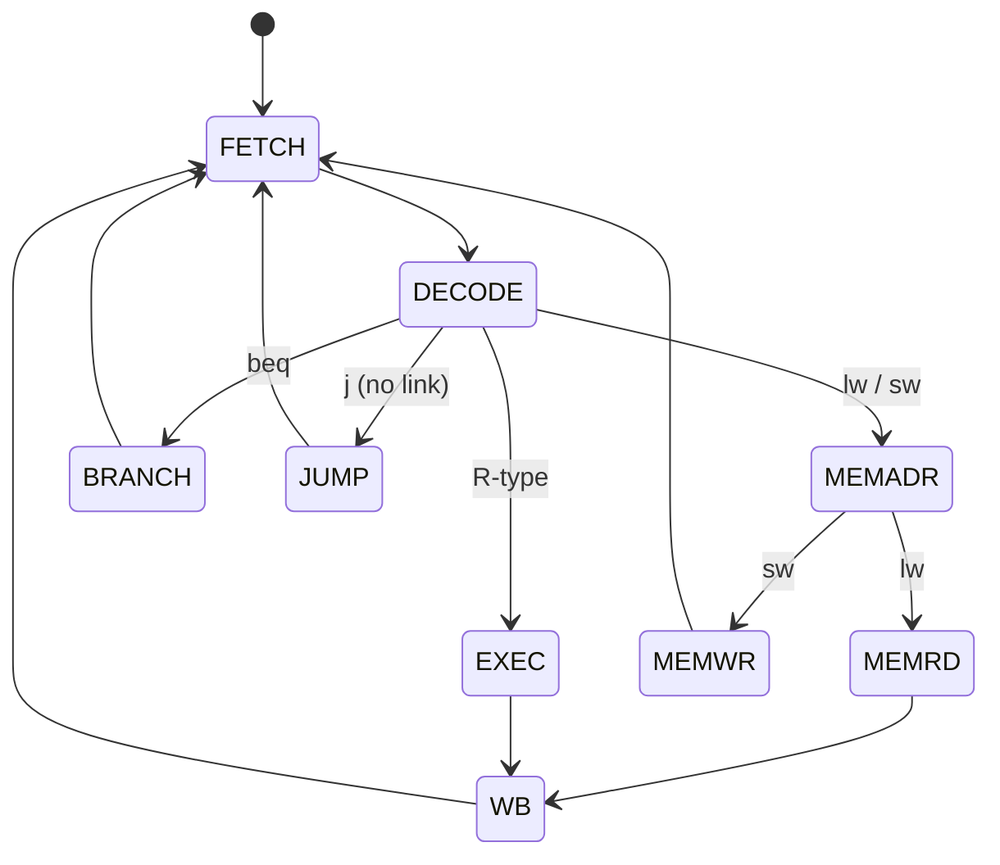

::: basics
### In plain words
The fetch-execute cycle is the loop a CPU repeats forever. It fetches the instruction at the address in the program counter, decodes what it asks for, executes it, and writes the result back. Then it starts again with the next instruction. Everything a CPU does is built from this loop.

### Picture it
Think of a clerk with a stack of request slips. The clerk takes the top slip (fetch), reads it to see what is wanted (decode), does the task (execute), and files the answer (writeback). Then the clerk takes the next slip. One real difference: some slips, like "go back to slip 4", change which slip is taken next.

### Words you need
- **Fetch**: reading the instruction from memory at the address in the program counter ([[q0903]]).
- **Decode**: working out which operation the instruction asks for and which registers it uses.
- **Execute**: doing the operation, usually in the ALU (for a memory instruction, working out the address).
- **Writeback**: storing the result into a register.
- **Instruction register**: holds the instruction while it is being worked on.

### The simplest example
Take "load word": `lw x5, 8(x2)`, meaning "read the memory at x2 plus 8 into x5". Say x2 = 0x2000 and the memory at 0x2008 holds 0xCAFE (numbers starting with 0x are written in hex, base 16).

Fetch: read the instruction at the PC, and the PC moves to the next one. Decode: read register x2. Execute: the ALU adds 0x2000 + 8 to get address 0x2008. Memory: read that address and get 0xCAFE. Writeback: put 0xCAFE into x5. A simple design spends one clock cycle on each step, so 5 cycles.

That is the whole idea. The rest of this page shows how many cycles other instructions take, why splitting work into steps is not faster by itself, and how pipelining overlaps the steps for different instructions.
:::

::: testing
Whether you can narrate the **instruction cycle as register transfers**, not just recite "fetch, decode, execute". The interviewer wants to hear what happens to the PC, the instruction register, memory, registers and ALU in each phase, how different instructions (an add, a load, a branch) differ, and how this simple loop is the starting point for multi-cycle control FSMs and pipelines. Bonus: the cycle counts, and why real CPUs overlap the phases.
:::

::: why
Everything in CPU design is an elaboration of this loop. A multi-cycle CPU's control unit is literally an FSM walking through these steps ([[q0896]]); a pipeline runs several instructions at different phases at once ([[q0906]]); interrupts hook in at instruction boundaries ([[q0911]]). Knowing the phases precisely lets you reason about latency (how many cycles for a load), bottlenecks (instruction fetch bandwidth) and debugging (why the PC shows what it shows). It's one of the most common warm-up questions in architecture interviews.
:::

::: concepts
- **Program counter and instruction register**: PC addresses memory; IR holds the fetched instruction. See [[q0903]].
- **Decode**: splitting the instruction into opcode and operand fields, reading registers.
- **ALU**: computes results or addresses. See [[q0902]].
- **Memory access and writeback**: loads/stores and committing results to registers.
- **Control unit as FSM**: sequences phases with a state per step. See [[q0896]].
- **Pipelining**: overlapping phases of different instructions. See [[q0909]].
:::

::: answer
"The fetch-execute cycle, or instruction cycle, is the loop a CPU runs forever. In the fetch phase, the CPU takes the address in the program counter, reads the instruction from memory, puts it in the instruction register, and increments the PC to point at the next instruction. In the decode phase, the control unit works out what the instruction is, from the opcode bits, and reads the source registers. In the execute phase, the ALU does the work: it adds, compares, or computes a memory address. If it's a load or store, there's a memory access phase, and finally the result is written back to the destination register. Then it loops back to fetch.

So for an add instruction the data goes registers to ALU and back to a register, for a load the ALU computes the address and then memory is read, and for a branch the ALU compares and the PC may be overwritten with the target. A simple multi-cycle CPU takes about three to five clock cycles per instruction, with the control FSM stepping through those states. Real CPUs pipeline it, so while one instruction is executing the next is being decoded and a third is being fetched, which gives close to one instruction per cycle."
:::

::: technical
**Register-transfer description (classic five-step, MIPS/RISC-V style).**
1. *Fetch (IF)*: $IR\leftarrow M[PC]$; $PC\leftarrow PC+4$.
2. *Decode / register read (ID)*: $A\leftarrow R[rs1]$, $B\leftarrow R[rs2]$; target address $PC_{old}+\text{imm}$ computed speculatively; immediate sign-extended; control signals derived from opcode/funct fields.
3. *Execute (EX)*:
 - R-type: $ALUOut\leftarrow A\ \text{op}\ B$.
 - Load/store: $ALUOut\leftarrow A+\text{imm}$ (address).
 - Branch: compare $A,B$ (ALU subtract or comparator); if taken, $PC\leftarrow\text{target}$.
4. *Memory (MEM)*: load: $MDR\leftarrow M[ALUOut]$; store: $M[ALUOut]\leftarrow B$.
5. *Writeback (WB)*: $R[rd]\leftarrow ALUOut$ or $MDR$.

**Cycles per instruction type (multi-cycle design).** R-type 4, load 5, store 4, branch 3, jump 3 (one common textbook allocation). With mix 25% lw, 10% sw, 45% R, 15% branch, 5% jump: $\text{CPI}=0.25(5)+0.10(4)+0.45(4)+0.15(3)+0.05(3)=4.05$.

**Latency numbers (illustrative).** With stage delays of 250 ps (fetch), 150 (decode), 200 (execute), 250 (memory), 100 (writeback): a single-cycle design needs about 900 ps for a load (fetch, read, ALU, memory, write plus overhead) so about 1.1 GHz and CPI 1. A multi-cycle design clocks at about $250+50=300$ ps and averages 4.05 cycles, i.e. about 1,215 ps per instruction: slower than single-cycle for this unbalanced example, though it needs only one memory and one ALU. A pipelined design also clocks at 300 ps but completes about one instruction per cycle, so about 300 ps per instruction in steady state: roughly $3\times$ faster than single-cycle.

**Interrupts** are checked at instruction boundaries (end of cycle or at writeback), so state is consistent ([[q0911]]).
:::

::: short
"It's the loop every CPU runs. Fetch: read the instruction at the address in the PC into the instruction register and increment the PC. Decode: work out what the instruction is and read its source registers. Execute: the ALU computes the result, a memory address, or a branch condition. Memory: loads and stores access memory. Writeback: write the result to a register. Then repeat. A simple CPU does this in 3 to 5 cycles per instruction; a pipeline overlaps the phases to finish about one per cycle."
:::

::: long
"The fetch-execute cycle is the basic loop that a CPU runs. It's usually split into fetch, decode, execute, memory access and writeback, though simple textbooks collapse it into just fetch, decode and execute.

In fetch, the CPU sends the program counter to memory, reads the instruction word into the instruction register, and updates the PC, usually plus four, so it points to the next instruction. In decode, the control unit looks at the opcode and function bits to figure out what operation it is, and the register file reads the source registers named in the instruction, while the immediate field is sign-extended. In execute, the ALU does the real work, and what that is depends on the instruction. For an add, it adds the two registers. For a load or store, it adds the base register and the offset to produce an address. For a branch, it compares two registers, and if the condition holds it overwrites the PC with the branch target.

Then, for loads and stores, there's a memory phase where the data memory is read or written using the address from the ALU. Finally in writeback the result, either the ALU output or the loaded data, goes into the destination register.

If you build this with a single clock for the whole thing, the clock has to be as slow as the slowest instruction, a load. A multi-cycle CPU instead does one phase per cycle, with the control unit as a finite state machine, so simple instructions take 3 or 4 cycles and a load takes 5. A pipelined CPU goes further and overlaps phases from different instructions, so while one instruction is in execute, the next one is in decode and another is in fetch. That gets throughput close to one instruction per cycle, though latency per instruction doesn't get shorter. Interrupts are taken at instruction boundaries so the machine state is always consistent."
:::

::: terms
- **Instruction cycle**: the repeated fetch, decode, execute (and memory/writeback) sequence.
- **Instruction register (IR)**: holds the fetched instruction while it is decoded and executed.
- **Opcode**: instruction field specifying the operation.
- **Register transfer (RTL notation)**: description of data movement such as $IR\leftarrow M[PC]$.
- **Multi-cycle CPU**: executes each instruction over several clock cycles, one step per cycle.
- **Single-cycle CPU**: executes each instruction in one (long) clock cycle.
- **Memory data register (MDR)**: holds data read from memory.
- **Writeback**: final step that writes the result to the register file.
- **Instruction boundary**: point between instructions where interrupts can be taken.
:::

::: exceptional
**An average answer** recites "fetch, decode, execute" and "repeat".

**An exceptional answer**:
- Writes each phase as a register transfer ($IR\leftarrow M[PC]$, $PC\leftarrow PC+4$, ...).
- Shows how add, load and branch differ in the execute/memory phases and in cycle count.
- Quantifies: CPI of a multi-cycle design, and the clock-period comparison with single-cycle and pipelined versions.
- Explains that the control unit for a multi-cycle CPU is an FSM, and that pipelining overlaps the phases.
- Notes when interrupts are taken, and that the loop is the same on every ISA, with differences in decode complexity (x86 vs RISC).
- Mentions that memory fetch is often the bottleneck, hence caches.
:::

::: mistakes
- **Ending with "execute" and forgetting writeback.** The result must reach the register file.
- **Saying fetch happens after execute.** The PC is incremented during fetch so the next fetch can start immediately; branches overwrite it later.
- **Claiming every instruction takes the same number of cycles.** In multi-cycle designs branches take 3, loads 5. In pipelines all pass through all stages but throughput is one per cycle.
- **Confusing the instruction register with the program counter.** The PC holds an address; the IR holds the instruction word itself.
- **Believing pipelining makes each instruction faster.** It improves throughput; individual latency is the same or slightly worse ([[q0909]]).
- **Treating decode as trivial.** On variable-length CISC ISAs, decode is a major block that also finds instruction boundaries.
:::

::: deep
## The loop as state transitions

A multi-cycle CPU controller is a finite state machine ([[q0896]]) in which each state performs one group of register transfers during one clock cycle:


Figure: Control FSM of a simple multi-cycle CPU. Every instruction starts with FETCH and DECODE, then branches into an instruction-specific path, and finally returns to FETCH. Loads go through FETCH, DECODE, MEMADR, MEMRD, WB (5 states = 5 cycles); R-type goes FETCH, DECODE, EXEC, WB (4); a branch goes FETCH, DECODE, BRANCH (3).

In hardware, this FSM has a state register and outputs (a Moore machine: control signals depend on state) such as `IRWrite`, `PCWrite`, `RegWrite`, `ALUOp`, `MemRead`. The same ALU is reused for PC+4, address computation, arithmetic and branch comparison, in different states. That sharing is the main benefit of multi-cycle: less hardware (one memory, one ALU) at the cost of more cycles.

## The phases as register transfers, for three instructions

Let the PC be 0x1000 and the instruction at that address be `lw x5, 8(x2)`, assuming $x2=0x2000$ and the word at 0x2008 is 0xCAFE:

| Cycle | Phase | Register transfers | Result |
|---|---|---|---|
| 1 | Fetch | $IR\leftarrow M[0x1000]$; $PC\leftarrow0x1004$ | IR = lw x5, 8(x2) |
| 2 | Decode | $A\leftarrow R[x2]=0x2000$; imm $=8$ | operands ready |
| 3 | Execute (address) | $ALUOut\leftarrow A+\text{imm}=0x2008$ | address 0x2008 |
| 4 | Memory | $MDR\leftarrow M[0x2008]=0xCAFE$ | data in MDR |
| 5 | Writeback | $R[x5]\leftarrow MDR$ | x5 = 0xCAFE |

For `add x5, x1, x2` cycles 3 and 4 become: $ALUOut\leftarrow A+B$ then writeback, giving 4 cycles. For `beq x1, x2, label`: cycle 3 is "compare A and B; if equal, $PC\leftarrow$ branch target", and the instruction ends: 3 cycles.

```timing
{"signals":[
 {"name":"CLK","wave":"p...."},
 {"name":"State","wave":"=====","data":["IF","ID","ADR","MEM","WB"]},
 {"name":"PC","wave":"==...","data":["0x1000","0x1004"]},
 {"name":"IRWrite","wave":"10000"},
 {"name":"MemRead","wave":"10010"},
 {"name":"RegWrite","wave":"00001"}
],"hscale":1.8}
```
Figure: A `lw` over five cycles in a multi-cycle CPU (IF = fetch, ID = decode, ADR = address calculation, MEM = data read, WB = writeback). Memory is read twice: once for the instruction in the first cycle (IRWrite asserted, PC becomes 0x1004 at the end of that cycle) and once for the data in the MEM cycle. RegWrite is asserted only in WB. (Simplified; real designs differ in exactly when each control signal is asserted.)

## How long does an instruction take: three designs compared

Using stage delays fetch 250 ps, decode 150, execute 200, memory 250, writeback 100 and 50 ps register overhead (illustrative, my own numbers, not from a specific chip):

| Design | Clock period | Cycles / instruction | Time per instruction |
|---|---|---|---|
| Single-cycle | 900 ps (slowest instruction: lw) | 1 | 900 ps |
| Multi-cycle | 300 ps (slowest step + overhead) | 4.05 avg for the mix above | 1,215 ps |
| Pipelined (5-stage) | 300 ps | about 1 (ideal) | about 300 ps |

Notice that the multi-cycle design here is *slower* than single-cycle: stage delays are unbalanced and each step pays register overhead, so breaking things up only pays when you can overlap the steps. Multi-cycle's benefit is hardware savings (one shared ALU and one memory) and the ability to give complex instructions more cycles, not speed. Pipelining is where the throughput gain comes from: about $900/300=3\times$ over single-cycle in this example, short of the ideal $5\times$ because of imbalance and overhead.

## Worked example: three instructions, cycle by cycle

Run `addi x1, x0, 5` then `lw x2, 0(x1)` then `beq x2, x0, done` (branch not taken because the loaded word is nonzero):

| Design | `addi` | `lw` | `beq` | Total cycles for the 3 instructions |
|---|---|---|---|---|
| Single-cycle | 1 | 1 | 1 | 3 cycles of 900 ps = 2,700 ps |
| Multi-cycle | 4 | 5 | 3 | 12 cycles of 300 ps = 3,600 ps |
| 5-stage pipeline | | | | $5+(3-1)=7$ cycles of 300 ps = 2,100 ps, if no stall |

Here the pipeline would not actually run clean: `lw` needs `x1` from `addi`, which the forwarding paths supply (ALU result to ALU input), and `beq` needs `x2` from the load, a load-use hazard that costs a one-cycle stall even with forwarding, so 8 cycles (2,400 ps) in practice. Counting cycles by hand like this is exactly what an interviewer means by "how long will it take to run" on a short assembly snippet ([[q0963]]).

## From the loop to a pipeline

If the five phases use different hardware (instruction memory, register file, ALU, data memory), then there's no reason a new instruction can't enter fetch while the previous one is in decode. The pipeline simply puts registers between the phases:

```sim
{"id":"pipeline-lab","program":"alu","forwarding":true}
```
Figure: Five ALU instructions (several depend on x2, but forwarding supplies it, so nothing stalls): each stage works on a different instruction every cycle, so one instruction completes per cycle after the pipeline fills. Count how many cycles N instructions take: $N+4$ for a 5-stage pipeline, versus $5N$ unpipelined. See [[q0906]] for hazards that break this ideal.

## Where the loop meets the outside world

- **Interrupts**: sampled at instruction boundaries; the pending interrupt replaces the next fetch with a vector fetch ([[q0911]]).
- **Memory latency**: the fetch step needs instructions fast. A cache miss stalls the whole front end for tens to hundreds of cycles, which is why instruction caches are mandatory in fast CPUs.
- **Variable-length ISAs**: x86 decode needs to find where each instruction ends before the next fetch address is known, so a large front end predecodes and queues micro-ops.
- **Microcode**: complex instructions (string moves) are executed as sequences of micro-ops in a microcode ROM, effectively an FSM inside the decode step.
- **Halting and debug**: a debugger halts the loop at an instruction boundary and can single-step: execute exactly one trip around the loop.

> [!INTERVIEW]
> Offer to "walk one instruction through" and do it on the whiteboard with register transfers for a load: it demonstrates the datapath, the control, and gives you a natural place to mention pipelining and cycle counts.
:::

::: applications
- **Single-stepping in a debugger**: executes one trip around the cycle and halts, showing PC and registers.
- **Microcoded CPUs and CISC front ends**: decode expands one instruction into several micro-operations.
- **Cycle-accurate simulators and FPGA soft cores**: implement the FSM or pipeline directly.
- **Performance counters**: counting instructions and cycles gives CPI for the workload.
- **Real-time firmware timing**: MCU datasheets list cycles per instruction (loads take more cycles than ALU ops) so that loops can be timed exactly.
:::

::: assumptions
- **RISC-V/MIPS-style load/store ISA** with fixed 32-bit instructions for the cycle counts; CISC instructions take variable cycles.
- **Textbook cycle allocation** (R 4, lw 5, sw 4, beq 3, jump 3); other designs distribute differently.
- **Stage delays are illustrative** and chosen to show the effect of imbalance; they are not measured data.
- **Memory is assumed to respond in one cycle.** With caches and misses real fetch and memory stages take variable time.
- **In-order, single-core, no interrupts during the walkthrough.**
:::

::: followups
### How does the fetch-execute cycle differ for a branch instruction?
The execute phase compares the registers and, if the condition is true, writes the branch target into the PC; there's no memory or writeback phase. So in a multi-cycle design it takes 3 cycles. In a pipeline the branch resolves in EX or ID and, if taken, the instructions already fetched behind it are flushed.

### Why is the PC incremented during fetch?
So that the next instruction address is ready immediately, and so that the incremented value (PC+4) is available as the return address for a call and as the base for PC-relative branch targets. A branch just overwrites it later in the instruction.

### What is the average CPI of a multi-cycle CPU with 25% loads (5 cycles), 10% stores (4), 45% ALU ops (4), 15% branches (3), 5% jumps (3)?
$0.25\times5+0.10\times4+0.45\times4+0.15\times3+0.05\times3=4.05$ cycles per instruction.

### Where can an interrupt be taken in this cycle?
At an instruction boundary: after writeback and before the next fetch. The control unit checks for pending interrupts, and if one is pending it saves the PC and loads the handler address instead of fetching the next instruction.

### What changes in a CPU with caches when fetch misses in the instruction cache?
The fetch state stalls until the line arrives from L2 or DRAM: tens to hundreds of cycles. The control FSM waits (a stall in a pipeline); nothing downstream proceeds. Prefetching and larger instruction caches keep the front end fed, which is why fetch bandwidth is a major design constraint.
:::

::: interpretations
"Fetch/execute cycle" is sometimes taught as three phases (fetch, decode, execute) and sometimes as five (adding memory and writeback). I give the five-stage version and note the three-phase simplification. The overlapping version is the five-stage pipeline in [[q0906]].
:::

::: references
- Patterson & Hennessy, *Computer Organization and Design* (RISC-V edition): The Processor chapter (single-cycle datapath, multi-cycle control FSM, pipelining).
- Harris & Harris, *Digital Design and Computer Architecture*: Microarchitecture chapter (single-cycle, multicycle and pipelined processors, with cycle counts).
- Hennessy & Patterson, *Computer Architecture: A Quantitative Approach*: Appendix C (pipelining basics).
:::

::: rubric
- Describes fetch: PC to memory, instruction to IR, PC incremented :: The start of every cycle.
- Describes decode: opcode interpreted, registers read :: Shows control and datapath understanding.
- Describes execute depending on instruction type (ALU op, address, branch) :: Shows you know instruction types differ.
- Mentions memory access and writeback :: Completes the five phases.
- Uses register-transfer notation or a concrete example :: Demonstrates precision.
- Mentions cycle counts or CPI and the control FSM :: Connects to multi-cycle design.
- Relates to pipelining and interrupts at instruction boundaries :: Shows the broader picture.
:::

::: quiz
```json
[
 {"type":"mcq","level":"fundamental","q":"Which register holds the instruction word currently being decoded?","options":["Program counter","Instruction register","Memory data register","Stack pointer"],"answer":1,"explain":"The instruction register (IR) captures the fetched instruction. The PC holds an address, not an instruction."},
 {"type":"mcq","level":"fundamental","q":"In which phase does a load instruction read data from memory?","options":["Fetch","Decode","Memory access","Writeback"],"answer":2,"explain":"Fetch reads the instruction, but the data load happens in the memory-access phase using the address computed by the ALU; the data is written to the register in writeback."},
 {"type":"numeric","level":"intermediate","q":"Multi-cycle CPU: 25% lw (5 cycles), 10% sw (4), 45% R-type (4), 15% beq (3), 5% jump (3). What is the average CPI?","answer":4.05,"tolerance":0.01,"unit":"","explain":"$0.25\\times5+0.1\\times4+0.45\\times4+0.15\\times3+0.05\\times3 = 1.25+0.4+1.8+0.45+0.15 = 4.05$."},
 {"type":"numeric","level":"intermediate","q":"A 5-stage ideal pipeline executes 100 independent instructions. How many cycles from the first fetch until the last writeback?","answer":104,"tolerance":0.001,"unit":"cycles","explain":"The pipeline takes 5 cycles to fill for the first instruction and then completes one per cycle: $5+(100-1)=104$ cycles."},
 {"type":"truefalse","level":"intermediate","q":"A multi-cycle CPU is always faster than a single-cycle CPU because it uses a shorter clock period.","answer":false,"explain":"Time per instruction is CPI times clock period. With unbalanced stage delays and register overhead, a multi-cycle design (e.g. CPI 4.05 at 300 ps = 1,215 ps) can be slower than single-cycle (900 ps). Its benefit is sharing hardware, not speed; pipelining is what gives the speed-up."},
 {"type":"multi","level":"advanced","q":"Select all that happen during the fetch phase of a typical RISC CPU.","options":["The PC is sent to instruction memory","The instruction is written to the IR","The ALU computes the load address","The PC is incremented to PC+4"],"answer":[0,1,3],"explain":"Fetch reads M[PC] into the IR and computes PC+4. Address calculation for loads happens in the execute phase."}
]
```
:::
