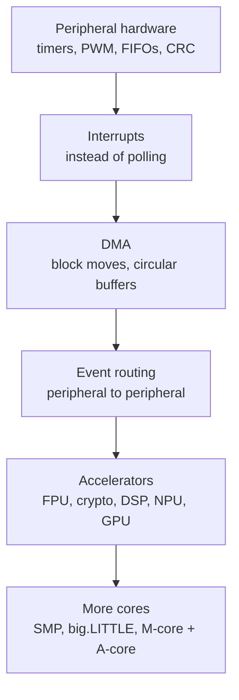

::: testing
Whether you can reason about **where work should run** in a system and what each choice costs. The interviewer wants a menu of offload mechanisms (DMA, peripheral hardware like timers/UART FIFOs/PWM, coprocessors and accelerators, GPU/DSP, extra cores, interrupts instead of polling) and a clear view of the trade-offs: area, power, flexibility, bandwidth contention, synchronization, latency/overhead, and software complexity. A strong answer also includes a rule for when offloading is worth it, ideally with a number such as a break-even task size or an Amdahl's-law estimate.
:::

::: why
Real embedded and SoC design is largely the art of keeping the CPU asleep or free for the work only it can do. A microcontroller bit-banging a serial stream or copying ADC samples in a loop wastes cycles and energy that a DMA channel or peripheral does for almost nothing. At SoC scale, moving video decode, image processing and ML from the CPU to dedicated blocks is the difference between a phone lasting a day or an afternoon ([[q0899]]). Interviewers ask this to see whether you think at the system level: bandwidth, concurrency, and energy, not just clock speed.
:::

::: concepts
- **DMA (direct memory access)**: a controller that moves data between peripherals and memory without CPU instructions.
- **Interrupts vs polling**: let hardware signal events instead of the CPU checking. See [[q0911]].
- **Peripheral hardware**: timers, PWM, UART/SPI FIFOs, CRC engines take over repetitive work.
- **Accelerators and coprocessors**: FPU, crypto, DSP, GPU, NPU for specific workloads. See [[q0926]].
- **Parallelism and Amdahl's law**: speed-up is limited by the serial fraction. See [[q0908]].
- **Shared bus and memory bandwidth**: offloaded agents compete for the same memory.
:::

::: answer
"There are a few layers of offload, from cheap to heavy. The simplest is using peripheral hardware properly: timers generate PWM and measure pulses, UARTs and SPI controllers have FIFOs, and ADCs trigger from timers, so the CPU isn't toggling pins or watching a clock. Next is interrupts instead of polling, so the CPU can do other work or sleep until something happens. Then DMA: a DMA controller moves blocks between a peripheral and memory on its own, and interrupts the CPU only when a buffer is full. For compute, you can use coprocessors and accelerators: a hardware floating-point unit, a crypto engine, a DSP, a GPU for parallel graphics or ML, or a second core.

What can you do in parallel? Independent things: DMA transfers while the CPU computes on another buffer, which is double buffering; peripherals running autonomously; multiple cores on independent threads; accelerators on separate frames.

The trade-offs are real. Hardware costs area and power and is less flexible than software. Everything shares the memory bus, so a DMA stream or GPU can slow the CPU through contention. There's setup and synchronization overhead, so offloading a tiny task can be slower than just doing it. You need cache coherence or explicit flushes, plus more complex software and verification. And Amdahl's law says that offloading a part of the program only helps up to that part's share of the runtime."
:::

::: technical
**Offload mechanisms.**
1. *Autonomous peripherals*: timer-generated PWM/capture, ADC triggered by timer, SPI/UART with FIFOs, hardware CRC, comparators, event/trigger routing between peripherals (peripheral-to-peripheral without CPU).
2. *Interrupts*: replace polling; the CPU sleeps (WFI) between events.
3. *DMA*: descriptor- or register-programmed engine; types: peripheral-to-memory, memory-to-peripheral, memory-to-memory; transfers in bursts, circular buffers, half/full-transfer interrupts.
4. *Coprocessors/accelerators*: FPU, crypto (AES/SHA), CORDIC, DSP MAC engine, GPU, NPU, video codec, ISP.
5. *More cores / threads*: symmetric (SMP) or asymmetric (big.LITTLE, an M-class core beside an A-class core).

**Quantitative examples.**
- UART at 115,200 baud, 8N1: 11,520 bytes/s. If each receive interrupt costs 200 cycles at 48 MHz, the CPU load is $11520\times200/48\text{e}6=4.8\%$. With DMA and an interrupt every 256-byte block (45 interrupts/s, say 500 cycles each) the load is $45\times500/48\text{e}6=0.047\%$, about 100 times lower.
- SPI at 10 MHz moving 4 KB takes $4096\times8/10\text{e}6=3.28$ ms. A CPU polling loop is stuck for that whole time; with DMA the CPU can sleep or compute.
- Amdahl: if 90% of runtime is offloadable and the accelerator is 20x faster, speed-up $=1/(0.1+0.9/20)=6.9$. Even an infinitely fast accelerator caps at $10\times$.
- **Break-even size.** If the offload has fixed overhead $o$ (setup, cache maintenance, interrupt, wakeup) and the accelerator is $k$ times faster, offloading wins only for CPU time $t > o\,k/(k-1)$. With $o=50$ µs and $k=20$: $t>52.6$ µs.

**Bandwidth.** A DMA stream of 10 MB/s on a 400 MB/s shared bus uses 2.5% of the bandwidth; a GPU or camera can take most of it, so QoS/arbitration and caches matter.

**Coherence.** Cacheable buffers shared with a DMA engine need cache clean/invalidate (or hardware-coherent interconnect) so the CPU and DMA see the same data.
:::

::: short
"I'd push repetitive or time-critical work to hardware: peripherals like timers, PWM and serial FIFOs, interrupts rather than polling, DMA to move blocks without the CPU, and accelerators or extra cores for heavy compute. In parallel you can run DMA and peripherals while the CPU computes, using double buffering. The trade-offs are area and power for the hardware, less flexibility, shared-bus contention, setup and synchronization overhead, cache coherence and software complexity. Offload only pays when the task is big enough to beat that overhead, and Amdahl's law caps the gain."
:::

::: long
"I think about offloading as a ladder from cheap to heavy.

The first rung is just using the peripherals well. A timer can generate PWM or capture an edge with no CPU involvement; a UART or SPI block has a FIFO, so the CPU handles a few bytes at once instead of every bit; an ADC can be triggered by a timer, and many MCUs can route events from one peripheral to another without software. The second rung is interrupts instead of polling, so the CPU can sleep and wake only on events.

The third is DMA. A DMA controller moves data between a peripheral and memory, or memory to memory, by itself. For example, an ADC sampling at 100 kHz with DMA into a circular buffer, with an interrupt on half-full and full, lets the CPU process one half while the DMA fills the other, the double-buffering pattern. The math is persuasive: a UART at 115,200 baud with an interrupt per byte costs about 5% of a 48 MHz core, and with DMA and block interrupts it's under 0.1%.

Beyond that you offload computation to coprocessors and accelerators: a floating-point unit, a crypto block, a DSP, a GPU, an NPU, or another core. Things that can run in parallel are the independent ones: data movement with computation, separate frames or threads, and autonomous peripherals.

The trade-offs are significant. Hardware costs silicon area and static power, and it's inflexible compared to firmware. Offloaded agents share the memory bus, so a heavy DMA or GPU stream can slow the CPU through contention. There's overhead to set up and synchronize, so for small tasks the overhead beats the gain; there's a break-even size. You have to handle cache coherence, since the CPU's cache and the DMA's view of memory can differ. Software and verification get harder with concurrency. And Amdahl's law caps the benefit: if only 90% of the time is offloadable, the best you can do is 10 times, no matter how fast the accelerator."
:::

::: terms
- **DMA controller**: hardware engine that transfers data over the bus without CPU involvement.
- **Double buffering (ping-pong)**: one buffer being filled by hardware while the CPU processes the other.
- **Peripheral event/trigger routing**: peripherals trigger each other (e.g. timer starts ADC) without software.
- **Accelerator / coprocessor**: dedicated unit for a specific class of computation.
- **Amdahl's law**: speed-up limited by the non-accelerated fraction: $S=1/((1-p)+p/s)$.
- **Bus contention / arbitration**: multiple masters competing for shared interconnect and memory.
- **Cache coherence**: consistency of data between CPU caches and other agents.
- **Offload overhead**: setup, data movement, synchronization and wake-up cost.
- **Polling vs interrupt-driven I/O**: CPU checks status repeatedly vs hardware signals events.
:::

::: exceptional
**An average answer** says "use DMA and a GPU".

**An exceptional answer**:
- Organizes mechanisms by cost and effect (peripherals, interrupts, DMA, accelerators, cores).
- Gives numbers: UART interrupt load vs DMA, SPI transfer time, break-even task size, Amdahl cap.
- Names parallel patterns (double buffering, pipelined DMA, peripheral chaining) and what must be independent.
- Discusses trade-offs concretely: area/power, bus contention and QoS, coherence, synchronization latency, determinism, debugging.
- Notes that offloading can also be about energy and real-time determinism, not only speed.
- Knows when not to offload (tiny tasks, rarely used features, data-dependent control flow).
:::

::: mistakes
- **Treating offload as always faster.** Overhead can exceed the savings for small tasks.
- **Ignoring shared bandwidth.** A DMA engine or GPU can starve the CPU of memory bandwidth and cause unexplained slowdowns.
- **Forgetting cache coherence.** The CPU reads stale data from its cache or DMA reads stale data from memory unless buffers are cleaned/invalidated or placed in non-cacheable memory.
- **Believing a faster accelerator fixes everything.** Amdahl's law: the serial part dominates eventually.
- **Using DMA without handling errors and overruns.** A missed interrupt or full buffer can lose data silently.
- **Equating multicore with free speed-up.** Software must be parallel, and synchronization and shared resources limit scaling.
:::

::: deep
## The offload ladder

Think about every task in terms of "who is cheapest to do this?" In order of increasing hardware investment:


Figure: Each step costs more silicon and design effort but removes more work from the main CPU. Most embedded designs should start at the top; a phone SoC uses all of them.

## Interrupts instead of polling

Polling a status flag in a loop keeps the CPU busy and burns energy. An interrupt lets the core sleep with `WFI` until the event. But interrupts have a per-event cost: entry/exit, pushing registers, and cache effects. Each Cortex-M interrupt costs about 12 cycles to enter with zero-wait-state memory, plus handler body and exit. At high event rates that cost dominates, which motivates DMA.

```sim
{"id":"interrupt-lab","nesting":false}
```
Figure: Add interrupt sources and lengthen the ISRs: when the handlers consume most of the time, the main loop starves and events are missed. That is the situation DMA and hardware FIFOs are designed to avoid.

## DMA in practice

A DMA channel is configured with a source, destination, count, increment modes, and trigger (a peripheral request line). Once started, it performs bus transfers on its own, stealing bus cycles from the CPU. Key patterns:

- **Peripheral to memory (circular)**: an ADC at 100 kHz writes into a 1,024-sample buffer. The DMA raises half-transfer and transfer-complete interrupts every 512 samples (about 5 ms), so the CPU services 200 interrupts per second instead of 100,000.
- **Memory to peripheral**: streaming audio samples to an I2S/DAC, or pixel data to an LCD interface.
- **Memory to memory**: block copy or buffer clearing while the CPU computes.
- **Scatter-gather**: descriptor chains let one transfer cover non-contiguous buffers, used by Ethernet and storage controllers.

CPU load example: UART at 115,200 baud 8N1 is $115200/10=11{,}520$ bytes/s. At 200 cycles per byte interrupt on a 48 MHz core that's 4.8% load; with DMA moving data and a 256-byte block interrupt (45 per second at 500 cycles each) it falls to 0.047%.

**Double buffering** is the canonical parallel pattern: while the DMA fills buffer A, the CPU processes buffer B; at the half-transfer interrupt they swap. The constraint is real-time: processing time per buffer must be less than the buffer fill time, otherwise samples are overwritten.

## When is offloading worth it? A break-even model

Suppose a task takes $t$ on the CPU. Offloading costs a fixed overhead $o$ (setup, flushing caches, signalling, waking the accelerator) plus $t/k$ on an accelerator that is $k$ times faster. Offload wins if $o+t/k<t$, i.e. $t>\frac{ok}{k-1}$.

```plot
{"title":"CPU vs offload time (overhead 50 µs, accelerator 20x faster)","x":{"label":"Task time on CPU","unit":"µs","min":0,"max":200},"y":{"label":"Completion time","unit":"µs","min":0,"max":200},
 "vars":{"o":50,"k":20},
 "series":[{"label":"Run on CPU: t","fn":"x"},{"label":"Offload: o + t/k","fn":"o+x/k","color":"green"}],
 "vlines":[{"at":"o*k/(k-1)","label":"break-even 52.6 µs","color":"orange"}]}
```
Figure: For short tasks the fixed overhead dominates and the CPU is faster. Beyond about 53 µs the accelerator wins and the gap grows. Batching many small tasks into one offload call amortizes the overhead.

**Amdahl's law** limits the end-to-end gain. If 90% of the runtime is accelerated 20x: $S=1/(0.1+0.9/20)=6.9$. If only half is accelerated: $S=1/(0.5+0.5/20)=1.9$. Accelerating a phase that is 5% of the runtime by any factor gains at most 5%, so profile before building hardware.

## What can run in parallel, and what can't

**Independent**: DMA with CPU compute (different data), several DMA channels (subject to bus bandwidth), peripherals with each other, frames in an image pipeline (ISP on frame N+1, NPU on frame N, CPU on N-1), threads on different cores without shared data.

**Dependent**: anything where a result feeds the next step: a control loop that needs the ADC result before computing PWM, a decode step that needs the previous frame. Latency matters here, so adding an accelerator with a 50 µs overhead to a 100 µs control loop budget is a bad idea.

## Trade-offs in detail

| Concern | Effect |
|---|---|
| Area and cost | A dedicated block takes silicon; if used rarely, firmware may be better value |
| Power | Fixed-function blocks are far more energy-efficient per operation than the CPU, but add leakage when powered |
| Flexibility | Hardware is fixed; algorithm changes need a new chip (or a programmable accelerator, which is less efficient) |
| Bandwidth | Offloaded agents share the interconnect and DRAM; priority and QoS settings matter |
| Latency/determinism | Setup and arbitration add latency, but hardware timing is deterministic versus software jitter |
| Coherence | Cache clean/invalidate (or coherent interconnect) needed for shared buffers |
| Complexity | More concurrency means more bugs: races, missed events, buffer overruns |
| Verification and debug | Harder to trace; need logic analysis of bus masters and trace tools |

## Real-hardware gotchas

- **DMA and caches**: on a Cortex-M7 or Cortex-A system with a data cache, the DMA writes to RAM, and the CPU's cache may still hold old data. Either place DMA buffers in non-cacheable memory or call a cache invalidate after receive and a clean before transmit. Cache line alignment of the buffer matters, or neighboring variables get corrupted.
- **Bus arbitration**: with a shared AHB/AXI bus, a high-priority DMA burst can stall the CPU for tens of cycles. Real-time systems sometimes cap burst size or use separate memories (tightly coupled memory) for the CPU.
- **Peripheral chaining**: timer triggers ADC triggers DMA triggers a compare: the entire acquisition pipeline runs with deterministic timing and zero CPU involvement. It is the standard way to get jitter-free sampling on MCUs.
- **Power**: DMA lets the CPU stay asleep: for a sensor logger, the CPU wakes once per buffer and sleeps the rest, which can lower average current by an order of magnitude compared with polling.

> [!INTERVIEW]
> Close with a rule of thumb: "I'd profile first; offload what's repetitive, big enough to beat the overhead, or time-critical, and I'd check the bus and cache implications before trusting the speed-up."
:::

::: applications
- **Sensor data logging**: ADC or I2C/SPI sensors streamed by DMA into buffers while the CPU sleeps.
- **Motor control**: timer-generated PWM with ADC sampling synchronized to the PWM, using hardware triggers.
- **Audio playback**: I2S with DMA double buffering to keep a glitch-free stream.
- **Networking**: Ethernet MAC with DMA descriptor rings, checksum and segmentation offload.
- **Camera and ML pipelines**: ISP, video encoder and NPU working on successive frames while the CPU handles the app.
- **Cryptography**: hardware AES/SHA engines for secure boot and TLS offload.
:::

::: assumptions
- **Typical microcontroller or SoC with shared bus and memory** (Cortex-M or A class). Numbers (200-cycle ISR, 48 MHz) are illustrative.
- **Overhead and speed-up factors in the break-even model** are examples, not measurements of any specific chip.
- **Independence assumption**: parallelism requires independent data. Dependent chains do not parallelize.
- **Software parallelism** (threads) is treated as offload to another core, ignoring OS overhead.
- **Interrupt cost** quoted for a Cortex-M3/M4 class core (about 12 cycles to enter); other architectures differ.
:::

::: followups
### What's the downside of DMA?
Setup and synchronization overhead, bus contention with the CPU, cache-coherence management, and fixed behavior that's harder to debug. For tiny transfers, programmed I/O is simpler and can be faster.

### How would you design continuous ADC sampling at 100 kHz with a 48 MHz MCU?
Timer-triggered ADC (for jitter-free sampling) with DMA into a circular buffer, half/full interrupts, and processing of one half while the other fills. Check the processing time per half-buffer is below the fill time (5.12 ms for 512 samples) and that the DMA's bus bandwidth is a negligible fraction.

### Why can adding a hardware accelerator make a program slower?
If the task is small, setup, data movement and synchronization exceed the compute saving (break-even about 53 µs in the example). Also data may need copying into accelerator memory, or caches flushed, and the accelerator may contend for bandwidth.

### Which tasks can't be offloaded effectively?
Control-flow heavy, data-dependent or latency-critical code with small payloads, and tasks where each step depends on the previous result; and anything where the serial portion dominates (Amdahl).

### Your CPU is at 90% load. What do you check before buying a faster chip?
Profile: where is the time going? Look for polling loops, per-byte interrupts, memcpy or checksum work, and floating-point emulation. Move data movement to DMA, enable peripheral FIFOs and hardware CRC/FPU, reduce interrupt rates and optimize hot loops. A 5% task offloaded gives at most 5%, so target the dominant part.
:::

::: interpretations
The question has three parts: how to offload, what can run in parallel, and trade-offs. "Offload tasks from the CPU" most naturally means DMA, peripherals and accelerators, but in an SoC interview it can also mean moving work to other cores, a GPU or DSP; I cover both. Related: [[q0908]] (throughput of a CPU) and [[q0926]] (SoC).
:::

::: references
- Hennessy & Patterson, *Computer Architecture: A Quantitative Approach*: Amdahl's law and the chapters on data-level parallelism and domain-specific architectures.
- Arm, *Cortex-M3/M4 Devices Generic User Guide*: exception entry timing and the NVIC.
- Microcontroller reference manuals (for example STMicroelectronics STM32 or NXP LPC DMA chapters): DMA controller configuration, circular mode and half-transfer interrupts.
- Yiu, *The Definitive Guide to Arm Cortex-M3 and Cortex-M4 Processors*: interrupts and low-power features.
:::

::: rubric
- Lists offload mechanisms: peripherals, interrupts, DMA, accelerators/cores :: Shows breadth of options.
- Explains DMA and double buffering as the main parallel pattern :: The most common embedded answer.
- Names what can run in parallel (independent data/threads/frames) :: Answers the second part directly.
- Discusses trade-offs: area/power, flexibility, bandwidth contention, coherence, overhead, complexity :: The third part of the question.
- Quantifies with Amdahl or break-even or CPU load numbers :: Shows engineering judgement.
- Mentions cache coherence and bus arbitration pitfalls :: Real hardware experience.
- States a decision rule (profile, offload large/repetitive/time-critical work) :: Demonstrates design thinking.
:::

::: quiz
```json
[
 {"type":"mcq","level":"fundamental","q":"What does a DMA controller do?","options":["Executes arithmetic instructions faster than the CPU","Transfers data between memory and peripherals without CPU instructions for each transfer","Predicts branches","Translates virtual addresses"],"answer":1,"explain":"DMA moves blocks of data over the bus by itself, freeing the CPU, which only handles setup and a completion interrupt."},
 {"type":"numeric","level":"intermediate","q":"A UART at 115,200 baud (8N1) interrupts per byte, each ISR costs 200 cycles on a 48 MHz core. What percentage of the CPU is used (bytes/s = 11,520)?","answer":4.8,"tolerance":0.02,"unit":"%","explain":"$11520\\times200/48\\times10^6 = 0.048$, i.e. 4.8%."},
 {"type":"numeric","level":"intermediate","q":"By Amdahl's law, what is the overall speed-up if 90% of a program is offloaded to an accelerator that is 20 times faster?","answer":6.9,"tolerance":0.02,"unit":"x","explain":"$S=1/((1-0.9)+0.9/20)=1/(0.1+0.045)=6.9$."},
 {"type":"numeric","level":"intermediate","q":"Offload overhead is 50 µs and the accelerator is 20x faster. Above what CPU task time (in µs) does offloading win? ($t > ok/(k-1)$)","answer":52.6,"tolerance":0.02,"unit":"µs","explain":"$t>50\\times20/19=52.6$ µs. For shorter tasks the overhead exceeds the time saved."},
 {"type":"multi","level":"intermediate","q":"Select all hazards or costs that come with using DMA on a system with a data cache.","options":["Stale cache data if buffers aren't invalidated or cleaned","Bus contention with the CPU","Needing the CPU to copy every byte","Alignment problems if buffers share cache lines with other data"],"answer":[0,1,3],"explain":"DMA bypasses the CPU cache so coherence must be managed, it shares the bus and may share cache lines with unrelated variables. Needing the CPU to copy every byte is what DMA avoids."},
 {"type":"truefalse","level":"advanced","q":"Offloading a task that is 5% of total runtime to an infinitely fast accelerator can improve total performance by at most about 5.3%.","answer":true,"explain":"Amdahl: $S=1/(0.95+0)=1.0526$, i.e. a 5.3% speed-up at best. Profiling first avoids wasting effort on small fractions."}
]
```
:::
