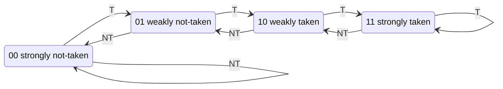

::: basics
### In plain words
A branch is an instruction that may jump somewhere else instead of continuing. A modern CPU works on several instructions at once, like an assembly line (a pipeline), so it must keep fetching new ones before the branch's outcome is known, so the CPU makes a guess based on past behavior. A right guess costs nothing. A wrong guess throws away the work done on the wrong path.

### Picture it
Imagine a driver who has turned left at the same fork every morning. Today the driver keeps going left without checking the map. Usually that saves time. On the rare day the road goes right, the driver must turn around and loses time. A predictor works like that driver, learning from history.

### Words you need
- **Taken / not taken**: a branch is taken when it jumps and not taken when execution continues to the next instruction.
- **Misprediction penalty**: cycles lost when the guess is wrong, roughly how many stages deep the branch is resolved ([[q0906]]).
- **History**: a record of how a branch behaved before, kept in a small table.
- **2-bit counter**: a counter from 0 to 3 that predicts "taken" when 2 or 3. It takes two wrong outcomes in a row to change the prediction.

### The simplest example
A loop runs 10 times. Its branch at the end is taken 9 times, then not taken once, and then the loop starts again. A predictor that just repeats the last outcome is wrong at the exit and wrong again at the next visit's first pass. That is 2 misses in 10, or 80% accurate. A 2-bit counter stays on "taken" after the single not-taken exit, so it misses only once. That is 90% accurate.

That is the whole idea: guess from history, and a bit of memory beats none. The rest of this page puts a number on the cost, shows predictors that spot patterns and correlations between branches, and covers predicting the jump target and recovering from a miss.
:::

::: testing
Whether you can explain **why** a pipelined CPU must guess and **how** the guess is made. The interviewer wants to hear:

1. The problem: a branch's outcome and target are not known until late in the pipeline, but fetch must continue every cycle.
2. The cost of a wrong guess: a flush whose size equals the pipeline depth to the resolving stage. You should be able to turn that into CPI.
3. A ladder of algorithms: static, 1-bit, **2-bit saturating counter**, correlating/two-level (gshare), and a mention of tournament/TAGE/perceptron predictors.
4. The supporting structures: branch target buffer (BTB) and return address stack.
5. A sense that this is a state machine learning from history.
:::

::: why
Branches are roughly one instruction in five. On a deep pipeline each misprediction throws away 10 to 20 or more cycles of work, so predictor accuracy of 95% versus 99% is the difference between a core that sustains high IPC and one that doesn't. It is also a clean example of hardware using a small finite state machine ([[q0896]]) with a table indexed by the program counter ([[q0903]]). Interviewers like it because you can reason from a loop to a counter design in a few sentences, and because it connects to power, security (speculation side channels) and performance tuning.
:::

::: concepts
- **Control hazard**: until a branch resolves, the pipeline doesn't know the next PC. See [[q0906]] and [[q0909]].
- **Program counter**: the predictor indexes its tables with PC bits, and the next-PC mux chooses between PC+4 and the target. See [[q0903]] and [[q0904]].
- **Speculative execution**: fetch/execute down the predicted path and squash it if wrong.
- **Branch penalty and CPI**: $\text{CPI}=1+f_{br}\cdot m\cdot P$.
- **Saturating counters**: small FSMs that need two consecutive surprises to flip their decision. See [[q0896]].
- **Branch target buffer (BTB)**: a small cache from branch PC to target address, so the target is known at fetch.
:::

::: answer
"Branch prediction is the CPU guessing which way a branch will go, and what its target is, before the branch has actually executed, so the pipeline can keep fetching instead of waiting. In a pipelined core the branch condition might not resolve until the execute stage or later, and by then you've already fetched several younger instructions. If you guess right, no time is lost. If you guess wrong, you flush those instructions and restart from the correct address, which costs a penalty of a few cycles on a short pipeline and 15 or more on a deep one.

Algorithms go in a ladder. Static prediction is the simplest: always not-taken, or backward-taken forward-not-taken since backward branches are usually loops. Next is dynamic: keep a table indexed by PC bits with a 1-bit last-outcome predictor, but that mispredicts twice per loop. The 2-bit saturating counter fixes that, since it needs two wrong outcomes in a row to change its mind, so a loop mispredicts only once on exit. Then there are correlating predictors like gshare, which XOR the PC with a global history register so the prediction depends on how recent branches behaved, and tournament or TAGE-style predictors that combine several. Alongside that you have a branch target buffer for targets and a return address stack for function returns."
:::

::: technical
**Why prediction is needed.** In the classic 5-stage pipeline a branch resolves in EX, so a taken branch flushes the 2 younger instructions (penalty $P=2$). In deep out-of-order cores the resolution point is 10 to 20+ cycles after fetch. Performance impact:

$$\text{CPI}=\text{CPI}_{base}+f_{br}\cdot m\cdot P$$

with $f_{br}$ the fraction of instructions that are branches, $m$ the misprediction rate and $P$ the penalty in cycles. With $f_{br}=0.2$, $m=5\%$, $P=15$: CPI = 1.15; at $m=10\%$, CPI = 1.30; at $m=2\%$, CPI = 1.06.

**What must be predicted.** (1) Direction: taken or not (conditional branches). (2) Target address: needed at fetch, supplied by the BTB; for returns, a return address stack (RAS); for indirect jumps, an indirect target predictor.

**Static schemes.** Always not-taken (fetch PC+4, no hardware); always taken; **BTFN** (backward taken, forward not taken), which exploits loops; compiler hints.

**Dynamic schemes.**
- *1-bit*: table of last outcome per (hashed) PC. A loop executed $n$ times per entry mispredicts twice per visit (exit, then first iteration of the next visit): accuracy $(n-2)/n$.
- *2-bit saturating counter* (states 00 strongly not-taken, 01 weakly NT, 10 weakly T, 11 strongly T; predict taken when MSB = 1): a loop mispredicts once per visit, accuracy $(n-1)/n$.
- *Two-level / local history*: a per-branch history register selects a counter, so repeating patterns like TNTN are learned.
- *Global history / gshare*: index = PC XOR global history register (GHR); captures correlation between different branches. A 4096-entry table of 2-bit counters costs $4096\times2/8=1$ KiB.
- *Tournament / hybrid*: a chooser picks between local and global predictors per branch.
- *TAGE and perceptron predictors*: used in high-performance cores. TAGE uses several tables indexed with geometrically increasing history lengths and tags; perceptrons compute a weighted sum of history bits.

**Recovery.** On a mispredict, squash younger instructions, restore the speculative state (in OoO cores, the rename map and GHR) and redirect fetch.
:::

::: short
"Branch prediction is the CPU guessing a branch's direction and target before it resolves, so a pipeline can keep fetching instead of stalling. A wrong guess flushes the speculative instructions and costs the pipeline depth in cycles. Static schemes are always-not-taken or backward-taken. The standard dynamic one is a table of 2-bit saturating counters indexed by the PC, which mispredicts a loop only once at the exit instead of twice like a 1-bit predictor. Better ones like gshare also use global branch history, and a BTB supplies the target address."
:::

::: long
"A pipelined processor fetches a new instruction every cycle, but a conditional branch might not resolve until the execute stage or even later in a deep out-of-order core. So the front end has to guess both whether the branch is taken and where it goes, and keep fetching down that path. If it's right, there's no bubble. If it's wrong, everything fetched since the branch is squashed and fetch restarts, and that costs about as many cycles as the distance from fetch to the resolution stage. With 20% branches, a 5% miss rate and a 15-cycle penalty, CPI goes from 1 to 1.15, so accuracy really matters.

The simplest approach is static: always not-taken, or backward-taken forward-not-taken, since backward branches are usually loops. Dynamic prediction uses a table indexed by PC bits. A 1-bit predictor just remembers the last outcome, which is bad for loops: a loop that runs ten times mispredicts when it exits and again on the first iteration the next time, so 80% accuracy. A 2-bit saturating counter has four states and needs two surprises to flip, so that same loop only mispredicts at the exit, 90%.

Next come correlating predictors. A global history register records the last several outcomes, and gshare XORs it with PC bits to index the counters, so a branch can be predicted from how nearby branches went. Modern cores combine several of these in tournament or TAGE-style predictors, and some use perceptrons.

Direction isn't enough. A branch target buffer caches targets so the next PC is known at fetch, and a return address stack handles function returns. The cost is area and power, plus recovery logic, and speculation can leak data through side channels, which is a security concern."
:::

::: terms
- **Control hazard**: uncertainty about the next instruction address caused by a branch.
- **Misprediction penalty**: cycles lost flushing wrong-path work; roughly the depth from fetch to branch resolution.
- **Static prediction**: a fixed rule (always not-taken, BTFN) with no learned state.
- **Dynamic prediction**: learned from runtime history stored in tables.
- **Saturating counter**: a small up/down counter that stops at its limits; a 2-bit one predicts from its MSB.
- **Branch History Table (BHT) / pattern history table**: table of counters indexed by PC (and history).
- **Global history register (GHR)**: shift register of recent branch outcomes.
- **gshare**: index = PC XOR GHR.
- **Branch target buffer (BTB)**: a cache mapping a branch PC to its target.
- **Return address stack (RAS)**: a small stack that predicts return targets.
- **Speculative execution**: executing instructions before knowing they are needed, and squashing them if the guess was wrong.
:::

::: exceptional
**An average answer** says "it guesses whether a branch is taken" and maybe mentions 2-bit counters.

**An exceptional answer**:
- Frames the **cost** with a formula and a number: CPI $=1+f_{br}\,m\,P$, e.g. 1.15 at 20% branches, 5% miss, 15-cycle penalty.
- Distinguishes **direction** prediction from **target** prediction (BTB, RAS, indirect).
- Walks a loop to show 1-bit gives $(n-2)/n$ and 2-bit gives $(n-1)/n$, and explains the hysteresis.
- Explains why history helps (correlation between branches, repeating patterns) and what gshare does.
- Mentions tournament/TAGE/perceptron as industrial-strength, without claiming exact numbers for any chip.
- Notes the downsides: aliasing in tables, area/power, recovery complexity, and speculation security issues.
:::

::: mistakes
- **Only describing direction.** A taken branch also needs a target at fetch, which is what the BTB is for.
- **Saying a misprediction "costs one cycle".** It costs the pipeline depth to resolution, 2 cycles in the classic 5-stage, 10 to 20+ in deep cores.
- **Claiming 2-bit counters are always better than 1-bit.** They help loops, but a strictly alternating branch can be predicted wrong 50% to 100% of the time by a plain 2-bit counter depending on its initial state; it needs history to catch the pattern.
- **Forgetting aliasing.** Different branches hashing into the same counter can interfere. Bigger tables and tags reduce this.
- **Confusing prediction with the compiler's work.** Compilers can lay out code or use hints, but runtime hardware prediction is what handles data-dependent branches.
- **Thinking misprediction only wastes time.** It also wastes energy on wrong-path instructions.
:::

::: deep
## Why the pipeline can't just wait

Take the classic 5-stage pipeline from [[q0906]]. A `beq` finds out whether it is taken in EX, its third pipeline cycle (two cycles after its fetch). During those cycles fetch keeps going, so two younger instructions are already in IF and ID. If the branch turns out taken, they're wrong-path and must be turned into bubbles: a 2-cycle penalty. Waiting instead (always stalling until resolution) would cost the same 2 cycles on every branch, taken or not. A predictor turns "always pay" into "pay only when wrong".

In deeper designs the story gets expensive. If a branch resolves 15 stages after fetch, every misprediction wastes about 15 cycles times the issue width worth of instruction slots. Use the formula:

$$\text{CPI}=1+f_{br}\cdot m\cdot P$$

```plot
{"title":"CPI vs misprediction rate (20% branches)","x":{"label":"Misprediction rate m","min":0,"max":0.2},"y":{"label":"CPI","min":1,"max":2.4},
 "vars":{"f":0.2},
 "series":[{"label":"P = 2 (classic 5-stage)","fn":"1+f*x*2"},{"label":"P = 15 (deep pipeline)","fn":"1+f*x*15","color":"orange"},{"label":"P = 25 (very deep)","fn":"1+f*x*25","color":"red"}],
 "points":[{"x":0.05,"y":1.15,"label":"m = 5%, P = 15: CPI 1.15"}]}
```
Figure: At the same 5% miss rate a 2-cycle penalty costs 2% in CPI, while a 15-cycle penalty costs 15% and a 25-cycle penalty 25%. Deeper pipelines make accuracy far more valuable, which is why predictors got so elaborate.

## The ladder of predictors

### Static

Always-not-taken needs zero hardware: just keep fetching PC+4. Always-taken wins for loops. **BTFN** uses the sign of the offset: backward branches (loop ends) are predicted taken, forward branches (if-statements, error checks) not taken. Typically useful as a fallback when the dynamic predictor has no information about a branch.

### One-bit

Keep one bit per table entry: the last outcome. Take a loop body with a backward branch taken 9 times then not taken once (10 iterations), executed repeatedly. The 1-bit predictor is wrong at the exit (predicted taken, was not-taken) and wrong at the first branch of the *next* visit (state is now not-taken, but the branch is taken). Two misses per 10: **80%** accuracy.

### Two-bit saturating counter

States 00 (strongly NT), 01 (weakly NT), 10 (weakly T), 11 (strongly T). Predict taken if the MSB is 1. Increment on taken (saturating at 11), decrement on not taken (saturating at 00).


Figure: Predict taken in the two right-hand states, not-taken in the two left-hand states. A single surprise from a strong state only moves to the weak state on the same side of the decision, so the prediction does not flip. That hysteresis is the whole point.

Run the same loop: after warm-up the counter sits at 11. At the exit (NT) it drops to 10, still predicting taken. Next visit it sees T again and goes back to 11. Only the exit is mispredicted: one miss per 10, **90%** accuracy. I simulated both predictors over 1000 loop visits with a short script: 1-bit 80.0%, 2-bit 90.0% steady state, matching the argument.

```sim
{"id":"branch-predictor","pattern":"loop"}
```
Figure: Run the "loop" pattern and compare the 1-bit and 2-bit predictors' miss counts. Then try "alternating" to see where a plain counter breaks, and "random" to see why nothing can beat noise.

### Where simple counters fail: alternating and correlated branches

For a branch that strictly alternates T, NT, T, NT, the 1-bit predictor is wrong every time (100%). A 2-bit counter can be wrong 100% or 50% of the time depending on where it starts: oscillating between the two weak states gives 100% misses, starting at strongly-not-taken gives 50%. It has no memory of *pattern*.

**Local two-level predictors** keep a short history register per branch (say the last 4 outcomes) and use it to index a table of 2-bit counters. TNTN becomes "history 0101 predicts T", learned perfectly after a few repetitions.

**Global/correlating predictors** use the outcomes of recent *other* branches. Consider

```
if (x == 0) ...      // branch A
if (y == 0) ...      // branch B
if (x == 0 && y == 0) ...   // branch C: fully determined by A and B
```
Branch C is perfectly predictable from the global history of A and B even though C's own history looks random.

**gshare** hashes both: index $=\text{PC}[k{+}1{:}2]\ \oplus\ \text{GHR}[k{-}1{:}0]$. Cheap, effective. A 4096-entry table is 1 KiB of counters.

**Tournament / hybrid predictors** have a local and a global predictor plus a chooser table of 2-bit counters that learns which to trust per branch.

**TAGE and perceptron.** High-performance cores use TAGE-style predictors (several tagged tables indexed with geometrically increasing history lengths; the longest matching table wins) or perceptron predictors (a weighted sum of history bits, trained online). Accuracy on typical integer code is high (well above 95%) but exact figures depend on the benchmark and design.

> [!UNCERTAIN]
> The exact predictor in a given commercial CPU is usually not fully public, and accuracy numbers vary by benchmark. Treat "above 95%" as typical for modern high-end designs, not a spec.

## Predicting the target

Direction alone isn't enough: to fetch the next instruction in the *same* cycle as the branch is fetched, the front end needs the target address immediately.

- **BTB**: a small cache keyed by branch PC; hit means "this is a branch, here's its target". Indexed in the fetch stage in parallel with the I-cache.
- **Return address stack**: `call` pushes PC+4, `ret` pops. Much more accurate than a BTB for returns because a function returns to many different callers.
- **Indirect predictor**: for jump tables and virtual calls, uses history to choose among targets.

## Recovery and costs

On a mispredict the core squashes younger instructions, restores the architectural-plus-speculative state (rename tables and GHR in an OoO core), and redirects fetch. Costs: area for tables and BTB, power for lookups every fetch, wrong-path energy, and complexity. Speculative execution can also leave traces in caches, which has been exploited in side-channel attacks on some processors.

## Compare in a table

| Scheme | State | Loop of $n$ iterations | Alternating TNTN | Cost |
|---|---|---|---|---|
| Always not-taken | none | wrong $n-1$ of $n$ | 50% | zero |
| BTFN | none | wrong at exit only ($n-1$ right of $n$) | 50% | tiny |
| 1-bit | 1 bit per entry | $(n-2)/n$ | 0% | small |
| 2-bit counter | 2 bits per entry | $(n-1)/n$ | 50% to 0% | small |
| Local 2-level | history + counters | $(n-1)/n$ or better | ~100% | medium |
| gshare | GHR + counters | similar | ~100% when history captures it | medium |

> [!INTERVIEW]
> If asked "which would you implement in an embedded core?", say that a small in-order MCU core usually has a very short pipeline (a 2-cycle penalty or less) so a static predictor or none is common, whereas high-performance application cores spend large area on elaborate predictors.
:::

::: applications
- **High-performance application cores** (phones, laptops, servers): large multi-component predictors with BTBs and return stacks to keep deep out-of-order pipelines fed.
- **Microcontroller cores**: Arm Cortex-M3/M4 class cores have short pipelines and use simple fetch behaviour; the branch penalty is small enough that elaborate prediction isn't worth the area. (Exact features vary by core.)
- **GPUs**: handle divergence with masking and predication rather than predictors in most cases.
- **Compilers and software tuning**: branch-free code, `likely/unlikely` hints, profile-guided layout, loop unrolling.
- **Security work**: speculative-execution vulnerabilities (the Spectre family) exploit mispredicted branches.
:::

::: assumptions
- The CPI formula assumes a single-issue pipeline and that branch resolution time is fixed. In wide out-of-order cores the lost *instruction slots* are penalty times issue width.
- Accuracy figures for loops assume steady state and a long-running loop in a non-aliased table entry.
- The 5% mispredict, 20% branch frequency and 15-cycle penalty are illustrative, not measurements of a specific chip.
- If the interviewer means **software** branch prediction (compiler hints or branchless code), or **delay slots** in old RISC ISAs, the answer shifts to compiler scheduling.
- A short pipeline (the 5-stage example) may reasonably use static prediction only.
:::

::: followups
### How does a 2-bit counter behave on a loop that runs 10 iterations?
After warm-up the counter is at 11. Nine taken branches keep it at 11, the exit not-taken moves it to 10 (still predicts taken), and the next visit's first taken branch moves it back to 11. Only the exit mispredicts: 1 in 10, 90% accuracy. A 1-bit predictor misses the exit and the next entry, 2 in 10, 80%.

### What is a branch target buffer and why is it needed on top of a direction predictor?
The direction predictor says taken or not-taken, but fetch needs the target address in the same cycle. The BTB is a small cache indexed by PC that returns the target (and tells the front end that this instruction is a branch at all), so fetch can redirect immediately without waiting for decode. Returns use a return address stack because their target varies by caller.

### How would you calculate the performance impact of a predictor?
CPI $=1+f_{br}\,m\,P$. For 20% branches, 15-cycle penalty: $m=5\%\Rightarrow1.15$; $m=2\%\Rightarrow1.06$. Going from 95% to 98% accuracy improves performance by about $1.15/1.06=8.5\%$. That's why designers keep improving predictors even when accuracy already looks high.

### What is gshare and why XOR the history with the PC?
Index = PC bits XOR global history. Using history alone would map the same history from different branches onto the same entry; PC alone ignores correlation. XOR mixes both into the same index width with no extra table size, spreading entries and reducing destructive aliasing compared with plain concatenation of fewer bits.

### Your code has a data-dependent branch that is 50/50 random and your loop is slow. What can you do?
No predictor can beat random data, so every other iteration flushes. Remove the branch: use conditional moves, predication or arithmetic masks, or sort the data first so the branch becomes predictable. Measure with hardware counters (branch-misses) before and after, since the compiler may already have converted it.

### Does a deeper pipeline always need a better predictor?
Yes, in proportion. The penalty $P$ grows with depth, so at the same miss rate CPI loss scales linearly with $P$. A 5-stage in-order core can live with a simple scheme at 2 cycles penalty; a 20-stage core needs 98%+ accuracy to keep CPI loss small.
:::

::: interpretations
The question is about **hardware** branch prediction in a pipelined CPU. "Describe some branch prediction algorithms" invites the ladder from static to 2-bit to correlating predictors; naming one or two with details beats listing ten by name. The related five-stage pipeline question ([[q0906]]) covers the control hazard itself and the throughput question ([[q0908]]) lists prediction as one of several techniques.
:::

::: references
- Hennessy & Patterson, *Computer Architecture: A Quantitative Approach*, the chapters on instruction-level parallelism: dynamic branch prediction, BTBs, correlating and tournament predictors.
- Patterson & Hennessy, *Computer Organization and Design*, the processor chapter: control hazards and dynamic branch prediction.
- McFarling, "Combining Branch Predictors", DEC WRL Technical Note TN-36 (1993): the gshare and tournament schemes.
- Seznec & Michaud, "A case for (partially) TAgged GEometric history length branch prediction", Journal of Instruction-Level Parallelism (2006): the TAGE predictor.
:::

::: rubric
- Explains that a branch's outcome is unknown for several cycles while fetch must continue :: This is the root problem; without it the algorithms have no motivation.
- Quantifies misprediction cost (penalty about equal to pipeline depth, CPI formula) :: Shows you understand why accuracy matters numerically.
- Describes static schemes (not-taken, BTFN) :: Establishes the baseline against which dynamic schemes are justified.
- Describes 1-bit vs 2-bit saturating counters and why 2-bit helps loops :: The canonical algorithm and the most expected detail.
- Mentions history-based predictors (local, gshare, tournament, TAGE or perceptron) :: Shows knowledge beyond the textbook basics.
- Distinguishes direction from target prediction (BTB, RAS) :: A taken branch is useless without a target at fetch.
- Notes recovery/flush and trade-offs (area, power, aliasing, security) :: Completes the engineering picture.
:::

::: quiz
```json
[
 {"type":"mcq","level":"fundamental","q":"Why does a pipelined CPU need branch prediction?","options":["Branches are slow to decode","The branch outcome is not known until late in the pipeline, but fetch has to continue every cycle","The register file cannot be read during a branch","Branches change the clock frequency"],"answer":1,"explain":"Fetch keeps pulling instructions each cycle. Without a guess the pipeline would have to stall until the branch resolves; a correct guess avoids that bubble and a wrong one flushes the speculative instructions."},
 {"type":"numeric","level":"fundamental","q":"A loop branch is taken 9 times and not taken once, repeatedly. In steady state, what is the accuracy of a 1-bit last-outcome predictor, as a percentage?","answer":80,"tolerance":0.01,"unit":"%","explain":"It mispredicts the exit and the first iteration of the next visit: 2 misses in 10, so 80% accuracy."},
 {"type":"numeric","level":"intermediate","q":"Same loop (taken 9, not taken 1). What is the steady-state accuracy of a 2-bit saturating counter predictor?","answer":90,"tolerance":0.01,"unit":"%","explain":"The counter sits at 11. The exit moves it to 10 which still predicts taken; the next taken branch returns it to 11. Only the exit is mispredicted: 9 of 10 correct."},
 {"type":"numeric","level":"intermediate","q":"20% of instructions are branches, the misprediction rate is 5% and the penalty is 15 cycles. What is the CPI, assuming a base CPI of 1?","answer":1.15,"tolerance":0.01,"unit":"","explain":"CPI = 1 + 0.2 x 0.05 x 15 = 1 + 0.15 = 1.15."},
 {"type":"mcq","level":"advanced","q":"A branch strictly alternates taken / not-taken. Which predictor can learn it perfectly?","options":["Always-taken","1-bit last-outcome predictor","2-bit saturating counter indexed only by PC","A local-history (two-level) predictor with at least 2 bits of history"],"answer":3,"explain":"The pattern TNTN is only distinguishable by history. A history register of the last outcomes selects a counter that learns 'after T comes N' and vice versa. The 1-bit predictor is wrong every time and a plain 2-bit counter has no pattern memory."},
 {"type":"truefalse","level":"advanced","q":"A branch target buffer is only needed if the direction predictor is inaccurate.","answer":false,"explain":"Even a perfect direction predictor does not know where a taken branch goes. The BTB supplies the target address at fetch time so the next PC can be redirected without waiting for decode."}
]
```
:::
