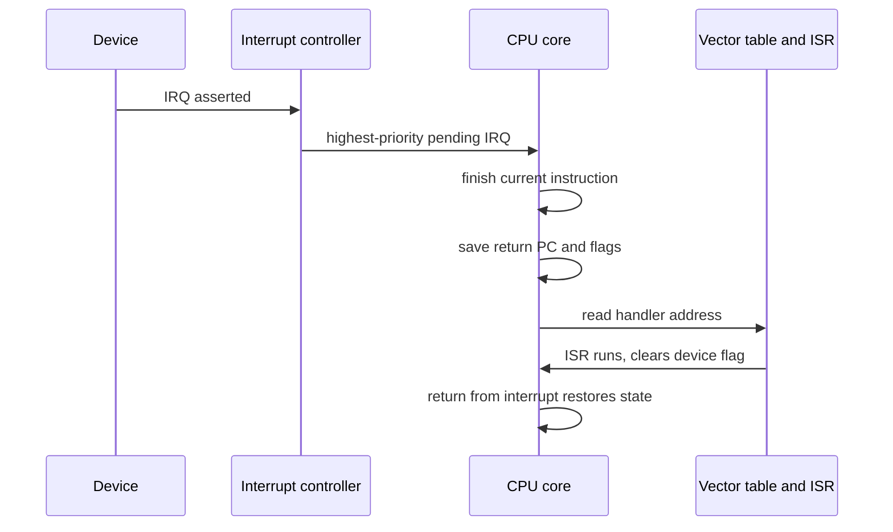

::: basics
### In plain words
An interrupt is a hardware signal that tells the CPU "something needs attention now". The CPU finishes its current instruction, saves where it was, runs a short handler routine for that event, and then returns to exactly where it left off. It is the alternative to polling, where the CPU keeps checking. On a PC the operating system handles interrupts. On a small embedded chip you often write the handler yourself.

### Picture it
Picture waiting for a package. You could walk to the door every minute to look (polling), which wastes your day. Or you can work on something else and let the doorbell ring. When it rings, you put a bookmark in your work, answer the door, and return to your page. The catch: the bell must be answered quickly, and your place must be saved exactly.

### Words you need
- **Interrupt handler (ISR)**: the short routine that runs in response to an interrupt.
- **Polling**: the CPU repeatedly checking whether an event has happened.
- **Vector table**: a list of handler addresses, indexed by interrupt number.
- **Latency**: the delay from the event to the first instruction of the handler.
- **Mask**: a control bit that temporarily blocks an interrupt from being taken.

### The simplest example
A serial port at 115,200 baud sends 10 bits per byte, so a byte arrives every 86.8 µs. A 48 MHz CPU that does nothing but poll uses 100% of its time just waiting. With an interrupt, the handler costs about 64 cycles (40 for its work, 12 to enter, 12 to exit). That is $64 / 48{,}000{,}000 \text{ s} \approx 1.33$ µs per byte, so the CPU is busy only about 1.5% of the time.

That is the whole idea: the CPU does other things until an event arrives. The rest of this page shows the hardware steps, how latency and priorities work, how PCs and embedded systems differ, and the rules for writing a good handler.
:::

::: testing
Whether you can explain interrupts as a **hardware mechanism that changes the program counter** (not just "a signal"), and whether you can compare how they're used in two worlds. The question has four parts and a good answer covers all of them:

1. What an interrupt is and what the hardware does when one arrives (finish instruction, save state, jump through a vector, return).
2. When to use one: asynchronous events, timers, I/O completion, faults and system calls.
3. Why they matter: efficiency compared with polling, bounded response time, and the way operating systems are built on them.
4. How **general-purpose computers** differ from **embedded systems**: the OS mediates, privilege levels and virtual memory are involved, versus bare-metal or RTOS firmware with the ISR directly doing the work, tight latency budgets and sleep-wake use.
:::

::: why
Every real system has to respond to things it can't predict: a key press, a packet arriving, a timer expiring, a sensor going over threshold. The alternative to an interrupt is polling, which burns CPU time and has poor latency. Interrupts are also how a multitasking operating system gets control back (timer tick), how system calls and page faults are implemented, and how a battery-powered MCU sleeps at microamps between events. Interviewers in hardware roles ask this to check you understand the CPU-level mechanism ([[q0905]], [[q0903]]) and can reason about latency, priority and the practical rules for ISRs ([[q0802]]).
:::

::: concepts
- **Program counter and fetch/execute cycle**: an interrupt is checked between instructions and redirects the PC. See [[q0905]] and [[q0903]].
- **Polling vs interrupt-driven I/O**: polling spends cycles asking "anything yet?"; an interrupt lets the device tell the CPU.
- **Vector table**: memory array of ISR addresses, indexed by interrupt number.
- **Context save/restore**: the registers and flags the ISR may clobber must be preserved. See [[q0797]].
- **Priority and masking**: which interrupt wins, and temporarily disabling them. See [[q0803]].
- **Latency**: the time from event to first ISR instruction. See [[q0800]].
:::

::: answer
"An interrupt is a hardware signal, from a timer, a peripheral, or the CPU itself, that tells the processor to stop what it's doing, run a handler, and then resume. In hardware, the CPU finishes the current instruction, saves the return address and some state, looks up the handler address in a vector table, and jumps to it. When the handler finishes, a return-from-interrupt instruction restores the state and the program carries on as if nothing happened.

You use them for events that are asynchronous or unpredictable: timer ticks, data arriving on a UART or network card, a button press, a DMA transfer finishing, and also internal events like divide-by-zero or a page fault. They matter because the alternative is polling, where the CPU keeps checking a status flag, which wastes cycles and responds slowly. They're also what makes multitasking possible, since the OS timer interrupt is how it takes the CPU back from a running process.

The difference with embedded systems is mostly who handles it. On a PC or phone, the hardware interrupt goes to the OS kernel, which runs a driver's handler in privileged mode, defers the heavy work to a lower-priority context, and may then schedule a different process. In an embedded system with no OS, or a small RTOS, the ISR is often your own code: you write the handler for the timer or ADC, keep it short, set a flag, and often use interrupts to wake the MCU from sleep to save power. Latency there is deterministic, often well under a microsecond on a Cortex-M, so it's a design parameter."
:::

::: technical
**Definition.** An interrupt is an event, external (asynchronous, from a peripheral) or internal (synchronous exception/trap), that causes the processor to suspend the current instruction stream, execute a handler, and then resume.

**Hardware sequence (typical).**
1. Device asserts an interrupt request (IRQ); an interrupt controller (PIC/APIC/GIC on application processors, NVIC on Arm Cortex-M) prioritizes and masks requests.
2. The CPU finishes (or in a pipeline, drains or squashes) the current instruction at an instruction boundary, if the interrupt is enabled and not masked.
3. It saves the return PC and status. Some architectures push registers automatically (Cortex-M pushes 8 registers on the stack in hardware); others leave it to software.
4. It fetches the handler address from the vector table and loads the PC, often switching to a privileged mode or a separate stack.
5. The ISR services the device (reads data, clears the pending flag, re-arms), and ends with a return-from-interrupt that restores state.

**Latency.** $t_{latency}=t_{synchronize}+t_{finish\ instr}+t_{save}+t_{vector}$, plus any time spent waiting because interrupts were masked or a higher-priority ISR was running. For Arm Cortex-M3/M4 with zero-wait-state memory the documented entry latency is 12 cycles.

**CPU load.** For a periodic event at rate $f_{ev}$ with ISR cost $C$ cycles: load $=f_{ev}\,C/f_{clk}$. Example: UART at 115200 baud, 10 bits per byte, so a byte every 86.8 µs. With a 48 MHz core, ISR body of 40 cycles plus 12 entry plus 12 exit, 64 cycles = 1.33 µs, so load = 1.5%.

**Uses.** Timers/ticks, I/O completion (UART, SPI, network, disk), DMA complete, sensor data-ready, pin changes and wake from sleep, faults, system calls (software interrupt/trap).

**General-purpose vs embedded.** On general-purpose systems the handler runs in the kernel (privileged mode, virtual memory active), is split into a short *top half* and a deferred *bottom half* or thread, and its end often triggers a reschedule. Interrupts are mostly managed by the OS, and applications never see them directly (they see signals, events or I/O completions). In embedded systems firmware commonly owns the vectors, ISRs are tiny and deterministic, and interrupts are a primary power-management tool (sleep until interrupt).
:::

::: short
"An interrupt is a signal that makes the CPU pause its current program, jump through a vector table to a handler, and then resume where it left off. It lets hardware events like timers, incoming data or faults get attention without the CPU polling, which saves cycles and gives fast response. They're also how an OS regains control for multitasking. On a PC the OS kernel owns the interrupts and defers heavy work to threads; in embedded systems you often write the ISR yourself, keep it very short, and use interrupts to wake the chip from sleep."
:::

::: long
"An interrupt is how hardware gets the CPU's attention. A peripheral, a timer, or the CPU itself raises a signal, the processor finishes the instruction it's on, saves the return address and some state, looks up the handler's address in a vector table, and jumps there. The handler does its job, then a return-from-interrupt instruction restores state and the original program resumes without knowing anything happened.

The important use cases are asynchronous events: a byte arriving on a UART, a packet on the network, a timer expiring, a button, a DMA transfer finishing. Internal events use the same mechanism: a divide by zero, a page fault, or a system call instruction.

Why they matter: the alternative is polling, where you check a status register in a loop. That wastes CPU time and the response time depends on where in the loop you happen to be. With interrupts the CPU can do useful work or sleep, and the response latency is a bounded, known number of cycles; on a Cortex-M it's about 12 cycles. They're also fundamental to operating systems: the timer interrupt is how the kernel preempts a process, and system calls and page faults are variants of the same mechanism.

The difference between a general-purpose computer and an embedded system is mostly who handles it and what the budget is. On a PC or phone, an interrupt goes to the kernel in privileged mode. The driver's top half does the minimum, then defers the rest to a lower-priority thread, and the scheduler may switch processes afterward. Latency is typically good but not guaranteed. In a bare-metal MCU, the ISR is your code, you control priorities in the NVIC, you keep it short, set a flag or push to a buffer, and use interrupts to wake from sleep for power. There the latency is deterministic and often the key requirement."
:::

::: terms
- **Interrupt request (IRQ)**: the signal a device or controller raises to ask for service.
- **Interrupt service routine (ISR) / handler**: the code that runs in response.
- **Vector table**: array of handler addresses indexed by interrupt number.
- **Interrupt controller (PIC/APIC/GIC/NVIC)**: hardware that prioritizes, masks and routes interrupts to cores.
- **Mask / enable**: control bits that allow or block an interrupt from being taken.
- **Exception / trap**: a synchronous internal event (fault, system call) handled via the same mechanism.
- **Context switch / context save**: preserving the registers an ISR (or the task being switched) would otherwise overwrite.
- **Latency**: time from the event to the first instruction of the ISR; **jitter** is its variation.
- **Nesting / preemption**: a higher-priority interrupt interrupting a running ISR.
- **Top half / bottom half**: the quick part of a handler versus deferred work in an OS.
:::

::: exceptional
**An average answer** says "a signal that stops the CPU to handle an event" and lists a timer and a button.

**An exceptional answer**:
- Describes the **hardware sequence** (instruction boundary, save PC/flags, vector lookup, return) and mentions the controller and priorities.
- Compares with **polling** quantitatively: e.g. UART at 115200 baud is 1.5% CPU with a 64-cycle interrupt at 48 MHz, versus 100% for busy-wait polling.
- Includes **internal** interrupts (faults, syscalls) and explains how a timer interrupt enables preemptive multitasking.
- Answers the last clause directly: kernel-mediated, top/bottom half, privilege and virtual memory on PCs; versus own ISRs, deterministic latency, tiny handlers and wake-from-sleep in embedded.
- Gives the ISR rules: keep short, clear the source, share data carefully (`volatile`, atomicity), avoid blocking calls.
:::

::: mistakes
- **"An interrupt is just a function call."** It's asynchronous and not at a point chosen by the program, so it must save and restore all state it touches and cannot rely on the caller's conventions.
- **Doing a lot of work in the ISR.** Long ISRs block other interrupts and add latency. Do the minimum and defer the rest. See [[q0802]].
- **Forgetting to clear the source.** If the peripheral's flag stays set, the interrupt re-fires immediately and the main program starves.
- **Assuming interrupts make latency zero.** There is entry latency, masking windows and higher-priority ISRs; the worst case matters for real-time.
- **Believing interrupts are always better than polling.** For very high event rates (like a 10 Gbit/s network card) interrupt overhead dominates, and drivers switch to polling or interrupt coalescing.
- **Treating embedded and PC interrupts as the same.** On a PC applications never receive hardware interrupts directly; the kernel does.
:::

::: deep
## The problem interrupts solve

A CPU executes one instruction stream ([[q0905]]). The outside world doesn't wait for it. There are two ways to notice an external event:

**Polling.** The program periodically reads a status register:

```
while (!(UART->STATUS & RX_READY)) { /* spin */ }
byte = UART->DATA;
```
This is simple and deterministic, but while waiting the CPU can do nothing else (or must interleave checks into everything else it does), and the response time depends on where the loop is when the event arrives.

**Interrupts.** The device raises a line; the CPU services it when it arrives. The CPU can run other code or sleep in the meantime.

A quantified comparison. A UART at 115200 baud sends 10 bits per byte (start + 8 data + stop), so a byte every $10/115200=86.8$ µs. On a 48 MHz core, a polled loop that does nothing else uses 100% of the CPU to keep up. An interrupt-driven receiver with an ISR of 40 cycles, 12 cycles of entry and 12 of exit uses $64/48\text{ MHz}=1.33$ µs per byte, i.e. $1.33/86.8=1.5\%$ of the CPU. At 1 Mbaud the same ISR costs 13% (byte every 10 µs). The interrupt is a clear win at these rates, but as rates climb the per-event overhead eventually dominates.

## What the hardware does


Figure: The CPU only accepts the interrupt at an instruction boundary, when it is enabled and not masked. The ISR must clear the device's pending flag, or the request stays asserted and fires again as soon as the ISR returns.

Interrupt handling in terms of the program counter ([[q0903]]): the PC is replaced by the vector, the old PC is saved, and the final return-from-interrupt instruction restores it. In a pipeline, instructions after the interrupted one are squashed, and the saved PC points to the first instruction that has not completed, so the resumed program sees a precise state.

## Latency and priorities

$$t_{response}=t_{sync}+t_{finish}+t_{save}+t_{vector}+t_{blocked}$$

The first four terms are fixed by the architecture; $t_{blocked}$ is the time the interrupt waits because interrupts are masked, or a higher-priority ISR is running, and it dominates real-time worst cases. Interrupt controllers assign priorities. Higher priority can preempt (nested) a running lower-priority ISR; equal or lower priority stays pending until it finishes.

```sim
{"id":"interrupt-lab","nesting":false}
```
Figure: Make an ISR long and watch the other interrupt's latency grow, and events get missed when the pending flag is overwritten before service. Then turn nesting on and see a higher-priority ISR cut in, at the cost of a more complex stack and shared-data problem.

## General-purpose computer vs embedded system

This is the last part of the question. The mechanism is the same; the way it is *used* differs.

| Aspect | PC, phone, server (OS-based) | Embedded MCU (bare-metal or RTOS) |
|---|---|---|
| Who owns the vectors | OS kernel, in privileged mode | Your firmware (startup code, vector table) |
| What the handler does | Driver top half acknowledges the device, defers work to a bottom half/thread/DPC | ISR often does the whole job: read data, push to buffer, set flag |
| Application visibility | Apps never see raw interrupts; they see syscalls returning, signals, events | Application code and ISR share variables directly |
| Timer interrupt | Drives the scheduler, preemptive multitasking, time keeping | Periodic tick or PWM/capture/ADC trigger, RTOS tick if present |
| Memory and protection | Virtual memory, user/kernel modes, privileged stack switch | Usually flat memory, maybe an MPU, one or two stacks |
| Latency | Good average, not strictly guaranteed (microseconds to many microseconds, depends on OS) | Deterministic: about a dozen cycles on a Cortex-M plus any masking; often a design spec |
| Power role | Idle states and wake-ups | Core use: sleep (WFI) until an interrupt wakes the CPU, microamp average current |
| Interrupt sources | Many devices through a controller with MSI, per-core routing | Handful of peripherals, GPIO, timers on a flat controller |
| Typical rate control | Interrupt coalescing, polling mode for very high rates (NAPI-style) | Hardware FIFOs, DMA to cut the interrupt rate |

> [!NOTE]
> Details differ by OS and architecture. The table describes typical designs (e.g. Linux-class systems vs Cortex-M firmware), not a universal rule.

A page fault shows how deeply interrupts are woven into computers: the MMU raises a synchronous exception when a virtual address has no mapping in RAM; the OS handler loads the page from storage, fixes the page table and restarts the faulting instruction. The application never notices except for the delay. A system call works the same way via a trap instruction.

## Rules for ISR design (embedded)

1. **Short**: do the minimum, set a flag or enqueue data, and do the rest in the main loop. See [[q0802]].
2. **Clear the source** before returning.
3. **Shared data**: variables shared with main code need `volatile` and atomic access (disable interrupts briefly or use atomic operations).
4. **No blocking or slow calls** such as `printf` or malloc.
5. **Mind priorities and nesting** ([[q0803]]).
6. **Debounce/noise**: a bouncing button can fire dozens of interrupts. See [[q0800]] for more limitations.

> [!INTERVIEW]
> When an interviewer says "how does it differ in embedded systems", hit three ideas: you often write the ISR yourself, latency is deterministic and short-handler discipline matters, and interrupts are how a CPU sleeps. Add the PC contrast: the kernel mediates and defers the work.

## Reducing the interrupt rate

If a source interrupts too often (a high-speed ADC, or a 10 Gbit/s NIC), the overhead takes over. Remedies: hardware FIFOs (interrupt on half-full), **DMA** (interrupt once when a whole block is done), interrupt coalescing in network cards, or switching to polling when the rate is high enough that there is always work waiting.
:::

::: applications
- **Operating system timer tick and preemption**: a periodic timer interrupt lets the scheduler switch tasks.
- **Peripheral I/O**: UART, SPI, I2C, USB, Ethernet and disk completion notifications.
- **Low-power MCUs**: sleep until a GPIO edge, RTC alarm or sensor data-ready interrupt wakes the core.
- **Motor control and power electronics**: a PWM or ADC end-of-conversion interrupt runs a control loop at a fixed rate.
- **Fault handling**: page faults, divide-by-zero, undefined instruction, watchdog or brown-out events.
- **System calls**: a trap instruction transfers into the kernel using the same machinery.
:::

::: assumptions
- Describes a typical single-core view with an interrupt controller. Multi-core systems route interrupts per core (e.g. through APIC/GIC), and Message Signaled Interrupts replace pin-based IRQs on PCIe devices.
- The 12-cycle Cortex-M entry latency is for Cortex-M3/M4 class cores with zero-wait-state memory; other cores and memory systems differ.
- "Embedded" here means MCU-class bare-metal or RTOS firmware. Embedded Linux on an application processor behaves like the general-purpose case.
- Cycle counts in the UART example (40-cycle ISR body) are illustrative.
- Precise-interrupt behaviour is described for in-order pipelines. Out-of-order cores keep precise state using a reorder buffer.
:::

::: followups
### What's the difference between an interrupt, an exception and a trap?
An interrupt is usually an asynchronous external request (a peripheral or timer). An exception is a synchronous event caused by the instruction itself (divide by zero, illegal instruction, page fault). A trap is a deliberate software-triggered exception, such as a system call instruction. Different architectures use these words slightly differently, but all use the same save-state and vector mechanism.

### When would you choose polling over interrupts?
When events are so frequent that interrupt overhead dominates (a stream with a byte every 100 ns), when latency needs to be perfectly predictable with no preemption, or for very simple code where a spin on a flag is enough. Network drivers deliberately switch from interrupts to polling under heavy load.

### What happens if two interrupts arrive at the same time?
The controller picks the highest priority first, and the other stays pending. If they have equal priority, a fixed tie-break such as lowest vector number applies. A lower-priority one runs after the first finishes, unless higher-priority preemption (nesting) is enabled and the new one is higher than the running one.

### How would you calculate how much CPU an interrupt source consumes?
Load $=f_{ev}\times C/f_{clk}$, where $C$ includes entry, body and exit cycles. A 1 kHz timer interrupt with a 480-cycle ISR on a 48 MHz core is 0.48/48 = 1%. Add the loads for all sources and compare against 100% minus margin. If one ISR's worst-case duration exceeds another's deadline, you have a latency problem even if total load is low.

### Your system misses data from a UART at 921,600 baud, even though CPU load is only 20%. Why?
Average load isn't the issue; worst-case latency is. A byte arrives every 10.9 µs, and if another ISR or a critical section with interrupts disabled lasts longer than the UART's buffer depth allows, the byte is overwritten. Fixes: enable the FIFO, DMA the stream, shorten the other ISR, or raise the UART's priority.

### How is an interrupt different from a context switch between tasks in an OS?
An interrupt is hardware-initiated and borrows the current context briefly to run a handler. A context switch is the OS saving one task's complete state and loading another's. Often the two are linked: the timer interrupt's handler calls the scheduler, which decides to context switch on return.
:::

::: interpretations
This question sits in the **computer architecture** section, but its last clause ("how does their usage often differ from that of embedded systems?") compares general-purpose computing with embedded systems, which the embedded-systems section covers in detail: [[q0795]] (what they are), [[q0796]] (how they work), [[q0797]] (hardware and software levels of ISRs), [[q0798]] (applications), [[q0800]] (limitations), [[q0801]] (the ISR) and [[q0802]] (rules of thumb). This page gives the architecture-level view and the comparison; those pages give the microcontroller details.
:::

::: references
- Patterson & Hennessy, *Computer Organization and Design*, the chapters on the processor and on storage and I/O: exceptions and interrupts, interrupt-driven I/O.
- Silberschatz, Galvin & Gagne, *Operating System Concepts*, the chapter on I/O systems: interrupts, polling, DMA; and on CPU scheduling for the timer interrupt.
- Joseph Yiu, *The Definitive Guide to ARM Cortex-M3 and Cortex-M4 Processors*, the chapters on exceptions and the NVIC: interrupt entry/exit and latency.
- Arm, *Cortex-M4 Technical Reference Manual*: exception handling and interrupt latency section.
:::

::: rubric
- Defines an interrupt as a hardware event that suspends the program and runs a handler via a vector :: The basic definition everything else rests on.
- Describes the hardware sequence (instruction boundary, save PC/state, vector, return) :: Shows you know the mechanism rather than just the word.
- Lists uses: timers, I/O, faults, system calls, wake from sleep :: Shows breadth; the question explicitly asks when they can be used.
- Explains why they matter versus polling (efficiency, bounded latency, multitasking) :: The "why important" part of the question.
- Describes the PC/OS-side usage: kernel-owned vectors, top/bottom half, privilege, scheduler tick :: Needed for the comparison asked at the end.
- Describes the embedded usage: own ISRs, short, deterministic latency, sleep/wake, DMA :: The other half of the comparison.
- Mentions ISR design discipline: short, clear the source, volatile/atomic shared data :: Practical knowledge that interviewers listen for.
:::

::: quiz
```json
[
 {"type":"mcq","level":"fundamental","q":"What happens first when a CPU accepts an interrupt?","options":["It resets and restarts the program","It finishes the current instruction, saves the return PC and state, and jumps to the handler through the vector table","It discards the current program","It switches to polling mode"],"answer":1,"explain":"The CPU accepts the interrupt at an instruction boundary, saves enough state to resume (return address, flags), loads the PC from the vector table, and later returns with a return-from-interrupt instruction."},
 {"type":"numeric","level":"fundamental","q":"A UART runs at 115200 baud with 10 bits per byte. How long between received bytes, in microseconds?","answer":86.8,"tolerance":0.01,"unit":"µs","explain":"10 bits / 115200 bit/s = 86.8 µs per byte."},
 {"type":"numeric","level":"intermediate","q":"A 48 MHz core takes 64 cycles in total (entry, body and exit) to service each UART byte at 115200 baud (10 bits/byte). What fraction of the CPU does this use, as a percentage?","answer":1.5,"tolerance":0.03,"unit":"%","explain":"ISR time = 64/48 MHz = 1.333 µs. Byte period = 86.8 µs. Load = 1.333/86.8 = 1.54%, about 1.5%."},
 {"type":"numeric","level":"intermediate","q":"A timer interrupt fires at 2 kHz and each ISR takes 600 cycles on a 24 MHz core. What fraction of CPU time does it use?","answer":5,"tolerance":0.02,"unit":"%","explain":"Load = $f_{ev}C/f_{clk} = 2000\\times600/24\\times10^6=0.05$, i.e. 5%."},
 {"type":"multi","level":"intermediate","q":"Which are typical differences between interrupt use in an OS-based PC and a bare-metal MCU? Select all that apply.","options":["On a PC, the kernel owns the vectors and usually defers heavy work out of the handler","On an MCU, firmware often supplies the ISR itself and keeps it short","On an MCU, interrupts are commonly used to wake the core from sleep","On a PC, applications handle hardware interrupts directly in user mode"],"answer":[0,1,2],"explain":"Applications on a general-purpose OS do not handle hardware interrupts directly; the privileged kernel does. The other three statements describe typical practice."},
 {"type":"truefalse","level":"advanced","q":"If an ISR does not clear the peripheral's pending flag before returning, the interrupt may immediately fire again.","answer":true,"explain":"Level-sensitive or latched requests stay asserted until the source is cleared, so the CPU re-enters the ISR as soon as it returns, starving the main program."}
]
```
:::
