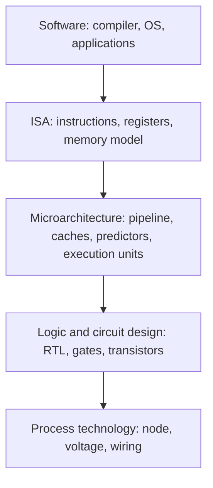
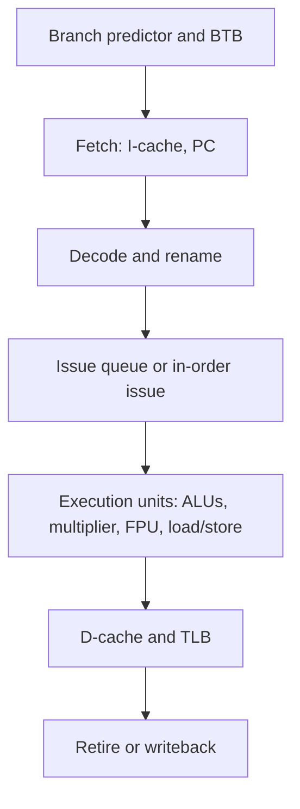

::: basics
### In plain words
The instruction set (ISA) is the contract that says which instructions exist and what each one does. Microarchitecture is the internal hardware design that carries them out: how many pipeline stages, what caches, how many instructions at once. Many different microarchitectures can implement the same ISA. That is why the same software can run on a small slow chip and a large fast one.

### Picture it
Think of cars. The steering wheel, pedals and gearshift are the contract: any driver can use any car. Under the hood, one car has a small economy engine and another a big turbo engine. Both obey the same controls, but they differ in speed, fuel use and cost. Software sees only the controls. It can tell the difference only by how fast it runs.

### Words you need
- **ISA**: the instructions and registers visible to software ([[q0913]]).
- **Pipeline**: overlapping the steps of several instructions ([[q0909]]).
- **In-order / out-of-order**: running instructions strictly in program order, versus as soon as their inputs are ready.
- **Cache**: a small fast memory that holds recently used data to cut waiting.
- **CPI**: average clock cycles per instruction. Fewer is better.

### The simplest example
Run the same program of $10^9$ instructions on two cores that share one ISA. Core A is simple: CPI 1.0 at 2 GHz, so the time is $10^9 \times 1.0 / (2 \times 10^9) = 0.50$ s. Core B has a deeper pipeline and bigger caches: CPI 1.3 at 3 GHz, so the time is $10^9 \times 1.3 / (3 \times 10^9) = 0.433$ s. B is about 15% faster, but it is bigger and uses more power. Both are valid implementations.

That is the whole idea: same contract, different insides. The rest of this page shows what a microarchitect chooses, real examples such as in-order and out-of-order Arm cores, and how design trade-offs are checked.
:::

::: testing
Whether you can draw the line between **what a processor promises** (the ISA, [[q0913]]) and **how a particular chip delivers it** (the microarchitecture). A good answer:

1. Defines microarchitecture as the implementation of an ISA: pipeline, caches, execution units, predictors, buses.
2. Gives the key point that many different microarchitectures can implement the same ISA with the same software-visible behaviour but very different speed, area and power.
3. Gives concrete knobs (pipeline depth, issue width, in-order vs out-of-order, cache sizes) and ties them to the iron law $T=\text{IC}\times\text{CPI}\times t_{clk}$.
4. Mentions that it's a trade-off space shaped by the target: an MCU, a phone, a server.
:::

::: why
In hardware and computer-architecture roles you constantly move between the contract (what software sees) and the implementation (what engineers design). Knowing that distinction is why a program compiled once runs on a 2015 phone core and a 2025 one, why two CPUs with the same ISA can differ 10x in performance, and why design reviews talk about "the microarchitecture" of a block (pipeline, buffers, handshakes) before writing RTL. It also underpins performance work: when a benchmark behaves differently across chips, the cause is almost always microarchitectural.
:::

::: concepts
- **ISA**: the programmer-visible contract (instructions, registers, memory model). See [[q0913]].
- **CPU blocks**: ALU, register file, control unit, caches, program counter. See [[q0901]] and [[q0900]].
- **Pipelining**: overlapping instruction stages for throughput. See [[q0906]].
- **Throughput techniques**: caches, superscalar/out-of-order execution, prediction, SIMD, multicore. See [[q0908]].
- **Branch prediction**: a microarchitectural feature invisible to software semantics. See [[q0910]].
- **Iron law**: time = instructions x cycles per instruction x clock period.
:::

::: answer
"Microarchitecture is how a processor actually implements its instruction set. The ISA says what instructions exist, what the registers are and what each instruction means. The microarchitecture is the internal design that makes those instructions happen: how many pipeline stages, whether it executes in order or out of order, how many instructions it issues per cycle, what the caches look like, what branch predictor it uses, how wide the buses are.

The key idea is that one ISA can have many microarchitectures. Arm's Cortex-A53 and Cortex-A76 both run the same ARMv8-A software, but the A53 is a small in-order core and the A76 is a big out-of-order one, so the A76 is much faster and bigger and uses more power. Intel and AMD both implement x86-64 with completely different internals.

Software can't tell the difference by correctness, only by performance. And as a designer, I think of the choices through the iron law: execution time is instruction count times CPI times clock period. Pipelining and process technology attack the clock period, wide issue, caches and prediction attack the CPI, and the ISA and compiler mostly affect the instruction count. Which choices you make depends on the target: a battery-powered sensor wants minimal area and energy per instruction, a server wants maximum single-thread and total throughput."
:::

::: technical
**Definition.** Microarchitecture (computer organization) is the specific implementation of an ISA: the set of hardware structures and the datapath/control organization that execute the architectural behaviour. ISA = interface; microarchitecture = implementation of the interface.

**What it includes.** Pipeline organization and depth; issue width (scalar vs superscalar); in-order vs out-of-order execution with register renaming, reservation stations and reorder buffer; execution units (number and latency of ALUs, multipliers, load/store, FPU, vector units); the memory hierarchy (L1/L2/L3 size, associativity, line size, TLBs, prefetchers); branch predictors and BTBs; buses and interconnect; power management features. It does **not** include the logic-gate-level circuit design (that's the implementation/circuit level) or the process technology, though all three interact.

**Performance link.**

$$T_{exec}=\text{IC}\times\text{CPI}\times t_{clk}$$

- IC (instruction count): set mostly by ISA and compiler.
- CPI: set mostly by microarchitecture (hazards, cache misses, issue width, prediction).
- $t_{clk}$: set by microarchitecture (pipeline depth, critical path) and technology.

Worked example (same program, same ISA, $\text{IC}=10^9$): Core A, simple, CPI 1.0 at 2 GHz: $10^9\times1.0/(2\times10^9)=0.50$ s. Core B, deeper pipeline and bigger caches but more stalls, CPI 1.3 at 3 GHz: $10^9\times1.3/(3\times10^9)=0.433$ s. B is 15% faster but certainly bigger and more power-hungry. Both are valid implementations of the same ISA.

**Trade-offs.** Performance, area (cost), power/energy, design complexity and verification effort, and time to market. Designers evaluate with cycle-accurate simulators, then RTL.
:::

::: short
"Microarchitecture is how a specific processor implements its ISA: the pipeline, issue width, in-order or out-of-order execution, execution units, caches, branch predictors and buses. The ISA is the contract software sees; the microarchitecture is the implementation and it can differ wildly while running identical programs, like an Arm Cortex-A53 versus an A76. It's what determines CPI and clock speed, so performance, area and power, and it's chosen for the target, from tiny low-power MCUs to server cores."
:::

::: long
"The way I think about it is ISA versus microarchitecture. The ISA is the contract: which instructions exist, what registers software can see, how memory behaves. Microarchitecture is how one particular chip implements that contract. It covers the pipeline depth, how many instructions can issue per cycle, whether it executes in order or out of order, how many ALUs and load/store units there are, the cache hierarchy, the branch predictor, the buses.

The big point is that there are many microarchitectures per ISA. Arm's Cortex-A53 and A76 both implement ARMv8-A, so the same binary runs on both. But the A53 is a small in-order core for efficiency and the A76 is a wide out-of-order core for performance. Intel and AMD each have many generations of x86-64 microarchitecture. Software sees the same behaviour, just at different speed and power.

I'd tie it to the iron law: execution time equals instruction count times CPI times clock period. The ISA and compiler mostly decide instruction count. The microarchitecture decides the other two. Pipelining and shorter critical paths raise the clock. Caches, forwarding, branch prediction and wider issue lower CPI, and they cost area and power. If I deepen a pipeline, I can raise the clock but the branch penalty grows, so CPI can go up. For example, 1.0 CPI at 2 GHz is 0.5 seconds for a billion instructions, and 1.3 CPI at 3 GHz is 0.43 seconds: faster but at the cost of a bigger, hotter design.

So microarchitecture is where the engineering trade-offs live, and which ones you pick depends on whether you're building a sensor node, a phone SoC or a server."
:::

::: terms
- **ISA (architecture)**: the programmer-visible specification: instructions, registers, memory model, exceptions.
- **Microarchitecture (organization)**: the implementation of an ISA in hardware.
- **Pipeline depth**: number of stages; affects clock and branch penalty.
- **Issue width / superscalar**: instructions fetched, decoded and dispatched per cycle.
- **In-order vs out-of-order**: whether instructions execute strictly in program order or as operands become ready.
- **Register renaming / reorder buffer**: out-of-order mechanisms that remove false dependences and retire results in program order.
- **Cache hierarchy**: levels of small fast memories (L1, L2, L3) that reduce average memory latency.
- **CPI / IPC**: cycles per instruction and its inverse, instructions per cycle.
- **Iron law**: $T=\text{IC}\times\text{CPI}\times t_{clk}$.
- **Cycle-accurate model**: a simulator that models the microarchitecture clock by clock.
:::

::: exceptional
**An average answer** says "microarchitecture is how the CPU is built internally" and maybe lists pipeline and cache.

**An exceptional answer**:
- Draws the **ISA / microarchitecture / circuit-process** layering and puts each design decision in the right layer.
- Gives a concrete pair of implementations of **one ISA** (e.g. Arm Cortex-A53 in-order vs Cortex-A76 out-of-order, or Intel vs AMD x86-64).
- Uses the **iron law** and a worked example to show how a microarchitectural choice trades CPI against clock period.
- Explains that microarchitecture can change without breaking software, while ISA changes need compilers and binaries to change.
- Says the target drives the choices (area/energy for MCUs, single-thread speed for desktops, throughput for servers) and notes that verification effort scales with complexity.
:::

::: mistakes
- **Using "architecture" and "microarchitecture" interchangeably.** In common speech "architecture" is ambiguous; in interviews, say ISA for the contract and microarchitecture for the implementation.
- **"A different microarchitecture needs recompiled software."** Not for correctness, since the ISA is the same. Recompiling can still tune performance for the new pipeline.
- **Equating more GHz with a better microarchitecture.** Clock is only one factor; CPI and instruction count matter equally. A 3 GHz in-order core can lose to a 2 GHz wide out-of-order core.
- **Thinking microarchitecture is only the pipeline.** Caches, TLBs, predictors, execution units, interconnect and power management are all part of it.
- **Believing microarchitecture is visible to the programmer.** Behaviour must not be, though timing is (and speculative effects have caused security issues).
- **Confusing it with process technology.** A 5 nm node doesn't change the microarchitecture, though it changes what is practical.
:::

::: deep
## The three layers

Think of a processor design as stacked abstractions:


Figure: Everything above the ISA line sees only the contract. Everything below it can change without breaking software. Microarchitecture is the first layer under the contract and the one that sets CPI, clock, area and power.

The ISA ([[q0913]]) answers: "what does `add x3, x1, x2` mean?" The microarchitecture answers: "which hardware does it, in how many cycles, and how many can proceed at once?" Same program, same result, different time and energy.

## What the microarchitect chooses


Figure: A generic core. Each box is a design decision: how big, how many, how fast. A simple MCU core collapses this to three stages with no rename or issue queue; a high-end core has deep fetch with a large predictor, wide decode, a big issue queue and several execution units.

| Knob | Effect | Cost |
|---|---|---|
| Pipeline depth | Higher clock, lower $t_{clk}$ | Bigger branch penalty, more flops and clock power |
| Issue width (1, 2, 4, 6...) | More instructions per cycle (lower CPI) | Wider decode, register file ports, bypass network area and wire delay |
| Out-of-order execution | Hides latency of cache misses and dependences | Rename tables, reorder buffer, scheduler: large area/power and verification effort |
| Branch predictor quality | Lower misprediction penalty | Table area, lookup power |
| Cache sizes and associativity | Fewer misses, lower CPI | Area, access latency, power |
| Prefetchers | Hide memory latency | Wrong prefetches waste bandwidth and energy |
| Number and type of execution units | Throughput on specific mixes | Area, possible idle power |
| SIMD/vector width | Data-level parallelism | Area, power, needs vectorizable code |

## One ISA, many microarchitectures

Arm's ARMv8-A is implemented by in-order cores like the Cortex-A53 (small, efficient) and by out-of-order cores like the Cortex-A72 and A76 (wider, faster, larger). Phone SoCs often combine both kinds in a big.LITTLE style arrangement so that light work runs on the efficient cores and heavy work on the fast ones, with the same binary running on either. x86-64 is implemented by Intel and AMD with different internals across generations. RISC-V is an open ISA with microarchitectures ranging from tiny microcontroller-class cores to large out-of-order designs.

> [!UNCERTAIN]
> Specific core details (pipeline depths, issue widths) change by generation and vendor documentation; the in-order vs out-of-order distinction between the A53 and A72/A76 families is the stable point to quote.

## Using the iron law

$$T_{exec}=\text{IC}\times\text{CPI}\times t_{clk}$$

A microarchitectural change is good only if the product falls. Take $\text{IC}=10^9$:

| Design | CPI | Clock | Time |
|---|---|---|---|
| A: simple 5-stage in-order | 1.0 | 2 GHz | $10^9\times1.0/2\text{ GHz}=0.500$ s |
| B: deeper pipeline, bigger caches, more stalls | 1.3 | 3 GHz | $10^9\times1.3/3\text{ GHz}=0.433$ s |

B wins by 15%, but compare power: dynamic power $\propto \alpha CV^2f$, so a 50% higher clock plus bigger structures costs substantially more than 50% extra energy rate, and a design that is limited by memory stalls may not benefit from higher clock at all.

```plot
{"title":"Execution time vs CPI for two clock speeds (IC = 10^9)","x":{"label":"CPI","min":0.5,"max":2.5},"y":{"label":"Execution time","unit":"s","min":0,"max":1.3},
 "vars":{"ic":1000000000},
 "series":[{"label":"2 GHz","fn":"ic*x/2e9"},{"label":"3 GHz","fn":"ic*x/3e9","color":"orange"}],
 "points":[{"x":1.0,"y":0.5,"label":"A: 0.50 s"},{"x":1.3,"y":0.4333,"label":"B: 0.43 s"}],
 "vlines":[{"at":1.5,"label":"3 GHz at CPI 1.5 = 2 GHz at CPI 1.0","color":"muted"}]}
```
Figure: Lines of constant clock are straight. A 3 GHz core with CPI 1.5 matches a 2 GHz core with CPI 1.0. A faster clock is worth it only if it doesn't inflate CPI by more than the same factor, which is the heart of the pipeline-depth trade-off.

## A second worked example: IPC and width

A programmer-facing way to say the same thing is IPC $=1/\text{CPI}$ and throughput = IPC x $f$ (instructions per second). Compare a scalar in-order core with IPC 0.8 at 1.5 GHz and a 4-wide out-of-order core with IPC 2.4 at 2.0 GHz:

- Scalar: $0.8\times1.5=1.2$ billion instructions per second.
- Wide OoO: $2.4\times2.0=4.8$ billion instructions per second, 4x faster.

The wide core is not 4x faster because of its clock (only 1.33x higher); almost all of the gain comes from IPC, which is pure microarchitecture: more execution units, a big window of instructions in flight to hide cache misses, and a good branch predictor. The price is area and energy: the OoO structures (rename, scheduler, reorder buffer) often take a significant fraction of the core, and each instruction costs more energy than on the small core. That is exactly why a phone has both kinds.

## Single-cycle, multicycle and pipelined: three microarchitectures of one ISA

A classic teaching sequence implements the same small ISA three ways. **Single-cycle**: CPI = 1 but the clock must cover the slowest instruction (a load) end to end. **Multicycle**: reuse one ALU and one memory across several short cycles per instruction, so the clock is short but CPI is 3 to 5 and area is small. **Pipelined**: split into stages and overlap instructions, giving CPI near 1 at a short clock. All three run the same programs and produce the same results; only the iron-law factors and the hardware cost differ. That is the cleanest demonstration that microarchitecture is a free choice under a fixed ISA.

## Why the separation is useful

- **Software compatibility**: a binary built years ago runs on a new core.
- **Independent evolution**: vendors improve the microarchitecture every generation (wider, bigger caches, better predictors) without changing the ISA.
- **Design reuse and licensing**: Arm licenses both ISA and core designs; RISC-V standardizes the ISA only and lets anyone build the microarchitecture.
- **Verification boundary**: architectural tests check ISA conformance (any compliant core must pass); microarchitectural tests check performance features, corner cases and timing.

Where it leaks: *timing* is observable, so behaviour that doesn't alter architectural results can still be exploited. Cache-timing and speculative-execution side channels are microarchitecture leaking through the ISA abstraction.

## How it is designed in practice

1. Choose target workloads, power and area budget.
2. Build a cycle-accurate or trace-driven performance model; explore the knobs in the table.
3. Write RTL for the selected microarchitecture and verify against an ISA reference model.
4. Synthesize, place and route; confirm clock, power and area. If timing fails, microarchitecture often changes (add a pipeline stage), which is why the three layers interact.

For hardware interviews, the microarchitecture of a *block* (not only a CPU) means the same thing: the datapath, registers, buffering and handshakes you'd draw before writing RTL, for a UART, an FFT engine, a DMA controller or a cache.
:::

::: applications
- **Phone SoCs** combining small efficient in-order cores with big out-of-order cores that run the same ARMv8-A software.
- **Microcontrollers** (e.g. Arm Cortex-M0 class) using minimal 2 to 3 stage in-order microarchitectures for low power and area.
- **Server CPUs** (x86-64 or Arm) with wide out-of-order cores, large caches and sophisticated predictors.
- **RISC-V** SoCs where the ISA is shared but companies design their own microarchitectures.
- **Accelerator blocks** (DMA, crypto, DSP) where "microarchitecture" means the block's datapath and control organization.
- **Performance engineering**: profiling with hardware counters (IPC, cache misses, branch misses) to find which microarchitectural resource limits a program.
:::

::: assumptions
- "Microarchitecture" is used as in textbooks (Patterson & Hennessy call it *organization*). Some authors also use "architecture" loosely for both; clarify with the interviewer.
- The performance example is illustrative: real CPI depends heavily on the workload, so B's CPI of 1.3 may differ per benchmark.
- Core names (A53, A72, A76) are mentioned for the in-order versus out-of-order contrast only; detailed specs vary by generation.
- For non-CPU blocks (e.g. "microarchitecture of a UART"), the definition changes to datapath, control and buffering of that block.
- An ISA can have extensions (SIMD, crypto) that expose more microarchitectural capability, but the principle stays the same.
:::

::: followups
### What's the difference between architecture and microarchitecture?
Architecture (ISA) is the programmer-visible interface: instructions, registers, addressing modes, memory model, exception behaviour. Microarchitecture is how a particular processor implements it. If two chips run the same binary correctly, they share an ISA; if one is faster because it is wider or has better caches, that's microarchitecture.

### Give an example of two microarchitectures of the same ISA and what differs.
Arm Cortex-A53 and Cortex-A76 both implement ARMv8-A. The A53 is an in-order, power-efficient core; the A76 is an out-of-order core with a wider front end and larger caches. Same software, but the A76 delivers much higher IPC at greater area and power. Another pair: Intel and AMD x86-64 cores.

### How does deepening the pipeline change performance?
It shortens the stage delay so the clock rises, but branch misprediction and some hazard penalties grow with depth, so CPI rises, and register overhead means the clock gain is less than proportional. With $T=\text{IC}\times\text{CPI}\times t_{clk}$ it only helps if $t_{clk}$ falls by a bigger factor than CPI rises, and power rises either way.

### How do you decide between in-order and out-of-order for a design?
In-order is small, low-power and simple to verify: right for MCUs and efficiency cores. Out-of-order hides cache-miss and dependency latency by running independent instructions ahead, which raises IPC on irregular code but needs renaming, a reorder buffer and a scheduler, so area, power and verification cost grow. Decide from the workload, power budget and the performance target.

### Two cores implement the same ISA. One has IPC 2 at 2.5 GHz, the other IPC 1.2 at 3.5 GHz. Which is faster for the same binary?
Instruction count is equal, so compare IPC x frequency: 2 x 2.5 = 5.0 billion instructions per second versus 1.2 x 3.5 = 4.2. The first is about 19% faster despite the lower clock, assuming IPC is measured on this workload. Clock alone is a poor performance indicator.

### Can software detect the microarchitecture, and should it?
Architecturally visible behaviour must match, but software can observe timing, and system registers or CPUID-style instructions can report the core model. Libraries use this to choose tuned code paths. But relying on microarchitectural details makes software fragile, and timing differences can also leak secrets through side channels.
:::

::: interpretations
"What is microarchitecture?" is the companion to [[q0913]] ("What is an ISA?"). Answer them as a pair: ISA = contract, microarchitecture = implementation. In the sense of this section of the list, it means **processor** microarchitecture; for other blocks the word is used the same way for their internal organization. Q898 ([[q0898]]) asks for named computer architectures, which usually means ISAs or system architectures (Von Neumann vs Harvard, RISC vs CISC); here the focus is the implementation layer.
:::

::: references
- Patterson & Hennessy, *Computer Organization and Design*: the opening chapter on the hardware/software interface and performance (the iron law), and the processor chapter on datapath implementations.
- Hennessy & Patterson, *Computer Architecture: A Quantitative Approach*, the chapters on fundamentals of quantitative design and instruction-level parallelism.
- Harris & Harris, *Digital Design and Computer Architecture*, the chapter on microarchitecture: single-cycle, multicycle and pipelined implementations of one ISA.
- Arm technical reference manuals for the Cortex-A53 and Cortex-A76 cores (vendor documentation of each microarchitecture implementing ARMv8-A).
:::

::: rubric
- Defines microarchitecture as the implementation of an ISA :: The core definition the question asks for.
- Contrasts it with the ISA (contract vs implementation) :: The distinction interviewers most want to see you state clearly.
- Lists features: pipeline, issue width, OoO, caches, predictors, execution units :: Shows concrete knowledge of what is being designed.
- Gives an example of one ISA with several microarchitectures :: Proves the idea with a real instance.
- Connects to performance via the iron law and trade-offs (CPI, clock, area, power) :: Turns a definition into engineering reasoning.
- Mentions that the target application drives the choices :: Shows design judgement.
- Notes compatibility, i.e. software need not change for correctness :: The main benefit of the separation.
:::

::: quiz
```json
[
 {"type":"mcq","level":"fundamental","q":"Which of these is part of the microarchitecture rather than the ISA?","options":["The number of architectural registers visible to programmers","The binary encoding of the ADD instruction","The depth of the pipeline and the branch predictor design","The meaning of a load instruction"],"answer":2,"explain":"Registers, encodings and instruction semantics are the ISA contract. Pipeline depth and predictors are implementation choices that software can't see except as speed."},
 {"type":"truefalse","level":"fundamental","q":"Two processors with the same ISA can have very different microarchitectures and performance.","answer":true,"explain":"For example Arm Cortex-A53 (in-order) and Cortex-A76 (out-of-order) both implement ARMv8-A but differ greatly in speed, area and power."},
 {"type":"numeric","level":"intermediate","q":"A program has $10^9$ instructions. Core A has CPI 1.0 at 2 GHz. What is its execution time?","answer":0.5,"tolerance":0.01,"unit":"s","explain":"$T=\\text{IC}\\times\\text{CPI}/f = 10^9\\times1.0/(2\\times10^9)=0.5$ s."},
 {"type":"numeric","level":"intermediate","q":"Core B runs the same $10^9$-instruction program with CPI 1.3 at 3 GHz. What is its execution time?","answer":0.433,"tolerance":0.01,"unit":"s","explain":"$T=10^9\\times1.3/(3\\times10^9)=0.4333$ s, about 13% less than core A's 0.5 s."},
 {"type":"mcq","level":"advanced","q":"A designer deepens a pipeline, cutting the clock period by 25% but raising CPI by 40% because of branch mispredictions. What happens to execution time for the same program?","options":["It falls by 25%","It rises by about 5%","It falls by 40%","It is unchanged"],"answer":1,"explain":"$T\\propto \\text{CPI}\\times t_{clk}=1.40\\times0.75=1.05$, so execution time is 5% worse. Deeper pipelines only help when the clock gain outweighs the CPI penalty."},
 {"type":"multi","level":"intermediate","q":"Select all items that belong to microarchitecture.","options":["Issue width","Cache size and associativity","Instruction set encoding","Out-of-order execution with a reorder buffer"],"answer":[0,1,3],"explain":"Issue width, caches and out-of-order machinery are implementation choices. The instruction encoding is part of the ISA."}
]
```
:::
