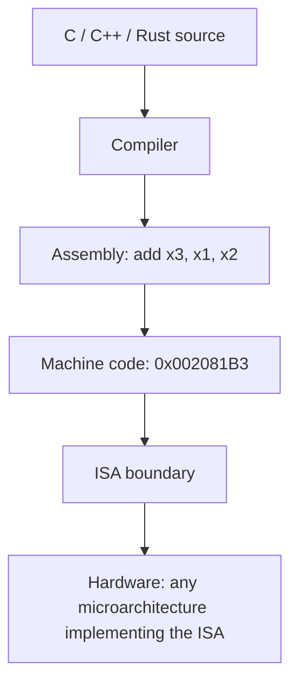

::: basics
### In plain words
The ISA (instruction set architecture) is the rulebook a processor offers to software. It lists the instructions, how each is written in bits, the registers, how memory addresses work, and how interrupts and errors behave. It is a contract: software depends only on the ISA, so the hardware inside can change.

### Picture it
Think of a restaurant menu. Customers order from the menu, and each dish has a fixed description. The kitchen can change its stoves, staff and layout, as long as the dishes that arrive match the menu. Likewise, a program written for an ISA runs on any chip that follows it, whether the chip is tiny or huge.

### Words you need
- **Instruction**: one basic command the processor understands, such as add.
- **Register**: a small fast storage spot named in the instruction.
- **Opcode**: the part of an instruction's bits that says which operation it is.
- **RISC / CISC**: simple, regular instructions versus larger, more complex ones ([[q0917]]).
- **Microarchitecture**: the hardware design that carries out the ISA ([[q0912]]).

### The simplest example
In the RISC-V ISA, `add x3, x1, x2` means "put x1 plus x2 into x3". It is stored as one 32-bit word, 0x002081B3 (the 0x means hexadecimal). The word is made of fields: an opcode saying "register arithmetic", the destination register 3, the source registers 1 and 2, and a field that selects "add". Change only that last field and the same word becomes `sub`, 0x402081B3. The assembler (the tool that turns written instructions into bits) and every compliant chip agree on this layout.

That is the whole idea: an ISA fixes meaning and bit layout. The rest of this page covers everything else an ISA specifies (memory, exceptions, privilege), how RISC and CISC differ, and the choices an ISA designer faces.
:::

::: testing
Whether you understand the **hardware/software contract**. A strong answer:

1. Defines an ISA as the programmer-visible interface of a processor: instructions, registers, data types, addressing modes, memory model, exceptions and I/O conventions.
2. Separates it clearly from microarchitecture ([[q0912]]): the ISA says *what*, the implementation decides *how fast and how*.
3. Knows the main families and trade-offs: RISC vs CISC, fixed vs variable length, load/store vs memory operands, and gives real examples (x86-64, Arm, RISC-V).
4. Can show an actual instruction encoding, proving you can connect assembly to bits.
:::

::: why
The ISA is the boundary between software and hardware. Compilers target it, operating systems build on it, binaries are compatible because of it, and a hardware team's first deliverable is often an ISA spec or a choice of an existing one. Choosing Arm vs RISC-V vs x86 for a product is an ISA decision with licensing, ecosystem and efficiency consequences. In interviews it shows whether you can talk about computers as layered abstractions, move between assembly and gates, and understand why the same program can run on very different chips.
:::

::: concepts
- **Instruction**: a binary word telling the CPU to do one operation. Fetched and decoded in the fetch/execute cycle. See [[q0905]].
- **Registers**: named architectural storage (e.g. 32 integer registers in RISC-V RV32I); the PC is one. See [[q0903]].
- **Addressing modes**: how operands are specified (register, immediate, base+offset, PC-relative).
- **Memory model and endianness**: how loads/stores behave and how multi-byte values are laid out. See [[q0893]] for number bases and byte order.
- **Microarchitecture**: the hardware implementing an ISA. See [[q0912]].
- **Software stack**: compiler, assembler, linker and OS that rely on the ISA and ABI.
:::

::: answer
"An ISA, instruction set architecture, is the interface between software and the processor hardware. It defines everything a programmer or compiler needs to know to write correct code for that CPU: the set of instructions and their binary encodings, the registers, the data types, how memory is addressed, how loads and stores behave, and how interrupts and exceptions work.

The important point is that it's a contract. Software only depends on the ISA, and the hardware team is free to implement it however it likes. That's why the same ARMv8-A program runs on a tiny in-order core and a big out-of-order one, and why x86 binaries from decades ago still run on new chips. The implementation is the microarchitecture.

There are different styles. RISC ISAs like Arm and RISC-V have simple, mostly fixed-length instructions, lots of registers and a load/store model where only loads and stores touch memory. CISC like x86 has variable-length instructions and complex ones that can operate directly on memory. For example in RISC-V, add x3, x1, x2 is a 32-bit word, 0x002081B3, with fields for the opcode, destination register and two source registers. Compilers target the ISA, and the choice of ISA affects code density, decoder complexity, power, ecosystem and licensing."
:::

::: technical
**Definition.** The ISA is the abstract model of a processor as seen by the programmer and the specification of its behaviour. It typically covers:

- **Instruction set**: operations (arithmetic, logical, shift, load/store, branch/jump, system, optional SIMD/FP/atomic) and their binary encodings.
- **Registers**: number, width, special registers (PC, status/flags, stack pointer by convention), and any hardwired registers (RISC-V `x0` always reads 0).
- **Data types and widths**: bytes, halfwords, words, 64-bit, floating point formats (IEEE 754).
- **Addressing modes**: register, immediate, base + offset, PC-relative, and for CISC memory-operand forms.
- **Memory model**: address space, alignment rules, byte ordering (little-endian in x86 and most Arm/RISC-V systems), and ordering/consistency rules for multicore.
- **Exception/interrupt model and privilege levels.**
- **I/O**: memory-mapped or port-mapped.

The ABI (calling convention, stack layout) is a software-level extension agreed on top of the ISA.

**RISC vs CISC.**

| | RISC (Arm, RISC-V, MIPS) | CISC (x86) |
|---|---|---|
| Instruction length | Mostly fixed (32-bit; compressed 16-bit optional) | Variable (1 to 15 bytes) |
| Memory access | Load/store only; operations on registers | Many instructions take memory operands |
| Registers | Many (16 to 32 GPRs) | Fewer architectural (16 in x86-64) |
| Decode | Simple | Complex; modern cores translate to internal micro-ops |
| Code density | Lower (unless compressed encoding) | Often higher |

**Encoding example (RISC-V RV32I R-type).** `add x3, x1, x2`: funct7=0000000, rs2=00010, rs1=00001, funct3=000, rd=00011, opcode=0110011, which assembles to 0x002081B3. `sub x3,x1,x2` differs only in funct7=0100000: 0x402081B3. I-type `addi x5, x0, 10` is 0x00A00293.

**Why it matters for the hardware.** Fixed-length, regular encodings make decode fast and simple. The ISA determines the register-file ports, the ALU operations needed, and what hazards and exceptions the pipeline must handle.
:::

::: short
"An ISA, or instruction set architecture, is the contract between software and a processor: the instructions and their encodings, the registers, data types, addressing modes, memory model and exception behaviour. Software only depends on the ISA, so different microarchitectures can implement the same ISA and run the same binaries. RISC ISAs like Arm and RISC-V use simple fixed-length load/store instructions, while CISC like x86 has variable-length, more complex ones. Examples are x86-64, Arm and RISC-V."
:::

::: long
"The ISA is the part of the processor that software can see. It specifies the instructions and how they're encoded in bits, how many registers there are and what they're called, the data types, how memory addresses are formed, how loads and stores behave, and what happens on interrupts and exceptions. A compiler or assembly programmer needs only that.

It's an abstraction boundary. Below it is the microarchitecture, the pipeline, caches and so on, which can change without breaking software. That's why a program built for ARMv8-A runs on a small in-order core or a big out-of-order one, and why x86 compatibility has lasted decades.

There's a classic split in styles. RISC, like Arm and RISC-V, uses a small set of simple instructions, mostly one fixed length like 32 bits, plenty of registers, and a load/store design where only load and store touch memory. That makes decode and pipelining easy. CISC, represented by x86, has variable-length instructions from one to fifteen bytes and complex instructions with memory operands; modern x86 chips decode those into simpler internal micro-ops anyway.

To make it concrete, in RISC-V the instruction add x3, x1, x2 is the 32-bit word 0x002081B3: seven bits of opcode, five bits for the destination, a function field, five bits for each source and a seven-bit function extension. The same layout is used for most register-register operations, which is what makes the hardware decoder cheap.

When choosing an ISA for a product you weigh software ecosystem, code density, power, extensibility and licensing. Arm is licensed, x86 is proprietary to two vendors, and RISC-V is open and modular with optional extensions."
:::

::: terms
- **ISA (instruction set architecture)**: the programmer-visible specification of a processor.
- **Opcode**: the field of an instruction that selects the operation.
- **Operand**: data an instruction acts on: register, immediate or memory.
- **Register file**: the architectural registers available to software.
- **Addressing mode**: the way an instruction specifies where an operand is.
- **RISC / CISC**: reduced vs complex instruction set styles.
- **Load/store architecture**: only load and store instructions access memory; others use registers.
- **Endianness**: byte order of multi-byte values in memory (little-endian: least-significant byte at lowest address).
- **ABI**: the software calling convention and binary interface layered on the ISA.
- **Instruction format**: the layout of fields within an instruction word.
- **ISA extension**: an optional addition, like SIMD, floating point or the RISC-V compressed set.
:::

::: exceptional
**An average answer** says "it's the set of instructions a CPU understands".

**An exceptional answer**:
- Defines it as a **contract** including registers, memory model, exceptions and encodings, not just a list of opcodes.
- Clearly separates **ISA from microarchitecture** with a concrete pair (Cortex-A53 vs A76, or Intel vs AMD x86-64).
- Compares **RISC and CISC** with specifics (fixed vs variable length, load/store, decode complexity) and notes that modern x86 cores translate to micro-ops.
- Shows an **encoding** (e.g. `add x3,x1,x2` = 0x002081B3) and explains the fields.
- Discusses selection criteria: ecosystem, density, power, licensing and extensibility (RISC-V's modular open ISA).
- Mentions the ABI as the software-level layer.
:::

::: mistakes
- **Equating ISA with a particular chip.** The ISA is a specification; many chips implement it.
- **Mixing up ISA and microarchitecture**: pipeline depth, caches and branch prediction are not part of the ISA. See [[q0912]].
- **Saying RISC means "fewer instructions".** The "reduced" refers to simplicity and regularity of instructions, not a tiny instruction count; modern RISC ISAs have hundreds of instructions with extensions.
- **Claiming CISC is always slower.** Microarchitecture matters more; high-performance x86 and Arm cores are both competitive.
- **Calling RISC-V "a chip" or "free chips".** It's an open ISA specification; implementations may be open or proprietary.
- **Forgetting that the ISA includes memory ordering, exceptions and privilege**, not only arithmetic instructions.
:::

::: deep
## The contract idea

Imagine writing a compiler. You need to know: which operations can I emit, how many registers can I use to hold variables, what is the instruction encoding, how do I load a 32-bit constant, how are function calls made, what happens on an overflow or a bad address? Everything the compiler needs, and nothing more, is the ISA (plus the ABI).


Figure: The ISA is the narrowest point in the stack. Everything above it targets the contract; everything below can be rebuilt (pipelined, out-of-order, different cache sizes) as long as it honours the same behaviour.

## What an ISA specifies

1. **Instructions and semantics.** Exactly what each does to registers, memory and flags, including corner cases (overflow, division by zero, shifts by more than the width).
2. **Encoding.** How each instruction is laid out in bits, so assemblers and decoders agree.
3. **Programmer-visible state.** Registers, PC, status registers, privilege mode.
4. **Data types.** Integer widths, floating point (IEEE 754), vectors.
5. **Addressing.** Address width (32/64-bit), alignment rules, endianness, address modes.
6. **Memory model.** What a load sees when other cores store; fences and atomics.
7. **Exceptions, interrupts and privilege.** Vectors, trap behaviour, user/supervisor modes, virtual memory model (page table format is usually architectural).

## A concrete case: RISC-V RV32I

RV32I has 32 integer registers `x0` to `x31`, each 32 bits wide, with `x0` hardwired to zero. Instructions are 32 bits long and come in six formats (R, I, S, B, U, J) which all keep the opcode in bits [6:0] and, where present, the register fields in the same positions. That regularity makes decode simple: the register read addresses can be pulled out before the instruction type is even known.

```svg
<svg viewBox="0 0 640 130" role="img" aria-label="RISC-V R-type instruction format with fields funct7, rs2, rs1, funct3, rd, opcode">
 <g font-family="Inter, sans-serif" font-size="12" fill="var(--d-ink)" text-anchor="middle">
  <rect x="32" y="40" width="126" height="36" fill="var(--d-box)" stroke="var(--d-ink)"/>
  <rect x="158" y="40" width="90" height="36" fill="var(--d-box)" stroke="var(--d-ink)"/>
  <rect x="248" y="40" width="90" height="36" fill="var(--d-box)" stroke="var(--d-ink)"/>
  <rect x="338" y="40" width="54" height="36" fill="var(--d-box)" stroke="var(--d-ink)"/>
  <rect x="392" y="40" width="90" height="36" fill="var(--d-box)" stroke="var(--d-ink)"/>
  <rect x="482" y="40" width="126" height="36" fill="var(--d-box)" stroke="var(--d-accent)" stroke-width="2"/>
  <text x="95" y="63">funct7</text><text x="203" y="63">rs2</text><text x="293" y="63">rs1</text>
  <text x="365" y="63">funct3</text><text x="437" y="63">rd</text><text x="545" y="63" font-weight="600">opcode</text>
  <text x="95" y="96" fill="var(--d-muted)">0000000</text><text x="203" y="96" fill="var(--d-muted)">00010</text><text x="293" y="96" fill="var(--d-muted)">00001</text>
  <text x="365" y="96" fill="var(--d-muted)">000</text><text x="437" y="96" fill="var(--d-muted)">00011</text><text x="545" y="96" fill="var(--d-muted)">0110011</text>
  <text x="95" y="116" fill="var(--d-muted)" font-size="11">7 bits</text><text x="203" y="116" fill="var(--d-muted)" font-size="11">x2</text><text x="293" y="116" fill="var(--d-muted)" font-size="11">x1</text>
  <text x="365" y="116" fill="var(--d-muted)" font-size="11">ADD/SUB</text><text x="437" y="116" fill="var(--d-muted)" font-size="11">x3</text><text x="545" y="116" fill="var(--d-muted)" font-size="11">OP (reg-reg)</text>
  <text x="32" y="28" font-size="11" fill="var(--d-muted)" text-anchor="start">bit 31</text>
  <text x="608" y="28" font-size="11" fill="var(--d-muted)" text-anchor="end">bit 0</text>
 </g>
</svg>
```
Figure: The 32-bit encoding of `add x3, x1, x2` in the RISC-V R-type format. Reading left to right: bits 31:25 funct7 (0000000), 24:20 rs2 (x2), 19:15 rs1 (x1), 14:12 funct3 (000), 11:7 rd (x3), 6:0 opcode (0110011). Concatenated: 0000 0000 0010 0000 1000 0001 1011 0011 = 0x002081B3. Changing only funct7 to 0100000 turns it into `sub`.

I computed these encodings with a small script so the hex values are right:

| Assembly | Format | Hex |
|---|---|---|
| `add x3, x1, x2` | R | 0x002081B3 |
| `sub x3, x1, x2` | R | 0x402081B3 |
| `addi x5, x0, 10` | I | 0x00A00293 |
| `lw x6, 8(x2)` | I | 0x00812303 |
| `sw x6, 12(x2)` | S | 0x00612623 |

Notice the S-type store splits its immediate into two fields so that rs1, rs2 sit at the same bit positions as in other formats. That is an ISA design decision made for hardware simplicity: the register file can start reading before decode finishes.

## Load/store vs memory operands

In a load/store ISA, adding two numbers in memory takes four instructions:

```
lw   x1, 0(x10)
lw   x2, 0(x11)
add  x3, x1, x2
sw   x3, 0(x12)
```
An x86-style ISA can do `add [mem], reg` in one instruction. The CISC form has better code density, but the hardware must do a load, an add and a store behind one instruction, which complicates pipelining. Modern x86 cores decode such instructions into micro-ops, effectively running a RISC-like core internally. The ISA is a compatibility layer; the microarchitecture ([[q0912]]) decides how it's really done.

## Design choices an ISA architect faces

- **Instruction length**: fixed (simple decode, can be less dense) vs variable (dense, harder to decode in parallel). RISC-V offers an optional 16-bit compressed extension for density.
- **Number of registers**: more registers reduce loads/stores but cost encoding bits (5 bits per field for 32 registers) and context-switch state.
- **Orthogonality and regularity**: same field positions for all formats.
- **Extensibility**: reserved opcodes, optional extensions (RISC-V is modular; Arm has profiles A, R and M).
- **Compatibility**: x86 carries decades of legacy; a new ISA can be cleaner but needs a software ecosystem.
- **Power and area**: decode complexity matters most for small, efficient cores.

## ISA vs ABI vs microarchitecture

| Layer | Question it answers | Changed when |
|---|---|---|
| ISA | What instructions and state exist? | New architecture version or extension |
| ABI | How do functions pass arguments, which registers are saved, how is the stack laid out? | New OS/toolchain convention |
| Microarchitecture | How fast and with what hardware? | Every new core generation |

> [!UNCERTAIN]
> Terminology varies. Textbooks (Patterson & Hennessy) say "architecture" for the ISA and "organization" for the implementation; vendors often say "architecture" for both. Say "ISA" and "microarchitecture" to be unambiguous.

## Families to name

- **x86 / x86-64**: variable-length CISC, dominant in PCs and servers.
- **Arm (ARMv7, ARMv8-A, ARMv9, Cortex-M profile)**: RISC; dominant in phones, tablets and MCUs.
- **RISC-V**: open, modular RISC ISA used from microcontrollers to accelerators.
- **MIPS, PowerPC**: older RISC families, still found in some embedded products.
- **Also**: DSP ISAs and GPU ISAs (often hidden behind a driver and intermediate representation).
:::

::: applications
- **Choosing a processor for a product**: Arm Cortex-M MCUs for low-power control, RISC-V cores for custom SoCs, x86 for PCs and servers.
- **Compilers and toolchains**: GCC and LLVM have a backend per ISA that maps source to its instructions.
- **Emulation and binary translation**: running x86 apps on Arm needs translation because the ISAs differ.
- **Custom instructions and extensions**: adding a SIMD or crypto extension to accelerate a workload (RISC-V is designed for it).
- **Verification**: ISA reference models and compliance test suites check that an implementation honours the contract.
- **Debugging and bring-up**: reading disassembly and register state means understanding the ISA.
:::

::: assumptions
- Examples use RISC-V RV32I because its encoding is public, regular and small enough to show; other ISAs have different formats.
- "ISA" means the user-level plus privileged specification; some people mean only the user-level instruction list.
- The RISC/CISC distinction is a spectrum: modern Arm has many instructions and x86 cores execute micro-ops, so the practical difference is mostly in encoding and decode.
- Little-endian byte order is assumed for the layouts mentioned, as in x86, RISC-V and most Arm systems; some ISAs allow either (bi-endian).
- If the interviewer means **ISA of a specific product** (e.g. an Arm Cortex-M4 with Thumb-2), the answer should mention variable-length 16/32-bit encoding in that case.
:::

::: followups
### What's the difference between an ISA and a microarchitecture?
The ISA is the contract: instructions, registers, memory model. Microarchitecture is how a specific chip implements it: pipeline, caches, predictors. Many microarchitectures implement one ISA, so the same binary runs on all of them, at different speeds. See [[q0912]].

### Decode this: what are the fields of the instruction 0x00A00293?
In binary it's 0000 0000 1010 0000 0000 0010 1001 0011. Opcode (bits 6:0) = 0010011 (OP-IMM), rd (11:7) = 00101 = x5, funct3 (14:12) = 000 (ADDI), rs1 (19:15) = 00000 = x0, imm (31:20) = 000000001010 = 10. So `addi x5, x0, 10`: load the constant 10 into x5, using x0 as zero.

### Why do RISC ISAs use load/store?
Restricting memory access to loads and stores keeps every other instruction simple and fixed-latency, with a regular pipeline: operands come from registers, so there's one memory stage and a simple hazard model. It makes decode and forwarding easy and the compiler optimizes register use. The price is more instructions for memory-to-memory work.

### How does x86 manage with complex variable-length instructions in a fast pipeline?
The front end decodes them, often several per cycle, into simple fixed-format micro-ops, caches the decoded micro-ops, and the back end is a RISC-like out-of-order engine. The ISA's complexity moves into the decoder, costing area and power but preserving compatibility with decades of software.

### What happens if two chips implement the same ISA but differ in a corner case, like integer divide by zero?
That's an ISA-level difference, so it matters: software can depend on it. A good ISA specifies those corner cases (RISC-V, for example, defines the result of division by zero rather than trapping), and compliance tests check them. Unspecified behaviour is a portability and security hazard.

### You need to pick an ISA for a new low-power sensor SoC. What do you weigh?
Software ecosystem and toolchain maturity, code density (flash size affects cost), power per MHz, licensing cost and terms, ability to add custom instructions, available IP cores and verification infrastructure, and long-term support. An Arm Cortex-M core is a mature, licensed choice; RISC-V offers no license fee and customization but needs more in-house or third-party support work.
:::

::: interpretations
In this list's computer-architecture section, "ISA" is paired with [[q0912]] (microarchitecture), and the earlier question [[q0898]] asks for computer architectures by name, which in practice means ISAs (x86, Arm, RISC-V) and organization styles (Von Neumann vs Harvard). This page defines the ISA itself; consult those pages for the naming list and for the implementation layer.
:::

::: references
- Patterson & Hennessy, *Computer Organization and Design: RISC-V Edition*: the chapter on instructions (the language of the computer) and the appendix/reference card for RV32I encodings.
- *The RISC-V Instruction Set Manual, Volume I: Unprivileged ISA*, RISC-V International: base integer ISA, instruction formats and encodings.
- Hennessy & Patterson, *Computer Architecture: A Quantitative Approach*: the appendix/chapter on instruction set principles.
- Harris & Harris, *Digital Design and Computer Architecture*: the architecture chapter, covering assembly language and machine language for a RISC ISA.
:::

::: rubric
- Defines the ISA as the hardware/software interface that software programs against :: This is the core definition.
- Lists what it contains: instructions, registers, data types, addressing modes, memory model, exceptions :: Shows it's more than a list of opcodes.
- Distinguishes ISA from microarchitecture and gives an example of multiple implementations :: The single most tested distinction.
- Compares RISC and CISC with concrete properties and examples :: Demonstrates breadth and ability to compare.
- Gives or decodes an instruction encoding :: Proves you connect assembly to bits and gates.
- Mentions families (x86-64, Arm, RISC-V) and selection factors such as ecosystem and licensing :: Connects theory to real choices.
- Mentions ABI or compatibility benefits :: Shows awareness of the software side.
:::

::: quiz
```json
[
 {"type":"mcq","level":"fundamental","q":"Which of the following is part of the ISA?","options":["The number of pipeline stages","The size of the L2 cache","The set of architectural registers and instruction encodings","The branch predictor algorithm"],"answer":2,"explain":"Registers and encodings are part of the programmer-visible contract. Pipeline depth, caches and predictors are implementation details of the microarchitecture."},
 {"type":"truefalse","level":"fundamental","q":"The same binary program can run on two different processors if they implement the same ISA, even if their internal designs differ.","answer":true,"explain":"That is the purpose of the ISA contract. Performance, power and area differ, but behaviour must match."},
 {"type":"mcq","level":"intermediate","q":"Which is typical of a RISC load/store ISA such as RISC-V?","options":["Arithmetic instructions can take memory operands directly","Instructions are variable length from 1 to 15 bytes","Only load and store instructions access memory, other instructions use registers","The ISA specifies the cache size"],"answer":2,"explain":"Load/store architectures keep ALU instructions register-only, which simplifies decode and pipelining. Memory operands and variable length are typical of x86."},
 {"type":"numeric","level":"intermediate","q":"In RISC-V RV32I, how many bits does the register field in an instruction need, given 32 integer registers?","answer":5,"tolerance":0.01,"unit":"bits","explain":"$\\log_2 32 = 5$ bits per register specifier. An R-type instruction therefore uses 3 x 5 = 15 bits for rd, rs1 and rs2."},
 {"type":"mcq","level":"intermediate","q":"The R-type instruction add x3, x1, x2 encodes to 0x002081B3. Which single field change turns it into sub x3, x1, x2 (0x402081B3)?","options":["funct3","funct7 (bit 30 set)","opcode","rd"],"answer":1,"explain":"ADD and SUB share opcode 0110011 and funct3 000; funct7 is 0000000 for ADD and 0100000 for SUB, which sets bit 30 and changes the top hex digits from 0x00 to 0x40."},
 {"type":"mcq","level":"advanced","q":"Why do high-performance x86 cores still work well despite a complex variable-length CISC ISA?","options":["x86 instructions are all executed directly as written","The front end decodes them into simpler micro-ops that a RISC-like out-of-order back end executes","x86 has no memory operands","The ISA forbids branches"],"answer":1,"explain":"The ISA is a compatibility layer. The decoder translates complex instructions to micro-ops, moving complexity into the front end while the execution core stays regular."}
]
```
:::
