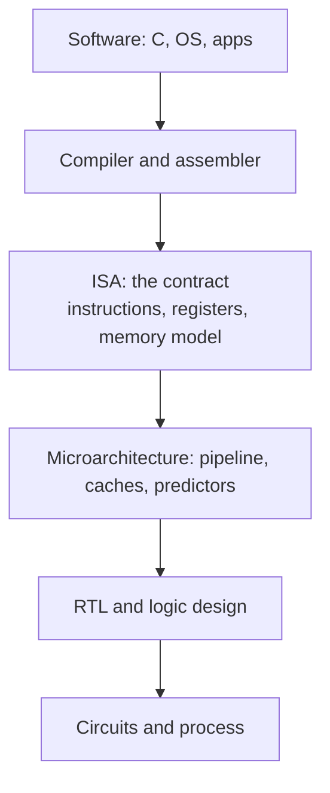

::: testing
Whether you can separate **what a processor promises** from **how it keeps the promise**. The interviewer is checking that you can:

1. Say that the ISA is the software-visible contract (instructions, registers, memory model, exceptions) and the microarchitecture is one particular hardware implementation of it.
2. Give a concrete example of one ISA with many microarchitectures (x86 from Intel and AMD, or Arm cores from tiny to huge).
3. Explain *why* the split exists: binary compatibility on one side, freedom to optimise on the other.
4. Name what is *not* part of the ISA (pipeline depth, cache sizes, branch predictor) and what can leak through anyway (timing, side channels).
:::

::: why
Almost every architecture discussion in a hardware interview quietly depends on this split. When someone says "RISC-V is open", "this core is out-of-order" or "this chip is 20% faster", you need to know which layer they are talking about. It also drives real business decisions: a company licensing an Arm or RISC-V ISA still has to spend years designing the microarchitecture, and a new core that runs the same binaries is how a product line improves without breaking software. Verification engineers lean on the same split: architectural state is what a reference model checks, and microarchitectural state is what the implementation is free to hide.
:::

::: concepts
- **ISA (instruction set architecture)**: the programmer-visible interface of a processor: opcodes, registers, addressing modes, data types, exception and memory-ordering rules. See [[q0913]].
- **Microarchitecture**: the organisation of one implementation: pipeline stages, issue width, caches, predictors, functional units. See [[q0912]].
- **Architectural state vs microarchitectural state**: registers, PC and memory are architectural; reorder buffer, rename tables, cache contents and predictor tables are not.
- **Binary compatibility**: software compiled for an ISA runs unchanged on any compliant implementation.
- **Implementation (RTL, circuits, process)**: the layer below microarchitecture, where gates and transistors are chosen.
- **Pipelining and caches**: the standard microarchitectural levers. See [[q0909]].
:::

::: answer
"The ISA is the contract between software and hardware. It defines what instructions exist, how many registers there are, how memory is addressed and what happens on an exception. If I compile a program for an ISA, that binary has to run on any chip that implements it. The microarchitecture is how a particular chip actually delivers that contract: how deep the pipeline is, how many instructions it issues per cycle, whether it executes out of order, how big the caches are, what branch predictor it uses.

The classic example is x86. An Intel core and an AMD core run the same binaries, but inside they're completely different designs. Same with Arm: a tiny in-order Cortex-M and a wide out-of-order Cortex-A both implement an Arm ISA, one for a microcontroller and one for a phone.

The reason the split matters is that it lets hardware change without breaking software. A new generation can be wider, faster and use a new predictor, and every old program still works. The ISA is stable and the microarchitecture is where the performance and power are won. The one caveat is that while microarchitecture is invisible to correct programs, it's not invisible to timing, which is why cache and speculation side channels exist."
:::

::: technical
**Definitions.** The ISA specifies the *architectural* behaviour a program can observe: the instruction encodings and semantics, the register file (count, width, special registers such as the PC and status flags), the memory model (addressing, alignment, endianness, ordering rules between loads and stores), the privilege levels and the exception/interrupt model. The microarchitecture is everything an implementation does to realise those semantics.

**What the ISA fixes and what it leaves free.**

| Item | ISA | Microarchitecture |
|---|---|---|
| Number of architectural registers | yes | no |
| Instruction semantics and encoding | yes | no |
| Pipeline depth (e.g. 5 vs 15+ stages) | no | yes |
| In-order vs out-of-order | no | yes |
| Issue width, number of ALUs | no | yes |
| Cache sizes, associativity, replacement | no | yes (ISA may define cache-maintenance instructions) |
| Branch predictor type | no | yes |
| Physical registers / renaming | no | yes |
| Clock frequency, process node | no | no (implementation) |

**Key invariant.** Any correct microarchitecture must make the program *appear* to execute one instruction at a time, in program order, with precise exceptions, even when it internally overlaps, reorders and speculates. Out-of-order cores achieve this with a reorder buffer that commits results in order.

**Performance link.** CPU time $= IC\times CPI\times T_{clk}$. The ISA and compiler mostly determine instruction count $IC$. The microarchitecture and circuit design mostly determine CPI and clock period. A deeper pipeline raises frequency but raises the cost of mispredictions, which hits CPI.

**Where the line blurs.** The ISA often includes things you would not guess: weak vs strong memory ordering (RISC-V RVWMO, x86-TSO) constrains what reordering a core may expose. Cache-line size is not architectural, but software that depends on it (for alignment or false-sharing avoidance) is effectively coupled to the implementation. Timing is never part of the ISA, yet speculative execution leaks microarchitectural state through timing.
:::

::: short
"The ISA is the contract software sees: instructions, registers, memory model, exceptions. The microarchitecture is how one chip implements that contract: pipeline, issue width, caches, branch predictor. One ISA, like x86 or Arm, has many microarchitectures, from tiny in-order cores to wide out-of-order ones, and they all run the same binaries. That split lets hardware improve every generation without breaking software."
:::

::: long
"I think of it as a stack. At the top is software compiled for an ISA. The ISA is the contract: it says which instructions exist, what they do, how many registers I have, how memory is addressed and ordered, and how exceptions behave. Below that is the microarchitecture, which is one particular way of building hardware that honours the contract. That's where you decide pipeline depth, whether the core is in-order or out-of-order, how many instructions you issue per cycle, how big and how associative the caches are, and what branch predictor you use. Below that again is the physical implementation: RTL, standard cells, the process node.

The best example is x86. Intel and AMD have both built many generations of cores, all with very different insides, and a binary built years ago still runs on all of them. Arm is the same story: a Cortex-M0 and a big out-of-order Cortex-A core implement related Arm ISAs but are totally different machines.

Why is it designed this way? Because the contract gives software a stable target and gives hardware designers freedom. If I improve the branch predictor or double the cache, nothing in the ISA changes, and every program just gets faster. In performance terms, CPU time is instruction count times CPI times clock period. The ISA and compiler mostly set instruction count; the microarchitecture sets CPI and, with the circuit design, the clock.

The one subtlety I'd mention is that the microarchitecture is hidden from correct programs but not from timing. Speculation and shared caches can leak information, which is why attacks like Spectre exist. So the ISA doesn't say how fast something is, but the implementation can still be observed."
:::

::: terms
- **ISA**: the architectural contract between software and hardware.
- **Microarchitecture**: a specific hardware organisation implementing an ISA.
- **Architectural state**: state defined by the ISA (registers, PC, memory) that software can observe.
- **Binary compatibility**: the same compiled program runs on all compliant implementations.
- **Out-of-order execution**: executing instructions as operands are ready but committing in program order.
- **Superscalar / issue width**: number of instructions started per cycle.
- **Precise exception**: the state seen at a fault matches in-order execution up to the faulting instruction.
- **Implementation**: the RTL, cells and process that realise a microarchitecture.
:::

::: exceptional
**An average answer** says "ISA is the instruction set and microarchitecture is how it's implemented" and stops.

**An exceptional answer**:
- Frames the ISA as a **contract** and gives the invariant: the machine must *look* like in-order, one-at-a-time execution to the programmer, even though it is not.
- Uses a concrete pair: same ISA, different microarchitectures (x86 Intel vs AMD; Cortex-M0 vs Cortex-A).
- Lists specific things on each side (register count and memory model vs pipeline depth and predictor).
- Ties it to $IC\times CPI\times T_{clk}$ so the split has a performance meaning.
- Brings up the leaks: memory-ordering rules are ISA, but cache timing and speculation attacks show microarchitecture is observable.
:::

::: mistakes
- **"RISC-V is a CPU."** It is an ISA; cores such as Rocket or BOOM (and commercial ones) are microarchitectures of it. See [[q0916]].
- **Putting the cache size in the ISA.** It is microarchitectural. The ISA may only give you instructions to flush or sync caches.
- **Calling pipelining or out-of-order "part of the ISA".** They are implementation choices that software cannot see.
- **Saying a new microarchitecture needs recompiled software.** Same ISA means same binary. Tuned compilers may get more from the new core, but correctness is unchanged.
- **Assuming a faster clock means a better microarchitecture.** A 5 GHz in-order core can lose to a 3 GHz wide out-of-order one because CPI differs.
- **Forgetting the exceptions-and-ordering rules are in the ISA.** Interrupts, privilege and memory ordering are not just "instructions".
:::

::: deep
## The layering


Figure: The ISA is the narrow waist. Everything above it is portable across implementations and everything below it is free to change. Performance, power and area are mostly decided below the line, while compatibility is decided at it.

This "narrow waist" idea is the whole point. IBM formalised it with the System/360 family in the 1960s: one architecture, a range of machines at different price points that ran the same programs. The idea survived because it decouples two groups with very different timescales. Software lives for decades. A microarchitecture is typically designed for a few years and replaced.

## One ISA, very different machines

Take a single instruction sequence:

```
lw  x5, 0(x2)
add x6, x5, x1
sw  x6, 0(x3)
```

An ISA-level view says: load a word, add it to $x1$, store it. The same three instructions can run in very different ways.

- **Small in-order core (3-stage)**: one instruction per cycle at best. The `add` stalls if it needs the loaded value before it arrives. Tiny area and a few mW. CPI around 1.2 to 1.5 on real code.
- **5-stage pipelined core with forwarding**: the load-use dependency costs one stall cycle, and CPI is near 1.1 to 1.3.
- **Wide out-of-order core**: decodes 4 to 8 instructions per cycle, renames registers, issues them when operands are ready, hides cache misses by running ahead, and may reach CPI well below 1 (IPC above 1) on friendly code, at the price of much more area and power.

Same binary, same final register and memory contents. Very different time and energy. Try the pipeline simulator to see how the same instructions behave when you change the implementation:

```sim
{"id":"pipeline-lab","program":"load-use","forwarding":true}
```
Figure: Toggle forwarding off and watch the stall cycles appear for the load-use pair. Forwarding is a microarchitectural feature; the program and ISA never change. Switch the program to `branch` to see the cost of flushes, which depends on pipeline depth rather than the ISA.

## Worked example: why the split pays for itself

Suppose a program has $IC = 10^9$ instructions and runs on core A (older design) at 2 GHz with CPI 1.6, then on core B (new microarchitecture, same ISA) at 3 GHz with CPI 1.1.

$$T_A = \frac{10^9\times 1.6}{2\times10^9} = 0.8\text{ s},\qquad T_B = \frac{10^9\times 1.1}{3\times10^9}\approx 0.367\text{ s}$$

Speedup $\approx 2.18\times$ with **no recompilation**. About 1.5x of that came from clock and 1.45x from CPI. The program, the compiler and the instruction count were untouched. That is exactly what a stable ISA buys you.

Now if the new generation changed the *ISA* (say, a new instruction that cuts $IC$ by 10% for some codes), every binary would need to be rebuilt to benefit, and old ones would not run on the new chips without emulation. This is why vendors add ISA extensions carefully and detect them at runtime.

## What the microarchitecture must hide

The most important rule is **precise, in-order-looking behaviour**. In an out-of-order core:

1. Instructions are fetched and renamed in order.
2. They execute out of order once operands arrive.
3. They **commit** in order from a reorder buffer (ROB), and only then update architectural state.

If a load faults, the ROB discards everything younger, so software sees the fault exactly where an in-order machine would show it. The ISA never mentions the ROB, but it requires the behaviour that the ROB provides.

## Real hardware: where the layers leak

> [!NOTE]
> Memory ordering is the sharpest example. The ISA must say what orderings other cores may observe. x86 uses a fairly strong model (total store ordering), while Arm and RISC-V allow more reordering and provide fence instructions. A microarchitecture can only reorder as much as the model allows, so a stronger ISA model forces more hardware (store-buffer snooping, speculation recovery) to keep performance.

Other leaks:

- **Timing and side channels.** Speculation runs ahead of the architectural point and leaves traces in caches and predictors. The architectural state is rolled back, but the cache state is not. Spectre-class attacks exploit exactly this gap between the two layers.
- **Cache-line size** is "microarchitectural", but library code that pads data to 64 bytes to avoid false sharing is baked to a typical implementation.
- **Instruction-cache coherence.** Self-modifying code or JITs must use explicit fence or cache-maintenance instructions, because the ISA does not promise the fetch path sees fresh stores automatically (on many ISAs).
- **Performance counters** expose microarchitectural events (cache misses, mispredicts). Their definitions are usually vendor-specific rather than ISA-defined.

> [!UNCERTAIN]
> Typical CPI numbers for the three core classes above depend heavily on workload; the ranges given are illustrative orders of magnitude, not measurements of a specific product.

## Design process view

A chip team usually starts by fixing the ISA (or licensing it), then writes a performance model of candidate microarchitectures, runs benchmarks through it, and picks pipeline depth, widths and cache sizes under power and area targets. Verification then checks the RTL against an ISA-level golden model: after every committed instruction, architectural state must match. Microarchitectural events are checked separately with assertions and coverage. This division is why the ISA is also the natural interface for compilers, OS ports and formal specs.
:::

::: applications
- **x86 desktop and server cores**: Intel and AMD sell very different microarchitectures that run the same operating systems and applications.
- **Arm family**: microcontroller-class Cortex-M cores and application-class Cortex-A cores share the Arm lineage but have vastly different pipelines and caches.
- **RISC-V cores**: open ISA with many independent implementations, from small embedded cores to high-performance out-of-order designs. See [[q0915]].
- **Generational upgrades**: a phone SoC moves to a new CPU core every year and old apps simply run faster.
- **Verification**: ISA-level reference models (instruction set simulators) are compared with RTL in lockstep to catch microarchitectural bugs.
:::

::: assumptions
- "ISA" here means the user-level plus privileged architecture a programmer or OS writer sees. Some people say "architecture" to mean ISA only, and others use it loosely to include microarchitecture. In interviews, clarify if the wording is ambiguous.
- Some ISAs deliberately expose more of the pipeline (early VLIW and the MIPS branch delay slot), which makes the split less clean. A branch delay slot is an ISA feature that exists because of a particular pipeline.
- "Microarchitecture" is sometimes also used for the system level (memory controller, interconnect). Here it refers to the core organisation.
- Implementation choices such as clock rate and process technology are below microarchitecture, but a design is usually judged on all of them together.
:::

::: followups
### Can two different microarchitectures of the same ISA give different program results?
Not for correct programs. Architectural state at every committed instruction must match. The exceptions are behaviours the ISA leaves undefined or implementation-defined (for example some uninitialised-value or unaligned-access behaviour, or unspecified instruction timing). Code that depends on those is non-portable.

### Is out-of-order execution part of the ISA?
No. It's a microarchitectural technique. The ISA only requires that the results and exceptions look like in-order execution. Some ISA design choices make OoO easier (fixed-length instructions, load-store form, enough registers to limit false dependencies), but the ISA does not mandate it.

### A new CPU generation has the same ISA but 30% higher IPC at the same clock. How can that happen?
Wider issue, bigger reorder buffer and instruction window, better branch prediction, larger or smarter caches and prefetchers, more execution ports, faster recovery from mispredictions. All of these cut CPI. Instruction count does not change unless the compiler targets new extensions.

### Give an example where microarchitecture shows through the ISA.
Speculative-execution side channels. Architecturally, a mispredicted path leaves no trace, but it can pull data into the cache, and the cache hit-or-miss timing is measurable with ordinary loads and a timer. Mitigations are partly ISA-level (new barrier instructions) and partly microarchitectural.

### You are asked to speed up a product without changing the software. What do you change?
Only things below the ISA: raise the clock via process or circuit work, improve the microarchitecture (width, predictor, caches, prefetch), or add specialised hardware that is transparent to software. Changing the ISA means recompiling or emulating. That is why the ISA is kept stable.
:::

::: interpretations
Some interviewers use "architecture" for the ISA and "microarchitecture" for the implementation, so "architecture vs microarchitecture" is the same question. [[q0912]] and [[q0913]] define each term separately; this question asks for the contrast. [[q0916]] applies the same split to RISC-V specifically.
:::

::: references
- Hennessy & Patterson, *Computer Architecture: A Quantitative Approach*: chapter 1 (fundamentals of quantitative design) and the ISA appendix, including the Iron Law of performance.
- Patterson & Hennessy, *Computer Organization and Design* (RISC-V edition): chapter 1 (abstractions: ISA as the hardware/software interface) and chapter 4 (the processor).
- Harris & Harris, *Digital Design and Computer Architecture*: chapter on microarchitecture, with single-cycle, multicycle and pipelined implementations of one ISA.
:::

::: rubric
- Defines the ISA as the software-visible contract (instructions, registers, memory model, exceptions) :: This is the core definition; without it the rest is vague.
- Defines microarchitecture as one implementation of that contract :: Shows you know it's a choice, not a given.
- Gives a concrete example of one ISA, many implementations :: Examples prove you understand compatibility, not only vocabulary.
- Lists items on each side (pipeline, predictor, caches vs registers and encoding) :: Concrete classification is what interviewers probe next.
- Explains why the split exists (compatibility plus freedom to optimise) :: Shows engineering reasoning rather than memorisation.
- Links to performance: ISA and compiler set instruction count, microarchitecture sets CPI and cycle time :: Connects the idea to the Iron Law.
- Mentions that microarchitecture can leak through timing or side channels :: Distinguishes a thoughtful candidate.
:::

::: quiz
```json
[
 {"type":"mcq","level":"fundamental","q":"Which of the following is part of the ISA rather than the microarchitecture?","options":["Number of pipeline stages","Size of the L2 cache","Number and width of architectural registers","Branch predictor algorithm"],"answer":2,"explain":"Software can see how many registers exist and how wide they are, so they are architectural. Pipeline depth, cache size and the predictor are implementation choices invisible to a correct program."},
 {"type":"truefalse","level":"fundamental","q":"Two processors that implement the same ISA must have the same pipeline.","answer":false,"explain":"The ISA only fixes software-visible behaviour. A 3-stage in-order core and an 8-wide out-of-order core can implement the same ISA and run the same binaries."},
 {"type":"numeric","level":"intermediate","q":"A program with $10^9$ instructions runs on a 2 GHz core with CPI 1.6 and on a newer core of the same ISA at 3 GHz with CPI 1.1. What is the speedup (old time / new time), no recompilation?","answer":2.18,"tolerance":0.02,"unit":"x","explain":"$T_{old}=10^9\\cdot1.6/2\\times10^9=0.8$ s and $T_{new}=10^9\\cdot1.1/3\\times10^9=0.367$ s, so the speedup is $0.8/0.367\\approx2.18$."},
 {"type":"mcq","level":"intermediate","q":"An out-of-order core executes instructions in a different order than the program. Why is this still ISA-correct?","options":["The ISA allows any order","Results are committed in program order, so architectural state and exceptions look sequential","Out-of-order is part of the ISA","Software is told to avoid dependent instructions"],"answer":1,"explain":"The reorder buffer retires instructions in order, so registers, memory and exceptions behave as if instructions ran one by one. The reordering is hidden inside the microarchitecture."},
 {"type":"multi","level":"advanced","q":"Select everything that is a microarchitectural (not architectural) feature.","options":["Reorder buffer","Memory consistency model","Rename tables / physical register file","Instruction encoding formats"],"answer":[0,2],"explain":"The reorder buffer and rename tables are internal to a particular implementation. The memory model and encodings are specified by the ISA and visible to software."}
]
```
:::
