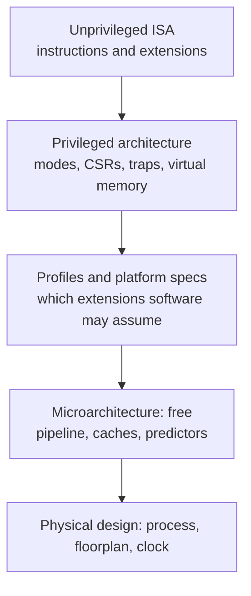

::: basics
### In plain words
RISC-V is an ISA, which means it is a specification. It defines the instructions, registers and rules that software can see. It does not say how many pipeline stages a chip has, whether it runs instructions out of order, or how big its caches are. Those choices are the microarchitecture, and each RISC-V chip makes its own.

### Picture it
Think of a piece of sheet music. The score fixes which notes are played and in what order. A school band and a full orchestra can both play it. They differ in speed, size and cost. RISC-V is the score, and each chip design is a different orchestra. The score does set some rules every performer must respect.

### Words you need
- **ISA**: the contract between software and hardware ([[q0913]]).
- **Microarchitecture**: a chip's internal design that carries out the ISA ([[q0912]]).
- **Core**: one specific processor design that implements the ISA.
- **Pipeline, out-of-order, cache**: internal speed tricks. They overlap the steps of several instructions, run instructions as soon as their inputs are ready, and keep recent data in a small fast memory.
- **Extension**: an optional standard addition to the ISA. Software only runs on cores that have the extensions it needs.

### The simplest example
Take one loop of 8 instructions per pass, with one hard-to-predict branch and one load that sometimes misses the cache. Run the identical RISC-V binary (compiled program) on three cores. The page's illustrative model gives 8.8 cycles per pass on simple core A, 8.9 on core B, and 4.5 on a wide out-of-order core C. At 1 GHz for A and B, and 2 GHz for C, the times are 8.8 ns, 8.9 ns and 2.25 ns. That is roughly a 4 times gap with the same software.

That is the whole idea: "RISC-V" says nothing about speed. The rest of this page lists what the ISA fixes and what it leaves free, and how software can read identity registers to learn about the core it is running on.
:::

::: testing
A short question with one correct answer, **ISA**, and the interviewer is looking at how well you back it up. They want to see that you:

1. Answer directly: RISC-V specifies an ISA (plus related system specs), not a microarchitecture.
2. Can name concrete things RISC-V leaves open: pipeline, caches, branch prediction, issue width.
3. Can name implementations (Rocket, BOOM, commercial cores) as the microarchitectures.
4. Understand the subtle part: the ISA still pins down some behavior (memory model, exceptions) that constrains microarchitecture, and leaves some *implementation-defined* choices that software can discover.
:::

::: why
This question is a quick check that you don't conflate "RISC-V" with a processor. It matters in practice: when a team says "we are using RISC-V", the real decisions are which extensions, which core, which memory system. Performance, area and power come from the microarchitecture and the physical design. Treating RISC-V as a product leads to wrong expectations, like assuming all RISC-V chips have similar speed or are binary-compatible by default. It also sets up the economics: open ISA, but cores still have to be designed and verified.
:::

::: concepts
- **ISA vs microarchitecture**: contract versus implementation. See [[q0914]].
- **RISC-V base and extensions**: the spec defines RV32I/RV64I plus optional extensions. See [[q0915]].
- **Implementation-defined behavior**: places where the spec lets each core choose (cache, number of PMP regions, supported address bits).
- **Memory model (RVWMO)**: ISA-level rules for how loads and stores from different harts may appear reordered.
- **Privileged architecture**: modes, CSRs, traps and virtual memory, also specified at the ISA level.
- **Core families**: independent microarchitectures that all implement the same ISA.
:::

::: answer
"RISC-V specifies the ISA, not the microarchitecture. The spec says what instructions exist, what they do, what the registers and privilege modes are, how traps and virtual memory behave and what memory ordering you can rely on. It says nothing about how many pipeline stages you have, whether you issue in order or out of order, how big the caches are or what branch predictor you use. Those are design choices for whoever builds the core.

That's why you see very different RISC-V cores. Berkeley's Rocket is a simple in-order pipeline, BOOM is a superscalar out-of-order design, and there are tiny two-stage microcontroller cores and big commercial server-class cores. They all run the same compliant software, but their area, power and speed are completely different.

There are a couple of nuances. The ISA does constrain the implementation, for example through its weak memory model and precise exceptions, so you can't build anything you like. And the spec leaves some implementation-defined parameters that software can query, like which extensions are present in the misa register and the vendor and architecture IDs. But those describe the core; they don't dictate its internals."
:::

::: technical
**Short answer.** RISC-V International ratifies *specifications*: the unprivileged ISA (instructions and extensions), the privileged architecture (modes, CSRs, traps, virtual memory), and supporting standards such as the debug specification, interrupt-controller specs and platform/profile definitions. None of them mandates a pipeline organization.

**What the ISA fixes.**
- Instruction formats, semantics and the register file (x0 to x31, x0 = 0).
- Exception and trap behavior: precise exceptions, `mcause`/`mepc`, privilege transitions (M, S, U).
- Virtual-memory schemes (Sv32, Sv39, Sv48) and page-table formats.
- The memory consistency model: RVWMO (weak), with optional Ztso for total store ordering.
- Atomic semantics of the A extension (LR/SC, AMOs).

**What is left to the implementation.**
- Pipeline depth, in-order vs out-of-order, issue width, number of functional units.
- Cache hierarchy, TLB organization, prefetchers, branch predictors, speculation depth.
- Physical register count, rename/ROB sizes, load/store queue design.
- Timing: instruction latencies and throughput are not specified.
- Clock frequency, process node, power management.

**Implementation-defined but software-visible.** Some choices are architecturally observable. A core must report them so software can adapt: `misa` reports the base width and supported extensions (on implementations that provide it), `mvendorid`, `marchid` and `mimpid` identify vendor, architecture and implementation, and WARL (write-any-read-legal) CSR fields let software discover which values are supported. The number of PMP regions and supported physical-address bits are also implementation-specific.

**Constraint example.** RVWMO allows loads and stores to be reordered in limited ways. A core with a simple in-order, blocking-cache pipeline trivially satisfies it. An out-of-order core with a store buffer and speculative loads must track enough state to guarantee that every execution it can produce is allowed by the model.

**Performance consequence.** $T = IC\times CPI\times T_{clk}$. For a given binary $IC$ is the same on all cores implementing the same ISA and extensions. CPI and $T_{clk}$ differ widely between microarchitectures, so "a RISC-V chip" tells you almost nothing about speed.
:::

::: short
"It specifies the ISA. RISC-V defines the instructions, registers, privilege modes, traps, virtual memory and memory model, but not the pipeline, caches or branch predictor. Those are microarchitecture, chosen by whoever builds the core. That's why in-order cores like Rocket and out-of-order cores like BOOM can both be RISC-V and run the same software at very different speeds and power."
:::

::: long
"RISC-V is an ISA specification. RISC-V International publishes documents that say what a compliant processor must do: the instruction set and its extensions, the register state, the privileged architecture with machine, supervisor and user modes, the trap and exception behavior, virtual memory schemes and the memory consistency model. If your core obeys those, software built for that ISA runs on it.

What the spec deliberately doesn't say is how you build it. Pipeline depth, in-order versus out-of-order, how many instructions you issue per cycle, cache sizes, TLBs, branch predictors, prefetchers, all of that is microarchitecture. So there are very different RISC-V cores. Berkeley's Rocket is a five-stage in-order design. BOOM is a superscalar out-of-order core. There are tiny microcontroller cores with two or three stages, and commercial cores aimed at phones or servers. Same ISA, different area, power and performance.

It's worth being precise about two nuances. First, the ISA does reach into the implementation through its rules. The memory model, precise exceptions and atomic semantics limit what a microarchitecture can do. A speculative out-of-order core has to be built so that nothing it does violates those rules. Second, some implementation choices are exposed to software but only as parameters. For example, the misa register reports which extensions are present, and the vendor, architecture and implementation ID registers tell you which core you are on. Software can adapt to those, but it can't see the pipeline.

In performance terms, instruction count is fixed by the ISA and compiler, while CPI and clock period come from the microarchitecture. So saying 'it's a RISC-V chip' tells you nothing about how fast it is."
:::

::: terms
- **ISA specification**: the document defining architecturally visible behavior.
- **Microarchitecture**: the internal organization of a particular core.
- **Hart**: a hardware thread, the RISC-V term for an execution context.
- **WARL**: write-any, read-legal; a CSR field that stores only legal values.
- **misa / mvendorid / marchid / mimpid**: CSRs that describe extensions and identify the vendor, architecture and implementation.
- **RVWMO / Ztso**: RISC-V weak memory ordering and the optional total store ordering extension.
- **Rocket / BOOM**: Berkeley's in-order and out-of-order RISC-V core generators.
- **Profile**: a named bundle of extensions for software compatibility.
:::

::: exceptional
**An average answer** says "ISA" and maybe adds "the implementation is up to the designer".

**An exceptional answer**:
- Gives the one-word answer first, then proves it with a list of what is and is not specified.
- Names two microarchitectures of the same ISA (in-order Rocket vs out-of-order BOOM) and what differs.
- Notes the interaction: memory model and precise exceptions constrain microarchitecture.
- Mentions that implementation-defined parameters are discoverable via CSRs, rather than hidden.
- Ties it to the Iron Law: same instruction count, different CPI and clock.
- Mentions that RISC-V International also specifies platforms, debug and interrupt controllers, which are still not core microarchitecture.
:::

::: mistakes
- **"RISC-V is an open-source CPU."** It is an open ISA. Some implementations are open source.
- **Saying RISC-V mandates a five-stage pipeline.** The five-stage design is a textbook example, not a requirement.
- **Assuming all RISC-V cores perform alike.** Microarchitecture dominates performance.
- **Thinking microarchitecture is free of constraints.** The memory model, exceptions and extensions bound what hardware may do.
- **Believing a RISC-V binary runs on every RISC-V chip.** It runs where the required extensions and privilege features exist.
- **Calling the SoC "RISC-V".** The SoC includes caches, memory controllers and peripherals outside the ISA. See [[q0926]].
:::

::: deep
## The specification stack

RISC-V is not one document but a family of them, and it helps to see where each sits relative to the core internals.


Figure: Everything above the Microarchitecture box constrains behavior software can see. Everything below is the implementer's freedom. Profiles exist to stop the top of the stack from fragmenting into incompatible extension combinations.

## The same ISA, three machines

To make the claim concrete, run a simple loop on three plausible RISC-V microarchitectures. Suppose a loop has 8 instructions per iteration, including one load that misses the L1 cache one time in 20, and one hard-to-predict branch that mispredicts 10 percent of the time.

| | A: small 3-stage in-order | B: 5-stage in-order | C: 4-wide out-of-order |
|---|---|---|---|
| Base CPI (no stalls) | 1.0 | 1.0 | 0.35 (IPC about 2.9) |
| Branch mispredict penalty | 2 cycles | 3 cycles | 14 cycles |
| L2 hit penalty on L1 miss | 12 cycles, fully exposed | 12 cycles, fully exposed | 12 cycles, about half hidden |

Count stalls per iteration. Branches: 1 per iteration, 10% mispredict. Load misses: 1 load, 5% miss.

- A: $8\times1.0 + 0.1\times2 + 0.05\times12 = 8.8$ cycles, so CPI $=1.10$.
- B: $8\times1.0 + 0.1\times3 + 0.05\times12 = 8.9$ cycles, CPI $=1.11$.
- C: $8\times0.35 + 0.1\times14 + 0.05\times12\times0.5 = 2.8+1.4+0.3 = 4.5$ cycles, CPI $=0.56$.

(These pipeline parameters are illustrative, chosen to show the arithmetic, not measurements of Rocket, BOOM or any product.) The instruction count is 8 per iteration on all three, so the binary is identical. If A and B ran at 1 GHz and C at 2 GHz, time per iteration is 8.8 ns, 8.9 ns and 2.25 ns, roughly a 4x gap from the same software. Notice also that C's mispredict penalty is large: it pays 1.4 of its 4.5 cycles for a branch the in-order cores barely notice, which is the deep-pipeline trade-off.

> [!UNCERTAIN]
> The CPI and penalty values above are a teaching model. Real values depend on the exact design, the workload mix and the memory system.

## Where the ISA reaches into the implementation

If the ISA said nothing at all about hardware behavior, you could not write an operating system for it. Several rules cross the boundary:

1. **Precise traps.** When an exception occurs at instruction $i$, all older instructions must have completed and none younger may have modified architectural state. An out-of-order core needs a reorder buffer, or equivalent, to meet this.
2. **RVWMO.** Loads and stores from one hart may be observed in a different order by another hart unless fences or acquire/release annotations on atomics order them. This lets hardware use store buffers and non-blocking caches, but sets a floor. A core that wants to be **Ztso** (total store ordering, like x86) must do extra work in its load/store unit to hide reordering.
3. **Instruction-fetch ordering.** Stores are not automatically visible to instruction fetch; `fence.i` is required. That keeps the I-cache simple, since it need not snoop stores.
4. **Atomicity.** LR/SC reservations must be cleared in certain circumstances, which bounds how aggressive the cache coherence protocol may be.

## Discoverability: how software meets the microarchitecture

Software cannot see the pipeline, but it can read identity registers. `mvendorid` holds a JEDEC-based vendor ID, `marchid` identifies the base microarchitecture (assigned by the vendor or RISC-V International for open cores) and `mimpid` is the implementation version. Operating systems and firmware use them to apply errata workarounds for specific cores. This is how the open ISA handles a world with many implementations: the ISA stays common while errata and tuning are keyed to the ID.

> [!NOTE]
> Behavior that is "implementation-defined" in the spec is still usually observable. For example, the physical-address width and the number of PMP entries vary between cores. Portable software must probe or be told by a device tree, not assume.

## Real hardware: what actually differs between RISC-V chips

When engineers compare RISC-V parts they compare things the ISA never mentions: how many cycles a load-use costs, what the L1 size is, whether the multiplier is single-cycle or iterative (a 32x32 multiply can take 1 cycle with a big array or 32+ cycles with a small shift-add unit), whether there is a floating-point unit, and how deep the debug and trace support goes. An RV32IM core with an iterative divider can take dozens of cycles per `div`, whereas a large core might do it in under ten. Both are compliant, and both give the same quotient. Only time differs.

This is why verification flows check a core against an ISA-level golden model: after every committed instruction the architectural state must match, and microarchitectural features are tested separately. It is also why the open ISA does not remove the work of building a core, which is the hard part.
:::

::: applications
- **Berkeley Rocket and BOOM**: open generator-based cores, one in-order and one out-of-order, both RISC-V, used in research and teaching.
- **Commercial IP cores**: vendors license RISC-V cores ranging from tiny microcontroller cores to high-performance application cores.
- **Custom accelerators**: a team builds its own tiny RISC-V control core with custom instructions, tuning microarchitecture for area and power.
- **Software stack porting**: Linux, compilers and firmware depend on the ISA, so they work across different cores, using ID registers for errata.
- **Verification and compliance**: test suites and formal models check that implementations match the specification.
:::

::: assumptions
- "ISA" includes the privileged architecture. Some people use it for just the unprivileged instruction set; either way, none specifies pipeline structure.
- RISC-V International also publishes platform-level specs (interrupt controllers, debug, trace). These constrain system behavior but not core microarchitecture.
- Core names (Rocket, BOOM) are real open-source generators from Berkeley; the CPI numbers in the worked table are illustrative parameters, not benchmarks of them.
- A particular core may implement only a subset of optional features, so "RISC-V compliant" must be read together with the extension list or profile.
:::

::: followups
### If RISC-V doesn't specify microarchitecture, why are all RISC-V designs not wildly incompatible?
Compatibility is at the ISA level. Any compliant core executes the same instructions with the same architectural results. Incompatibility arises only from different optional extensions or custom instructions, which profiles address.

### Can a microarchitecture violate the ISA and still be fast?
It can be fast but would be non-compliant. For example, reordering stores in a way RVWMO forbids might improve performance and break software that relies on ordering. Correctness at the architectural level comes first.

### How would you pick a RISC-V core for a battery-powered sensor node vs a Linux gateway?
Sensor node: RV32IMC-class core, 2 to 3 stage in-order, small or no cache, low leakage. Gateway: RV64GC application core with MMU, caches and enough performance for Linux. Same ISA family, completely different microarchitectures chosen for power and area versus throughput.

### Where would you look to find out what a particular RISC-V core supports?
The core's documentation and the `misa`, `mvendorid`, `marchid` and `mimpid` CSRs for what the hardware reports, plus the device tree or platform spec for system configuration. Not all CSRs are mandatory, so vendor docs remain the authority.

### An out-of-order RISC-V core passes all functional tests but a multithreaded program shows a rare ordering bug. Which layer do you suspect?
Check the memory model first. RVWMO allows many reorderings, so the program may be missing fences or acquire/release annotations and just got lucky on a stronger in-order core. If the program is correct under RVWMO, suspect a hardware bug in the load/store unit's ordering or coherence handling.
:::

::: interpretations
This is the RISC-V-specific version of [[q0914]]. Literally the answer is "ISA", but because the question follows "What is RISC-V?" ([[q0915]]), interviewers often want the explanation of what that means and the examples of implementations, which the page gives.
:::

::: references
- *The RISC-V Instruction Set Manual, Volume I: Unprivileged ISA* and *Volume II: Privileged Architecture* (RISC-V International), including the sections on memory model (RVWMO), trap behavior and the machine-level ID CSRs.
- Patterson & Hennessy, *Computer Organization and Design: RISC-V Edition*, chapter 1 (ISA as interface) and chapter 4 (several implementations of one RISC-V subset).
- Hennessy & Patterson, *Computer Architecture: A Quantitative Approach*, appendix on ISA principles and chapter on instruction-level parallelism for out-of-order implementations.
:::

::: rubric
- Answers "the ISA" directly :: The question has a clear answer and hedging wastes the interviewer's time.
- Lists what the spec defines (instructions, registers, privilege, traps, memory model) :: Shows you know what an ISA contains.
- Lists what it leaves open (pipeline, caches, predictors, issue width) :: This is the definition of microarchitecture.
- Gives example cores that implement the same ISA differently :: Examples prove the claim.
- Notes ISA rules that constrain implementations (RVWMO, precise exceptions) :: Shows depth beyond the slogan.
- Mentions identification and discoverability (misa, marchid) or extension profiles :: Shows practical software/hardware awareness.
- Connects to performance via instruction count, CPI and clock :: Explains why the distinction matters.
:::

::: quiz
```json
[
 {"type":"mcq","level":"fundamental","q":"Does RISC-V specify the ISA or the microarchitecture?","options":["Microarchitecture, including a 5-stage pipeline","The ISA (plus related system specifications), not the microarchitecture","Both, since it defines cache sizes","Neither, it only defines a programming language"],"answer":1,"explain":"RISC-V defines instructions, registers, privilege levels, traps, memory model and so on. Pipeline organization, caches and predictors are left to implementers."},
 {"type":"multi","level":"fundamental","q":"Select the items that are microarchitectural choices rather than RISC-V ISA requirements.","options":["L1 cache size","Branch predictor design","Meaning of the `add` instruction","Out-of-order vs in-order issue"],"answer":[0,1,3],"explain":"The semantics of `add` come from the ISA. Cache size, predictor and issue order are implementation choices."},
 {"type":"numeric","level":"intermediate","q":"A loop has 8 instructions per iteration, base CPI 1.0, one branch with 10% mispredict rate and a 3-cycle penalty, and one load with a 5% miss rate and 12-cycle penalty. What is the CPI?","answer":1.11,"tolerance":0.02,"unit":"","explain":"Cycles per iteration: $8 + 0.1\\cdot3 + 0.05\\cdot12 = 8.9$. CPI $=8.9/8\\approx1.11$."},
 {"type":"truefalse","level":"intermediate","q":"Two RISC-V cores that both implement RV64GC can differ widely in performance for the same binary.","answer":true,"explain":"Instruction count is identical but CPI and clock frequency depend on pipeline, caches and prediction, so performance can differ by an order of magnitude or more."},
 {"type":"mcq","level":"advanced","q":"Why does the RISC-V weak memory model (RVWMO) matter to microarchitects?","options":["It specifies the number of cache levels","It forces an in-order pipeline","It defines which load/store reorderings other harts may observe, bounding what the load/store unit may do","It only affects the compiler, not hardware"],"answer":2,"explain":"RVWMO is an ISA-level rule. Hardware may reorder and buffer as long as every possible observed execution is permitted, which constrains the design of store buffers, speculation and coherence."}
]
```
:::
