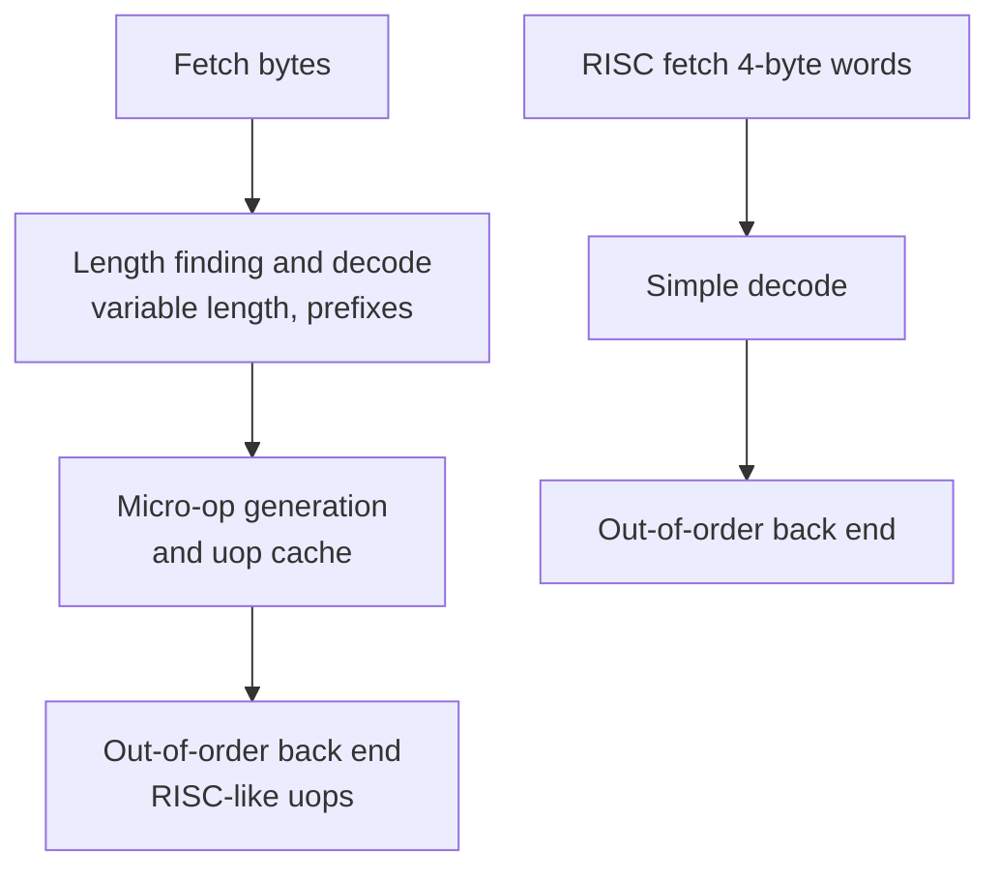

::: basics
### In plain words
RISC and CISC are two styles of instruction set. RISC uses a small set of simple instructions that are all the same size, and only loads and stores touch memory. CISC has richer instructions of varying size, and one can do several things, like adding a number straight from memory. RISC's advantages are mostly in hardware: simpler decoding, cleaner pipelines and smaller control logic.

### Picture it
Think of giving directions. RISC says: "walk one block, turn left, walk one block". Each step is simple and quick to understand. CISC says: "go to the library", which is one short instruction, but the listener must work out many steps. Short directions save paper. Simple steps are easier for a pipeline to handle in an assembly-line way.

### Words you need
- **Load/store architecture**: only load and store instructions access memory. Everything else works on registers.
- **Decode**: working out what an instruction asks for. Same-size instructions make this easy.
- **Micro-op**: a simple internal step. Modern x86 chips split complex instructions into these.
- **Code density**: how compactly a program is encoded.
- **CPI**: average cycles per instruction ([[q0918]]).

### The simplest example
Take "add register R2 to the value in memory at A". CISC does it in 1 instruction. RISC takes 3: load, add, store. With the page's teaching numbers, a CISC program has $10^9$ instructions at CPI 2.2, and a RISC program has $1.4 \times 10^9$ at CPI 1.1, both on a 2 GHz clock. CISC takes 1.10 s and RISC takes 0.77 s. RISC has 40% more instructions but half the CPI.

That is the whole idea: RISC trades more instructions for simpler hardware. The rest of this page shows how modern CISC chips hide the complexity internally, how that shifts the trade-off, and where code density still matters.
:::

::: testing
Whether you can give a balanced, modern answer instead of reciting 1980s slogans. The interviewer wants to see that you can:

1. Define both styles correctly: RISC is simple, uniform, load/store instructions; CISC has rich, variable-length instructions, often with memory operands.
2. Explain the **hardware** advantages of RISC: simpler decode, easier pipelining, smaller control logic, more registers, lower power per instruction.
3. Use the Iron Law to show the trade-off, since CISC wins on instruction count and RISC on CPI.
4. Admit that modern x86 translates CISC instructions into RISC-like micro-ops, so the real difference today is mostly in the front end, code density, and ecosystem.
:::

::: why
RISC versus CISC is the oldest architecture debate, and it is a favorite because a shallow answer ("RISC is faster") is easy to give and wrong. In real work the question shows up when choosing between Arm, RISC-V and x86 for a product: power budget, decode complexity, software compatibility and licensing all matter. Knowing *why* RISC helps (regular encoding enabling pipelining and wide decode) lets you reason about new ISAs rather than memorize labels. See also [[q0915]] for a modern RISC.
:::

::: concepts
- **RISC**: reduced instruction set computer. Fixed-length instructions, load/store only memory access, many registers, simple addressing modes.
- **CISC**: complex instruction set computer. Variable-length instructions, memory operands in ALU instructions, many addressing modes, some multi-step instructions.
- **Iron Law**: $T=IC\times CPI\times T_{clk}$. See [[q0918]].
- **Pipelining**: overlapping instruction stages, much easier when every instruction is similar. See [[q0909]].
- **Micro-operations (uops)**: simple internal operations that CISC front ends translate instructions into.
- **Code density**: bytes per unit of work, where CISC traditionally wins.
:::

::: answer
"RISC machines keep the instruction set small and regular: fixed-length instructions, only loads and stores touch memory, and arithmetic works on a big register file. CISC instructions are richer, variable length, and can do things like add a value straight from memory.

The advantages of RISC are mostly in hardware. Fixed-length, uniform instructions make decoding trivial, so the decoder is small and you can decode several per cycle. Every instruction goes through roughly the same stages, which makes pipelining clean and keeps the clock fast and the CPI close to one. The control logic is smaller and uses less area and power, and it leaves room for more registers or cache. It's also easier for compilers to generate good code for a regular ISA.

CISC's argument is code density and fewer instructions, which was a big deal when memory was expensive. In terms of the Iron Law, CISC lowers instruction count but tends to raise CPI, and RISC does the reverse. In practice today the line has blurred. Modern x86 cores split CISC instructions into RISC-like micro-ops internally, so you pay for that decode in area and power at the front end. That's partly why Arm and RISC-V do well in power-limited devices."
:::

::: technical
**Typical RISC characteristics.** Fixed instruction length (32 bits, optionally 16 with compression), load/store architecture, 16 to 32 or more general registers, few addressing modes (base plus offset), three-operand register instructions, no or few microcoded instructions. Examples: Arm, RISC-V, MIPS, Power.

**Typical CISC characteristics.** Variable length (x86: 1 to 15 bytes), ALU instructions with memory operands, many addressing modes, two-operand destructive forms (in classic x86), specialized string and loop instructions, microcode for complex cases. Example: x86 (and historically VAX, 68k).

**Advantages of RISC (hardware view).**
1. **Simple, fast decode.** Fields are in fixed positions; next instruction address is PC+4. Wide decode (4 to 8 per cycle) is cheap. x86 needs length-finding, prefix handling and a uop cache or complex decoders.
2. **Clean pipelining.** Uniform instructions use the same stages once each, avoiding structural hazards and variable-latency memory access in the middle of ALU instructions.
3. **Smaller control logic**, so less area and power for the same performance, and shorter design and verification time.
4. **More registers** (32 versus 16 in x86-64) reduce spills to memory.
5. **Predictable cost model** for compilers and schedulers.
6. **Easier precise exceptions**, since an instruction does at most one memory access and one register write.

**Where CISC helps.** Higher code density (smaller I-cache footprint, less fetch bandwidth), a memory-operand instruction replaces a load plus an ALU op, and decades of binary compatibility.

**Iron Law view.**
$$T = IC\times CPI\times T_{clk}$$
Illustrative: if CISC needs 0.7 times the instructions but averages CPI 2.5, while RISC needs 1.0 times at CPI 1.3 (same clock), then CISC time $\propto 0.7\times2.5 = 1.75$ and RISC time $\propto 1.3$, giving RISC about $1.35\times$ faster. These are teaching numbers, not measurements.

**Modern reality.** High-performance x86 cores decode CISC instructions into uops and then run a RISC-like out-of-order engine. Arm and RISC-V cores are also out-of-order and superscalar. The remaining differences are front-end complexity, code density (the RISC-V C extension and Arm Thumb narrow the gap) and ecosystem.
:::

::: short
"RISC uses simple, fixed-length, load/store instructions with lots of registers. That makes decode cheap and pipelining clean, so you get low CPI, a fast clock and less area and power. CISC packs more work into each instruction and has better code density, which lowers instruction count. By the Iron Law it's a trade between IC and CPI. Today x86 translates to micro-ops internally, so the difference is mostly the cost of the front end."
:::

::: long
"RISC and CISC are two philosophies for the instruction set. RISC means a small, regular set of instructions: all the same length, memory touched only by loads and stores, and arithmetic on registers, with a large register file. CISC means richer instructions of varying length, often with memory operands, and many addressing modes. x86 is the main CISC example, and Arm and RISC-V are RISC.

The advantages of RISC are mostly about making the hardware simple. With fixed-length instructions and fixed field positions, decode is trivial and the next instruction is always at PC plus four, so you can decode several instructions per cycle cheaply. Because every instruction does roughly the same kind of work, the pipeline is regular: fetch, decode, execute, memory, writeback, with few special cases. That gives a high clock rate and a CPI near one in simple designs. The control logic is smaller, so there's less area and power, and that leaves transistors for registers or cache. Having 32 registers also means fewer spills to memory. And a simple ISA is easier for compilers.

CISC's strength is code density and fewer instructions: one instruction can load, add and store. That reduces instruction fetch bandwidth and cache footprint. If you look at the Iron Law, time is instruction count times CPI times clock period. CISC reduces IC but tends to increase CPI, while RISC does the opposite.

The honest modern answer is that the gap has narrowed. High-end x86 chips decode instructions into RISC-like micro-ops and run a RISC-style out-of-order core. The price is a heavier front end, which costs power and area. That's one reason Arm and RISC-V are attractive in power-limited devices, though x86 is also very competitive on performance. The microarchitecture usually matters more than the label."
:::

::: terms
- **Load/store architecture**: only load and store instructions access memory; ALU operations use registers.
- **Variable-length encoding**: instructions of different sizes, as in x86.
- **Micro-op (uop)**: a simple internal operation generated by decoding a complex instruction.
- **Microcode**: stored sequences of micro-operations implementing complex instructions.
- **Code density**: how compactly a program encodes the work.
- **CPI / IPC**: cycles per instruction, instructions per cycle.
- **Addressing mode**: how an instruction forms an operand's memory address.
- **Iron Law**: execution time = IC x CPI x cycle time.
:::

::: exceptional
**An average answer** says "RISC is simpler and faster, CISC does more per instruction".

**An exceptional answer**:
- Frames the advantages as **enabling** pipelining and wide decode: regular encoding, fixed length, load/store.
- Uses the Iron Law to show that neither style wins in the abstract: it trades IC against CPI and clock.
- Mentions that x86 decodes into uops, so the cost of CISC shows up as front-end area/power and not as a slower back end.
- Quantifies one point (for example 15-byte max x86 instruction length vs fixed 4 bytes, or 16 vs 32 registers).
- Mentions code density counter-measures in RISC (Thumb, RISC-V C) and ends with "microarchitecture dominates the label".
:::

::: mistakes
- **"RISC has fewer instructions, so it's faster."** Fewer instruction *types* is not the point, and RISC programs usually have more dynamic instructions.
- **"CISC is obsolete."** x86 dominates PCs and servers, and its internal uop engine is very RISC-like.
- **Ignoring code density.** RISC's bigger code can cost I-cache misses and fetch bandwidth.
- **Saying RISC has no complex instructions.** Modern RISC ISAs include multiply/divide, vector, atomics and cryptography ops.
- **Confusing ISA style with implementation.** Out-of-order, superscalar and pipelining are not RISC-only. See [[q0914]].
- **Claiming a power win is guaranteed.** Many factors (process, design effort, frequency target) matter as much as ISA.
:::

::: deep
## What problem was RISC solving?

In the late 1970s, compilers were weak, memory was expensive and implementation of control logic used microcode. Architects added powerful instructions (the VAX had polynomial evaluation and queue manipulation) to close the "semantic gap" between high-level languages and hardware. Studies at IBM, Berkeley and Stanford noticed that compilers rarely used the complex instructions, that most executed instructions were simple moves, adds and branches, and that the control logic for the complex ones consumed die area and slowed the common case. The RISC idea: make the common case fast by building a simple, regular machine, and let the compiler assemble complex operations from simple ones.

## One operation, two encodings

Consider `mem[A] = mem[A] + R2`:

| ISA style | Instructions | Bytes (typical) |
|---|---|---|
| CISC (x86-like) | `add [A], R2` | about 3 to 7 |
| RISC (load/store) | `lw t0, 0(a0)` ; `add t0, t0, a2` ; `sw t0, 0(a0)` | 12 (or 6 to 10 with compressed forms) |

CISC has 1 instruction versus 3. Yet inside a modern x86 core the single instruction is cracked into the same primitive operations (load, add, store-address, store-data; some cores micro-fuse pairs of these so they track as fewer uops), and the RISC core executes the equivalent 3 instructions. So the work done is nearly identical. The difference is *where the complexity lives*: the x86 front end has to decode a variable-length instruction and crack it into uops, and the RISC front end just reads three simple words.


Figure: The two top rows show why CISC is paid for in the front end. After decode, both styles feed a similar out-of-order engine. The x86 path needs extra stages (and often a micro-op cache so the expensive decode can be skipped on hot loops), which costs power.

## The Iron Law trade-off, with numbers

$$T=IC\times CPI\times T_{clk}$$

Suppose a benchmark compiles to $10^9$ instructions on the CISC ISA and $1.4\times10^9$ on the RISC ISA (RISC has 1.4 times as many instructions). Take CPI 2.2 for a simple multi-cycle CISC implementation and CPI 1.1 for a pipelined RISC, same 2 GHz clock.

- CISC: $T=10^9\times2.2/(2\times10^9)=1.10$ s
- RISC: $T=1.4\times10^9\times1.1/(2\times10^9)=0.77$ s

RISC wins by $1.43\times$, which is the story of the 1980s: IC grew 40%, CPI halved. Now give the CISC design an out-of-order, uop-based core with CPI 1.1 as well. Then CISC time is $10^9\times1.1/(2\times10^9)=0.55$ s, faster than RISC, because it has fewer instructions to retire (though its clock may be lower and its front end hotter). That is the modern story: once both can reach similar CPI, what matters is instruction count, clock, and power.

```sim
{"id":"pipeline-lab","program":"alu","forwarding":true}
```
Figure: With a simple ALU program on the classic 5-stage RISC pipeline, CPI approaches 1 after the fill. Switch to `load-use` and `branch` to see the hazards that remain. A regular ISA makes these hazards few and easy to detect; variable-length, memory-operand instructions would add structural and decode complexity to this picture.

## Why regularity helps hardware, concretely

1. **Decode width.** To decode $N$ RISC instructions per cycle you place $N$ copies of a small decoder at fixed 4-byte offsets. For x86, the start of instruction $k+1$ depends on the length of instruction $k$, so a naive decoder is serial; real designs use predecode bits in the I-cache or a uop cache. Either way it costs area and power.
2. **Register file ports.** In fixed formats rs1 and rs2 are always in the same bits, so register reads start immediately, in parallel with decode.
3. **Exceptions.** A RISC instruction touches memory at most once and writes at most one register, so restart after a page fault is simple. An x86 `rep movs` or a push with memory operands can fault midway and must be restartable.
4. **Register count.** With 32 architectural registers, a compiler keeps more values in registers. Studies (and common experience) show fewer loads and stores than with 8 or 16 registers, which saves both instructions and energy. x86-64 moved from 8 to 16 registers and saw a measurable benefit.

## Where RISC pays and where it doesn't

- **Power-limited designs** (phones, microcontrollers): a lean decoder saves milliwatts on a core whose total budget is a watt or less. A few percent of core power spent in decode is significant when the whole core is small. Large x86 cores amortize decode over a bigger machine.
- **Code size**: RISC code is larger, so I-cache and flash cost more. RISC-V C and Arm Thumb-2 recover most of this with 16-bit forms.
- **Software moat**: instruction set differences do not stop Arm from running well on servers or x86 from running in laptops. Compatibility and ecosystem often override technical differences.

> [!UNCERTAIN]
> Claims such as "x86 decode costs X percent of core power" vary by study and microarchitecture generation. Treat any single percentage with caution. The qualitative statement (decode and front end are costlier for variable-length CISC) is well supported.

## Real hardware example

A modern x86 core can issue 6 or more uops per cycle from a micro-op cache but only decode a smaller number of instructions per cycle from the legacy path, which is why hot loops that fit the uop cache run faster and use less energy. Apple, Arm and other fixed-length designs have demonstrated very wide decode (8 or more instructions per cycle) because finding instruction boundaries is free. That is a direct, measurable result of the ISA style.
:::

::: applications
- **Smartphones and tablets**: Arm RISC cores dominate, where decode energy and area matter.
- **Microcontrollers**: Cortex-M (Thumb) and RISC-V RV32 cores for small, low-power, cheap chips.
- **PCs and servers**: x86 CISC with a RISC-like core inside, driven by software compatibility.
- **Embedded Linux boards and servers on Arm/RISC-V**: chosen for power efficiency and licensing flexibility.
- **Compilers and toolchains**: regular ISAs simplify instruction selection and scheduling.
:::

::: assumptions
- "RISC" and "CISC" are tendencies rather than a strict binary. Real ISAs mix traits (Arm has load/store but also complex addressing modes; x86-64 has 16 registers and RISC-like uops internally).
- Numbers like 15-byte maximum x86 instruction length and 4-byte fixed RISC length are architectural facts, but CPI and IC ratios in the worked examples are illustrative.
- The comparison is at the ISA level. Differences in process node, design effort and frequency targets often swamp the ISA effect in real chips.
- In 1980s textbooks CISC was assumed to be microcoded and RISC hardwired. Modern cores of both types use hardwired fast paths with microcode only for rare instructions.
:::

::: followups
### If modern x86 is RISC inside, why not just throw the CISC decoder away?
Binary compatibility. The installed software base is vast, so the ISA must stay. What vendors do is minimize the decode cost with uop caches, predecode and wide dispatch. The ISA is a business and ecosystem constraint more than a technical one.

### What is a load/store architecture and why does it help?
Only loads and stores access memory; arithmetic works on registers. This keeps each instruction to at most one memory access, so the pipeline has one memory stage and exceptions are simple. It makes timing predictable and lets the scheduler overlap memory latency with computation.

### Does RISC always need more instructions?
Usually somewhat more (often 10 to 40 percent more dynamic instructions, depending on benchmark and ISA), because it lacks memory-operand ALU ops and complex addressing. But more registers can reduce loads and stores, narrowing the gap, and fused or compressed instructions help further.

### Which would you choose for a coin-cell-powered sensor node and why?
A small RISC core (Cortex-M or RV32IMC): tiny area and leakage, simple in-order pipeline, good code density with 16-bit encodings, and available ecosystems. A big x86 core would waste power on decode and out-of-order structures the workload doesn't need.

### Suppose a RISC and a CISC chip have the same IPC and clock. Which uses less energy per task?
Depends on instruction count and energy per instruction. If the CISC chip needs 30 percent fewer instructions but spends more energy decoding each, it can be a wash. Measure both. The IPC-and-clock equality removes the performance difference but not the energy one, which is driven by front-end and circuit design.
:::

::: interpretations
"Some advantages of RISC vs CISC" expects benefits of RISC first, but a balanced answer includes what CISC offers. The question is architecture-level and sits after [[q0914]] and [[q0916]]; the Iron Law connection leads straight into [[q0918]].
:::

::: references
- Hennessy & Patterson, *Computer Architecture: A Quantitative Approach*: ISA chapter/appendix (RISC vs CISC discussion) and the performance equation in chapter 1.
- Patterson & Hennessy, *Computer Organization and Design*: sections on the RISC design principles and the pipelined datapath.
- Patterson & Ditzel, "The Case for the Reduced Instruction Set Computer", *ACM SIGARCH Computer Architecture News* (1980), the original RISC argument.
- Intel 64 and IA-32 Architectures Software Developer's Manual (Intel), for x86 instruction format and the 15-byte maximum length.
:::

::: rubric
- Defines RISC and CISC correctly (fixed vs variable length, load/store vs memory operands) :: The comparison collapses without correct definitions.
- Gives hardware advantages: simple decode, clean pipelining, small control, more registers :: These are the reasons RISC is attractive.
- Uses the Iron Law to show IC vs CPI trade-off :: Shows quantitative reasoning rather than slogans.
- Acknowledges CISC advantages (code density, fewer instructions) :: Balance signals maturity.
- Notes that modern x86 breaks instructions into micro-ops :: Shows you know the current state of the art.
- Mentions front-end power/area cost and power-limited markets :: Connects theory to product decisions.
- Concludes that microarchitecture and ecosystem often outweigh ISA style :: Demonstrates judgment.
:::

::: quiz
```json
[
 {"type":"mcq","level":"fundamental","q":"Which feature is characteristic of RISC?","options":["Variable-length instructions up to 15 bytes","Load/store architecture with fixed-length instructions","Memory operands in most ALU instructions","Heavy use of microcode"],"answer":1,"explain":"RISC ISAs access memory only through loads and stores and use fixed-length (or few-length) encodings. Variable length, memory operands and microcode are CISC traits."},
 {"type":"mcq","level":"fundamental","q":"Why does a fixed instruction length help a wide decoder?","options":["Instruction boundaries are known without decoding earlier instructions, so several can be decoded in parallel","It reduces the number of registers","It makes the clock faster by itself","It removes the need for caches"],"answer":0,"explain":"With fixed length the Nth instruction starts at a known offset, so N decoders work in parallel. With variable length the start of the next instruction depends on the previous one."},
 {"type":"numeric","level":"intermediate","q":"CISC: $10^9$ instructions, CPI 2.2. RISC: $1.4\\times10^9$ instructions, CPI 1.1. Same 2 GHz clock. By what factor is RISC faster (CISC time / RISC time)?","answer":1.43,"tolerance":0.02,"unit":"x","explain":"$T_{CISC}=10^9\\cdot2.2/2\\times10^9=1.10$ s; $T_{RISC}=1.4\\times10^9\\cdot1.1/2\\times10^9=0.77$ s; ratio $=1.43$."},
 {"type":"truefalse","level":"intermediate","q":"Modern high-performance x86 cores execute CISC instructions directly, with no internal translation.","answer":false,"explain":"They decode instructions into simpler micro-ops and execute those in a RISC-like out-of-order engine, often caching them in a micro-op cache."},
 {"type":"multi","level":"advanced","q":"Select the genuine advantages of a RISC ISA for hardware.","options":["Simpler, smaller decode logic","Easier pipelining and precise exceptions","Always lower instruction count","Larger architectural register files are practical"],"answer":[0,1,3],"explain":"RISC typically needs more dynamic instructions, not fewer. The other three are real hardware benefits of regular, load/store encodings."}
]
```
:::
