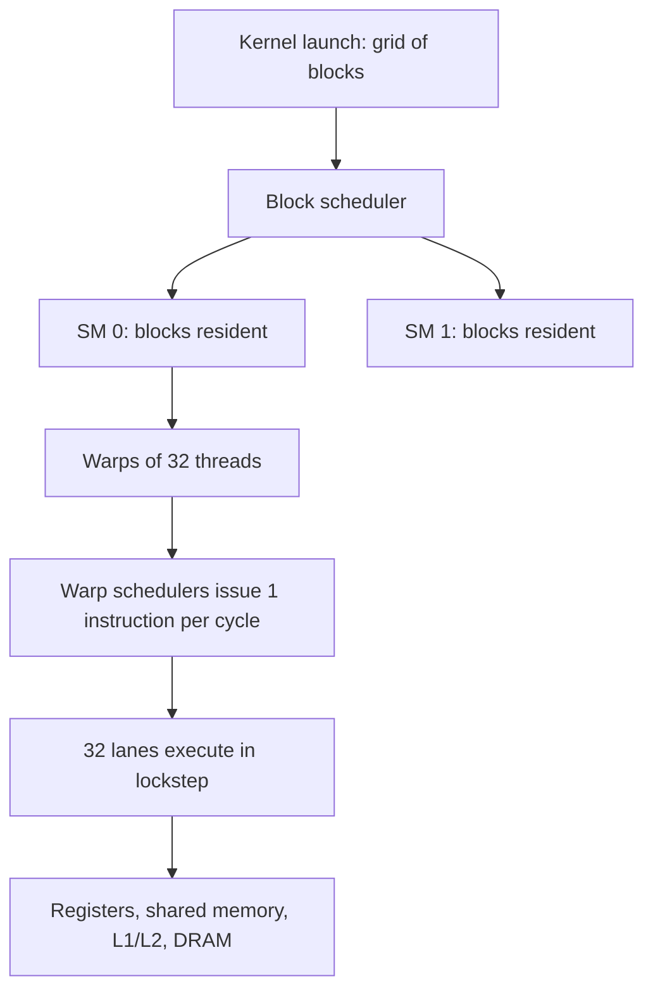

::: basics
### In plain words
You write a small program called a kernel for one thread, then launch it across thousands or millions of threads. The hardware bundles threads into groups of 32 called warps. A warp runs one instruction on all 32 of its lanes (small arithmetic units) at once. When a warp must wait for memory, the GPU switches to another ready warp, so the waiting is hidden by having many threads.

### Picture it
Picture one chef tending many pots. While one pot simmers, which is like waiting for memory, the chef stirs another, so no time is wasted. The more pots there are, the less the chef ever stands idle. One difference: the 32 lanes in a warp must all do the same step together, like 32 burners controlled by one knob.

### Words you need
- **Kernel**: the function launched on the GPU and run by many threads.
- **Warp**: a group of 32 threads that execute the same instruction together.
- **Latency hiding**: switching to another warp while one waits, so the processor stays busy.
- **Divergence**: lanes in one warp wanting different branches. The warp runs each path in turn.
- **Coalescing**: merging neighboring threads' memory reads into one wide read.

### The simplest example
Say a memory load takes 400 cycles, and a warp does about 10 independent instructions between loads. To keep the processor busy, it needs roughly 400 / 10 = 40 other warps ready to run. That is why a GPU keeps thousands of threads resident.

Memory pattern matters too. If 32 threads read 32 consecutive 4-byte numbers, that is 128 bytes in one transaction. If they read scattered addresses, it takes up to 32 transactions, and bandwidth collapses.

That is the whole idea: hide waiting with parallelism, and keep threads in step. The rest of this page works through launching a kernel, a cycle-by-cycle timeline, how many warps fit, and the numbers for divergence and coalescing.
:::

::: testing
Whether you understand the **execution model**, not just that "it has many cores". A strong answer shows that you know:

1. Work is expressed as a grid of threads that run the same kernel, grouped into blocks and hardware warps.
2. Warps execute in lockstep (SIMT), so branch divergence costs time.
3. Latency is hidden by switching between many resident warps, not by caches and speculation.
4. The memory hierarchy (registers, shared memory, caches, DRAM) and access patterns such as coalescing decide performance.
:::

::: why
If you only know "a GPU has lots of cores" you cannot predict why one kernel runs at 90% of peak and a similar one at 5%. Hardware and architecture engineers need the mechanism: the scheduler, the register file, the memory coalescer. These explain the design trade-offs (area spent on registers instead of caches, wide memory buses) and are what interviewers probe after [[q0919]]. The same ideas appear in every GPU, from mobile to datacenter, even though the vendor names differ.
:::

::: concepts
- **SIMT**: one instruction fetched and decoded, executed by 32 (or 64) threads in lockstep. See [[q0919]].
- **Thread hierarchy**: threads form blocks (workgroups); blocks form a grid; blocks are assigned to SMs.
- **Warp scheduling**: each cycle the scheduler picks a ready warp to issue.
- **Branch divergence**: lanes taking different paths are masked, so both paths run.
- **Memory hierarchy**: registers, shared memory/L1, L2, DRAM, each with different size, bandwidth and latency.
- **Coalescing**: merging a warp's addresses into few wide memory transactions.
- **Pipelining**: GPUs are also deeply pipelined. See [[q0909]].
:::

::: answer
"You write a small program, called a kernel, for one thread, and launch it across a grid of thousands or millions of threads. The hardware groups threads into blocks, assigns blocks to streaming multiprocessors, and splits each block into warps of 32 threads. A warp is the real unit of execution: the SM fetches and decodes one instruction and all 32 lanes execute it at once on their own data. That's SIMT.

Each SM keeps many warps resident, with their registers all on chip. Every cycle the scheduler picks a warp that's ready and issues its next instruction. When a warp waits on a memory load, which can take hundreds of cycles, the scheduler just issues from another warp. So latency is hidden by parallelism, not by big caches.

Two things hurt. If threads in a warp take different branches, the warp runs both paths with lanes masked off, so you lose efficiency. And memory access patterns matter a lot: if the 32 threads read consecutive addresses the hardware merges them into one wide transaction, but scattered addresses become many transactions and bandwidth collapses. So good GPU code is about keeping warps full, avoiding divergence, coalescing memory and using on-chip shared memory for reuse."
:::

::: technical
**Execution hierarchy (CUDA terms; OpenCL/AMD equivalents in parentheses).**
- *Grid* of *blocks* (workgroups) of *threads* (work-items). A block runs entirely on one SM/CU and can share on-chip *shared memory* (local memory) and synchronize with barriers.
- Blocks are scheduled independently, in any order, onto SMs with enough free registers and shared memory.
- Each block is divided into *warps* of 32 threads (wavefronts of 32 or 64).

**Inside an SM.** A typical SM has several warp schedulers, each issuing one instruction per cycle from a ready warp to a set of lanes (for example 32 FP32 lanes per scheduler partition), plus special function units, load/store units, a large register file (on the order of 64K 32-bit registers), and a configurable shared memory/L1 (tens to hundreds of KB). All resident warps' registers stay allocated, so switching warps is free.

**Latency hiding.** If a memory operation takes $L$ cycles and a warp executes $k$ independent instructions between loads, covering the latency needs about $L/k$ other warps per scheduler. The number of resident warps (occupancy) is limited by registers per thread, shared memory per block, and a hardware cap on warps per SM.

**Branch divergence.** The hardware keeps an active mask. For `if (c) A else B`, if lanes disagree it executes A with a subset active, then B with the complement, then reconverges. Cost = time(A) + time(B). Efficiency can be as low as $1/32$.

**Memory hierarchy.** Registers (per-thread, fastest), shared memory (per-block, banked, around tens of cycles), L1/L2 caches, then DRAM (hundreds of cycles). Global-memory loads are *coalesced*: if the 32 addresses fall in the same 128-byte segment, one transaction serves the whole warp. Shared memory has 32 banks; threads hitting the same bank on different addresses serialize (bank conflicts).

**Synchronization.** Barriers inside a block, atomics across blocks, and kernel boundaries for global ordering. There is no global barrier inside a kernel.

**Throughput formula.** Peak FLOP/s $=N_{lanes}\times2\times f$ for FMA. Achieved performance is bounded by the roofline: $\min(\text{peak},\ \text{bandwidth}\times\text{arithmetic intensity})$.
:::

::: short
"You write a kernel for one thread and launch it over a huge grid. The hardware groups threads into warps of 32 that run the same instruction in lockstep on an SM. Each SM holds many warps, and when one stalls on memory the scheduler instantly issues another, so latency is hidden by parallelism. Divergent branches and uncoalesced memory accesses are what cost performance."
:::

::: long
"A GPU program is a kernel written from the point of view of a single thread, launched across a grid of thousands or millions of threads. The hardware groups those threads into blocks and assigns each block to a streaming multiprocessor. Inside the SM, each block is chopped into warps of 32 threads, and the warp is the real unit of execution. The SM fetches and decodes one instruction and all 32 lanes execute it on their own data at the same time. That's SIMT.

The key trick is how latency is handled. A DRAM load might take 400 cycles. A CPU fights that with caches and out-of-order execution. A GPU instead keeps lots of warps resident on each SM, with all their registers sitting in a big register file, and each cycle the scheduler picks any warp that's ready. When a warp issues a load and has to wait, another warp runs. Switching costs nothing, so with enough warps the ALUs stay busy. How many warps fit, called occupancy, depends on how many registers each thread uses and how much shared memory each block needs.

Then there are two performance traps. The first is branch divergence: since the warp shares one instruction stream, if some lanes take the if and others the else, the hardware executes both paths with lanes masked, and you pay for both. The second is memory access pattern. If the 32 threads read 32 consecutive floats, that's one 128-byte transaction. If they read with a stride of 32, it's up to 32 transactions and you waste almost all the bandwidth. So I'd use shared memory as a programmer-managed cache for data reuse, like tiles in matrix multiply, and keep accesses coalesced.

Put together: lots of independent threads, grouped in lockstep warps, hiding latency by switching, limited mostly by memory bandwidth and divergence."
:::

::: terms
- **Kernel**: the function launched on the GPU, executed by many threads.
- **Grid / block / thread**: the software hierarchy of the launch.
- **Warp / wavefront**: 32 (or 64) threads executed in lockstep.
- **SM / CU**: streaming multiprocessor or compute unit; the core cluster.
- **Occupancy**: ratio of resident warps to the SM's maximum.
- **Divergence**: lanes in a warp taking different control paths.
- **Coalescing**: merging a warp's memory accesses into few transactions.
- **Shared memory**: fast on-chip memory shared within a block.
- **Bank conflict**: multiple lanes accessing the same shared-memory bank, serializing.
:::

::: exceptional
**An average answer** says "many cores run in parallel on lots of data".

**An exceptional answer**:
- Describes the **thread hierarchy** and maps it onto hardware (block to SM, warp to issue unit).
- Explains **latency hiding** with a number: 400-cycle load, 10 instructions between loads, so about 40 warps.
- Explains **divergence cost** as the sum of both paths and gives the worst-case 1/32.
- Describes **coalescing** with a concrete stride example and its bandwidth effect.
- Mentions occupancy limits from registers and shared memory, and the roofline view of what bounds performance.
:::

::: mistakes
- **"Each GPU thread runs independently like a CPU thread."** Threads in a warp share an instruction stream, so independence is logical, not physical.
- **Thinking context switches are expensive.** On a GPU they are free because each warp keeps its registers.
- **More threads is always better.** Beyond what hides latency, extra occupancy gives nothing, and heavy register use reduces occupancy.
- **Ignoring coalescing.** A bad access pattern can cut bandwidth by 10x or more.
- **Branches are free.** Divergent branches serialize; uniform branches (same direction across a warp) are cheap.
- **Assuming a global barrier exists inside a kernel.** Only block-level barriers do; global sync needs a new kernel launch.
:::

::: deep
## From kernel to hardware

Consider SAXPY, $y_i = a x_i + y_i$ for $N=10^6$ elements. The kernel is one line per thread: compute index $i$ from block and thread IDs, bounds-check, load $x_i$ and $y_i$, FMA, store.

Launch with 256 threads per block: $\lceil10^6/256\rceil=3907$ blocks, which is $3907\times8=31{,}256$ warps. A GPU with 80 SMs, each holding up to 32 resident warps (for example), holds 2,560 warps (320 blocks) at a time, so blocks are dispatched in $3907/320\approx12.2$, that is 13, waves as earlier blocks retire. The GPU's block scheduler does this automatically, which is why the same code scales across GPUs of different sizes: more SMs just means fewer waves.


Figure: The block scheduler decouples the program from the machine size. Blocks are independent, so any number of SMs can work on them. Within an SM, the warp scheduler (not the program) chooses which warp issues each cycle.

## Hiding latency, with a timeline

Here is a toy SM with a single scheduler and four warps. Each warp issues one arithmetic instruction (ALU) then a load (LD); the load returns after 8 cycles, and the warp then continues.

```timing
{"signals":[
 {"name":"Issue slot","wave":"========0=","data":["W0","W0","W1","W1","W2","W2","W3","W3","W0"],"color":"accent"},
 {"name":"Warp 0","wave":"==zzzzzzz=","data":["ALU","LD","ALU"]},
 {"name":"Warp 1","wave":"00==zzzzzz","data":["ALU","LD"]},
 {"name":"Warp 2","wave":"0000==zzzz","data":["ALU","LD"]},
 {"name":"Warp 3","wave":"000000==zz","data":["ALU","LD"]}
],"hscale":1.3}
```
Figure: While Warp 0 waits (dashed) for its load, the scheduler issues from Warps 1, 2 and 3, keeping the issue slot busy for 8 cycles. At cycle 8 there is a bubble because all four warps are waiting: four warps are not quite enough for an 8-cycle latency with only 2 instructions of work each. More warps, or more independent instructions per warp, would fill it.

The arithmetic rule is: required warps per scheduler $\approx 1 + L/k$ (the stalled warp plus $L/k$ others), where $L$ is memory latency in cycles and $k$ the independent instructions per warp between stalls. In the toy: $L=8$, $k=2$ gives $1+4=5$ warps, so four warps leave exactly the one-cycle bubble shown. Real numbers: $L\approx400$, $k\approx10$ gives about 40 (the +1 hardly matters at that scale).

## Occupancy: the resource arithmetic

Suppose an SM has 65,536 registers, 96 KB shared memory and supports at most 64 resident warps (2048 threads). A kernel uses 48 registers per thread and a block of 256 threads uses 16 KB shared memory.

- Register limit: $65{,}536/(48\times256)=5.33$, so 5 blocks (1280 threads, 40 warps).
- Shared memory limit: $96/16=6$ blocks.
- Hardware limit: $2048/256=8$ blocks.
- The binding limit is registers: 5 blocks, 40 of 64 warps, so **occupancy $=62.5\%$**.

If the compiler spilled to bring registers to 32 per thread, the register limit rises to $65{,}536/(32\times256)=8$ blocks, but now shared memory binds at 6 blocks (48 warps), so occupancy only rises to 75%. Spilled values go to local memory (cached DRAM) and may slow the kernel. Occupancy is a means (latency hiding) rather than a goal, and many tuned kernels run at 50% occupancy with more registers per thread because they have enough instruction-level parallelism.

## Divergence arithmetic

```
if (x[i] > 0) { A: 20 instructions } else { B: 30 instructions }
```
- If all 32 lanes agree (all positive): 20 cycles of work; efficiency 100%.
- If lanes split roughly 50/50 inside every warp: 50 instruction-times; useful lane-work averaged is $(20+30)/2=25$ per lane, so efficiency $=25/50=50\%$.
- If the data is sorted so warps are mostly uniform, divergence disappears. Reorganizing data to make neighboring threads follow the same path is a common optimization.

## Memory: coalescing in numbers

A warp loads one 4-byte float per lane.
- **Consecutive** (`x[tid]`): 32 x 4 B = 128 B in one aligned segment, one transaction, 100% of fetched bytes used.
- **Stride 2** (`x[2*tid]`): spans 256 B, two transactions, 50% efficiency.
- **Stride 32** (`x[32*tid]`): each lane in its own segment. If the hardware fetches 32-byte sectors, 32 sectors = 1024 B fetched for 128 B used, 12.5% efficiency. If a full 128 B line is fetched per lane, 4096 B for 128 B used, 3.1%.

Memory-bound kernels scale directly with this efficiency, so a transposed access pattern can be the difference between 800 GB/s and 100 GB/s effective bandwidth. The standard cures: restructure data (structure-of-arrays rather than array-of-structures), or stage a tile through shared memory so global reads are coalesced and the awkward permutation happens on chip.

> [!NOTE]
> Shared memory has 32 banks of 4 bytes. A column access to a 32x32 float tile stride-32 puts all lanes in one bank (32-way conflict). Padding the tile to 33 columns shifts each row by one bank and removes the conflict. This one-element padding trick is a classic.

## Real hardware details

- **Instruction issue is cheap per thread**: one fetch/decode serves 32 lanes, which is a major source of the GPU's energy efficiency.
- **Register file is huge** (hundreds of KB per SM, larger than the L1), because it holds the state of all resident threads.
- **Modern GPUs relaxed strict lockstep** with independent thread scheduling within a warp (to allow fine-grained synchronization and avoid deadlock in some patterns), but performance behavior still follows the lockstep mental model.
- **Hardware differs**: AMD wavefronts of 64 (older) or 32, mobile GPUs with different tile-based architectures. The model carries over.

> [!UNCERTAIN]
> SM resource sizes (registers, shared memory, max warps) vary by architecture generation and vendor. The occupancy example uses plausible round numbers; check the specific GPU's documentation.
:::

::: applications
- **Matrix multiplication and convolutions**: tiled through shared memory for reuse, the core of deep-learning libraries.
- **Image and video processing**: per-pixel kernels with coalesced access along rows.
- **Physics and fluid simulation**: stencil kernels with shared-memory tiles.
- **Graphics shaders**: each pixel or vertex is one thread; pixel quads (2x2) are grouped so derivatives can be computed.
- **Reduction and scan primitives**: block-level shared-memory trees, then a second kernel to combine blocks.
:::

::: assumptions
- Warp size 32, 128-byte transactions and 32-bank shared memory describe a common NVIDIA-style design; other vendors differ in details (AMD wavefront sizes, cache line sizes).
- The toy timeline uses a fixed 8-cycle latency and one scheduler; real SMs have multiple schedulers, variable latency and dual issue.
- Occupancy numbers assume the resource limits stated. Real limits depend on the architecture and compute capability.
- The graphics case differs slightly: pixel shaders are grouped in quads and fixed-function stages feed the SMs (see [[q0921]]).
:::

::: followups
### What exactly happens when threads in a warp diverge at a branch?
The hardware evaluates the condition per lane, builds an active mask, and executes the taken path with the non-taken lanes disabled, then the other path with the complement, then reconverges. The warp takes the sum of both paths' time. With 32 distinct paths the throughput is 1/32.

### Why does a GPU need such a large register file?
Because every resident thread keeps its registers on chip so warp switches are free. With 2048 threads per SM and ~32 to 64 registers each, that is 64K to 128K registers (256 to 512 KB). It is larger than the L1 cache and is the main on-chip storage, a design choice opposite to CPUs.

### How would you make a memory-bound kernel faster?
Increase coalescing (consecutive threads touch consecutive addresses), use structure-of-arrays, reuse data through shared memory or registers to raise arithmetic intensity, use vectorized loads (float4), reduce data size (FP16 instead of FP32), and fuse kernels to avoid writing intermediates to DRAM.

### A kernel gets 25% occupancy but runs at 90% of peak bandwidth. Is occupancy a problem?
No. Occupancy is only a proxy for latency hiding. If each warp already has many loads in flight (memory-level parallelism) then 25% can saturate the memory system. Measure achieved bandwidth or throughput, not occupancy alone.

### Why can't you have a barrier across the whole grid inside one kernel?
Blocks are scheduled as resources free up, so not all blocks are resident at once. A global barrier could deadlock if some blocks are waiting for blocks that haven't started. Cooperative launches can guarantee residency in limited cases; otherwise you split work into separate kernel launches.
:::

::: interpretations
"How does a GPU work?" is intentionally broad. This page answers at the compute/execution-model level. The graphics-specific stage sequence is in [[q0921]], and the comparison with CPUs is in [[q0922]].
:::

::: references
- Kirk & Hwu, *Programming Massively Parallel Processors*: chapters on the CUDA execution model, memory hierarchy, memory coalescing and performance considerations (occupancy, divergence).
- Hennessy & Patterson, *Computer Architecture: A Quantitative Approach*: GPU architecture section of the data-level-parallelism chapter.
- NVIDIA, *CUDA C++ Programming Guide*: hardware implementation chapter (SIMT architecture, memory coalescing, shared memory banks).
- Williams, Waterman & Patterson, "Roofline: An Insightful Visual Performance Model for Multicore Architectures", *Communications of the ACM* (2009).
:::

::: rubric
- Describes the kernel/grid/block/thread model and its mapping to SMs and warps :: This is the execution model the whole answer rests on.
- Explains SIMT lockstep execution of a warp :: It is what distinguishes a GPU from independent CPU threads.
- Explains latency hiding by warp switching with many resident warps :: The core architectural idea.
- Explains branch divergence and its cost :: Key performance hazard.
- Explains the memory hierarchy and coalescing :: Memory behavior dominates real performance.
- Mentions occupancy limits from registers and shared memory :: Shows quantitative understanding of resource limits.
- Ties to roofline: compute vs memory-bound :: Gives a framework for diagnosing performance.
:::

::: quiz
```json
[
 {"type":"mcq","level":"fundamental","q":"What is a warp?","options":["A block of threads assigned to one SM","A group of threads (typically 32) that execute the same instruction in lockstep","A GPU memory region","A scheduling queue for kernels"],"answer":1,"explain":"A warp (or wavefront) is the hardware unit of SIMT execution: one instruction is issued for all of its threads at once."},
 {"type":"mcq","level":"fundamental","q":"How does a GPU primarily hide memory latency?","options":["Large out-of-order window","Large L3 cache","Switching to other ready warps while one waits","Speculative execution"],"answer":2,"explain":"With thousands of resident threads and all registers kept on chip, the scheduler can issue from another warp at no switching cost."},
 {"type":"numeric","level":"intermediate","q":"An SM has 65,536 registers. A kernel uses 48 registers per thread with 256 threads per block. How many blocks fit by the register limit (round down)?","answer":5,"tolerance":0,"unit":"blocks","explain":"Registers per block $=48\\times256=12{,}288$. $65{,}536/12{,}288=5.33$, so 5 blocks."},
 {"type":"numeric","level":"intermediate","q":"A warp executes `if/else` where the if path takes 20 instruction-times, the else path 30, and the lanes split so both paths run. How many instruction-times does the warp take?","answer":50,"tolerance":0,"unit":"","explain":"The paths are executed one after the other with masking: $20+30=50$."},
 {"type":"mcq","level":"advanced","q":"Each of 32 lanes loads a 4-byte float at address `base + 32*4*tid` (stride of 32 floats). Assuming 32-byte sectors are fetched, what fraction of fetched bytes is used?","options":["100%","50%","12.5%","3.1%"],"answer":2,"explain":"Each lane hits a different 32-byte sector: 32 sectors x 32 B = 1024 B fetched, 128 B used. 128/1024 = 12.5%."}
]
```
:::
