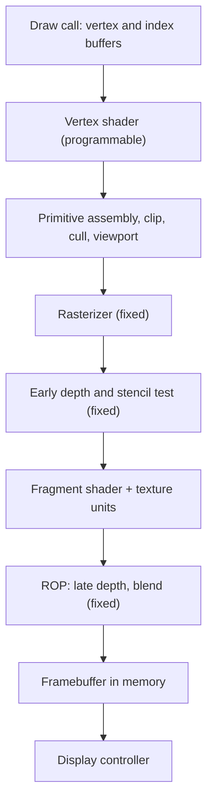

::: testing
Whether you can walk through how a triangle becomes pixels and say **which stages are programmable and which are fixed-function**. The interviewer wants to hear:

1. The stage order: vertex processing, primitive assembly and clipping, rasterization, fragment (pixel) shading, then depth test and blending into the framebuffer.
2. Where the data parallelism is (per vertex, per pixel) and why the stages are pipelined.
3. Awareness of memory traffic at the end of the pipeline (depth, color, textures), and of tile-based rendering in mobile GPUs.
4. That "GPU pipeline" can also mean the hardware pipeline inside a shader core (fetch, decode, issue, execute).
:::

::: why
The graphics pipeline is the reason GPUs are built the way they are. Its structure explains the fixed-function units on the die (rasterizer, ROPs, texture units), why shaders are data-parallel, and where bandwidth is spent. If you are asked to design or verify any part of a GPU or display SoC, you need this map. It also connects to the general idea of pipelining from CPUs ([[q0909]]) but at a very different scale: here the pipeline stages work on streams of vertices and pixels with thousands in flight.
:::

::: concepts
- **Pipelining and streaming**: each stage works on a different primitive at once. See [[q0909]].
- **Vertex and fragment shaders**: programmable per-vertex and per-pixel programs. See [[q0920]].
- **Rasterization**: converting triangles into the pixels they cover.
- **Depth buffer (Z-buffer)**: per-pixel nearest-surface test for hidden surface removal.
- **Blending / ROP**: combining shaded color with the framebuffer.
- **Tile-based rendering**: processing the screen in small on-chip tiles to save bandwidth.
:::

::: answer
"I'd describe the classic graphics pipeline as a stream of data going through stages. The application and driver send vertices and draw commands. First the vertex shader runs on every vertex: it transforms positions from model space through the camera and projection into clip space. Then primitive assembly groups vertices into triangles, clips them against the view volume, culls back-facing ones, and maps to screen coordinates.

The rasterizer is next, a fixed-function stage that works out which pixels each triangle covers and interpolates attributes like color and texture coordinates across it. Each covered pixel becomes a fragment, and the fragment shader runs on it: that's where lighting and texture sampling happen. Finally the raster output stage does the depth test, stencil and blending, and writes the result into the framebuffer in memory, which the display controller scans out.

Vertex and fragment stages are programmable and run on the same shader cores. Rasterizer, texture units and ROPs are fixed-function. Mobile GPUs usually use tile-based rendering, which splits the screen into small tiles and does depth and blending on chip, so each pixel is written to DRAM once. Compute shaders bypass most of this and just use the shader cores."
:::

::: technical
**Stages (classic pipeline).**
1. **Input assembly / command processor**: reads vertex and index buffers, parses draw commands from the driver.
2. **Vertex shader (programmable)**: per vertex; applies model-view-projection matrices $\mathbf{p}_{clip}=P\,V\,M\,\mathbf{p}$ (4x4 matrix times a homogeneous vector), plus per-vertex attributes (normals, UVs).
3. **Optional geometry stages**: tessellation (hull/domain shaders), geometry or mesh shaders.
4. **Primitive assembly, clipping, culling**: form triangles, clip to the view frustum, perspective divide (divide by $w$), viewport transform, back-face culling.
5. **Rasterization (fixed-function)**: determine pixel coverage with edge functions, generate fragments in 2x2 *quads*, interpolate attributes (perspective-correct).
6. **Early depth/stencil test**: reject hidden fragments before shading when the shader does not modify depth.
7. **Fragment (pixel) shader (programmable)**: per fragment; lighting, texture fetches through texture units with filtering.
8. **Raster operations (ROP)**: late depth test, stencil, blending (read-modify-write of color), anti-aliasing resolve; writes to the framebuffer.
9. **Display**: scan-out engine reads the framebuffer to the panel.

**Hardware realization.** A command processor feeds a geometry front end; screen-space work is distributed to the shader cores; raster, depth and blend units are partitioned across memory channels. Shader cores time-share between vertex and pixel work (unified shaders since the mid-2000s), balancing load automatically.

**Why quads.** Texture mapping needs screen-space derivatives (for mip-map selection), computed by differencing neighboring pixels in a 2x2 quad. Pixels outside the triangle but inside the quad are shaded as *helper lanes* and discarded. Small triangles therefore waste shading work.

**Tile-based architectures.** Binning triangles per screen tile (for example 16x16 or 32x32 pixels), then shading each tile with depth, color and blend held in on-chip memory. Deferred variants also perform hidden-surface removal before shading. Result: far less DRAM traffic, valuable on bandwidth- and power-limited mobile SoCs.

**Compute path.** Compute shaders run on the same cores without rasterizer or ROP involvement, reading and writing buffers directly. Ray-tracing hardware adds a traversal and intersection unit alongside shader cores.
:::

::: short
"Vertices go through a vertex shader that transforms them to screen space, then primitive assembly builds and clips triangles. The fixed-function rasterizer finds the pixels each triangle covers, the fragment shader colors them using textures and lighting, and the ROP stage does depth test and blending and writes the framebuffer. The shaders are programmable and share the same cores, while raster, texture and ROP hardware are fixed-function. Mobile GPUs render by tile to save bandwidth."
:::

::: long
"The graphics pipeline is a stream: data goes in as vertices and comes out as pixels in a framebuffer.

The application and driver submit draw calls with vertex and index buffers. The first stage is the vertex shader, run once per vertex. Its main job is multiplying the position by the model, view and projection matrices to get into clip space, and passing attributes like normals and texture coordinates along. Optionally there are tessellation or geometry stages that add detail.

Next is primitive assembly: vertices are grouped into triangles, clipped to the viewing volume, back faces are culled, the perspective divide is applied and the triangle is mapped to screen coordinates.

Then the rasterizer, which is fixed-function hardware. It computes which pixels the triangle covers, using edge equations, and interpolates attributes across the surface. Each covered pixel becomes a fragment. Fragments are handled in 2x2 quads, because texture filtering needs neighboring pixels to compute derivatives. Before the fragment shader there is usually an early depth test to throw away hidden fragments cheaply.

The fragment shader runs per fragment, doing lighting and sampling textures through dedicated texture units. Finally the ROPs do the late depth and stencil tests and blend the color with what's in the framebuffer, then write it out to memory. The display controller scans that buffer to the screen.

Architecturally, vertex and fragment shaders run on the same unified shader cores, so the GPU balances the load. The rasterizer, texture units and ROPs are fixed-function because they're needed constantly and are far more efficient as dedicated logic. And mobile GPUs use tile-based rendering: they bin triangles by screen tile and keep depth and color in on-chip memory so the framebuffer is written to DRAM once, saving a lot of bandwidth and power."
:::

::: terms
- **Vertex shader**: program run per vertex to transform and prepare attributes.
- **Clip space / NDC**: coordinates after projection and perspective divide, before viewport mapping.
- **Rasterization**: converting a triangle to pixel fragments.
- **Fragment / pixel shader**: per-pixel program computing color.
- **Early-Z / depth test**: discarding fragments hidden behind nearer surfaces.
- **ROP**: render output unit performing depth, stencil and blending.
- **Quad**: 2x2 block of pixels shaded together for derivatives.
- **Tile-based rendering**: dividing the screen into tiles processed on chip.
- **Framebuffer**: memory holding the final image.
:::

::: exceptional
**An average answer** lists "vertex shader, rasterizer, pixel shader, output" in order.

**An exceptional answer**:
- Marks which stages are programmable and which are fixed-function, and says why.
- Explains the math: matrix transform to clip space, divide by $w$, viewport transform.
- Mentions quads and the small-triangle inefficiency with a number.
- Identifies where memory bandwidth goes (texture reads, depth, blend read-modify-write) and the tile-based fix.
- Notes unified shaders, early-Z, and that compute shaders and ray tracing bypass or extend the pipeline.
- Distinguishes the graphics pipeline from the internal shader-core pipeline.
:::

::: mistakes
- **Forgetting rasterization**, the step that turns geometry into pixels, which is the heart of the pipeline.
- **Saying the whole pipeline is programmable.** Rasterizer, texture filtering and blending are largely fixed-function.
- **Putting depth test only at the end.** Early-Z before shading saves enormous work when the shader does not write depth.
- **Confusing pixel and fragment.** A fragment is a candidate pixel that may still fail depth or blending.
- **Ignoring clipping and the perspective divide** between vertex shader and rasterizer.
- **Assuming GPU pipelines run one primitive at a time.** Thousands of vertices and pixels are in flight simultaneously.
:::

::: deep
## The pipeline as a data-flow


Figure: One frame as a data flow. The programmable boxes (vertex and fragment shader) run on the same cores. The rest are fixed-function units tuned for throughput. Each arrow carries a stream, and every box can be busy on a different triangle at the same time.

## What the vertex shader does, with numbers

A vertex position is a homogeneous 4-vector $(x,y,z,1)$. The clip-space position is $\mathbf{p}_c=P\,V\,M\,\mathbf{p}$. That is three 4x4 matrix products (usually precombined into one MVP matrix, so a single 4x4 times 4-vector). One 4x4 matrix-vector product costs $16$ multiplies and $12$ adds, or 16 FMAs, about 32 FLOPs. A scene with 2 million vertices per frame at 60 fps: $2\times10^6\times32\times60=3.84\times10^9$ FLOP/s, about 4 GFLOP/s, trivial for the GPU. The pixel work dominates, which is why modern GPUs spend most area on pixel/compute throughput.

After the shader: divide by $w$ to get normalized device coordinates in $[-1,1]$, then the viewport transform maps to pixel coordinates: $x_s=(x_{ndc}+1)\,W/2$. Perspective division is why geometry shrinks with distance and also why attribute interpolation must be perspective-correct (interpolating $u/w$ and $1/w$ linearly in screen space, then dividing).

## Rasterization: edge functions

For a triangle with vertices $a,b,c$ in screen space, the **edge function** for edge $ab$ at point $p$ is
$$E_{ab}(p)=(p_x-a_x)(b_y-a_y)-(p_y-a_y)(b_x-a_x).$$
A pixel center is inside the triangle if all three edge functions have the same sign. These are linear in $x$ and $y$, so hardware evaluates them incrementally across a block of pixels with adders, and the normalized values $E/\text{area}$ give the barycentric weights used to interpolate colors and UV coordinates.

Worked example: triangle $(0,0)$, $(8,0)$, $(0,8)$ has area 32 pixel units. Pixel centers $(i+0.5,\,j+0.5)$ are inside when $i+j+1<8$, i.e. $i+j\le6$, which covers $7+6+5+4+3+2+1=28$ pixels (close to the area of 32, the difference being the diagonal edge's partial pixels).

## Quads and the small-triangle problem

Pixels are shaded in 2x2 quads. Count, for a right triangle with legs $n$ pixels, the covered pixels versus the number of quads touched (each shaded as 4 pixels):

```plot
{"title":"Shading efficiency vs triangle size (right triangle, legs n pixels)","x":{"label":"Triangle leg length n","unit":"px","min":1,"max":70,"log":true},"y":{"label":"Useful fraction of shaded pixels","min":0,"max":1.05},
 "series":[{"label":"covered pixels / (4 x quads touched)","points":[[2,0.25],[4,0.5],[8,0.7],[16,0.833],[32,0.912],[64,0.955]]}],
 "hlines":[{"at":0.25,"label":"tiny triangle: 25%","color":"red"}]}
```
Figure: Efficiency is computed by counting pixel centers and 2x2 quads exactly for each size. A 2-pixel triangle covers 1 pixel but shades a full quad (25% useful). By 16 pixels you are at 83%, and by 64 pixels, 95%. Dense meshes with pixel-sized triangles therefore cost far more than their pixel count suggests, which is why games use level-of-detail.

Counts: $n=2$: 1 covered, 1 quad; $n=8$: 28 covered, 10 quads, $28/40=0.70$; $n=64$: 2016 covered, 528 quads, $2016/2112=0.955$.

## Where the bandwidth goes

Consider 4K at 60 fps, 4 bytes color and 4 bytes depth per pixel, with an average overdraw of 3 (each pixel covered by three fragments, ignoring early-Z):

- Color with blending: read + write per fragment: $8.29\times10^6\times3\times8\times60=11.9$ GB/s.
- Depth read + write: another $11.9$ GB/s.
- Textures: add several GB/s depending on cache hit rate.
- Total: about 24 GB/s plus textures, before geometry and post-processing.

On a discrete card this is a few percent of 500 to 1000 GB/s. On a phone SoC sharing about 50 GB/s with the CPU, camera and display, it is crippling and burns energy (DRAM access costs far more energy than an on-chip operation). **Tile-based rendering** processes one small tile at a time. Depth and color for that tile live in on-chip memory. All overdraw happens in SRAM, and each final pixel is written to DRAM exactly once: $8.29\times10^6\times4\times60=2.0$ GB/s for color. The price is the binning step: geometry must be stored (post-vertex-shader) and re-read per tile, so scenes with huge triangle counts hurt tilers more.

> [!NOTE]
> Immediate-mode rasterizers (typical desktop GPUs) achieve similar savings with large on-chip caches and compression of color and depth. Some recent desktop GPUs also bin in tiles internally. The categories are blurring.

## Early-Z and why shader code can slow the whole pipeline

If the fragment shader can discard pixels or modify depth, the hardware cannot run the depth test before shading (the result of shading might change the answer), so early-Z is disabled and hidden pixels are shaded then thrown away. A scene with overdraw 3 could cost 3x the shading. Hence the advice: draw opaque geometry front to back, avoid `discard` where you can, and use a depth pre-pass if needed. Deferred-shading engines go further and write attributes to a G-buffer so that the expensive lighting runs exactly once per visible pixel.

## The other "GPU pipeline": inside a shader core

Interviewers sometimes mean the hardware pipeline of a shader core. It resembles the CPU 5-stage idea in a SIMT form: instruction fetch and decode (shared by 32 lanes), operand collection from the banked register file, execute (ALU, special-function or load/store unit), and writeback. It is deeper than a simple CPU pipeline (ALU latencies of 4 to 10 cycles are typical), and instead of forwarding and branch prediction it relies on switching warps to cover dependences. See [[q0920]] for the scheduling mechanism.

> [!UNCERTAIN]
> Exact stage naming and partitioning (which units are split across memory channels, where tiling happens) differ between vendors and generations and are often not fully public. The model above is the standard conceptual pipeline.
:::

::: applications
- **Games and real-time 3D**: all stages in play, usually with deferred shading and post-processing.
- **Phone and tablet UIs**: composition of layers by a tiled GPU, saving DRAM bandwidth.
- **CAD and visualization**: large meshes stress the vertex and geometry stages.
- **Video playback and display pipelines**: scalers and compositors use similar fixed-function blending hardware.
- **Ray-traced rendering**: replaces rasterization for visibility with BVH traversal units, then reuses shader cores for shading.
:::

::: assumptions
- This describes the standard rasterization pipeline of OpenGL/Vulkan/DirectX-style GPUs. Mesh-shader and ray-tracing pipelines reorder or replace some stages.
- Bandwidth calculations assume uncompressed color and depth. Real GPUs compress both (often 2x or better), reducing traffic.
- Fixed-function vs programmable partition has shifted over time: early GPUs had fixed lighting; modern GPUs have unified programmable cores with a few dedicated units.
- If asked about the "GPU pipeline" in the sense of the execution pipeline inside a core, give that second answer too, as in the deep section.
:::

::: followups
### Why is the rasterizer fixed-function instead of a shader?
It runs on every triangle and every pixel, always doing the same arithmetic (edge tests, interpolation). Dedicated logic does this at far lower energy and area per pixel than programmable cores, and its workload rarely varies enough to benefit from programmability. Programmability is kept where applications differ: shading.

### What is overdraw and how do GPUs reduce its cost?
Overdraw is shading multiple fragments at the same pixel because geometry overlaps. Early-Z rejects hidden fragments before shading, front-to-back sorting makes early-Z effective, and tile-based deferred renderers resolve visibility per tile first so each pixel is shaded once.

### Why does a GPU shade pixels in 2x2 quads?
Texture sampling picks a mip level using the rate of change of texture coordinates across the screen, computed as differences with neighboring pixels. Shading a quad together makes those derivatives available. The cost is helper lanes on triangle edges and tiny triangles.

### A scene has 100 million tiny triangles and the frame rate collapses even though pixel count is small. Why?
Triangle setup and rasterizer throughput are limited (a few triangles per clock), so tiny triangles bottleneck the fixed-function front end. Also quad overshading wastes shader work (25% efficiency for 1-pixel triangles). Fixes: level of detail, culling, mesh shaders and combining detail into textures or normal maps.

### How would you reduce DRAM bandwidth in a mobile GPU?
Tile-based rendering with on-chip tile memory, color and depth compression, texture compression (block formats such as ASTC or ETC), keeping intermediate render targets on chip between passes, lower precision (FP16), and avoiding unnecessary read-modify-write blending.
:::

::: interpretations
"What does the GPU pipeline look like?" most commonly means the graphics rendering pipeline, which is how this page answers. A hardware-oriented interviewer may mean the instruction pipeline of a shader core, which is covered in the last deep subsection. Compare the CPU five-stage pipeline in [[q0909]].
:::

::: references
- Akenine-Möller, Haines & Hoffman, *Real-Time Rendering*: chapters on the graphics rendering pipeline, the GPU, and rasterization.
- Hennessy & Patterson, *Computer Architecture: A Quantitative Approach*: GPU architecture discussion in the data-level parallelism chapter.
- Khronos Group, *Vulkan Specification*: the "Pipeline" and "Rasterization" chapters, for the standard stage definitions.
- Pineda, "A Parallel Algorithm for Polygon Rasterization", *SIGGRAPH* (1988): origin of the edge-function approach.
:::

::: rubric
- Lists the stages in order: vertex, assembly/clip, raster, fragment, ROP/framebuffer :: This is the core of the question.
- Marks programmable versus fixed-function stages :: Shows hardware understanding.
- Explains the vertex transform (MVP, perspective divide) :: Shows you know what the first stage computes.
- Explains rasterization as coverage plus attribute interpolation :: The step that connects geometry to pixels.
- Mentions depth test, early-Z and blending :: Where visibility and transparency are resolved.
- Mentions memory traffic and tile-based rendering :: Practical architectural consideration.
- Notes unified shaders and compute bypassing the pipeline :: Reflects modern hardware.
:::

::: quiz
```json
[
 {"type":"mcq","level":"fundamental","q":"Which stage determines which screen pixels a triangle covers?","options":["Vertex shader","Rasterizer","Fragment shader","ROP"],"answer":1,"explain":"The fixed-function rasterizer converts each triangle into fragments covering pixel positions and interpolates attributes. The vertex shader works on vertices and the fragment shader colors the resulting fragments."},
 {"type":"multi","level":"fundamental","q":"Which stages are typically programmable on a modern GPU?","options":["Vertex shader","Rasterizer","Fragment shader","Blending (ROP)"],"answer":[0,2],"explain":"Vertex and fragment (pixel) shaders run user programs on the shader cores. Rasterization and blending are mostly fixed-function."},
 {"type":"numeric","level":"intermediate","q":"Pixel centers inside a right triangle with legs of 8 pixels satisfy $i+j\\le6$ for pixel indices $i,j\\ge0$. How many pixels are covered?","answer":28,"tolerance":0,"unit":"pixels","explain":"Count $7+6+5+4+3+2+1=28$ pixels, close to the geometric area of 32."},
 {"type":"numeric","level":"intermediate","q":"A tile-based GPU writes each final pixel to DRAM once. For 3840x2160 at 60 fps with 4-byte color, what is the color write bandwidth in GB/s (round to one decimal)?","answer":2.0,"tolerance":0.03,"unit":"GB/s","explain":"$3840\\times2160\\times4\\times60=1.99\\times10^9$ B/s $\\approx2.0$ GB/s."},
 {"type":"mcq","level":"advanced","q":"Why do very small triangles hurt GPU shading efficiency?","options":["The vertex shader cannot process them","Depth testing is disabled for small triangles","They require double precision","Pixels are shaded in 2x2 quads, so a triangle covering one pixel still shades four"],"answer":3,"explain":"Quad shading computes derivatives for texturing, so partially covered quads run helper lanes. A 1-pixel triangle uses 25% of the shading work done. Triangle setup throughput also limits tiny-triangle rates."}
]
```
:::
