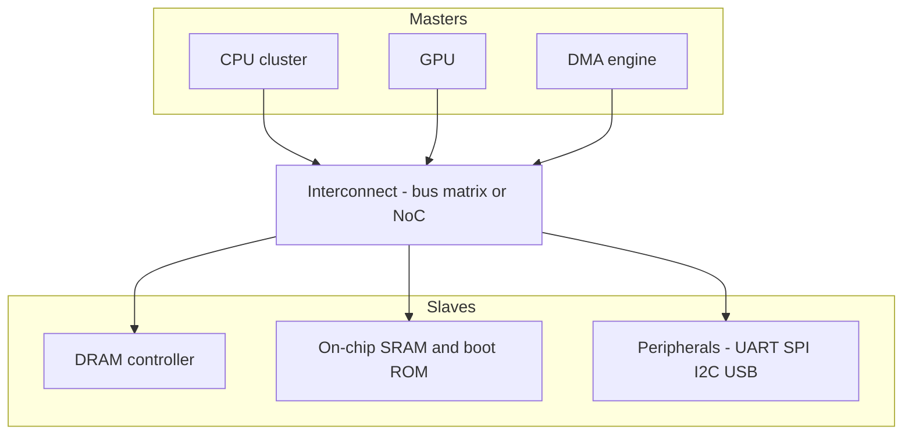
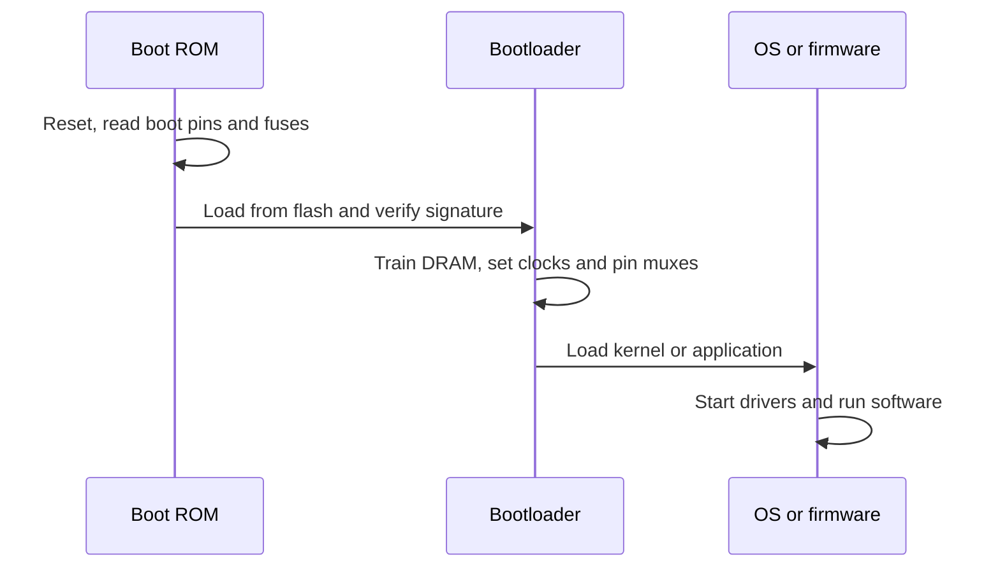

::: basics
### In plain words
A system on chip (SoC) is one piece of silicon that holds most of a small computer: a processor, memory, and the circuits that talk to the outside world. Putting it all on one chip makes a product smaller and often cheaper at large volumes, and it can save power. A few parts, such as the big main memory and the power supply, usually stay outside.

### Picture it
Picture two ways to build a town. In the old way, each shop sits in its own village, and long highways join the villages. Every trip is slow. A SoC is one compact city where the same shops sit a few blocks apart on short streets. Every building has a street number, so anyone can reach it by number. The picture breaks down in one place: a chip has a fixed size and cannot hold everything.

### Words you need
- **Die**: the single small square of silicon that the circuits are built on.
- **Processor core**: the part that runs program instructions.
- **Peripheral**: a block that talks to the outside world, such as a serial port or USB.
- **Interconnect**: the on-chip wiring and switching that lets blocks send data to each other.
- **Address map**: the list of numbers that says where each block lives, so software reaches a block by its number.
- **Microcontroller**: a small SoC with a processor, built-in memory and peripherals.

### The simplest example
The old way uses three chips: a processor, a memory chip and a serial-port chip, wired together on a board. A SoC puts all three blocks on one die. To send a byte, the program writes it to the serial block's address. The interconnect routes that write to the serial block, which sends the byte out. You still add a crystal (a part that sets the clock beat) outside. That is the whole idea. The rest of this page shows what blocks a SoC holds, how they are wired and booted, and why integration pays.
:::

::: testing
Whether you can define a SoC precisely and distinguish it from nearby ideas, instead of saying "a chip with lots of stuff on it". The interviewer wants:

1. The core definition: a complete (or nearly complete) computing system integrated on **one piece of silicon**: processor(s), memory, interconnect, peripherals and often analog/RF.
2. How it differs from a bare CPU, a microcontroller, a SiP/SoM and a multi-chip board.
3. The idea of **an interconnect plus an address map** that ties the blocks together, and that blocks are often licensed IP.
4. Why it exists: size, power, cost and performance, with the trade-offs coming later ([[q0929]], [[q0932]]).
:::

::: why
Almost every product you will work on has a SoC at its center: phones, wearables, cameras, routers, cars, even a simple Wi-Fi sensor node. Hardware engineers need to read a SoC block diagram, know what the chip does for you and what it still needs around it ([[q0930]]), and understand why integration changes power, cost and design effort. This is the entry question for the rest of the SoC section.
:::

::: concepts
- **Integration**: placing functions that were separate chips onto one die. See [[q0932]].
- **Processor core(s)**: CPU, possibly GPU, DSP, NPU. See [[q0912]], [[q0919]].
- **On-chip memory**: SRAM, caches, boot ROM, sometimes embedded flash; external DRAM via a controller.
- **Interconnect (bus/NoC)**: how masters (CPU, DMA, GPU) reach slaves (memory, peripherals).
- **Peripherals and I/O**: UART, SPI, I²C, GPIO, USB, PCIe, Ethernet, ADC. See [[q0928]].
- **IP reuse**: blocks are usually licensed (for example an Arm CPU) and integrated, not designed from scratch.
:::

::: answer
"A system on chip puts most of what used to be a whole computer board onto a single piece of silicon. Instead of a separate CPU, memory controller, graphics chip, peripheral chips and so on, you integrate them as blocks on one die and connect them with an on-chip interconnect.

A typical SoC has one or more CPU cores, caches, a memory controller for external DRAM, often a GPU and other accelerators, a bunch of peripherals like UART, SPI, I2C, USB and PCIe, plus clocking, power management and security blocks. The blocks sit in a shared address map, so software talks to a peripheral just by reading and writing registers at an address.

The reasons to do it are size, power, performance and cost at volume. On-chip wires are shorter and cheaper to drive than board traces, so you save energy and latency, and you replace many packages with one. Microcontrollers are really small SoCs too: a core, flash, SRAM and peripherals. A phone application processor is a big one.

It isn't free: a SoC takes a lot of design effort and a big upfront cost, and you still need things around it like DRAM, power regulators, a crystal and connectors."
:::

::: technical
**Definition.** A SoC integrates the processing, memory, communication and I/O functions of a system onto a single die (or a single package treated as one component), connected by an on-chip fabric and controlled by software through a memory-mapped address space.

**Typical structure.**
- **Masters**: CPU cluster(s), GPU, DMA engines, accelerators (NPU, ISP, video codec). They initiate transactions.
- **Interconnect**: a bus matrix or network-on-chip (for example Arm AMBA AXI/AHB/APB protocols) routing transactions to slaves and arbitrating shared resources.
- **Slaves**: memory controllers (DDR/LPDDR), on-chip SRAM, boot ROM, peripheral registers.
- **Infrastructure**: clock generation (PLLs), reset, power management and domains, interrupt controller, timers, debug (JTAG/SWD), security (secure boot, crypto).

**Address map example (Arm Cortex-M style).** Architectural regions: code at 0x0000_0000, SRAM at 0x2000_0000, peripherals at 0x4000_0000, system/private peripherals at 0xE000_0000. Exact peripheral addresses are vendor-specific.

**Related terms.**
| Term | Meaning |
|---|---|
| MCU | Small SoC: core, flash, SRAM, peripherals, usually no external DRAM |
| Application processor | Large SoC running Linux/Android: multi-core CPU, GPU, DRAM controller, many accelerators |
| SiP (system in package) | Several dies (possibly SoC plus memory) in one package |
| SoM | A small board with SoC, DRAM, flash and power on a connector ([[q0931]]) |
| FPGA SoC | FPGA fabric plus hard CPU cores on one die |

**Why it works.** Energy per bit moved falls dramatically when signals stay on-die rather than crossing package pins and PCB traces; the quantitative argument is in [[q0929]].
:::

::: short
"A SoC integrates a whole system, CPU cores, memory controllers, often a GPU and accelerators, peripherals like UART, SPI, USB and PCIe, plus clocks, power management and security, onto a single die, tied together by an on-chip interconnect and a shared address map. It cuts size, power and board cost at volume, though you still need DRAM, regulators and a crystal outside, and the design effort is large. A microcontroller is a small SoC."
:::

::: long
"A system on chip integrates most of a computer system onto one piece of silicon. In the old board-level approach you had a CPU chip, a graphics chip, memory controllers, I/O chips and glue logic, all connected by traces. In a SoC they're blocks on the same die.

The pieces are: processor cores, from a small microcontroller core up to a multi-core cluster with caches; often a GPU and specialized accelerators like a neural engine, image signal processor or video codec; on-chip SRAM and a boot ROM, and a controller for external DRAM; and peripherals such as UART, SPI, I2C, GPIO, USB, PCIe and Ethernet. Around them is infrastructure: PLLs for clocks, reset logic, power management with multiple voltage and clock domains, an interrupt controller, debug, and security blocks.

All of it hangs off an on-chip interconnect, a bus matrix or a network-on-chip. Masters like the CPU and DMA issue transactions, the interconnect routes them to slaves, and everything lives in a single memory map, so software controls a peripheral by reading and writing registers.

Why do it? Wires on a die are short and low-capacitance, so moving data costs far less energy and time than going through package pins and PCB traces. You replace many chips with one, so the board is smaller and cheaper. And you get tighter, lower-latency coupling between blocks.

The costs are the huge upfront engineering and mask cost, which only pays off at volume, the difficulty of verifying so many blocks together, and the fact you can't mix every technology on one die. So the SoC is rarely the entire system: you still need DRAM, flash, regulators, a clock source and connectors around it."
:::

::: terms
- **SoC**: system on chip; a whole system integrated on one die.
- **IP block**: reusable design block (CPU, USB controller, PHY), often licensed.
- **Interconnect / NoC**: on-chip communication fabric between blocks.
- **AMBA (AXI/AHB/APB)**: Arm's family of on-chip bus protocols.
- **Memory-mapped I/O**: peripherals controlled through registers at fixed addresses.
- **Power/clock domain**: region of the chip with its own supply or clock that can be gated or scaled.
- **Boot ROM**: immutable code in the chip that starts the boot chain.
- **SiP / SoM**: multi-die package / small module board containing a SoC.
- **MCU**: microcontroller; small SoC with flash and SRAM.
:::

::: exceptional
**An average answer** says "a chip that has CPU, memory and peripherals on it".

**An exceptional answer**:
- Defines a SoC by **single-die integration plus a shared interconnect and address map**, and gives the MCU-to-application-processor spectrum.
- Names real block types (CPU cluster, GPU, NPU, ISP, memory controller, PHYs, PMU, security) without a long shopping list.
- Explains **why** integration helps with a quantitative flavor: on-die versus off-chip energy and latency ([[q0929]]).
- Mentions what is still external (DRAM, flash, regulators, crystal, RF front-end) and that licensed IP is the norm.
- Contrasts with SiP, SoM and chiplets ([[q0931]], [[q0932]]).
:::

::: mistakes
- **"A SoC is just a CPU."** A CPU is one block; the SoC includes memory interface, peripherals and infrastructure.
- **Thinking everything is on-chip.** DRAM, flash, power regulation, crystals and RF front-ends are usually external.
- **Confusing SoC and SoM.** A SoM is a board module; a SoC is silicon ([[q0931]]).
- **Forgetting software.** A SoC is useless without boot firmware, drivers and an OS or RTOS.
- **Assuming SoC is always cheaper.** Below high volumes the NRE dominates ([[q0929]]).
- **Treating an MCU as not a SoC.** MCUs are SoCs with simpler cores and on-chip flash.
:::

::: deep
## From board to die

Consider a simple embedded system built the old way: a microprocessor, a separate ROM and RAM, a UART chip, a timer chip, a bus buffer and some glue logic. Each function sits in its own package, connected by address, data and control buses on the board. Every signal that crosses a package boundary needs an I/O driver, ESD protection, a pad, a bond wire or ball, a PCB trace, and the same on the receiving end. That costs area, energy, time and cost, and it limits how wide and how fast the buses can be.

A SoC pulls those functions onto the same die. The CPU's bus now reaches the UART through a few hundred micrometers of metal, so the bus can be wide (128 or 256 bits), fast and cheap.

## Anatomy of a SoC


Figure: Masters (blocks that start transactions) and slaves (blocks that respond) meet at the interconnect. Because everything shares one address map, software talks to hardware by loads and stores. Clocking, power, reset and debug (not drawn) touch every block.

**Interconnect and the address map.** The interconnect decodes the address of every transaction and routes it to the right slave. In a small MCU this is a bus matrix; in a big SoC it is a network-on-chip with routers and quality-of-service so that, say, the display controller never starves. Software sees the result as one flat map:

| Region (Cortex-M style) | Start address | Contents |
|---|---|---|
| Code | 0x0000_0000 | Flash/boot memory (aliased) |
| SRAM | 0x2000_0000 | On-chip RAM |
| Peripherals | 0x4000_0000 | UART, SPI, GPIO and so on |
| System | 0xE000_0000 | Interrupt controller, SysTick, debug |

Writing a 1 to a GPIO output register at its mapped address toggles a pin: the interconnect routes the store to the GPIO block. Exact addresses beyond the architectural regions depend on the vendor's reference manual.

## Spectrum of SoCs

| Class | Example content | Memory | Typical power |
|---|---|---|---|
| Microcontroller | One or a few small cores, flash, SRAM, ADC, timers, communication | On-chip only | µW to hundreds of mW |
| Wireless SoC | MCU core plus radio (BLE, Wi-Fi) and crypto | On-chip, some external flash | mW range |
| Application processor | Multi-core CPU, GPU, NPU, ISP, video codec, USB, PCIe | External LPDDR | watts |
| FPGA SoC | Hard CPU cores plus programmable fabric | External DRAM | watts |

The line between "SoC" and "microcontroller" is conventional. Both integrate a system; the difference is scale and whether external DRAM and a full OS are expected.

## Boot: the part people forget

A SoC has to start itself. Reset puts the CPU at a fixed address inside the **boot ROM**, which is immutable code written at manufacture. The ROM reads boot configuration pins or fuses, initializes minimal hardware, loads the next stage from external flash or storage, and (in secure parts) verifies a signature before running it.


Figure: The boot chain. DRAM cannot be used until the bootloader trains the memory interface, so the first stage runs from on-chip SRAM. This is one reason SoCs need SRAM and a ROM on the die.

## Why integration pays: a rough cost-of-moving-data argument

The energy to send a bit changes by orders of magnitude depending on distance. Switching a short on-chip wire costs far less than driving an off-chip DRAM interface, where the PHY, package pins and board trace all have to be driven. The quantified version, with caveats, is in [[q0929]]. The point here is that anything that can stay on the die is cheaper in energy and faster.

**Worked example: bandwidth per wire.** An on-die fabric 512 bits wide at 1 GHz moves $512\times10^9/8=64$ GB/s and costs only metal tracks. To get a similar 51.2 GB/s off-chip you need a 64-bit LPDDR5-6400 interface: $64\times6.4/8=51.2$ GB/s, which takes at least 64 data pins plus strobes and command lines, a PHY with calibrated drivers, package routing and a carefully controlled PCB. On-die the fabric can be widened simply by adding wires; off-chip each extra bit costs a ball, a trace and I/O power. This is the root reason SoCs keep high-bandwidth traffic (CPU to cache, GPU to its caches, accelerator to accelerator) on the die and only go off-chip when capacity forces it.

> [!UNCERTAIN]
> Exact pJ/bit figures depend on process node, interface (LPDDR vs DDR vs HBM) and design; use them for ratios and trends, not as specifications.

## Where the SoC ends

A SoC doesn't contain everything. Large DRAM arrays use a process optimized for storage density, so they are normally separate dies. High-voltage power conversion, RF power amplifiers, displays, sensors and batteries are also external, and so are the crystal and often the power-management IC. [[q0930]] covers that list in detail.

> [!INTERVIEW]
> If asked to "draw a SoC", draw the interconnect in the middle with masters on one side and slaves on the other, add clock/power/debug as a ring around it, and label which blocks are IP and what is off-chip. It shows you think in system terms.
:::

::: applications
- **Smartphones and tablets**: application processors integrating CPU, GPU, NPU, ISP and modem subsystems.
- **Microcontroller-based products**: appliances, motor drives, sensors; the MCU is a small SoC.
- **Single-board computers**: Raspberry Pi boards are built around a Broadcom SoC with external DRAM.
- **Wireless IoT nodes**: Bluetooth LE or Wi-Fi SoCs combining MCU, radio and crypto.
- **Laptops and consoles**: Apple M-series and game-console processors integrate CPU, GPU and memory controllers.
- **FPGA SoCs**: Xilinx Zynq-style parts combine hard Arm cores with programmable logic.
:::

::: assumptions
- "SoC" is used loosely in industry. Some marketing treats a multi-die package as a SoC; here a SoC is functionally one integrated component, usually one die.
- The block lists describe typical parts; actual content varies widely between a Cortex-M MCU and a flagship phone processor.
- Address map regions quoted are the Arm Cortex-M architectural map; other architectures differ.
- Energy numbers are order-of-magnitude trends.
- The definition shifts when chiplets are used: a "SoC" can be several dies on one package presented to software as a single system ([[q0932]]).
:::

::: followups
### Is a microcontroller a SoC?
Yes, a small one. It integrates a core, flash, SRAM, clocks and peripherals on one die. The distinction from an application SoC is mostly scale: an MCU runs bare-metal or an RTOS from on-chip memory, while an application SoC usually needs external DRAM and runs a full OS.

### How does the CPU talk to a peripheral inside a SoC?
Through memory-mapped registers. Each peripheral occupies a range of addresses. A store to a control register address travels via the interconnect to that block and changes its configuration; a load reads a status register. Interrupts and DMA complement this so the CPU does not have to poll.

### What's the difference between a SoC and a SiP?
A SoC is a single die. A SiP packages multiple dies, for example a SoC with stacked DRAM or an RF die, into one package. The SiP gets short interconnect between dies without forcing all technologies onto one process.

### Why can't you put everything, including DRAM and the power supply, on the SoC?
Different technologies. DRAM needs capacitor-optimized processes, power conversion needs high-voltage devices and big inductors, and RF power amplifiers use different processes. Even where possible, area and yield would suffer. Embedded SRAM, small regulators (LDOs) and low-power radios are integrated; bulk DRAM and switching converters usually are not. See [[q0932]].

### A new SoC has been fabricated and powers up but doesn't boot. Where do you start?
Check the basics in order: supplies and sequencing, clock/crystal start-up, reset release, then whether the boot ROM runs (debug port, boot-mode pins and fuses). Then flash/storage access, then DRAM initialization, since the bootloader needs DRAM for later stages. Use JTAG/SWD to halt the core and inspect the program counter.
:::

::: interpretations
The question is open-ended and conceptual. This page answers it as "what a SoC is and how it is built". Applications are in [[q0927]], block-by-block detail in [[q0928]], trade-offs in [[q0929]] and [[q0932]], required external parts in [[q0930]], and SoM in [[q0931]].
:::

::: references
- Hennessy & Patterson, *Computer Architecture: A Quantitative Approach*: embedded and mobile systems, and on-chip interconnect discussion.
- Weste & Harris, *CMOS VLSI Design*: system-level integration and design flow chapters.
- Arm, *AMBA* specifications (AXI, AHB, APB): on-chip interconnect protocols.
- Arm, *Armv7-M Architecture Reference Manual*: the Cortex-M memory model and address regions.
:::

::: rubric
- Defines a SoC as a full system integrated on one die :: The definition is the core of the question.
- Lists main blocks: CPU, memory/controller, GPU/accelerators, peripherals, clock/power/security :: Shows you know what is inside.
- Mentions the interconnect and shared address map :: This is what makes it a system and not a pile of blocks.
- Gives reasons for integration: size, power, performance, cost :: Interviewers expect motivation, not only description.
- States what remains external (DRAM, power, clock, RF) :: Shows realism about system design.
- Notes costs and trade-offs: NRE, verification, volume :: Sets up follow-ups on trade-offs.
- Places MCU, application processor, SiP and SoM on the spectrum :: Demonstrates precise vocabulary.
:::

::: quiz
```json
[
 {"type":"mcq","level":"fundamental","q":"Which best describes a system on chip?","options":["A motherboard with many chips","A single die integrating processor(s), memory interfaces, peripherals and interconnect","A processor core only","A PCB module containing a CPU and DRAM"],"answer":1,"explain":"A SoC is a whole system integrated on one die. The module option describes a SoM, the board option a multi-chip design, and a core alone is only one block of a SoC."},
 {"type":"truefalse","level":"fundamental","q":"A microcontroller with a core, flash, SRAM and UART on one die can be considered a small SoC.","answer":true,"explain":"It integrates processing, memory and peripherals on one die, which is the definition. The difference from application SoCs is scale and external DRAM."},
 {"type":"mcq","level":"intermediate","q":"How does software on a SoC typically control an on-chip UART?","options":["By reading and writing memory-mapped registers at the UART's address","By soldering wires to its pins","By recompiling the interconnect","By using a dedicated instruction for each peripheral"],"answer":0,"explain":"Peripherals sit in the address map, so ordinary loads and stores reach their control and status registers through the interconnect."},
 {"type":"multi","level":"intermediate","q":"Which of these are usually NOT on the SoC die in a typical phone design?","options":["Bulk LPDDR DRAM","CPU cores","Battery","Boot ROM"],"answer":[0,2],"explain":"DRAM is normally a separate die/package and the battery is obviously external. CPU cores and the boot ROM are on-die."},
 {"type":"mcq","level":"advanced","q":"At reset, why does a SoC's first boot stage typically run from on-chip SRAM or ROM rather than DRAM?","options":["DRAM is slower than flash","DRAM cannot store code","The DRAM controller must be configured and trained before DRAM is usable, and that code has to run from somewhere","The OS forbids it"],"answer":2,"explain":"DRAM interfaces need initialization and training at the specific speed before use. The early code that does so must therefore run from boot ROM and on-chip SRAM."}
]
```
:::
