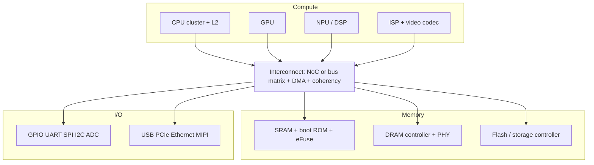

::: testing
Whether you can list the blocks inside a SoC **organised by function** and say what each one is for, instead of reciting a random shopping list. The interviewer is looking for:

1. Compute: CPU cores, GPU, DSP, NPU, ISP, video codec.
2. Memory: caches, SRAM, ROM, flash (MCUs), DRAM controller and PHY.
3. Communication fabric: bus or network-on-chip, DMA, interrupt controller.
4. Peripherals and I/O: UART/SPI/I2C/GPIO, USB, PCIe, Ethernet, ADC/DAC, display and camera interfaces.
5. Infrastructure: clocks (PLL), resets, power management, security, debug, timers.
:::

::: why
Reading a SoC block diagram is a daily task: you decide which pins to wire, which interfaces your product uses, what has to be powered, and where the performance and power will go ([[q0933]]). Interviewers also use this question to check that you understand *why* each block exists (offload the CPU, save power, meet real-time, secure boot) and not only its name.
:::

::: concepts
- **CPU cluster and caches**: general-purpose execution. See [[q0912]].
- **Accelerators**: GPU, NPU, DSP, ISP, video codec doing specific work efficiently. See [[q0919]].
- **Memory subsystem**: SRAM, ROM, flash, DRAM controller and PHY. See [[q0936]].
- **Interconnect and DMA**: moving data between blocks without the CPU. See [[q0926]].
- **Peripherals**: GPIO, UART, SPI, I2C, timers, ADC, USB, PCIe. See [[q0911]] for interrupts.
- **Clock, reset and power management**: PLLs, power domains, DVFS.
- **Security and debug**: root of trust, secure boot, crypto engine, JTAG/SWD.
:::

::: answer
"I like to group them by what they do. Compute blocks: one or more CPU cores with caches, often a GPU, and increasingly accelerators like a neural engine, a DSP, an image signal processor and a video codec. Memory: on-chip SRAM, a boot ROM, in microcontrollers on-chip flash, and for bigger SoCs a DRAM controller and its PHY. Then the interconnect, a bus matrix or network-on-chip, plus DMA engines and an interrupt controller so the CPU doesn't have to babysit every transfer.

Peripherals and I/O: GPIO, UART, SPI, I2C, timers, ADCs, then high-speed stuff like USB, PCIe, Ethernet, MIPI camera and display interfaces. Infrastructure that people forget: PLLs and clock trees, reset logic, a power management unit with multiple voltage and clock domains, security blocks like a crypto engine, secure boot and key storage, and debug access over JTAG or SWD.

All of that is wired into one address map, so software controls it through registers. Which blocks a particular SoC has depends on the product: a sensor MCU has a core, flash, SRAM, ADC and a radio, a phone processor has a big CPU cluster, GPU, NPU, ISP and a modem."
:::

::: technical
**Functional grouping.**

| Group | Blocks | Role |
|---|---|---|
| Compute | CPU cluster (cores, L1/L2/L3), GPU, DSP, NPU, ISP, video encode/decode | Execute software; accelerate common heavy tasks at lower energy |
| On-chip memory | SRAM (scratchpad, caches), boot ROM, eFuse/OTP, embedded flash (MCUs) | Fast storage, boot code, keys and trim values |
| Memory interface | DRAM controller and PHY (DDR/LPDDR), flash controller (QSPI, eMMC, UFS), SD | Access external memory and storage |
| Fabric | Bus matrix or NoC (AXI/AHB/APB), DMA, cache-coherency logic | Move data, arbitrate, offload CPU |
| Control | Interrupt controller, timers, watchdog, RTC | Events, scheduling, fault recovery |
| Low-speed I/O | GPIO, UART, SPI, I2C, CAN, PWM, ADC/DAC | Sensors, actuators, debug consoles |
| High-speed I/O | USB, PCIe, Ethernet MAC/PHY, MIPI CSI/DSI, HDMI/DisplayPort, SerDes | Connectivity, camera, display |
| Wireless | Wi-Fi/BLE/cellular baseband (analog/RF sometimes on-die) | Connectivity |
| Clock/reset | Oscillator, PLLs, clock dividers, clock gating, reset controller | Create and distribute clocks |
| Power | Power-management unit, LDOs, power switches, DVFS controller, sensors | Voltage/power domains, low-power modes |
| Security | Crypto engines, TRNG, secure boot ROM, key storage, TrustZone-style isolation | Root of trust, protect keys and firmware |
| Debug/test | JTAG/SWD, trace, scan/BIST, performance counters | Bring-up, production test, profiling |

**PLL example.** A 24 MHz crystal feeding a PLL with feedback divider $N=100$ gives a 2.4 GHz VCO; a post-divider of 2 yields 1.2 GHz for a CPU cluster. Peripherals take divided versions of the same PLL. Formula: $f_{out}=f_{ref}\cdot N/M$.

**Typical contents by SoC class.**
- *MCU*: one or two small cores, flash, SRAM, DMA, timers, UART/SPI/I2C, ADC, maybe USB or a radio.
- *Application processor*: multi-core CPU, GPU, NPU, ISP, video codec, LPDDR controller, USB/PCIe, display, security, PMU.
:::

::: short
"I group them by function. Compute: CPU cores with caches, a GPU, and accelerators like NPU, DSP, ISP and video codec. Memory: on-chip SRAM, boot ROM, a DRAM controller and PHY, flash in MCUs. A bus matrix or network-on-chip with DMA and an interrupt controller ties them together. Peripherals: GPIO, UART, SPI, I2C, ADC, USB, PCIe, Ethernet, camera and display. Infrastructure: PLLs, resets, power management, security and debug. All in one address map."
:::

::: long
"A SoC is built from reusable blocks, and I think of them in layers.

At the center is compute: one or more CPU cores with their L1 and L2 caches, often a GPU, and then accelerators for specific jobs, like an NPU for neural networks, a DSP, an image signal processor for the camera, and a video codec. They exist because fixed-function hardware does those tasks at a fraction of the energy of the CPU.

Next is memory. On-chip SRAM for caches and scratch, a boot ROM, OTP or eFuses for keys and calibration, embedded flash in microcontrollers, and for bigger chips a DRAM controller plus its PHY and flash or storage controllers.

Everything is connected by the interconnect, a bus matrix or a network-on-chip, with DMA engines that move data without the CPU, and an interrupt controller that tells the CPU when something needs attention.

Then peripherals: low-speed ones like GPIO, UART, SPI, I2C, timers and ADCs, and high-speed ones like USB, PCIe, Ethernet and MIPI camera and display interfaces. Some SoCs also have radios.

The supporting infrastructure is easy to forget but essential: a crystal oscillator and PLLs make the clocks, the reset controller sequences startup, the power-management unit handles voltage and clock domains and low-power modes, security blocks provide secure boot, crypto and key storage, and debug logic gives you JTAG or SWD access.

Which blocks appear depends on the product. A sensor MCU needs a core, flash, SRAM, ADC and a radio, while a phone chip adds a big CPU cluster, GPU, NPU and ISP."
:::

::: terms
- **IP block**: reusable design unit such as a CPU core or USB controller.
- **PHY**: physical-layer circuit for a high-speed interface (DDR, USB, PCIe).
- **NoC**: network-on-chip; packet-based interconnect.
- **DMA**: direct memory access engine that moves data without CPU involvement.
- **PLL**: phase-locked loop generating high-frequency clocks from a reference.
- **PMU**: power-management unit controlling domains and modes.
- **eFuse / OTP**: one-time-programmable storage for keys and trims.
- **TrustZone / secure enclave**: hardware isolation for sensitive code and data.
- **JTAG / SWD**: debug and test access ports.
:::

::: exceptional
**An average answer** reads a list: "CPU, GPU, memory, UART, SPI".

**An exceptional answer**:
- Groups blocks by function and gives the **reason each exists** (offload, power, real-time, security).
- Includes the "boring but essential" infrastructure: PLLs, resets, PMU, debug, boot ROM, eFuses.
- Notes that PHYs for DDR/USB/PCIe are large analog blocks with their own power rails and area.
- Mentions the interconnect, DMA and address map as the glue.
- Ties the list to a specific class of SoC, showing how content depends on the product.
- Knows which blocks tend to dominate area and power ([[q0933]]).
:::

::: mistakes
- **Listing only CPU and memory.** Peripherals, infrastructure and security are half the chip.
- **Forgetting the interconnect and DMA.** Without them nothing can talk to anything efficiently.
- **Assuming DRAM is on the SoC.** The controller and PHY are on-die, the DRAM array is almost always external.
- **Calling every accelerator a GPU.** NPU, DSP and ISP are different blocks with different dataflows.
- **Ignoring the analog pieces.** PLLs, ADCs, PHYs and regulators are analog blocks in a digital chip and need clean supplies.
- **Forgetting clock and power domains.** They are essential for low-power operation.
:::

::: deep
## A block diagram you can reproduce


Figure: Compute blocks (top) are masters; memory and I/O (bottom) are slaves reached through the fabric. Around this core sit blocks that touch everything: PLLs and clock gating, reset, the power-management unit, security and debug.

## Compute blocks and why they exist

**CPU cluster.** General-purpose, branchy, latency-sensitive code, the OS and application logic. Modern SoCs use heterogeneous clusters: a few performance cores and several efficiency cores that share an L3 or system-level cache ([[q0912]]).

**GPU.** Parallel graphics and general parallel compute ([[q0919]], [[q0925]]). Large, power-hungry and often the biggest single block in a phone or console SoC.

**NPU/DSP.** A matrix-multiply or MAC-array engine for neural networks or signal processing, measured in TOPS and TOPS/W. It exists because fixed MAC arrays with local SRAM and low-precision (INT8/INT4) arithmetic deliver more operations per joule than a GPU or CPU.

**ISP and video codec.** Camera data (raw Bayer) needs demosaicing, denoising, auto-exposure and tone mapping in real time; video needs encode/decode. Both are fixed-function pipelines because they run for long periods and must be energy efficient.

## Memory blocks

| Block | Typical size | Purpose |
|---|---|---|
| L1 caches | 32 to 128 KB per core | Single-cycle-ish access |
| L2/L3/system cache | hundreds of KB to tens of MB | Reduce DRAM traffic |
| Boot ROM | a few KB to tens of KB | First code executed, immutable |
| eFuse / OTP | bits to kilobits | Keys, chip ID, trim, boot mode |
| Scratchpad SRAM | KB to MB | Always-on and boot data; deterministic latency |
| Embedded flash (MCU) | 64 KB to a few MB | Program storage in microcontrollers |

> [!UNCERTAIN]
> Sizes are broad typical ranges across MCU to application-processor classes; individual parts differ widely.

The **DRAM controller** schedules reads and writes to maximise row-buffer hits and meet refresh timing; the **PHY** is the analog interface that aligns clocks and data (training) at multi-gigabit-per-pin rates. The DRAM chips themselves are external.

## Interconnect, DMA and interrupts

The fabric decodes addresses and arbitrates, with QoS so that real-time masters (display, camera) get bandwidth guarantees. **DMA** moves data between memory and peripherals without the CPU. Example: a UART at 1 Mbaud delivers a byte every $10\,\text{bits}/1\,\text{Mbaud}=10\,\mu$s. If servicing each interrupt costs 2 µs (an illustrative 200 cycles at 100 MHz), the CPU spends 20% of its time on that one UART. With DMA filling a buffer and one interrupt per 256 bytes, the cost falls to about $2\,\mu s/2560\,\mu s\approx0.08\%$. The **interrupt controller** prioritises events and delivers them to cores.

## Peripherals

Low-speed peripherals are simple register-mapped blocks: GPIO with pin multiplexing and pad controls, serial (UART, SPI, I2C, CAN), timers/PWM, watchdog, RTC and ADCs. High-speed interfaces (USB, PCIe, Ethernet, MIPI D-PHY/C-PHY, HDMI) combine a protocol controller (digital) with a PHY (analog, SerDes), and the PHY is a large part of the pad ring and package pin budget. Pin multiplexing lets a limited pad count serve many functions, so a pin planner is part of every design.

## The pad ring and pin budget

Every external interface costs package balls, and the ball budget often limits what a SoC can offer. A 64-bit LPDDR interface needs 64 data balls plus strobes or clocks, command/address lines, and chip selects, on the order of 100 signal balls, before counting the many power and ground balls needed to carry the I/O switching current cleanly. Add two PCIe lanes (4 differential pairs, 8 balls), USB (a few), a MIPI camera (4 data lanes plus a clock, 10 balls), a display link, and dozens of GPIOs, and a mid-range package of a few hundred balls fills quickly. Designers therefore multiplex low-speed functions onto shared pins and drop interfaces that the product does not need. This is also why a SoC datasheet lists *maximum* peripheral counts, and why your board design can use only a subset at once.

> [!UNCERTAIN]
> Exact signal counts depend on the memory standard (LPDDR4 vs LPDDR5 vs DDR4/5), the number of channels and ranks, and package design. Use the figure above as an order-of-magnitude illustration only.

## Infrastructure: clocks, resets, power, security, debug

```sim
{"id":"pll-lab","fref":24000000,"n":50,"bw":1000000,"zeta":0.7}
```
Figure: A 24 MHz reference times N = 50 gives 1.2 GHz. Change N and the loop bandwidth to see lock time and overshoot; this is how a SoC makes its CPU and bus clocks from one crystal.

- **Clock tree**: crystal or oscillator, one or more PLLs, dividers, clock muxes and clock gates. Clock gating switches off clocks to idle blocks to save dynamic power.
- **Reset**: power-on reset, brown-out detect, watchdog reset, per-block resets sequenced after clocks are stable.
- **Power management**: multiple supply domains (core, I/O, always-on, DRAM interface), power switches to shut off idle domains, DVFS to match voltage and frequency to load, temperature sensors for throttling ([[q0933]]).
- **Security**: secure boot (boot ROM verifies the next stage with a key in eFuse), crypto accelerators (AES, SHA, public-key), true random number generator, and isolation of secure software.
- **Debug and test**: JTAG/SWD for halting and inspecting cores, trace, performance counters, and scan chains and memory BIST used in production test.

## Block counts for an example MCU

An STM32-like MCU might contain: one Cortex-M core, 1 MB flash, 256 KB SRAM, DMA, 10+ timers, 3 ADCs, several UARTs/SPI/I2C, USB, a CAN controller, a crypto engine and an RTC, with a PLL for clocks. A phone processor has the same categories but with larger, more numerous blocks and DRAM, GPU and NPU. The categories, not the lists, are what carry across designs.

> [!INTERVIEW]
> If you are asked to "name some components" and only have 20 seconds, say the five groups: compute, memory, interconnect, peripherals, infrastructure (clock, power, security, debug). Then pick two blocks and explain why they exist.
:::

::: applications
- **Phone application processor**: CPU clusters, GPU, NPU, ISP, video codec, modem, LPDDR controller, display and camera interfaces.
- **Wireless MCU**: Arm core, flash, SRAM, BLE/Wi-Fi radio, crypto, ADC, GPIO, timers.
- **Automotive SoC**: CPU clusters, GPU, vision accelerators, CAN/Ethernet, safety island and diagnostic logic.
- **Network SoC**: multi-core CPU, packet engines, MACs, SerDes lanes, crypto.
- **Raspberry Pi-class SoC**: quad-core CPU, GPU, video codec, USB, PCIe or Ethernet, GPIO, camera/display interfaces.
:::

::: assumptions
- The component list is representative; real SoCs vary by market, process and licensing.
- Sizes and block counts are broad typical figures, not specifications.
- Radio blocks may be integrated (BLE/Wi-Fi SoC) or external (many application processors use a separate modem or combo chip).
- DRAM arrays are assumed external; some products (HBM, stacked DRAM in a SiP) co-package them but they are still different dies ([[q0932]]).
- The DMA example uses an illustrative 2 µs interrupt cost.
:::

::: followups
### What does the interconnect do and why is it a performance concern?
It decodes addresses, routes transactions between masters and slaves, arbitrates shared resources and enforces ordering and coherency. Contention at a shared slave, mainly DRAM, creates latency, so SoCs add QoS, caches and multiple memory channels. Poor interconnect design can make a fast CPU wait on a slow peripheral path.

### Why have an NPU if the GPU can do matrix math?
Energy and area. An NPU uses dense MAC arrays, local SRAM, fixed dataflows and low-precision arithmetic, so it delivers more operations per joule than a general GPU. It also runs always-on features such as keyword detection within a milliwatt-scale budget that would be unworkable on a GPU.

### How is a SoC's boot trust established?
The boot ROM is mask-programmed and cannot be altered. It reads a public-key hash or key from eFuses, verifies the signature of the first-stage bootloader, which verifies the next stage, forming a chain of trust. If verification fails the chip refuses to boot or falls back to recovery mode.

### What is pin multiplexing and why is it needed?
SoCs integrate far more peripheral signals than they have package pins. Each pin can be configured to one of several functions (GPIO, UART TX, SPI MOSI and so on) through pad-control registers. You pick functions to match the board and resolve conflicts, since two peripherals cannot share a pin at once.

### You need to add a new sensor over I2C and the SoC has no free I2C controller. What can you do?
Options: use a pin-mux to route a different I2C instance if available, share the bus with address-distinct devices (check bus capacitance and speed), use a GPIO-bit-banged I2C at lower speed, use an I2C multiplexer chip, or switch to a part with more I2C blocks. I'd check bus load and timing before choosing.
:::

::: interpretations
The wording "some components" invites a broad but structured list. The page groups blocks by function. If the interviewer is focused on a specific class (MCU or application processor), the same groups apply with different block sizes. For power attribution among these blocks see [[q0933]]; for what is not on the SoC see [[q0930]].
:::

::: references
- Hennessy & Patterson, *Computer Architecture: A Quantitative Approach*: SoC and embedded-system sections.
- Arm, *AMBA AXI and ACE Protocol Specification*: on-chip interconnect and coherency.
- Weste & Harris, *CMOS VLSI Design*: clocking, PLLs and system-level chapters.
- Manufacturer reference manuals (for example any Cortex-M MCU's reference manual): peripheral register maps, clock tree and boot sequence examples.
:::

::: rubric
- Groups components by function (compute, memory, interconnect, peripherals, infrastructure) :: Structure shows you understand the system, not a memorised list.
- Includes CPU, GPU and at least one specialised accelerator with its purpose :: Core compute content, with reasoning for specialisation.
- Mentions memory blocks: SRAM, ROM, DRAM controller/PHY, flash :: Memory is half the system.
- Mentions interconnect, DMA and interrupts :: The glue that makes it a system.
- Lists peripherals low-speed and high-speed :: Shows practical knowledge of what hardware engineers wire up.
- Includes clocks/PLL, reset, power management, security and debug :: The commonly forgotten but essential infrastructure.
- Adapts the list to the SoC class (MCU vs application processor) :: Shows contextual judgement.
:::

::: quiz
```json
[
 {"type":"mcq","level":"fundamental","q":"What is the main purpose of a DMA engine on a SoC?","options":["To increase the clock speed","To move data between memory and peripherals without CPU involvement","To store boot code","To protect against ESD"],"answer":1,"explain":"DMA offloads bulk transfers from the CPU, freeing it for other work and reducing interrupt overhead."},
 {"type":"truefalse","level":"fundamental","q":"The DRAM arrays that store a phone's main memory are normally integrated on the application-processor die.","answer":false,"explain":"The DRAM controller and PHY are on the SoC, but the DRAM array is a separate die or package because DRAM uses a process optimised for storage."},
 {"type":"numeric","level":"intermediate","q":"A 24 MHz crystal feeds a PLL with feedback divider N = 75. What is the VCO frequency in GHz?","answer":1.8,"tolerance":0.01,"unit":"GHz","explain":"$24\\,\\text{MHz}\\times75=1800$ MHz = 1.8 GHz (assuming input divider M = 1)."},
 {"type":"numeric","level":"intermediate","q":"A UART at 2 Mbaud (10 bits per byte) interrupts the CPU once per byte and each ISR takes 1.5 µs. What fraction of CPU time is spent in the ISR, as a percent?","answer":30,"tolerance":0.02,"unit":"%","explain":"Byte period $=10/2\\times10^6=5\\,\\mu$s. Fraction $=1.5/5=0.30$, i.e. 30%. DMA with block-sized interrupts would cut this to a tiny fraction."},
 {"type":"mcq","level":"advanced","q":"Why does a SoC include a mask-programmed boot ROM plus eFuses for a secure boot chain?","options":["ROM is faster than SRAM","The ROM code cannot be modified, so it can anchor trust by verifying the next stage against a key held in eFuses","eFuses store the operating system","It reduces the need for DRAM"],"answer":1,"explain":"An immutable first stage plus an unmodifiable key (eFuse hash) is the root of trust. Each later stage is verified by the previous one."},
 {"type":"multi","level":"intermediate","q":"Which of these are typically analog or mixed-signal blocks in a mostly digital SoC?","options":["PLL","ADC","DDR PHY","Instruction decoder"],"answer":[0,1,2],"explain":"PLLs, ADCs and high-speed PHYs contain analog circuits needing clean supplies. The instruction decoder is digital logic."}
]
```
:::
