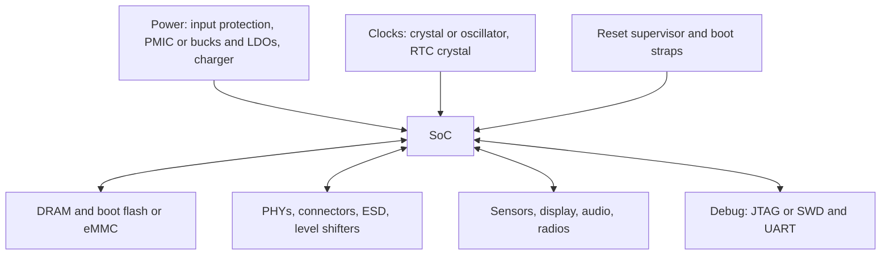

::: testing
Whether you can design a **complete system** around a SoC instead of stopping at the chip. The interviewer wants a structured list, each item with a reason:

1. Power: regulators or a PMIC with correct rails, sequencing, decoupling and a battery/charger if portable.
2. Clocking and reset: crystal or oscillator, reset supervisor.
3. Memory and storage: DRAM (if not on-die), boot flash or eMMC/SD/UFS.
4. Connectivity and interfaces: PHYs, connectors, radios, level shifters, protection (ESD).
5. Sensors, display, audio, user I/O, debug access.
6. Mechanical/thermal: heat sink, PCB stackup, test points.
:::

::: why
A datasheet's block diagram shows what is inside the chip; getting a board to boot depends on everything *outside* it. Missing a pull-up on a boot-mode pin, wrong sequencing or an inadequate decoupling network are the usual reasons a new board does not start. Interviewers ask this to see whether you can turn a chip into a working product, which links power ([[q0171]], [[q0172]]), signal integrity and layout decisions together.
:::

::: concepts
- **Power delivery**: rails, regulators, PMIC, efficiency, sequencing. See [[q0171]], [[q0172]].
- **Decoupling / PDN**: capacitors that keep the supply stiff at high frequency.
- **Clock source**: crystal with load capacitors, or MEMS/TCXO oscillator.
- **Reset and supervision**: power-on reset, brown-out detect, watchdog.
- **External memory**: LPDDR/DDR for working memory, flash/eMMC/UFS for storage. See [[q0936]].
- **Interface devices**: PHYs, transceivers, level shifters, ESD/TVS protection.
- **Boot configuration**: strap pins, boot media selection.
:::

::: answer
"I'd go through it in layers, starting with the things the SoC can't boot without.

Power first: the SoC needs several rails, say a low-voltage core rail, an I/O rail, and DRAM supplies, usually from a PMIC or a set of buck converters and LDOs, with the right sequencing and decoupling capacitors at every power pin group. If it's battery powered, add a charger and fuel gauge. Second, clocks and reset: a crystal or oscillator for the main clock, usually 24 or 26 MHz, plus a 32 kHz crystal for the RTC, and a reset supervisor or at least a defined power-on reset.

Third, memory: if it's an application processor, external LPDDR or DDR for working memory and flash, eMMC or SD for storage and boot code. MCUs often have these on-chip. Fourth, the I/O side: Ethernet PHY if the SoC only has a MAC, USB connectors and protection, Wi-Fi or cellular modules, level shifters between voltage domains, and ESD protection on anything that leaves the board. Then the application stuff: sensors, display, audio codec, buttons, LEDs.

And bring-up needs a debug header or JTAG/SWD, boot-mode straps, test points, and the thermal solution. The board design, stackup and layout for DDR and high-speed pairs matter as much as the part list."
:::

::: technical
**Checklist by function.**

| Function | Typical external parts | Why |
|---|---|---|
| Power conversion | PMIC or buck converters + LDOs, input protection, load switches | SoC needs several accurate rails (for example core 0.9 V, I/O 1.8 V or 3.3 V, DRAM 1.1 V and 0.6 V) |
| Power sequencing / monitoring | Sequencer, enable/power-good chaining, supervisor | Rails must come up in a specified order ([[q0171]]) |
| Decoupling | Bulk, ceramic and high-frequency capacitors near power balls | Keep rail impedance below target ([[q0932]] discusses die coupling) |
| Clock | 24/26/40 MHz crystal or oscillator, 32.768 kHz RTC crystal, load capacitors | Time base for PLLs, RTC |
| Reset | Supervisor, reset button, pull-ups | Clean, defined start-up |
| Working memory | LPDDR/DDR DRAM (when not integrated) | Capacity |
| Storage / boot | QSPI NOR, eMMC, SD, UFS, NAND | Firmware, OS, data |
| Connectivity | Ethernet PHY and magnetics, USB connectors/PHY, Wi-Fi/BLE/cellular module and antenna | Many SoCs have MACs but not full analog PHYs or RF |
| Protection | ESD/TVS, fuses, reverse-polarity protection | Robust ports |
| Interface conditioning | Level shifters, buffers, isolators, RS-485/CAN transceivers | Match voltage and bus standards |
| Sensing and I/O | Sensors, display and touch, audio codec, LEDs, buttons | The product's function |
| Bring-up/test | JTAG/SWD, UART console, test points, boot straps | Debug and manufacturing |
| Thermal/mechanical | Heat spreader/sink, shielding, connectors | Dissipate heat, EMC |

**Sizing examples.**
- *Rail budget* (all rails from a 5 V input): core 0.9 V/3 A at 88% efficiency, I/O 1.8 V/0.3 A at 90%, DRAM 1.1 V/0.5 A at 90%, DRAM I/O 0.6 V/0.3 A at 85%. Output power is 3.97 W; input power $=3.07+0.60+0.61+0.21=4.49$ W, i.e. 0.90 A at 5 V.
- *PDN target impedance*: $Z_{target}=\dfrac{\Delta V}{\Delta I}=\dfrac{5\%\times0.9\text{ V}}{2\text{ A}}=22.5\text{ m}\Omega$ for the core rail.
- *Crystal load capacitors*: with $C_L=8$ pF specified and stray capacitance $C_s\approx3$ pF, $C_1=C_2=2(C_L-C_s)=10$ pF.
:::

::: short
"Beyond the SoC you need power: a PMIC or regulators with the right rails, sequencing and decoupling, plus a charger if it's a battery product. Clocks and reset: a crystal or oscillator, a 32 kHz RTC crystal and a reset supervisor. Memory: DRAM and boot flash or eMMC unless they're on-chip. I/O parts: PHYs, connectors, ESD protection, level shifters and radios. Then sensors, display and user I/O, plus debug access, boot straps, test points and a thermal solution."
:::

::: long
"I'd think about what the SoC can't do for itself, and group it.

Power is the biggest. A modern SoC needs several rails, maybe a 0.9 volt core rail drawing amps, a 1.8 or 3.3 volt I/O rail, and two DRAM supplies. That usually means a PMIC, or discrete buck converters plus LDOs for the noisy and quiet loads. Each needs the right sequencing, because many SoCs specify an order and a maximum skew, and lots of decoupling: bulk capacitors plus ceramics next to the balls to meet a target impedance. For the core rail with a five percent budget on 0.9 volts and a two amp step, that target is about 22 milliohms. If it's battery powered I need a charger, protection and a fuel gauge.

Clocks and reset next. A crystal or oscillator, usually 24 or 26 MHz, with the right load capacitors, and a 32.768 kHz crystal for the real-time clock. A supervisor to hold reset until the rails are good.

Memory and storage: LPDDR or DDR if there's no on-package DRAM, and boot media like QSPI NOR, eMMC, or an SD card. Many MCUs have these on chip, so that depends on the part.

Then the interface parts: many SoCs have an Ethernet MAC but you add the PHY and magnetics; USB needs connectors and protection; wireless often needs a module; level shifters between voltage domains; and ESD protection on every external port.

Finally the product pieces, sensors, display, audio, buttons, plus the things you need for bring-up: a debug header, UART console, boot-mode straps and test points, and a heat sink if needed.

The way I'd check that I haven't missed something is to walk through the SoC's reference design or hardware design guide pin by pin."
:::

::: terms
- **PMIC**: power-management IC integrating several regulators, sequencing and often a charger.
- **Sequencing**: bringing rails up and down in a required order and timing.
- **PDN / target impedance**: power-delivery network and the impedance it must stay under.
- **Crystal load capacitance ($C_L$)**: capacitance the crystal expects, set by two external caps plus strays.
- **Reset supervisor**: monitors rail voltage and holds reset until valid.
- **Boot straps**: pins sampled at reset that select boot mode.
- **PHY**: physical-layer transceiver (for example Ethernet).
- **Level shifter**: converts signals between voltage domains.
- **TVS / ESD diode**: protection against transients.
:::

::: exceptional
**An average answer** says "memory, power supply, clock, and connectors".

**An exceptional answer**:
- Organizes by **function** and says what the SoC *cannot* provide itself and why.
- Puts numbers on at least one item (rail budget, target impedance, crystal load caps).
- Discusses **sequencing** and decoupling as design constraints, not just parts.
- Mentions boot configuration, reset behavior, debug access and test points.
- Knows to follow the vendor's reference design and hardware design guide.
- Differentiates MCU (many items integrated) from application processor (many external).
- Notes layout-critical items: DDR routing, crystal layout, thermal vias.
:::

::: mistakes
- **Forgetting sequencing.** Applying I/O power before core power can cause latch-up or leakage on some parts.
- **Insufficient decoupling** or ignoring placement; capacitor value alone does not help if the loop inductance is high.
- **Not checking voltage domains.** Connecting a 1.8 V pin to 3.3 V logic without level shifting can damage the part.
- **Leaving boot straps floating** so the chip boots from an unintended source.
- **Omitting ESD protection** on connectors.
- **Ignoring the crystal's load capacitance**, causing frequency error or no start-up.
- **Assuming the SoC includes the PHY, radio or memory** when only the MAC or controller is on-die.
:::

::: deep
## What the SoC cannot do for itself

A SoC is digital CMOS at a fine process node. It is excellent at logic and SRAM, but several things need different physics or are simply too large to integrate: switching power conversion (inductors, high-current MOSFETs), crystal oscillators (a mechanical resonator), bulk capacitors, DRAM and flash arrays, RF power amplifiers and antennas, high-voltage or isolated interfaces, and connectors. The system around it supplies those. Compare [[q0929]] and [[q0932]] for why not everything is integrated.


Figure: The SoC is the hub. Arrows from the top row are things it cannot start without (power, clock, reset); double arrows below are interfaces to external devices. Missing a top-row item means the board will not boot; missing a bottom-row item means the product lacks a feature.

## Power: rails, sequencing, decoupling

**Rails.** Take an application processor with four rails fed from a 5 V input:

| Rail | Voltage | Current | Output power | Efficiency | Input power |
|---|---|---|---|---|---|
| Core | 0.9 V | 3.0 A | 2.70 W | 88% | 3.07 W |
| I/O | 1.8 V | 0.3 A | 0.54 W | 90% | 0.60 W |
| DRAM core | 1.1 V | 0.5 A | 0.55 W | 90% | 0.61 W |
| DRAM I/O | 0.6 V | 0.3 A | 0.18 W | 85% | 0.21 W |
| Total | | | 3.97 W | | 4.49 W |

The 5 V input must supply $4.49/5=0.90$ A at full load, plus margin, so the input protection, connector and trace must handle roughly 1.2 A. The lost power (0.52 W) is heat that must also be considered. Efficiency and the choice between buck and LDO follow the usual trade-offs (high current at a large ratio calls for a buck; low-noise analog rails may use an LDO).

**Sequencing.** SoC datasheets define which rails must come up first and how far a pin voltage may exceed its rail. Typical rules: core before or with I/O, I/O never exceeds core by more than a stated amount, DRAM supplies in a specified order, and reset held until all rails are valid ([[q0171]], [[q0172]]).

```timing
{"signals":[{"name":"VIN","wave":"01.............."},{"name":"VDD_CORE","wave":"0..1............","color":"accent"},{"name":"VDD_IO","wave":"0....1.........."},{"name":"VDD_DDR","wave":"0......1........"},{"name":"XTAL","wave":"0.......1......."},{"name":"PGOOD","wave":"0.........1....."},{"name":"RESET_n","wave":"0............1.."}],
 "hscale":1.2}
```
Figure: A power-up sequence. Core comes up first, then I/O, then DRAM; the crystal runs, the supervisor asserts PGOOD only after all rails are valid, and RESET_n is released later after a hold time so the PLL and logic start from a known state. Exact order and delays are set by the SoC datasheet.

```sim
{"id":"power-sequencing","preset":"soc"}
```
Figure: The SoC preset brings up core, SRAM, DDR and then I/O, each enabled by the previous rail's power-good, and every rule passes (this preset puts I/O last; the exact order is whatever your SoC's datasheet specifies). Edit VDD_IO so it is enabled by the master EN with no delay: it now rises before the core is good and the ordering and voltage-difference rules turn red, just as a real part's absolute-maximum rating would be violated. Also try the "All at once" power-down to see why rails are sequenced down in reverse.

**Decoupling and PDN.** The core rail sees fast current steps when blocks wake up. If a 2 A step is allowed to drop the rail by 5% (45 mV):
$$Z_{target}=\frac{45\text{ mV}}{2\text{ A}}=22.5\text{ m}\Omega$$
That impedance must be maintained from DC to the frequency where the die and package capacitance take over, so the network contains the regulator (low frequency), bulk capacitors (hundreds of kHz to a few MHz), ceramic capacitors (MHz to tens of MHz) and the package/die capacitance (above that). A rough charge check: for a 10 ns burst of 2 A, the local capacitor must supply $Q=I\Delta t=20$ nC; to hold the droop to 45 mV needs at least $C=Q/\Delta V=0.44\,\mu$F in the nearest stage, in practice several µF of small capacitors with low loop inductance.

```sim
{"id":"decap-network","preset":"mixed","ztarget":0.0225}
```
Figure: With mixed values (220 µF bulk plus 10 µF, 1 µF and 100 nF ceramics) the combined impedance stays under the 22.5 mΩ line up to about 69 MHz, with anti-resonance peaks between values coming close to it (about 20 mΩ near 11 MHz). Above that, mounting inductance dominates and board capacitors cannot hold the target; the package and on-die capacitance have to. Switch to the 'placed far' preset to see the failure move tens of MHz lower.

## Clocks and reset

Most SoCs need a reference clock (24 to 40 MHz is common) and an RTC clock (32.768 kHz). A Pierce oscillator uses a crystal with two load capacitors. The effective load seen by the crystal is
$$C_L=\frac{C_1C_2}{C_1+C_2}+C_{stray}$$
For $C_L=8$ pF, $C_{stray}=3$ pF and $C_1=C_2=C$: $C/2=5$ pF, so $C=10$ pF.

```circuit
{"caption":"Pierce crystal connection to a SoC","elements":[
 {"t":"box","at":[16,2],"w":5,"h":7,"label":"SoC","pins":[{"side":"left","pos":1,"name":"XIN"},{"side":"left","pos":5,"name":"XOUT"}]},
 {"t":"wire","pts":[[16,3],[7,3]]},
 {"t":"wire","pts":[[16,7],[10,7]]},
 {"t":"xtal","a":[12,3],"b":[12,7],"label":"Y_1","value":"24 MHz"},
 {"t":"dot","at":[12,3]},{"t":"dot","at":[12,7]},
 {"t":"C","a":[7,3],"b":[7,7],"label":"C_1","value":"10 pF"},
 {"t":"C","a":[10,7],"b":[10,10],"label":"C_2","value":"10 pF"},
 {"t":"wire","pts":[[7,7],[7,10],[10,10]]},
 {"t":"gnd","at":[8.5,10]}
]}
```
Figure: The crystal sits between XIN and XOUT and each pin sees a load capacitor to ground. Keep the loop short and the area under the crystal clear of noisy traces. Capacitor values come from the crystal's specified load capacitance minus stray capacitance.

**Reset.** A supervisor holds reset low until supply voltage rises above a threshold and stays there for a fixed delay. Without it a slowly ramping rail can release reset while the logic is below its minimum operating voltage. Boot straps (pins sampled at reset) choose the boot device, so they need defined pull-ups or pull-downs.

## Memory, storage and boot

An application SoC includes a DRAM controller and PHY but not the DRAM. LPDDR devices are placed very close with tightly length-matched routing and controlled impedance. Boot code is stored in QSPI NOR, eMMC, SD or UFS depending on size and speed. The boot ROM reads strap pins or fuses to decide where to look. MCUs with on-chip flash skip most of this. See [[q0928]] for what is on the die.

## Interfaces and protection

- **Ethernet**: SoC provides the MAC; an external PHY and magnetics (or an integrated-magnetics jack) turn it into differential signals at 100BASE-TX or 1000BASE-T.
- **USB**: some SoCs include the PHY; connectors need ESD protection and a common-mode choke may be needed for EMC.
- **Level shifting**: signals between a 1.8 V SoC and 3.3 V devices need shifters or voltage-compatible parts.
- **Wireless**: if the SoC has no radio, a module or separate transceiver plus antenna and matching network is required.
- **Protection**: ESD diodes on external ports, fuses or ideal-diode controllers on power input, reverse-polarity protection.

## Bring-up and thermal

A good first board has a debug header (JTAG/SWD), a UART console, test points for every rail and clock, boot-mode jumpers and LEDs for status. Thermal design depends on the power from the table above: 0.52 W of regulator loss plus the SoC's own dissipation determine heat-sink needs. At 3 W in the SoC and a junction limit of 105 °C with 40 °C ambient, the required total thermal resistance is $(105-40)/3=21.7$ °C/W or lower.

> [!INTERVIEW]
> Offer to start from the vendor's reference design: "I'd use the evaluation board schematic and hardware design guide as the baseline, then adapt it, because it already encodes the sequencing, decoupling and layout rules the vendor validated."
:::

::: applications
- **Embedded Linux boards**: application SoC + PMIC + LPDDR + eMMC + PHYs; reference designs from the SoC vendor.
- **MCU products**: MCU + decoupling, crystal, reset, connector and sensors (most memory on-chip).
- **IoT devices**: wireless SoC + antenna matching, battery, charger and sensors.
- **Industrial controllers**: SoC + isolated interfaces, CAN/RS-485 transceivers, wide-input power, extra protection.
- **Wearables**: SoC + PMIC with charger and fuel gauge, display and sensors on a tiny board.
:::

::: assumptions
- Rail voltages, currents and efficiencies are illustrative values for an application-class SoC; real parts have datasheets that define them.
- Which items are external depends on the SoC class: MCUs integrate flash, SRAM, sometimes regulators and radios; application processors integrate few of these.
- Package-on-package or SiP parts can include DRAM and PMIC inside the package, reducing the external list.
- The target-impedance method is a first-order design aid; the vendor's PDN guidelines take precedence.
- Crystal load calculations use a simplified stray-capacitance estimate; the crystal datasheet and the SoC oscillator specification govern.
:::

::: followups
### Why can't the SoC generate its own supply rails?
Efficient conversion needs inductors, large capacitors and power transistors that don't fit on a digital die, and the input is often battery or a 5 V-to-20 V source. Some SoCs integrate LDOs or small on-die regulators for low-current domains, but the bulk power conversion is external, often in a PMIC.

### How would you decide between a PMIC and discrete regulators?
A PMIC integrates several rails, sequencing, DVFS interfaces and often the battery charger, so it saves area and validation time, and many SoC vendors ship a recommended PMIC. Discrete regulators give flexibility (efficiency, current, cost) for unusual rails or custom requirements. For a first design near a vendor's reference, use the recommended PMIC.

### What goes wrong if you ignore power sequencing?
Depending on the part: excess current through ESD diodes or parasitic structures when an I/O pin is driven before its rail is up, latch-up, an undefined reset state, or violating absolute-maximum differentials between rails, which can cause long-term damage. A sequencer, enable chaining or a PMIC with programmed order prevents it.

### The board powers up but the SoC never boots. What do you check?
First the rails with a scope (levels, order, noise, timing), then the clocks (is the crystal oscillating, correct frequency) and reset (released after PGOOD, not glitching). Then boot straps and the boot media (is it populated, is the image valid), then the console UART and JTAG/SWD to see where it stops. DRAM training failures are another common cause on application SoCs.

### Your board's 1.8 V I/O pin connects to a 3.3 V sensor's output. What do you do?
A 3.3 V output can overstress a 1.8 V input. Check the SoC pin's absolute maximum and whether it's 3.3 V tolerant. If not, add a level shifter, or a resistive divider for a slow one-way signal, or choose a sensor that runs on the 1.8 V rail. I'd verify the logic thresholds are still met after the change.
:::

::: interpretations
"In addition to a SoC" means *system-level* support components. The page covers the common answer (power, clock, reset, memory, interfaces, protection, debug) and shows the numbers needed to size the main items. Whether DRAM and flash are on the chip depends on the class (MCU vs application SoC); see [[q0926]] and [[q0928]]. The module alternative, where these parts come pre-assembled, is [[q0931]].
:::

::: references
- Johnson & Graham, *High-Speed Digital Design: A Handbook of Black Magic*: power-system decoupling and signal-integrity layout.
- Horowitz & Hill, *The Art of Electronics*: power regulation, oscillators and reset circuits.
- SoC vendors' hardware design guides and reference schematics (for example the NXP i.MX, TI Sitara or STM32 hardware development guides): rail lists, sequencing, strap and layout rules for each family.
- JEDEC LPDDR specifications: supply requirements and signaling for DRAM devices.
:::

::: rubric
- Lists power delivery (PMIC/regulators, sequencing, decoupling) as the first requirement :: Without correct power nothing else works.
- Includes clocks (crystal, RTC) and reset :: Essential for start-up and timekeeping.
- Mentions external memory and boot storage, with the MCU exception :: Shows you know what the die does and doesn't include.
- Mentions PHYs, connectors, ESD protection and level shifting :: Interface realities that cause many real bugs.
- Mentions sensors, display, radios and user I/O as application-dependent :: The product-level view.
- Includes debug/bring-up and thermal considerations :: Practical engineering readiness.
- Gives at least one calculation (rail budget, target impedance, crystal caps) :: Demonstrates ability to size, not just list.
:::

::: quiz
```json
[
 {"type":"mcq","level":"fundamental","q":"Which of these is NOT normally integrated on an application-processor SoC?","options":["CPU cores","DRAM controller","Bulk LPDDR DRAM array","Boot ROM"],"answer":2,"explain":"The DRAM array uses a different process and is external; the controller and PHY are on the SoC."},
 {"type":"truefalse","level":"fundamental","q":"If the SoC has an Ethernet MAC, no additional chip is needed to connect to an Ethernet cable.","answer":false,"explain":"A MAC is digital; you typically need a PHY (analog transceiver) and magnetics, unless the SoC integrates the PHY."},
 {"type":"numeric","level":"intermediate","q":"A core rail is 1.0 V with a 4% allowed deviation and a 5 A load step. What target impedance in mΩ must the PDN meet?","answer":8,"tolerance":0.02,"unit":"mΩ","explain":"$Z=\\Delta V/\\Delta I=0.04\\times1.0/5=8$ mΩ."},
 {"type":"numeric","level":"intermediate","q":"A crystal requires CL = 12 pF. Stray capacitance is 4 pF. For equal load capacitors C1 = C2, what value of each in pF?","answer":16,"tolerance":0.02,"unit":"pF","explain":"$C_L=C/2+C_{stray}$ so $C=2(12-4)=16$ pF."},
 {"type":"numeric","level":"intermediate","q":"Rails total 3.2 W output power with an average converter efficiency of 90%, fed from 5 V. What input current in A?","answer":0.711,"tolerance":0.03,"unit":"A","explain":"Input power $=3.2/0.9=3.56$ W; $I=3.56/5=0.711$ A."},
 {"type":"mcq","level":"advanced","q":"After power-up the SoC sometimes fails to boot, only when the supply ramps slowly. What is the most likely missing part or setting?","options":["A larger heat sink","A reset supervisor holding reset until rails are above threshold","A faster USB cable","More GPIO pull-ups"],"answer":1,"explain":"With slow ramps the internal power-on reset or RC reset may release before rails are valid. A supervisor holds reset until voltage is above threshold plus a delay."}
]
```
:::
