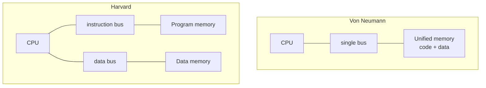

::: testing
Whether you understand that "program memory" and "data memory" are **roles and access paths**, not magic different kinds of silicon. The interviewer wants to hear:

1. Program memory holds instructions that the PC fetches; data memory holds values that load/store instructions read and write.
2. The architectural split: **Harvard** (physically separate) vs **von Neumann** (shared), and why each exists.
3. The practical differences: writability, volatility, width, access pattern, and protection.
4. A performance argument, ideally with a number: a shared bus makes the fetch stage and the memory stage fight.
:::

::: why
Real microcontrollers (AVR, PIC, many DSPs) literally have separate program and data memories, and getting the distinction wrong produces classic bugs: a string that eats scarce SRAM because it was not put in flash, a pointer to flash used as if it were a RAM pointer, a function that cannot be written to because it is in ROM. On the architecture side, the split is the cleanest example of a bandwidth bottleneck being fixed by adding a second path, which is a theme that recurs through caches, GPUs and SoCs.
:::

::: concepts
- **Program counter and instruction fetch**: instructions are read in mostly sequential order, addressed by the PC. See [[q0905]].
- **Load/store addressing**: data is accessed at arbitrary addresses computed by the program.
- **Read-only vs read/write**: program memory is usually written only when flashing; data memory is written constantly.
- **Von Neumann vs Harvard**: one memory vs two. See [[q0913]] for what an ISA exposes.
- **Structural hazard**: two pipeline stages want the same single-ported resource in one cycle. See [[q0909]].
- **Non-volatile vs volatile** storage. See [[q0826]].
:::

::: answer
"Program memory stores the instructions the CPU executes. Data memory stores the values those instructions work on: variables, buffers, the stack.

At the highest level they're distinguished by how the CPU uses them. The program counter walks through program memory, mostly in order, and it's essentially read-only while the program runs. Data memory is accessed by load and store instructions at whatever addresses the program computes, and it's constantly read and written.

In a Harvard architecture, like an AVR or PIC microcontroller, those are two physically separate memories with separate buses and sometimes separate address spaces. For example, an ATmega328P has 32 KB of flash for program and 2 KB of SRAM for data. The advantage is that you can fetch the next instruction while the current one is accessing data, so you don't have a bus bottleneck.

In a von Neumann architecture, both live in one memory and share a bus, so you have more flexibility, you can treat code as data and load programs dynamically, but fetch and data access compete.

Most modern CPUs split the difference. The L1 instruction and data caches are separate, but below that it's one shared main memory."
:::

::: technical
**Functional differences.**

| Property | Program memory | Data memory |
|---|---|---|
| Content | machine instructions | variables, stack, heap, buffers, I/O |
| Accessed by | instruction fetch (PC) | load/store (computed addresses) |
| Pattern | mostly sequential, with branches | arbitrary; stack is LIFO, arrays strided |
| Writes at run time | rare (flashing, JIT) | constant |
| Typical technology | flash, ROM, (code RAM) | SRAM, DRAM |
| Volatile? | usually not | usually yes |
| Protection | executable, read-only | read/write, non-executable (NX) |
| Width | instruction width (e.g. 16 or 32 bits) | byte-addressable, 8 to 64-bit accesses |

**Harvard example, ATmega328P.** 32 KB flash organised as 16 K x 16-bit words (the PC addresses words); 2 KB SRAM addressed as bytes; 1 KB EEPROM in a third space. Two memories, two address spaces, so the same numeric address means different things. Reading a constant out of flash needs a special instruction (`LPM`), and C code needs `PROGMEM` helpers.

**Performance argument.** In a 5-stage pipeline, IF fetches an instruction every cycle and MEM performs loads/stores. With a single-ported unified memory, any cycle in which a load/store is in MEM collides with IF. If a fraction $f_{ls}$ of instructions are loads/stores, each costs one extra stall cycle:
$$\text{CPI} = 1 + f_{ls}.$$
With $f_{ls} = 0.30$, CPI = 1.30, a 30% slowdown versus split memories (CPI = 1.0), or equivalently the Harvard machine is $1.3\times$ faster at the same clock.

**Von Neumann advantages.** One address space; code can be treated as data (loaders, JIT, self-modifying code); memory is partitioned by software, so a 40 KB code / 20 KB data program and a 10 KB / 50 KB one both fit in 60 KB total. Harvard fixes the split in hardware.

**Modified Harvard.** Separate L1-I and L1-D caches with a unified L2/L3/DRAM give parallel fetch and data access at the top and flexibility below.
:::

::: short
"Program memory holds the instructions the CPU fetches with the program counter; data memory holds the variables and buffers the instructions load and store. Program memory is mostly read-only at run time and often non-volatile flash, while data memory is read/write, usually SRAM. In a Harvard architecture they're physically separate so you can fetch and access data in the same cycle; in von Neumann they share one memory and bus, which is more flexible but creates a bottleneck. Modern CPUs use split L1 caches over a unified main memory."
:::

::: long
"The cleanest way to see the difference is by who accesses it and how. Program memory is accessed by the instruction fetch unit, driven by the program counter. It reads mostly in sequence, jumping on branches, and at run time it's essentially read-only. Data memory is accessed by load and store instructions at addresses the program computes, so it's random-looking, and it's read and written constantly.

That shows up in the technology. Program memory tends to be non-volatile, flash or ROM, because the program has to survive power-off. Data memory is SRAM or DRAM because it has to be fast and written billions of times.

Architecturally, there are two ways to arrange this. Von Neumann puts both into one memory with one bus. It's flexible: you can use the same 60 KB however you like, and you can treat code as data to load programs. But the CPU can't fetch an instruction and access data at the same time. Harvard splits them into two memories with two buses. Then the fetch and the data access overlap. For a pipeline where about 30 percent of instructions are loads or stores, a single shared port costs about one extra cycle on each, so CPI goes from 1.0 to 1.3. The price is rigidity: if you run out of data memory you can't borrow program memory, and reading constants out of program memory needs special instructions. AVR and PIC are examples.

Real application CPUs use a modified Harvard design: separate L1 instruction and data caches, so fetch and load/store happen in parallel, over one unified main memory underneath. That gets the bandwidth of Harvard and the flexibility of von Neumann. Memory protection adds the last distinction: code pages are marked executable and read-only, data pages are read/write and non-executable."
:::

::: terms
- **Program memory**: the memory region that holds instructions; read by instruction fetch.
- **Data memory**: the memory region read and written by load/store instructions.
- **Harvard architecture**: separate storage and buses for instructions and data.
- **Von Neumann architecture**: one storage and bus shared by instructions and data.
- **Modified Harvard**: separate L1 instruction/data caches over unified memory.
- **Structural hazard**: two operations needing the same hardware resource in the same cycle.
- **NX / W^X**: pages are either writable or executable, not both, to prevent code injection.
- **PROGMEM / LPM**: AVR mechanism for reading constants from program flash.
:::

::: exceptional
An average answer says "program memory stores code, data memory stores variables". An exceptional answer:

- Frames it as **role and access path**: PC fetch vs load/store, not different physics.
- Gives the Harvard vs von Neumann trade-off with a **quantified** hazard argument (CPI = 1 + f_ls).
- Names a real part with real numbers (ATmega328P: 32 KB flash, 2 KB SRAM, separate address spaces) and the practical pain (`PROGMEM`).
- Mentions modified Harvard and that every modern core is one, plus I/D cache coherence for self-modifying code.
- Brings in protection: execute-only/NX, why attackers exploit von Neumann's code-as-data property.
:::

::: mistakes
- **"Program memory is ROM and data memory is RAM."** Typical, but not definitional. Code can run from RAM; constants live in flash.
- **Saying von Neumann is just slower.** It is more flexible, and caches hide most of the bottleneck in modern CPUs.
- **Thinking Harvard has twice the memory.** It has two separate memories; total capacity is whatever you build, and each has a hard limit.
- **Assuming the same address means the same location** in a Harvard MCU. Program address 0x0100 and data address 0x0100 are different places.
- **Forgetting that flash holds data too** (constants, calibration) and that SRAM can hold code (relocated ISRs).
:::

::: deep
## What "memory for the program" really means

Take a CPU with a program counter, a register file and an ALU. At each step the control unit does:

1. **Fetch**: send the PC to memory, receive an instruction word.
2. **Decode and execute**: read registers, compute.
3. **Memory** (only for loads/stores): send an address, read or write a data word.
4. **Write back** and update the PC.

Step 1 and step 3 are both memory accesses from the same core. The question "are these one memory or two?" is the whole von Neumann vs Harvard debate.


Figure: Left, one bus carries both instruction fetches and data traffic, so they must take turns. Right, two buses let the CPU fetch the next instruction while the current one reads or writes data.

## Quantifying the bottleneck

In a classic 5-stage pipeline ([[q0906]]) a new instruction enters IF every cycle. A load or store is in its MEM stage three cycles later, at the same time another instruction wants IF. With one memory port, one of them must wait. Say 30% of instructions are loads/stores (a typical figure for integer code is 20 to 35%):

$$\text{CPI}_{\text{shared}} = 1 + 0.30 \times 1 = 1.30,\qquad \text{Speedup of Harvard} = \frac{1.30}{1.00} = 1.30.$$

For a 2-cycle memory (slow flash) the effect on the shared design is worse, but then both designs are memory-bound and what really helps is caches, wider fetch, or prefetch buffers.

```timing
{"signals":[
 {"name":"CLK","wave":"p......."},
 {"name":"Von Neumann bus","wave":"=.=.=.=.","data":["IF i1","LD data","IF i2","IF i3"]},
 {"name":"Harvard I-bus","wave":"=.=.=.=.","data":["IF i1","IF i2","IF i3","IF i4"]},
 {"name":"Harvard D-bus","wave":"x.=.x.x.","data":["LD data"]}
],"hscale":1.2}
```
Figure: The single shared bus spends a slot on the load's data, delaying instruction 2; the Harvard design keeps fetching one instruction per slot while the D-bus services the load in parallel.

## Why they are physically different technologies in MCUs

- **Program memory is read far more than written.** Flash cells are dense (small area per bit) and keep data unpowered, but writing needs high voltage, whole-page erase and has limited endurance (order of $10^4$ to $10^5$ cycles for embedded NOR flash; vendor-dependent).
- **Data memory is read and written constantly**, so it needs fast, symmetric, unlimited-endurance cells: 6-transistor SRAM ([[q0939]]). SRAM is much larger per bit (6 transistors vs one floating-gate), so MCUs have kilobytes of SRAM but hundreds of kilobytes of flash. That is exactly the ATmega328P's 32 KB / 2 KB ratio.

## What a real Harvard MCU feels like

On an AVR the C compiler must know whether a pointer points to flash or SRAM. A string literal such as `"Hello"` would by default be copied into scarce SRAM at boot. Declaring it with `PROGMEM` keeps it in flash and you read it with `pgm_read_byte()`, which compiles to `LPM`. On Cortex-M (a modified Harvard design with one unified address map) flash and SRAM share the same address space, so a `const` array just lives in flash and plain loads read it.

## Protection: separating roles even on a shared memory

Even on a von Neumann memory, an MMU or MPU ([[q0943]]) restores much of the split in software: pages of code are marked read + execute, pages of data are read + write + no-execute. This blocks classic buffer-overflow attacks that write machine code to the stack and jump to it. The cost is that JIT compilers must request memory as writable, write the code, then flip it to executable and flush the instruction cache.

## Modified Harvard and cache coherence

A typical application core has:

- L1-I (e.g. 32 KB) feeding fetch, L1-D (e.g. 32 KB) feeding load/store,
- unified L2/L3 and DRAM below.

When software writes new code (a loader, JIT, or the kernel paging in an executable), the new bytes enter the L1-D as data. The L1-I may still hold stale instructions. Software must clean the data cache to the point of unification and invalidate the instruction cache, which is the "cache maintenance" sequence in Arm and RISC-V `fence.i`. Missing it produces the classic "works under the debugger, crashes without" bug.

## Worked example: sizing both memories

A thermostat firmware needs 60 KB of code and 8 KB of lookup tables (68 KB that must be non-volatile), plus 3 KB of variables and a 2 KB stack (5 KB of read/write data).

- A Harvard part with 64 KB flash and 4 KB SRAM fails on **both**: 68 > 64 and 5 > 4.
- A Harvard part with 128 KB flash and 8 KB SRAM fits, with 60 KB spare flash for an OTA image and 3 KB spare RAM.
- A unified 72 KB memory fails (73 KB needed), while 80 KB fits, with 7 KB of slack that software can split any way it likes.

Harvard splits are chosen to match the *typical* code-to-data ratio; a program with an unusual ratio hits the wrong wall first, which is the flexibility argument for von Neumann.

## Bandwidth arithmetic

Take a 100 MHz core issuing one 32-bit instruction per cycle with 30% of instructions doing a 4-byte data access.

- Instruction fetch bandwidth: $100\times10^6 \times 4 = 400$ MB/s.
- Data bandwidth: $100\times10^6 \times 0.3 \times 4 = 120$ MB/s.
- A shared bus must sustain $400 + 120 = 520$ MB/s, i.e. 30% more traffic than the instruction side alone. That is the same 1.3x number as the CPI argument, seen from the bandwidth side.

Compressed instruction sets (Thumb-2, RISC-V "C") cut the fetch term: with an average of 2.5 bytes per instruction the fetch bandwidth falls to 250 MB/s, so the flash needs to deliver fewer bytes per second, which also saves power. That is one reason Cortex-M parts are so popular where flash wait states are the limit.

## Putting it together: a checklist for "which memory is this?"

1. Does the PC ever point into it? Then it is program memory (even if it is physically SRAM).
2. Do loads and stores target it? Then it is data memory (even if it is physically flash, like a `const` table).
3. Is it writable at run time at full speed? Then it is RAM-like; otherwise flash/ROM-like.
4. Does it survive power-off? Then it is non-volatile; otherwise the content must be rebuilt at boot.

Applying this to a bootloader that copies a new firmware image into flash: the image is *data* while being copied and becomes *program* once the PC jumps to it, with flash programming running from RAM because the flash array is busy during erase and write.
:::

::: applications
- **ATmega328P / Arduino Uno**: 32 KB flash program memory, 2 KB SRAM data memory, 1 KB EEPROM in a third space.
- **PIC microcontrollers**: Harvard with different instruction word width than data width (e.g. 14-bit instruction words in midrange parts).
- **DSP chips**: dual data buses plus a program bus (modified Harvard) to fetch an instruction and two operands for a MAC every cycle.
- **Cortex-M MCUs**: one address map, separate I-code, D-code and system buses, giving Harvard-like parallelism.
- **Application processors (x86, Arm, RISC-V)**: split L1-I/L1-D over unified DRAM.
:::

::: assumptions
- Assumes a conventional single-core stored-program machine; the CPI model assumes a single-port shared memory and in-order 5-stage pipeline.
- "30% loads/stores" is a rough, workload-dependent figure.
- Flash endurance and sizes are typical orders of magnitude and vary by technology and vendor.
- Many modern MCUs expose a unified address map but internally use multiple buses; whether you call that "Harvard" depends on whether you mean address spaces or bus paths. Both answers are valid if you define your terms.
:::

::: followups
### Why do MCUs usually have far more program memory than data memory?
Flash is about one transistor per bit while SRAM is six, so flash is much denser; programs are also big (code plus constants) while their working variables are small. A typical split is 8:1 to 32:1, like 32 KB/2 KB on an ATmega328P.

### Can a Harvard machine run code from RAM?
Not directly on a strict Harvard design: the instruction bus only sees program memory. Some Harvard chips add a way to execute from RAM or to write program memory (self-programming flash). Modified Harvard machines like Cortex-M can just branch to a RAM address.

### What is the structural hazard in a unified-memory pipeline, and how do real CPUs avoid it?
IF and MEM want the single port in the same cycle. Solutions: separate instruction and data memories, split L1 caches, or a dual-ported memory. With a 30% load/store mix, avoiding it improves CPI from 1.30 to 1.0.

### How does the OS stop data from being executed as code?
The MMU holds per-page permission bits. Code pages are read + execute, data and stack pages are read + write with the NX bit set. A jump into the stack causes a fault. The trade-off: JIT engines and loaders must change permissions deliberately.

### What if the data is a large constant table, such as a 4 KB sine lookup? Where should it go on an AVR vs a Cortex-M?
On AVR, in program memory with `PROGMEM`, because 4 KB would be 200% of the 2 KB SRAM. On Cortex-M, declare it `const` so the linker places it in `.rodata` in flash; it is then read directly via the unified address map, with no RAM cost.
:::

::: references
- Patterson & Hennessy, *Computer Organization and Design*: the stored-program concept, pipelining and structural hazards.
- Hennessy & Patterson, *Computer Architecture: A Quantitative Approach*: memory hierarchy and pipeline hazards.
- Microchip (Atmel) ATmega328P datasheet: memory organisation (program flash, SRAM, EEPROM).
- Arm, *Armv7-M Architecture Reference Manual*: system address map and memory attributes.
:::

::: rubric
- Defines program memory as holding instructions fetched via the PC and data memory as read/written by load/store :: Establishes the role distinction the question asks about.
- Contrasts Harvard (separate) with von Neumann (shared) :: This is the architectural meaning of the split.
- Gives the performance consequence (simultaneous fetch and data access; shared-bus bottleneck) :: Shows you know why the distinction matters.
- Notes technology and writability differences (flash vs SRAM, read-mostly vs read/write) :: Connects architecture to circuits.
- Gives a real example such as an AVR with its sizes and special access to flash constants :: Evidence of hands-on familiarity.
- Mentions modified Harvard / split L1 caches :: Shows you know what actual modern CPUs do.
- Mentions protection (NX/W^X) or cache coherence for code modification :: Senior-level awareness of the practical consequences.
:::

::: quiz
```json
[
 {"type":"mcq","level":"fundamental","q":"Which statement best describes a Harvard architecture?","options":["Instructions and data share one memory and one bus","Instructions and data use separate memories/buses so both can be accessed in the same cycle","Only data is stored in cache","Program memory is always RAM"],"answer":1,"explain":"Harvard means physically separate paths for instructions and data. Option A describes von Neumann."},
 {"type":"truefalse","level":"fundamental","q":"On an ATmega328P, the same numeric address refers to the same location in flash and in SRAM.","answer":false,"explain":"It is a Harvard part with separate address spaces; flash is word-addressed program memory and SRAM is byte-addressed data memory, so address 0x0100 means something different in each."},
 {"type":"numeric","level":"intermediate","q":"A pipeline has a single-ported unified memory. 25% of instructions are loads/stores, each causing one stall cycle. What is the CPI? (Ideal CPI = 1.)","answer":1.25,"tolerance":0.01,"unit":"","explain":"CPI = 1 + 0.25 x 1 = 1.25."},
 {"type":"numeric","level":"intermediate","q":"Using the same assumptions (30% loads/stores, one stall each), how many times faster is a Harvard design than the shared-memory design at equal clock rate?","answer":1.3,"tolerance":0.01,"unit":"x","explain":"Shared CPI = 1.30, Harvard CPI = 1.00, so the speedup is 1.30/1.00 = 1.3x."},
 {"type":"mcq","level":"advanced","q":"A JIT compiler writes machine code into memory and then jumps to it on a modern Arm/x86 CPU with an MMU. Which sequence is correct?","options":["Write code, jump to it immediately","Write code, make pages executable, and handle instruction-cache coherence (clean D-cache/invalidate I-cache where needed) before jumping","Mark pages writable and executable at the same time to avoid permission changes","Store the code in registers"],"answer":1,"explain":"The new instructions go through the data side. Under W^X you must flip permissions, and on architectures with non-coherent I/D caches you must clean and invalidate before executing. Jumping immediately can run stale instructions."}
]
```
:::
