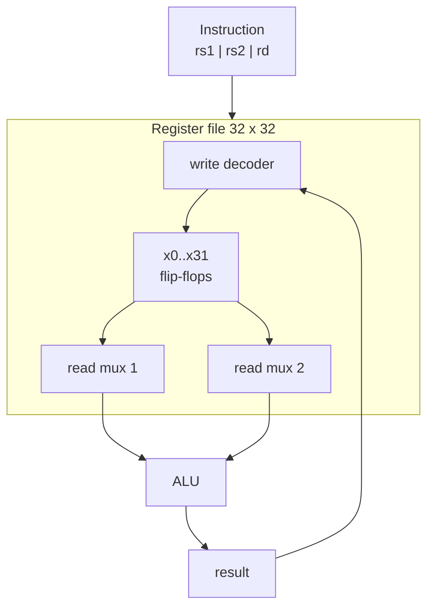

::: testing
Whether you can say what a register is **physically** (an array of flip-flops) and **architecturally** (the CPU's named, fastest storage), and why a CPU needs them. Strong answers cover:

1. Registers are the top of the memory hierarchy: tiny, within the datapath, accessed in under a cycle.
2. The different kinds: general-purpose, program counter, stack pointer, status/flags, pipeline registers, and peripheral control/status registers.
3. How they are built (D flip-flops with enable, grouped into a register file with read and write ports).
4. Why the count is small, and what happens when you run out (spilling).
5. The distinction from memory: registers are named in the instruction encoding, not addressed.
:::

::: why
Every instruction reads and writes registers, so the register file sits on the critical path of every CPU and sets cycle time, area and power. In embedded work, "registers" also means the memory-mapped control and status registers that configure peripherals (the subject of [[q0829]] and [[q0830]]), and misreading a register's bit fields is a classic bring-up bug. Knowing both meanings, and that they are the same circuit idea, is what interviewers are probing for.
:::

::: concepts
- **D flip-flop / latch**: the 1-bit storage element that captures a value on a clock edge. See [[q0880]].
- **Register file**: an array of registers with address decoders, read ports and write ports.
- **Architectural vs physical registers**: the ISA-visible names vs the hardware's actual storage (renaming).
- **Special-purpose registers**: PC, SP, status/flags, link register.
- **Pipeline registers**: flip-flops between stages that hold in-flight state. See [[q0906]].
- **Memory-mapped (peripheral) registers**: control/status bits at fixed addresses. See [[q0829]].
:::

::: answer
"A register is a small piece of storage built from flip-flops that holds a value right inside the processor. A 32-bit register is just 32 D flip-flops sharing a clock and a write-enable. They're the fastest memory in the system: the ALU reads its operands from registers and writes its result back to a register, usually within a single cycle, at the very top of the memory hierarchy.

A CPU has several kinds. General-purpose registers hold operands and addresses, for example RISC-V has 32 of them, 32 bits each. Then special-purpose ones: the program counter that points at the next instruction, the stack pointer, a status register with flags like zero and carry. Internally there are also pipeline registers between stages.

They're named directly in the instruction encoding, five bits to pick one of 32, rather than addressed like memory, which is why access is so fast and why there can only be a few. Too many would mean bigger decoders and more ports, which slows every cycle.

And in embedded work the term also covers peripheral registers: control and status registers at fixed addresses, where individual bits enable a UART, set a baud rate or flag an interrupt. Same idea, flip-flops with a bus interface."
:::

::: technical
**Circuit.** A 1-bit register is a D flip-flop; with a write enable, a 2:1 mux feeds either the new data or the flip-flop's own output back to D, or the clock is gated. An $n$-bit register is $n$ such cells with a common clock and enable.

**Register file.** $N$ registers of $W$ bits with $R$ read ports and $P$ write ports. For a RISC-V RV32I core: $N=32$, $W=32$, $R=2$ (rs1, rs2), $P=1$ (rd): $32\times32 = 1024$ bits = 128 bytes. Address inputs: 5 bits per port. `x0` is hard-wired to 0 (writes discarded), which makes `mv`, `nop`, comparisons with zero and `j` encodable without extra opcodes.

**Cost vs ports.** Each added port adds a word-line and bit-line to every cell, increasing both cell width and height, so area grows roughly like the square of the port count. A wide superscalar core with 8 read and 4 write ports has $(12/3)^2 \approx 16\times$ the per-bit area of a 2R1W file, which is why big cores limit architectural registers and use banking or clustering.

**Timing.** Read is combinational (decoder + mux, about a fraction of a cycle); write happens on the clock edge. Within one cycle, a read of a register being written is resolved by internal write-through or by forwarding in the pipeline.

**Typical counts.** x86-64: 16 GPRs; Arm64: 31 GPRs + SP/ZR; RISC-V: 32 (x0 = 0); AVR: 32 8-bit registers; Cortex-M: 13 low/high GPRs + SP, LR, PC. Out-of-order cores have 100 to 300+ **physical** registers behind the architectural names.

**When registers run out**, the compiler *spills* values to the stack: a store and a later load. With an L1 hit time of about 4 cycles, a spill/reload pair adds work and latency to the dependency chain.
:::

::: short
"A register is a small, very fast storage element inside the CPU made of flip-flops: an n-bit register is n D flip-flops sharing a clock and write enable. Registers are the top of the memory hierarchy: the ALU reads operands from them and writes results back in about a cycle. There are general-purpose registers, plus special ones like the program counter, stack pointer and status flags, and pipeline registers between stages. They're named in the instruction rather than addressed, so there are only a few. Peripheral control registers in a microcontroller work the same way but sit at memory-mapped addresses."
:::

::: long
"Physically, a register is a group of D flip-flops. A flip-flop captures one bit on a clock edge and holds it; a 32-bit register is 32 of them sharing a clock and a write-enable. So a register is how a synchronous digital circuit remembers state from one cycle to the next.

In a CPU, registers are the fastest level of the memory hierarchy. The datapath is built around a register file: say 32 registers of 32 bits, with two read ports so you can fetch two operands at once and one write port for the result. The instruction itself names the registers, five bits each for 32 registers, so there's no address calculation or cache lookup, the decode just drives a mux. That's why access is under a cycle.

There are different kinds. General-purpose registers hold operands, addresses and temporaries. Special-purpose ones include the program counter, the stack pointer, a link register for return addresses, and a status register with flags like zero, carry, overflow. Inside the pipeline, there are pipeline registers between each stage that carry the instruction's state forward.

The count is small on purpose. Every extra register enlarges the decoder and muxes, and every extra port adds wires to each cell, so area grows roughly with the square of the port count and the cycle time suffers. If the compiler runs out, it spills values to the stack, which is a load and store to the cache, so it's slower. Big out-of-order cores hide this by having hundreds of physical registers behind the 16 or 32 architectural names via register renaming.

Finally, in embedded work I also use the word for peripheral registers: control and status registers at fixed memory addresses where each bit field does something specific, like enabling a timer. They're also flip-flops, just with a bus interface and sometimes side effects on read or write."
:::

::: terms
- **Register**: a group of flip-flops holding a multi-bit value, clocked together.
- **Register file**: array of registers with decoders and read/write ports.
- **Architectural register**: a register visible in the ISA (e.g. `x5`).
- **Physical register**: actual hardware storage; renamed to architectural ones in OoO cores.
- **Program counter (PC)**: holds the address of the next instruction.
- **Status / flags register**: condition bits (Z, N, C, V).
- **Register spilling**: storing a live value to the stack because there are not enough registers.
- **Memory-mapped register**: peripheral control/status register accessed via loads/stores.
:::

::: exceptional
An average answer says "fast storage inside the CPU". An exceptional answer:

- Ties the **circuit** (D flip-flops, enable, register file ports) to the **architecture** (named in the instruction, 5-bit specifiers).
- Explains **why there are few**: port count and decoder delay, area ~ ports squared, register-file read in the critical path.
- Covers all the kinds, including pipeline registers and peripheral CSRs.
- Mentions register renaming/physical register files and spilling, with a concrete example count (RV32: 32 x 32 b = 128 B).
- Distinguishes registers from RAM clearly and gives the embedded meaning and its pitfalls (reserved bits, write-1-to-clear, read side effects).
:::

::: mistakes
- **"Registers are just very fast RAM."** They are flip-flops/latches in the datapath, specified by encoded names rather than addresses; RAM is a dense array with address decoding and sense amps ([[q0939]]).
- **Forgetting special-purpose registers** (PC, SP, flags) and pipeline registers.
- **Believing more registers are always better.** More registers need more instruction bits (5 bits for 32, 6 for 64), bigger context switch state, and slower ports.
- **Mixing up CPU registers and peripheral registers**, then wondering why a "register" read can have side effects (clearing a status flag on read).
- **Claiming register reads take zero time.** They take part of a cycle, and are often on the critical path.
:::

::: deep
## From a flip-flop to a register file

The primitive is a **D flip-flop**: on each rising clock edge it samples D into Q. To make it *hold* between writes, add a write-enable. Two equivalent ways:

- **Mux feedback**: D = EN ? new : Q. Simple, but toggles the clock tree every cycle.
- **Clock gating**: a gated clock only pulses when EN is true. Saves dynamic power (see [[q0952]]).

```timing
{"signals":[
 {"name":"CLK","wave":"p......."},
 {"name":"WE","wave":"0.10...."},
 {"name":"D_in","wave":"x=.=.x..","data":["0x1F","0xA0"]},
 {"name":"Q (32-bit reg)","wave":"=.=.....","data":["old","0x1F"],"color":"accent"}
],"hscale":1.2}
```
Figure: The register only changes on a clock edge when write-enable is high: the edge with WE = 1 captures 0x1F, while the later value 0xA0 on D_in is ignored because WE has dropped. Between edges the value is stable, which is exactly what makes registers the "memory" of synchronous logic.

Stack 32 of these 32-bit registers and add a **write decoder** (5-bit rd to a one-hot enable), and two **read multiplexers** (32:1 mux per bit per port, selected by rs1 and rs2). That is a 2R1W register file.


Figure: The instruction's three 5-bit fields select two read ports and one write port. Reads are combinational through the muxes; the write happens on the clock edge through the decoder.

## Why access takes a fraction of a cycle but can still limit the clock

A read is a 5-bit decode plus a 32:1 mux, about 5 stages of logic plus wire. At a 3 GHz clock (333 ps), the budget per stage in a 5-stage pipeline is split among decode, register read, bypass muxing, and setup. A larger register file (more entries, more ports) lengthens the bit-lines and select lines, so in practice the register read stage is designed to meet cycle time and sets how many ports a design can afford. This is also why wide cores split their register files into clusters.

**Area vs ports.** In a basic 6T SRAM-style cell, each port adds one bit-line pair and one word-line; the cell must grow in both dimensions. A common approximation is that area per bit scales as $(R+P)^2$. For 2R1W that is $3^2 = 9$ units; for 8R4W it is $12^2 = 144$ units, i.e. $16\times$.

## Register count: an encoding and compiler trade-off

- With 5-bit specifiers, a 3-operand instruction spends 15 bits on registers; with 6-bit (64 registers) it spends 18, which competes with opcode and immediate bits in a 32-bit instruction.
- More registers means fewer spills but a larger context to save on a context switch or interrupt: 32 x 4 B = 128 B plus PC/status, vs 16 x 4 = 64 B. Cortex-M saves only 8 words (r0-r3, r12, LR, PC, xPSR) automatically on interrupt entry, to make ISRs fast.
- Typical compilers see diminishing returns beyond 16 to 32 registers for integer code.

**Spilling example.** A loop with 20 live integer values on a 16-register machine must spill 4+ of them. Each spill/reload pair is two extra instructions, and with a 4-cycle L1 load-to-use latency, a reload on the critical dependency chain adds ~4 cycles per iteration. If the loop was 10 cycles, spilling can add 40% to its run time.

## Out-of-order cores: names vs storage

Dependences between instructions that merely reuse a register name (WAR and WAW) are false dependences. Renaming maps each architectural register to a fresh physical register on write: with 16 architectural and ~180 physical registers, a window of up to ~160 in-flight results is possible without name conflicts. The physical register file is a very large multi-ported structure and one of the main power consumers in a big core.

GPUs go the other way: a streaming multiprocessor may have 64K x 32-bit registers (256 KB) because thousands of resident threads each need their own registers; there, the register file is bigger than the L1 cache, and register usage per thread limits how many threads can be resident (occupancy).

## Peripheral (memory-mapped) registers

On a microcontroller, a UART exposes registers such as CTRL, STATUS, BAUD, DATA at consecutive addresses. Each is a bank of flip-flops with a bus interface, and individual bits have behaviours:

- **RW**: read/write control bit (e.g. enable).
- **RO**: read-only status bit (hardware sets it).
- **W1C**: write-1-to-clear flag (writing 1 clears an interrupt flag; writing 0 does nothing).
- **Read-clear / read side effects**: reading DATA pops the FIFO.
- **Reserved**: read as zero, "write as read" to be forward compatible.

In C these are accessed through `volatile` pointers so the compiler does not cache or remove accesses. Extracting a field from a register value uses the same mask-and-shift logic as in [[q0830]]: for a 3-bit field at bits [6:4] of 0xA5, `(0xA5 >> 4) & 0x7` = 0xA & 0x7 = 2.

## Worked sizing example

A 64-bit RISC-V core with 32 integer and 32 floating-point registers of 64 bits has $2\times32\times64 = 4096$ bits = 512 B of architectural register state. An 8-wide OoO version with 280 physical integer and 224 physical FP registers has $(280+224)\times64 = 32{,}256$ bits ≈ 4 KB of register storage, but each bit has 12+ ports, so its area is more like a 50 to 100 KB SRAM than a 4 KB one. That is why the register file is a hot spot for power and why designers care about reducing port count.

## Why registers are "free" but not zero-cost

Writing a register is nearly free in energy compared with an access to L1 SRAM (which drives long bit-lines and reads a full line of tags and data), but the datapath, bypass network and port wiring still dissipate. Architectures like RISC (load/store) push the programmer and compiler toward register operands for exactly this reason: a register operand is about 1 cycle and a small amount of energy, while a cache access is several cycles and noticeably more energy. (Absolute energy figures vary strongly with process; treat the comparison as relative.)
:::

::: applications
- **RISC-V / Arm / x86 CPU cores**: 16 to 32 architectural integer registers feeding the ALUs.
- **Pipeline registers** between IF/ID/EX/MEM/WB in every pipelined CPU.
- **Microcontroller peripheral registers**: GPIO MODER/ODR, timer ARR/CCR, UART CR/SR (STM32-style naming).
- **GPU register files**: hundreds of KB per SM to hold thread state.
- **Shift registers and counters** in digital design: chained flip-flops for serial-to-parallel conversion, SPI shift registers, CRC/LFSR.
:::

::: assumptions
- "Registers" is treated as CPU registers first and peripheral registers second; an embedded interviewer may mean only the latter, in which case the bit-field/register-map discussion is the main answer ([[q0829]], [[q0830]]).
- Port-count area scaling is a first-order model; real cells use clever layouts and multi-bank structures.
- Register counts apply to mainstream ISAs; some ISAs (e.g. stack machines, accumulator MCUs like 8051 with banked registers) differ.
- In FPGA/ASIC RTL, "register" often just means any flip-flop-based storage in the design, including state registers of an FSM.
:::

::: followups
### How is a register different from a latch or a flip-flop?
A flip-flop stores one bit, edge-triggered. A latch is level-sensitive. A register is a group of flip-flops (or latches) with common clock and enable, treated as one multi-bit value. Register files built from latches save area but need careful timing.

### Why does RISC-V hard-wire x0 to zero?
It gives a free zero constant and discard destination: `addi x5, x0, 7` loads an immediate, `jal x0, label` is an unconditional jump with no link, `beq x1, x0, L` compares with zero, and writing to x0 is a harmless no-op. That removes many separate opcodes at the cost of one register.

### What happens on an interrupt in terms of registers?
The CPU must preserve the interrupted program's registers. Cortex-M hardware pushes 8 registers (r0-r3, r12, LR, PC, xPSR) to the stack on entry, so a C function can serve as ISR; the ISR itself saves callee-saved registers if it uses them. Fewer or banked registers shorten interrupt latency.

### What's register renaming and why does it help?
It removes false dependences from reusing the same architectural register name: each write gets a new physical register, so later instructions that "write the same name" need not wait for earlier readers. Combined with out-of-order scheduling, it exposes more parallelism. The cost is a rename table, a larger physical register file and recovery on mispredicts.

### Harder: your ISR works at -O0 but breaks at -O2 when reading a peripheral status register. Why?
The pointer was probably not declared `volatile`, so the compiler cached the register value in a CPU register or hoisted the load out of the polling loop. It also may have reordered accesses relative to others. Use `volatile` accesses (and, on systems with write buffers, a memory barrier if ordering to the peripheral matters).
:::

::: references
- Patterson & Hennessy, *Computer Organization and Design* (RISC-V edition): the datapath chapter and register file description.
- Hennessy & Patterson, *Computer Architecture: A Quantitative Approach*: instruction set principles (register count and encoding) and dynamic scheduling/renaming.
- The RISC-V Instruction Set Manual, Volume I (unprivileged): integer register definitions (x0 = zero).
- Weste & Harris, *CMOS VLSI Design*: register file and multiport memory design.
:::

::: rubric
- Defines a register as flip-flop-based storage in the processor :: Core definition.
- Places registers at the top of the memory hierarchy: fastest, smallest :: Shows hierarchy awareness.
- Distinguishes general-purpose, special-purpose (PC, SP, flags) and pipeline registers :: Completeness.
- Explains they are named in the instruction (not addressed) and why counts are small (ports, encoding) :: The engineering reason behind the numbers.
- Mentions spilling or renaming :: Shows compiler/microarchitecture connection.
- Mentions peripheral (memory-mapped) registers and bit-field behaviours :: Covers the embedded meaning.
:::

::: quiz
```json
[
 {"type":"mcq","level":"fundamental","q":"What is a 32-bit register physically?","options":["A DRAM array with 32 rows","32 D flip-flops sharing a clock and enable","A flash block","A 32-bit ROM"],"answer":1,"explain":"A register is a bank of flip-flops that capture their inputs on the clock edge when enabled."},
 {"type":"numeric","level":"fundamental","q":"An RV32I register file has 32 registers of 32 bits. How many bytes of storage is that?","answer":128,"tolerance":0.01,"unit":"bytes","explain":"32 x 32 = 1024 bits = 128 bytes."},
 {"type":"numeric","level":"intermediate","q":"How many bits are needed in a 3-operand instruction to name all three registers in a 32-register ISA?","answer":15,"tolerance":0.01,"unit":"bits","explain":"log2(32) = 5 bits per register, 3 registers = 15 bits."},
 {"type":"truefalse","level":"intermediate","q":"In RISC-V, writing to register x0 changes its value.","answer":false,"explain":"x0 is hard-wired to zero; writes are discarded, which is useful for discarding results and encoding pseudo-instructions."},
 {"type":"numeric","level":"advanced","q":"Using area per bit proportional to (read ports + write ports)^2, how many times larger is the per-bit area of an 8R4W register file than a 2R1W one?","answer":16,"tolerance":0.02,"unit":"x","explain":"2R1W has 3 ports: 9 units. 8R4W has 12 ports: 144 units. 144/9 = 16."},
 {"type":"mcq","level":"advanced","q":"A polling loop on a peripheral STATUS register never exits when compiled with optimization but works unoptimized. What is the most likely cause?","options":["The register is write-only","The pointer is not declared volatile so the compiler hoists the load","The stack overflowed","The clock is too fast"],"answer":1,"explain":"Without volatile, the compiler may assume the value cannot change and read it once. Declaring the access volatile forces a real load on every iteration."}
]
```
:::
