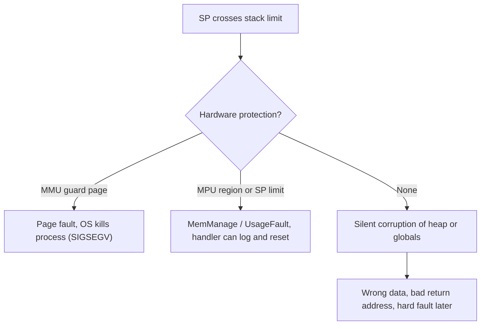

::: testing
Whether you understand what the call stack physically **is** (a region of RAM with a moving stack pointer), and can explain, not just name, what happens when it runs out. The interviewer is looking for:

1. The mechanism: every function call pushes a frame (return address, saved registers, locals) and the stack pointer moves; overflow is the pointer running past the end of the region reserved for the stack.
2. The two classic causes: unbounded or very deep recursion, and large local variables (big arrays on the stack).
3. What *actually happens* differently on a PC (guard page, segmentation fault) versus a microcontroller with no MMU (silent corruption of heap or globals).
4. Prevention and detection: bounding recursion, static analysis, stack canaries and watermarks, sizing the stack with measurement.
5. A bonus link to security: a *buffer overflow on the stack* is a different bug, but it is the one attackers exploit.
:::

::: why
Stack overflow is one of the nastiest classes of bug in embedded and systems work because on small chips it does not crash cleanly. The stack silently grows into your global variables or heap, and you get a bug that looks like random data corruption, a watchdog reset, or a hard fault that happens only when two interrupts line up. Hardware interviewers ask it because it tests whether you picture memory as a physical address map rather than as an abstraction. It also leads naturally into the stack versus heap discussion ([[q0942]]) and the MMU ([[q0943]]), which is what turns an overflow into a clean fault on a big system.
:::

::: concepts
- **Call stack**: a LIFO region of RAM holding one *frame* per active function call. See [[q0942]].
- **Stack pointer (SP)**: a register pointing at the top of the stack; push and pop move it. See [[q0938]].
- **Stack frame**: return address, saved registers, function arguments spilled to memory, and local variables.
- **Memory map**: on an MCU, `.data`, `.bss`, heap and stack share one SRAM and the stack usually grows *down* toward them. See [[q0934]].
- **Guard page / MPU region**: hardware that turns an overflow into an immediate fault instead of silent corruption. See [[q0943]].
- **Recursion depth**: the number of simultaneously active calls; stack use is depth times frame size.
:::

::: answer
"Stack overflow is when the call stack uses more memory than it was given. Every time a function is called, the hardware pushes a frame on the stack: the return address, saved registers, and the function's local variables. When the function returns, that frame is popped. The stack is just a fixed-size region of RAM with a stack pointer that moves up and down inside it, so if you nest calls too deeply, or put something huge on the stack like a 100 KB local array, the stack pointer runs off the end of that region.

The classic cause is runaway recursion, where a function has no base case or the base case is never reached. Each call adds, say, 48 bytes, so on a PC with an 8 MB stack you'd hit the limit after roughly 170,000 nested calls.

What happens next depends on the system. On a PC or phone, the OS places an unmapped guard page after the stack, so the next push triggers a page fault and the program is killed with a segmentation fault. On a microcontroller without an MMU, there's often nothing there, so the stack just keeps growing into whatever sits next to it, usually your global variables or heap, and you get silent corruption that is painful to debug.

To avoid it, I'd bound recursion or convert it to a loop, keep big buffers off the stack, size the stack from measurement, and on an MCU fill the stack with a pattern at boot so I can check the high-water mark, or use an MPU guard region."
:::

::: technical
**Mechanism.** On most ISAs (x86-64, ARM, RISC-V) the stack grows toward *lower* addresses. A call executes `push return_address` (x86 `call`) or writes the link register to the stack in the callee's prologue (ARM `push {lr}`); the prologue then subtracts the frame size from SP: $SP \leftarrow SP - F$. Stack depth in bytes at nesting level $n$ is

$$S(n) = \sum_{i=1}^{n} F_i \approx n \cdot \bar F$$

and overflow occurs when $S(n)$ exceeds the stack region size $S_{max}$, i.e. when $SP < SP_{limit}$.

**Typical sizes.** Linux main-thread default is 8 MB (`ulimit -s`); thread stacks are commonly 1-8 MB depending on platform; a Cortex-M RTOS task stack is often 256 B to 4 KB; a small 8-bit MCU may have 128 B to 2 KB for everything. With $\bar F = 48$ B, $8\,\text{MB}/48\,\text{B} \approx 174{,}800$ nested calls. With $\bar F = 24$ B on a 2 KB stack you get only about 85 calls, minus interrupt context, which is why recursion is usually banned in embedded coding standards.

**Causes.**
- Unbounded recursion (missing/unreachable base case).
- Deep but legitimate recursion (naive tree traversal on a degenerate, list-shaped tree).
- Large locals: `char buf[65536]` inside a function, `alloca`/variable-length arrays with attacker- or input-controlled size.
- Interrupt nesting: each ISR pushes an exception frame (8 words on Cortex-M, 32 B, plus any software-saved registers), so worst-case stack is task stack plus nested ISR frames.
- Many RTOS tasks, each with its own stack, where one task's budget was underestimated.

**Consequences by platform.**
- *MMU system*: the page past the stack limit is unmapped, so a fault is raised on the first touch (SIGSEGV). Compilers emit *stack probes* for large frames so no guard page gets jumped over.
- *MCU, no MMU/MPU*: SP crosses into `.bss`/heap; the program corrupts data or later fetches a corrupted return address and jumps into garbage.
- *Cortex-M with `PSPLIM`/`MSPLIM` (ARMv8-M) or an MPU region*: a fault fires at the boundary.

**Detection and prevention.** Stack painting (fill with `0xDEADBEEF`, scan for the first overwritten word to get the high-water mark), canary words at the stack limit, compiler `-fstack-usage` and static call-graph analysis for the worst-case depth, `-Wstack-usage=N`/`-Wframe-larger-than`, replacing recursion with iteration or an explicit heap-allocated stack, and sizing with a margin (commonly 25-50%) above the measured worst case.

> [!NOTE]
> Stack **overflow** (the stack runs out of space) is not the same as a stack **buffer overflow** (writing past the end of an array *within* the stack, which can overwrite the return address). The first is a resource exhaustion bug; the second is a memory-safety bug that is a classic security exploit. Many people conflate them, so say which one you mean.
:::

::: short
"A stack overflow is when the call stack outgrows the region of memory reserved for it. Each function call pushes a frame with the return address and locals, so very deep or infinite recursion, or big local arrays, can push the stack pointer past the limit. On a PC the OS has a guard page, so you get a segfault. On a microcontroller with no MMU it silently overwrites globals or the heap. You prevent it by avoiding unbounded recursion, keeping big buffers off the stack, and measuring the stack high-water mark."
:::

::: long
"The stack is a region of RAM that holds one frame for every function that is currently active. A frame has the return address, saved registers, and the function's local variables. A stack pointer register tracks the top. On a call it moves down by the frame size, and on return it moves back up. So the total stack in use is roughly the call depth times the average frame size.

A stack overflow happens when that total goes beyond the memory that was allocated for the stack. There are three common causes. One is infinite or very deep recursion, for example a missing base case. Two is large local variables, like declaring a 64 KB array inside a function. Three, specifically on embedded systems, is that interrupts and RTOS tasks each add their own frames, so the worst case is the sum of everything that can be nested at once, and a small stack that works in testing can overflow when two interrupts line up.

What happens depends on the hardware. On a PC the OS puts an unmapped guard page just past the stack. The next push touches it, the MMU raises a fault, and the process dies with a segmentation fault. That's actually the nice case, because it's loud. On a typical microcontroller there's no MMU, so the stack just keeps going into whatever is next to it, usually the heap or global variables. Now you have corrupted data, or worse, a corrupted return address, and the symptom shows up far from the cause.

To handle it, I'd first avoid recursion or bound it. I'd keep large buffers static or on the heap. I'd get the worst-case stack usage from the compiler's stack-usage output and by measuring: fill the stack with a known pattern at boot and later check how much of the pattern was overwritten. And I'd add hardware protection if the chip has it, like an MPU region or a stack limit register, so an overflow becomes an immediate fault. Finally, I'd leave a safety margin."
:::

::: terms
- **Call stack**: the LIFO structure of frames for active function calls.
- **Stack frame / activation record**: the per-call block holding the return address, saved registers and locals.
- **Stack pointer (SP)**: the register that marks the current top of the stack.
- **Guard page**: an unmapped or protected page just past the stack that turns an overflow into a fault.
- **Stack canary**: a known value placed next to the return address or at the stack limit to detect corruption.
- **High-water mark**: the deepest point the stack has ever reached, found by checking a painted pattern.
- **Stack probe**: compiler-inserted touches of each page in a large frame so the guard page cannot be skipped.
- **Tail-call optimization**: the compiler reuses the current frame for a call in tail position, so some recursion uses constant stack.
:::

::: exceptional
**An average answer** says "recursion without a base case fills up the stack and the program crashes."

**An exceptional answer**:
- Describes the stack as a region with a moving stack pointer and quantifies it: frame size times depth versus region size (for example 8 MB over 48 B is about 175k calls, 2 KB over 24 B is about 85).
- Separates the **PC case** (guard page plus MMU gives a clean segfault) from the **MCU case** (silent corruption) and names the protection available (MPU, stack limit registers, canaries).
- Includes interrupts and RTOS task stacks in the worst-case estimate, since that is the realistic embedded failure.
- Gives a measurement method (stack painting, `-fstack-usage`) rather than just "use less stack".
- Distinguishes stack overflow from stack buffer overflow, the security bug.
:::

::: mistakes
- **"Stack overflow is when you run out of RAM."** Not quite: it is when the *stack region* is exhausted, which can happen with plenty of free heap. Running out of heap is an allocation failure, a different problem ([[q0942]]).
- **Blaming only recursion.** Big local arrays, variable-length arrays and nested interrupts overflow stacks without any recursion.
- **Assuming it always crashes immediately.** Without an MMU or MPU it often corrupts memory silently and fails later, elsewhere.
- **Confusing it with buffer overflow.** Writing past the end of an array is a memory-safety bug; the stack-overflow bug is about total depth.
- **Sizing the stack from the average case.** The requirement is the *worst-case* path, including the deepest call chain plus the deepest nesting of interrupts.
- **Thinking the stack always grows up.** On x86, ARM and RISC-V the stack conventionally grows toward lower addresses; "up" and "down" depend on how you draw the map.
:::

::: deep
## What the stack physically is

Nothing about the stack is magic. It is an ordinary range of RAM addresses, plus one convention: a register (the stack pointer, [[q0938]]) holds the address of the most recently pushed word. Because functions finish in the reverse order they start, a last-in-first-out structure is exactly what you need to remember "where do I go back to?" for every active call.

A call to `f(a, b)` on a typical ARM or x86 ABI does roughly this:

1. Put the arguments in registers (or push extras on the stack).
2. Save the return address (x86 pushes it; ARM puts it in the link register, and the callee pushes it if it makes further calls).
3. In the prologue, subtract the frame size from SP to make room for locals and saved registers.
4. On return, restore registers, add the frame size back to SP, jump to the return address.

```svg
<svg viewBox="0 0 560 330" role="img" aria-label="Recursive call frames growing downward toward a guard page">
  <text x="10" y="18" font-family="Inter, sans-serif" font-size="13" fill="var(--d-muted)">high addresses</text>
  <rect x="150" y="28" width="200" height="40" fill="var(--d-box)" stroke="var(--d-ink)"/>
  <text x="250" y="46" text-anchor="middle" font-family="Inter, sans-serif" font-size="13" fill="var(--d-ink)">main() frame</text>
  <text x="250" y="61" text-anchor="middle" font-family="Inter, sans-serif" font-size="11" fill="var(--d-muted)">ret addr, locals</text>
  <rect x="150" y="68" width="200" height="40" fill="var(--d-box)" stroke="var(--d-ink)"/>
  <text x="250" y="92" text-anchor="middle" font-family="Inter, sans-serif" font-size="13" fill="var(--d-ink)">f(n=1000) frame</text>
  <rect x="150" y="108" width="200" height="40" fill="var(--d-box)" stroke="var(--d-ink)"/>
  <text x="250" y="132" text-anchor="middle" font-family="Inter, sans-serif" font-size="13" fill="var(--d-ink)">f(n=999) frame</text>
  <rect x="150" y="148" width="200" height="40" fill="var(--d-box)" stroke="var(--d-ink)"/>
  <text x="250" y="172" text-anchor="middle" font-family="Inter, sans-serif" font-size="13" fill="var(--d-ink)">f(n=998) frame</text>
  <rect x="150" y="188" width="200" height="40" fill="var(--d-box)" stroke="var(--d-accent)" stroke-width="2"/>
  <text x="250" y="212" text-anchor="middle" font-family="Inter, sans-serif" font-size="13" fill="var(--d-ink)">f(n=997) frame (top)</text>
  <text x="250" y="244" text-anchor="middle" font-family="Inter, sans-serif" font-size="12" fill="var(--d-muted)">unused stack space</text>
  <rect x="150" y="250" width="200" height="30" fill="none" stroke="var(--d-muted)" stroke-dasharray="4 3"/>
  <rect x="150" y="284" width="200" height="30" fill="var(--d-red)" fill-opacity="0.25" stroke="var(--d-red)"/>
  <text x="250" y="304" text-anchor="middle" font-family="Inter, sans-serif" font-size="13" fill="var(--d-ink)">guard page: fault on touch</text>
  <text x="10" y="322" font-family="Inter, sans-serif" font-size="13" fill="var(--d-muted)">low addresses</text>
  <path d="M 395 60 L 395 280" stroke="var(--d-accent)" stroke-width="2" fill="none"/>
  <polygon points="395,288 389,276 401,276" fill="var(--d-accent)"/>
  <text x="408" y="160" font-family="Inter, sans-serif" font-size="12" fill="var(--d-accent)">stack grows</text>
  <text x="408" y="176" font-family="Inter, sans-serif" font-size="12" fill="var(--d-accent)">downward</text>
  <path d="M 130 188 L 130 256" stroke="var(--d-orange)" stroke-width="2" fill="none"/>
  <polygon points="130,262 124,250 136,250" fill="var(--d-orange)"/>
  <text x="124" y="226" text-anchor="end" font-family="Inter, sans-serif" font-size="12" fill="var(--d-orange)">SP</text>
</svg>
```
Figure: Each recursive call adds one frame below the previous one. The stack pointer (SP) walks toward low addresses. When it crosses the end of the allocated region, a system with a guard page faults immediately; a system without one lets it silently overwrite whatever is next.

## The arithmetic of overflow

If every call to a function uses $F$ bytes (return address, saved registers, locals, alignment padding), then a recursion of depth $n$ uses about $nF$ bytes, and the maximum safe depth is

$$n_{max} = \left\lfloor \frac{S_{max} - S_{base}}{F} \right\rfloor$$

where $S_{base}$ is what the caller chain already consumed. Some real numbers:

| Platform | Stack size | Frame | Max depth |
|---|---|---|---|
| Linux main thread (default) | 8 MB | 48 B | about 174,800 |
| Linux thread, small config | 512 KB | 48 B | about 10,900 |
| Cortex-M RTOS task | 1 KB | 40 B | about 25 |
| 8-bit MCU, whole stack | 256 B | 6 B | about 42 |

A factorial function written recursively with 32 B frames only needs 640 B for $n=20$, which is fine on a PC and fatal on a 512 B stack. That is why recursion is rarely allowed in safety-critical embedded code (MISRA C bans it): you cannot prove a worst-case stack bound for it.

## Why large locals are dangerous

`char buf[65536];` inside a function subtracts 64 KB from SP in one instruction. On a PC with a guard page one page (4 KB) wide, SP can jump *over* the guard page into whatever is mapped below, and the next write happens in valid but unrelated memory. That is why compilers insert **stack probes**, touching each page in order so the guard page is hit first. On an MCU the same declaration just overwrites the area under the stack.

## Interrupts and RTOS tasks

On a bare-metal Cortex-M, hardware pushes an 8-word (32 B) exception frame on entry; your ISR code then pushes more. A nested higher-priority interrupt pushes another. So the worst-case stack need is

$$S_{worst} = S_{main\,path} + \sum_{\text{nested ISRs}} (32 + F_{ISR})$$

Under an RTOS, each task owns a private stack, and the scheduler's context switch also saves the task's registers there. A common field failure: a task works for months, then a rare path with a `printf` (which can use hundreds of bytes of stack) runs and overflows a 512 B task stack.

## What actually happens next


Figure: The same logical bug has three very different outcomes. Hardware protection turns a heisenbug into a deterministic crash with a program counter you can read.

## Measuring and bounding the stack

1. **Static analysis.** `gcc -fstack-usage` emits per-function frame sizes; combine with the call graph (tools like `cflow`, or vendor static analyzers) to get a worst-case path. Indirect calls and recursion break the analysis, which is another argument against them.
2. **Stack painting.** At boot fill the stack region with a pattern such as `0xA5A5A5A5`. After running stress tests, scan from the far end for the first word that is not the pattern; the distance to the stack top is the high-water mark. Most RTOSes offer this (for example FreeRTOS exposes a task's minimum free stack).
3. **Hardware limit.** ARMv8-M has `MSPLIM`/`PSPLIM` registers that fault when SP drops below the limit; ARMv7-M uses an MPU region marked no-access at the stack end.
4. **Margin.** Add headroom (25-50% is common) because test coverage rarely hits the true worst path.

## Fixing recursion

Convert recursion to a loop, or use an explicit stack in static/heap memory with a hard capacity check:

```
// Recursive: stack depth grows with n
int sum(int n) { return n == 0 ? 0 : n + sum(n - 1); }

// Iterative: constant stack
int sum(int n) { int s = 0; for (int i = 1; i <= n; i++) s += i; return s; }
```

Some compilers turn *tail* recursion into a jump (tail-call optimization, typically at `-O2`), but it is never guaranteed in C, so it is not something you can rely on for a safety proof.

> [!WARNING]
> A stack **buffer overflow** such as `strcpy` into a 16-byte local array writes upward through the frame and can overwrite the saved return address. That is how many classic exploits work. Mitigations include stack canaries, non-executable stacks, ASLR and bounds-checked APIs. It is related to, but not the same as, stack overflow.

## Where this shows up in hardware work

When you bring up a new board and the firmware hard-faults only when Wi-Fi and a motor ISR run together, a stack overflow is one of the first things to check. Look at SP in the debugger at the fault: if it is outside the task's stack range, that's your answer.
:::

::: applications
- **Embedded firmware sizing**: RTOS task stacks are sized from measured high-water marks plus margin; mis-sizing is a top cause of random resets.
- **Safety-critical coding standards**: MISRA C forbids recursion largely because worst-case stack cannot be bounded statically.
- **Operating systems**: Linux sets a default 8 MB main-thread stack and auto-grows it up to the limit, with a guard region beyond it.
- **Compiler hardening**: GCC and Clang `-fstack-protector` canaries and `-fstack-clash-protection` probes defend against stack-related memory-safety bugs.
- **Debugging field failures**: an unexplained hard fault with SP outside any task stack range is the signature of an overflow.
- **Interrupt design**: keeping ISRs short and avoiding `printf` or large locals in them bounds worst-case nested stack use.
:::

::: assumptions
- **Stack grows downward** and is contiguous. True for mainstream ISAs, but some architectures (a few older ones, and some systems with segmented or linked stacks, as in some Go and language-runtime implementations) grow it upward or in chunks.
- **A single fixed-size stack per thread.** Some runtimes (Go goroutines, split stacks) grow stacks dynamically, which changes the failure mode to a runtime panic instead of a hardware fault.
- **MMU present** for the "segfault" story. On an MCU without MMU/MPU there is no protection unless you add it.
- **Frame sizes** depend on the compiler, optimization level and ABI; the numbers here are illustrative, not universal.
- If the interviewer means a **security** overflow, answer with the buffer-overflow variant (overwrite of return address) and mention canaries and ASLR.
:::

::: followups
### Why does infinite recursion crash on a PC but corrupt data on a microcontroller?
On a PC the OS maps a stack region and leaves the next page unmapped. When SP runs into that page, the MMU raises a page fault and the OS terminates the process. A typical Cortex-M0 has no MMU and often no MPU, so the addresses below the stack are real RAM holding globals or the heap. The CPU happily writes frames over them, so you get corrupted data and a later crash, far from the real bug.

### How would you find out how big a task's stack needs to be?
Combine static and dynamic: use `-fstack-usage` plus the call graph for the worst-case path, add the ISR nesting cost (for Cortex-M, 32 B hardware frame per nested exception plus software saves), then confirm with stack painting under stress test. Add 25-50% margin, because tests rarely hit the true worst path.

### Can you overflow the stack without recursion?
Yes. A large local array (`int buf[20000]` is 80 KB), variable-length arrays or `alloca` with a large size, many nested function calls through a deep but finite call chain, or nested interrupts on a tiny stack can each do it. Recursion is only the most common cause because the depth depends on data.

### What if the compiler does tail-call optimization on my recursive function?
Then a call in tail position reuses the current frame, so depth no longer grows the stack and a recursive loop can run indefinitely in constant space. But C does not guarantee it: at `-O0` or with a debugger build it may not happen, and any work after the recursive call (like `n + f(n-1)`) is not a tail call. So you can't rely on it where overflow matters.

### Scenario: your robot firmware randomly hard-faults about once a day. How do you check for stack overflow?
Halt in the fault handler and read SP and the stacked PC. If SP is outside the active task's stack range, it overflowed. Check the RTOS's stack high-water counters and the painted pattern. Then look for the rare path that runs deep: a logging call with `printf`, a JSON parser, or an ISR that fires while a deep call chain is active. Fix by enlarging that stack, shrinking its frames, or enabling an MPU guard region so the next occurrence faults at the offending call.
:::

::: interpretations
Some people use "stack overflow" for the **security bug** where a buffer on the stack is overrun (more precisely, a stack buffer overflow). In a hardware/architecture interview under the *Memory* heading, the resource-exhaustion meaning is the expected one, but mentioning the other meaning briefly shows awareness. The website Stack Overflow is of course unrelated. It is named after this error.
:::

::: references
- Patterson & Hennessy, *Computer Organization and Design*: the sections on procedure calling conventions and the stack (the MIPS/RISC-V "Supporting Procedures in Computer Hardware" material).
- Bryant & O'Hallaron, *Computer Systems: A Programmer's Perspective*: the chapter on machine-level programs, stack frames and buffer overflow.
- Yiu, *The Definitive Guide to ARM Cortex-M3 and Cortex-M4 Processors*: exception entry stacking and the MPU.
- MISRA C guidelines (published by the MISRA consortium): the rule against recursion.
- GCC documentation: `-fstack-usage`, `-fstack-protector`, `-fstack-clash-protection`.
:::

::: rubric
- Defines the stack as a region of memory with a stack pointer holding frames (return address, locals) :: Without this, the explanation is just a slogan about recursion.
- States overflow means exceeding the allocated region, and names recursion and large locals as causes :: Shows you know both the data-dependent and the static causes.
- Describes the platform difference: guard page and segfault on a PC vs silent corruption on an MCU :: This is the practical insight hardware interviewers want.
- Mentions interrupts and RTOS task stacks as embedded contributors :: Realistic embedded stack sizing is a worst-case sum, not a single call chain.
- Gives prevention and detection methods (avoid recursion, stack painting, static analysis, MPU/guard) :: Turns a definition into engineering practice.
- Quantifies with a frame-size and stack-size example :: Numbers show the idea is not just vocabulary.
- Distinguishes it from stack buffer overflow and from heap exhaustion :: Prevents the most common terminology mix-up.
:::

::: quiz
```json
[
 {"type":"mcq","level":"fundamental","q":"What is the most direct definition of a stack overflow?","options":["The stack pointer moves beyond the memory region reserved for the stack","Too many values are stored in CPU registers","The heap runs out of free blocks to allocate","A write past the end of an array corrupts a neighbouring variable"],"answer":0,"explain":"Stack overflow is the stack exceeding its reserved region. Running out of heap is an allocation failure; writing past an array is a buffer overflow."},
 {"type":"numeric","level":"fundamental","q":"A thread has an 8 MB stack and each recursive call uses 48 bytes. About how many thousands of nested calls fit? (Take 1 MB = 1,048,576 B.)","answer":174.8,"tolerance":0.02,"unit":"thousand calls","explain":"$8\\times1{,}048{,}576/48 = 174{,}763 \\approx 174.8$ thousand calls."},
 {"type":"truefalse","level":"intermediate","q":"On a microcontroller with no MMU or MPU, a stack overflow always causes an immediate, clean crash.","answer":false,"explain":"With no protection the stack silently grows into the heap or globals and corrupts them. The failure appears later and elsewhere, which is why it is so hard to debug."},
 {"type":"multi","level":"intermediate","q":"Select all that can cause a stack overflow.","options":["Infinite recursion","A 128 KB local array on a 64 KB stack","Many nested interrupts on a small stack","Calling malloc for 128 KB when the heap is empty"],"answer":[0,1,2],"explain":"The first three consume stack. A failed malloc is a heap allocation failure that returns NULL; it does not move the stack pointer."},
 {"type":"mcq","level":"advanced","q":"Which method best finds the real worst-case stack usage of an RTOS task?","options":["Check the average usage with a profiler","Count the number of functions in the code","Static call-graph analysis plus a painted-stack high-water mark under stress tests, with margin","Increase the stack to 1 MB and assume it is safe"],"answer":2,"explain":"Worst-case matters. Static analysis bounds the path; painting measures what actually happened; margin covers paths the tests missed. Blindly enlarging wastes RAM on an MCU and proves nothing."},
 {"type":"numeric","level":"advanced","q":"A Cortex-M ISR uses 60 bytes of its own frame in addition to the 32-byte hardware exception frame. Three of these ISRs can nest. The main code path needs 400 bytes. What is the worst-case stack requirement in bytes?","answer":676,"tolerance":0.01,"unit":"bytes","explain":"Each ISR costs $32+60 = 92$ B; three nested cost 276 B; plus 400 B for the main path gives 676 B (before margin)."}
]
```
:::
