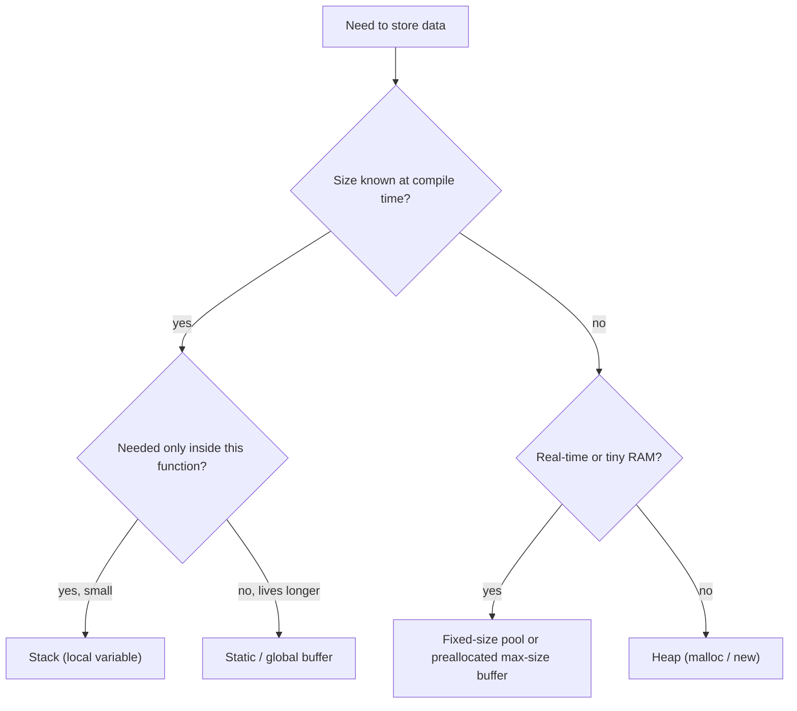

::: basics
### In plain words
The stack and the heap are two parts of RAM that hold data created while a program runs. The stack is for function calls. It is automatic, very fast, small and fixed in size. The heap is for data that must outlive a call or whose size is unknown until the program runs. You ask for a piece and give it back yourself. The heap is flexible but slower, and it can leak or fragment. Small chips in gadgets therefore use the stack and fixed buffers wherever they can.

### Picture it
The stack is a pile of papers on your desk. You add each new one on top, and you always remove the top one first. The heap is a parking lot. Cars stay as long as their owners want, and they leave in any order. After many cars come and go, empty spaces are scattered. A bus may not fit even when plenty of spaces are empty in total.

### Words you need
- **Stack**: memory for function calls. It is freed automatically, newest first.
- **Heap**: memory you request and release yourself, in any order.
- **malloc / free**: the C calls that request a heap block and give it back.
- **Memory leak**: a heap block you never freed and can no longer use.
- **Fragmentation**: free memory split into pieces too small to use.
- **Memory pool**: a set of equal-size blocks reused with no fragmentation.

### The simplest example
Allocating on the stack is one subtraction from the stack pointer (the number marking the top of the stack), and returning undoes it. A heap block needs a search for free space. Picture a 1,000-byte heap holding ten 100-byte blocks, all in use. Free the five odd-numbered blocks. Now 500 bytes are free, but the biggest hole is only 100 bytes, so `malloc(200)` fails. That is the whole idea. The rest of this page puts both regions on a memory map, explains why the stack is faster, and shows how small-chip designs avoid the heap.
:::

::: testing
Whether you can compare the two dynamic regions of a program's data memory on **lifetime, speed, size, management and failure modes**, and tie them back to hardware. The interviewer is checking:

1. Stack: automatic, LIFO, allocated by moving a pointer, freed on return, tiny per-allocation cost, size fixed in advance.
2. Heap: manual or runtime-managed, arbitrary lifetime and order, slower, fragmentation, leaks.
3. That you know where globals and code live too, so you can place all four regions on a memory map.
4. Embedded judgment: why many firmware projects avoid `malloc` after boot, and what that buys.
5. A clean answer to "which would you use for X and why".
:::

::: why
Every program, from a 2 KB firmware image to a game engine, splits its RAM into regions with very different behavior. Choosing between stack and heap affects determinism, latency, memory footprint and bug classes. In embedded work it is a design decision with consequences: dynamic allocation can fragment and fail at runtime weeks after deployment, whereas a statically sized design can be proven to fit. Interviewers use this question to see whether you think in terms of lifetimes and physical memory instead of just syntax, and it connects directly to stack overflow ([[q0941]]) and virtual memory ([[q0943]]).
:::

::: concepts
- **Process memory map**: code (`.text`), initialized data (`.data`), zero-initialized data (`.bss`), heap, stack. See [[q0934]].
- **Lifetime**: stack variables live until the function returns; heap blocks live until freed.
- **Stack pointer**: allocation is just `SP -= size`. See [[q0938]] and [[q0941]].
- **Allocator**: `malloc`/`free` manages free blocks inside the heap and keeps bookkeeping metadata.
- **Fragmentation**: free memory split into pieces too small to satisfy a request.
- **Locality**: stack accesses are dense and recently used, so they hit in cache. See [[q0937]].
:::

::: answer
"Both are parts of RAM your program uses for data that isn't fixed at compile time, but they work very differently.

The stack is for function calls. Each call gets a frame holding its locals and return address. Allocating it is almost free, because the compiler just subtracts from the stack pointer, and it frees itself when the function returns. It's LIFO, fast, and cache friendly. The downsides are that it's small and fixed in size, and anything on it dies when the function returns, so I can't hand back a pointer to a local.

The heap is for data that has to outlive the function or whose size isn't known until runtime. I request a block with `malloc` or `new` and I have to free it, or a garbage collector does. It's much more flexible, since blocks can be any size and live any length of time, but it's slower because the allocator has to search for free space, and it brings leaks, fragmentation and the possibility that an allocation just fails.

In embedded systems I lean on the stack and static allocation, and I'm cautious with the heap. A device that runs for years can fragment its heap and hit an allocation failure in the field that you never saw in testing. If I need dynamic-like behavior I'll use fixed-size pools."
:::

::: technical
**Layout (typical Unix-like process or MCU image).** From low to high address: `.text` (code, often in flash on an MCU), `.rodata`, `.data` (initialized globals, copied from flash at boot), `.bss` (zero-initialized globals), then the **heap** growing toward higher addresses, and the **stack** growing toward lower addresses from the top of RAM. On a desktop the heap and stack are separated by a huge virtual gap; on an MCU they share one small SRAM and can collide.

**Stack.**
- Allocation: $SP \leftarrow SP - F$ in the function prologue, one instruction, constant time, no metadata.
- Deallocation: automatic, in reverse order of calls.
- Size: fixed when the thread starts (8 MB main thread on Linux by default, 1-8 MB for other threads, often hundreds of bytes to a few KB in embedded tasks).
- Lifetime: scope of the function call.
- Failure mode: stack overflow ([[q0941]]).
- Performance: the top of the stack is always hot in L1 cache.

**Heap.**
- Allocation: `malloc(n)` searches free lists/bins (first-fit, best-fit, size-class bins, buddy system), splits a block, and returns a pointer. Cost varies from tens of ns to microseconds, and is *non-deterministic* in the worst case.
- Deallocation: explicit `free`, which may coalesce neighbors. A garbage-collected runtime does it for you at the cost of pauses.
- Size: limited by available RAM (embedded) or virtual memory (desktop).
- Overhead: each block carries a header (commonly 8-16 B) and is rounded up to an alignment boundary.
- Failure modes: leak (never freed), double free, use-after-free, fragmentation, out-of-memory (`malloc` returns NULL).

**Fragmentation example.** A 1,000 B heap holds ten 100 B blocks. Free blocks 1, 3, 5, 7 and 9: now 500 B is free but the largest contiguous hole is 100 B, so `malloc(200)` fails even though half the heap is "free". External fragmentation is why long-running embedded devices avoid general heaps.

| | Stack | Heap |
|---|---|---|
| Managed by | compiler (automatic) | programmer or runtime |
| Allocation cost | one subtract | allocator search, variable |
| Lifetime | until function returns | until freed |
| Size | small, fixed per thread | large, flexible |
| Order | strict LIFO | any |
| Typical bug | overflow, dangling pointer to a local | leak, fragmentation, use-after-free |
| Cache behavior | excellent | depends on layout |
:::

::: short
"The stack holds function-call frames: locals and return addresses. It's allocated by moving the stack pointer, freed automatically on return, fast and cache friendly, but small and strictly LIFO. The heap holds data that has to outlive a call or has a runtime-determined size. It's allocated with malloc and freed explicitly, so it's flexible but slower and can leak or fragment. In embedded I prefer stack and static allocation because the heap can fail unpredictably in the field."
:::

::: long
"They're two regions of RAM with different rules. I'll go through lifetime, cost and failure modes.

The stack is tied to function calls. When a function runs, it gets a frame with its local variables and the return address. Creating that frame is a single subtract on the stack pointer, and destroying it is a single add on return. That makes it extremely cheap, and because the same few hundred bytes get reused constantly, it lives in the L1 cache. The limits are that it's fixed in size, typically 8 MB on a desktop thread or a few hundred bytes to a few kilobytes in an embedded task, and that its data only lives as long as the function. So if you return a pointer to a local array, you have a dangling pointer. If you go too deep, you get a stack overflow.

The heap is for data whose size isn't known at compile time or which must outlive the function that created it. You ask the allocator for a block, it finds a free chunk, adds some bookkeeping, and gives you a pointer. You are responsible for freeing it, or a garbage collector does that for you. It's flexible, but allocation takes variable time, which matters in real-time systems, and the memory can get fragmented. For example, if I free every other 100-byte block in a 1 KB heap, I have 500 bytes free but can't allocate 200 contiguous bytes.

So for design: use the stack for small, short-lived data; use the heap for large or long-lived data on bigger systems. On a microcontroller I'd generally use static buffers and fixed-size memory pools, allocate everything at startup if I need dynamic allocation at all, and avoid `malloc` in the main loop. That way I can calculate worst-case RAM use at build time and I don't get surprise out-of-memory failures after months of uptime."
:::

::: terms
- **Stack**: LIFO region holding call frames, managed automatically.
- **Heap**: pool of memory from which blocks are allocated dynamically with `malloc`/`new`.
- **Stack frame**: the per-call block with locals, saved registers and return address.
- **Dangling pointer**: a pointer to memory that has been freed or whose frame has returned.
- **Memory leak**: heap memory that is no longer reachable but was never freed.
- **Fragmentation**: free memory broken into small non-contiguous pieces; *external* between blocks, *internal* inside rounded-up blocks.
- **Memory pool / slab**: pre-allocated fixed-size blocks that give constant-time allocation and no external fragmentation.
- **`.bss` / `.data`**: statically allocated globals, zero-initialized and initialized respectively.
:::

::: exceptional
**An average answer** says "stack is fast and automatic, heap is slow and manual."

**An exceptional answer**:
- Puts both on a **memory map** next to code, `.data` and `.bss`, with directions of growth, and notes that on an MCU they share one SRAM and can collide.
- Explains *why* the stack is fast (pointer arithmetic, hot in cache) and *why* the heap is not (search, metadata, variable time).
- Gives a concrete **fragmentation** example with numbers.
- States the embedded policy (static allocation or pools, no `malloc` after init) and its motivation: determinism and a provable worst-case RAM bound.
- Mentions the lifetime trap of returning a pointer to a stack variable.
:::

::: mistakes
- **"The stack is in cache and the heap is in RAM."** Both live in RAM. The stack is just accessed so densely and repeatedly that it stays in cache. Heap data that is hot is cached too.
- **"The stack is faster because it is a different kind of memory."** It is the same SRAM/DRAM. The speed comes from trivial allocation and good locality.
- **"Local variables are always on the stack."** The compiler may keep them in registers, and `static` locals live in `.data`/`.bss`.
- **Returning the address of a local variable.** The frame is reclaimed on return, so the pointer dangles. Allocate on the heap, use a caller-supplied buffer, or make it static.
- **Assuming `malloc` is O(1).** Typical allocators have variable and sometimes long worst-case times, which breaks hard real-time guarantees.
- **Believing a garbage-collected language has no heap issues.** It still has a heap; it adds GC pauses and memory overhead.
:::

::: deep
## Four regions of a program's memory

Before comparing stack and heap, place them on the map. The linker script and C runtime lay out an executable like this (low addresses at the bottom of the figure, as in most diagrams of an MCU):

```svg
<svg viewBox="0 0 600 340" role="img" aria-label="Memory map with stack growing down and heap growing up">
  <text x="20" y="22" font-family="Inter, sans-serif" font-size="13" fill="var(--d-muted)">high address</text>
  <rect x="140" y="30" width="230" height="64" fill="var(--d-box)" stroke="var(--d-blue)" stroke-width="2"/>
  <text x="255" y="58" text-anchor="middle" font-family="Inter, sans-serif" font-size="14" fill="var(--d-ink)">Stack</text>
  <text x="255" y="77" text-anchor="middle" font-family="Inter, sans-serif" font-size="11" fill="var(--d-muted)">frames, locals, return addresses</text>
  <path d="M 255 96 L 255 126" stroke="var(--d-blue)" stroke-width="2" fill="none"/>
  <polygon points="255,134 249,122 261,122" fill="var(--d-blue)"/>
  <rect x="140" y="140" width="230" height="52" fill="none" stroke="var(--d-muted)" stroke-dasharray="5 4"/>
  <text x="255" y="170" text-anchor="middle" font-family="Inter, sans-serif" font-size="12" fill="var(--d-muted)">free RAM (they can collide here on an MCU)</text>
  <path d="M 255 236 L 255 202" stroke="var(--d-orange)" stroke-width="2" fill="none"/>
  <polygon points="255,194 249,206 261,206" fill="var(--d-orange)"/>
  <rect x="140" y="236" width="230" height="44" fill="var(--d-box)" stroke="var(--d-orange)" stroke-width="2"/>
  <text x="255" y="262" text-anchor="middle" font-family="Inter, sans-serif" font-size="14" fill="var(--d-ink)">Heap (malloc)</text>
  <rect x="140" y="280" width="230" height="26" fill="var(--d-box)" stroke="var(--d-ink)"/>
  <text x="255" y="298" text-anchor="middle" font-family="Inter, sans-serif" font-size="12" fill="var(--d-ink)">.bss (zeroed globals)  /  .data (init globals)</text>
  <rect x="140" y="306" width="230" height="26" fill="var(--d-box)" stroke="var(--d-ink)"/>
  <text x="255" y="324" text-anchor="middle" font-family="Inter, sans-serif" font-size="12" fill="var(--d-ink)">.text (code), .rodata</text>
  <text x="400" y="62" font-family="Inter, sans-serif" font-size="12" fill="var(--d-blue)">grows down</text>
  <text x="400" y="262" font-family="Inter, sans-serif" font-size="12" fill="var(--d-orange)">grows up</text>
  <text x="400" y="298" font-family="Inter, sans-serif" font-size="12" fill="var(--d-muted)">fixed size at link time</text>
  <text x="20" y="332" font-family="Inter, sans-serif" font-size="13" fill="var(--d-muted)">low address</text>
</svg>
```
Figure: Code and globals are fixed at link time. The stack and heap are the two regions that change size at runtime, growing toward each other from opposite ends of the free RAM. On a desktop, virtual memory makes the gap huge; on a microcontroller it may be a few hundred bytes.

## Why the stack is so cheap

Stack allocation is nothing but SP arithmetic. If a function needs 48 B, the prologue contains one `sub sp, sp, #48`, and the epilogue undoes it. There is no search, no metadata, no lock, and the allocation order is known at compile time, so the compiler can assign each local a fixed offset from SP (`[sp, #8]`). The memory being touched is the same few cache lines again and again, so it is almost always in L1 ([[q0937]]).

## Why the heap costs more

A general-purpose allocator must handle any size, any order, and any lifetime. Even a good one such as a size-class (slab-like) allocator needs to:

1. Round the request to a size class or alignment.
2. Find a free block (list lookup, bitmap, tree).
3. Split it, and write a header (size, flags).
4. On `free`, coalesce adjacent free blocks and update the lists.

That is tens to hundreds of instructions on a good day, with cache misses on the metadata, and it can take much longer in a pathological case. In multi-threaded programs, a lock or per-thread arenas are also needed. This is why latency-critical code uses pools, arenas or pre-allocation.

> [!UNCERTAIN]
> Exact `malloc` timings depend on the allocator (glibc ptmalloc, jemalloc, tcmalloc, newlib-nano, FreeRTOS `heap_4`, etc.), the size, and the heap state. Treat "tens of ns to microseconds" as an order-of-magnitude statement, not a spec.

## Fragmentation, with numbers

Take a 1,000 byte heap with ten 100 B blocks numbered 0 to 9, all allocated. Free the odd-numbered blocks.

```plot
{"title":"Free memory vs largest allocatable block after freeing every other 100 B block","x":{"label":"blocks freed (alternating)","min":0,"max":5},"y":{"label":"bytes","min":0,"max":520},
 "series":[{"label":"total free bytes","fn":"100*x","step":true},{"label":"largest contiguous free block","fn":"ite(x>0,100,0)","step":true,"color":"red"}],
 "hlines":[{"at":200,"label":"malloc(200) needs this contiguous"}]}
```
Figure: Total free space climbs to 500 B but the largest hole stays at 100 B. A request for 200 B fails even though 500 B is "free". Coalescing only helps when *adjacent* blocks are both free.

Long-running embedded firmware is vulnerable because lifetimes are mixed (a short-lived packet buffer between two long-lived objects) and the heap can never be defragmented without moving objects, which C cannot do safely.

## Choosing: a decision guide


Figure: On a small embedded system most paths end at stack or static memory; the heap is the last resort.

## Pools: heap flexibility without fragmentation

A **memory pool** splits one region into $N$ equal blocks and keeps a free list. Allocation and free are O(1): pop or push one pointer. Because every block is the same size, any freed block satisfies any request, so there is no external fragmentation. The cost is internal fragmentation (a 20 B request consumes a 64 B block) and one pool per size class. RTOS kernels typically provide this (for example FreeRTOS static allocation and Zephyr memory slabs).

## Stack vs heap in hardware terms

Both live in the same SRAM or DRAM. What differs is the *access pattern* and *who manages it*. The stack benefits from temporal locality; the heap pointers wander, which can cause cache and TLB misses ([[q0943]]). On a Cortex-M with 64 KB SRAM, a typical split might be 8 KB globals, 4 KB main stack, a few task stacks, and the rest either unused or in a small heap. That sum is a **static budget** and you can check it from the linker map file.

## The lifetime trap

```
char *bad(void) {
    char name[16] = "motor";   // lives on the stack
    return name;               // pointer to a frame that is about to vanish
}
```
After `bad` returns, the memory is reused by the next call. The caller's pointer is dangling, and reads show garbage. Fixes: pass a caller-owned buffer, make it `static`, or heap-allocate and document who frees.

## What the MMU changes on a big system

On a desktop OS the picture above is *virtual*. Each process sees its own address space, and the MMU ([[q0943]]) maps 4 KB pages to physical frames on demand. The stack and heap are therefore far apart (the gap is terabytes on a 64-bit machine), the stack's pages are committed as it grows, and the page past the stack limit is deliberately unmapped. The heap grows through `brk` or `mmap` system calls: when `malloc` runs out of free blocks it asks the kernel for more pages, and large requests (commonly above about 128 KB in glibc) get their own `mmap` region that is returned to the OS on `free`. So on a PC a `malloc` rarely returns NULL; instead the system gets slow (paging) or the OOM killer acts. On an MCU none of this exists: a failed `malloc` is simply the end of a small heap.

## Multi-threading

Each thread gets its own stack, but all threads share one heap. That is why heap allocators need locks or per-thread arenas, and why a stack variable is automatically thread-private while a heap object needs explicit synchronization if two threads can reach it. Sharing a pointer to a stack variable with another thread, then returning, is a classic race plus dangling-pointer bug.

## Worked budget example

A 32 KB-SRAM MCU: `.data` + `.bss` = 9 KB; main stack 2 KB; 3 RTOS tasks at 1.5 KB each = 4.5 KB; a 4 KB static DMA buffer. Used: $9 + 2 + 4.5 + 4 = 19.5$ KB, leaving 12.5 KB. You could give 8 KB to a pool allocator and keep 4.5 KB as margin; never let the heap grow into the stack. That arithmetic, done at design time, is why embedded engineers like static allocation.
:::

::: applications
- **Embedded firmware**: static buffers and fixed pools for packets, messages and sensor samples; `heap_4` or no heap at all in FreeRTOS builds.
- **Safety-critical code**: MISRA C bans the standard library's `malloc`/`free`, and many avionics and automotive coding standards forbid any dynamic allocation after initialization.
- **Operating systems**: kernels use slab allocators and per-CPU caches to keep allocation fast and fragmentation low.
- **Game and audio engines**: per-frame arena allocators (bump-pointer, free all at once) to get stack-like cost with heap-like flexibility.
- **Network stacks**: lwIP and others use pools of fixed-size packet buffers (pbufs).
- **Language runtimes**: JVM and Go manage the heap with garbage collectors, trading pauses and memory overhead for safety.
:::

::: assumptions
- **Conventional C/C++ model** with a separate stack and heap. Some languages (Java, Python) place all objects on the heap and keep only references on the stack; escape analysis may move small objects to the stack.
- **One flat address space**; on a desktop each process sees a virtual address space and multi-threaded programs have one stack per thread but a shared heap.
- **Stack grows down, heap up** is conventional, not a rule; the important part is that they grow toward each other.
- **Allocator behavior varies**: embedded libc heaps (newlib-nano `malloc`) are simple, with poor fragmentation behavior, while server allocators are far more sophisticated.
- Alternative good answers stress **ownership**: the stack is automatic storage duration, heap is dynamic storage duration (C/C++ standard wording).
:::

::: followups
### Why is stack allocation faster than heap allocation?
Stack allocation is a single subtraction on the stack pointer, with the layout fixed at compile time and no bookkeeping. Heap allocation has to find a suitable free block, split it, write a header, and possibly lock a shared structure, and its metadata accesses miss in cache. The stack's data is also reused constantly, so it stays in L1.

### Can you put a large array on the stack? What are the risks?
You can, but a 1 MB local array on an 8 MB thread stack uses 12.5% in one call and a 1 MB array on a 4 KB RTOS task stack overflows immediately. Large frames can also jump over a guard page, which is why compilers emit stack probes. For big buffers use static storage or the heap, and for embedded make them static and sized at compile time.

### How does fragmentation happen and how do you avoid it?
Mixed lifetimes leave small free holes between live blocks: free blocks 1, 3, 5, 7, 9 of ten 100 B blocks and you have 500 B free, but `malloc(200)` fails. Avoid it by allocating everything at startup, using fixed-size pools, grouping allocations by lifetime (arenas), or avoiding the heap entirely on small devices.

### Does a garbage-collected language have a stack and a heap?
Yes. Locals and call frames are on the stack; objects are on the heap, and the GC reclaims unreachable ones. The programmer no longer calls `free`, but the runtime still has allocation cost, pause times, and a memory overhead, often a factor of 1.5x to 2x or more of live data to run efficiently. That is why GC languages are rare in hard real-time firmware.

### Scenario: a sensor node runs fine for a week and then stops responding. malloc returns NULL but total free heap reports 6 KB. What happened?
Classic external fragmentation: 6 KB is free in total, but split into pieces smaller than the requested block. Confirm by dumping the free list or logging the largest free block, not just total free. Fix by pre-allocating at boot, using fixed-size pools for the recurring allocations, or restructuring so short- and long-lived objects don't interleave. Add a watchdog and log the failure so you can see it in the field.
:::

::: interpretations
This question is sometimes asked with the **data structure** meaning ("stack = LIFO container, heap = priority queue"). Under the *Memory* heading of an architecture list it clearly means the two **memory regions** of a running program, which is how this page answers it. If an interviewer starts talking about priority queues, ask a clarifying question and then switch. See also [[q0941]] for the overflow failure of the stack region.
:::

::: references
- Bryant & O'Hallaron, *Computer Systems: A Programmer's Perspective*: chapters on machine-level procedures (stack frames) and on dynamic memory allocation (heap, fragmentation).
- Patterson & Hennessy, *Computer Organization and Design*: the sections on the memory layout of a program (static data, dynamic data, stack).
- Kernighan & Ritchie, *The C Programming Language*: storage allocation and storage classes.
- Documentation of the FreeRTOS heap schemes (`heap_1` to `heap_5`) and of Zephyr memory slabs for embedded allocator choices.
:::

::: rubric
- States stack = automatic, LIFO call frames; heap = dynamic, programmer-managed blocks :: Core definitions; everything else builds on them.
- Compares lifetime, speed, size and management :: These are the axes interviewers expect in a comparison.
- Explains why the stack is fast (SP arithmetic, cache locality) and the heap slower (search, metadata, variable time) :: Shows mechanism, not memorized adjectives.
- Names failure modes of each: overflow vs leak/fragmentation/dangling pointer :: Real engineering is about how things fail.
- Places both on a memory map including `.data`, `.bss`, and growth directions :: Demonstrates a hardware-level picture of memory.
- Gives the embedded policy (static allocation, pools, no malloc after init) with a reason :: Shows design judgment for the intended role.
- Offers a concrete example or numbers (fragmentation, a memory budget) :: Makes the answer credible and memorable.
:::

::: quiz
```json
[
 {"type":"mcq","level":"fundamental","q":"Which statement correctly contrasts stack and heap allocation?","options":["Heap allocation is automatic; stack allocation needs free()","Stack allocation is automatic and freed on function return; heap allocation is explicit and can outlive the function","The stack is stored in cache and the heap in RAM","Both are LIFO but the heap is larger"],"answer":1,"explain":"Stack frames are created and destroyed automatically with calls. Heap blocks persist until freed. Both live in RAM; the stack is merely cache-friendly."},
 {"type":"truefalse","level":"fundamental","q":"Returning a pointer to a local (non-static) array from a function is safe as long as the caller uses it immediately.","answer":false,"explain":"The local array lives in a stack frame that is released on return and will be overwritten by the next call or interrupt. The pointer dangles, even if it appears to work briefly."},
 {"type":"numeric","level":"intermediate","q":"A 1,000 B heap has ten 100 B blocks. Blocks 1, 3, 5, 7 and 9 are freed. What is the largest single request (in bytes) that can still succeed?","answer":100,"tolerance":0.01,"unit":"bytes","explain":"Free blocks are separated by live ones, so the largest contiguous hole is a single 100 B block, even though 500 B is free in total."},
 {"type":"mcq","level":"intermediate","q":"Why do many embedded and safety-critical projects avoid malloc after startup?","options":["malloc is not available in C","Heap memory is slower to read than stack memory","Allocation time is non-deterministic and the heap can fragment or run out unpredictably in the field","The heap cannot hold arrays"],"answer":2,"explain":"Reads cost the same in both regions. The problem is variable allocation latency plus fragmentation and out-of-memory failures that testing may not reveal. Pools or static buffers give a provable bound."},
 {"type":"numeric","level":"intermediate","q":"A 32 KB SRAM holds 9 KB of globals, a 2 KB main stack, three 1.5 KB task stacks and a 4 KB DMA buffer. How many KB remain?","answer":12.5,"tolerance":0.01,"unit":"KB","explain":"Used: $9 + 2 + 3\\times1.5 + 4 = 19.5$ KB, so $32 - 19.5 = 12.5$ KB remain, which you might split between a pool and safety margin."},
 {"type":"multi","level":"advanced","q":"Select all that are advantages of a fixed-size memory pool over general malloc.","options":["O(1), deterministic allocation and free","No external fragmentation","Never wastes memory on small requests","Easy to compute worst-case RAM at design time"],"answer":[0,1,3],"explain":"Pools are constant time, immune to external fragmentation, and statically budgetable. They do waste memory when a request is smaller than the block (internal fragmentation)."}
]
```
:::
