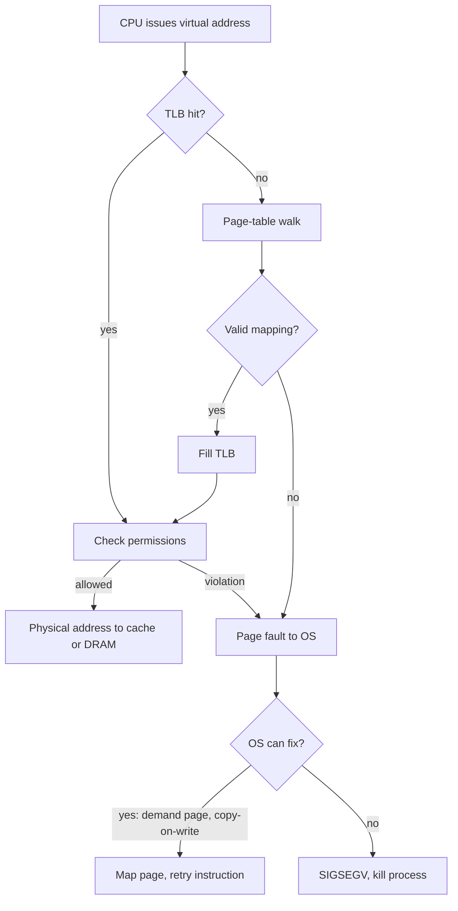

::: testing
Whether you understand **virtual memory** as a hardware/OS partnership, and can explain the MMU's jobs precisely rather than saying "it manages memory". The interviewer wants:

1. The core function: translate virtual addresses used by software into physical addresses, using page tables, with a TLB cache.
2. The reasons it exists: isolation between processes, protection (read/write/execute, user/kernel), a contiguous virtual view over fragmented physical RAM, demand paging and sharing.
3. What happens on a miss or violation: TLB miss, page walk, page fault, segmentation fault.
4. Cost awareness: translation adds latency, so TLBs matter; page size trade-offs.
5. The embedded contrast: most small MCUs have no MMU (maybe an MPU), and what that implies.
:::

::: why
Without an MMU you cannot run a modern general-purpose OS such as Linux, Android or Windows: one buggy program could overwrite the kernel or another app, memory would fragment, and you could not run more programs than fit in RAM. The MMU is also on the critical path of every memory access, so its design (TLB size, page-table depth) affects performance and power. Hardware interviewers ask it to see whether you understand how a CPU core, its caches and the OS cooperate, and to separate "application processors with an MMU" from "microcontrollers with an MPU". It builds on the stack and heap picture in [[q0942]] and the memory hierarchy ([[q0936]]).
:::

::: concepts
- **Virtual vs physical address**: the address a program uses vs the address that actually reaches DRAM. See [[q0934]].
- **Page and page table**: memory is divided into fixed-size pages (commonly 4 KB); the page table maps virtual page numbers to physical frame numbers plus permission bits.
- **TLB (translation lookaside buffer)**: a small cache of recent translations so most accesses skip the page-table walk. See [[q0937]].
- **Page fault**: an access to a page that is not mapped or not permitted, handled by the OS.
- **Protection bits**: read, write, execute, user/supervisor; enforced on every access.
- **MPU vs MMU**: a Memory Protection Unit checks permissions on a few regions but does no translation.
:::

::: answer
"An MMU is the hardware block between the CPU and memory that translates virtual addresses into physical addresses and checks permissions on every access.

Programs don't see real RAM addresses. Each process gets its own virtual address space, divided into pages, usually 4 KB. The OS keeps a page table per process that says which physical frame each virtual page maps to and whether it's readable, writable or executable. On each load or store the MMU looks up the translation, mostly in a small cache called the TLB, and if it's not there it walks the page table in memory.

Why do we need it? First, isolation and protection: one process can't touch another's memory or the kernel's, and a bad pointer becomes a page fault instead of corrupting the system. Second, convenience: every program can pretend it has a big contiguous address space starting at the same address, while the OS scatters its pages across physical RAM wherever there's room. Third, it enables demand paging and swapping, memory-mapped files and shared libraries that share physical pages between processes.

The cost is extra latency and area, which is why there's a TLB. Small microcontrollers skip it and use at most an MPU for protection, which keeps them simple and deterministic."
:::

::: technical
**Translation.** With page size $P = 2^p$, a virtual address splits into a virtual page number (VPN) and an offset: $VA = (VPN, offset)$ with $offset$ the low $p$ bits. The MMU maps $VPN \to PFN$ via the page table; the physical address is $PA = (PFN, offset)$. Only the upper bits change; the offset passes through.

**Multi-level page tables.** A single-level table for a 32-bit space with 4 KB pages has $2^{20}$ entries; at 4 B each that is 4 MB per process, mostly empty. So tables are hierarchical. x86-64 and ARMv8 (4 KB granule, 48-bit VA) use four levels: 9 index bits per level ($4 \times 9 = 36$ bits of VPN) plus a 12-bit offset = 48 bits. Each level is one 4 KB table holding 512 eight-byte entries. Unused regions need no lower-level tables.

**TLB.** A TLB hit adds roughly one cycle (often overlapped with the L1 access). A miss triggers a hardware page walk, up to 4 dependent memory accesses for a 4-level walk, though paging-structure caches and the data caches absorb many of them. The effective access time with hit rate $h$, TLB time $t_{TLB}$, memory time $t_m$ and a 4-level walk is

$$t_{eff} = t_{TLB} + (1-h)\cdot 4\,t_m \;(+\;t_m \text{ for the data itself})$$

**Faults.** Not present, wrong permission, or a write to a read-only page raises an exception. The OS may fix it (demand-load a page from disk, copy-on-write, grow the stack) and restart the instruction, or kill the process (SIGSEGV).

**Other functions.** Per-page attributes (cacheable, device/uncached, execute-never), address-space IDs (ASID) so the TLB need not be flushed on context switch, and two-stage translation for virtualization (guest VA to guest PA to host PA).

**MMU vs MPU.** An MPU, typical on Cortex-M, defines a handful of regions (for example 8 or 16) with base, size and permission. There is no translation, no paging and no demand loading. It gives protection (for instance a no-access guard region at the stack limit, see [[q0941]]) at tiny cost and with deterministic timing.
:::

::: short
"The MMU sits between the CPU and memory and translates the virtual addresses programs use into physical addresses, using page tables, with a TLB caching recent translations. It also checks read, write and execute permissions on every access. We need it for isolation between processes and the kernel, for giving every program a clean contiguous address space on top of fragmented RAM, and for features like demand paging and shared libraries. Small microcontrollers skip it and use a simpler MPU."
:::

::: long
"The MMU is the hardware that makes virtual memory work. Programs issue virtual addresses; the MMU translates them to physical addresses and enforces permissions, on every single load, store and instruction fetch.

Here's how. Memory is split into pages, typically 4 KB. A virtual address is a page number plus a 12-bit offset. The OS keeps a page table for each process mapping page numbers to physical frames, with permission bits like read, write, execute and user versus kernel. The MMU looks up the page number, swaps in the frame number, keeps the offset, and checks the permissions. To make this fast it caches recent translations in the TLB, so most accesses cost about a cycle extra. On a TLB miss, hardware walks the page table, which in a 4-level design can be up to four memory accesses, so keeping the hit rate high matters. If the page is missing or the access isn't allowed, the MMU raises a page fault and the OS decides what to do.

Why is it needed? One, protection and isolation: processes can't read or corrupt each other or the kernel, and an invalid pointer becomes a clean segfault. Two, abstraction: each program sees its own big contiguous address space, even though physical RAM is fragmented and shared. Three, it enables demand paging, memory-mapped files, copy-on-write fork and shared libraries mapped once and used by many processes.

The tradeoffs are area, power and unpredictable latency from TLB misses, which is why microcontrollers and real-time systems often don't have an MMU. They use an MPU, which only checks permissions on a few regions, or nothing at all."
:::

::: terms
- **Virtual address (VA)**: the address generated by the program.
- **Physical address (PA)**: the address that selects a location in DRAM or a device.
- **Page / frame**: a fixed-size block of virtual memory / physical memory (commonly 4 KB).
- **Page table**: the OS data structure that maps virtual pages to physical frames plus attributes.
- **TLB**: translation lookaside buffer, a small cache of recent translations.
- **Page walk**: the hardware (or software) traversal of the page-table levels after a TLB miss.
- **Page fault**: exception from an unmapped or disallowed access.
- **ASID**: address-space identifier, tags TLB entries per process to avoid flushes.
- **MPU**: memory protection unit; permissions on regions with no address translation.
:::

::: exceptional
**An average answer** says "the MMU maps virtual addresses to physical addresses so each process has its own memory."

**An exceptional answer**:
- Walks one translation with numbers (12-bit offset, 9-bit indices, 4 levels, 48-bit VA) and mentions the TLB.
- Lists protection **and** abstraction **and** demand paging as reasons, and names the fault flow (TLB miss, page walk, page fault, OS handler).
- Quantifies the cost with an effective-access-time estimate and the importance of TLB hit rate and TLB reach.
- Contrasts **MMU vs MPU**, and says why a microcontroller or hard-real-time system may choose not to have one.
- Mentions side issues that interviewers love: the TLB is tagged with ASIDs, caches can be virtually or physically indexed, and virtualization uses two-stage translation.
:::

::: mistakes
- **"The MMU manages the memory like malloc does."** The MMU does not allocate anything. It translates and checks. The OS decides the mappings and writes the page tables.
- **Saying virtual memory means swapping to disk.** Swapping is one *use*; the main benefits are isolation and a uniform address space.
- **Forgetting the TLB.** Without it every access would cost multiple extra memory accesses.
- **Mixing up page fault and segfault.** A page fault is the hardware exception; the OS may handle it transparently (demand paging) and only some faults become a SIGSEGV.
- **Calling an MPU an MMU.** An MPU has no address translation and no paging.
- **Thinking the offset gets translated.** Only the page number is translated; the low bits pass through unchanged.
:::

::: deep
## The problem the MMU solves

Imagine a computer with no MMU. Every program uses real physical addresses. Then:

- Two programs linked to run at the same address cannot both be loaded unless one is relocated.
- A wild pointer in one program can overwrite another program or the OS.
- Free RAM becomes fragmented: three 1 MB holes cannot satisfy a 3 MB request.
- You can never run more code and data than physically fits in RAM.

The MMU fixes all four by adding **one level of indirection**: programs use virtual addresses, and hardware maps them to physical ones under OS control.

## Address translation step by step

Use a 48-bit virtual address with 4 KB pages and a four-level table. The low 12 bits are the offset. The next four groups of 9 bits index the four levels of the table.

Take the virtual address `0x00007f3a12345678`. Splitting it:

| Field | Bits | Value |
|---|---|---|
| Level-4 index | 47:39 | 254 |
| Level-3 index | 38:30 | 232 |
| Level-2 index | 29:21 | 145 |
| Level-1 index | 20:12 | 325 |
| Offset | 11:0 | 0x678 |

```svg
<svg viewBox="0 0 700 250" role="img" aria-label="Four level page table walk">
  <text x="10" y="22" font-family="Inter, sans-serif" font-size="13" fill="var(--d-ink)">Virtual address (48 bit)</text>
  <rect x="10" y="30" width="105" height="32" fill="var(--d-box)" stroke="var(--d-ink)"/>
  <rect x="115" y="30" width="105" height="32" fill="var(--d-box)" stroke="var(--d-ink)"/>
  <rect x="220" y="30" width="105" height="32" fill="var(--d-box)" stroke="var(--d-ink)"/>
  <rect x="325" y="30" width="105" height="32" fill="var(--d-box)" stroke="var(--d-ink)"/>
  <rect x="430" y="30" width="105" height="32" fill="var(--d-box)" stroke="var(--d-orange)" stroke-width="2"/>
  <text x="62" y="51" text-anchor="middle" font-family="Inter, sans-serif" font-size="12" fill="var(--d-ink)">L4 idx 9b</text>
  <text x="167" y="51" text-anchor="middle" font-family="Inter, sans-serif" font-size="12" fill="var(--d-ink)">L3 idx 9b</text>
  <text x="272" y="51" text-anchor="middle" font-family="Inter, sans-serif" font-size="12" fill="var(--d-ink)">L2 idx 9b</text>
  <text x="377" y="51" text-anchor="middle" font-family="Inter, sans-serif" font-size="12" fill="var(--d-ink)">L1 idx 9b</text>
  <text x="482" y="51" text-anchor="middle" font-family="Inter, sans-serif" font-size="12" fill="var(--d-ink)">offset 12b</text>
  <rect x="10" y="110" width="110" height="46" fill="var(--d-box)" stroke="var(--d-blue)" stroke-width="2"/>
  <text x="65" y="130" text-anchor="middle" font-family="Inter, sans-serif" font-size="12" fill="var(--d-ink)">L4 table</text>
  <text x="65" y="146" text-anchor="middle" font-family="Inter, sans-serif" font-size="11" fill="var(--d-muted)">(base in CR3/TTBR)</text>
  <rect x="150" y="110" width="110" height="46" fill="var(--d-box)" stroke="var(--d-blue)" stroke-width="2"/>
  <text x="205" y="138" text-anchor="middle" font-family="Inter, sans-serif" font-size="12" fill="var(--d-ink)">L3 table</text>
  <rect x="290" y="110" width="110" height="46" fill="var(--d-box)" stroke="var(--d-blue)" stroke-width="2"/>
  <text x="345" y="138" text-anchor="middle" font-family="Inter, sans-serif" font-size="12" fill="var(--d-ink)">L2 table</text>
  <rect x="430" y="110" width="110" height="46" fill="var(--d-box)" stroke="var(--d-blue)" stroke-width="2"/>
  <text x="485" y="138" text-anchor="middle" font-family="Inter, sans-serif" font-size="12" fill="var(--d-ink)">L1 table</text>
  <path d="M 120 133 L 144 133" stroke="var(--d-blue)" stroke-width="2" fill="none"/><polygon points="150,133 140,128 140,138" fill="var(--d-blue)"/>
  <path d="M 260 133 L 284 133" stroke="var(--d-blue)" stroke-width="2" fill="none"/><polygon points="290,133 280,128 280,138" fill="var(--d-blue)"/>
  <path d="M 400 133 L 424 133" stroke="var(--d-blue)" stroke-width="2" fill="none"/><polygon points="430,133 420,128 420,138" fill="var(--d-blue)"/>
  <path d="M 62 62 L 62 104" stroke="var(--d-muted)" stroke-dasharray="3 3" fill="none"/>
  <path d="M 167 62 L 167 104 L 205 104" stroke="var(--d-muted)" stroke-dasharray="3 3" fill="none"/>
  <path d="M 272 62 L 272 98 L 345 98 L 345 104" stroke="var(--d-muted)" stroke-dasharray="3 3" fill="none"/>
  <path d="M 377 62 L 377 92 L 485 92 L 485 104" stroke="var(--d-muted)" stroke-dasharray="3 3" fill="none"/>
  <rect x="410" y="195" width="150" height="38" fill="var(--d-box)" stroke="var(--d-green)" stroke-width="2"/>
  <text x="485" y="218" text-anchor="middle" font-family="Inter, sans-serif" font-size="12" fill="var(--d-ink)">Frame + offset = PA</text>
  <path d="M 485 156 L 485 189" stroke="var(--d-green)" stroke-width="2" fill="none"/><polygon points="485,195 480,185 490,185" fill="var(--d-green)"/>
  <path d="M 482 62 L 590 62 L 590 214 L 566 214" stroke="var(--d-orange)" stroke-width="1.5" stroke-dasharray="3 3" fill="none"/>
  <polygon points="560,214 570,209 570,219" fill="var(--d-orange)"/>
  <text x="595" y="130" font-family="Inter, sans-serif" font-size="11" fill="var(--d-orange)">offset</text>
  <text x="595" y="144" font-family="Inter, sans-serif" font-size="11" fill="var(--d-orange)">unchanged</text>
</svg>
```
Figure: Each 9-bit index picks one of 512 entries in a 4 KB table; that entry points to the next table, and the last level yields the physical frame. The 12-bit offset bypasses translation. A full walk costs up to four dependent memory reads, which is exactly what the TLB exists to avoid.

## The TLB and effective access time

A TLB is a small, fully- or highly-associative cache of (VPN, ASID) to (PFN, permissions) entries. Typical L1 data TLBs hold tens of entries (commonly 32 to 128 for 4 KB pages), backed by a larger L2 TLB with 1,000 to a few thousand entries, though this varies by core. **TLB reach** is entries times page size: 64 entries times 4 KB is only 256 KB, and 1,536 entries times 4 KB is 6 MB, which is why huge pages (2 MB or 1 GB) help large-working-set programs.

Assume a 1 ns TLB lookup, 80 ns per DRAM reference, and a 4-level walk (320 ns if every level goes to DRAM). With a hit rate $h$:

$$t_{eff}(h) = 1 + (1-h)\cdot 320 \;\text{ns}$$

```plot
{"title":"Translation overhead vs TLB hit rate (1 ns TLB, 4 walk refs at 80 ns)","x":{"label":"TLB hit rate","min":0.9,"max":1},"y":{"label":"average translation time","unit":"ns","min":0,"max":40},
 "vars":{"tt":1,"walk":320},
 "series":[{"label":"t_eff = 1 + (1-h)*320","fn":"tt+(1-x)*walk"}],
 "points":[{"x":0.999,"y":1.32,"label":"99.9%"},{"x":0.99,"y":4.2,"label":"99%: 4.2 ns"},{"x":0.95,"y":17,"label":"95%: 17 ns"}]}
```
Figure: Dropping the hit rate from 99.9% to 95% raises translation overhead from about 1.3 ns to 17 ns. That is why TLB size, huge pages, and locality matter. In real systems the walker's accesses often hit in the L2/L3 caches, so the actual penalty is smaller than this worst case.

## What happens on every access


Figure: A page fault is not automatically a crash. Demand paging, copy-on-write after `fork`, and stack growth are all handled by the OS fixing the mapping and retrying.

## What the MMU buys you, one by one

1. **Isolation.** Different processes have different page tables, so process A's virtual 0x1000 and B's virtual 0x1000 map to different physical frames. Neither can name the other's memory.
2. **Protection.** Kernel pages are marked supervisor-only; code pages are execute-only or read-execute; data pages are no-execute. A write to a read-only page or a jump into a data page faults. This underlies mitigations against code injection (W^X / NX bit).
3. **Contiguous virtual view.** A 3 MB array can occupy three non-adjacent 1 MB physical regions.
4. **Demand paging and overcommit.** Pages are allocated or loaded only when first touched; unused pages can be evicted to storage.
5. **Sharing.** A shared library maps the same physical frames into many processes (read-only), and `fork` uses copy-on-write to share until modified.
6. **Memory-mapped I/O control.** Device registers are mapped as uncached, strongly-ordered pages so caches and write buffers don't reorder or hide accesses.

## Cost and design trade-offs

- **Latency and area**: the TLB sits on the critical path of every memory access; designs overlap TLB lookup with the L1 tag access (VIPT caches, see [[q0937]]).
- **Page size**: small pages (4 KB) reduce internal fragmentation but need more TLB entries and deeper tables; huge pages improve TLB reach but waste memory and fragment.
- **Determinism**: a TLB miss or page fault makes timing unpredictable, so hard real-time systems often use an MPU with fixed regions or lock critical TLB entries.
- **Power**: TLB lookups happen every access, so TLBs are small and highly optimized.

## MMU vs MPU vs nothing

| | No protection (small MCU) | MPU (Cortex-M) | MMU (Cortex-A, x86) |
|---|---|---|---|
| Address translation | none | none | yes |
| Protection | none | per-region (e.g. 8-16 regions) | per-page |
| Demand paging, swap | no | no | yes |
| Timing | deterministic | deterministic | TLB misses and faults vary |
| Runs Linux | no (uClinux only) | no (uClinux only) | yes |

In a typical system-on-chip ([[q0936]]), the application cores have MMUs and run the OS, while small real-time cores or power-management microcontrollers sit alongside using an MPU or nothing.

## Worked example: page table cost

A 32-bit process uses 12 MB spread in three regions (code at the bottom, heap, stack at the top). A flat table would need $2^{20}$ entries times 4 B $= 4$ MB. A two-level table (10 + 10 index bits) needs one 4 KB top-level table plus a 4 KB second-level table for each 4 MB region actually touched: about 3 to 5 second-level tables, so 16 to 24 KB total. That 99.5% saving is the reason multi-level tables exist.
:::

::: applications
- **General-purpose OSes**: Linux, Windows, macOS, Android and iOS all rely on the MMU for process isolation and virtual memory.
- **Application processors**: ARM Cortex-A cores and x86 CPUs include MMUs with multi-level TLBs; Cortex-M cores include at most an MPU.
- **Virtualization**: hypervisors use two-stage translation (nested page tables) so each guest believes it controls physical memory.
- **GPUs and I/O devices**: an IOMMU/SMMU gives DMA-capable devices their own virtual address spaces and stops a rogue device from writing anywhere in RAM.
- **Security**: NX/XN bits, kernel/user separation and address-space layout randomization all depend on MMU permissions.
- **Embedded real-time**: Cortex-M and similar parts use an MPU to guard stacks and separate privileged firmware from application code, for example in RTOS "MPU mode".
:::

::: assumptions
- **Paged MMU model with 4 KB pages and 48-bit VA**, as on x86-64 and ARMv8-A. Other page sizes (16 KB, 64 KB) and depths (3-5 levels) exist.
- **Hardware-walked page tables.** Some architectures (older MIPS, SPARC variants) used software-refilled TLBs.
- **The TLB cost figures** are illustrative; real walkers cache upper levels and the page-table entries often sit in the L2/L3 caches, so the typical miss penalty is well below 4 DRAM accesses.
- **Segmentation** (x86 legacy) is an older, different mechanism; modern 64-bit mode mostly uses flat segments plus paging.
- If the interviewer is thinking of an **MPU or embedded context**, say that many MCUs have no MMU and discuss protection regions instead.
:::

::: followups
### What is a TLB and why is it needed?
The TLB is a small cache of recent virtual-to-physical translations next to the core. Without it, every load/store would need a page-table walk of up to four dependent memory references on a 4-level system. With a 99.9% hit rate the average translation cost is about 1.3 ns in the model above; at 95% it is 17 ns.

### What happens on a context switch?
The OS switches the page-table base register (CR3 on x86, TTBR on ARM) to the new process's tables. Without ASIDs the TLB must be flushed, since entries belong to the old process, making the new one start cold. With ASIDs the entries are tagged so they can stay, and the switch is much cheaper.

### Why do multi-level page tables exist?
A flat table for a 48-bit space with 4 KB pages would need $2^{36}$ entries, which at 8 B each is 512 GB per process. Hierarchical tables only allocate the sub-tables for regions actually used, so a typical process needs kilobytes to a few megabytes of tables.

### What are huge pages and when do you want them?
A 2 MB page covers 512 normal pages with one TLB entry, so TLB reach goes from 256 KB to 128 MB for 64 entries. They help databases, VMs and ML jobs with large working sets, at the cost of internal fragmentation and harder allocation of contiguous physical memory.

### Scenario: a program runs 10x slower after its working set grows from 100 MB to 2 GB, though CPU utilization is the same. Why might that be, and how would you check?
Working-set growth beyond TLB reach causes many TLB misses and page walks, and possibly cache misses on page-table entries. Check performance counters for dTLB-load-misses and page-walk cycles, try transparent huge pages, and improve locality (blocked access patterns). If memory is also overcommitted, check page-fault and swap rates too.
:::

::: interpretations
"MMU" is most often asked in two contexts: **application processors** (Linux, virtual memory, page tables, TLB), which is the main answer here, and **embedded** (where the follow-up is "does the Cortex-M have one?"; it has at most an MPU). Some candidates conflate it with the *memory controller* (which drives DRAM signals and refresh, and is a different block) or with the *DMA engine*. If the question is later asked about memory management in firmware ([[q0942]]), it is about allocation, not the MMU.
:::

::: references
- Patterson & Hennessy, *Computer Organization and Design*: the virtual memory sections on pages, page tables, the TLB and page faults.
- Hennessy & Patterson, *Computer Architecture: A Quantitative Approach*: memory hierarchy and virtual memory appendix/chapter.
- Bryant & O'Hallaron, *Computer Systems: A Programmer's Perspective*: virtual memory chapter (address translation, multi-level tables, TLB).
- Arm Architecture Reference Manual for A-profile (VMSA chapter) and the Intel/AMD architecture manuals' paging chapters, for exact table formats.
- Yiu, *The Definitive Guide to ARM Cortex-M3 and Cortex-M4 Processors*: the MPU chapter.
:::

::: rubric
- Defines the MMU as the block that translates virtual to physical addresses and checks permissions :: This is the core definition; everything else elaborates it.
- Explains pages, page tables and the offset passing through untranslated :: Shows you understand the mechanism, not only the slogan.
- Mentions the TLB and what a miss costs (page walk) :: Performance is the main hardware concern with translation.
- Gives the reasons: isolation/protection, contiguous virtual space, demand paging/sharing :: The question asks "why is it needed", which is several distinct benefits.
- Describes page-fault handling and that not all faults are errors :: Connects hardware to OS behaviour.
- Contrasts MMU with MPU and says small MCUs often lack one :: Shows system-level awareness relevant to embedded interviews.
- Quantifies something (levels and bits, TLB reach, effective access time) :: Numbers make the answer concrete.
:::

::: quiz
```json
[
 {"type":"mcq","level":"fundamental","q":"What is the primary job of an MMU?","options":["Allocate and free memory for programs","Translate virtual addresses to physical addresses and enforce access permissions","Refresh DRAM cells","Compress data in RAM"],"answer":1,"explain":"The MMU only translates and checks. Allocation is done by software (the OS and malloc); DRAM refresh is the memory controller's job."},
 {"type":"truefalse","level":"fundamental","q":"When translating a virtual address with 4 KB pages, the low 12 address bits are translated through the page table just like the upper bits.","answer":false,"explain":"The low 12 bits are the offset within the page and pass through unchanged. Only the virtual page number is translated into a physical frame number."},
 {"type":"numeric","level":"intermediate","q":"With 4 KB pages and 9 index bits per level, how many page-table levels are needed to cover a 48-bit virtual address?","answer":4,"tolerance":0.01,"unit":"levels","explain":"48 - 12 offset bits = 36 VPN bits; 36 / 9 = 4 levels."},
 {"type":"numeric","level":"intermediate","q":"TLB lookup takes 1 ns, a page walk costs 320 ns, and the TLB hit rate is 99%. What is the average translation time in ns?","answer":4.2,"tolerance":0.02,"unit":"ns","explain":"$t = 1 + 0.01\\times 320 = 4.2$ ns."},
 {"type":"mcq","level":"intermediate","q":"Which of these is true of a Cortex-M MPU compared with an MMU?","options":["It supports demand paging and swap","It translates virtual to physical addresses","It enforces permissions on a small number of memory regions with no translation","It is required to run desktop Linux"],"answer":2,"explain":"An MPU checks region permissions only; no translation or paging. Hence it cannot run a full virtual-memory OS, but gives deterministic timing and cheap protection."},
 {"type":"numeric","level":"advanced","q":"A 64-entry TLB uses 4 KB pages. What is its reach (total memory covered), in KB?","answer":256,"tolerance":0.01,"unit":"KB","explain":"Reach = entries x page size = $64\\times4$ KB = 256 KB. With 2 MB pages it would be $64\\times2$ MB = 128 MB, a 512x increase."}
]
```
:::
