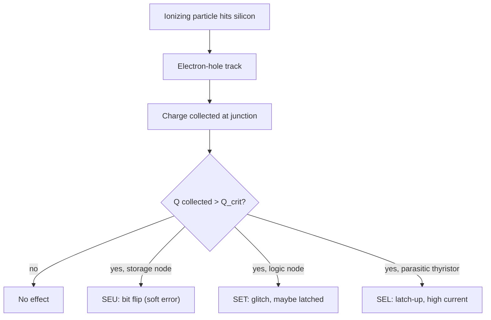

::: testing
Whether you can reason from **physics to architecture**: how radiation corrupts a memory cell, what failure categories result, and which mitigation fits which failure. The interviewer is looking for:

1. A correct physical picture: a charged particle deposits charge in silicon, which can flip a stored bit (single-event upset) without damaging the device, versus effects that do damage (latch-up, total ionizing dose).
2. The system-level consequences: wrong data, wrong instructions, crashes, silent data corruption, accumulation of errors over time.
3. A layered mitigation answer: ECC with scrubbing, redundancy (TMR, lockstep), radiation-tolerant process or parts, software checks, watchdogs, shielding, architecture-level recovery.
4. Quantitative sense: ECC overhead, why scrubbing matters, the trade-offs in area, power and performance.
5. Engineering judgment, not a memorized list: you pick mitigations by threat and cost.
:::

::: why
Satellites, deep-space probes, launch vehicles and even high-altitude aircraft and some terrestrial servers are exposed to ionizing particles. A single flipped bit in a configuration register or program counter can lose a mission, and you can't send a technician to power-cycle a probe at Jupiter. Aerospace and defense employers, and any company building reliable memories or automotive/safety silicon, expect hardware engineers to know how upsets are detected and corrected. The same ideas (ECC, parity, redundancy) are in every server DRAM and cache you will design or test, so this question covers broad, high-value fundamentals, and ties to RAM structure ([[q0939]]) and the memory hierarchy ([[q0936]]).
:::

::: concepts
- **Single-event upset (SEU)**: a particle strike flips a stored bit (soft error); the circuit still works afterwards. See [[q0939]].
- **Single-event latch-up (SEL)**: a strike triggers a parasitic thyristor in CMOS, causing a high-current short that can destroy the chip unless power is cut.
- **Total ionizing dose (TID)**: cumulative charge trapping in oxides that shifts thresholds and raises leakage over months or years.
- **ECC / SECDED**: extra check bits let hardware correct 1-bit and detect 2-bit errors per word.
- **Redundancy (TMR)**: three copies and a majority voter mask a single failing copy.
- **Scrubbing**: periodically reading, correcting and rewriting memory so errors do not accumulate.
- **Soft error vs hard error**: soft errors corrupt data but the cell is fine; hard errors are permanent damage.
:::

::: answer
"In space there's a lot of ionizing radiation: protons and heavy ions from the sun and cosmic rays, plus trapped particles in the radiation belts. When one of those hits silicon it deposits charge, and if it lands near a sensitive node in a memory cell it can flip the stored bit. That's a single-event upset, a soft error. The hardware isn't damaged, but the data is wrong. If it lands in a register, an instruction in cache, or a configuration bit, the program can crash or silently produce wrong results.

There are worse effects too. A particle can trigger latch-up, where a parasitic thyristor in the CMOS shorts the supply and can burn out the chip. And over a mission, accumulated dose shifts transistor thresholds and raises leakage, so memory slowly degrades.

To be resilient I'd stack defenses. At the data level, ECC on all memories, like SECDED that corrects one bit and detects two per word, with a background scrubber that reads and rewrites memory so single errors don't pile up into uncorrectable double errors. For critical logic, redundancy: triple modular redundancy with voting, or lockstep cores with comparison. At the part level, use radiation-hardened or radiation-tolerant devices, and add latch-up protection, like current limiting and fast power cycling. At the system level, add watchdogs, checksums on code and configuration, periodic reloading from protected non-volatile memory, and safe-mode recovery, and shielding helps a bit but can't stop high-energy particles. Which of these I'd pick depends on the mission length, orbit and cost."
:::

::: technical
**Radiation environment.** Space radiation comprises galactic cosmic rays (high-energy heavy ions), solar particle events (protons and heavier ions), and trapped protons and electrons in the Van Allen belts. Terrestrially, atmospheric neutrons (and alpha particles from package materials) cause far fewer, but non-zero, upsets.

**Mechanism of an SEU.** An ionizing particle creates electron-hole pairs along its track. Charge collected at a reverse-biased drain node can exceed the *critical charge* $Q_{crit}$ of an SRAM cell or DRAM capacitor, flipping it. Smaller nodes at lower voltage have lower $Q_{crit} \approx C_{node} V_{DD}$, so scaling makes cells more sensitive per bit, though smaller area collects fewer hits.

**Effects classified.**
| Effect | Type | Result | Mitigation |
|---|---|---|---|
| SEU (bit flip) | soft | wrong data/instruction | ECC, parity, scrubbing, TMR |
| MBU (multi-bit upset) | soft | adjacent bits flip | bit interleaving so adjacent cells are in different ECC words |
| SET (transient pulse in logic) | soft | wrong value if latched | filtering, redundancy, hardened flip-flops |
| SEFI (functional interrupt) | soft | device hangs or enters wrong mode | watchdog, reset, re-config |
| SEL (latch-up) | potentially hard | high current, burnout | SOI/epi process, current limit, power cycle |
| TID | cumulative | $V_{th}$ shift, leakage up | rad-hard process, margin, shielding |

**ECC arithmetic.** A Hamming code over $k$ data bits needs $r$ check bits with $2^r \ge k + r + 1$. SECDED adds one overall parity bit: $k=64$ needs $r=7$ plus 1, so $(72,64)$ with 12.5% storage overhead. It corrects any single-bit error and detects any double-bit error.

**Why scrubbing matters.** Correction only works if a word has at most one error. If upsets arrive in a given word at rate $\lambda_w$ and the word is rewritten every $T_s$, the probability of two upsets within one interval is approximately $(\lambda_w T_s)^2/2$. Doubling the scrub interval quadruples the double-error probability per interval.

**TMR.** Three copies feed a majority voter: $Y = AB + BC + AC$. A single failure is masked; the area cost is about 3x plus the voter. The voter itself is a single point of failure unless also triplicated.

> [!UNCERTAIN]
> Real upset rates depend on the orbit, solar activity, altitude, shielding and the specific process and cell design. Published rates range over many orders of magnitude, so any numbers here are illustrative assumptions. Mission designers use measured cross-sections from beam testing and environment models, not rules of thumb.
:::

::: short
"Radiation particles can deposit charge in silicon and flip a stored bit, a single-event upset, which silently corrupts data or instructions. Worse events include latch-up, which can burn the chip, and accumulated dose that degrades transistors. To be resilient I'd use ECC on all memories with scrubbing so errors don't accumulate, triple modular redundancy or lockstep for critical logic, radiation-tolerant parts with latch-up protection, and system-level watchdogs and recovery. Shielding helps but isn't enough on its own."
:::

::: long
"The core issue is that space is full of ionizing particles: cosmic rays, solar protons and heavy ions, and trapped particles in the radiation belts. When one passes through silicon it leaves a trail of electron-hole pairs. If enough of that charge is collected at a sensitive node, say the storage node of an SRAM cell, it exceeds the cell's critical charge and flips the bit. That's a single-event upset. It's a soft error: the chip is fine, the data isn't.

What goes wrong depends on what flipped. If it's a data word, you get a wrong computation. If it's an instruction in cache or RAM, the CPU may execute garbage. If it's a configuration bit in an FPGA or a control register, a whole subsystem can misbehave. Scaling makes things worse since lower voltage and smaller capacitance mean lower critical charge. Other effects include single-event latch-up, where a parasitic thyristor in the CMOS structure shorts the supply and can destroy the part unless you cut the power fast, and total ionizing dose, which slowly shifts thresholds and raises leakage over the mission.

For resilience I'd work in layers. First, ECC on every memory, typically SECDED with 8 check bits on 64 data bits, so 12.5% overhead. Add scrubbing, because ECC only fixes one error per word, and if errors pile up you get uncorrectable doubles. Second, interleave bits so a multi-bit upset lands in different words. Third, for the CPU and control logic, use TMR with voters or lockstep cores that compare outputs. Fourth, choose radiation-hardened or at least radiation-tolerant parts, and protect against latch-up with current limiting and the ability to power cycle. Finally, at the system level, use watchdog timers, checksums on code and configuration, periodic reloading from a protected non-volatile store, and a safe mode.

All of this costs area, power, and performance, so the real design question is how much protection the mission justifies."
:::

::: terms
- **SEU (single-event upset)**: a radiation-induced bit flip in a storage element; a soft error.
- **MBU (multi-bit upset)**: one particle flips several adjacent bits.
- **SEL (single-event latch-up)**: radiation-triggered parasitic thyristor conduction, potentially destructive.
- **TID (total ionizing dose)**: cumulative radiation damage, measured in rad(Si) or gray.
- **Critical charge ($Q_{crit}$)**: the minimum collected charge that flips a node.
- **ECC / SECDED**: error-correcting code that corrects single-bit and detects double-bit errors.
- **Scrubbing**: periodic read-correct-write of memory to clear accumulated errors.
- **TMR**: triple modular redundancy with majority voting.
- **Lockstep**: two identical cores run the same instructions and a comparator flags divergence.
- **Rad-hard / rad-tolerant**: designed or screened to withstand a specified radiation level.
:::

::: exceptional
**An average answer** says "radiation flips bits, so use ECC and shielding."

**An exceptional answer**:
- Separates **soft errors** (SEU, MBU, SET) from **destructive/cumulative** effects (SEL, TID), and matches mitigations to each: ECC and scrubbing for SEU, bit interleaving for MBU, current limiting and power cycling for SEL, margin and rad-hard process for TID.
- Explains *why scrubbing is needed* with the double-error argument rather than only naming it.
- Gives ECC overhead numbers (72,64 gives 12.5%) and notes TMR is about 3x area.
- Notes that **registers, caches, flip-flops and FPGA configuration memory** are vulnerable too, not just the main RAM; and that logic transients matter.
- Admits trade-offs and cost, and that shielding is limited against high-energy particles, which can create secondaries.
- Mentions system-level recovery: watchdogs, reboots from golden image, checkpointing.
:::

::: mistakes
- **"Shielding solves it."** Thin shielding stops low-energy particles, but high-energy cosmic rays penetrate and can produce secondary particles. Shielding reduces dose, not SEU risk to zero.
- **"ECC is enough on its own."** Without scrubbing, errors accumulate until a word has two errors and ECC can only detect them.
- **Protecting only main memory.** Caches, register files, pipeline flops, configuration memory and the voter itself can all be hit.
- **Confusing soft and hard errors.** An SEU needs no replacement part; a latch-up may destroy one.
- **Treating TMR voters as perfect.** A single voter is a single point of failure; critical designs triplicate voters or use hardened voter cells.
- **Assuming parity is equivalent to ECC.** Parity detects odd numbers of bit errors but cannot correct them; it works for caches that can refetch clean data.
:::

::: deep
## How a particle flips a bit

A memory cell stores a bit as charge on a small node: two cross-coupled inverters in SRAM, a tiny capacitor in DRAM, charge in a floating gate for flash. An ionizing particle traveling through silicon creates a dense track of electron-hole pairs (the linear energy transfer, LET, measures how much per unit length). Near a reverse-biased junction, the electric field separates the carriers and the junction collects a current pulse. If the collected charge exceeds the critical charge of the node, the feedback loop flips to the opposite state.

For a rough sense of scale, the node charge is approximately $Q_{node} \approx C V_{DD}$. A node of 1 fF at 1.0 V stores 1 fC, so $Q_{crit}$ is on the order of a femtocoulomb, comparable to what a single particle track can deposit. A 5 nm-class cell at 0.7 V has an even smaller $Q_{crit}$, which is why smaller technologies have a lower threshold per bit, even though each bit presents a smaller target.


Figure: The same particle can cause very different results depending on where it lands. SEU and SET are soft errors; latch-up can be destructive, and TID (not shown) accumulates over time.

## What goes wrong in the system

Consider where bits live: main memory (DRAM/SRAM), caches, register files, pipeline and state-machine flip-flops, FPGA configuration cells, and non-volatile memory (flash is relatively robust to SEUs in storage but its control logic and charge pumps are vulnerable to TID).

- **Data corruption**: sensor readings or calculations become wrong, often silently ("silent data corruption").
- **Control-flow corruption**: a flipped bit in an instruction, return address or PC sends execution to the wrong place.
- **Configuration corruption**: an FPGA's SRAM-based configuration changes its logic function; a flipped register in a motor controller changes a setting.
- **Crashes and hangs**: SEFIs, stuck state machines.
- **Accumulation**: untouched memory slowly collects errors; a second upset in the same ECC word makes correction impossible.
- **Latch-up**: current surges, thermal damage.
- **TID drift**: over months, thresholds shift and leakage rises, so timing and retention margins shrink.

## Error-correcting codes: the data-level defense

A Hamming code adds check bits so that a single flipped bit produces a unique non-zero **syndrome** pointing to its position. For $k$ data bits you need the smallest $r$ with $2^r \ge k + r + 1$. Adding an overall parity bit makes it SECDED.

| Data bits $k$ | Check bits (SECDED) | Total | Overhead |
|---|---|---|---|
| 4 | 4 | 8 | 100% |
| 8 | 5 | 13 | 62.5% |
| 16 | 6 | 22 | 37.5% |
| 32 | 7 | 39 | 21.9% |
| 64 | 8 | 72 | 12.5% |

Wider words amortize the check bits, which is why DRAM ECC is (72,64) and caches sometimes use 128-bit or 256-bit ECC granules.

```sim
{"id":"ecc-lab","mode":"hamming"}
```
Figure: Flip one bit in the code word and watch the syndrome point at the failed position and correct it. Select SECDED(8,4), flip two bits, and see the decoder flag an uncorrectable error instead of miscorrecting. Then switch the Topic to TMR to see majority voting mask a single bad copy.

## Scrubbing: why ECC alone is not enough

Suppose a 1 GiB memory built from 72-bit words, so $N = 2^{30}\cdot 8 / 64 = 134{,}217{,}728$ words. Assume (illustrative) an upset rate of $10^{-10}$ per bit per day, so per word $\lambda_w = 72\times10^{-10}/24 = 3\times10^{-10}$ per hour. If every word is rewritten every $T_s$ hours, the expected number of double-error words per day is approximately

$$E_{2} \approx N \cdot \frac{(\lambda_w T_s)^2}{2}\cdot\frac{24}{T_s} = 12\,N\,\lambda_w^2\,T_s$$

```plot
{"title":"Expected uncorrectable (double-error) words per day vs scrub interval (illustrative upset rate)","x":{"label":"scrub interval","unit":"h","min":0.1,"max":720,"log":true},"y":{"label":"double-error words per day","min":1e-12,"max":1e-4,"log":true},
 "vars":{"n":134217728,"lam":3e-10},
 "series":[{"label":"12 N λ² T_s","fn":"12*n*lam*lam*x"}],
 "vlines":[{"at":24,"label":"daily scrub"}]}
```
Figure: On log axes the uncorrectable-error rate grows linearly with the scrub interval. Scrubbing 10x more often cuts the double-error risk 10x. The numbers depend entirely on the assumed upset rate, so the shape matters more than the absolute values. With a 100x higher rate, the curve moves up 10,000x.

The lesson is that ECC *plus* scrubbing sets the mean time between uncorrectable errors. Scrubbing costs memory bandwidth and power, so you choose the interval to meet a reliability target. Many memory controllers also do "demand scrubbing": correct and write back whenever a read finds a single error.

## Bit interleaving for multi-bit upsets

One particle can flip two adjacent cells. If both belong to the same ECC word, SECDED sees a double error and cannot correct it. Layout interleaving places bits of *different* words next to each other, so a multi-bit upset produces single-bit errors in separate words, all correctable.

## Redundancy for logic and CPUs

ECC protects stored data, but a flip-flop in the CPU's pipeline or an adder glitch is not ECC-protected. Options:

- **TMR**: triple the logic and vote. A bit-level voter is $Y = AB + BC + AC$. Cost: about 3x area and power, plus voter delay. Common in FPGA designs for flight (with scrubbing of the FPGA configuration memory).
- **Lockstep**: two identical cores execute the same instructions and a checker compares outputs each cycle. It detects a fault (about 2x area) but cannot say which core is wrong, so a rollback or reset follows. Safety microcontrollers (for automotive, for example) use lockstep Cortex-R cores.
- **Time redundancy**: execute twice and compare, costing performance instead of area.
- **Hardened cells and DICE latches**: redundant-node storage circuits that resist flipping.
- **Parity on caches**: for write-through caches, parity detects an error and the controller just refetches the clean copy from memory.

## Latch-up and total dose

CMOS contains parasitic PNPN thyristor structures. A radiation-induced current pulse can trigger them, causing the supply to short through the chip. Remedies: processes with insulating substrates (SOI, silicon-on-sapphire) or epitaxial layers with guard rings, supply current monitors that cut power within microseconds, and series current limiting. After a latch-up event, power cycling restores operation if there was no thermal damage.

TID builds up as charge trapped in gate and field oxides, shifting $V_{th}$ and creating leakage paths. Mitigation: radiation-hardened processes, design margins, enclosed-layout transistors, and spot shielding. TID is the reason mission-qualified parts are tested to a specified dose, often expressed in krad(Si).

## Software and system-level resilience

- **Watchdog timers** to recover from hangs or wild jumps.
- **Checksums/CRCs on code and configuration**, with periodic verification and reload from a golden image in protected non-volatile memory.
- **Redundant computation and voting** across multiple computers (the shuttle used four synchronized computers plus a backup, and many spacecraft have cold spares).
- **Checkpoint and rollback**, so work can restart from a known-good state.
- **Safe mode**: on detecting inconsistent state, shut down non-essential functions and wait for ground intervention.
- **Selecting the architecture to avoid big volatile state**: keep critical parameters in ECC-protected or hardened memory and refresh them.

## The cost trade-off

| Technique | Area/Power cost | Covers |
|---|---|---|
| Parity | about 1/8 extra bits on a byte | detect odd-bit errors |
| SECDED (72,64) | 12.5% storage, XOR trees | correct 1, detect 2 per word |
| Scrubbing | memory bandwidth, energy | prevents accumulation |
| TMR | about 3x logic | masks single logic or flop failures |
| Lockstep | about 2x | detects divergence |
| Rad-hard process | 10-100x cost, older nodes | TID, SEL, hardened cells |

The right combination follows from the mission: a 5-year geostationary satellite needs more than a 2-week low-orbit cubesat, which may use commercial parts with watchdogs and software recovery.
:::

::: applications
- **Spacecraft computers**: radiation-hardened processors with ECC memory and scrubbers in GEO and deep-space probes; commercial parts with watchdogs and reset in some CubeSats.
- **FPGA-based payloads**: TMR on logic combined with continuous configuration scrubbing, since SRAM-based FPGA configuration bits are vulnerable.
- **Servers and data centers**: ECC DRAM and caches protect against atmospheric neutron upsets; patrol scrubbing is a standard memory-controller feature.
- **Automotive and avionics**: ISO 26262 safety microcontrollers use lockstep cores and ECC on flash and SRAM.
- **Medical and industrial**: ECC memory and CRC on firmware images in equipment where silent corruption is unacceptable.
- **Particle physics experiments and nuclear facilities**: radiation-tolerant electronics near detectors and reactors.
:::

::: assumptions
- **Soft-error focus.** The answer assumes the dominant risk is SEUs in memory; for a long Jupiter mission, TID and latch-up dominate part selection.
- **Illustrative rates.** Upset rates in the scrubbing example are assumed, not measured. Real rates depend on the orbit, shielding, solar events and the technology node.
- **Independence.** The double-error calculation assumes independent random upsets per word. MBUs and clustering violate this, which is why interleaving is used.
- **Mission context.** For a short low-cost mission, a commercial part with watchdog and reload may be the optimal answer, so the right mitigation set is a cost/reliability decision rather than "always rad-hard".
- **Non-volatile memories** (flash, FRAM, MRAM) have different sensitivity than SRAM/DRAM: flash storage is relatively immune to SEU but vulnerable to TID and has sensitive peripheral circuits.
:::

::: followups
### What is the difference between a soft error and a hard error?
A soft error is a transient data corruption: the bit flipped but the cell works fine and is fixed by rewriting. A hard error is permanent physical damage, such as oxide breakdown or latch-up burnout, and requires replacing or avoiding that part or cell. SEU is soft; SEL can become hard; TID is a cumulative degradation.

### Why does ECC need scrubbing?
ECC corrects one error per word. If a word sits untouched, two upsets can accumulate, and then SECDED can only detect the problem. A scrubber periodically reads, corrects and rewrites each word so the error count resets to zero. The double-error probability per interval scales with the square of the interval, so scrub frequency directly sets reliability.

### How does TMR work and what are its weaknesses?
Three copies compute the same function and a majority voter outputs the value agreeing in at least two. It masks any single failure. Weaknesses: about 3x area and power, the voter is itself a single point of failure unless hardened or triplicated, and errors can accumulate in the copies (a second failure before repair defeats it), so state in TMR flops needs resynchronizing.

### Would you shield the electronics with a thick metal box?
Shielding reduces total dose and stops low-energy particles, so it helps against TID and trapped electrons. High-energy cosmic rays and protons pass through practical thicknesses, and thick shields can make secondary particles (showers). So it's a TID mitigation and a partial one for SEE, not a substitute for ECC or redundancy, and it adds mass, which is expensive at launch.

### What if the radiation corrupts the ECC logic itself, or the program counter?
ECC encoders and decoders can be protected with TMR or parity-checked logic, and the PC can be protected with lockstep comparison or hardened flops. In practice systems assume undetected corruption can still happen, so a watchdog timer, periodic state checks and the ability to reset to a golden image from protected storage form the last line of defense.

### Scenario: your satellite's SRAM shows 1 correctable error per hour, but suddenly several uncorrectable errors appear. What do you check?
First, solar particle events or crossing the South Atlantic Anomaly can raise rates by orders of magnitude, so check the environment telemetry. Check whether the scrub interval is too long for the elevated rate, and whether multi-bit upsets cluster within words (interleaving issue). If errors are in the same location repeatedly, suspect a hard fault (stuck cell from TID or damage) and map that region out. Shorten the scrub interval and increase protection (for example, stronger BCH or Reed-Solomon codes) if needed.
:::

::: interpretations
"Corrupt my memory" could mean main memory, caches, registers, or even storage. The page covers all, with the main emphasis on RAM. The question has two parts: **what issues arise** (the failure modes) and **what to do** (mitigations), so a good answer addresses both explicitly. If the interviewer follows with a specific scenario (for example, an FPGA or a CubeSat), tailor the protection to the budget. Terrestrial servers also see soft errors (from atmospheric neutrons and packaging alpha particles) at much lower rates, which is why server DRAM uses ECC.
:::

::: references
- Baumann, R., "Radiation-induced soft errors in advanced semiconductor technologies," *IEEE Transactions on Device and Materials Reliability* (2005): overview of soft-error mechanisms.
- Hennessy & Patterson, *Computer Architecture: A Quantitative Approach*: dependability, ECC and redundancy discussion.
- Patterson & Hennessy, *Computer Organization and Design*: the section on dependable memory and Hamming codes.
- Weste & Harris, *CMOS VLSI Design*: reliability and latch-up chapters.
- NASA and ESA radiation-effects handbooks and the JEDEC JESD89 series on soft-error testing (consult the current versions for details).
:::

::: rubric
- Explains that a particle deposits charge and can flip a stored bit (SEU), a soft error :: This is the root mechanism; without it the mitigations are just a list.
- Lists the consequences: corrupted data, instructions or control state; crashes; silent corruption :: The question asks "what issues can arise".
- Mentions latch-up and total dose as the destructive or cumulative effects :: Shows you know radiation does more than flip bits.
- Proposes ECC (SECDED) with scrubbing and explains why scrubbing is needed :: The standard memory-level defense, and the nuance impresses.
- Proposes redundancy for logic (TMR, lockstep) and protection of registers/caches, not only RAM :: Memory is not the only vulnerable state.
- Mentions radiation-tolerant parts, latch-up protection, and system-level recovery (watchdog, golden image) :: A layered defense is the real engineering answer.
- Acknowledges cost trade-offs and mission-dependent choices :: Shows engineering judgment.
:::

::: quiz
```json
[
 {"type":"mcq","level":"fundamental","q":"What is a single-event upset (SEU)?","options":["A permanent short caused by a latch-up","A radiation-induced bit flip that leaves the circuit undamaged","A slow threshold shift from accumulated dose","A power supply glitch from a regulator"],"answer":1,"explain":"An SEU is a soft error: a particle deposits charge and flips a stored bit, but rewriting the cell restores it. Latch-up and TID are different effects."},
 {"type":"numeric","level":"fundamental","q":"A SECDED code protects 64 data bits with 8 check bits. What is the storage overhead as a percentage?","answer":12.5,"tolerance":0.01,"unit":"%","explain":"$8/64 = 0.125 = 12.5\\%$, which is why (72,64) is the standard DRAM ECC organization."},
 {"type":"mcq","level":"intermediate","q":"Why is scrubbing needed even when memory has SECDED ECC?","options":["ECC cannot detect any errors","Errors accumulate in untouched words until a word has two errors, which ECC can detect but not correct","Scrubbing increases the ECC check bits","Scrubbing prevents latch-up"],"answer":1,"explain":"SECDED corrects only one error per word. Periodic read-correct-write resets each word's error count so two independent upsets rarely coincide."},
 {"type":"truefalse","level":"intermediate","q":"Triple modular redundancy with a single, unprotected majority voter has no single point of failure.","answer":false,"explain":"The voter is a single point of failure: a fault in it corrupts the output regardless of the three good copies. High-reliability designs triplicate or harden the voter."},
 {"type":"multi","level":"intermediate","q":"Select all that are mitigations aimed at radiation-induced memory errors.","options":["Bit interleaving across ECC words","Memory scrubbing","Increasing the clock frequency","Current-limited supplies with power-cycle capability"],"answer":[0,1,3],"explain":"Interleaving handles multi-bit upsets, scrubbing prevents accumulation, and current limiting plus power cycling addresses latch-up. A faster clock does nothing for upsets."},
 {"type":"numeric","level":"advanced","q":"With the same illustrative model, the expected double-error words per day scales as $E_2 \\propto T_s$. If you change the scrub interval from 24 h to 6 h, by what factor does $E_2$ fall?","answer":4,"tolerance":0.01,"unit":"x","explain":"Per interval the double-error probability scales as $T_s^2$, and there are $24/T_s$ intervals per day, so per day it scales as $T_s$. 24/6 = 4, so $E_2$ falls 4x."}
]
```
:::
