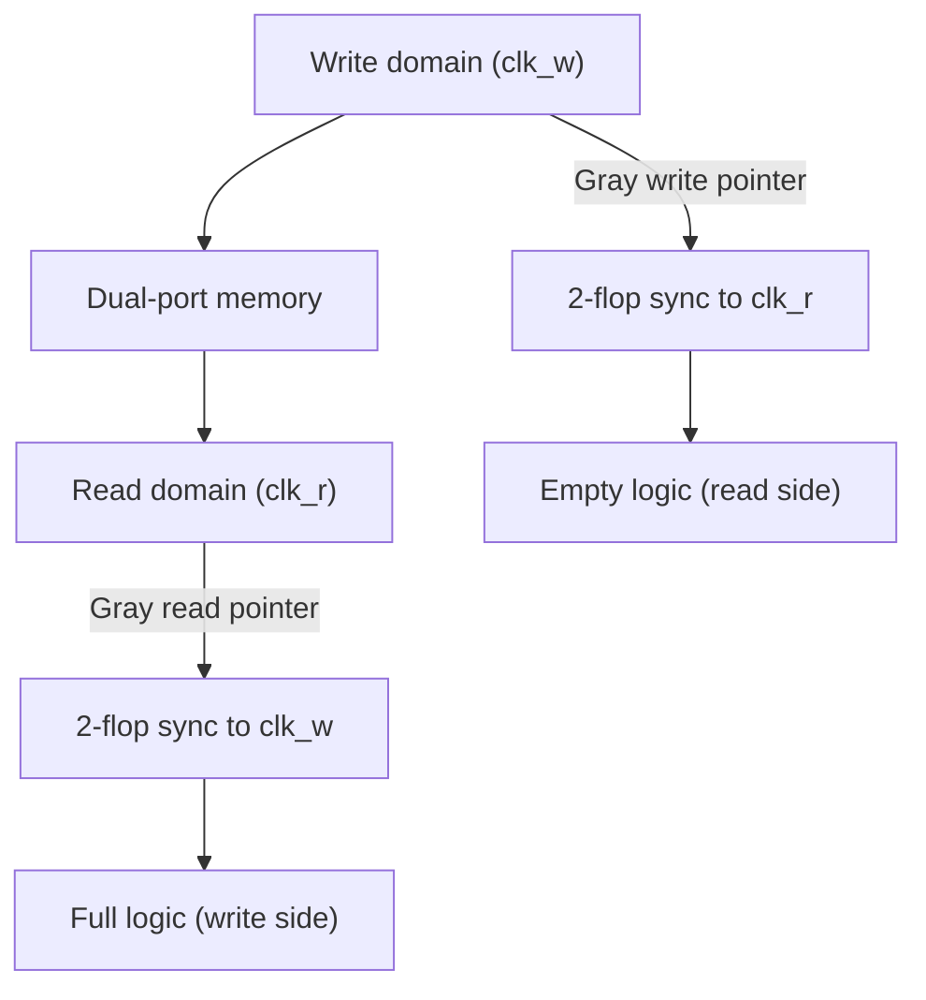

::: basics
### In plain words
A chip is not one block ticking to one clock. A processor wants a very fast clock, and a serial port (a slow one-bit-at-a-time link) needs only a slow one. Interfaces like USB have clocks set by standards. Separate clock domains let each part run only as fast as it needs, which saves power. The price is that passing signals between unrelated clocks is risky and needs special circuits.

### Picture it
Picture a baton relay between two runners who each step to their own drumbeat. If the first hands over the baton at a random moment, the second may fumble it, and for a moment neither holds it nor has dropped it. A safe design hands the baton to a waiting shelf first. The second runner picks it up one full beat later, once it has settled.

### Words you need
- **Clock domain**: a group of circuits driven by one clock, or by clocks with a fixed relationship.
- **Flip-flop**: a circuit that stores one bit, capturing its input on each clock tick.
- **Metastability**: a flip-flop stuck between 0 and 1 for a short while, because its input changed just as it captured.
- **Synchronizer**: two flip-flops (flops, for short) in a row that give the first one time to settle.
- **Gray code**: a counting code where each step changes only one bit.

### The simplest example
For a single-bit signal, a synchronizer on the receiving side gives the first flop a full tick to settle before the second reads it. A multi-bit counter is trickier. Binary 0111 (7) goes to 1000 (8), and all four bits change. If the other side samples mid-change, it may read 1111 (15), a value that never existed. In Gray code, 7 is 0100 and 8 is 1100, so only one bit differs, and a sample is either 7 or 8. That is the whole idea. The rest of this page covers the reasons for domains and the standard crossing through a FIFO (a small first-in, first-out queue).
:::

::: testing
Whether you understand that a chip is not one synchronous island, and can say **why** several clocks exist and **what it costs** to cross between them. The interviewer is listening for:

1. Reasons: blocks need different frequencies (CPU vs peripherals vs memory), interfaces have externally fixed clocks (USB, Ethernet, DDR, PCIe), power savings, and clock-tree limits.
2. Power and DVFS: each domain can be scaled or gated independently.
3. The price: clock domain crossing (CDC) problems, metastability, and the standard fixes (2-flop synchronizer, Gray-coded async FIFO, handshakes).
4. Physical-design reasons: skew and insertion delay across a big die.
5. Whether you know the difference between **asynchronous** (unrelated), **synchronous** (related by fixed ratio) and **mesochronous** (same frequency, unknown phase) clocks.
:::

::: why
A modern SoC has dozens of clock domains: a CPU at gigahertz, a bus at a few hundred megahertz, a 32 kHz real-time clock, a 48 MHz USB PHY, DRAM interfaces running at their own rate. Choosing domains is an architectural decision for power and performance, and crossing them incorrectly is one of the most common causes of "works in sim, fails once a week in the lab" bugs. Interviewers use this question to see whether you connect power ([[q0945]]), interface standards and timing closure to the clocking architecture, and whether you know metastability is real.
:::

::: concepts
- **Clock domain**: the set of flip-flops driven by a given clock (or clocks with a known fixed relationship). See [[q0945]].
- **Setup and hold time**: the window around the clock edge in which data must be stable; violating it causes metastability.
- **Metastability**: a flip-flop output hovers at an intermediate level for an unbounded time, resolved exponentially.
- **Synchronizer**: two or more flip-flops in the destination domain give the first one time to resolve.
- **Async FIFO**: dual-clock buffer using Gray-coded pointers for safe multi-bit transfer.
- **Clock gating and DVFS**: power techniques that operate per domain. See [[q0952]].
:::

::: answer
"A chip needs multiple clock domains because different parts have different needs, and forcing everything onto one clock would cost power, area and performance.

First, required speeds differ. A CPU core may run at 2 to 4 GHz, but a UART or I2C block only needs a few MHz, and the always-on timer runs from a 32 kHz crystal. Running everything at CPU speed would burn dynamic power, $\alpha C V^2 f$, for no benefit. Second, many interfaces have clocks set by standards or external devices: USB, Ethernet, PCIe, DDR, a camera or display. The chip has to sample or generate data at whatever rate those protocols define, so those blocks get their own clock, often from their own PLL. Third, power management: with separate domains I can scale the voltage and frequency of the GPU independently of the CPU, or gate the clock of an idle block entirely. Fourth, physical design: distributing one gigahertz clock with low skew across a large die is expensive, so splitting into smaller domains keeps clock trees tractable.

The cost is crossing between domains. A signal launched by one clock and captured by an unrelated clock can violate setup or hold and make the flop metastable. So I use synchronizers, usually two flip-flops in series for single bits, and for buses I use a handshake or an asynchronous FIFO with Gray-coded pointers so only one bit changes at a time. CDC checks are part of sign-off."
:::

::: technical
**Reasons for multiple domains.**
1. *Frequency requirements*: dynamic power $P = \alpha C V^2 f$ rises with $f$; run each block only as fast as needed ([[q0945]]).
2. *External interface clocks*: USB 2.0 480 Mb/s high-speed (60 MHz parallel interface or its own PLL), Ethernet (125 MHz GMII, 25/50 MHz RMII), I2S audio (e.g. 12.288 MHz master clock for 48 kHz), DDR memory clock, PCIe reference clock. Each recovers or uses its own clock.
3. *Independent DVFS and power gating*: per-domain voltage/frequency and clock gating ([[q0948]], [[q0952]]).
4. *Clock-tree cost*: tree power and skew scale with die size and frequency; splitting limits the span of the fast tree.
5. *Reuse and integration*: IP blocks come with their own clocking assumptions; globally asynchronous, locally synchronous (GALS) design uses small synchronous islands.
6. *Low-power always-on logic* clocked from a slow oscillator while the rest sleeps.

**Relationships.** *Synchronous* (same source, fixed ratio, e.g. derived by dividers: timing analyzable); *mesochronous* (same frequency, unknown phase); *plesiochronous* (nearly equal, slightly different frequencies, e.g. two crystals within 100 ppm); *asynchronous* (unrelated).

**Metastability.** If data changes within the aperture of the capturing flop, the output can linger near $V_{DD}/2$. The probability it remains unresolved after time $t_r$ decays as $e^{-t_r/\tau}$. MTBF of a synchronizer:

$$\text{MTBF} = \frac{e^{t_r/\tau}}{T_0\, f_{clk}\, f_{data}}$$

with $\tau$ a technology-dependent time constant (tens of ps) and $T_0$ the effective capture window. Each extra flop adds roughly one clock period to $t_r$, which improves MTBF by $e^{T_{clk}/\tau}$.

**Safe crossing structures.**
- *Single-bit level*: two-flop synchronizer (3 flops for high-reliability or high frequencies).
- *Pulse*: toggle synchronizer or handshake.
- *Multi-bit bus*: (a) handshake with a stable-data request/ack, (b) async FIFO with Gray-coded read/write pointers, (c) Gray-coded counters.
- Never synchronize each bit of a multi-bit binary bus separately: bits arrive in different cycles and the receiver can see a value that never existed.

> [!UNCERTAIN]
> $\tau$ and $T_0$ are process, voltage and temperature dependent and are characterized by the foundry or by test chips. The numbers shown here are illustrative.
:::

::: short
"Different blocks need different clock rates: CPUs run at GHz, peripherals at a few MHz, an always-on timer at 32 kHz, and interfaces like USB or DDR have clocks set by their standards. Separate domains let me save dynamic power, apply DVFS and clock gating per block, and keep clock trees manageable. The price is clock domain crossing: signals between unrelated clocks can go metastable, so I use synchronizers for single bits and Gray-coded async FIFOs or handshakes for buses."
:::

::: long
"There are four main reasons to have multiple clock domains.

One, different performance needs. A CPU wants gigahertz clocks, but a UART, an I2C controller or a GPIO block is perfectly happy at tens of MHz or less, and an always-on timer might run from a 32 kHz crystal. Dynamic power is $\alpha C V^2 f$, so clocking slow blocks fast is wasted energy.

Two, external interfaces. USB, Ethernet, PCIe, DDR, MIPI cameras, audio codecs each run at a rate dictated by the standard or the partner chip. The receiving logic has to be clocked by a clock recovered from or matched to that interface, which is usually unrelated in phase and often in frequency to the core clock.

Three, power management. If the GPU and CPU have different clock domains, I can raise the GPU's voltage and frequency for a game while the CPU idles, or gate off the camera pipeline completely. That's per-domain DVFS and clock gating.

Four, implementation. A single low-skew clock across a big die at gigahertz rates burns power in the buffers and is hard to close timing on. Smaller domains give smaller trees.

The cost is clock domain crossing. When a signal launched in one domain is captured in another, there's no guaranteed setup and hold relationship, so the capture flop can go metastable. The fix is a synchronizer: two flip-flops in the destination domain so the first has a full cycle to resolve. The MTBF improves exponentially with the resolution time, so with a decent tau you can get to billions of years. For multi-bit data you can't just synchronize each bit, because they may be captured in different cycles. Use a handshake, or an asynchronous FIFO with Gray-coded pointers where only one bit changes at a time. And you verify all this with CDC tools in sign-off."
:::

::: terms
- **Clock domain**: logic launched and captured by one clock or by clocks with a fixed relationship.
- **CDC (clock domain crossing)**: a signal path that passes between flops in different, unrelated clock domains.
- **Metastability**: an unresolved intermediate state of a flip-flop after a setup/hold violation.
- **Synchronizer**: a chain of flops that gives metastability time to resolve.
- **MTBF**: mean time between failures of a synchronizer.
- **Gray code**: a code in which successive values differ in exactly one bit.
- **Async FIFO**: a dual-clock FIFO with Gray-coded pointers synchronized across the boundary.
- **GALS**: globally asynchronous, locally synchronous design style.
- **PLL**: phase-locked loop generating clocks from a reference.
:::

::: exceptional
**An average answer** says "different blocks run at different speeds, so they need different clocks" and maybe mentions synchronizers.

**An exceptional answer**:
- Gives **several independent reasons** (frequency need, standard interfaces, per-domain DVFS and gating, clock-tree cost, always-on logic).
- Ties power to $\alpha C V^2 f$ and mentions independent voltage domains.
- Describes the **cost**: CDC, metastability, and the MTBF formula with its exponential dependence on resolution time.
- Distinguishes **single-bit** (2-flop) from **multi-bit** crossings (Gray-code async FIFO, handshake), explaining why per-bit synchronization of binary buses fails.
- Mentions sign-off: CDC lint and static analysis, plus constraints (set_clock_groups or false paths) and a metastability-aware simulation.
:::

::: mistakes
- **"Multiple clocks are only for saving power."** Interface standards often force them regardless of power.
- **Synchronizing each bit of a bus separately.** Bits skew by a cycle, so the receiver can see a value that never existed (0111 to 1000 can be sampled as 1111).
- **Believing a synchronizer eliminates metastability.** It reduces the probability of failure to an acceptably small MTBF; it never makes it zero.
- **Crossing combinational logic output.** Glitches from combinational logic can be captured; always register signals in the source domain before the crossing.
- **Using a synchronizer for a pulse shorter than the destination clock period.** The pulse can be missed entirely; use a toggle or handshake instead.
- **Forgetting reset crossing.** Asynchronous reset assertion is safe but de-assertion must be synchronized to each domain.
:::

::: deep
## Why one clock is not enough

Take a plausible SoC and list what its blocks need:

| Block | Typical clock | Why |
|---|---|---|
| CPU cores | 1 to 4 GHz | performance, DVFS |
| GPU / NPU | 0.5 to 2 GHz | independent load, DVFS |
| System bus / interconnect | 400 MHz to 1.6 GHz | bandwidth |
| DRAM controller / PHY | DDR rate (e.g. 800 to 3200 MHz clock) | set by DRAM standard |
| USB PHY | 480 Mb/s high speed, 48 or 60 MHz logic | USB standard |
| Ethernet MAC | 25/125 MHz | standard |
| UART/I2C/SPI | 1 to 100 MHz | peripherals |
| Audio (I2S) | e.g. 12.288 MHz = 256 x 48 kHz | sample-rate multiples |
| RTC / always-on | 32.768 kHz | µA sleep |

If you clocked everything at 3 GHz you would waste power (the 12.288 MHz audio block is 244x slower than needed), make timing closure impossible on interface blocks (they receive data at their own rates), and fail to meet standards for the external side. Note the **clock relationships**: the audio clock is probably unrelated in phase to the CPU clock.

> [!NOTE]
> Different clock *frequencies* are not the same as different clock *domains*. If one clock is derived from another by a divider ([[q0957]] shows how to make one), they are synchronous: timing tools can check the paths with known edge relationships. A *domain crossing* problem arises only when no fixed phase relationship exists.

## Power: what separate domains buy

Dynamic power $P = \alpha C V^2 f$. Suppose a chip has 80% of its switched capacitance in blocks that need only 1/4 of the peak frequency most of the time. Running the whole chip at $f_{max}$ costs $P_0$; running those blocks at $f_{max}/4$ costs $0.2 P_0 + 0.8 P_0/4 = 0.4 P_0$, a 60% reduction. Then lower voltage on the slow domain adds a further $V^2$ factor. This is why mobile SoCs have many separately controlled domains ([[q0948]]).

Independent domains also allow **clock gating** of whole blocks and per-domain PLLs or dividers; see [[q0952]].

## Physical design reasons

A global clock must reach every flip-flop in about the same time. The clock tree for a large die (say 10 mm across) at 3 GHz has insertion delays of hundreds of ps, with on-chip variation (OCV) adding uncertainty in skew. Clock networks can consume 20% to 40% of dynamic power in a synchronous design, so large single-clock chips are expensive. Partitioning into domains with local trees (and GALS-style islands communicating via asynchronous interfaces) limits both skew and clock-power.

## The crossing problem

Consider a flop in domain B capturing a signal from domain A. There's no timing relationship, so the data can change at any time, including inside the setup/hold aperture of the capturing flop. The flop can go **metastable**: its internal node settles slowly to a valid level, with the time to resolve unbounded but exponentially distributed:

$$P(\text{unresolved after } t_r) \propto e^{-t_r/\tau}$$

A two-flop synchronizer gives FF1 an entire clock period (minus FF2 setup) to resolve before FF2 samples it.

```circuit
{"caption":"Two-flop synchronizer","elements":[
 {"t":"term","at":[0,1],"label":"D_{async}","side":"left"},
 {"t":"wire","pts":[[0,1],[4,1]]},
 {"t":"box","at":[4,0],"w":4,"h":4,"label":"FF1","pins":[{"side":"left","pos":1,"name":"D"},{"side":"right","pos":1,"name":"Q"},{"side":"bottom","pos":2,"name":">"}]},
 {"t":"wire","pts":[[8,1],[10,1]]},
 {"t":"box","at":[10,0],"w":4,"h":4,"label":"FF2","pins":[{"side":"left","pos":1,"name":"D"},{"side":"right","pos":1,"name":"Q"},{"side":"bottom","pos":2,"name":">"}]},
 {"t":"wire","pts":[[14,1],[17,1]]},
 {"t":"term","at":[17,1],"label":"Q_{sync}","side":"right"},
 {"t":"wire","pts":[[0,7],[6,7]]},
 {"t":"term","at":[0,7],"label":"CLK_B","side":"left"},
 {"t":"wire","pts":[[6,4],[6,7]]},
 {"t":"wire","pts":[[6,7],[12,7],[12,4]]},
 {"t":"dot","at":[6,7]},
 {"t":"text","at":[9,-1],"text":"FF1 may go metastable; FF2 sees a resolved value","muted":true,"anchor":"middle"}
]}
```
Figure: Both flops are clocked by the destination clock (CLK_B). FF1 samples the asynchronous input and may become metastable; the full cycle before FF2 samples gives it time to resolve. Never put logic between FF1 and FF2.

### How good is it? A worked MTBF

With $\tau = 20$ ps, $T_0 = 100$ ps (illustrative), $f_{clk} = 1$ GHz and data toggling at $f_{data} = 100$ MHz, the MTBF is $e^{t_r/\tau}/(T_0 f_{clk} f_{data})$:

| Resolution time $t_r$ | What gives it (at 1 GHz) | MTBF of one synchronizer |
|---|---|---|
| 0.5 ns | half a cycle (e.g. logic squeezed between FF1 and FF2) | about 7,200 s (2 hours) |
| 0.85 ns | two-flop synchronizer: one period minus clock-to-Q and setup | about $2.9\times10^{11}$ s (about 9,000 years) |
| 1.85 ns | three-flop synchronizer: one more full period | about $1.5\times10^{33}$ s |

Nine thousand years sounds safe, but MTBF is per synchronizer: a product with a million units in the field, each with one such crossing, sees a failure somewhere about every 80 hours. That fleet view is why high-frequency or high-volume designs add a third flop, which multiplies MTBF by another $e^{1\text{ ns}/20\text{ ps}} = e^{50}$.

```plot
{"title":"Synchronizer MTBF vs resolution time (illustrative tau = 20 ps)","x":{"label":"resolution time t_r","unit":"s","min":2e-10,"max":2e-9},"y":{"label":"MTBF (seconds)","log":true,"min":1,"max":1e40},
 "vars":{"tau":2e-11,"t0":1e-10,"fc":1e9,"fd":1e8},
 "series":[{"label":"exp(t_r/tau)/(T0 fclk fdata)","fn":"exp(x/tau)/(t0*fc*fd)"}],
 "hlines":[{"at":3.15e17,"label":"10 billion years","color":"muted"}]}
```
Figure: On a log axis MTBF is a straight line: each extra 46 ps of resolution time (tau times ln 10) buys another factor of 10 in MTBF. Giving the first flop most of a clock period moves you from "fails in hours" to thousands of years per synchronizer. At higher clock frequencies there is less $t_r$ per period, which is why the second flop can become insufficient and a third is added. All parameters are illustrative.

## Multi-bit crossings

Binary counters change many bits at once. Moving from 0111 to 1000 flips four bits; if the receiver samples while they are in transition, it may capture 1111 or 0000, values far from the real count. **Gray code** has the property that consecutive values differ in one bit, so any sampling instant yields either the old or the new value.

An **asynchronous FIFO** uses this: the write pointer (in the write clock domain) is converted to Gray code, passed through a two-flop synchronizer into the read domain, and compared with the read pointer to generate *empty*. The read pointer does the same in reverse for *full*. Because synchronization adds latency, the flags are conservative: the writer compares against a slightly old read pointer, so *full* asserts on time but de-asserts a few cycles late (and *empty* likewise de-asserts late on the read side). That never causes overflow or underflow, but it costs a little throughput, so you add margin to the depth.


Figure: Data goes through a dual-port RAM; only the Gray-coded pointers cross the boundary, each through its own synchronizer, so the multi-bit problem reduces to single-bit-change crossings.

**Sizing example.** Writer at 100 MHz bursts 80 words back-to-back; reader drains at 50 MHz. During the 0.8 us burst the reader removes 40 words, so the FIFO must hold at least $80 - 40 = 40$ words, plus a few extra for synchronization latency (say 2 to 4 entries), giving 44 words or, rounding up to a power of two for Gray pointers, 64.

## Other crossing styles

- **Handshake (req/ack)**: source holds data stable, raises request, synchronized in destination, which captures and acknowledges. Slow but cheap for infrequent transfers (e.g. configuration registers).
- **Pulse/toggle synchronizer**: convert a pulse to a level toggle in the source, synchronize the level, detect the edge in the destination.
- **Reset**: assert asynchronously but de-assert synchronously per domain.
- **Mesochronous/plesiochronous** links use elastic buffers or phase-picking; GALS networks-on-chip use async wrappers.

## Verification and sign-off

Tools do structural CDC analysis (find all crossings and check they use approved synchronizers), reconvergence checks, and use metastability injection in simulation. Timing constraints declare clock groups as asynchronous (`set_clock_groups -asynchronous`) so static timing does not try to time the crossing paths, while `set_max_delay` or bus-skew constraints protect Gray-coded paths.

> [!INTERVIEW]
> If asked "what could go wrong in CDC?", give three: metastability at the first flop, multi-bit incoherence, and pulses lost or duplicated by a slower destination. Then name the fix for each. That structure is easy to follow and shows real experience.
:::

::: applications
- **Application SoCs** (phones, tablets): dozens of domains for CPU clusters, GPU, ISP, display, modem, audio and always-on, each with DVFS.
- **Microcontrollers**: a core clock, separate peripheral buses with prescalers, and a low-speed oscillator for RTC and watchdog; USB and ADC often have their own clocks.
- **FPGAs**: designs with one clock per external interface (Ethernet, DDR, video) connected by async FIFOs; vendor FIFO IP provides Gray-coded pointers.
- **Network switches and PHYs**: recovered clocks from each serial lane cross into the core domain with elastic buffers.
- **Audio systems**: sample-rate-related clocks (multiples of 48 kHz or 44.1 kHz) cross to the processor domain with FIFOs or sample-rate converters.
- **Low-power sensor nodes**: a 32 kHz domain stays on while the main domain sleeps and wakes it via a synchronized event.
:::

::: assumptions
- **"Domain" means an asynchronous clock relationship.** Domains derived from the same source with fixed ratios are timing-analyzable and often safe to cross with care.
- **Digital synchronous design** as the baseline; clockless (asynchronous) circuits avoid some issues but are rare in mainstream SoCs.
- **MTBF parameters** $\tau$ and $T_0$ are illustrative; real values come from library characterization and vary over PVT ([[q0949]]), worst at slow corner and low voltage.
- **Power savings** depend on how much of the chip can run slower; a design where most logic needs peak speed gains less.
- If the interviewer asks about **FPGAs**, the same principles apply, with vendor primitives for synchronizers and FIFOs.
:::

::: followups
### What is metastability and how does a two-flop synchronizer help?
Metastability is the state where a flip-flop's output sits between logic levels because the input changed during its setup/hold window. It resolves randomly with an exponential time constant $\tau$. A second flop samples FF1 one full cycle later, giving FF1 that time to resolve, so the probability that FF2 sees an unresolved value drops by a factor of $e^{T_{clk}/\tau}$.

### Why can't I just synchronize each bit of an 8-bit bus with its own two-flop synchronizer?
Each bit's capture time is independent, so some bits may be captured in the old cycle and others in the new, producing a value that never existed (for example 0111 to 1000 captured as 1111). Instead use a Gray-coded value, a handshake that holds the data stable, or an async FIFO.

### Why does the FIFO use Gray code pointers?
Only one bit changes per increment, so a pointer sampled in the middle of a change is either the old or the new value, both legal. A binary pointer could be captured with several bits mid-transition and give a wildly wrong value, potentially causing a false full or empty and data loss.

### What if the destination clock is much faster than the source? And much slower?
If it's faster, a 2-flop synchronizer works for levels and the destination can detect edges. If it's much slower, a pulse in the source can be shorter than one destination period and be missed, so you stretch it (hold until acknowledged) or use a toggle/handshake. For data, a FIFO handles either ratio provided the average throughput of the writer does not exceed the reader's.

### Scenario: a chip works on the bench for hours but fails once a week. The failure is a corrupted register read. How would you suspect and debug a CDC bug?
Look for a multi-bit register crossing from a peripheral clock to the CPU bus with no handshake, since random one-in-a-million timing coincidences match a "once a week" signature. Check CDC reports for unsynchronized crossings, run on a worst-case corner and low-voltage (where metastability is worse), vary clock ratios and temperature to change the failure rate, and add a handshake or capture the register with a gated stable-data strobe.
:::

::: interpretations
The question could be answered at the **architecture level** (why the chip has multiple clocks) or the **design-implementation level** (how crossings are done safely). This page gives both, because the reasons for domains and the cost of crossing them are a pair. A follow-up may ask about **multiple clock domains within an FPGA** or about how to design a clock divider ([[q0957]]). A related but distinct question is why multiple **supply voltages** are needed ([[q0948]]).
:::

::: references
- Weste & Harris, *CMOS VLSI Design*: the sections on clocking, synchronizers and metastability.
- Dally & Poulton, *Digital Systems Engineering*: synchronization and metastability chapters.
- Cummings, C., "Simulation and Synthesis Techniques for Asynchronous FIFO Design," SNUG 2002 (Gray-pointer async FIFO design).
- Ginosar, R., "Metastability and Synchronizers: A Tutorial," *IEEE Design & Test of Computers* (2011).
- Rabaey, Chandrakasan & Nikolic, *Digital Integrated Circuits*: clock distribution and timing issues.
:::

::: rubric
- Gives multiple reasons: different frequency needs, external interface clocks, power management, clock-tree/skew limits :: The question asks "why" and expects more than one reason.
- Links to power with $\alpha C V^2 f$ and per-domain DVFS/gating :: Connects to the power cluster this question sits in.
- Names CDC and metastability as the cost :: Shows you know the trade-off, not just the benefit.
- Describes the synchronizer and what its MTBF depends on :: Demonstrates real understanding of how the problem is handled.
- Explains multi-bit crossing solutions (Gray async FIFO, handshake) and why per-bit sync fails :: The classic follow-up.
- Distinguishes synchronous, asynchronous and related clocks :: Precision about what creates a CDC problem.
- Mentions verification (CDC tools, constraints) :: Shows practical flow awareness.
:::

::: quiz
```json
[
 {"type":"mcq","level":"fundamental","q":"Which is a typical reason for a chip to have multiple clock domains?","options":["To make every flip-flop meet setup time","Interfaces like USB or DDR have clocks set by their standards and unrelated to the core clock","Because one clock cannot drive more than 1000 flip-flops","To eliminate metastability"],"answer":1,"explain":"External standards and partner devices dictate interface clocks. Splitting domains also saves power, but it introduces (not eliminates) metastability risk."},
 {"type":"mcq","level":"fundamental","q":"What is the standard structure for safely crossing a single-bit level signal between asynchronous domains?","options":["A direct wire","A two-flop synchronizer clocked by the destination clock","An AND gate with both clocks","A latch in the source domain"],"answer":1,"explain":"Two flops in the destination domain give the first flop a cycle to resolve metastability. A direct wire can violate setup/hold and produce metastability."},
 {"type":"numeric","level":"intermediate","q":"Writer bursts 80 words at 100 MHz; the reader drains at 50 MHz during the burst. What is the minimum FIFO depth in words (ignoring synchronization margin)?","answer":40,"tolerance":0.01,"unit":"words","explain":"The burst lasts 0.8 us, during which the reader removes $0.8\\,\\mu s \\times 50$ MHz $= 40$ words. Depth $\\ge 80 - 40 = 40$."},
 {"type":"truefalse","level":"intermediate","q":"Synchronizing each bit of a multi-bit binary counter with its own two-flop synchronizer is safe because each flop eliminates metastability.","answer":false,"explain":"Bits can be captured in different destination cycles, so the receiver may see a value that never existed (e.g. 0111 to 1000 read as 1111). Use Gray code, a handshake or an async FIFO."},
 {"type":"numeric","level":"intermediate","q":"A synchronizer has $\\tau = 20$ ps. By what factor does MTBF improve if the resolution time increases by 100 ps? (Give the factor, not the exponent.)","answer":148.4,"tolerance":0.02,"unit":"x","explain":"MTBF $\\propto e^{t_r/\\tau}$, so adding 100 ps multiplies it by $e^{100/20} = e^5 = 148.4$."},
 {"type":"mcq","level":"advanced","q":"Why is the full flag of an async FIFO usually conservative?","options":["Gray code makes pointers wrong","The read pointer seen by the write domain is delayed by synchronizer latency, so the writer sees an older (smaller) read pointer and may think the FIFO is fuller than it is","The memory is slower than the clocks","Because the write clock is always faster"],"answer":1,"explain":"The synchronized pointer lags the true one, so full (and, on the read side, empty) is released a few cycles later than strictly necessary. This only costs a little throughput, and never causes overflow or underflow."}
]
```
:::
