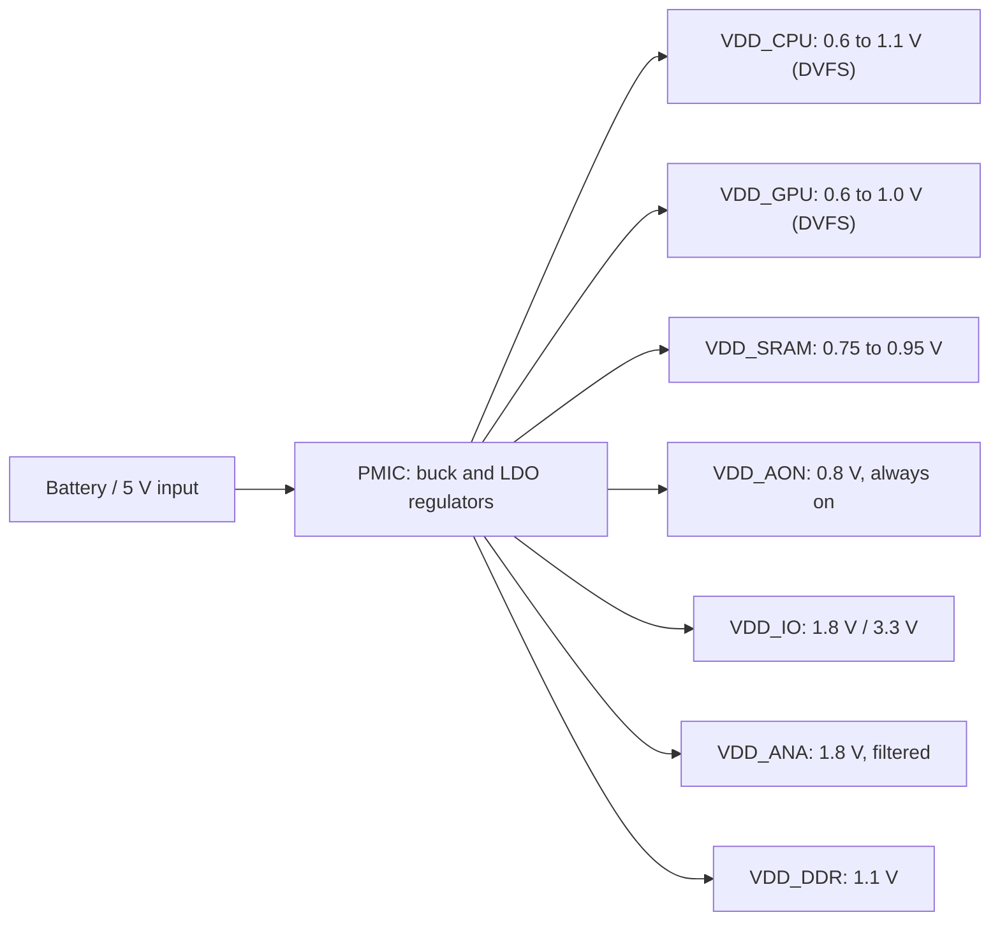

::: testing
Whether you can justify the extra complexity of several supply rails, and name the **different reasons** rather than one. The interviewer wants:

1. Power: $P\propto V^2$, so non-critical or slow blocks should run at lower voltage than critical ones.
2. DVFS: each domain needs its own adjustable voltage to follow its own workload.
3. Circuit-type requirements: SRAM $V_{min}$, I/O standards (1.2 / 1.8 / 3.3 V), analog headroom, flash/charge-pump high voltage, always-on retention.
4. Power gating and retention (a rail you can turn off).
5. The costs: regulators and PMIC, level shifters, isolation cells, sequencing, board area, and efficiency of the conversion.
:::

::: why
Look at any phone or laptop board and you will find a power-management IC with a dozen rails. Choosing how many rails to use, which blocks share them, and how to cross between them is a core SoC architecture decision, because it trades die and board complexity against a large power saving. It is also where silicon meets board design: sequencing, droop, regulator efficiency. Interviewers ask it to see if you connect the $V^2$ power law ([[q0947]]) to system-level design, and whether you know the hidden costs: level shifting and the efficiency of the regulators themselves.
:::

::: concepts
- **$V^2$ dependence**: dynamic power drops quadratically with voltage. See [[q0947]].
- **Voltage island / domain**: a part of the die with its own supply, separable from the rest.
- **DVFS**: each domain moves along its own voltage-frequency curve. See [[q0945]].
- **Level shifter**: a cell that translates logic levels between voltage domains.
- **Isolation cell and power gating**: clamp outputs of a powered-down domain, and switch off its supply to eliminate leakage.
- **PMIC / regulators**: buck converters and LDOs that generate the rails. See [[q0952]] and [[q0932]].
:::

::: answer
"A chip has several different kinds of circuits and they want different voltages, so a single supply is either wasteful or can't work at all.

The main reason is power. Dynamic power goes with V squared, so any block that doesn't need peak speed should run at a lower voltage. A simple example: if 70% of the logic is not timing critical and can run at 0.8 V while 30% needs 1.0 V, dynamic power falls from 1.0 to about 0.75, a 25% saving. In practice that means separate voltage domains for the big CPU cores, the little cores, the GPU and so on, each with its own DVFS, so each follows its own workload.

Second, different circuits have different needs. SRAM needs a higher minimum voltage than logic to stay stable, so it often sits on its own rail. I/O has to match external standards, like 1.8 V or 3.3 V signaling, while the core runs near 0.8 V and uses thick-oxide I/O transistors. Analog blocks like PLLs and ADCs want a clean, separate supply. Flash programming or LCD drivers need higher voltages. And an always-on domain for the RTC and wake logic sits on its own rail so the rest of the chip can be switched off completely.

The costs are real. You need more regulators or a PMIC, board area and decoupling, a power-up sequence, level shifters wherever signals cross domains, and isolation cells when a domain is powered down. And the regulator efficiency matters: a linear regulator dropping from 1.0 to 0.8 V only saves 20% at the input, while a buck converter saves much more."
:::

::: technical
**Reason 1: power.** For a block with switched capacitance $C_i$ running at $V_i$ and frequency $f_i$: $P = \sum_i \alpha_i C_i V_i^2 f_i$. Lowering $V_i$ on blocks with slack saves quadratically. With 30% of switching capacitance at 1.0 V and 70% at 0.8 V and equal $f$: $P/P_0 = 0.3 + 0.7(0.64) = 0.748$.

**Reason 2: DVFS and workload diversity.** CPU big cores, little cores, GPU, ISP, modem have different, mostly independent loads. Per-domain voltage lets each pick its minimum voltage for its current frequency.

**Reason 3: circuit constraints.**
- *SRAM*: bit-cell stability needs higher $V_{min}$ than logic, so a dual-rail design runs logic at $V_{logic}$ and SRAM arrays at $V_{SRAM} \ge V_{logic}$.
- *I/O*: interface standards define levels (for example 1.8 V and 3.3 V LVCMOS, 1.1 V to 1.5 V DDR, 0.9 V to 1.2 V for LPDDR variants), requiring thicker-oxide transistors and their own rails.
- *Analog*: PLLs, ADCs and sensors want low-noise supplies isolated from digital switching noise (separate LDOs or filtered rails).
- *High-voltage needs*: flash program/erase and display drivers use charge pumps or boost rails ([[q0932]]).
- *Always-on and retention*: a low-leakage, low-voltage always-on domain and a retention voltage for state while the main domain is off.

**Reason 4: leakage control.** A domain with its own switchable supply (power gating) removes leakage when idle. Retention flops hold state at a reduced retention voltage.

**Costs.**
- *Level shifters* between domains: needed when the driver's high level ($V_{DDL}$) is too low to turn off the receiver's PMOS (static leakage) or when voltage differences exceed device ratings. Added delay and area.
- *Isolation cells* clamp the outputs of an off domain so powered domains see defined values.
- *Power grid* and decoupling per rail; more package balls/pins; more regulators with their own losses.
- *Sequencing*: rules such as "core before I/O" and "no rail exceeds another by more than a threshold" avoid latch-up and I/O contention.
- *Regulator efficiency*: an LDO from $V_{in}$ to $V_{out}$ has $\eta\approx V_{out}/V_{in}$; a buck converter typically 85% to 95%.

**LDO vs buck for a lower rail.** Digital load current scales roughly as $I\propto V$ at fixed $f$. From a 1.0 V rail, an LDO delivering 0.8 V draws input current equal to the load current ($\propto 0.8$), so input power is $1.0\times0.8 = 0.8$ of baseline: only 20% saved. A buck at ~90% efficiency would cost $0.64/0.9 = 0.71$, saving 29%, which is why high-power domains use switching regulators.
:::

::: short
"Because different blocks want different voltages. Dynamic power scales with V squared, so non-critical logic runs at lower voltage and each domain, like big cores, little cores and GPU, gets its own DVFS. Also SRAM needs a higher minimum voltage than logic, I/O must match external standards like 1.8 or 3.3 V, analog wants a clean rail, and an always-on domain lets the rest power off. The cost is more regulators, level shifters and isolation cells between domains, sequencing, and regulator losses."
:::

::: long
"There are four main motivations.

The biggest is power. Dynamic power is proportional to V squared. If a chip has 30% of its switching capacitance on timing-critical paths that need 1.0 V and 70% that can meet timing at 0.8 V, a split supply brings power to about 75% of the single-rail design. Better yet, when the workload changes, each domain can move along its own voltage-frequency curve. The GPU can ramp up for a game while the CPU idles at a low voltage.

Second, different circuits have different physical limits. SRAM bit cells need higher minimum voltage than logic to maintain read and write margins, so memories often have their own rail, or dual-rail macros. I/O has to meet external standards, 1.8 or 3.3 V signaling, and uses thick-oxide devices on their own supply. Analog circuits like PLLs and ADCs need a clean supply isolated from digital noise. Flash and display drivers need higher voltages from charge pumps.

Third, leakage. If a domain has its own supply, I can power-gate it to remove all its leakage when it's idle, and keep a tiny always-on domain alive for wake-up logic and a real-time clock.

The costs are significant. You need level shifters wherever a signal goes from a lower to a higher domain so the receiving gate turns off fully; isolation cells to clamp outputs when a domain is off; more regulators and more board area and decoupling; and a power-up sequence so that, for example, I/O doesn't drive into an unpowered core. And watch the regulator choice: a linear regulator that drops 1.0 V to 0.8 V only saves 20% of input power because the input current equals the load current. A buck converter saves much more, which is why SoC power management ICs are mostly switchers."
:::

::: terms
- **Voltage domain / island**: a region of the chip with its own supply.
- **Multi-Vdd design**: using more than one supply voltage on one chip.
- **DVFS domain**: a domain whose voltage and frequency are scaled independently.
- **Level shifter**: a cell translating logic levels between supply domains.
- **Isolation cell**: a clamp on a domain output that holds a defined value when the domain is off.
- **Power gating**: cutting the supply of an idle domain with header or footer switches.
- **Retention flop**: a flip-flop that keeps its state at reduced voltage or on a separate rail during power-down.
- **PMIC**: power-management IC that generates multiple rails.
- **$V_{min}$**: the minimum supply voltage at which a circuit works reliably.
:::

::: exceptional
**An average answer** says "different blocks need different voltages, like I/O at 3.3 V and the core at 1 V."

**An exceptional answer**:
- Leads with the **$V^2$ power argument** and a worked number (e.g. 30% at 1.0 V and 70% at 0.8 V gives 25% less dynamic power).
- Lists **distinct categories** of reasons: power/DVFS, SRAM $V_{min}$, I/O standards and oxide thickness, analog noise, high-voltage blocks, leakage via power gating and retention.
- States the **costs and mechanisms**: level shifters, isolation cells, sequencing rules, extra regulators and decoupling.
- Makes the **regulator efficiency point**: an LDO only saves in proportion to voltage, whereas a buck saves energy quadratically.
- Mentions on-die vs off-die regulators (integrated VRs, FIVR/LDOs) and PVT interplay: voltage margin per domain.
:::

::: mistakes
- **Giving only the "I/O vs core" answer.** That is one reason of several, and the least interesting for power.
- **Ignoring regulator losses.** If the lower rail is generated by an LDO, the saving is only linear in voltage, since the input current equals the load current.
- **Forgetting level shifters.** Connecting a 0.8 V output to a 1.0 V input can leave the receiver partly on, causing leakage and noise margin loss, and a 3.3 V output into a 1.8 V gate can damage it.
- **Powering down a domain without isolation.** A floating output from an unpowered block can cause crowbar current or random behavior downstream.
- **Overlooking sequencing.** Applying I/O voltage before the core can forward-bias ESD structures or cause latch-up.
- **Thinking more rails are always better.** Each rail costs regulator area, decoupling, pins and verification effort; the optimum is a handful of rails.
:::

::: deep
## The power argument in numbers

A single-supply chip must set its voltage for the slowest, most critical path. Every other block then burns $\alpha C V^2 f$ at a voltage it does not need. Suppose block A (30% of the switched capacitance) is critical and needs 1.0 V at the target frequency; block B (70%) has timing slack and meets the frequency at 0.8 V:

| Design | Power (relative) |
|---|---|
| Single rail, 1.0 V | $0.3(1.0) + 0.7(1.0) = 1.000$ |
| Two rails, 1.0 V and 0.8 V | $0.3(1.0) + 0.7(0.64) = 0.748$ |

That is a 25% dynamic power reduction for one extra rail. This idea, called **multi-Vdd** (or voltage islands), is applied at the block level: choose the lowest voltage that meets each block's timing.

## DVFS needs independent rails

Workloads differ by block and by time. A phone SoC might have the big CPU cluster loaded while the GPU idles, then the reverse. If they share a rail, the rail voltage must follow the demand of the hungrier block. With separate rails each runs at its own V-f point ([[q0945]], [[q0947]]), so the system as a whole spends less energy.


Figure: A typical SoC has separately controlled rails for CPU, GPU, memories, always-on logic, I/O, analog and DRAM. Each rail has its own voltage range and its own regulator in the PMIC.

## Circuit-specific reasons

**SRAM.** A six-transistor SRAM cell has contention in read (access vs pull-down) and write (access vs pull-up); its read and write static noise margins shrink as $V$ falls and as local $V_t$ mismatch grows. Large arrays, with millions of cells, need to withstand rare 5 to 6 sigma outliers, so SRAM $V_{min}$ is commonly higher than the logic's. Remedies: a separate higher SRAM rail, or assist circuits (negative bitline, wordline boost) that add area. Many SoCs therefore have a dual-rail arrangement for cache memories.

**I/O.** Pad drivers must meet standards with specific levels and drive strengths (for example LVCMOS 1.8 V and 3.3 V, SSTL/HSTL, LVDS). They use thick-oxide devices that tolerate the higher voltage but are slower and larger, powered from their own rail with ESD protection referenced to it.

**Analog and PLL.** Supply noise couples directly into jitter and conversion noise; PSRR is finite. Analog blocks get dedicated LDOs or filtered rails, with separate grounds or careful returns.

**High voltage.** Flash program/erase (about 10 to 20 V), LCD or OLED drivers, and gate drivers use on-chip charge pumps or boosted rails ([[q0932]]).

**Always-on and retention.** A small always-on domain (RTC, wake-up logic, a power controller) is on a low-leakage rail. Retention flops keep state at a lowered voltage during sleep.

## Crossing between domains

```circuit
{"caption":"Signal crossing from a low-voltage to a high-voltage domain","elements":[
 {"t":"rail","at":[5,0],"label":"V_{DDL} = 0.8 V","dir":"up"},
 {"t":"rail","at":[16,0],"label":"V_{DDH} = 1.0 V","dir":"up"},
 {"t":"rail","at":[27,0],"label":"V_{DDH} = 1.0 V","dir":"up"},
 {"t":"wire","pts":[[5,0],[5,2]]},
 {"t":"wire","pts":[[16,0],[16,2]]},
 {"t":"wire","pts":[[27,0],[27,2]]},
 {"t":"box","at":[2,2],"w":7,"h":4,"label":"Block A (logic)","pins":[{"side":"right","pos":2}]},
 {"t":"wire","pts":[[9,4],[13,4]]},
 {"t":"text","at":[11,3.3],"text":"0.8 V swing","anchor":"middle","muted":true},
 {"t":"box","at":[13,2],"w":7,"h":4,"label":"Level shifter","pins":[{"side":"left","pos":2},{"side":"right","pos":2}]},
 {"t":"wire","pts":[[20,4],[24,4]]},
 {"t":"text","at":[22,3.3],"text":"1.0 V swing","anchor":"middle","muted":true},
 {"t":"box","at":[24,2],"w":7,"h":4,"label":"Block B (logic)","pins":[{"side":"left","pos":2}]},
 {"t":"text","at":[16.5,8],"text":"Without the shifter, A's 0.8 V high leaves B's PMOS partly on","anchor":"middle","muted":true}
]}
```
Figure: When block A swings only to 0.8 V and block B's PMOS source is at 1.0 V, A's logic high leaves B's PMOS partially on (gate-to-source of 0.2 V below its supply), leaking static current. The level shifter restores a full 1.0 V swing. Going from a high domain to a low one is easier but still needs care against over-voltage and noise margin.

A powered-down domain's outputs float or sit at 0 V; an **isolation cell** clamps them to a safe logic level so the powered domain doesn't see garbage. **Retention** and **power-gating switches** (header PMOS or footer NMOS "sleep" transistors) complete the toolbox, with sequencing: isolate, save state, then gate; on wake, power up, restore, then release isolation.

## The regulator efficiency trap

Each extra rail needs a regulator, and its efficiency decides how much of the theoretical saving you actually realize. Take a digital load whose current scales as $I\approx I_0\,(V/V_0)$ at fixed frequency (since $P\propto V^2$).

- **LDO from 1.0 V to 0.8 V**: input current equals load current, $I = 0.8 I_0$. Input power $= 1.0\times0.8I_0 = 0.80\,P_0$: a 20% saving (efficiency $\eta = V_{out}/V_{in} = 80\%$; the rest is heat in the pass device).
- **Buck at 90% efficiency**: load power $0.64P_0$, input power $0.64/0.9 = 0.71\,P_0$: a 29% saving.

So the *theoretical* 36% $V^2$ saving at the load shrinks to 20% with an LDO and 29% with a buck. That is why high-power domains use switching regulators, while LDOs are used for low-current analog domains where low noise matters more than efficiency, or for small voltage steps where $\eta$ is high.

```sim
{"id":"regulator-compare","mode":"compare","vin":1.0,"vout":0.8,"iout":2}
```
Figure: Compare LDO and buck efficiency at a 1.0 V to 0.8 V step and 2 A. The LDO's efficiency is pinned near Vout/Vin (80%), while the buck's depends on load current and its loss terms: with the simulator's default (illustrative) losses it reaches only about 82% here, barely ahead of the LDO, so the 90% figure used above is an assumption about a better-optimized converter. Small steps are where LDOs stay competitive. Raise Vin to 3.3 V to see how fast the LDO's efficiency collapses (to about 24%) for a large step while the buck barely changes.

## Sequencing

Different rails must come up and go down in a safe order. Typical rules: the core before I/O, or "no rail exceeds any other by more than about 0.5 V" depending on the part. Violations can forward-bias ESD diodes, cause bus contention, or trigger latch-up. A PMIC or power sequencer provides enable delays, soft-start ramps and power-good signals.

```sim
{"id":"power-sequencing","preset":"soc"}
```
Figure: The SoC preset brings rails up in the order core, SRAM, DDR, I/O, each enabled by the previous rail's power-good, so all rule checks pass. Now select VDD_IO and set its enable source to Master EN with zero delay: I/O rises before the core is good and the core-before-I/O rule turns red. Then try the power-down modes to see why rails are sequenced down in reverse.

## When *not* to add a rail

Each rail adds a regulator (area, cost, quiescent current), decoupling capacitors, package balls, level shifters, extra timing corners for sign-off (each domain is analyzed at its own voltage, and cross-domain paths at combined corners) and verification effort. If the potential saving is small, e.g. a block with little capacitance, share the rail. Designers pick a small number of voltage levels and may use **on-die LDOs or integrated voltage regulators** to get fine-grained domains without extra board rails.
:::

::: applications
- **Smartphone SoCs**: separate rails for big and little CPU clusters, GPU, memory subsystem, always-on domain, I/O and DRAM, from a multi-output PMIC.
- **Microcontrollers**: core at 1.2 V from an internal LDO, I/O at 1.8 to 3.3 V, backup domain on a battery pin for the RTC.
- **FPGAs**: VCCINT (core), VCCAUX, VCCO per I/O bank (1.2/1.5/1.8/2.5/3.3 V), and transceiver rails, with a defined power-up order.
- **Server CPUs**: multiple rails and per-core regulators for fine-grained DVFS and power gating.
- **Mixed-signal chips (ADC, PLL)**: separate analog and digital supplies for noise isolation.
- **Memory (flash/EEPROM)**: internal charge pumps create program/erase voltages from the logic supply.
:::

::: assumptions
- **Digital CMOS focus.** For analog or power-IC design the reasons shift to headroom, matching and breakdown limits.
- **Power numbers use $P\propto V^2$ at fixed frequency** and constant activity; the actual savings depend on which blocks have slack and on how much frequency is traded.
- **Regulator model**: the LDO is ideal apart from its dropout efficiency $V_{out}/V_{in}$, and the buck efficiency is an assumed 90% (typical for mid-load, varies widely with load and design).
- **Load current $\propto V$** is a first-order approximation (current $\propto C V f$); leakage current and crowbar current do not follow it exactly.
- If the interviewer is thinking of **board-level** designs (e.g. microcontroller plus sensors at 1.8 V and 3.3 V), the same arguments apply with level translators ([[q0932]]) and sequencing between ICs.
:::

::: followups
### Why does SRAM often need a higher voltage than logic?
A 6T cell's read and write margins depend on the relative strengths of its transistors, which become more mismatched as $V$ falls and as local threshold variation grows. With millions of bits you need robustness against extreme outliers, so SRAM fails at a higher $V_{min}$ than ordinary logic. Solutions: a dedicated higher rail, or assist circuits and larger cells.

### What is a level shifter and when is it needed?
It converts logic levels between domains. It's needed mainly from a lower-voltage driver to a higher-voltage receiver, where the driver's high level doesn't switch the receiver cleanly (partially-on PMOS causing static leakage and poor noise margin). Also used between domains with very different voltages for safety. Typically cross-coupled PMOS shifters or differential cascode types.

### What is an isolation cell?
When a power-gated domain turns off, its outputs float or go to zero, which can create indeterminate or crowbar conditions in the domains still on. An isolation cell, powered from an always-on rail, forces the output to a defined 0 or 1 while the domain is off, and is enabled before powering down and released after power up.

### Is it better to generate the lower rail with an LDO or a buck?
For high-current digital domains, a buck, since an LDO's efficiency equals $V_{out}/V_{in}$ and wastes the rest as heat; a 3.3 V to 1.0 V LDO is only 30% efficient. For low-current noise-sensitive analog rails or small voltage steps, an LDO is simpler, quieter and cheaper. Many designs use buck followed by LDO.

### Scenario: your SoC at 1.0 V common rail misses the power target by 20%. What multi-voltage changes do you evaluate?
Find the blocks with timing slack and large switching capacitance (GPU, accelerators, the interconnect) and test whether they close timing at 0.8 to 0.85 V on a separate rail. Estimate savings with $\alpha C V^2 f$ and subtract the regulator losses and level-shifter overhead. Add per-domain DVFS and power gating for blocks idle most of the time. Verify at all corner combinations and check that sequencing and isolation are covered.
:::

::: interpretations
This could be about **on-chip voltage domains** (the main answer) or about **board-level rails** (e.g. a 3.3 V sensor talking to a 1.8 V MCU). The reasoning overlaps: different devices need different voltages, so you use multiple regulators and level translation. The page leans toward the SoC view, because the question sits in the power/performance/thermals cluster. For the clock-side parallel, see [[q0946]]; for the voltage knob itself, see [[q0947]].
:::

::: references
- Weste & Harris, *CMOS VLSI Design*: power, low-power design (multiple supply voltages), and I/O chapters.
- Rabaey, Chandrakasan & Nikolic, *Digital Integrated Circuits*: low-power design techniques, voltage scaling.
- IEEE 1801 (UPF, Unified Power Format) for how power domains, isolation, level shifting and retention are specified in design flows.
- Horowitz & Hill, *The Art of Electronics*, 3rd ed.: linear and switching regulator chapters for the LDO versus buck efficiency argument.
:::

::: rubric
- Leads with the $V^2$ power argument and a concrete saving :: It's the core engineering motivation.
- Mentions per-domain DVFS (CPU, GPU) as a reason for independent rails :: Ties the supply to workload behavior.
- Lists circuit-driven needs: SRAM $V_{min}$, I/O standards, analog cleanliness, high-voltage blocks :: Shows breadth beyond power.
- Mentions leakage control via power gating, retention and an always-on domain :: Completes the picture of why rails must be switchable.
- Names the costs: level shifters, isolation, sequencing, regulators, area :: A trade-off answer rather than a one-sided one.
- Notes regulator efficiency (LDO vs buck) and its effect on realized savings :: Distinguishes system thinkers from circuit-only thinkers.
:::

::: quiz
```json
[
 {"type":"mcq","level":"fundamental","q":"Which is the main power-related reason to use multiple supply voltages on one chip?","options":["Dynamic power scales with V squared, so blocks with timing slack can run at lower voltage","Higher voltage reduces leakage","Lower voltage increases speed","Regulators are more efficient with more rails"],"answer":0,"explain":"$P\\propto V^2$: blocks that meet timing at lower $V$ should be given lower $V$. Lower voltage reduces speed and extra rails add regulator overhead."},
 {"type":"numeric","level":"intermediate","q":"30% of switched capacitance runs at 1.0 V and 70% at 0.8 V (same frequency and activity). What is the dynamic power relative to an all-1.0 V design?","answer":0.748,"tolerance":0.01,"unit":"(ratio)","explain":"$0.3\\times1 + 0.7\\times0.64 = 0.748$."},
 {"type":"mcq","level":"intermediate","q":"Why is SRAM commonly put on a separate, higher rail than logic?","options":["SRAM is faster at high voltage only","SRAM read/write noise margins and cell mismatch set a higher minimum voltage than logic needs","SRAM cannot use level shifters","SRAM has no leakage"],"answer":1,"explain":"6T cells have contention in read and write; margins shrink with voltage and with $V_t$ mismatch across millions of cells, so SRAM $V_{min}$ is higher."},
 {"type":"truefalse","level":"intermediate","q":"If a lower rail is generated by an LDO from the higher rail, the full $V^2$ power saving shows up at the input supply.","answer":false,"explain":"An LDO's input current equals its load current, so input power is $V_{in}\\times I_{load}$. With $I\\propto V$, going 1.0 V to 0.8 V saves only about 20% at the input, not 36%."},
 {"type":"numeric","level":"advanced","q":"A digital load at 0.8 V draws power 0.64 P0 (relative to 1.0 V). It is fed from a buck converter with 90% efficiency. What is the input power relative to P0?","answer":0.711,"tolerance":0.02,"unit":"(ratio)","explain":"$0.64/0.9 = 0.711$, a 29% saving, versus 20% with an LDO."},
 {"type":"multi","level":"advanced","q":"Select all that are needed when a block in a lower-voltage domain drives a block in a higher-voltage domain that can be powered down.","options":["A level shifter on the signal","An isolation cell on outputs of the powered-down block","A power sequence defining enable order","A larger clock divider"],"answer":[0,1,2],"explain":"Level shifters restore full swing; isolation cells clamp outputs when a domain is off; sequencing avoids latch-up and contention. A clock divider is unrelated to supply crossings."}
]
```
:::
