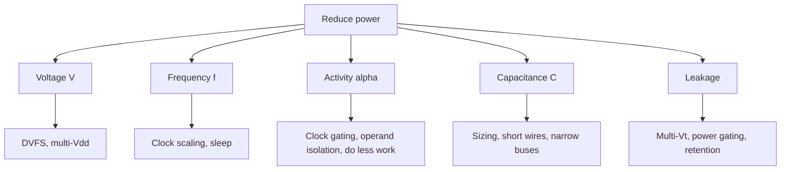

::: testing
Whether you can organize a long list of low-power techniques around the **power equation** and prioritize by payoff, rather than reciting buzzwords. The interviewer is looking for:

1. Structure: $P=\alpha C V^2 f + V I_{leak}$ gives four levers: activity $\alpha$, capacitance $C$, voltage $V$, frequency $f$, plus leakage.
2. A spread across abstraction levels: architecture/algorithm, RTL, circuit/physical, power-domain management, software and system.
3. Specific mechanisms with correct reasoning: clock gating, power gating, DVFS, multi-$V_t$, operand isolation, memory banking, race-to-idle.
4. Trade-offs: wake-up latency, area, complexity, verification, state retention.
5. Sense of magnitude: where the big wins are (voltage and not doing work at all), and an example calculation.
:::

::: why
Power decides battery life in phones and wearables, cooling cost and density in data centers, and whether a chip can run all its blocks at once at all. Low power is no longer a late-stage polish; it shapes the architecture from day one. Interviewers for SoC, FPGA, MCU and board roles all ask this, since the answer shows whether you can connect circuit physics to design decisions and system software. This question gives the *toolbox*; the related questions explain the underlying knobs: frequency ([[q0945]]), voltage ([[q0947]]), multiple rails ([[q0948]]) and the throttling response to thermal limits ([[q0953]]).
:::

::: concepts
- **Dynamic power**: $P_{dyn}=\alpha C V^2 f$; reduce activity, capacitance, voltage or frequency. See [[q0945]].
- **Leakage (static) power**: $V I_{leak}$; reduce with higher $V_t$, power gating, lower voltage, lower temperature. See [[q0949]].
- **Clock gating**: stop the clock to idle registers so they do not toggle.
- **Power gating**: cut the supply to idle blocks to remove leakage.
- **DVFS**: lower voltage and frequency together when the load is light. See [[q0947]].
- **Race-to-idle**: finish work quickly, then sleep deeply.
:::

::: answer
"I'd organize it around the power equation: dynamic power is activity times capacitance times V squared times frequency, plus leakage. So every technique attacks one of those terms.

For voltage and frequency, the big one is DVFS: run each block at the lowest voltage and frequency that meets the current workload, because power drops with V squared. Multi-voltage domains let non-critical blocks run lower.

For activity, clock gating is the workhorse: if a register isn't updating, don't clock it, which also kills the clock-tree power, often a big share of dynamic power. Operand isolation and bus encoding stop pointless toggling in datapaths, and good architecture avoids work: skip computation, use caches to avoid DRAM trips, which cost far more energy than arithmetic.

For capacitance, use smaller transistors where timing allows, shorter wires through good floorplanning, and fewer, less-wide buses.

For leakage, use high-threshold devices on non-critical paths, multi-Vt libraries, and power gating for blocks that are idle for long periods, with retention for state. Memory gets banked so only the active bank is powered.

At the system level, software matters: sleep states, batching interrupts, avoiding polling, and race-to-idle. And choose efficient regulators, since a lossy converter wastes what the chip saved. In a microcontroller, going from always-on 10 mA to a 1% duty cycle with a 2 microamp sleep drops the average to around 100 microamps, a 100x improvement."
:::

::: technical
**Power model.** $P = P_{dyn} + P_{sc} + P_{leak}$ with $P_{dyn}=\alpha C V^2 f$ (energy per operation $\alpha C V^2$), $P_{sc}$ short-circuit (a few percent), $P_{leak}=V I_{leak}$ (subthreshold plus gate tunneling), strongly dependent on $V_t$, $V$ and $T$.

**Levers and techniques.**
| Target | Technique | Mechanism | Typical cost/trade-off |
|---|---|---|---|
| $V$ | DVFS, multi-Vdd, near-threshold | $P\propto V^2$ | speed loss, regulator complexity, level shifters ([[q0948]]) |
| $f$ | clock scaling, race-to-idle | linear (not energy) | performance |
| $\alpha$ | clock gating | no clock edges to idle flops and their fan-out tree | enable logic, timing of the gating cell |
| $\alpha$ | operand isolation, data gating | hold datapath inputs when result unused | extra latches/AND gates |
| $\alpha$ | bus encoding (Gray, bus-invert), glitch reduction | fewer transitions | encoder/decoder area |
| $\alpha$, $C$ | architecture/algorithm: caches, locality, accelerators, sparsity, approximate/lower-precision | do less work or in cheaper hardware | design effort, area |
| $C$ | transistor sizing, shorter wires, low-swing signaling | less charge per transition | timing closure |
| $I_{leak}$ | multi-$V_t$ (HVT off critical path), longer-channel cells | exponential in $V_t$ | slower cells |
| $I_{leak}$ | power gating with retention/isolation | remove supply from idle domains | wake-up latency/energy, area, inrush |
| $I_{leak}$ | body biasing (reverse), lower temperature | raise $V_t$ dynamically | process support, speed |
| memory | banking, sleep/retention modes, smaller wider caches, voltage scaling | power only the active portion | complexity |
| system | deeper sleep states, interrupt batching, DMA, peripheral gating | reduce active time | latency, software |
| delivery | efficient regulators (buck vs LDO), reduce rail count | less conversion loss | cost |

**Quantifying a stack.** Baseline $P_{dyn}=600$ mW, $P_{leak}=150$ mW (750 mW). (1) Clock gating removes 60% of the 25% of dynamic power consumed by idle clocked logic: $600\times(1-0.15)=510$ mW. (2) DVFS on a light load, 1.0 V to 0.85 V and 2 to 1.5 GHz: factor $0.85^2\times0.75 = 0.542$, so 276 mW. (3) Power-gate and HVT-swap to cut leakage 60%: 60 mW. Total: 336 mW, a 55% reduction.

**Energy vs power.** Reducing $f$ alone does not reduce energy per task; lowering $V$, reducing $\alpha$ and $C$, and removing leakage do ([[q0945]]). Race-to-idle wins when leakage and platform power are high relative to dynamic power, because the sooner the system sleeps the less it pays.

**Duty-cycling example (MCU).** Active 10 mA at 1% duty cycle and 2 µA in sleep: $I_{avg}=0.01\times10\text{ mA}+0.99\times2\ \mu\text{A}=102\ \mu\text{A}$, so a 220 mAh coin cell lasts about 2,160 h (90 days) versus 22 h if always on.
:::

::: short
"I'd go through the power equation. Dynamic power is activity times capacitance times V squared times frequency, so: lower voltage and frequency with DVFS and multiple voltage domains; cut activity with clock gating, operand isolation and architectural choices that avoid work; reduce capacitance with smaller devices and shorter wires. For leakage use high-Vt cells, and power gating with retention for idle blocks. Then system-level: deep sleep states, race-to-idle and efficient regulators."
:::

::: long
"I'd frame it with the power equation, since that tells you where to look. Total power is dynamic, alpha C V squared f, plus leakage, V times leakage current.

Starting with voltage, because it's squared: DVFS lets each block run at the lowest voltage and frequency that meets the current demand, and multi-voltage domains let non-critical blocks sit at lower rails. That's usually the biggest lever.

Next, activity. Clock gating is the workhorse: if a register bank isn't being written, gate its clock. That saves the flop's own power and the clock-tree branch driving it, and since the clock network can be a quarter or more of dynamic power, this is a big win. Related tricks are operand isolation, holding a multiplier's inputs steady when its output isn't used, and bus encoding to reduce toggles. At the architecture level, the cheapest operation is the one you don't do: use caches to avoid DRAM accesses, which cost orders of magnitude more energy than an add, use hardware accelerators for fixed functions, and exploit sparsity or lower precision.

For capacitance: smaller drive strengths wherever timing allows, shorter wires from good floorplanning, narrower buses.

For leakage: multi-threshold libraries, using high-Vt cells off the critical path, and power gating blocks that idle for long periods, with isolation cells and state retention. Memories get banked so only the accessed bank is active, and others go to retention.

Finally the system. Software chooses sleep states, batches interrupts, uses DMA instead of polling, and does race-to-idle: finish quickly and sleep deeply, which helps when leakage and platform power matter. And I'd check regulator efficiency, because an LDO or lossy converter can throw away what the chip saved. For a microcontroller, the typical story is duty cycling: 10 mA active at 1% with a 2 microamp sleep averages about 100 microamps, hundredfold better than staying awake."
:::

::: terms
- **Activity factor ($\alpha$)**: average fraction of capacitance switching per cycle.
- **Clock gating**: disabling the clock to idle logic.
- **Power gating**: switching off a domain's supply with header/footer transistors.
- **Retention**: keeping state (flops or SRAM) through power-down at low cost.
- **Multi-$V_t$**: using devices with different thresholds: low for speed, high for low leakage.
- **DVFS**: dynamic voltage and frequency scaling.
- **Operand isolation**: preventing datapath inputs from toggling when the result is unused.
- **Race-to-idle**: running fast then sleeping to minimize total energy.
- **Duty cycling**: alternating active and sleep states to lower average power.
:::

::: exceptional
**An average answer** lists "lower the clock, lower the voltage, clock gating, power gating, sleep modes".

**An exceptional answer**:
- Organizes everything around $P=\alpha C V^2 f + V I_{leak}$ so each technique has a clear target term.
- Adds **architecture and algorithm** choices (locality, caches, accelerators, doing less work) as the biggest-leverage category, and notes DRAM access energy dwarfs arithmetic.
- Distinguishes **power from energy** and explains when race-to-idle beats slow-and-steady (leakage/platform dominated), and why lowering $f$ alone does not save energy.
- Names the **costs**: wake-up latency and inrush for power gating, retention area, level shifters, verification effort.
- Gives numbers, such as an MCU duty-cycle calculation or a stacked-savings example, and mentions regulator efficiency as part of the picture.
:::

::: mistakes
- **"Just reduce the clock frequency."** That reduces power but not energy per task; voltage must come down too.
- **Clock gating without considering enable timing.** The gating enable must be glitch-free and arrive before the clock edge, so tools use integrated clock-gating (ICG) cells.
- **Power gating everything.** Each wake-up costs time and energy (restoring state, charging the domain), so only gate blocks that stay idle longer than the break-even time.
- **Ignoring leakage in the idle state.** In many systems most time is spent idle, where leakage dominates, so dynamic techniques alone miss the point.
- **Forgetting the regulators and board.** A 70% efficient LDO wastes 30% of what the chip draws.
- **Believing low power only applies to the chip.** Peripherals, radios and display often dominate system power; software must control them.
:::

::: deep
## Start from the equation

$$P_{total} = \underbrace{\alpha\,C\,V^2 f}_{\text{dynamic}} + \underbrace{V\,I_{leak}}_{\text{static}}$$

Each technique maps to one factor. Doing this mapping out loud in an interview shows structure.


Figure: Each branch is one term of the power equation. Voltage and activity usually give the biggest savings; leakage management matters more as devices shrink and as products spend more time idle.

## 1. Architecture and algorithm: do less work

The largest savings come before any circuit trick. Representative energy costs (order of magnitude, process dependent) are that a 32-bit integer add costs on the order of a picojoule or less, an on-chip SRAM access tens of pJ for a small cache, and an off-chip DRAM access several hundred pJ to nanojoules, so a DRAM access can cost 100x or more than an arithmetic operation. Consequently:

- Improve **locality** and use caches and scratchpads to cut DRAM traffic ([[q0937]]).
- Use **specialized hardware** (video decoders, DSPs, NPUs) that does a task at 10x to 100x less energy than a general-purpose core.
- Exploit **sparsity**, **lower precision** (8-bit instead of 32-bit), and approximate computing where acceptable.
- Reduce **data movement**: compress data, keep it close to where it is processed.
- Choose algorithms with fewer operations, and avoid polling.

> [!UNCERTAIN]
> Absolute energy-per-operation figures vary widely with process node, voltage and design; the stable lesson is the ratio: off-chip memory access is one to two orders of magnitude more expensive than on-chip arithmetic.

## 2. Voltage and frequency: DVFS and multi-Vdd

Run at the lowest voltage that meets timing at the required frequency. Work out an example. Baseline: 0.9 V, 2 GHz, $\alpha C = 20$ nF gives 32.4 W. If the workload only needs 1.49 GHz, the voltage can drop to about 0.72 V (alpha-power model, [[q0947]]): $P=20\text{ nF}\times0.518\times1.49\text{ GHz}=15.5$ W, a 52% saving for a 25% frequency reduction. Multiple domains ([[q0948]]) let each block do this independently.

```sim
{"id":"pvt-power","v":0.9,"f":2e9,"t":25,"corner":"tt"}
```
Figure: The simulator models its own illustrative chip (about 5 W at 0.9 V and 2 GHz). Lower the voltage and watch the timing slack go negative, then lower the frequency (or press the Set f button) until it meets timing again, and read the dynamic and leakage power. The energy-per-cycle readout shows that lowering frequency at a fixed voltage reduces power but not dynamic energy per operation, while lowering voltage cuts both. Then raise the ambient temperature and see leakage become a larger share.

## 3. Activity: clock gating and friends

The clock network switches every cycle (activity 1) and drives every flip-flop, so in a synchronous design clock tree plus register clock pins can account for a large fraction of dynamic power. **Clock gating** inserts an integrated clock-gating cell (a latch plus AND gate) that blocks clock pulses to registers whose enable is low. Synthesis tools can infer it automatically from RTL enable conditions (`if (en) q <= d;` becomes a gated clock instead of a recirculating mux).

Example: 1,000 flops, each with clock-pin capacitance $C_{ck}=1$ fF, at 1 V and 1 GHz. Ungated clock power at the pins alone: $1000\times1\text{ fF}\times1\text{ V}^2\times1\text{ GHz}=1$ mW (plus tree buffers, often comparable). If the bank is enabled only 20% of the time, gating saves 80% of this, about 0.8 mW plus the matching tree savings and the muxes removed.

Other activity reducers:
- **Operand isolation**: AND gates on multiplier inputs, so when the result is unused the datapath does not toggle.
- **Glitch reduction**: balancing paths or retiming; glitches can account for 10% to 40% of dynamic power in arithmetic-heavy logic (design dependent).
- **Bus encoding**: Gray code for counters or addresses, bus-invert coding for wide buses.
- **Finite-state-machine encoding** (one-hot vs binary) to reduce toggles, and avoiding unnecessary reset or toggling signals.

## 4. Capacitance

Switched capacitance is gate and diffusion capacitance plus wire. Shrink it through:
- **Sizing**: use the smallest drive strength that meets timing; most paths have slack.
- **Floorplanning and placement**: put communicating blocks close; reduce long global wires.
- **Narrower, shared buses** and low-swing signaling on long wires (power $\propto V_{swing}\,V_{DD}$ instead of $V_{DD}^2$).
- **Process choices**: low-k dielectrics and scaling reduce wire capacitance.

## 5. Leakage

Leakage grows as devices shrink and as temperature rises ([[q0949]]). Tools:
- **Multi-$V_t$ libraries**: LVT/SVT/HVT cells. Use HVT on non-critical paths; each 60 mV of extra $V_t$ cuts leakage by roughly 4 to 6x (for a subthreshold swing of 80 to 100 mV/decade) at a cost in speed.
- **Power gating**: header (PMOS) or footer (NMOS) sleep transistors cut supply to an idle domain, reducing its leakage by orders of magnitude. Requires isolation cells, retention flops or state save/restore, and controlled turn-on to limit inrush current. **Break-even time**: the idle interval must exceed the energy to power down and up divided by the leakage power saved. Example: wake-up energy 2 µJ, domain leakage 20 mW gives a break-even of 100 µs.
- **Body biasing**: reverse body bias in idle raises $V_t$ (FD-SOI and some bulk processes).
- **Memory**: banked SRAM with retention voltage (lower supply that still holds data), drowsy caches, and gating unused banks.
- **Temperature**: leakage falls with lower junction temperature, so better cooling saves power as well.

## 6. System and software

Software decides how much of the above hardware gets used:
- **Idle states**: use the deepest sleep state the latency budget allows.
- **Race-to-idle**: if a task takes 100 ms at 2 GHz and 1.0 W, then idle at 0.05 W, energy over 200 ms is $0.1+0.005=0.105$ J. Run at 1 GHz for 200 ms at 0.55 W (leakage and platform power do not halve) and it's 0.11 J. Fast-then-sleep wins here; if the slower point also allowed a much lower voltage, it can reverse. The answer depends on the leakage and fixed power share.
- **Batching and coalescing** interrupts and wakeups; **DMA** instead of CPU copying; turn **peripherals, radios, displays** off when unused.
- **Efficient regulators**: a buck instead of an LDO for large steps, and keep regulators in their efficient load range.

```plot
{"title":"Average current of a duty-cycled MCU (10 mA active, 2 µA sleep)","x":{"label":"duty cycle (fraction of time active)","min":0.00001,"max":1,"log":true},"y":{"label":"average current (µA)","min":1,"max":10000,"log":true},
 "series":[{"label":"I_avg = d·10 mA + (1-d)·2 µA","fn":"x*10000+(1-x)*2"}],
 "points":[{"x":0.01,"y":102,"label":"1%: 102 µA"}]}
```
Figure: On log axes the curve is flat at the 2 µA sleep floor for very small duty cycles, then rises linearly with duty cycle. At a 1% duty cycle the average is 102 µA, so a 220 mAh cell lasts about 90 days instead of 22 hours always-on. Lowering the sleep current helps only below about 0.02% duty; above that, the active time dominates, so shorten the active burst.

## A stacked example

| Step | Dynamic (mW) | Leakage (mW) | Total (mW) |
|---|---|---|---|
| Baseline | 600 | 150 | 750 |
| + clock gating (idle clocked logic: 25% of dyn, 60% gated) | 510 | 150 | 660 |
| + DVFS to 0.85 V, 1.5 GHz at light load (x0.542) | 276 | 150 | 426 |
| + HVT swap and power gating (leakage x0.4) | 276 | 60 | 336 |

The cumulative saving is 55%. In practice savings interact (the leakage fraction rises as dynamic power falls) and each step costs area, verification and design time, so engineers prioritize by savings per effort, typically architecture and DVFS first.

## Verification and cost

Low-power design adds a power-intent specification (UPF/CPF), power-aware simulation and static checks (isolation, level shifting, retention), plus testing of all power states and transitions. These domain-crossing and sequencing bugs are subtle; budget verification effort accordingly.
:::

::: applications
- **Smartphones and wearables**: DVFS, big.LITTLE cores, aggressive clock and power gating, deep sleep between interactions.
- **Microcontrollers for IoT**: run from a low-power oscillator, wake on interrupt, perform a short burst and return to microamp sleep.
- **Data-center CPUs and GPUs**: power capping, per-core DVFS, idle-state management and efficient VRMs.
- **FPGAs**: clock gating through enable signals and clock enables, reduced voltage options, and avoiding unnecessary toggling.
- **Memories**: banked SRAM with retention, LPDDR self-refresh and DRAM power-down modes.
- **Sensor and wireless nodes**: duty cycling the radio and sensor, batching transmissions.
:::

::: assumptions
- **Digital CMOS SoC** viewpoint; for analog and RF, power reduction is mostly bias-current optimization and architectural choices.
- **Savings are illustrative** and interact; real results depend on the workload's idle fraction, the process (leakage share) and implementation quality.
- **DVFS example** uses the alpha-power model with $V_t=0.35$ V, $\alpha=1.3$ and the illustrative $\alpha C=20$ nF ([[q0947]]).
- **Energy-per-operation ratios** (DRAM vs arithmetic) are order-of-magnitude statements.
- If the interviewer is asking about **a board or system** (not a chip), the same levers apply with regulator efficiency, component selection (low-quiescent parts), sleep modes and duty cycling dominating.
:::

::: followups
### What's the difference between clock gating and power gating?
Clock gating stops the clock to idle registers: dynamic power falls to nearly zero, but leakage continues and state is preserved. Power gating switches off the supply to a domain: leakage also falls by orders of magnitude, but state is lost unless retained, and waking takes time and energy. Use clock gating for short idle intervals, power gating for long ones beyond the break-even time.

### When does race-to-idle beat running slowly at low voltage?
When fixed and leakage power are large compared with dynamic power, because finishing sooner shortens the time those are paid. When the dynamic share dominates and a lower voltage is available at the slow speed, running slowly can use less energy since energy per operation $\propto V^2$. The break point depends on the leakage share and the available voltage scaling.

### What is the downside of power gating?
Wake-up latency and energy (recharging internal capacitance and restoring state), inrush current that can droop neighboring supplies, area for sleep transistors, isolation and retention cells, and verification complexity. It only pays if the block is idle longer than the break-even time.

### Why is DRAM access such a big deal for power?
Moving data off-chip drives high-capacitance pins and traces and activates DRAM rows, costing hundreds of picojoules to nanojoules per access, 100x or more the energy of an arithmetic operation. So caches, locality, compression and keeping data on-chip are among the most effective power optimizations.

### Scenario: your IoT sensor node lasts 3 weeks but the target is 1 year. Where do you look?
Compute the average current budget: 1 year on a 220 mAh cell needs under about 25 µA average. Measure the current profile: active bursts, radio on time, sleep current. Fix the largest contributor: shorten radio and CPU on-time (batch and compress data), lower the sleep current (turn off pull-ups, use a low-power timer, disable unused peripherals, check regulator quiescent current), lower the active voltage and clock, and increase the interval between wake-ups.
:::

::: interpretations
"Decrease power consumption" can be read at the **chip** level (clock/power gating, DVFS), the **microcontroller/firmware** level (sleep modes, duty cycling) or the **system/board** level (efficient regulators, shutting down peripherals). A strong answer names the equation first and then gives techniques at each level, which is how this page is organized. A related but separate question is how to *throttle performance* ([[q0953]]), which uses the same knobs in response to a limit.
:::

::: references
- Rabaey, Chandrakasan & Nikolic, *Digital Integrated Circuits*: low-power design chapters (power, clock gating, voltage scaling).
- Weste & Harris, *CMOS VLSI Design*: power chapter, including clock gating, multi-$V_t$ and power gating.
- Chandrakasan, Sheng & Brodersen, "Low-power CMOS digital design," *IEEE JSSC* (1992).
- Hennessy & Patterson, *Computer Architecture: A Quantitative Approach*: energy and power in architecture.
- IEEE 1801 (UPF), the standard for specifying power intent.
:::

::: rubric
- Frames techniques around $P=\alpha C V^2 f + V I_{leak}$ :: Gives the answer structure and shows first-principles thinking.
- Covers voltage/frequency (DVFS, multi-Vdd) and notes the $V^2$ leverage :: The highest-payoff lever.
- Covers activity reduction (clock gating, operand isolation, architecture) :: Shows breadth beyond voltage and frequency.
- Covers leakage (multi-Vt, power gating, retention) :: Leakage dominates in idle and at advanced nodes.
- Mentions system and software techniques (sleep states, race-to-idle, duty cycling, regulators) :: Real power budgets are system-level.
- States trade-offs (wake latency, area, verification, break-even time) :: Engineering judgment rather than a list.
- Gives at least one quantitative example :: Shows fluency with the numbers.
:::

::: quiz
```json
[
 {"type":"mcq","level":"fundamental","q":"Which technique directly attacks the activity factor $\\alpha$ in $P=\\alpha C V^2 f$?","options":["Clock gating","Raising the supply voltage","Using a higher-$V_t$ library","Increasing the clock frequency"],"answer":0,"explain":"Clock gating prevents idle registers from toggling, reducing activity. DVFS addresses $V$ and $f$; multi-$V_t$ addresses leakage."},
 {"type":"mcq","level":"fundamental","q":"What is the main benefit of power gating compared with clock gating?","options":["It preserves state with no overhead","It also removes leakage power of the idle block","It increases the clock frequency","It removes the need for isolation cells"],"answer":1,"explain":"Clock gating leaves the block powered, so it still leaks. Power gating cuts the supply, eliminating most leakage, at the cost of state loss/retention, wake-up latency and isolation."},
 {"type":"numeric","level":"intermediate","q":"An MCU draws 10 mA when active and 2 µA asleep. At a 1% duty cycle, what is the average current in µA?","answer":102,"tolerance":0.02,"unit":"µA","explain":"$0.01\\times10{,}000\\ \\mu A + 0.99\\times2\\ \\mu A = 100 + 1.98 \\approx 102\\ \\mu A$."},
 {"type":"numeric","level":"intermediate","q":"By what factor does dynamic power change if voltage drops from 1.0 V to 0.85 V and frequency from 2 GHz to 1.5 GHz?","answer":0.542,"tolerance":0.02,"unit":"(ratio)","explain":"$(0.85)^2\\times(1.5/2) = 0.7225\\times0.75 = 0.542$."},
 {"type":"numeric","level":"advanced","q":"A power-gated domain leaks 20 mW when on. Powering it down and back up costs 2 µJ in total. What is the break-even idle time in µs?","answer":100,"tolerance":0.02,"unit":"µs","explain":"Break-even = wake energy / leakage saved $=2\\ \\mu J / 20\\ mW = 100\\ \\mu s$. Idle periods shorter than this waste energy by gating."},
 {"type":"truefalse","level":"advanced","q":"Halving the clock frequency at constant voltage halves the energy needed to complete a fixed task.","answer":false,"explain":"Dynamic energy per operation is $\\alpha C V^2$ regardless of frequency, and the slower run pays leakage and platform power for twice as long. Energy only falls if the voltage is also lowered."}
]
```
:::
