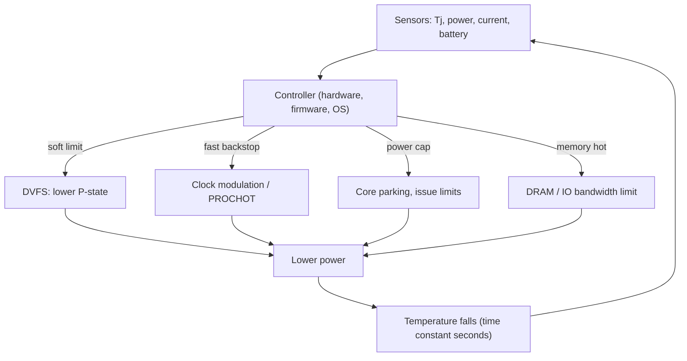

::: testing
Whether you know the **actuators** available for reducing a chip's performance (and therefore power and heat), and can pick among them with their trade-offs, instead of only saying "lower the clock". The interviewer is looking for:

1. The standard mechanisms: DVFS (voltage and frequency P-states), clock modulation (duty-cycling the clock), reducing microarchitectural activity (fetch/issue width), disabling cores or units, power/current capping, memory and I/O bandwidth throttling.
2. Why you throttle: thermal protection, power and current limits, battery, reliability, consistent performance.
3. Efficiency ranking: lowering voltage and frequency together beats clock stopping at fixed voltage, because of the $V^2$ term.
4. The control loop picture: sensors, thresholds, hysteresis, response time, and avoiding oscillation.
5. Awareness of the hardware/firmware/OS layering and of the user-visible effects.
:::

::: why
Every modern processor, from a phone SoC to a server CPU, spends part of its life being throttled: it can generate more heat and current than its cooling, battery or power delivery can sustain, so it is designed to run fast in short bursts and then back off gracefully. How it backs off decides performance consistency, device safety and user experience. Interviewers use this question to see that you understand the physical limits behind the marketing numbers, the knobs the architecture provides, and the control-theory flavour of keeping a system just below its limits. It is the "response" half of the previous questions on frequency ([[q0945]]), voltage ([[q0947]]) and power reduction ([[q0952]]).
:::

::: concepts
- **DVFS / P-states**: discrete voltage-frequency operating points. See [[q0947]].
- **Thermal limit**: junction temperature cap, $T_j \le T_{j,max}$. See [[q0951]].
- **Power and current limits**: package, battery, VRM and di/dt constraints independent of temperature.
- **Clock modulation (stop-clock)**: periodically gating the clock to cut average performance.
- **Hysteresis**: separate trip and release thresholds that avoid rapid on-off cycling.
- **Thermal time constant**: heat capacity makes temperature respond over seconds, allowing bursts.
:::

::: answer
"There are several knobs, and I'd choose among them by how efficiently they trade performance for power.

The main one is DVFS: move to a lower voltage-frequency operating point. Because power goes with V squared times f, dropping from 4 GHz at 1.1 V to 2 GHz at 0.9 V cuts power by about two thirds for half the speed. That's the preferred throttle because it saves energy per operation too.

Second, clock modulation or stop-clock: gate the clock for a fraction of the time, say 25% of cycles, so average throughput falls linearly. It's fast and simple to apply in hardware, but at fixed voltage you only get a linear power saving, so it's a weaker, emergency tool.

Third, reduce microarchitectural activity: limit fetch or issue width, cap instructions in flight, disable speculation or wide vector units, which cuts power with finer control. Fourth, reduce parallelism: park or power-gate cores, or move work to efficient little cores. Fifth, limit memory and I/O bandwidth, or cap the GPU and accelerator clocks. And the OS can limit the maximum frequency, restrict scheduling, or reduce charging current.

What triggers it: temperature sensors crossing a threshold, a power-capping limit over a moving average, a current limit, or battery state. It's a closed-loop control with hysteresis so it doesn't oscillate, usually layered: hardware reacts within microseconds at the hard limit, firmware and the OS manage the smoother steady-state, and as a last resort the chip shuts down."
:::

::: technical
**Why throttle.** (1) Thermal: $T_j = T_a + P\theta_{JA}$ must stay below $T_{j,max}$ ([[q0951]]). (2) Power: package/TDP, rack, battery and VRM limits. (3) Current: $I_{ccmax}$ and di/dt limit droop. (4) Reliability: limit high-$T$ and high-$V$ time. (5) Consistency and noise: predictable performance, fan noise, case/skin temperature.

**Mechanisms (coarse to fine).**
| Mechanism | How it works | Power effect | Performance effect | Notes |
|---|---|---|---|---|
| DVFS / P-state | lower $V$ and $f$ | $\approx V^2 f$ (up to near-cubic) | roughly $\propto f$ | best energy efficiency; milliseconds, voltage ramp time |
| Frequency-only drop | lower $f$ at same $V$ | linear in $f$ | $\propto f$ | faster to apply (PLL/divider change); less efficient |
| Clock modulation (duty cycling) | gate clock on a fraction of periods | linear in duty | linear in duty | very fast, hardware-triggered; worst efficiency |
| Microarchitectural throttling | cap fetch/issue/decode rate, in-flight ops, disable speculation or wide SIMD | partial | partial | fine-grained; limited range |
| Core parking / offlining | power-gate or idle cores | removes their power | loses parallel throughput | good when threads are few |
| Power capping | closed loop on estimated or measured power (moving average) | holds $P\le P_{cap}$ | adapts | enforces TDP/battery limits |
| Memory/IO throttling | limit DRAM bandwidth, refresh behaviour, link rate | reduces memory power | hits memory-bound work | used for DRAM thermal limits |
| System-level | OS max-frequency caps, scheduler limits, reduced charging current, display brightness | varies | varies | cooperative with firmware |

**Efficiency comparison.** Illustrative chip ($\alpha C=20$ nF; $V=0.7+0.1f$ with $f$ in GHz): at 4 GHz, 1.1 V it dissipates 96.8 W. To get to 48.4 W (-50%) by *clock modulation* at fixed voltage requires 50% duty, giving 50% performance. By *DVFS* the same power is reached at $f\approx2.62$ GHz and 0.96 V, i.e. 65% of the performance. DVFS retains 30% more speed at equal power.

**Control loop.** Sensors (on-die thermal diodes, power estimators, current monitors) feed a controller that sets an actuator (P-state, duty, core count). Thermal behaviour is a first-order lag with time constant $\tau_{th}=R_{th}C_{th}$ of seconds, so a simple threshold with hysteresis or a PID-style controller works; poorly tuned loops oscillate between fast and slow states. A multi-level scheme uses an early soft threshold (gradual frequency reduction), a hard trip (assert a PROCHOT-style signal for immediate maximum throttle) and a critical shutdown temperature as final protection. See also [[q0954]].

**Example thermal trajectory.** $\theta_{JA}=0.6$ K/W, 45 °C local ambient, $\tau=20$ s, throttle threshold 95 °C. At 96.8 W the die would head toward $45+58=103$ °C, crossing 95 °C after $-\tau\ln(1-50/58.1)=39.4$ s. The 83 W sustainable at 95 °C corresponds to about 3.66 GHz in the model, so a good controller settles near that rather than dropping to 2 GHz.

> [!UNCERTAIN]
> Exact mechanism names, step sizes (for example clock modulation steps), and the layering between hardware, firmware and OS differ by vendor and generation. The structure here is general; check the specific platform's documentation.
:::

::: short
"The main throttle is DVFS: lower voltage and frequency together, which cuts power by roughly V squared times f. Faster, cruder options are clock modulation, which gates the clock for some fraction of cycles, and microarchitectural throttling of fetch and issue width; coarser ones park cores or cap memory and accelerator bandwidth. Triggers are temperature, power or current limits, with hysteresis. DVFS is the most efficient; clock gating at fixed voltage is the emergency tool."
:::

::: long
"Let me answer by listing the knobs and how efficient each is.

The primary one is DVFS, changing the voltage-frequency operating point. Power scales with V squared times f, so for example going from 4 GHz at 1.1 V to 2 GHz at 0.9 V cuts power by about two thirds while losing half the performance. It also reduces energy per operation, which makes it the preferred throttle in steady state. The costs are that voltage transitions take microseconds to milliseconds because the regulator has to slew.

For fast emergency action, there's clock modulation: gate the clock for a fraction of the cycles. It's immediate and implementable in hardware without regulator involvement, but at constant voltage power falls only linearly with performance. For the same power target DVFS keeps about 30% more speed in a typical model, so this is a backup.

Then finer microarchitectural controls: limit the fetch or issue rate, cap in-flight instructions, disable speculation or wide vector units. These give smooth steps. At the coarse end, park cores or move threads to efficient cores. For memory-bound systems, throttle DRAM or I/O bandwidth, and cap GPU or accelerator clocks. The OS can also cap max frequency, limit scheduling, reduce charge current or screen brightness.

The triggers are temperature, power over a moving average, current limits, or battery state. It's closed-loop control: threshold crossing reduces performance, with hysteresis so you don't oscillate, and because thermal mass gives seconds of time constant a chip can boost for a while before throttling. Typically it's layered: the hardware responds in microseconds at the hard limit, firmware tunes the P-state every few milliseconds, the OS applies policy, and a thermal shutdown protects as the final resort."
:::

::: terms
- **Throttling**: deliberately reducing performance to stay within limits.
- **P-state**: a performance operating point (voltage and frequency pair).
- **DVFS**: dynamic voltage and frequency scaling.
- **Clock modulation / stop-clock**: periodically gating the clock.
- **TDP / power cap**: the sustained power limit a thermal solution can handle.
- **PROCHOT**: a hardware signal/mechanism that forces maximum throttle on over-temperature.
- **Thermal shutdown**: forced power-off at a critical temperature.
- **Hysteresis**: different thresholds for entering and leaving throttle to prevent chatter.
- **Boost / turbo**: temporary operation above sustained limits, enabled by thermal capacitance.
:::

::: exceptional
**An average answer** says "reduce the clock frequency when it gets too hot".

**An exceptional answer**:
- Lists a **hierarchy** of mechanisms (DVFS, frequency-only, clock modulation, microarchitectural limits, core parking, power capping, memory/IO throttling) and says when each is used.
- Ranks them by **efficiency using $P\propto V^2 f$** with a number: DVFS keeps about 65% performance at half power while clock gating keeps 50%.
- Names **multiple reasons** (thermal, power, current/droop, battery, reliability, consistency) and the multi-layer response times (hardware µs, firmware ms, OS 10s of ms).
- Describes the **control behaviour**: thresholds with hysteresis, thermal time constant allowing bursts, PID or step controllers, and the oscillation risk.
- Mentions **side effects**: latency spikes, QoS impact, validation of throttled states, and how to design workloads and cooling around them.
:::

::: mistakes
- **"Just lower the frequency."** At fixed voltage it saves power but not energy, and it is the less effective option; lowering voltage matters more.
- **Ignoring non-thermal triggers.** Power, current (VRM, battery) and di/dt limits can force throttling at temperatures far below the thermal limit.
- **Using a single threshold without hysteresis.** The system chatters between fast and slow states, wasting time in transitions and creating unpredictable performance.
- **Forgetting thermal time constants.** Temperature lags power by seconds, so reacting only at the limit overshoots; predictive or early soft limits help.
- **Assuming throttling is a failure.** It is a designed protection and enables burst performance; only *unexpected* or deep throttling signals a cooling or design problem.
- **Throttling the wrong thing.** Reducing CPU frequency does little for a memory-bound or GPU-dominated heat source; throttle the component that is actually dissipating the power.
:::

::: deep
## Why chips throttle at all

A processor's power can transiently exceed what can be sustained. The reasons:

1. **Thermal**: a die with 100 W in 150 mm$^2$ has a power density of about 0.67 W/mm$^2$; the cooler can remove only so much. $T_j=T_a+P\theta$ ([[q0951]]).
2. **Package and system power (TDP)**: a laptop or phone has a sustained budget set by chassis, battery and skin-temperature limits.
3. **Current**: voltage regulators and the battery have maximum current ($I_{ccmax}$); exceeding it droops the supply and corrupts timing.
4. **di/dt**: sudden power ramps (waking a vector unit) cause supply droop; hardware staggers the ramp.
5. **Reliability**: sustained high $V$ and $T$ accelerate aging, so the maximum boost duration is limited.
6. **Consistency**: fleet and cloud systems enforce power caps for predictable behaviour and rack-level budgeting.

The **thermal time constant** is what makes boost possible. If $R_{th}C_{th}=\tau\approx20$ s (illustrative), a chip can run far above its sustainable power for a few seconds before the temperature crosses the limit.

## The knobs, ordered by efficiency

All throttles reduce $\alpha C V^2 f$ or leakage. The question is how much *performance* you lose per watt saved.

**DVFS.** Move along the voltage-frequency curve. Power ratio $\approx (V_2/V_1)^2 (f_2/f_1)$. Using the illustrative chip with $V=0.7+0.1f$:

| $f$ (GHz) | $V$ (V) | $P_{dyn}$ (W) | Performance | Power |
|---|---|---|---|---|
| 4.0 | 1.10 | 96.8 | 100% | 100% |
| 3.66 | 1.07 | 83.3 | 92% | 86% |
| 3.0 | 1.00 | 60.0 | 75% | 62% |
| 2.62 | 0.96 | 48.4 | 65% | 50% |
| 2.0 | 0.90 | 32.4 | 50% | 33% |

Each step down buys more power reduction than performance lost, up to the voltage floor ($V_{min}$), after which only frequency scaling remains and efficiency drops.

**Clock modulation (duty cycling).** Stop the clock for a fraction of the time. Average performance equals the duty cycle $D$; dynamic power at fixed $V$ also scales with $D$ (leakage does not). For the same 48.4 W target as above, $D=0.5$ gives 50% performance vs 65% for DVFS. It has no voltage transition delay and can be triggered by a purely hardware thermal trip, which is why it is used as a fast backstop. It also creates bursty power draw (supply noise) unless the duty period is short.

**Frequency-only reduction.** Changing a PLL multiplier or clock divider is fast, but if voltage remains high the saving is linear in $f$, giving the same inefficiency as modulation with smoother performance. Many systems do a quick frequency drop first, then lower voltage once the regulator has ramped.

**Microarchitectural throttling.** The core limits how fast it issues work: fewer instructions fetched/decoded per cycle, a smaller issue window, no speculation, narrower or disabled SIMD units (AVX-class instructions are known to cause frequency offsets in some CPUs). These actions cut activity $\alpha$ at the source. Granularity is fine, and effects are workload dependent, since compute-bound code suffers more than stall-dominated code.

**Core parking and migration.** Idle or power-gate cores, and migrate threads to efficient cores. Large savings for lightly threaded workloads; no effect if all cores are needed.

**Power and current capping.** A power estimator (activity counters and a model, or measurement) feeds a moving-average limiter that adjusts P-states to keep long-term power at the cap and permits short bursts above it. Current limiters watch $I_{cc}$ and temporary di/dt ramps.

**Memory, I/O and accelerator throttling.** DRAM has its own thermal and power limits (throttle by limiting activate/command rate or increasing refresh). GPUs and NPUs have independent clocks. Throttle the actual heat source.

**System-level and OS.** Frequency governors set `max_freq`; cgroups or schedulers limit CPU time; battery management reduces charge current when hot; displays dim. Policy can prioritise the foreground task.


Figure: A throttling system is a closed loop. Sensors feed a controller that picks one or more actuators; the thermal response closes the loop with a delay of seconds, which is why gain, hysteresis and layering matter.

## What the thermal response looks like

Using $\theta_{JA}=0.6$ K/W, $T_a=45$ °C and $\tau=20$ s: the chip starts cool and runs at 4 GHz (96.8 W), heading toward $45+58.1=103$ °C. It crosses the 95 °C throttle threshold at $t_1=-\tau\ln(1-50/58.1)\approx39.4$ s.

```plot
{"title":"Junction temperature during a thermal throttle event (illustrative)","x":{"label":"time","unit":"s","min":0,"max":120},"y":{"label":"junction temperature","unit":"°C","min":40,"max":110},
 "vars":{"ta":45,"th":0.6,"p1":96.8,"p2":32.4,"tau":20,"tthr":95,"t1":39.45},
 "series":[{"label":"no throttling (heads to 103 °C)","fn":"ta+p1*th*(1-exp(-x/tau))","dashed":true,"color":"red"},{"label":"hard drop to 2 GHz at threshold","fn":"ite(x<t1,ta+p1*th*(1-exp(-x/tau)),ta+p2*th+(tthr-ta-p2*th)*exp(-(x-t1)/tau))","color":"blue"},{"label":"graded: settle at 3.66 GHz (83 W)","fn":"ite(x<t1,ta+p1*th*(1-exp(-x/tau)),tthr)","color":"orange"}],
 "hlines":[{"at":95,"label":"throttle threshold 95 °C","color":"muted"}],
 "vlines":[{"at":39.45,"label":"t1 = 39 s"}]}
```
Figure: Without action the die would exceed the threshold at about 39 s and keep rising. A hard drop to 2 GHz cools the chip to 64 °C, much more than needed, so the controller would then ramp back up and oscillate. A graded controller trims frequency just enough to hold 95 °C, running at about 3.66 GHz (92% of peak) in the steady state. Gentle control gives better performance and smoother behaviour than a bang-bang response.

## Try it

```sim
{"id":"pvt-power","v":0.9,"f":2e9,"t":25,"corner":"tt"}
```
Figure: The simulator's chip is a smaller illustrative one (about 5 W, $\theta_{JA}$ = 10 °C/W, 5 s thermal time constant) with a simple step-up/step-down governor and a 95 °C limit. At 25 °C ambient the junction settles near 74 °C and the clock stays at 2 GHz. Raise the ambient to 45 °C: the unthrottled steady state would be about 111 °C, so the governor steps down to a lower P-state (0.8 V, 1.83 GHz) whenever $T_j$ passes 95 °C and back up below 90 °C, averaging about 1.9 GHz. That toggling is the hysteresis band at work. Uncheck throttling and raise $\theta_{JA}$ to see runaway. To compare actuators, set the clock to about 1.83 GHz at 0.9 V and note $P_{total}$, then click the 0.80 V DVFS row (same clock): the lower-voltage point delivers the same performance for noticeably less power.

## Control design considerations

- **Thresholds and hysteresis**: trip at 95 °C, release at 90 °C so the system does not chatter.
- **Layering and response time**: hardware (microseconds) for hard limits, firmware (milliseconds) for P-state control, OS/user-space (tens to hundreds of ms) for policy; each layer must agree and not fight.
- **Soft limits before hard limits**: start reducing gently before the critical temperature so you rarely hit the abrupt backstop.
- **Predictive control**: use power telemetry and thermal models to anticipate temperature, as power is a leading indicator.
- **Sensor accuracy and placement**: on-die sensors at hot spots, with accuracy of a few degrees, set the margin you must hold.
- **Fairness and QoS**: for multi-tenant servers and phones, decide who gets throttled first (background tasks, GPU, modem).
- **Validation**: test throttled operating points; every P-state and transition must be functionally correct, including voltage-ramp sequencing (raise voltage before frequency, lower frequency before voltage).

## User-visible effects

A phone that is warm and gaming for ten minutes drops frame rate; a laptop's fan ramps and the clock steps down; a data-center chip trims frequency to meet a rack power cap. Throttling is not a bug unless it happens in conditions the product was supposed to sustain, when it points to cooling, thermal-interface or board-level problems.
:::

::: applications
- **Laptop and desktop CPUs**: turbo boost within power-limit time windows and thermal throttling via P-states and clock modulation.
- **Smartphone SoCs**: thermal governors lower CPU/GPU frequencies and limit charging to keep skin temperature acceptable.
- **Data-center servers**: rack-level power capping and per-node frequency limits.
- **GPUs and AI accelerators**: board power and temperature limits applied through clock and voltage reduction.
- **DRAM**: thermal throttling of command rate and increased refresh at high temperature.
- **Embedded/automotive**: derating of performance at high ambient and fallback modes for safety.
:::

::: assumptions
- **Illustrative chip model** ($\alpha C=20$ nF, $V=0.7+0.1f$, $\theta_{JA}=0.6$ K/W, $\tau=20$ s); real chips have multi-stage thermal networks, multiple sensors and hot spots.
- **Leakage ignored in the trajectory**, which would raise power and temperature at the hot end and make throttling kick in sooner.
- **Voltage-frequency relationship** is assumed linear; real tables are measured and have a voltage floor.
- **Mechanism names and step sizes** vary by vendor and generation; the hardware/firmware/OS split differs between platforms.
- **Workload dependence**: memory-bound workloads lose less performance under frequency throttling than compute-bound ones.
:::

::: followups
### Why is DVFS better than just gating the clock for a given power reduction?
Because voltage drops too, giving the $V^2$ benefit: at the same 48.4 W target, DVFS keeps about 65% of performance whereas 50% clock gating at fixed voltage keeps 50%, and DVFS reduces energy per operation while clock gating does not. The trade-off is that DVFS needs the regulator to slew and the PLL to relock, so it responds in microseconds to milliseconds instead of cycles.

### How do you prevent the system from oscillating between throttled and unthrottled?
Use hysteresis (release threshold below the trip point), a controller with rate limits or integral action rather than bang-bang, and graded steps. Also exploit power telemetry (a leading indicator) to avoid overshoot. The goal is to settle at the highest sustainable P-state, not to alternate between extremes.

### What's the difference between thermal throttling and power capping?
Thermal throttling reacts to junction temperature, a slow variable with a time constant of seconds. Power capping limits average power over a window (tens of ms to seconds) regardless of temperature, to respect TDP, battery or rack budgets. Both can drive the same actuators (P-states), and the lower of the two limits wins.

### What happens at the critical temperature if throttling does not work?
A hardware trip asserts maximum throttle (PROCHOT-style) and, if temperature continues to climb to the critical limit, the chip or platform shuts down to avoid permanent damage. That last-resort path is implemented in hardware independent of software, so a hung OS cannot disable it.

### Scenario: a phone game runs smoothly for 3 minutes then frame rate halves. How do you investigate?
Log temperatures, frequencies and power against time for CPU, GPU and the battery. If CPU/GPU clocks step down when skin or junction temperature hits a threshold, it's thermal throttling, with the time to onset reflecting the thermal capacitance. Mitigations: reduce the workload's power (lower rendering resolution or frame cap), improve heat spreading, adjust governor thresholds for smoother graded throttling, and check whether battery current limits or a specific hot spot (modem, GPU) is the true trigger.
:::

::: interpretations
"Throttle performance" can mean **thermal/power protection** (the main reading here), **deliberate limiting** by software for consistency or fairness (cpufreq caps, cgroups), or **hardware features that rate-limit memory or I/O**. The page covers all three, and emphasises the principle that the best throttle is the one that gives up the least performance per watt saved. The closed-loop aspects are discussed further under temperature control loops ([[q0954]]).
:::

::: references
- Hennessy & Patterson, *Computer Architecture: A Quantitative Approach*: power, energy and dynamic voltage-frequency scaling.
- Rabaey, Chandrakasan & Nikolic, *Digital Integrated Circuits*: power, thermal and low-power design chapters.
- Intel and AMD processor datasheets and software developer manuals: sections on thermal monitoring, clock modulation and power limits (consult the manual for your generation).
- Arm documentation on DVFS, thermal management and big.LITTLE/DynamIQ power management; Linux kernel documentation on cpufreq and thermal governors.
- Franklin, Powell & Workman, *Digital Control of Dynamic Systems*, for the control-loop viewpoint (stability and hysteresis).
:::

::: rubric
- Lists several throttling mechanisms (DVFS, clock modulation, microarchitectural limits, core parking, bandwidth caps) :: The question asks "what can you do", so breadth matters.
- Identifies DVFS as the most efficient and explains with $P\propto V^2 f$ :: Connects throttling to the power physics.
- Notes clock modulation is fast but inefficient at fixed voltage, with a number :: Shows quantitative ranking, not just a list.
- States the triggers: temperature, power, current, battery :: Throttling is not only thermal.
- Describes closed-loop control, thresholds, hysteresis and the thermal time constant :: Shows systems and control thinking.
- Mentions the layered hardware/firmware/OS response and last-resort shutdown :: Real systems implement protection in layers.
- Discusses user-visible consequences and validation :: Completes the picture beyond the circuit.
:::

::: quiz
```json
[
 {"type":"mcq","level":"fundamental","q":"Which throttling method generally gives the best performance retained per watt saved?","options":["Clock modulation at fixed voltage","Lowering voltage and frequency together (DVFS)","Lowering frequency only at fixed voltage","Disabling the thermal sensor"],"answer":1,"explain":"DVFS exploits the $V^2$ dependence, so power falls faster than performance. Clock modulation and frequency-only reduce power only linearly."},
 {"type":"mcq","level":"fundamental","q":"What is hysteresis used for in a throttling controller?","options":["To increase the maximum frequency","To prevent rapid toggling by using different trip and release thresholds","To measure junction temperature","To reduce leakage"],"answer":1,"explain":"Releasing at a lower temperature than the trip point prevents the system from chattering between throttled and unthrottled states."},
 {"type":"numeric","level":"intermediate","q":"A chip at 96.8 W is cut to 48.4 W by 50% clock modulation at fixed voltage. What fraction of performance remains, in percent?","answer":50,"tolerance":0.02,"unit":"%","explain":"Average throughput equals the duty cycle, 50%, and dynamic power scales with it linearly. With DVFS, the same power would keep about 65%."},
 {"type":"numeric","level":"intermediate","q":"With $\\theta_{JA}=0.6$ K/W and a 45 °C ambient, what is the maximum sustainable power (in W) that keeps $T_j$ at 95 °C?","answer":83.3,"tolerance":0.02,"unit":"W","explain":"$P=(95-45)/0.6 = 83.3$ W."},
 {"type":"multi","level":"intermediate","q":"Select all that can trigger performance throttling.","options":["Junction temperature above a threshold","Average power above a cap","VRM or battery current limit","A fully charged battery with the device idle"],"answer":[0,1,2],"explain":"Thermal, power and current limits all trigger throttling. An idle device on a full battery has no reason to throttle."},
 {"type":"truefalse","level":"advanced","q":"Because of the thermal time constant, a chip can safely run above its sustained power rating for a short burst before throttling is needed.","answer":true,"explain":"Heat capacity makes temperature lag power with a time constant of seconds, so short bursts (turbo/boost) stay below the temperature limit; the controller throttles only when temperature actually approaches the limit."}
]
```
:::
