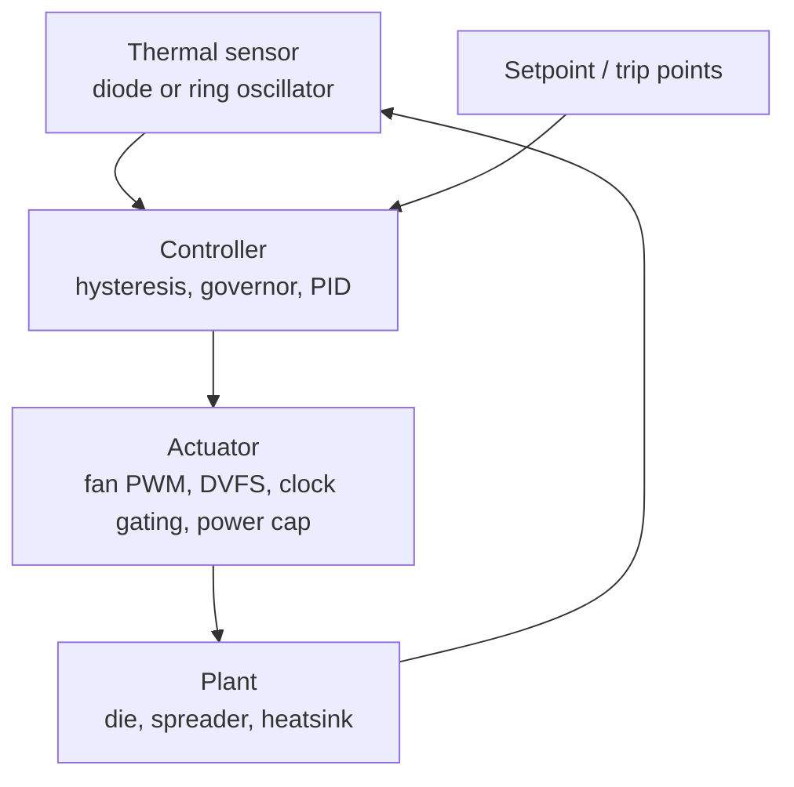

::: basics
### In plain words
Chips and systems keep their temperature in check with feedback loops. A sensor measures the temperature. A controller compares it with a limit. An actuator, such as a fan or a clock-speed reduction, pushes the temperature back down. Several loops run at different speeds, and a hardware trip is the last resort. Temperature responds slowly, so the loops must be tuned carefully.

### Picture it
Think of a home thermostat with a heater. When the room falls below 19 °C, the heater turns on. When it reaches 21 °C, the heater turns off. The two settings stop it from flicking on and off every second. Because the room takes minutes to warm and cool, the temperature always swings gently between the two settings. A chip's thermal loop behaves the same way. Its actuator reduces speed instead of heating.

### Words you need
- **Junction temperature**: the temperature of the silicon, which the limits refer to.
- **Hysteresis**: a different temperature to turn an action on than to turn it off, to prevent rapid flipping.
- **Throttling**: reducing speed or power when the chip gets too hot.
- **PID controller**: a controller that reacts to the temperature error, its running total and its rate of change.
- **Thermal time constant**: how many seconds the temperature takes to respond to a change in power.
- **Limit cycle**: a steady back-and-forth swing around a threshold.

### The simplest example
A chip with $\theta=0.5$ K/W sits in 35 °C air. At 150 W, it would settle at $35+150\times0.5=110$ °C, above a 95 °C limit. So throttling drops the power to 100 W, which settles near 85 °C. The loop turns throttling on at 95 °C and off at 90 °C, so the temperature swings between those marks, about 6 times a minute with a 10 s time constant. That is the whole idea. The rest of this page covers fan and DVFS loops, PID tuning, and sensor limits.
:::

::: testing
Whether you can connect **thermal physics to a control system**. The interviewer wants to hear that temperature is a slow, heavily lagged plant, that you need a sensor, a controller and an actuator, and that there are several layers of loops running at different speeds. The hidden sub-skills:

1. Knowing the actuators: fan speed, clock throttling, DVFS, power capping, task migration, and a last-resort hard shutdown.
2. Knowing the controller styles: bang-bang with hysteresis, step governors, PID, and model-based or predictive control.
3. Reasoning about **stability and oscillation**: a thermal loop with delay and hysteresis will limit-cycle, and you should be able to say how big and how fast.
4. Understanding sensors: where they sit, how accurate they are, and why a hot spot can be hotter than any sensor reads.
:::

::: why
Every modern SoC, CPU, GPU and phone lives against its thermal limit. Silicon is allowed to run at full speed only until the junction temperature gets close to its maximum, and after that something has to back off. How gracefully it backs off decides sustained performance, fan noise, battery life and long-term reliability. A chip with a clumsy thermal loop either throttles hard and oscillates (the frame rate in a game saws up and down) or cooks itself. For a hardware interview it is also a nice test of control-theory instincts on a physical system you can reason about with one RC pair.
:::

::: concepts
- **Thermal RC model**: junction temperature behaves like $T_j = T_a + P\,\theta_{JA}$ at steady state, with a thermal capacitance that gives a time constant of seconds. See [[q0022]] for the electrical capacitor analogy.
- **Closed-loop control**: sensor, comparison with a setpoint, controller, actuator, plant. Negative feedback with lag can oscillate.
- **Hysteresis (bang-bang) control**: switch the actuator on at one threshold and off at a lower one to avoid chattering.
- **PID control**: proportional, integral and derivative action on the temperature error; common for fans and heaters.
- **Actuators on a chip**: DVFS, clock gating or duty-cycling, power caps, core parking, workload migration. See [[q0945]], [[q0947]] and [[q0953]].
- **Thermal sensing**: on-die diodes ($\Delta V_{BE}$), ring-oscillator sensors, board thermistors.
- **Protection layers**: throttle, PROCHOT-style assertion, hard thermal trip.
:::

::: answer
"There are really a few loops stacked on top of each other, running at different speeds.

The fastest and most basic one is on the chip itself. Thermal sensors, usually a diode whose voltage changes with temperature, feed a small controller. When the junction gets close to its limit, say within ten degrees, it starts throttling: it drops the clock or the voltage and frequency through DVFS, or caps power. That's often a simple threshold with hysteresis, so it doesn't flap on and off, or a stepped governor that walks through frequency states.

The next loop is at the system level. A fan controller reads temperature and sets fan PWM, usually along a temperature-to-speed curve or a PID, because a fan can cool the chip without costing performance. The OS or firmware can also manage things with workload migration or by parking cores, and phones with no fan lean entirely on throttling and skin-temperature limits.

Last is the safety net: if everything else fails, a hardware trip shuts the part down at a fixed temperature, independent of software.

The thing to keep in mind is that the thermal plant is slow, with a time constant of seconds, so the loops are cautious. Too aggressive and you oscillate; too gentle and you overshoot the limit."
:::

::: technical
**Plant.** To first order $C_{th}\,\dot T_j = P - (T_j - T_a)/\theta$, so $T_j(t) = T_{ss} - (T_{ss}-T_0)e^{-t/\tau}$ with $T_{ss} = T_a + P\theta$ and $\tau = \theta C_{th}$. The die itself reacts in milliseconds, but the heat spreader and heatsink add seconds to minutes of lag, so real chips have multiple thermal time constants. Hot spots on the die can be several degrees above the sensor.

**Loop types.**
- **Hysteretic (bang-bang) throttle**: assert at $T_{hi}$, release at $T_{lo}$. It always limit-cycles between the two thresholds; amplitude is set by the hysteresis band, period by $\tau$ and the power step.
- **Stepped governors**: step frequency or voltage down one operating point when $T > T_{trip}$, step up when $T < T_{trip} - \Delta$. Used in Linux-style thermal governors and phone SoCs.
- **PID**: $u = K_p e + K_i\!\int e\,dt + K_d\,\dot e$ with $e = T - T_{set}$. Used for fans, heaters, TEC drivers and some power-limit controllers. Integral action removes steady-state error; the derivative term is limited because sensors are noisy and quantized.
- **Power capping**: a running-average power limit acts as an indirect thermal controller, because power times $\theta$ gives temperature. Short bursts above the sustained limit are allowed until the thermal capacitance fills up.
- **Predictive or model-based**: use a thermal model plus workload information to throttle before the limit is hit.
- **Hard trip**: a comparator-based shutdown at a fixed temperature with no software involved.

**Fan law.** Airflow scales with rpm and fan power with rpm cubed, so a 20% speed cut saves about $1-0.8^3 \approx 49\%$ of fan power. This is why fan curves ramp gently.

**Sensing.** A diode-connected transistor run at two currents with ratio $N$ gives $\Delta V_{BE} = \frac{kT}{q}\ln N$, about 0.18 mV/K for $N = 8$, a PTAT signal that is largely independent of process.
:::

::: short
"Thermal control is a stack of feedback loops. On-chip sensors drive fast throttling, via DVFS, clock reduction or power caps, often with hysteresis or a stepped governor. At the system level, a fan controller runs a PWM curve or a PID loop on temperature. Underneath all that is a hardware thermal trip as the last resort. Because the thermal plant is slow and lagged, the loops have to be tuned so they don't oscillate or overshoot the junction limit."
:::

::: long
"I think of it as three layers. The first is the on-die loop. You have thermal sensors, typically a diode pair giving a delta-VBE reading that's proportional to absolute temperature, spread around the hot spots. A small controller compares those readings to thresholds. The simplest version is bang-bang with hysteresis: when the temperature crosses the trip point, drop the frequency or the voltage and frequency together; release when it falls back under a lower threshold. A more polished version is a stepped governor that walks down a table of operating points, or a power cap that limits the running-average power so the temperature stays under control indirectly.

The second layer is the system. If there's a fan, a controller sets the PWM duty from temperature, either with a lookup curve or a PID loop. Fans are the cheapest actuator because they cost no performance, though their power goes up with the cube of speed, so you ramp gently. Phones have no fans, so they depend on throttling, and often on a skin-temperature limit as well as a junction limit. Software can also help by moving work to cooler cores.

The third layer is protection: a hard thermal trip, implemented in hardware, that shuts the chip down at a fixed temperature, independent of any firmware, because firmware can crash.

What makes all this tricky is that the thermal plant has real lag. A heatsink has a time constant of many seconds. A hysteretic loop will always cycle, and a PID with too much gain will hunt, so you pick thresholds, hysteresis width and gains to balance sustained performance against overshoot, and you leave margin for sensor error and hot spots."
:::

::: terms
- **Junction temperature ($T_j$)**: the temperature of the silicon. It is what reliability limits and throttling thresholds refer to.
- **Thermal resistance ($\theta_{JA}$)**: kelvin per watt from junction to ambient; $T_j = T_a + P\theta_{JA}$ in steady state.
- **Hysteresis**: separate assert and release thresholds so the control action does not chatter.
- **DVFS**: dynamic voltage and frequency scaling; lowers power superlinearly because $P \propto V^2 f$.
- **Thermal throttling**: a reduction of performance triggered by temperature.
- **PROCHOT / thermal trip**: a processor-hot signal that forces throttling, and a harder trip level that forces shutdown. Names and levels are vendor specific.
- **PID controller**: proportional-integral-derivative feedback on the error.
- **Power capping**: limiting average power over a time window, which indirectly limits temperature.
- **Limit cycle**: a sustained oscillation, here the throttle and release cycle around a threshold.
:::

::: exceptional
**An average answer** says "throttle the clock when it gets hot, and use a fan."

**An exceptional answer**:
- Organizes the loops by speed and purpose: fast on-die throttling, medium-speed fan or governor control, and an independent hardware trip.
- Names the controller styles and *why* each is used: hysteresis to prevent chatter, steps to keep the voltage and frequency table small, PID for fans and heaters.
- Points out that the plant has lag, so a hysteretic loop *will* limit-cycle, and can put numbers on the amplitude and period.
- Mentions sensor reality: hot-spot gradients, quantization, noise, and why margins and guard bands exist.
- Notes the performance consequence: a good loop sits at the limit with small ripple, a bad one throttles deeply and oscillates.
:::

::: mistakes
- **Treating temperature like a fast signal.** The heatsink time constant is seconds to minutes, so a high-gain loop will overshoot and oscillate. Tune for the slow plant.
- **No hysteresis.** If assert and release are the same threshold, sensor noise makes the throttle chatter. Add a band.
- **Thinking the fan alone is enough.** Fans have a finite airflow limit and fail; there must always be a chip-level throttle and a hard trip that does not depend on software.
- **Throttling only frequency.** Cutting only frequency saves power linearly; reducing voltage as well saves roughly quadratically. DVFS beats clock-only throttling.
- **Forgetting the hot spot.** The sensor may be several degrees cooler than the hottest transistors, so the trip point has margin built in.
- **Calling it "just a thermostat".** A simple thermostat has the right shape, but real loops combine several actuators and a safety layer.
:::

::: deep
## The plant: a thermal RC circuit

Heat flow obeys the same math as current in a resistor-capacitor network. Power $P$ plays the role of current, temperature difference plays the role of voltage, thermal resistance $\theta$ (K/W) is the resistor, and thermal capacitance $C_{th}$ (J/K) is the capacitor. That gives

$$C_{th}\frac{dT_j}{dt} = P - \frac{T_j - T_a}{\theta}\quad\Rightarrow\quad T_j(t) = T_{ss} - (T_{ss}-T_0)\,e^{-t/\tau},\ \ T_{ss}=T_a+P\theta,\ \ \tau=\theta C_{th}$$

A concrete example. Take a package plus heatsink with $\theta = 0.5$ K/W and an effective $C_{th} = 20$ J/K, so $\tau = 10$ s. The ambient is 35 °C and the workload dissipates 150 W. The steady-state temperature would be $35 + 150\times 0.5 = 110$ °C, above a 95 °C limit. Starting from 60 °C, the chip reaches 95 °C after

$$t = -\tau \ln\frac{T_{ss}-95}{T_{ss}-60} = -10\ln\frac{15}{50} = 12.0\ \text{s}$$

So the chip can burst at full power for about 12 seconds before it must act. That burst allowance is exactly what turbo or boost modes exploit: the thermal capacitance is a buffer.

```sim
{"id":"package-thermal","P":6,"Ta":35,"pkg":"bga","heatsink":true,"airflow":0}
```
Figure: A scaled-down version of the same first-order thermal circuit: a BGA with a heatsink and no airflow at 35 °C ambient, dissipating 6 W. The transient plot shows the junction temperature rising in stages toward its steady-state value (about 105 °C) rather than jumping, which is the burst allowance; the slow final stage is the heatsink warming up. Raise P past about 8 W and the steady state crosses the 125 °C limit; the time axis shows how long you have before it does.

> [!NOTE]
> A real package has several RC stages (die, spreader, heatsink, case), so the true response is a sum of exponentials with different time constants. A one-pole model is good enough for reasoning about loops but not for tuning a product.


Figure: The generic thermal loop. Every layer on a real system, on-die throttle, fan control, power cap, is an instance of this shape with a different sensor, actuator and speed. The plant block is the slow one, and its lag is what makes tuning hard.

## Loop 1: bang-bang throttling with hysteresis

The simplest on-chip loop: when $T_j > 95$ °C drop the power to a throttled level; when $T_j < 90$ °C restore it. Suppose throttling cuts power from 150 W to 100 W, so $T_{ss}$ drops from 110 °C to $35 + 100\times0.5 = 85$ °C. The temperature then rides a **limit cycle** between 90 and 95 °C.

- Heating from 90 to 95 °C at full power: $t_{up} = -10\ln\frac{110-95}{110-90} = 2.88$ s.
- Cooling from 95 to 90 °C at throttled power: the curve is $T = 85 + 10e^{-t/\tau}$, which falls to 90 °C when $e^{-t/\tau} = 0.5$, so $t_{dn} = 10\ln 2 = 6.93$ s.

So the cycle is 9.81 s long, the chip spends 29% of the time at full power, and the average power is $0.293\times150 + 0.707\times100 = 114.7$ W. Notice what hysteresis buys: with a 5 °C band the temperature never exceeds 95 °C, and the loop completes only about 6 cycles a minute instead of chattering with sensor noise.

```plot
{"title":"Bang-bang thermal throttle: limit cycle between 90 and 95 °C","x":{"label":"time","unit":"s","min":0,"max":40},"y":{"label":"T_j","unit":"°C","min":84,"max":97},
 "vars":{"tau":10,"up":"-tau*ln(0.75)","dn":"tau*ln(2)","p":"up+dn"},
 "series":[{"label":"T_j","fn":"ite(mod(x,p)<up, 110-20*exp(-mod(x,p)/tau), 85+10*exp(-(mod(x,p)-up)/tau))"}],
 "hlines":[{"at":95,"label":"assert (throttle on): 95 °C","color":"red"},{"at":90,"label":"release (throttle off): 90 °C","color":"muted"}]}
```
Figure: Heating segments (at full power) are short and steep because the target is far above the limit; cooling segments (at throttled power) are slower because the throttled steady state of 85 °C is only 5 °C under the release threshold. A lower throttled power would give faster cooling and less time at full power.

The design levers are visible here. A wider band reduces switching rate but increases the temperature swing. A deeper throttle (lower $P$) shortens the cooling leg but costs more performance. Slower sensors add delay and cause overshoot beyond 95 °C, which is why trip points are set below the true limit.

## Loop 2: stepped governors and DVFS

A single throttle level is blunt. A governor holds a table of operating points, for example 3.0 GHz at 1.0 V, 2.4 GHz at 0.9 V and 1.8 GHz at 0.8 V, and steps one entry per decision interval. Because dynamic power is $\alpha C V^2 f$, the first step from 3.0 GHz/1.0 V to 2.4 GHz/0.9 V gives $(2.4/3.0)(0.9/1.0)^2 = 0.648$, a 35% power cut for a 20% frequency cut. That is why DVFS is a far better thermal actuator than clock-only throttling, which gives only the 20%.

Trip steps are separated by a hysteresis margin, and a minimum dwell time prevents the governor from stepping up and down every few milliseconds. Try it:

```sim
{"id":"pvt-power","v":0.9,"f":2e9,"t":25,"corner":"tt"}
```
Figure: With thermal throttling ticked, raise the ambient temperature or θ_JA (a worse heatsink) and watch the "Clock chosen by the governor" plot step down P-states to hold T_j at the limit. Look at how leakage grows with temperature, which creates positive feedback (hotter means more leakage means more power means hotter) that the loop has to defeat.

## Loop 3: PID on a fan or heater

Fans are the friendly actuator: they change $\theta$ rather than $P$, so performance is untouched. A fan loop measures temperature, compares with a setpoint (say 70 °C), and sets a PWM duty (commonly a 25 kHz PWM on a 4-wire fan) through a curve or a PID. Proportional action alone leaves a steady-state offset, because to hold a nonzero fan speed you need a nonzero error. Integral action removes that offset. Derivative action speeds the reaction but amplifies sensor quantization noise, so it is often filtered or omitted. Because $\tau$ is many seconds, a fan loop needs a low bandwidth, typically with slew-rate limits on the fan speed so the user is not annoyed by rpm hunting.

The same structure drives **heater** loops: an oven-controlled crystal oscillator, a PCR block or a thermoelectric cooler holds a setpoint with a PID on a thermistor reading. There the aim is the opposite, to hold temperature constant rather than to avoid a limit.

## Loop 4: power capping as a thermal proxy

Instead of measuring temperature directly, many chips limit **average power** over windows matched to the thermal time constants: a long-window limit that the cooling can sustain, and a higher short-window limit that allows boosting while the thermal capacitance absorbs the burst. Since $\Delta T = P\theta$, bounding the filtered power bounds the temperature without needing a sensor in the loop. Temperature sensing then acts as the outer loop that trims these limits when the ambient is unusually high.

## The safety layer and sensor reality

- **Thermal trip**: a hardware comparator, not software, shuts the part down or asserts reset at a fixed high temperature. It must survive a hung CPU.
- **Sensor limits**: on-die diode sensors have an accuracy of a few degrees, are quantized to about a degree, and sit at only a handful of locations. Hot spots over a running core can exceed the sensor by several degrees, so firmware adds guard bands, and some parts use many distributed sensors or an estimator.
- **Leakage runaway**: subthreshold leakage rises roughly exponentially with temperature, so at high temperature the loop gain of the power-temperature feedback can exceed one and the chip heats itself unstably unless the throttle intervenes.

> [!UNCERTAIN]
> Specific trip temperatures, window lengths and governor policies are vendor and product specific. Numbers in this page (95 °C limit, 20 J/K) are illustrative and should not be quoted as properties of any real part.

## Worked comparison

Using the same plant: with no control the chip would settle at 110 °C. The hysteretic loop holds it below 95 °C at 114.7 W average (76% of the 150 W demand). A DVFS governor that settles on a fixed intermediate point, 130 W for example, would sit at $35 + 130\times0.5 = 100$ °C, still too hot, whereas 120 W gives $T_{ss}=95$ °C exactly, with no cycling, and 80% of the demanded power. The smooth steady point wins on stability; the bang-bang loop wins on simplicity.
:::

::: applications
- **Laptop and desktop CPUs**: on-die sensors feed PROCHOT-style throttling, boost windows backed by power limits, and a fan curve in firmware.
- **Smartphone SoCs**: with no fan, thermal governors step down CPU, GPU and modem operating points, driven by junction and skin temperature.
- **Data-center GPUs**: telemetry-driven fan speed and power-cap loops keep accelerators at their clock-versus-temperature sweet spot.
- **Oven-controlled crystal oscillators and instrumentation**: PID heater loops hold a crystal at a fixed temperature for frequency stability.
- **Thermoelectric (Peltier) coolers** for lasers and image sensors: PID with bidirectional drive.
- **Battery packs and chargers**: temperature-based derating of charge current, a throttle loop with hysteresis.
:::

::: assumptions
- **First-order thermal plant.** Real packages have multiple poles and a spatial temperature distribution; a single RC captures the lag but not the hot-spot effects.
- **Constant ambient and constant demanded power.** In reality workload and ambient vary, which is why loops have margins.
- **Ideal sensor.** Zero delay and noise, unlike real quantized sensors read at millisecond intervals.
- **Power is independent of temperature.** In reality leakage grows with temperature, which tightens the loop.

If the interviewer is thinking of a lab setup, such as a heater and thermistor, the answer centers on PID tuning of a slow plant. If they mean a chip, the answer centers on DVFS and power caps. If it is a phone, include skin temperature. State which context you are assuming.
:::

::: followups
### Why does a bang-bang thermal throttle need hysteresis?
Without it, the output flips whenever noise moves the reading across one threshold, so the actuator chatters, wasting energy and causing visible performance jitter. With a 5 °C band and a 10 s time constant the loop above switches roughly every 3 to 7 seconds instead. The band should be bigger than sensor noise and quantization.

### Why is DVFS better than just lowering the clock to cool the chip?
Dynamic power is $\alpha C V^2 f$. Lowering only $f$ cuts power linearly, and the energy per task does not improve. Lowering $V$ along with $f$ gives roughly cubic savings, for example 0.648 of the power at 0.8 of the frequency and 0.9 of the voltage. The catch is that voltage cannot go below the minimum needed for the target frequency.

### How would you tune a PID fan loop for a slow thermal plant?
Start with the plant: identify the time constant, perhaps from a step response. Choose a low proportional gain so a small error does not saturate the fan, add integral action slowly (integral time of the order of the time constant) to remove the offset, and leave derivative out or heavily filtered. Add output slew limits and an anti-windup clamp so integral does not build up when the fan is saturated at 100%.

### What happens if the temperature sensor is slow or far from the hot spot?
The loop reacts late and sees a smaller temperature than the true hot spot, so the junction overshoots the threshold. You compensate with a lower trip point (guard band), more sensors near hot blocks, or a predictive element that uses power estimates. Delay also reduces phase margin of a PID loop, so the gain must come down.

### Scenario: a game runs smoothly for 30 seconds and then the frame rate starts sawing up and down. What do you suspect?
A thermal limit cycle. The initial 30 seconds is the burst phase where the thermal capacitance absorbs power; once the temperature reaches the trip point, a bang-bang or coarse stepped governor alternates between high and low operating points. I would log temperature, frequency and power over time, look for the periodic pattern, and then widen the steps, add intermediate operating points, or lower the sustained power cap so the system settles at a steady point instead of cycling.

### What if leakage rises exponentially with temperature: can the thermal loop become unstable even with a fan?
Yes. If $dP_{leak}/dT \cdot \theta \ge 1$, each degree rise adds more than a degree of heating, so there is no stable operating point: thermal runaway. A bigger heatsink (lower $\theta$) or cooler operation restores a stable point. This is why the throttle and the hard trip must act independently of the cooling system.
:::

::: interpretations
"Temperature control loops" can mean the **on-chip throttling mechanisms** of a processor (the likely reading given the section on power, performance and thermals) or **classic heater and cooler PID loops** in instrumentation. The page covers both, leading with the chip-level view. If the interviewer follows with a hardware thermal design question about heatsinks and airflow, see [[q0949]] for PVT effects and [[q0953]] for performance throttling.
:::

::: references
- Horowitz & Hill, *The Art of Electronics*, 3rd ed.: thermal design and temperature-control topics, including feedback control of heaters and thermal time constants.
- Franklin, Powell & Emami-Naeini, *Feedback Control of Dynamic Systems*: PID control and tuning for first-order-plus-delay processes.
- Rabaey, Chandrakasan & Nikolic, *Digital Integrated Circuits*: power and energy in CMOS, $P=\alpha CV^2f$ and leakage.
- Hennessy & Patterson, *Computer Architecture: A Quantitative Approach*: power and energy chapter, including dynamic voltage and frequency scaling and thermal management.
:::

::: rubric
- Identifies sensor, controller and actuator as the elements of the loop :: Frames the answer as a control system rather than a list of tricks.
- Lists on-chip actuators (DVFS, clock throttling, power cap, core parking) :: These are the mechanisms real products use, and interviewers expect several.
- Mentions system-level loops: fan PWM curve or PID :: Cooling-side control is the other half of thermal management.
- Names bang-bang with hysteresis, stepped governors and PID, and says when each fits :: Shows you understand controller trade-offs, not just vocabulary.
- Explains the slow thermal plant (RC time constant) and the resulting limit-cycle or overshoot risk :: The plant's lag is the central difficulty.
- Mentions a hardware thermal trip independent of software :: Safety layers are non-negotiable in real silicon.
- Mentions sensor placement, accuracy and hot-spot guard banding :: Practical limits that separate theory from product design.
:::

::: quiz
```json
[
 {"type":"mcq","level":"fundamental","q":"Why does a thermal throttle usually use two different thresholds (assert high, release lower)?","options":["To make the chip run cooler than the limit at all times","To prevent the actuator from chattering when noise crosses a single threshold","Because sensors can only measure two temperatures","To increase the clock frequency after throttling"],"answer":1,"explain":"Hysteresis separates assert and release levels so sensor noise and the slow plant do not make the throttle flip rapidly. It does not make the chip cooler on average; it shapes how often the actuator switches."},
 {"type":"numeric","level":"intermediate","q":"A package has $\\theta = 0.5$ K/W, effective $C_{th} = 20$ J/K, ambient 35 °C, and dissipates 150 W starting from 60 °C. How many seconds until it reaches 95 °C (single-pole model)?","answer":12.04,"tolerance":0.03,"unit":"s","explain":"$\\tau = 0.5\\times20 = 10$ s and $T_{ss} = 35+75 = 110$ °C. $t = -10\\ln\\frac{110-95}{110-60} = -10\\ln 0.3 = 12.04$ s."},
 {"type":"numeric","level":"intermediate","q":"A DVFS step goes from 3.0 GHz at 1.0 V to 2.4 GHz at 0.9 V. What fraction of the original dynamic power remains (as a number between 0 and 1)?","answer":0.648,"tolerance":0.01,"unit":"","explain":"$P\\propto V^2 f$, so the ratio is $(0.9/1.0)^2\\times(2.4/3.0) = 0.81\\times0.8 = 0.648$."},
 {"type":"truefalse","level":"intermediate","q":"Cutting a fan's speed by 20% cuts its power by about 20%.","answer":false,"explain":"By the fan affinity laws power scales with the cube of speed, so $0.8^3 \\approx 0.51$: about 49% power saving, not 20%."},
 {"type":"multi","level":"advanced","q":"Select all the reasons a hysteretic thermal throttle produces a persistent oscillation of the junction temperature.","options":["The thermal plant has lag, so temperature keeps moving after the actuator switches","The control action is two-level, so there is no steady operating point between the thresholds","Using a larger heatsink always removes the oscillation entirely","Hysteresis band means the controller only reverses direction at the two thresholds"],"answer":[0,1,3],"explain":"A two-level actuator with a slow plant and a deliberate band inherently limit-cycles. A bigger heatsink changes the period and amplitude but does not remove a bang-bang cycle."},
 {"type":"mcq","level":"advanced","q":"A chip's leakage current roughly doubles every 10 °C and its package has $\\theta = 1$ K/W. Which statement best describes thermal runaway?","options":["It occurs when leakage power has a slope against temperature greater than 1/θ, so extra heat exceeds what the package can remove","It occurs whenever the ambient is above 25 °C","It cannot happen if a fan is present","It only happens at low voltage"],"answer":0,"explain":"Stability requires $\\theta\\, dP/dT < 1$. If leakage power rises faster than $1/\\theta$ watts per kelvin, each degree adds more heat than the package removes, so no stable point exists."}
]
```
:::
