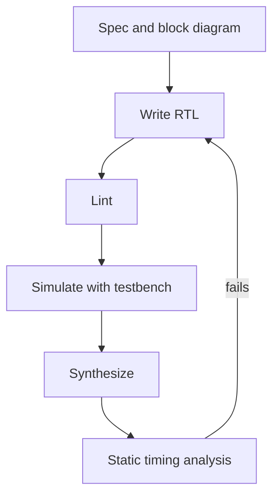

::: basics
### In plain words
The interviewer wants to know what you have actually built in RTL (register-transfer level, the code that describes digital hardware), and whether you think like a hardware engineer. They cannot see your code. So they listen to one real project for your role, your technical choices, and how you checked and measured the result. Honesty about a small project beats a big claim you cannot explain.

### Picture it
A good answer is a short story with a clear beginning, middle and end. It names the project and your part, explains one or two design decisions and why you made them, describes how you tested it, and ends with a number and a lesson. It is like a trip report. A listener should come away knowing exactly what you did, what went wrong, and what you learned.

### Words you need
- **RTL**: code in Verilog, SystemVerilog or VHDL that describes registers (storage cells) and the logic (decision circuits) between them.
- **Synthesis**: the tool step that turns RTL into gates (tiny logic circuits).
- **Testbench**: simulation code that drives the design's inputs and checks its outputs.
- **Timing report**: the tool's list of the slowest paths and whether they meet the clock.
- **Inferred latch**: an unwanted memory element created when a code branch forgets to assign an output.

### The simplest example
Use this skeleton and fill in the *[placeholders]* with true details. "I built *[a UART transmitter, an SPI controller, a FIFO]* in *[language]* for *[class, internship or hobby project]*. My part was *[the blocks you wrote]*, mainly *[a finite state machine plus a counter]*. I tested it with *[a self-checking testbench with corner cases]* and found *[a real bug and its cause]*. Synthesis showed *[frequency and size numbers]*, and I improved the slowest path by *[your fix]*." That is the whole idea. The rest of this page covers hardware-style coding habits, what an interviewer probes, and what to say if your experience is thin.
:::

::: testing
This is a **behavioral question with a technical filter**. The interviewer cannot see your code, so they use your description to probe three things:

1. **What you actually did**, as opposed to what the team did: the block, your role, the size and the tools.
2. **Whether you think in hardware**: that RTL describes registers and combinational logic that will become gates, not a program that runs top to bottom.
3. **Whether you close the loop**: simulation, lint, synthesis and timing, not just writing code that "works in the testbench".

They will follow whichever thread you dangle, so only mention what you can defend. Honesty about a small project is far better than a big claim you cannot explain.
:::

::: why
RTL (register-transfer level) is the main design entry for digital chips and FPGAs, and the job is largely about turning a specification into synthesizable code that meets timing, power and area. Even if you are interviewing for an analog, firmware or validation role, a hardware team often wants to know whether you can read RTL, because bugs found there are cheap and bugs found after tape-out are not. Your answer also reveals engineering habits: do you verify, do you think about reset and clock domains, do you notice what the tool inferred?
:::

::: concepts
- **Register-transfer abstraction**: the design is described as registers (flip-flops) and the combinational logic between them, evaluated each clock cycle. See [[q0882]] and [[q0886]].
- **Synthesizable subset**: the part of Verilog, SystemVerilog or VHDL that tools can map to gates; testbench constructs like delays are not synthesizable.
- **Finite state machines**: control logic written as state register plus next-state logic. See [[q0896]] and [[q0897]].
- **Clocking and reset**: synchronous versus asynchronous reset, clock domains, metastability. See [[q0887]].
- **Verification**: self-checking testbenches, assertions, coverage, waveform debugging.
- **Timing closure**: setup and hold, critical paths. See [[q0880]].
- **Design flow**: spec, RTL, lint, simulation, synthesis, static timing analysis, place and route.
:::

::: answer
"I'd answer this with one concrete project rather than a list of buzzwords. Mine was *[your project: e.g. a UART transmitter/receiver, a small RISC-V core, an SPI controller, a FIFO, a PWM generator]* in *[Verilog / SystemVerilog / VHDL]*, done in *[a class, a hobby project on an FPGA board, an internship]*.

My part was *[the blocks you owned]*. For example, the core of it was a finite state machine with a baud-rate counter and a shift register, written with a clocked process for the state and a combinational block for next-state and outputs, using non-blocking assignments for registers so it simulates the way it synthesizes.

I verified it with a testbench that drove random and corner-case inputs and checked outputs against a reference model, and I looked at waveforms to debug. Then I ran it through *[Vivado / Quartus / Yosys / Design Compiler]*, looked at the utilization and timing report, and fixed the critical path by *[adding a pipeline register / simplifying logic]*. The main thing I learned was *[a real lesson: e.g. an unintended latch from an incomplete case statement, or a clock-domain crossing bug]*.

If that's useful, I can go into any piece of it, the FSM, the testbench, or the timing results."
:::

::: technical
**What a technically credible RTL story contains.**
- **Block and interface**: what the module does, its ports, clock and reset, and the protocol it speaks (ready/valid, SPI, AXI-lite).
- **Coding style**: `always @(posedge clk)` with non-blocking `<=` for sequential logic; `always @(*)` (or `always_comb`) with blocking `=` for combinational logic; every branch assigns every output to avoid inferred latches; parameters for widths.
- **Reset strategy**: synchronous or asynchronous reset, and why (asynchronous assert, synchronous release is common practice).
- **FSM style**: separate state register from next-state logic, use enumerated or one-hot encoding, handle illegal states.
- **Verification**: directed tests, constrained-random stimulus, self-checking scoreboards, assertions; coverage to know when you are done.
- **Implementation**: synthesis report numbers (LUTs or gates, flops, maximum frequency), the critical path, and what you did about it.
- **Debugging**: a specific bug, how you found it (waveform, assertion, lint), the cause, and the fix.

**A tiny example worth being able to write.**

```verilog
module sync2 (input wire clk, input wire rst_n,
              input wire d_async, output reg q);
  reg m;
  always @(posedge clk or negedge rst_n)
    if (!rst_n) begin m <= 1'b0; q <= 1'b0; end
    else        begin m <= d_async; q <= m; end
endmodule
```

This two-flop synchronizer is a few lines, but it lets you talk about metastability, clock-domain crossings and why `q` rather than `m` feeds the rest of the design.
:::

::: short
"My RTL experience is *[your project, for example a UART or a small processor]* in *[language]* on *[FPGA or ASIC flow]*. I wrote the FSM and datapath with clocked registers and combinational logic, verified it with a self-checking testbench, then ran synthesis and looked at timing and utilization. The biggest lesson was *[a real bug you hit]*. I'm comfortable going into any part of it."
:::

::: long
"The project I'd point to is *[your project]*, written in *[Verilog / SystemVerilog / VHDL]*, targeting *[an FPGA board / a standard-cell flow]*, in *[class / internship / personal project]*.

The block was *[describe in one sentence what it did]*. I wrote the control as a finite state machine, state in a clocked always block with non-blocking assignments, next-state and outputs in a combinational block with a default assignment at the top so I couldn't create latches by accident. Datapath pieces were *[counters, shift registers, an ALU, a FIFO]* with parameterized widths so I could reuse them.

For verification I wrote a testbench that generated input sequences, including edge cases like back-to-back transactions and reset in the middle of an operation, and compared the outputs against a simple model. I looked at the waveform when something failed. I also ran a linter, which caught *[for example a width mismatch or an unintended latch]*.

Then I pushed it through *[the toolchain]*. The report showed *[numbers: LUT count, maximum frequency]*. The critical path went through *[where]*, and I fixed it by *[adding a pipeline stage / restructuring the logic / constraining properly]*, which took the frequency from *[x]* to *[y]*.

What I took away is that RTL isn't software. You're describing hardware, so you think about what registers exist, what the longest path is, how reset behaves, and how signals cross clock domains. I'd be glad to walk through the state machine or the testbench in more detail."
:::

::: terms
- **RTL**: register-transfer level, a description of hardware as registers and the combinational logic between them, in Verilog, SystemVerilog or VHDL.
- **Synthesis**: the tool step that maps RTL to a gate-level netlist for a given library or FPGA.
- **Non-blocking assignment (`<=`)**: the assignment used for sequential logic so that all registers update together at the clock edge.
- **Inferred latch**: an unintended level-sensitive storage element created when a combinational block does not assign an output in every path.
- **Testbench**: non-synthesizable code that drives inputs and checks outputs of the design under test.
- **Lint**: static checks on RTL for style and likely bugs (width mismatches, latches, multiple drivers, clock-domain issues).
- **STA (static timing analysis)**: checking all paths against setup and hold without simulation.
- **Clock-domain crossing (CDC)**: a signal passing between asynchronous clocks, requiring synchronizers or handshakes.
- **Coverage**: a measure of how much of the design and its scenarios the tests exercised.
:::

::: exceptional
**An average answer** names a language and a project, says "I wrote it and simulated it", and trails off.

**An exceptional answer**:
- Picks *one* project and gives its size and purpose in a sentence, then drills into real technical decisions.
- Shows hardware thinking: mentions what registers were inferred, the critical path and reset strategy, not just functionality.
- Describes verification as a process (self-checking testbench, corner cases, assertions or coverage) and a specific bug found.
- Quotes a concrete implementation result, such as frequency or resource use, and a change that improved it.
- States clearly which parts were their own and which were given.
- Invites follow-ups, which signals confidence, and handles them without bluffing.
:::

::: mistakes
- **Listing languages and tools without a project.** "I know Verilog and VHDL" invites a quiz. Anchor on something you built.
- **Claiming a big design you only touched.** Interviewers probe the interface, the clocking and the bugs. If you cannot answer, it shows. Describe your actual contribution.
- **Writing RTL like software.** Using blocking assignments in clocked blocks, delays in synthesizable code, or loops that imply sequential execution all signal a software mindset.
- **Skipping verification and timing.** "It worked in simulation" with no mention of testbench quality, synthesis results or timing is a red flag.
- **Not knowing what you synthesized.** Be ready to say how many flops, roughly, and what the critical path was.
- **Saying you have no experience.** If it is true, say what you do have (coursework, a lab, reading RTL, an FPGA tutorial) and show you understand the concepts.
:::

::: deep
## What the interviewer hears

An RTL question is really "can you be trusted with a design?" They are listening for evidence of a **complete loop**: spec, code, check, implement, measure, iterate. The structure below works for any experience level.

1. **Context** in one sentence: what it was, where, how big.
2. **Your role**: which blocks were yours.
3. **Technical core**: one or two design decisions with reasons.
4. **Verification**: how you knew it worked.
5. **Implementation result**: a number and a fix.
6. **Lesson**: one honest takeaway.


Figure: The loop an interviewer expects you to have gone round at least once. Mention each stage you really touched; the arrow from timing back to RTL is where most of the learning happens.

## Hardware thinking: the idea they are testing for

RTL looks like code, but every statement describes a piece of hardware that exists all the time and runs in parallel.

- A **clocked block** with `<=` becomes flip-flops that all sample their inputs at the same clock edge.
- A **combinational block** becomes gates. If it assigns an output only in some branches, the tool must remember the old value, so it infers a **latch**. This is the classic first bug:

```verilog
// BUG: no else, so q holds its value -> inferred latch
always @(*) if (en) q = d;

// FIX: assign in every path
always @(*) begin
  q = 1'b0;            // default
  if (en) q = d;
end
```

- A `for` loop in synthesizable RTL is unrolled into parallel hardware; its bound must be a constant.
- A `#10` delay or a `$display` is simulation only and ignored by synthesis.

Being able to say this out loud, unprompted, signals you have crossed from "wrote Verilog" to "design hardware".

## A worked example of a story you can adapt

Suppose the project was a UART transmitter at 115200 baud on a 50 MHz clock.

- **Baud divider**: $50\times10^6 / 115200 = 434.03$, so a counter that counts 0 to 433 (434 clocks) gives 115207 baud, an error of $+0.006\%$. That is well within the UART tolerance of a few percent (see [[q0771]] for UART basics).
- **Datapath**: a 10-bit shift register (start, 8 data bits, stop).
- **Control**: an FSM with states IDLE, START, DATA, STOP and a bit counter.
- **Verification**: a testbench that sends several bytes, samples `tx` at the middle of each bit time, reassembles the byte and compares it with what was sent, plus a test with a new byte requested while busy.
- **Implementation**: perhaps tens of LUTs and a comfortably high maximum clock on a small FPGA; the interesting part is the counter's compare logic, which could be the critical path if the clock were much faster.

If your project differs, keep the same shape: derive a number, name a data structure, name a bug.


## If your experience is thin

Interviewers value honesty and learning speed. Legitimate things to say:

- "My experience is coursework: a 4-bit ALU and a traffic-light FSM in Verilog, simulated in *[tool]*. I haven't taken a design through synthesis on a large project, but I understand the flow, and I've read through *[an open-source core]*."
- "I've mostly worked on the software side of a team that uses RTL; I can read the code and I've debugged waveforms with the design engineers."

Then **prove understanding** with a short technical remark: blocking versus non-blocking, latch inference, why you need a reset, setup-time-limited paths. Something like the two-flop synchronizer shows you know why clock-domain crossings are dangerous.

> [!INTERVIEW]
> Never invent experience. A follow-up like "what did the synthesis report say?" or "how did you handle reset?" exposes it in seconds. A short true story told well beats a long fictional one.

## Technical knowledge you need to survive the follow-ups

**Assignments.** Use `<=` in clocked blocks and `=` in combinational ones. Mixing them in one block, or using `=` for registers, can create simulation races where results depend on evaluation order.

**Reset.** Asynchronous reset removes the dependency on the clock but needs its de-assertion synchronized to avoid recovery/removal violations, so the common pattern is asynchronous assert, synchronous release. Synchronous reset adds a gate on the D path but keeps timing fully synchronous.

**FSM.** Moore outputs depend only on state, Mealy on state and input, which can cause glitches and combinational paths from input to output. One-hot encoding favors speed on FPGAs; binary saves flops. See [[q0897]].

**Clock-domain crossing.** A single-bit asynchronous signal goes through a 2-flop synchronizer; a multi-bit bus needs a handshake or an asynchronous FIFO with Gray-coded pointers, because binary counters can change many bits at once.

**Timing.** The longest register-to-register path must satisfy $T_{clk} \ge t_{clk\text{-}q} + t_{logic} + t_{su} + t_{skew}$. If it fails, pipeline, restructure, or retime. See [[q0880]].

**Tools.** Simulators (Icarus, Verilator, commercial), waveform viewers, lint, synthesis (Yosys, Vivado, Quartus, Design Compiler). Name only those you used.

```sim
{"id":"fsm-lab","preset":"detect-101"}
```
Figure: If your project involved a controller, this is the abstraction behind it. Press Send 1, 0, 1: each press is one clock edge loading the state register, and the highlighted arrow is the next-state function $\delta(S,x)$, the two pieces you keep in separate always blocks. Note that the Mealy output fires in the same cycle as the last bit while the Moore output lags by one clock, a common follow-up when you describe an FSM you wrote.
:::

::: applications
- **FPGA prototyping and products**: protocol bridges, motor control, video pipelines, data acquisition written in RTL.
- **ASIC blocks**: UARTs, SPI/I2C controllers, DMA engines, caches and arbiters inside an SoC.
- **CPU design**: pipelines, register files and ALUs described at RTL, then verified and synthesized.
- **Hardware accelerators**: matrix multiply engines, crypto blocks, signal-processing filters.
- **Glue logic and bring-up**: small RTL blocks that connect chips on a board and implement custom timing.
- **Verification environments**: reading RTL to write assertions, reference models and coverage.
:::

::: assumptions
- **No fabricated experience.** The answer template uses placeholders; replace them with the truth. Everything technical (blocking/non-blocking, latches, reset, CDC) holds regardless of project.
- **Synthesizable RTL in Verilog/SystemVerilog or VHDL.** If your experience is in high-level synthesis or a hardware construction language, say so and explain how it maps to RTL.
- **FPGA versus ASIC.** FPGA experience is valid and common for interns, but ASIC interviewers may ask about library cells, scan, clock gating and sign-off, so be honest about the difference.
- **Role dependent.** For a verification role emphasize testbenches, coverage and assertions; for design, emphasize architecture and timing; for a firmware role, emphasize register maps and bring-up.
:::

::: followups
### How did you verify the design?
Describe your stimulus (directed and random), the checking method (a reference model or self-checking comparison, assertions on protocol rules), and the metric for completeness (functional coverage, code coverage). For example: "I drove random byte streams and compared the received bytes against the sent bytes, with assertions that `busy` is never high while `idle` is, and I checked that every FSM state and transition was exercised."

### What is the difference between blocking and non-blocking assignment, and why does it matter?
Blocking (`=`) executes immediately and in order, like software; non-blocking (`<=`) schedules the update for the end of the time step so all registers sample the old values. With `<=` in a clocked block, `a <= b; b <= a;` swaps the values, as the hardware would. With `=` it would not, and simulation could differ from synthesis. Rule of thumb: `<=` for sequential logic, `=` for combinational.

### What causes an inferred latch and how do you avoid it?
A combinational process that does not assign a signal on every path forces the tool to hold the old value. Avoid it by assigning defaults at the top of the block, covering all cases in `case` with a `default`, and using `always_comb` in SystemVerilog, which flags incomplete assignments.

### Your timing report fails by 0.4 ns at 200 MHz. What do you do?
The period is 5 ns, so 0.4 ns is about 8% of the path. First read the critical path: is it logic depth, high fanout, or routing? Then pick the remedy: insert a pipeline register (adds a cycle of latency), restructure or balance the logic, duplicate registers to cut fanout, or relax constraints if a path is a multicycle or false path and you can justify it. Last choice is lowering the clock.

### Scenario: your design works in simulation but fails on the FPGA board. How do you debug?
Suspect things simulation hides: asynchronous inputs not synchronized (metastability), missing or glitchy resets, clock-domain crossings, timing failures, uninitialized registers, and simulation-only constructs. I would check the timing and synthesis warnings first, then add an internal logic analyzer on the failing signals, and compare with the simulation waveforms.

### What if the interviewer says "you've only done FPGA, we do ASIC"?
Acknowledge the difference honestly: ASIC adds standard-cell libraries, clock gating and scan insertion, power intent, sign-off timing at multiple corners, and no ability to patch silicon. The RTL discipline, verification and timing thinking carry over directly, and I would say I'm keen to learn the rest. See [[q0955]] for the PPA vocabulary they use.
:::

::: interpretations
"Describe any experience you have with RTL" is open-ended and assumes you may have little. It is not a request for a lecture on what RTL is. Treat it as an invitation to tell a short, true story with technical depth, and as a probe for the vocabulary. The same pattern applies to [[q0964]] (general coding experience) and [[q0966]] (rating your languages). For the design-style questions that often follow, see [[q0957]] (clock divider), [[q0958]] (arbiter) and [[q0959]] (mux).
:::

::: references
- Cummings, S., "Nonblocking Assignments in Verilog Synthesis, Coding Styles That Kill!" (SNUG paper), the classic reference on assignment style; search by title.
- Harris & Harris, *Digital Design and Computer Architecture*: chapters on hardware description languages and sequential logic design.
- Weste & Harris, *CMOS VLSI Design*: the chapter on design methodology and the RTL-to-layout flow.
- IEEE Std 1364 (Verilog) and IEEE Std 1800 (SystemVerilog): the language standards, for the definition of the synthesizable subset and event semantics.
:::

::: rubric
- Names one concrete project with language, scope and your own role :: Interviewers evaluate experience through specifics and ownership, not lists of tools.
- Describes the design in hardware terms (registers, FSM, datapath, interfaces) :: Shows hardware thinking rather than a software mindset.
- Mentions coding style: clocked process with non-blocking assignments, no inferred latches, reset :: These are the basics that separate writers of working RTL from beginners.
- Describes verification beyond "I simulated it" :: A testbench, corner cases and checking show engineering maturity.
- Mentions synthesis and timing results and a fix :: Demonstrates that RTL was taken through to implementation.
- Includes a real bug and what it taught :: Concrete lessons are credible and memorable.
- Is honest about scope and invites follow-ups :: Trust is the point of the question; bluffing is penalized heavily.
:::

::: quiz
```json
[
 {"type":"mcq","level":"fundamental","q":"Which assignment should you normally use for registers in a clocked always block?","options":["Blocking (=)","Non-blocking (<=)","Continuous (assign)","Either, it makes no difference"],"answer":1,"explain":"Non-blocking assignments update all registers together at the end of the time step, matching how flip-flops behave. Blocking assignments in clocked blocks can create ordering-dependent simulation results that differ from synthesis."},
 {"type":"mcq","level":"fundamental","q":"What does an inferred latch usually indicate?","options":["A well-optimized design","A combinational block that doesn't assign an output in every path","Too many flip-flops","A missing clock"],"answer":1,"explain":"If an output isn't assigned in some branches, the tool must hold its previous value, which requires a storage element (a latch). Defaults or complete case statements prevent it."},
 {"type":"numeric","level":"intermediate","q":"A UART transmitter runs from a 50 MHz clock. A counter that counts 434 clocks per bit gives what baud rate?","answer":115207,"tolerance":0.005,"unit":"baud","explain":"$50{,}000{,}000/434 = 115{,}207$ baud, about 0.006% above the nominal 115200."},
 {"type":"truefalse","level":"intermediate","q":"A `#10` delay statement in a module will be implemented as a 10-time-unit delay in the synthesized hardware.","answer":false,"explain":"Delays are simulation constructs. Synthesis ignores them, so relying on them for function leads to a design that works in simulation but not in hardware."},
 {"type":"multi","level":"advanced","q":"Which are standard ways to handle a single-bit signal and a multi-bit bus crossing between asynchronous clock domains? Select all that apply.","options":["Two-flop synchronizer for the single-bit signal","Passing a multi-bit binary bus through independent two-flop synchronizers","Asynchronous FIFO with Gray-coded pointers for the multi-bit data","A request/acknowledge handshake with the data held stable"],"answer":[0,2,3],"explain":"A multi-bit binary bus can change several bits at once, so separate synchronizers may capture an inconsistent mix of old and new bits. Gray-coded pointers change one bit at a time, and handshakes hold data steady."}
]
```
:::
