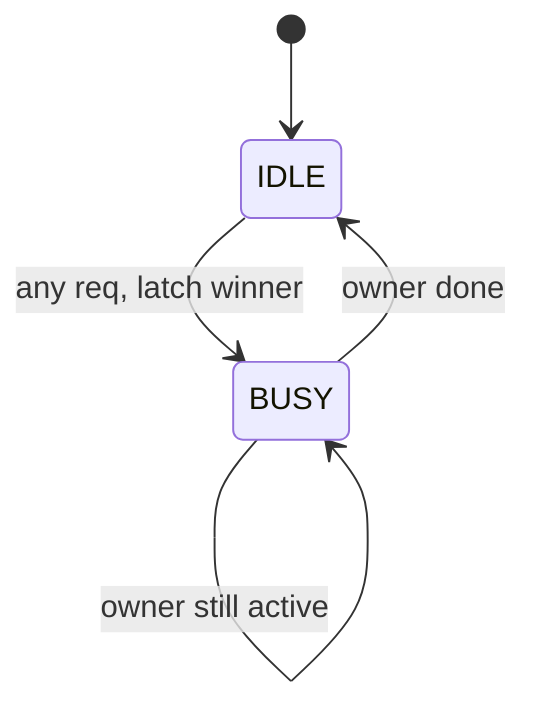

::: testing
Whether you can design a small but subtle piece of control logic **and** reason about fairness, latency and cost. The interviewer is checking:

1. **Requirements first**: how many requesters, one grant per cycle or per transfer, how long a grant is held, whether the arbiter may be combinational.
2. A correct **fixed-priority** arbiter, ideally in one line using the lowest-set-bit trick.
3. A correct **round-robin** arbiter, which is where candidates stumble: the pointer update and the wrap-around.
4. A vocabulary of arbitration schemes (fixed, round-robin, weighted, matrix/LRU, age-based, TDM) with a table of trade-offs: fairness, starvation, latency bound, hardware cost.
5. The invariants: at most one grant, grant only to a requester, no deadlock.
:::

::: why
Anything that shares a resource needs an arbiter: a bus with several masters, a memory controller with many clients, a NoC router's output port, a DMA engine, a shared cache port. Arbiter policy directly sets **latency, bandwidth shares and starvation behavior** of the system, and the arbiter sits on a timing-critical path (request in, grant out, within one cycle in many designs). So it is both an architecture decision and a circuit design problem, which is why it appears as a design question in RTL interviews.
:::

::: concepts
- **Request/grant handshake**: requesters assert `req`; the arbiter asserts at most one `grant`. See [[q0911]] for the interrupt-priority analog.
- **Priority encoder**: logic that selects the highest-priority asserted input; the core of a fixed-priority arbiter.
- **Fairness and starvation**: a fixed-priority scheme can starve a low-priority requester indefinitely.
- **State**: round-robin needs a pointer or mask register; matrix arbiters need pairwise priority bits.
- **FSM view**: an arbiter with grant locking (hold until the transfer ends) is a small state machine. See [[q0896]].
- **Multiplexing**: the grant often drives a mux selecting which master's signals reach the shared resource. See [[q0888]].
- **Throughput versus latency**: the arbiter may add a cycle; choosing combinational or registered grants trades timing for latency.
:::

::: answer
"I'd start by asking how many requesters there are, whether a grant lasts one cycle or until the transfer finishes, and whether I need fairness or just priority.

The simplest arbiter is fixed priority. Requester zero always wins if it's asking, otherwise requester one, and so on. In RTL it's just a priority encoder, and there's a neat one-liner: the grant is the request vector AND its two's complement negation, which isolates the lowest set bit. It's tiny and fast, but a low-priority requester can starve if the high-priority ones keep asking.

For fairness I'd use round-robin. I keep a mask of requesters that haven't been served this round. If any masked request is active I pick the highest priority among those; otherwise I pick from the unmasked requests. After a grant I update the mask to cover only the requesters above the one that just won. That guarantees that with N requesters, nobody waits more than N minus 1 grants.

Beyond that there's weighted round-robin for bandwidth shares, matrix or least-recently-used arbiters that track pairwise priority, age-based arbiters that serve the oldest request for bounded latency, and time-division schemes with fixed slots for hard real-time guarantees. The trade-off is fairness and latency guarantees against logic cost and timing.

I'd also check invariants: grant is one-hot or zero, a grant only goes to a requester, and I'd verify no starvation in round-robin with a test."
:::

::: technical
**Interface.** `req[N-1:0]` in, `grant[N-1:0]` out, one-hot or all-zero. Optionally `busy` or `last` to lock a multi-cycle grant.

**Fixed priority (bit 0 highest).**

```verilog
module arb_fixed #(parameter N = 4) (input wire [N-1:0] req, output wire [N-1:0] grant);
  assign grant = req & (~req + 1'b1);   // isolate lowest set bit
endmodule
```

Because $-x = \sim x + 1$ flips every bit above the lowest set bit, ANDing with $x$ leaves only that bit.

**Round-robin with a mask.**

```verilog
module arb_rr #(parameter N = 4) (
  input  wire clk, input wire rst_n,
  input  wire [N-1:0] req, output wire [N-1:0] grant);
  reg  [N-1:0] mask;                         // eligible requesters this round
  wire [N-1:0] mreq = req & mask;
  wire [N-1:0] g_m  = mreq & (~mreq + 1'b1);
  wire [N-1:0] g_u  = req  & (~req  + 1'b1);
  assign grant = (|mreq) ? g_m : g_u;        // fall back when masked set is empty
  always @(posedge clk or negedge rst_n)
    if (!rst_n)       mask <= {N{1'b1}};
    else if (|grant)  mask <= ~((grant << 1) - 1'b1) & {N{1'b1}}; // bits above winner
endmodule
```

I simulated both: with all four requesting, round-robin grants 0, 1, 2, 3, 0, 1, ... while the fixed arbiter grants requester 0 every cycle; with only requesters 1 and 3 active, round-robin alternates between them.

**Properties.** (1) `grant` is one-hot or zero; (2) `grant & ~req == 0`; (3) if `|req` then `|grant`; (4) round-robin: a continuously asserted request is granted within $N$ grant cycles.

**Types and trade-offs.**

| Scheme | Fairness | Worst-case wait | State | Notes |
|---|---|---|---|---|
| Fixed priority | None; can starve | Unbounded for low priority | none | Smallest, fastest; used when priority is meaningful |
| Round-robin | Equal shares | $N-1$ other grants | $\log N$ or $N$ bits | Default fair choice |
| Weighted round-robin | Proportional to weights | bounded by sum of weights | counters | Bandwidth shaping |
| Matrix / LRU | Least recently served first | $N-1$ grants | $N(N-1)/2$ bits | Strong fairness, cost grows as $N^2$ |
| Age-based (oldest first) | Fair in time | bounded | timestamps/counters | Used where latency bounds matter; comparators cost area |
| TDM (fixed slots) | Static | slot period | slot counter | Deterministic for real-time, wastes idle slots |
:::

::: short
"An arbiter picks one winner among simultaneous requests. Fixed priority is a priority encoder, `req & -req`, tiny and fast but it can starve low-priority requesters. Round-robin keeps a mask or pointer so every requester gets a turn, with a worst-case wait of N minus 1 grants. Other schemes are weighted round-robin, matrix or LRU, age-based and time-division, each trading fairness and latency guarantees against area and timing."
:::

::: long
"An arbiter decides which of several requesters gets a shared resource. I'd first ask how many requesters, how long a grant lasts, and whether fairness matters.

The base design is a fixed-priority arbiter. Requests come in as a vector, and the grant is the highest-priority set bit. In Verilog I can write it as req AND the negation of req, which keeps only the lowest set bit. It's smallest and fastest, and a good fit when the priorities genuinely mean something, like an interrupt controller. The problem is starvation: if a high-priority requester keeps asking, the others never win.

For fairness I'd go round-robin. I keep a mask register of who is still eligible this round. If any masked request is active I run the fixed-priority logic on just those; if none are, I run it on all of the requests and reset the mask. When someone wins, the mask is updated to include only the requesters above the winner. So the winner goes to the back of the line, and any requester waits at most N minus 1 other grants. For a bus that does multi-cycle bursts I'd add a lock so the grant holds until the transfer completes, otherwise two masters could interleave a burst.

Then the alternatives. Weighted round-robin gives bandwidth shares, like four to two to one. A matrix arbiter keeps a bit for every pair of requesters recording who won last, which gives true least-recently-served ordering at N squared cost. Age-based arbiters serve the oldest request, good for latency bounds in a memory controller. TDM gives each master a fixed slot, which is deterministic for real-time systems but wastes slots when masters are idle.

I'd verify with assertions: grant is one-hot, only goes to requesters, and in round-robin no continuously asserted request waits more than N grants."
:::

::: terms
- **Arbiter**: logic that grants a shared resource to one of several simultaneous requesters.
- **Starvation**: a requester never being granted because others always win.
- **Priority encoder**: logic that outputs the index (or one-hot) of the highest-priority asserted input.
- **Round-robin**: rotating priority so the most recently served requester has the lowest priority next.
- **Weighted round-robin**: round-robin where each requester gets a number of grants proportional to a weight.
- **Matrix arbiter**: stores a priority bit for every pair of requesters to implement least-recently-served priority.
- **Grant locking (hold)**: keeping a grant until the owner finishes a multi-cycle transfer.
- **Age-based arbitration**: serving the oldest outstanding request first.
- **TDM (time-division multiplexing)**: assigning fixed time slots to each requester.
:::

::: exceptional
**An average answer** says "use a priority encoder" or "rotate the priority", and lists names of schemes.

**An exceptional answer**:
- Starts by fixing the interface and protocol: one-cycle grants versus held grants, combinational versus registered output.
- Gives the lowest-set-bit one-liner and a **correct, complete round-robin** (mask plus fallback) rather than hand-waving "rotate".
- States the invariants as assertions and how they would be tested, including a starvation check.
- Quantifies the trade-offs: worst-case wait $N-1$, matrix cost $N(N-1)/2$, bandwidth share for weights.
- Mentions timing: the arbiter is a request-to-grant path, depth $\log N$ with a tree, and may need pipelining or a registered grant.
- Ties the policy to the system: fixed for interrupts, round-robin for fairness, age or QoS for memory controllers, TDM for hard real-time.
:::

::: mistakes
- **Round-robin that restarts at requester 0 each time.** That degenerates into fixed priority. The pointer or mask must move relative to the last winner.
- **Updating the pointer when nobody wins.** If no request is active, the mask should stay put; otherwise fairness drifts.
- **Allowing two grants.** A bug in the masked/unmasked fallback can produce more than one bit set. Assert one-hot.
- **Granting to a non-requester.** Grant must be a subset of the requests in that cycle.
- **Forgetting multi-cycle transfers.** Without a lock, the arbiter re-arbitrates mid-burst and corrupts the transaction.
- **Ignoring timing.** A long chain of AND/OR priority logic over many requesters becomes the critical path. Use a tree, pipeline, or precompute.
- **Claiming round-robin is perfectly fair for all workloads.** It gives equal *grant* counts; if transfer lengths differ, bandwidth is unequal.
:::

::: deep
## Setting up the problem

Before coding, pin the contract.

| Question | Why it matters |
|---|---|
| How many requesters $N$? | Sets logic depth and which schemes are affordable. |
| Grant for one cycle or until the transfer ends? | One-cycle needs no lock; bursts need a hold. |
| Must `grant` be combinational from `req`, or can it be registered? | Combinational is lowest latency but longest path; registered costs a cycle. |
| Are priorities fixed by function? | Interrupt controllers want strict priority; shared buses want fairness. |
| Is there a latency or bandwidth requirement? | Drives weighted, age-based or TDM choices. |

## Fixed priority and the lowest-set-bit trick

Let $r$ be the request vector with bit 0 highest priority. Two's complement negation is $-r = \sim r + 1$. If the lowest set bit of $r$ is at position $k$, then $\sim r$ has ones in bits $0..k-1$ and zero at bit $k$; adding 1 carries through bits $0..k-1$ to make them zero and sets bit $k$ back to one, leaving bits above $k$ inverted. So $r \,\&\, (-r)$ keeps only bit $k$.

Example: $r = 1010_2$. $\sim r = 0101$, $+1 = 0110$, $r \,\&\, 0110 = 0010$, so requester 1 is granted. As logic, that carry chain is a ripple structure, but synthesis tools restructure it into a tree of depth about $\log_2 N$ (4 levels for 16 requesters, 6 for 64).

```timing
{"signals":[
 {"name":"CLK","wave":"p........"},
 {"name":"REQ0","wave":"111111111"},
 {"name":"REQ1","wave":"111111111"},
 {"name":"REQ2","wave":"111111111"},
 {"name":"GNT0 (fixed)","wave":"111111111","color":"red"},
 {"name":"GNT1 (fixed)","wave":"000000000","color":"red"},
 {"name":"GNT2 (fixed)","wave":"000000000","color":"red"}
],"hscale":0.9}
```
Figure: Fixed priority with all three requesters asserting continuously: requester 0 takes every grant, requesters 1 and 2 starve. Priority is the correct design when a requester's importance is absolute, but it is dangerous for shared bandwidth.

## Round-robin: the mask method

A common correct implementation avoids a barrel-rotate. Keep a mask register where bit $i$ is 1 if requester $i$ is "still eligible this round".

1. Compute masked requests $m = r \,\&\, \text{mask}$.
2. If $m \ne 0$: grant = lowest set bit of $m$.
3. Else: grant = lowest set bit of $r$ (a new round starts: everyone eligible again).
4. After a grant at bit $k$, set mask $=$ all bits strictly above $k$ (bits $k+1$ to $N-1$ ones, the rest zeros). If $k=N-1$ the mask is 0, so the next round starts from the unmasked fallback.

Trace with four requesters all asserting: mask starts 1111, grant 0001; mask becomes 1110, grant 0010; mask 1100, grant 0100; mask 1000, grant 1000; mask 0000 so masked requests are empty and fallback grants 0001 again. The simulated outputs were exactly 0, 1, 2, 3, 0, 1, 2, 3. With only requests 1 and 3 active (1010): mask 1111, grant 0010; mask 1100, masked request 1000, grant 1000; mask 0000, fallback grants 0010; so the two alternate.

```timing
{"signals":[
 {"name":"CLK","wave":"p........"},
 {"name":"REQ0","wave":"111111111"},
 {"name":"REQ1","wave":"111111111"},
 {"name":"REQ2","wave":"111111111"},
 {"name":"GNT0 (RR)","wave":"100100100","color":"accent"},
 {"name":"GNT1 (RR)","wave":"010010010","color":"accent"},
 {"name":"GNT2 (RR)","wave":"001001001","color":"accent"}
],"hscale":0.9}
```
Figure: Same requests as the previous figure, now with round-robin. Each requester gets every third grant; the worst-case wait for a requester is the other $N-1 = 2$ grants. This is the fairness the fixed-priority arbiter lacks.

**Alternative implementation:** keep a pointer $p$ (the last winner), rotate the request vector right by $p+1$, run a fixed-priority encoder, and rotate the result back. That needs two barrel rotators, costing area and delay. Another approach duplicates the priority encoder: one on masked requests, one on all requests, and selects, which is the mask scheme above and costs about two encoders plus a mask register.

## Bounds and numbers

- **Round-robin latency.** A requester that asserts at any time waits for at most the other $N-1$ requesters' grants. If each grant holds the resource for $L$ cycles, worst-case wait is $(N-1)L$: for $N=8$ and 4-cycle transfers, $7\times4 = 28$ cycles.
- **Weighted round-robin.** With weights 4:2:1:1 the shares are 50%, 25%, 12.5% and 12.5% of grants. Implementations either give each requester `w_i` grants in a row (bursty) or interleave them (smoother, lower jitter).
- **Matrix arbiter state.** One bit for each pair: $N(N-1)/2$ bits, 28 bits for $N=8$, and 120 for $N=16$. Each bit says whether $i$ has priority over $j$; after $i$ wins, it becomes lowest priority against everyone by flipping its row and column. It implements true least-recently-served and is attractive for small $N$ in high-speed routers because the grant logic is shallow.
- **Bandwidth fairness vs grant fairness.** If requester A moves 64-byte bursts and B moves 4-byte transfers, round-robin by grant gives A 16 times B's bandwidth. If bandwidth equality matters, arbitrate in units of data or use weights inversely proportional to burst size.

## Holding a grant: the FSM view

For a burst of several cycles, the arbiter needs state: IDLE, then a GRANTED state that holds the current owner until `last` or `req` deasserts, and re-arbitration only in IDLE or at the end.


Figure: The lock FSM. Arbitration logic runs only in IDLE (or in the last cycle of BUSY, for back-to-back transfers with no dead cycle). The winner is stored in a register so the shared-resource mux keeps a stable select throughout the burst.

Two timing variants: **combinational grant** (grant responds to `req` in the same cycle; lowest latency but a long input-to-output path), or **registered grant** (one cycle slower, much better timing; usually combined with a skid or look-ahead so no bandwidth is lost).

## Other policies in practice

- **Age-based**: tag each request with a timestamp or counter and pick the oldest; used in memory controllers and on-chip networks to bound tail latency. Cost: comparators or a sorted structure.
- **QoS/priority classes with round-robin inside the class**: a hybrid. Real-time traffic gets strict priority up to a rate limit (so it cannot starve the rest), then best-effort traffic shares round-robin.
- **TDM**: slot $i$ belongs to master $i$ whether or not it needs it. Deterministic worst-case latency, so it is used in safety-critical and real-time systems, but unused slots waste bandwidth.
- **Random/lottery**: probabilistic fairness; simple, but the worst case has no bound.
- **Bitwise arbitration on a wired bus**: in I2C and CAN, masters drive the bus simultaneously and the one sending a 0 where others send 1 wins (wired-AND), so arbitration is by comparing bits on the fly, with lowest address or ID winning.

Interrupt priority in [[q0911]] is a hardware fixed-priority arbiter; a DMA controller with several channels often uses round-robin among equal-priority channels. 

## Verification

Write properties, then drive random requests:

1. `$onehot0(grant)` every cycle.
2. `(grant & ~req) == 0`.
3. `|req |-> |grant` (work-conserving), unless a lock is active.
4. Starvation: for each $i$, if `req[i]` is held high then within $N$ grants `grant[i]` occurs (round-robin only; expect this to fail for fixed priority, which makes a nice negative test).
5. Coverage: every requester wins, all single and multiple request combinations, simultaneous request on reset release.

## Scaling up

At large $N$ the single-level priority encoder is a long path. A **two-level (tree) arbiter** groups requesters, picks a winner per group, then arbitrates among groups; it shrinks each encoder (less fan-in, shorter wires) and lets the group-level arbiters work in parallel, and with round-robin at each level it stays fair per level, though overall fairness is only approximate. On-chip router allocators use **separable** input-first or output-first arbiters because a full matching problem is too slow to solve in one cycle.
:::

::: applications
- **Shared buses** (AMBA AXI/AHB-style interconnects): the interconnect arbitrates multiple masters for each slave port.
- **Memory controllers**: arbitrate among CPU, GPU, display and DMA with priority classes and age to bound latency and keep the display fed.
- **Network-on-chip routers**: allocate output ports and virtual channels with round-robin or matrix arbiters.
- **DMA engines and interrupt controllers**: pick the next channel or interrupt source to service.
- **I2C and CAN buses**: bitwise arbitration between multiple masters on a wired-AND bus.
- **Shared cache ports and FIFOs**: arbitrate among several producers writing to one queue.
:::

::: assumptions
- **Synchronous design with one-cycle arbitration** and a binary request/grant interface. Protocol details (AXI ready/valid) change when the arbiter is allowed to switch.
- **Number of requesters small (4 to 16)** so a flat priority encoder is acceptable; larger arrays use trees.
- **Equal-size transactions** when claiming fairness; unequal sizes need weights or byte-based accounting.
- **Fixed policy at design time.** Run-time programmable priorities need additional registers and care to avoid changing the mask mid-grant.
- **Combinational timing is assumed to close.** If not, register the grant.

Another valid way to answer is to describe the arbiter first as a **mux select generator** attached to the shared resource, then pick the policy; interviewers accept any structured approach that reaches a correct RTL structure.
:::

::: followups
### Why does round-robin guarantee no starvation, and what is the worst-case wait?
After a requester wins it is excluded from the mask until every other pending requester has been served or the round ends. Any requester that keeps its request asserted will therefore be reached within one pass, so it waits at most $N-1$ other grants. With transfers of $L$ cycles each, the bound is $(N-1)L$ cycles.

### How would you build a weighted arbiter giving 4:2:1:1 shares?
Use per-requester credit counters loaded with the weights. Grant the requester with credit left, using round-robin among them, decrement on each grant; when all credits are zero or no credit-holder is requesting, reload. In the long run grants are split 50:25:12.5:12.5. To reduce burstiness, interleave grants instead of giving four in a row to the first requester.

### What changes if the grant must be held for a multi-cycle burst?
Add an owner register and a lock state: arbitrate only when idle or at the final beat, hold the owner's grant while the transfer is active, and drive the data mux from the registered owner. Without it, a higher-priority newcomer could take over mid-burst and break the transaction, unless the protocol supports preemption.

### How does a matrix arbiter work, and when is it worth its cost?
It stores $N(N-1)/2$ bits where bit $(i,j)$ says that $i$ has priority over $j$. A requester wins if no other active requester has priority over it. After a grant, the winner's row is cleared and its column set so it becomes lowest priority. This gives exact least-recently-served behavior with very shallow logic, so it is common in high-speed router allocators with small $N$, but the $N^2$ state is wasteful for large $N$.

### Scenario: a display controller sharing a memory controller with a CPU underruns its buffer even though average bandwidth is sufficient. What do you do with the arbiter?
Average bandwidth is not the issue; worst-case latency is. Give the display requests a higher priority class (or a deadline-based urgency boost when its FIFO falls below a threshold), while rate-limiting it so it cannot starve the CPU. Alternatively, use TDM or reserved slots for the display. Then verify the latency bound with a worst-case traffic test.

### What if timing fails because the arbiter is in the critical path?
Options: use a tree-structured priority encoder, register the request or grant (adding a cycle of latency, perhaps hidden by a skid buffer), precompute the next grant while the current transfer is in progress (look-ahead arbitration), or reduce the number of requesters per arbiter with a two-level scheme.
:::

::: interpretations
"Design an arbiter" without further detail is deliberately open. The page assumes a **request/grant arbiter for a shared resource**, such as a bus, with the common types explained. Some interviewers mean a **bus arbiter** (grant held until done), some a **priority encoder** (fixed priority), and some an **I2C-style bitwise arbiter**. Say which you are designing, then generalize. For the related small RTL building blocks, see [[q0957]] (clock divider) and [[q0959]] (mux), and for your own RTL background, [[q0956]].
:::

::: references
- Dally & Towles, *Principles and Practices of Interconnection Networks*: the chapter on arbitration (fixed-priority, round-robin, matrix and weighted arbiters) in the allocator discussion.
- Harris & Harris, *Digital Design and Computer Architecture*: combinational building blocks (priority encoders) and finite state machines.
- NXP UM10204, *I2C-bus specification and user manual*: the arbitration and clock-synchronization section for multi-master buses.
- Hennessy & Patterson, *Computer Architecture: A Quantitative Approach*: memory-system and interconnect chapters for arbitration in memory controllers.
:::

::: rubric
- Clarifies requirements (requesters, grant duration, fairness, timing) :: Design starts from the contract, and the right arbiter depends on it.
- Implements fixed priority correctly (priority encoder or `req & -req`) :: The base building block must be right and simple.
- Implements round-robin with a correct pointer or mask update and fallback :: The common failure point; it demonstrates real RTL skill.
- Lists the arbiter types (fixed, round-robin, weighted, matrix/LRU, age, TDM) with trade-offs :: The question explicitly asks for types and trade-offs.
- Discusses starvation and worst-case latency quantitatively :: Fairness claims need bounds.
- States invariants (one-hot grant, grant only to requesters) and verification :: Correctness and testing awareness.
- Mentions timing/pipelining and grant locking for bursts :: Practical issues that decide whether the design works in a real system.
:::

::: quiz
```json
[
 {"type":"mcq","level":"fundamental","q":"Which expression isolates the lowest set bit of the request vector `r`?","options":["r | (r - 1)","r & (~r + 1)","r ^ (r >> 1)","~r & (r + 1)"],"answer":1,"explain":"`~r + 1` is `-r`. It has every bit above the lowest set bit inverted, the lowest set bit preserved and zeros below it, so `r & -r` keeps exactly that bit. For r = 1010 the result is 0010."},
 {"type":"mcq","level":"fundamental","q":"What is the main weakness of a fixed-priority arbiter?","options":["It is slow","It can starve low-priority requesters","It cannot produce a one-hot grant","It needs a large amount of state"],"answer":1,"explain":"If higher-priority requesters assert continuously, lower-priority ones are never granted. Fixed priority has no state, which makes it small and fast, at the price of fairness."},
 {"type":"numeric","level":"intermediate","q":"A round-robin arbiter serves 8 requesters. Each grant holds the shared bus for 4 cycles. What is the worst-case wait (in cycles) for a requester that asserts just after it was served?","answer":28,"tolerance":0.01,"unit":"cycles","explain":"It must wait for the other $N-1 = 7$ requesters, each for 4 cycles: $7\\times4 = 28$ cycles."},
 {"type":"numeric","level":"intermediate","q":"How many state bits does a matrix arbiter need for 16 requesters?","answer":120,"tolerance":0.01,"unit":"bits","explain":"One bit per unordered pair: $N(N-1)/2 = 16\\cdot15/2 = 120$."},
 {"type":"truefalse","level":"advanced","q":"A round-robin arbiter that grants by grant count gives each requester an equal share of bandwidth even if their transfer lengths differ.","answer":false,"explain":"It equalizes the number of grants, not the data moved. A requester issuing 64-byte bursts gets 16 times the bandwidth of one issuing 4-byte transfers. Use weights or byte-based accounting for bandwidth fairness."},
 {"type":"multi","level":"advanced","q":"Select the properties you would assert for a correct work-conserving arbiter (no lock active).","options":["`$onehot0(grant)`","`(grant & ~req) == 0`","If `|req` then `|grant`","Requester 0 is granted at least once every N cycles regardless of request pattern"],"answer":[0,1,2],"explain":"Grants must be at most one-hot, only to requesters, and some grant must be issued when any request is active. The last statement is false: a requester that does not request cannot be granted, and the fairness property only applies to requesters that hold their request."}
]
```
:::
