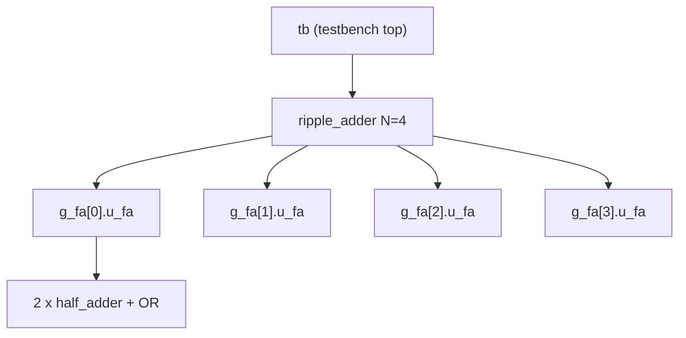

::: testing
Whether you understand **hierarchy** in hardware description, not just the syntax of the word `module`. The interviewer is checking that you know:

1. A module is a *design unit* with a defined interface (ports) and a body, and is **instantiated**, not "called". Each instance is a separate piece of hardware.
2. The difference between the module (the template) and an instance (one copy of the hardware).
3. How modules connect (ports, named association, parameters) and why that makes large designs manageable.
4. That a module is not a function: it describes concurrent structure that exists all the time.
5. A bonus: you recognize that the word is overloaded (RTL module, software module, hardware module such as a Wi-Fi module) and pick the right meaning from context.
:::

::: why
No chip is designed as one flat file. A modern SoC has millions of lines of RTL organized into thousands of modules, owned by different teams, simulated separately, synthesized separately and reused across products. Modules are how teams divide work, how tools run in parallel, how verification can test a block in isolation, and how you reuse a tested block ([[q0961]]). If you cannot explain a module clearly, interviewers will doubt that you can read or write real RTL. It is also the first step toward harder topics such as parameterization, interfaces and hierarchy in physical design.
:::

::: concepts
- **Ports and directions**: `input`, `output`, `inout` define the boundary. Everything inside is hidden behind them. See [[q0956]].
- **Instance**: one copy of a module placed in a parent; its name (for example `u_ha1`) identifies this copy of the hardware.
- **Hierarchy**: modules instantiate other modules, forming a tree from the top level down to leaf cells.
- **Concurrency**: all instances operate in parallel all the time; nothing is "called" or "returned". See [[q0886]] for sequential state.
- **Parameters**: compile-time constants such as bit width, set per instance.
- **Synthesis and flattening**: tools can keep or flatten hierarchy; the physical design often follows module boundaries.
:::

::: answer
"A module is the basic building block in an HDL like Verilog or SystemVerilog. It's a self-contained piece of hardware with a name, a list of ports, which are its inputs and outputs, and a body that describes what's inside, either logic written with assign statements and always blocks, or instances of other modules.

The key idea is that a module is a template, and you place copies of it called instances. If I write a half adder module once and instantiate it twice inside a full adder, I get two separate half adders in the hardware. They all run in parallel, so it's nothing like a software function call. It's more like drawing a block in a schematic and reusing it.

Modules give you hierarchy. A top-level module instantiates sub-modules, which instantiate smaller ones, all the way down to gates or flops. That's how a big chip gets split between teams, and it also lets you simulate, test and synthesize each block on its own.

Ports connect modules together, and I'd use named port connections rather than positional ones, so reordering ports doesn't silently break the wiring. Parameters let me reuse one module at different widths. In VHDL the equivalent is an entity and architecture. Outside RTL the word is also used for hardware modules, like a Wi-Fi module, or software modules, but in this context it's the RTL building block."
:::

::: technical
**Definition.** In Verilog/SystemVerilog a `module` is a design unit enclosed by `module ... endmodule`. It declares an interface (ports) and contains the implementation: continuous assignments, procedural blocks (`always_comb`, `always_ff`), and instances of other modules.

```verilog
module half_adder (
  input  logic a, b,
  output logic s, c
);
  assign s = a ^ b;
  assign c = a & b;
endmodule
```

**Instantiation.** A parent places a child using `ModuleName #(parameters) instance_name (port_connections);`. Named association is preferred: `.a(x)` connects the child's port `a` to the parent signal `x`. Each instance is independent hardware with its own state.

```verilog
module full_adder (input logic a, b, cin, output logic s, cout);
  logic s1, c1, c2;
  half_adder u_ha1 (.a(a),  .b(b),   .s(s1), .c(c1));
  half_adder u_ha2 (.a(s1), .b(cin), .s(s),  .c(c2));
  assign cout = c1 | c2;
endmodule
```

**Parameters.** `module ripple_adder #(parameter int N = 4) (...)` lets the instantiator choose `N`. `localparam` values cannot be overridden. Parameters are resolved at elaboration, so there is no runtime cost.

**Module versus function/task.** A function computes a value from inputs and has no state; a module is a structural entity that exists for the whole simulation and can contain state and processes. Instantiating a module twice creates two hardware blocks; calling a function twice reuses the same code.

**Hierarchy in the flow.** Simulation elaborates the full tree. Synthesis can flatten it (better optimization across boundaries) or keep selected boundaries (for incremental runs, floorplanning, IP). Physical design often places each large module as a block. Equivalents: VHDL uses `entity` plus `architecture`; SystemVerilog adds `interface` and `package` for grouping signals and shared definitions.
:::

::: short
"A module is the basic design unit in Verilog or SystemVerilog: a named block with ports for its inputs and outputs, and a body containing logic or instances of other modules. You write it once as a template and instantiate it as many times as you like, and each instance is separate hardware running in parallel, unlike a software function call. Modules give you hierarchy, so teams can split a chip into blocks, test each one alone, and reuse them. In VHDL the equivalent is an entity with an architecture."
:::

::: long
"A module is the fundamental building block of RTL in Verilog or SystemVerilog. It has a name, a port list that defines its interface, and a body that defines its behavior.

Let me use an example. I write a half adder module with inputs a and b, outputs sum and carry, and two assign statements. Then in a full adder module I instantiate that half adder twice and connect them with a few wires and an OR gate. In the final hardware there are two half adders, each its own copy of the logic. That's the distinction I'd stress: the module definition is a template, and each instance is physical hardware that exists and runs all the time, in parallel. It isn't called and it doesn't return, so it's not like a function.

The big payoff is hierarchy. A top-level module instantiates a CPU, a memory controller and some peripherals, each of which is built from smaller modules, down to registers and gates. That lets different engineers own different blocks, lets me simulate or synthesize a block by itself, and lets me reuse a verified block somewhere else.

For good practice, I connect ports by name rather than by position, so changing a port order doesn't silently break the wiring. I'd use parameters for things like bus width so the same module works at 8 or 32 bits. And I'd keep ports narrow and well documented, because the port list is the contract with the rest of the design.

In VHDL it's an entity plus an architecture, and in SystemVerilog there are also interfaces that bundle related ports. Finally, I'd mention that outside RTL people also say module for a hardware subassembly like a GPS module, or for a Python file, so I'd check which meaning the interviewer wants."
:::

::: terms
- **Module**: Verilog/SystemVerilog design unit with ports and a body; the unit of hierarchy and reuse.
- **Port**: a named, directional connection between a module and its parent (`input`, `output`, `inout`).
- **Instance**: one placed copy of a module inside a parent, with its own name and state.
- **Instantiation**: the act of placing an instance, with port and parameter connections.
- **Hierarchy**: the tree of modules instantiating modules; the top module is the root.
- **Parameter**: a compile-time constant, overridable per instance (for example data width).
- **Named association**: connecting ports by name (`.a(x)`), robust to port reordering.
- **Entity / architecture**: VHDL's equivalent of a module's interface and body.
- **Flattening**: synthesis merging a hierarchy into one level so optimization can cross boundaries.
- **Testbench top**: a module with no ports that instantiates the design under test and drives it.
:::

::: exceptional
**An average answer** says "a module is like a function in Verilog" or "a block of code with inputs and outputs".

**An exceptional answer**:
- Corrects the function analogy: a module is a concurrent hardware structure, instances all exist at once.
- Distinguishes module (template) from instance (hardware) and shows a short example, such as a full adder from half adders.
- Uses named port connections and parameters, and says why.
- Connects hierarchy to team workflow: ownership, block-level verification, incremental synthesis, floorplanning.
- Mentions the VHDL equivalent and SystemVerilog `interface`, and clarifies that "module" is also used for hardware modules and software modules.
- Knows a typical pitfall: unconnected inputs, width mismatches on ports, implicit nets.
:::

::: mistakes
- **"A module is just a function."** A function is called and returns; a module is hardware that exists concurrently. Instantiating it twice creates two copies.
- **Positional port connections on big modules.** Adding or reordering a port silently rewires signals. Use `.name(signal)`.
- **Leaving an input unconnected.** It floats to `z`, and a `z` or `x` propagates through the logic in simulation. Tie unused inputs explicitly.
- **Width mismatch across a port.** Verilog silently truncates or zero-extends, so a 16-bit bus into an 8-bit port loses the top byte with no error unless you enable lint checks.
- **Assuming hierarchy means separate chips.** After synthesis the tool may flatten the hierarchy; the module tree is a design structure, not a physical boundary, unless the flow keeps it.
- **Mixing up module and testbench.** A testbench is a module too, but it has no ports and is not synthesized.
:::

::: deep
## What problem a module solves

A flat netlist of ten thousand gates is unmanageable. Digital designers borrow the oldest trick in engineering: **divide and conquer with a defined interface**. A module hides internal detail behind ports, so a user only needs to know what goes in, what comes out and when (the timing contract).

Schematically, a module is simply a box:

```circuit
{"caption":"A module is a box with a contract","elements":[
 {"t":"box","at":[4,0],"w":8,"h":6,"label":"half＿adder","pins":[
  {"side":"left","pos":2,"name":"a"},
  {"side":"left","pos":4,"name":"b"},
  {"side":"right","pos":2,"name":"s"},
  {"side":"right","pos":4,"name":"c"}]},
 {"t":"term","at":[0,2],"label":"a","side":"left"},
 {"t":"wire","pts":[[0,2],[4,2]]},
 {"t":"term","at":[0,4],"label":"b","side":"left"},
 {"t":"wire","pts":[[0,4],[4,4]]},
 {"t":"wire","pts":[[12,2],[16,2]]},
 {"t":"term","at":[16,2],"label":"sum","side":"right"},
 {"t":"wire","pts":[[12,4],[16,4]]},
 {"t":"term","at":[16,4],"label":"carry","side":"right"}
]}
```
Figure: From outside you see only the ports: inputs a and b, outputs s and c. The body (an XOR and an AND here) could change as long as the functionality and timing contract hold.

## Module versus instance

Think of a **cookie cutter** and **cookies**. The module definition is the cutter; every `half_adder u_ha1 (...)` line makes a cookie. Two instances means two physical copies of the XOR and AND, each with its own wires. This is why instance names matter: they give each copy a unique hierarchical path such as `top.u_cpu.u_alu.u_ha1`, which you use in waveform viewers, constraints and debug.

## Building up: half adder to full adder to ripple adder

A full adder adds three bits $a$, $b$, $c_{in}$ and produces a sum and carry-out. It can be built from two half adders and an OR:

$$s_1 = a\oplus b,\quad c_1 = a\cdot b,\quad s = s_1\oplus c_{in},\quad c_2 = s_1\cdot c_{in},\quad c_{out} = c_1 + c_2$$

```circuit
{"caption":"Full adder built from two half_adder instances","elements":[
 {"t":"box","at":[6,1],"w":4,"h":6,"label":"u＿ha1","pins":[
  {"side":"left","pos":2,"name":"a"},{"side":"left","pos":4,"name":"b"},
  {"side":"right","pos":2,"name":"c"},{"side":"right","pos":4,"name":"s"}]},
 {"t":"box","at":[14,1],"w":4,"h":6,"label":"u＿ha2","pins":[
  {"side":"left","pos":4,"name":"a"},{"side":"bottom","pos":2,"name":"b"},
  {"side":"right","pos":2,"name":"c"},{"side":"right","pos":4,"name":"s"}]},
 {"t":"term","at":[0,3],"label":"a","side":"left"},{"t":"wire","pts":[[0,3],[6,3]]},
 {"t":"term","at":[0,5],"label":"b","side":"left"},{"t":"wire","pts":[[0,5],[6,5]]},
 {"t":"wire","pts":[[10,5],[14,5]]},
 {"t":"text","at":[12,4.4],"text":"s1","muted":true},
 {"t":"term","at":[0,9],"label":"cin","side":"left"},{"t":"wire","pts":[[0,9],[16,9],[16,7]]},
 {"t":"wire","pts":[[10,3],[12,3],[12,-1],[20,-1],[20,2],[22,2]]},
 {"t":"wire","pts":[[18,3],[19,3],[19,4],[22,4]]},
 {"t":"or","at":[22,3],"inputs":2},
 {"t":"wire","pts":[[26,3],[28,3]]},{"t":"term","at":[28,3],"label":"cout","side":"right"},
 {"t":"wire","pts":[[18,5],[20,5],[20,7],[28,7]]},{"t":"term","at":[28,7],"label":"sum","side":"right"}
]}
```
Figure: Two copies of the same half adder module (instances `u_ha1` and `u_ha2`) plus an OR gate form the full adder. The hierarchy is a full adder (parent) with two half adder children, and the carries from both are OR-ed.

You can check the full adder in the gate simulator and see it matches the equations above.

```sim
{"id":"logic-lab","preset":"full-adder"}
```
Figure: Load the full-adder preset and toggle a, b and carry-in through all 8 combinations. Verify that sum is the XOR of the three inputs and carry-out is high when at least two inputs are high.

Now stack N full adders for an N-bit ripple adder, using a `generate` loop:

```verilog
module ripple_adder #(parameter int N = 4) (
  input  logic [N-1:0] a, b,
  input  logic         cin,
  output logic [N-1:0] s,
  output logic         cout
);
  logic [N:0] c;
  assign c[0] = cin;
  for (genvar i = 0; i < N; i++) begin : g_fa
    full_adder u_fa (.a(a[i]), .b(b[i]), .cin(c[i]), .s(s[i]), .cout(c[i+1]));
  end
  assign cout = c[N];
endmodule
```

Count the hardware. Each half adder is 1 XOR + 1 AND, so a full adder is $2+2 = 4$ gates plus the OR = 5 gates. A 4-bit ripple adder is $4\times5 = 20$ gates, and a 32-bit one is 160 gates. The carry path from $c_{in}$ to $c_{out}$ goes through one AND and one OR per bit: 2 gate delays per bit, so 8 gate delays for 4 bits and 64 for 32 bits. That is why wide adders use carry-lookahead. The module hierarchy did not change that physics; it only organized it.


Figure: The hierarchy tree. The testbench instantiates the design, the adder instantiates four full adders via generate, and each full adder instantiates two half adders. Each box on the same level is a separate instance, so a hierarchical path from the testbench down through the tree points to exactly one XOR/AND pair.

## Connecting modules correctly

**Named association** removes ordering errors:

```verilog
// Fragile: swap two ports in the module definition and this still compiles
half_adder u1 (x, y, sum, carry);
// Robust
half_adder u1 (.a(x), .b(y), .s(sum), .c(carry));
```

**Parameters** are overridden at instantiation: `fifo #(.W(32), .DEPTH(16)) u_fifo (...)`. They are resolved when the design is elaborated, so a 32-bit instance and an 8-bit instance become differently sized hardware. A 16-deep, 32-bit FIFO holds $16\times32 = 512$ bits of storage.

**Common wiring bugs** that lint tools catch:
- **Implicit nets**: a misspelt signal on a port connection silently creates a 1-bit wire. Use `` `default_nettype none ``.
- **Width mismatch**: connecting an 8-bit signal to a 16-bit port zero-extends it; the reverse truncates.
- **Unconnected inputs**: float as `z` and then `x` downstream.
- **Multiple drivers**: two instances driving the same net.

> [!TIP]
> If asked "what is a module?", mention both views in one breath: **from the outside** it is a black box with a port contract, and **from the inside** it is concurrent logic. That separation is the whole reason hierarchy works.

## Anatomy of a good module

A well-formed module is easy for someone else to drop into a design. Habits worth stating in an interview:

1. **One clear job.** If you cannot name the module's function in a short phrase ("arbiter", "FIFO", "CRC generator"), it is probably doing too much and should be split.
2. **A narrow, documented port list.** Every port has a direction, a width, a polarity (active-high or active-low, usually marked `_n`) and a clock domain. Ports that cross clock domains are called out explicitly, because that is where metastability bugs live ([[q0887]]).
3. **Registered outputs where timing matters.** If a module's outputs come straight from flip-flops, the parent does not need to know the module's internal logic depth, which makes timing closure at the integration level far easier.
4. **No hidden dependencies.** A module should not reach into another module's signals by hierarchical path (`top.u_a.sig`). That works in simulation but is not synthesizable and breaks the moment someone renames an instance.
5. **Naming convention.** `u_` prefix for instances, `_n` suffix for active-low, `_i` / `_o` for inputs and outputs: consistent naming makes waveforms and netlists readable.

A useful check: could you write a standalone testbench for the module using only its port list and its spec? If yes, the boundary is clean. If you need to peek inside, the interface is leaking.

## Module boundaries in the real flow

- **Simulation** elaborates everything and runs it as one event-driven model, but each module can be tested alone with a small testbench.
- **Synthesis** can flatten the whole design (best optimization) or preserve boundaries (faster incremental runs, protection of IP, easier timing budgets).
- **Floorplanning and place-and-route** often treat large modules as physical blocks, so the module tree decides who owns which piece of silicon area.
- **Interfaces**: SystemVerilog `interface` bundles related signals (for example an AXI channel) so a module has one port instead of 40, reducing connection errors.

> [!NOTE]
> The word "module" is overloaded. In Python, a module is a `.py` file you import. In hardware design it can also mean a pre-built board, such as a Wi-Fi or GPS module, or a System-on-Module ([[q0931]]). For this question the RTL meaning is the intended one, but one sentence acknowledging the others shows awareness.
:::

::: applications
- **CPU design**: a core is a hierarchy of fetch, decode, ALU, load-store and register-file modules, each owned and verified by a separate team.
- **IP reuse**: a UART, SPI or I2C controller module is written once and instantiated in many chips ([[q0961]]).
- **FPGA projects**: top-level module instantiates vendor primitives (PLL, block RAM) as modules plus your own logic.
- **Verification**: a testbench top module instantiates the design under test and drives its ports.
- **Physical design**: large modules (such as a GPU shader core) become hard macros that are replicated across the die.
- **Bus fabrics**: one parameterized crossbar module instantiated at different port counts for different SoCs.
:::

::: assumptions
- **Verilog/SystemVerilog terminology.** In VHDL the same idea is split into `entity` (ports) and `architecture` (body); in Chisel it is a `Module` class.
- **Synthesizable RTL context.** In a testbench, modules can include non-synthesizable constructs (delays, `$display`).
- **Hardware modules and software modules** have different meaning; this page assumes the RTL meaning, as the question sits under the RTL section.
- **Hierarchy is logical.** After synthesis and optimization the physical netlist may not preserve your boundaries unless the tool is told to keep them.
- **Parameterized variation.** Two instances of the same module with different parameters are different hardware; they share source code but not structure.
:::

::: followups
### What is the difference between a module and an instance?
The module is the definition, written once, and the instance is one placed copy of it with its own name, parameters and state. A design with two instances of `half_adder` has two XOR+AND pairs in hardware. Tools identify an instance by its hierarchical path.

### How is a module different from a function or task in Verilog?
A function computes a value combinationally from its inputs and returns it, with no time delay and no state of its own. A task can include timing and several outputs but is also called from procedural code. A module is a structural entity: it is instantiated, always exists, can contain state and concurrent processes, and cannot be "called" from procedural code.

### Why prefer named port connections over positional ones?
Positional connection depends on the order ports appear in the module declaration. If someone adds or reorders a port, the code still compiles but the wires are crossed. With `.port(signal)` the mapping is explicit, mismatches become compile errors, and it is easier to review.

### A signal into your module is `z` in simulation. What do you check?
Check that the port is actually connected (a missing connection leaves it floating at `z`), that the name wasn't misspelt (implicit net), that the driver is not tri-stated, and that the hierarchy path in the waveform is the instance you think it is. A lint run with `` `default_nettype none `` catches most of these.

### How does hierarchy affect synthesis results?
Flattening lets the tool optimize across boundaries (constant propagation, sharing logic) so area and timing are usually better, but runs are slower and debugging is harder. Preserving hierarchy keeps modules separable for incremental flows, IP protection and physical design, at some cost in optimization. Teams often keep hierarchy at major block boundaries and flatten inside.

### What if you need the same module with two different bus widths in one design?
Use a parameter and override it per instance: `fifo #(.W(8)) u_a (...)` and `fifo #(.W(64)) u_b (...)`. Both come from the same source file but elaborate to different hardware. Without parameters you'd copy and edit the file, which is a maintenance problem.
:::

::: interpretations
In an RTL interview this almost certainly means the **Verilog/SystemVerilog module**. In other contexts the same word means a software module (a Python or C file), a **hardware module** (a small pre-built board or subsystem such as a Wi-Fi module), or a **system on module** ([[q0931]]). A good answer states the RTL meaning, adds one sentence about the other meanings, and then moves on. The nearby question [[q0961]] extends this to how modules are reused.
:::

::: references
- Harris & Harris, *Digital Design and Computer Architecture*: hardware description languages, structural modeling and parameterized modules.
- Sutherland, Davidmann & Flake, *SystemVerilog for Design*: modules, ports and hierarchy.
- IEEE 1800, *SystemVerilog Language Reference Manual*: modules, instances, ports, parameters and interfaces.
- Wakerly, *Digital Design: Principles and Practices*: structural design and hierarchy with HDLs.
:::

::: rubric
- Defines a module as a design unit with ports and a body (logic and/or instances) :: This is the core definition; it must be precise, not hand-wavy.
- Distinguishes module (template) from instance (separate hardware) :: This is the most common conceptual gap among beginners.
- Says modules run concurrently and are not like function calls :: Shows you understand hardware, not software, execution.
- Gives a small example (half adder in full adder, or a parameterized block) :: An example demonstrates fluency and makes the explanation concrete.
- Explains why hierarchy matters (team ownership, block-level test, reuse, synthesis/physical design) :: Connects syntax to engineering practice.
- Mentions ports, named connections and parameters :: Shows you know how modules actually get wired and reused.
- Acknowledges alternative meanings or the VHDL equivalent :: Signals breadth and the ability to read ambiguous questions.
:::

::: quiz
```json
[
 {"type":"mcq","level":"fundamental","q":"In Verilog, what happens if you instantiate the same module twice in a parent?","options":["The second instantiation is an error","The tool shares one copy of hardware between both","You get two independent copies of the hardware, each running in parallel","The module runs twice in sequence, like calling a function twice"],"answer":2,"explain":"A module definition is a template and each instance is separate hardware with its own state. They operate concurrently, not sequentially, so a function-call analogy is wrong."},
 {"type":"mcq","level":"fundamental","q":"Which connection style is safest when instantiating a module with many ports?","options":["Positional: `m u1 (a, b, c);`","Named: `m u1 (.x(a), .y(b), .z(c));`","Leave unused inputs unconnected","Use `defparam` for every port"],"answer":1,"explain":"Named association ties each signal to a specific port, so reordering ports in the definition cannot silently rewire signals. Floating inputs and defparam are bad practice."},
 {"type":"numeric","level":"intermediate","q":"A full adder is built from two half adders (1 XOR + 1 AND each) plus one OR gate. How many gates are in a 32-bit ripple-carry adder made of 32 full adders?","answer":160,"tolerance":0.001,"unit":"gates","explain":"Per full adder: $2\\times(1+1) + 1 = 5$ gates. For 32 bits: $32\\times5 = 160$ gates."},
 {"type":"numeric","level":"intermediate","q":"In the ripple adder above, the carry path through each bit crosses one AND and one OR (two gate delays). How many gate delays from $c_{in}$ to $c_{out}$ for 16 bits?","answer":32,"tolerance":0.001,"unit":"gate delays","explain":"$16\\text{ bits}\\times2\\text{ gates per bit} = 32$ gate delays. This linear growth is why long adders use carry-lookahead or prefix structures."},
 {"type":"truefalse","level":"intermediate","q":"A `function` in Verilog and a `module` are interchangeable: both can be instantiated and both keep internal state between uses.","answer":false,"explain":"Functions are called from procedural code, compute a result and hold no state of their own. Modules are instantiated structurally, exist concurrently and can contain state (flip-flops) and processes."},
 {"type":"mcq","level":"advanced","q":"You connect a 16-bit bus to an 8-bit input port of a child module and simulation shows no error. What most likely happened?","options":["The tool inserted a width converter","The upper 8 bits were silently truncated","The child module was automatically widened to 16 bits","The simulation stopped at elaboration"],"answer":1,"explain":"Verilog allows port width mismatches and truncates (or zero-extends the other way) without error unless lint or warnings are enabled. This is why width-checking lint is standard in RTL flows."}
]
```
:::
