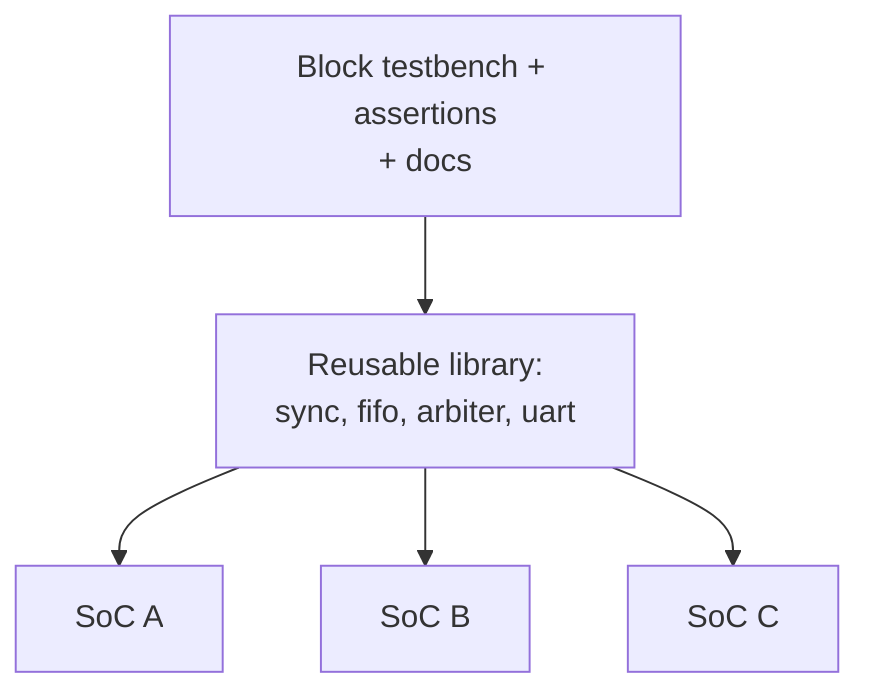

::: testing
Whether you understand RTL as an engineering asset, not just code. The interviewer wants to hear that you know **how** reuse is achieved (parameterization, clean interfaces, libraries, standard protocols, reusable verification) and **why** it matters (schedule, risk, cost, quality). Hidden sub-skills:

1. Knowing the SystemVerilog tools: `parameter`, `generate`, `package`, `interface`, and why `` `define `` macros are a poor substitute.
2. Understanding that reuse has a **cost**: a configurable block is harder to write, document and verify than a one-off.
3. Knowing that "reuse" includes verification components, scripts and constraints, not only RTL.
4. Recognizing soft IP, hard IP and third-party IP as forms of reuse.
:::

::: why
A modern SoC has far more logic than any team could design from scratch: CPU cores, memory controllers, interconnect, USB, PCIe, DMA, timers, UARTs. Teams get there by reusing blocks that have already been verified and, ideally, proven in silicon. Reuse is the difference between "write 2 million lines" and "assemble and integrate". It shortens schedules, cuts verification effort (the dominant cost in chip design), and reduces the chance of new bugs, since a block that has already shipped in a product has been tested far harder than any new one. Interviewers ask this to see whether you think like someone who will work in a large team.
:::

::: concepts
- **Modules and hierarchy**: the unit of reuse is a module with a clean interface. See [[q0960]].
- **Parameters and generate**: compile-time knobs (width, depth, number of ports) that make one source file serve many cases.
- **Packages and interfaces**: shared types, constants and bundled signals, so many modules agree on definitions.
- **Standard protocols**: using a published bus protocol (for example AMBA AXI or APB) lets blocks from different sources connect without custom glue.
- **Soft, firm and hard IP**: RTL source, netlist, or fixed layout: three levels of reuse with different flexibility.
- **Verification reuse**: testbenches, assertions and models that travel with the block. See [[q0959]] for a small example of a block that is exhaustively testable.
:::

::: answer
"RTL reuse means writing a block once, in a way that lets me drop it into many designs without rewriting it. The main tools are parameters and generate statements, so one FIFO or synchronizer serves different widths and depths; packages and interfaces, so types and signal bundles are defined in one place; and standard interface protocols, like AXI or APB, so blocks plug together without glue logic.

It matters for three reasons. First, schedule: I don't want to redesign a UART or a DMA engine for every chip. Second, quality: a block that's already been verified and used in silicon is far less risky than a fresh one, and verification is usually the biggest cost in a chip project. Third, consistency across the team, one clock-domain-crossing cell, one reset synchronizer, one way of doing things.

But reuse isn't free. A reusable block needs a clean port list, parameters that are documented, lint and clock-domain checks passing, and a testbench that covers the configurations people will use. If a block has twenty parameters, you can't verify every combination, so I'd limit the configuration space. And I'd use parameters and generate rather than copy-paste and edit, since copies drift and bugs get fixed in one copy only."
:::

::: technical
**Mechanisms in SystemVerilog.**

- **Parameters**: `module fifo #(parameter int W = 8, parameter int DEPTH = 16)`. Resolved at elaboration; override with `#(.W(32))`. Use `localparam` for derived values such as `AW = $clog2(DEPTH)`.
- **Generate**: `generate if (USE_PARITY) ... endgenerate` and `for (genvar i...)` create or omit hardware structurally depending on parameters.
- **Packages**: `package bus_pkg; typedef struct packed {...} req_t; endpackage` shares types and constants through `import bus_pkg::*;`.
- **Interfaces**: bundle related signals and modports, so a module has one `axi_if.master` port rather than dozens.
- **Avoid**: `` `define `` macros for configuration (global, no scoping, hard to trace) and copy-paste duplication.

**Levels of reuse.**

| Level | What is reused | Flexibility | Typical example |
|---|---|---|---|
| Copy-paste | Source text | High, but copies diverge | Quick prototype |
| Parameterized module | RTL source | Configurable per instance | FIFO, CDC synchronizer |
| Soft IP | RTL plus testbench plus docs | Re-synthesize for any process | CPU core, UART, DMA |
| Firm IP | Netlist | Limited | Pre-optimized block |
| Hard IP | Layout (GDS) for one process | None, fixed to a node | SRAM macros, PLLs, SerDes |

**What makes RTL reusable.** Narrow documented ports; no hierarchical references; no technology-specific constructs; lint-clean; clock-domain crossings explicit; resets defined; parameter ranges asserted (`initial assert (W > 0)`); a self-checking testbench; a README with timing contract and latency.

**Costs and risks.** Each independent boolean parameter doubles the configuration space: $k$ parameters give $2^k$ combinations. Generality can cost area or timing. Integration still needs verification: a verified block can be wired wrongly.

**Verification reuse.** Block-level testbenches, assertions (SVA) and bus functional models travel with the RTL, and the same checkers are reused at subsystem and chip level.
:::

::: short
"RTL reuse is writing a block once, with parameters and clean interfaces, so it can drop into many designs. Tools are parameters, generate statements, packages, interfaces, and standard bus protocols. It matters because it saves schedule and, more importantly, verification effort, and a block already proven in silicon is lower risk. The cost is that a reusable block needs documentation, a limited and well-tested configuration space, and a testbench that travels with it, instead of copy-paste edits that drift apart."
:::

::: long
"RTL reuse means designing a block so it can be used in more than one place or project without rewriting it.

Technically I'd do it in layers. At the module level I'd use parameters for things like data width and FIFO depth, and generate statements to include or remove hardware, for example optional parity. At the project level I'd put shared types and constants in a package, and bundle related signals into an interface so a module has one port for a whole bus. At the system level I'd use standard protocols such as AXI or APB, so blocks from different teams or vendors connect with no custom glue. Beyond RTL, the reusable thing also includes the testbench, assertions, constraints and documentation.

Why it matters: first, time. Nobody writes a UART or DMA engine from scratch for every chip. Second, risk and quality. Verification is the biggest cost in a chip project, and a block that's been verified and has shipped is far safer than something new. Third, consistency: one tested clock-domain-crossing synchronizer used everywhere beats forty hand-rolled variants, each with different bugs.

But it's a trade-off. A configurable block takes longer to write and has to be verified across the configurations that will actually be used. Every independent boolean parameter doubles the configuration space, so ten of them gives over a thousand combinations, and no one verifies that. So I'd restrict parameters to the ones needed, check parameter ranges with assertions, and regress the supported configurations.

I'd also avoid copy-paste reuse. Copies drift: a bug gets fixed in one and not the others. And I'd avoid global `define macros for configuration, because they're not scoped and are hard to trace. If the question is about hardware IP generally, I'd also mention soft IP like RTL cores versus hard IP like a fixed PLL or SRAM layout, which is reused at a different level."
:::

::: terms
- **Reuse**: using an existing, verified design or verification component in a new context instead of recreating it.
- **Parameter**: compile-time constant overridable per instance; the main knob of reusable RTL.
- **Generate block**: compile-time conditional or loop that creates structure based on parameters.
- **Package**: SystemVerilog container for shared types, constants and functions.
- **Interface**: SystemVerilog construct bundling related signals (and modports) into one port.
- **IP (intellectual property) block**: a reusable design block, owned in-house or licensed.
- **Soft / firm / hard IP**: RTL source / netlist / physical layout for one process.
- **Configuration space**: all combinations of parameter values a block supports; must be verified.
- **Verification IP (VIP)**: reusable testbench components such as bus monitors and drivers.
- **Lint / CDC check**: static analysis that catches coding and clock-domain issues before simulation.
:::

::: exceptional
**An average answer** says "reuse saves time because you don't rewrite code" and mentions parameters.

**An exceptional answer**:
- Names the SystemVerilog mechanisms (parameters, generate, packages, interfaces) and why macros and copy-paste are worse.
- Separates **what** is reused: RTL, verification, scripts, constraints, documentation.
- Quantifies the configuration-space cost: $k$ boolean parameters gives $2^k$ configurations.
- Distinguishes soft, firm and hard IP and says what each costs in flexibility.
- Gives the real reason it matters: verification effort and silicon-proven risk reduction, not just typing time.
- Notes that reuse pays only above a break-even number of uses, because making a block generic costs more up front.
:::

::: mistakes
- **Copy-paste and edit.** Copies diverge, and a bug fixed in one is still present in the others. Use a parameter or generate instead.
- **Over-parameterizing.** Twenty knobs means an unverifiable configuration space and unreadable code. Expose only what users need.
- **Using `` `define `` for configuration.** Macros are global and unscoped; use `parameter` and `localparam` so every instance can differ.
- **Forgetting reuse includes verification.** A block without its testbench, assertions and documentation is not really reusable.
- **Hard-coding technology or hierarchy.** Vendor primitives or cross-module hierarchical references break portability. Wrap technology cells in a thin module.
- **Assuming a verified block is a verified system.** Reused blocks still need integration checks: reset, clocks, address maps and protocol compliance.
:::

::: deep
## Why reuse exists: the economics

Designing and verifying a block costs engineers' time. For anything with state or a protocol, verification effort is often comparable to or larger than design effort. If a block will be used once, you write exactly what is needed. If it will be used again, a more general version costs more up front but each later use is mostly integration work.

A toy cost model (illustrative numbers, not industry statistics): writing and verifying a single-use block costs 6 engineer-weeks. Making it reusable costs 50% more (9 weeks) because of parameters, documentation and a wider regression. Each later integration costs 1 week.

- Rewriting each time: $\text{cost}(n) = 6n$
- Reusable: $\text{cost}(n) = 9 + (n-1)\times1 = 8 + n$

```plot
{"title":"Cumulative effort: rewrite every time vs build once reusable (illustrative)","x":{"label":"Number of projects using the block","min":1,"max":8},"y":{"label":"Engineer-weeks","min":0,"max":50},
 "vars":{"w":6,"gen":9,"integ":1},
 "series":[{"label":"rewrite each time","fn":"w*x","color":"red"},{"label":"reusable block","fn":"gen+(x-1)*integ","color":"accent"}],
 "points":[{"x":1.6,"y":9.6,"label":"break-even near 1.6 uses"}],
 "vlines":[{"at":2,"label":"second use already pays","color":"muted"}]}
```
Figure: With these assumed numbers the reusable block overtakes rewriting at about 1.6 uses, so from the second use on it wins. At 8 uses it is 16 weeks against 48. The point of the model is the shape (a high fixed cost and a low marginal cost), not the exact numbers; real figures depend on the block.

## Mechanism 1: parameters and generate

A parameter changes *sizes*, a generate block changes *structure*. A reusable two-flop synchronizer (for single-bit signals crossing clock domains, [[q0887]]) is a typical first example:

```verilog
module sync #(
  parameter int W      = 1,
  parameter int STAGES = 2
) (
  input  logic         clk,
  input  logic [W-1:0] d,
  output logic [W-1:0] q
);
  logic [W-1:0] pipe [STAGES];
  always_ff @(posedge clk) begin
    pipe[0] <= d;
    for (int i = 1; i < STAGES; i++) pipe[i] <= pipe[i-1];
  end
  assign q = pipe[STAGES-1];
endmodule
```

Instantiate with `sync #(.W(1)) u_en_sync (...)` for a single enable or with `.STAGES(3)` for a high-frequency domain that needs extra settling time. One source, many uses, one place to fix a bug.

> [!WARNING]
> This module is reusable for *single-bit* or Gray-coded signals. Using it with `W > 1` on an arbitrary multi-bit bus is a classic bug, because bits can be captured on different edges. A reusable block's documentation must say what it is safe for.

Generate lets a parameter add or remove hardware:

```verilog
generate
  if (PARITY_EN) begin : g_par
    assign parity = ^data;
  end else begin : g_nopar
    assign parity = 1'b0;
  end
endgenerate
```

**Derived parameters** keep users from making inconsistent choices: `localparam int AW = $clog2(DEPTH);` means the address width can never disagree with the depth. A 16-deep, 32-bit FIFO stores $16\times32=512$ bits and uses a 4-bit pointer; the same module at depth 64 uses $\log_2 64 = 6$ bits with no code change.

## Mechanism 2: packages and interfaces

Packages hold shared definitions so every module agrees on them:

```verilog
package bus_pkg;
  localparam int ADDR_W = 32;
  typedef enum logic [1:0] {IDLE, READ, WRITE} op_e;
  typedef struct packed { logic [ADDR_W-1:0] addr; op_e op; } req_t;
endpackage
```

An `interface` bundles signals so a block that speaks a bus has one port. Both reduce the connection errors discussed in [[q0960]] and make protocol changes a one-file edit.

## Mechanism 3: standard protocols

If every team invents its own handshake, blocks cannot be reused without glue. Adopting a standard on-chip bus such as Arm's AMBA APB/AXI (an openly documented family of protocols) or a simple valid/ready handshake means a DMA from one project can talk to a memory controller from another. This is also why interviewers like questions about arbiters and handshakes: those are the pieces of "glue" that standards remove ([[q0958]]).


Figure: One library of verified blocks feeds several chips, and the verification collateral travels with it. A fix to the library reaches every chip that imports it, which is the upside; a bug also reaches every chip, so the block must be verified across all configurations in use.

## The configuration-space trap

Parameters are cheap to add and expensive to verify. If a block has $k$ independent boolean options, it has $2^k$ configurations:

| Boolean options | Configurations |
|---|---|
| 4 | 16 |
| 8 | 256 |
| 10 | 1,024 |
| 16 | 65,536 |

No team runs a full regression on 65,536 variants. Practical answers: restrict to the combinations people actually need, constrain with assertions so illegal ones fail at elaboration, and regress a chosen set of corner configurations (minimum size, maximum size, every option on, every option off) plus the configurations used by real products.

## Reuse beyond RTL

- **Verification**: a UVM agent or bus monitor written for one block becomes a reusable verification IP, and assertions bound to the interface check every instance.
- **Scripts and constraints**: synthesis and timing constraint templates (clocks, false paths) get reused with each instance.
- **Documentation**: a register map, latency and throughput numbers, reset behavior and a "known limitations" list. Without it nobody dares to reuse.
- **Physical reuse**: hard macros (an SRAM, a PLL) are reused as GDS for a given process; a CPU core that is hardened once can be tiled across a chip.

## When not to reuse

Reuse is a tool, not a religion. A tiny glue block that exists only to adapt two interfaces in one chip is cheaper to write than to generalize. A timing-critical datapath may need hand tuning that a generic version cannot express. And legacy code with unknown quality is sometimes more costly to fix than to rewrite. The question to ask is how many times it will be used and how risky it is to change.

> [!INTERVIEW]
> A one-line closing that lands well: "Reuse only pays if the block is trustworthy, so what I'm really building is a verified, documented interface, not just a file of code."
:::

::: applications
- **Clock-domain crossing cells**: one verified synchronizer or async FIFO module used at every crossing in an SoC.
- **Peripheral IP**: UART, SPI, I2C and timer blocks reused across a family of microcontrollers.
- **Licensed processor cores**: soft or hard IP cores integrated by many companies, with the bus protocol as the integration contract.
- **Hard macros**: SRAM compilers, PLLs and SerDes blocks delivered as layout for a specific process node.
- **FPGA IP catalogs**: vendor-supplied FIFO, DDR controller and PCIe blocks instantiated from a library with parameters.
- **Verification components**: bus monitors and protocol checkers reused from block level up to full-chip simulation.
:::

::: assumptions
- **Soft-IP perspective.** This answer centers on reusable RTL source. Hard IP trades all flexibility for guaranteed physical behavior at one process node.
- **Team context.** In a one-person project or an FPGA prototype, the cost of generalization may outweigh the benefit.
- **Configuration space is manageable.** If a block truly needs many options, a generator or code-generation approach (scripts producing the RTL) may be more maintainable than parameters.
- **Illustrative economics.** The break-even calculation uses made-up effort numbers; real ratios vary with block complexity and team process.
- **Licensing and ownership** matter for third-party IP but are outside the technical answer.

> [!UNCERTAIN]
> Published estimates of how much of a modern SoC is reused IP vary widely between sources and over time. I have deliberately given no percentage here; if you quote one in an interview, say it is approximate and where it came from.
:::

::: followups
### Why use parameters instead of copy-pasting a module and editing the width?
Copies diverge: a bug fixed in one is still present in the others, and nobody knows which is canonical. With a parameter there is one source of truth, so a fix and its regression benefit all users. It also documents intent: `W` is visibly the data width.

### What is wrong with using `` `define `` macros for configuration?
Macros are global text substitutions with no scope: every instance sees the same value, so two instances cannot be configured differently. They are also hard to trace in debug and easy to redefine by accident. Parameters are scoped per instance and type-checked.

### How do you verify a block with many parameters?
Restrict the supported configuration space, put assertions on illegal combinations, and regress a deliberate set: minimum, maximum, all-on, all-off and the configurations real products use. Randomize parameters in the testbench where possible and track coverage per configuration. Ten boolean options give 1,024 combinations, so exhaustive regression is not realistic.

### What is the difference between soft IP and hard IP?
Soft IP is RTL (or a netlist) you synthesize for your own process and constraints, so it is flexible but timing and area are your responsibility. Hard IP is a finished layout for one process node, such as an SRAM macro or PLL: guaranteed performance, no flexibility. Analog and high-speed blocks are usually hard IP.

### You inherit a "reusable" module with 40 parameters and no testbench. What do you do?
Do not integrate it blind. Find which parameter combinations the existing users actually use, build a regression around those, add assertions rejecting illegal combinations, and write down the contract (latency, reset, clock domains). If the configuration space is far wider than the use cases, consider fixing the parameters you need and wrapping the module. Treat it as unverified until it passes your tests.

### When is it better not to reuse a block?
If the block will be used once, if it sits on a critical timing path that needs tailoring, if the existing code is poor quality and cheaper to rewrite than to fix, or if generalizing it adds complexity that hurts readability. Reuse pays above a break-even number of uses, and risk drives the decision as much as effort.
:::

::: interpretations
"How is RTL reused?" can mean the **mechanisms** (parameters, generate, packages, IP libraries) or the **process** (libraries, version control, verification collateral, standards). A complete answer covers both, then answers "why" with schedule, quality and risk. Related questions [[q0960]] (what a module is) and [[q0956]] (your RTL experience) are natural lead-ins: if you have used a library module, that is a good example.
:::

::: references
- Harris & Harris, *Digital Design and Computer Architecture*: hardware description languages and parameterized modules.
- Sutherland, Davidmann & Flake, *SystemVerilog for Design*: parameters, generate, packages and interfaces.
- IEEE 1800, *SystemVerilog Language Reference Manual*: parameters, generate constructs, packages, interfaces.
- Bergeron, *Writing Testbenches Using SystemVerilog*: structuring reusable verification components.
- Arm, *AMBA* specifications (APB, AXI): examples of a published, vendor-neutral interface standard used to connect reusable blocks.
:::

::: rubric
- Names concrete mechanisms: parameters, generate, packages, interfaces :: Shows you know how reuse is actually implemented in SystemVerilog.
- Explains why copy-paste and global macros are poor reuse :: Demonstrates understanding of maintenance and scoping problems.
- Mentions standard protocols as the glue that makes reuse across teams possible :: Reuse at system level depends on agreed interfaces.
- States the benefits as schedule, verification effort and silicon-proven risk reduction :: Connects the technique to why companies care.
- Covers verification reuse (testbench, assertions, docs) and not only RTL :: A block without verification collateral is not safely reusable.
- Raises the costs: configuration-space explosion, up-front effort, break-even :: Shows engineering judgment rather than slogans.
- Distinguishes soft, firm and hard IP :: Shows awareness of how the industry reuses designs across levels.
:::

::: quiz
```json
[
 {"type":"mcq","level":"fundamental","q":"Which SystemVerilog feature lets one FIFO module be instantiated at 8-bit and 32-bit widths in the same design?","options":["`define macros","Parameters overridden per instance","Hierarchical references","Copy-paste of the module with a new name"],"answer":1,"explain":"Parameters are scoped per instance, so each instantiation can set its own width. A `define is global (one value for all instances), and copy-paste creates diverging copies."},
 {"type":"truefalse","level":"fundamental","q":"RTL reuse only means reusing the Verilog source file.","answer":false,"explain":"Reusable IP also includes the testbench, assertions, constraints, and documentation. Without verification collateral and a documented contract, the source alone is risky to reuse."},
 {"type":"numeric","level":"intermediate","q":"A block has 10 independent boolean parameters. How many configurations exist in total?","answer":1024,"tolerance":0.001,"unit":"configurations","explain":"$2^{10} = 1024$. This is why configurable IP restricts its parameter space and regresses selected corner configurations instead of all of them."},
 {"type":"numeric","level":"intermediate","q":"Using the page's model, writing a one-off block costs 6 weeks per project, while a reusable version costs 9 weeks first and 1 week per later integration. How many engineer-weeks does the reusable approach save over 5 projects versus rewriting each time?","answer":17,"tolerance":0.001,"unit":"weeks","explain":"Rewrite: $6\\times5 = 30$. Reusable: $9 + 4\\times1 = 13$. Savings: $30-13 = 17$ weeks. These are illustrative numbers."},
 {"type":"mcq","level":"intermediate","q":"Which statement about a 2-flop synchronizer module with parameter W > 1 is correct?","options":["It is safe for any multi-bit bus because each bit is synchronized","It is only safe for single-bit or Gray-coded signals, because bits can be captured on different clock edges","It removes the need for any timing constraints","It works only at W = 2"],"answer":1,"explain":"Each bit has its own metastability resolution, so on a binary multi-bit bus different bits can settle in different cycles and produce an invalid intermediate value. Use Gray coding, a handshake, or an async FIFO."},
 {"type":"multi","level":"advanced","q":"Select all practices that improve the reusability of a block.","options":["Documented ports and parameter ranges, with assertions on illegal values","Hierarchical references into sibling modules for convenience","Shipping a self-checking testbench with the RTL","Wrapping technology-specific cells in a thin module"],"answer":[0,2,3],"explain":"Documentation with assertions, a bundled testbench and isolating technology cells all improve portability and trust. Hierarchical references create hidden dependencies and break when the surrounding design changes."}
]
```
:::
